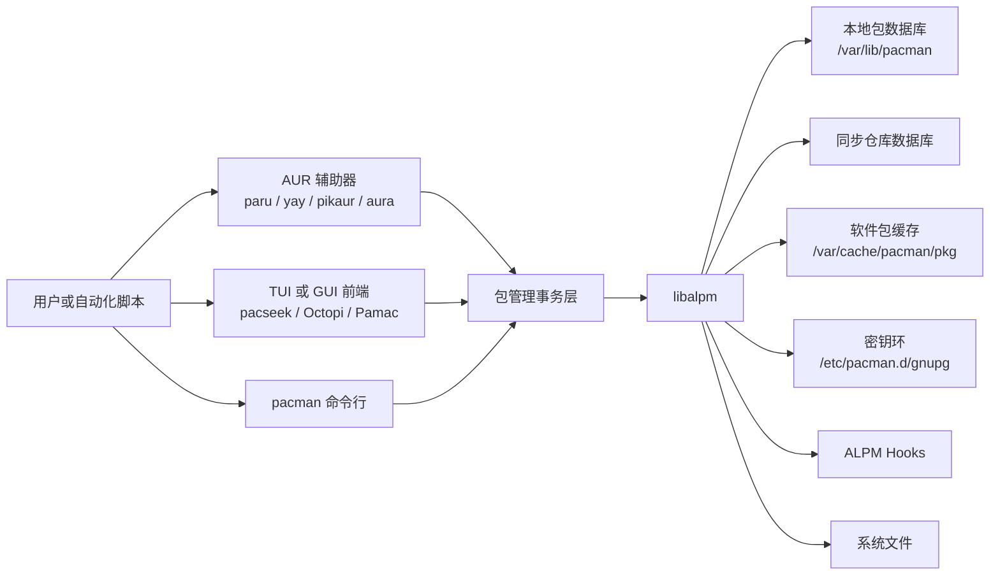
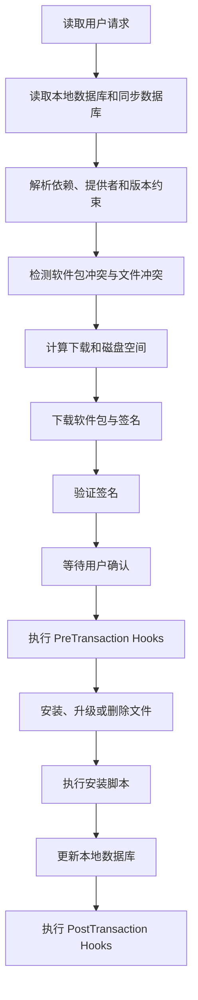
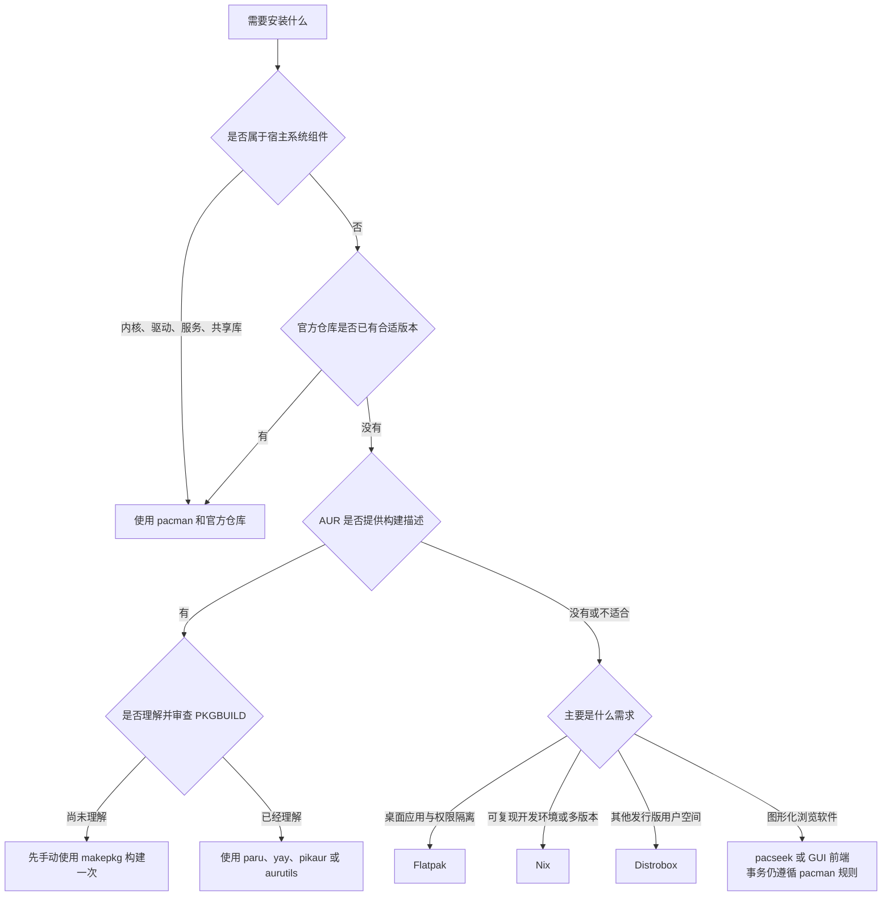

[toc]


下面按“先建立心智模型，再掌握规则与命令，最后比较现代工具”的路径组织。内容基于截至 **2026 年 7 月**的 Arch Linux、pacman 及相关项目文档。

## pacman 包管理器及其现代化替代品

> 适用对象：Arch Linux、接近原生 Arch 的发行版用户，以及希望理解 AUR、滚动更新和现代 Linux 软件分发方式的新手。
> 内容范围：重点讨论原生 Arch Linux。Manjaro、CachyOS、EndeavourOS、SteamOS 等系统可能拥有不同的软件仓库、更新节奏或管理策略，不能机械照搬全部操作。

## 结论先行

`pacman` 仍然是 Arch Linux 的官方系统包管理器（Package Manager），也是管理核心系统、内核、驱动、共享库和官方仓库软件包的基础工具。它不是“已经过时、应当被替换”的旧组件；现代工具通常是在它之上提供 AUR 支持、更友好的搜索界面、构建自动化、快照或跨发行版环境，而不是完全接管底层系统包事务。`pacman` 本身是 `libalpm`（Arch Linux Package Management Library）的命令行前端，因此其他前端可以复用相同的底层能力。([pacman.archlinux.page](https://pacman.archlinux.page/pacman.8.html))

对多数新手，推荐的软件管理组合是：

- 使用 `pacman` 管理官方仓库、系统组件、驱动和共享库。
- 至少手动构建一次 AUR 软件包，理解 `PKGBUILD` 与 `makepkg`。
- 熟悉手动过程后，再选择 `paru` 或 `yay` 简化日常 AUR 操作。
- 使用 Flatpak 安装适合沙箱化的桌面应用。
- 使用 Nix 管理需要可复现、多版本并存的开发环境。
- 使用 Distrobox 获取其他发行版的用户空间，而不是污染宿主系统。
- 不把图形软件中心当作系统维护规则的替代品。

## 编排思路与学习目标

学习 `pacman` 时，最容易犯的错误是只背命令，不理解仓库数据库、系统状态和事务之间的关系。因此，本教程按以下思路展开：

- 先理解 `pacman` 在 Arch 软件生态中的位置。
- 区分本地数据库、同步数据库、软件包文件和 AUR 构建描述。
- 掌握完整系统升级（Full System Upgrade）原则。
- 理解安装、删除、升级为什么必须作为事务（Transaction）执行。
- 学会查询“包、文件、依赖关系、安装原因和来源”。
- 掌握签名验证、缓存、`.pacnew`、日志和 Hooks。
- 理解 AUR 辅助器的便利性与信任边界。
- 根据实际场景选择 `paru`、`yay`、`aura`、`aurutils`、Flatpak、Nix 或 Distrobox。
- 建立可恢复、可审计、少依赖运气的维护流程。

## 详细大纲

### 基础认知

- `pacman`、`libalpm` 与 Arch Linux 的关系
- 软件包、仓库和数据库
- 本地包数据库与同步包数据库
- 二进制包与源代码构建
- 显式安装、依赖安装与孤儿包
- 官方仓库、自建仓库与 AUR
- 包签名、源码校验与信任边界

### 核心操作模型

- `pacman <操作> [选项] [目标]`
- 查询、同步、删除、安装本地包
- 软件包事务与依赖解析
- 完整系统升级
- 不受支持的部分升级
- 软件包组、虚拟依赖与提供者

### 日常管理

- 搜索和查看软件包
- 安装与升级
- 删除软件包
- 查询文件归属
- 查看依赖树
- 查找孤儿包
- 管理安装原因
- 查询非官方软件包

### 配置与维护

- `/etc/pacman.conf`
- 镜像列表
- 并行下载
- 签名验证
- 软件包缓存
- `pacman-contrib`
- `.pacnew` 与 `.pacsave`
- ALPM Hooks
- 日志与故障排查

### AUR 与构建系统

- AUR 的真实含义
- `PKGBUILD`
- `.SRCINFO`
- `makepkg`
- 手动构建流程
- 构建安全检查
- AUR 包更新与重建

### 现代化工具

- `paru`
- `yay`
- `pikaur`
- `aura`
- `aurutils`
- `pacseek`
- Octopi、Pamac 等图形前端
- Flatpak
- Nix
- Distrobox

### 最佳实践

- 更新前阅读公告
- 避免部分升级
- 避免危险参数
- 控制 AUR 软件数量
- 及时合并配置文件
- 保留有限版本缓存
- 准备可恢复方案
- 定期审计软件来源

## pacman 在 Arch 软件生态中的位置

从用户视角看，`pacman` 是一个命令；从系统设计视角看，它是多个组件之间的协调者。



`pacman` 会跟踪已经安装的软件包，解析依赖与冲突，从远程仓库同步数据库和软件包，并把一组变更作为事务应用到系统。软件包通常是压缩的 tar 归档，包内除了程序文件，还包含版本、依赖、冲突、安装脚本和文件备份规则等元数据。([pacman.archlinux.page](https://pacman.archlinux.page/pacman.8.html))

### 为什么需要 libalpm

`libalpm` 是底层包管理库。它负责：

- 读取本地与同步数据库。
- 解析依赖关系。
- 检查冲突。
- 比较版本。
- 验证软件包签名。
- 下载和缓存软件包。
- 执行安装、升级与删除事务。
- 调用安装脚本和 ALPM Hooks。

因此，AUR 辅助器或图形前端即使看起来“取代了 pacman”，最终仍然需要与 pacman、libalpm 或兼容的事务接口协作。

## 核心术语

| 术语       | 英文                    | 含义                                                         |
| ---------- | ----------------------- | ------------------------------------------------------------ |
| 软件包     | Package                 | 程序文件、元数据、依赖声明和安装规则组成的归档               |
| 软件仓库   | Repository              | 存放软件包及其数据库的服务器或本地目录                       |
| 本地数据库 | Local Database          | 记录当前系统已经安装的软件包，通常位于 `/var/lib/pacman/local` |
| 同步数据库 | Sync Database           | 远程仓库软件包信息在本机的副本                               |
| 事务       | Transaction             | 一次完整的安装、升级或删除操作集合                           |
| 依赖       | Dependency              | 软件正常构建或运行所需要的其他软件包                         |
| 可选依赖   | Optional Dependency     | 启用附加功能时才需要的依赖                                   |
| 冲突       | Conflict                | 不能同时安装的软件包或文件                                   |
| 提供者     | Provider                | 通过 `provides` 满足某个虚拟依赖的软件包                     |
| 软件包组   | Package Group           | 便于批量选择的一组相关软件包                                 |
| 显式安装   | Explicitly Installed    | 用户主动要求安装的软件包                                     |
| 依赖安装   | Installed as Dependency | 因其他软件包需要而自动安装的软件包                           |
| 孤儿包     | Orphan Package          | 作为依赖安装，但当前不再被需要的软件包                       |
| 外来包     | Foreign Package         | 不存在于当前同步仓库中的已安装软件包                         |
| AUR        | Arch User Repository    | 由用户维护的构建描述仓库，不是官方二进制仓库                 |
| 构建描述   | PKGBUILD                | 描述源码获取、校验、编译和打包方式的 Bash 文件               |
| 分包       | Split Package           | 一个 `PKGBUILD` 生成多个二进制软件包                         |
| 密钥环     | Keyring                 | 保存受信任打包者公钥及其信任关系的数据                       |
| 部分升级   | Partial Upgrade         | 仓库数据库与系统已安装软件包处于不一致时间点的状态           |

## 软件来源与信任边界

| 来源         | 获得的内容               | 典型工具              | 是否由 Arch 官方构建 | 主要风险                       |
| ------------ | ------------------------ | --------------------- | -------------------- | ------------------------------ |
| 官方仓库     | 已构建二进制包           | `pacman -S`           | 是                   | 滚动更新中的兼容性变化         |
| 自建仓库     | 自己或组织构建的二进制包 | `pacman -S`           | 否                   | 构建流程、签名和仓库维护质量   |
| 本地包文件   | `.pkg.tar.zst` 等包文件  | `pacman -U`           | 不一定               | 来源、签名和版本兼容性         |
| AUR          | `PKGBUILD` 及辅助文件    | `makepkg`、AUR 辅助器 | 否                   | 恶意或过时构建脚本、源码供应链 |
| Flatpak 仓库 | 应用与运行时             | `flatpak`             | 否                   | 应用发布者、权限和仓库信任     |
| Nix 仓库     | Nix 包和闭包             | `nix`                 | 否                   | 与宿主系统的双重管理复杂度     |
| 容器镜像     | 另一发行版的用户空间     | Distrobox             | 否                   | 镜像来源及与宿主机的紧密集成   |

关键原则是：**安装方式越自动化，越不能把自动化误认为安全审查。**

AUR 中保存的主要是构建文件，而不是经过 Arch 官方审核和签名的二进制软件包。官方建议用户在构建前检查 `PKGBUILD` 和相关文件，再通过 `makepkg` 构建，最后由 `pacman -U` 安装生成的软件包。([wiki.archlinux.org](https://wiki.archlinux.org/title/Arch_User_Repository?utm_source=chatgpt.com))

## pacman 的命令结构

基本语法是：

```text
pacman <operation> [options] [targets]
```

操作（Operation）决定“要对哪类数据库或对象做什么”，选项（Option）进一步限定行为，目标（Target）通常是软件包名、文件名、URL 或搜索表达式。([pacman.archlinux.page](https://pacman.archlinux.page/pacman.8.html))

| 操作 | 长选项       | 主要用途                       | 常见示例                              |
| ---- | ------------ | ------------------------------ | ------------------------------------- |
| `-S` | `--sync`     | 查询同步仓库、安装包、升级系统 | `sudo pacman -Syu`                    |
| `-Q` | `--query`    | 查询本地已安装软件包           | `pacman -Qi bash`                     |
| `-R` | `--remove`   | 删除软件包                     | `sudo pacman -Rns package`            |
| `-U` | `--upgrade`  | 安装本地包文件或指定 URL       | `sudo pacman -U file.pkg.tar.zst`     |
| `-F` | `--files`    | 查询仓库文件数据库             | `pacman -F libexample.so`             |
| `-D` | `--database` | 检查或修改安装数据库属性       | `sudo pacman -D --asexplicit package` |
| `-T` | `--deptest`  | 检查依赖是否满足               | `pacman -T 'bash>=5'`                 |

### 为什么参数看起来像字母组合

`pacman -Syu` 可以拆成：

- `-S`：使用同步仓库操作。
- `-y`：刷新仓库数据库。
- `-u`：升级所有过期软件包。

因此，它不是一个不可分割的“神秘命令”，而是“刷新数据库并执行完整升级”。

同理：

- `-Qdt`：查询本地包、只看依赖安装的软件包、再筛选不再需要的软件包。
- `-Rns`：删除目标、删除其备份配置，并递归删除不再需要的依赖。
- `-Qm`：查询不存在于当前同步仓库中的外来包。

## 软件包事务原理

安装软件包并不只是解压文件。pacman 会先构建一个事务计划：



事务设计有两个重要意义：

- 在实际修改系统前，尽可能发现依赖和冲突。
- 把相关软件包作为一个整体升级，避免共享库与程序处于不兼容状态。

`--noconfirm`、`--nodeps`、`--dbonly`、`--overwrite` 等选项会绕过部分保护机制。pacman 手册明确提醒，`--noconfirm` 主要适合经过严格设计的脚本；跳过依赖检查或文件冲突检查可能破坏系统。([pacman.archlinux.page](https://pacman.archlinux.page/pacman.8.html))

## 日常命令速查

修改系统状态的命令通常需要 `sudo`。单纯查询一般不需要。

### 搜索与查看

| 目标             | 命令                       | 说明                         |
| ---------------- | -------------------------- | ---------------------------- |
| 搜索官方仓库     | `pacman -Ss keyword`       | 同时匹配包名和描述           |
| 查看仓库包详情   | `pacman -Si package`       | 查看版本、依赖、大小、仓库等 |
| 搜索已安装软件包 | `pacman -Qs keyword`       | 搜索本地数据库               |
| 查看已安装包详情 | `pacman -Qi package`       | 查看安装原因、安装时间等     |
| 查看包内文件     | `pacman -Ql package`       | 列出已安装包拥有的文件       |
| 查询本地文件归属 | `pacman -Qo /path/to/file` | 查找哪个已安装包拥有该文件   |
| 查询仓库中的文件 | `pacman -F filename`       | 查找尚未安装的软件包文件     |
| 更新文件数据库   | `sudo pacman -Fy`          | 只更新用于 `-F` 的文件数据库 |
| 查看软件包组     | `pacman -Sg group`         | 查看指定组成员               |
| 查看外来包       | `pacman -Qm`               | 常用于审计 AUR 和本地安装包  |
| 查看显式安装包   | `pacman -Qe`               | 用户明确要求保留的软件包     |
| 查看孤儿候选     | `pacman -Qdt`              | 不应直接无脑批量删除         |

`-Q` 查询本地数据库，`-S` 查询同步数据库，`-F` 查询仓库文件数据库，这是理解 pacman 查询行为最重要的区分。([pacman.archlinux.page](https://pacman.archlinux.page/pacman.8.html))

### 安装与升级

| 目标               | 命令                              | 建议                         |
| ------------------ | --------------------------------- | ---------------------------- |
| 完整系统升级       | `sudo pacman -Syu`                | Arch 的标准更新方式          |
| 更新系统并安装软件 | `sudo pacman -Syu package`        | 系统较久未更新时优先使用     |
| 安装软件           | `sudo pacman -S package`          | 数据库与系统状态已同步时使用 |
| 避免重复安装       | `sudo pacman -S --needed package` | 适合脚本和初始化清单         |
| 安装本地包文件     | `sudo pacman -U file.pkg.tar.zst` | 仍会从仓库解析缺失依赖       |
| 只下载不安装       | `sudo pacman -Sw package`         | 用于预下载                   |
| 重新安装包         | `sudo pacman -S package`          | 可用于恢复属于该包的文件     |

### 删除与清理

| 目标             | 命令                           | 说明                       |
| ---------------- | ------------------------------ | -------------------------- |
| 仅删除目标包     | `sudo pacman -R package`       | 可能留下不再需要的依赖     |
| 删除包及无用依赖 | `sudo pacman -Rs package`      | 常用删除方式               |
| 同时删除备份配置 | `sudo pacman -Rns package`     | 不保留包管理器标记的配置   |
| 列出孤儿候选     | `pacman -Qdt`                  | 先检查，再决定是否删除     |
| 查看缓存占用     | `du -sh /var/cache/pacman/pkg` | 仅查看磁盘占用             |
| 清理旧缓存       | `sudo paccache -r`             | 默认保留每个包最近三个版本 |

`pacman -Rdd` 会跳过依赖检查，可能留下缺少运行库的软件。除非正在按照明确的修复方案操作，否则不要使用。

### 检查与审计

| 目标               | 命令                       | 说明                                   |
| ------------------ | -------------------------- | -------------------------------------- |
| 检查包文件是否缺失 | `pacman -Qk package`       | 两个 `k` 会进行更详细检查              |
| 检查包数据库       | `sudo pacman -Dk`          | 检查数据库内部一致性                   |
| 查看正向依赖树     | `pactree package`          | 来自 `pacman-contrib`                  |
| 查看反向依赖树     | `pactree -r package`       | 查看哪些包依赖目标                     |
| 查看待更新软件包   | `checkupdates`             | 使用独立临时数据库，不制造部分升级状态 |
| 查看 pacman 日志   | `less /var/log/pacman.log` | 排查安装、升级与删除历史               |

`checkupdates` 使用独立数据库检查待更新项目，不直接刷新系统正在使用的同步数据库；`pactree` 用于展示依赖树。([man.archlinux.org](https://man.archlinux.org/man/checkupdates.8.en))

## Arch 最重要的规则：只支持完整系统升级

Arch Linux 是滚动发行版（Rolling Release）。官方仓库中的软件包是按照某个整体状态发布的，而不是承诺任意时间点的软件包都可以自由混合。

### 安全的典型流程

```bash
sudo pacman -Syu
```

系统很久没有更新，同时需要安装新软件时：

```bash
sudo pacman -Syu package-name
```

也可以分为两个连续步骤：

```bash
sudo pacman -Syu
sudo pacman -S package-name
```

### 应避免的流程

```bash
sudo pacman -Sy package-name
```

这里的 `-Sy` 更新了仓库数据库，却没有升级已经安装的软件包。新安装的软件可能依赖仓库中的新版共享库，而系统仍保留旧版本，从而造成 ABI（Application Binary Interface，应用二进制接口）或依赖不匹配。

Arch 明确不支持部分升级，并建议不要单独运行 `pacman -Sy`；刷新数据库后，应完成对应的系统升级。([wiki.archlinux.org](https://wiki.archlinux.org/title/System_maintenance?utm_source=chatgpt.com))

### `-Syyu` 不是“更彻底的日常升级”

```bash
sudo pacman -Syyu
```

两个 `y` 会强制重新下载所有仓库数据库，即使本地数据库看起来仍然有效。它主要用于数据库损坏、仓库切换或明确的镜像故障排查，不会让普通更新“更干净”或“更安全”。日常更新使用单个 `y` 即可。([pacman.archlinux.page](https://pacman.archlinux.page/pacman.8.html))

### 长期忽略软件包也可能形成部分升级

在 `/etc/pacman.conf` 中长期设置：

```ini
IgnorePkg = package-name
```

可能使该软件包与系统其他组件逐渐失去兼容性。临时忽略某个已知有问题的软件包可以作为应急措施，但不应变成永久维护策略。`IgnorePkg` 和 `IgnoreGroup` 会在系统升级时跳过对应项目。([archlinux.org](https://archlinux.org/pacman/pacman.conf.5.html))

## 理解显式安装与依赖安装

pacman 不只记录“这个包是否安装”，还记录安装原因（Install Reason）。

例如：

- 用户执行 `pacman -S firefox`，`firefox` 被标记为显式安装。
- Firefox 需要的某个库自动安装，该库被标记为依赖安装。
- 删除 Firefox 后，如果该库不再被任何包需要，它可能成为孤儿包。

查询：

```bash
pacman -Qe
pacman -Qd
pacman -Qdt
```

修改安装原因：

```bash
sudo pacman -D --asexplicit package-name
sudo pacman -D --asdeps package-name
```

这比粗暴删除软件包更重要：很多“系统清理工具”只是寻找孤儿包，却无法判断用户是否仍然直接使用其中某个程序。

### 安全处理孤儿包

先查看详细列表：

```bash
pacman -Qdt
```

确认每个包确实无用后，再删除选中的包：

```bash
sudo pacman -Rns package-a package-b
```

不建议把查询和删除无条件拼成自动命令，因为某些构建依赖、插件、手动工作流或暂时没有父包的工具，仍可能有保留价值。

## `/etc/pacman.conf` 配置

`/etc/pacman.conf` 分为全局 `[options]` 和各个仓库段。仓库顺序具有优先级：当多个仓库存在同名软件包时，配置中更靠前的仓库优先。配置项区分大小写，并使用 CamelCase。([archlinux.org](https://archlinux.org/pacman/pacman.conf.5.html))

### 适合新手的基础配置

```ini
[options]
Color
CheckSpace
VerbosePkgLists
ParallelDownloads = 5
```

作用如下：

| 配置                | 作用                       |
| ------------------- | -------------------------- |
| `Color`             | 终端支持时启用彩色输出     |
| `CheckSpace`        | 安装前估算可用磁盘空间     |
| `VerbosePkgLists`   | 用表格显示包名、版本和大小 |
| `ParallelDownloads` | 设置并发下载数量           |

`ParallelDownloads` 必须是正整数；数值并非越大越好，过高可能增加镜像服务器压力或导致不稳定。([archlinux.org](https://archlinux.org/pacman/pacman.conf.5.html))

### 不应为了“解决签名错误”关闭签名验证

不要设置：

```ini
SigLevel = Never
```

pacman 的内置默认策略要求签名并只接受受信任密钥，即：

```ini
SigLevel = Required TrustedOnly
```

关闭签名验证会移除重要的供应链保护。签名错误通常应该从系统时间、镜像同步状态、密钥环和软件包来源入手排查。([archlinux.org](https://archlinux.org/pacman/pacman.conf.5.html))

### 下载沙箱

现代 pacman 能对下载进程应用文件系统和系统调用限制，并提供相应的故障排除选项。不要为了方便长期启用 `DisableSandbox`；只有确认内核、Landlock、seccomp 或特殊运行环境导致兼容性问题时，才应临时禁用相关限制。([pacman.archlinux.page](https://pacman.archlinux.page/pacman.8.html))

## 镜像管理

镜像（Mirror）保存官方仓库数据库和软件包。镜像选择不当可能表现为：

- 下载速度慢。
- 数据库与软件包不同步。
- 部分文件出现 404。
- 某些镜像长时间未同步。

`/etc/pacman.d/mirrorlist` 中越靠前的镜像优先级越高。

Reflector 可以从 Arch 的镜像状态数据获取候选镜像，根据同步新鲜度、协议和速度筛选，然后生成新的镜像列表。([wiki.archlinux.org](https://wiki.archlinux.org/title/Mirrors?utm_source=chatgpt.com))

最佳实践：

- 优先选择地理位置合理、同步及时的 HTTPS 镜像。
- 不要只按一次测速结果选择唯一镜像。
- 保留多个候选镜像。
- 修改镜像列表后执行一次正常完整升级。
- 不要在更新进行到一半时频繁切换镜像。
- 自动更新 mirrorlist 前备份原文件。

## 软件包签名与密钥环

pacman 使用 GnuPG 密钥环验证官方软件包和数据库签名，默认目录是：

```text
/etc/pacman.d/gnupg
```

签名验证主要回答两个问题：

- 软件包是否由密钥持有者签名。
- 该密钥是否属于系统信任的打包者。

它不能回答：

- 上游源代码本身是否安全。
- 软件是否存在逻辑漏洞。
- AUR 中的 `PKGBUILD` 是否安全。
- 打包者账号或构建系统是否从未受攻击。

### 密钥环过旧时

长时间未更新的系统可能先遇到新的打包密钥。Arch 文档给出的特殊处理流程是先同步数据库并升级 `archlinux-keyring`，随后立即完成系统升级：

```bash
sudo pacman -Sy archlinux-keyring
sudo pacman -Su
```

这个流程是针对密钥环更新的明确例外；两个命令必须连续完成，不能只执行第一条后继续日常使用。([wiki.archlinux.org](https://wiki.archlinux.org/title/Pacman/Package_signing?utm_source=chatgpt.com))

不应采用的“修复方式”包括：

- 关闭 `SigLevel`。
- 使用 `--noconfirm` 跳过异常。
- 从未知网站下载所谓更新密钥。
- 盲目删除整个 pacman GnuPG 目录。
- 在系统时间错误时反复重建密钥环。

## 软件包缓存与回退能力

pacman 下载的软件包默认保存在：

```text
/var/cache/pacman/pkg
```

缓存的价值包括：

- 网络中断后避免重新下载。
- 临时回退到上一版本。
- 在其他机器上复用软件包。
- 为 `.pacnew` 三方合并提供旧版本文件。

### 推荐使用 paccache

安装工具：

```bash
sudo pacman -S pacman-contrib
```

清理旧版本：

```bash
sudo paccache -r
```

`paccache` 默认保留每个软件包最近三个版本，也可以通过 systemd 的 `paccache.timer` 定期执行。([man.archlinux.org](https://man.archlinux.org/man/paccache.8.en))

启用定期清理：

```bash
sudo systemctl enable --now paccache.timer
```

### 不要频繁使用 `pacman -Scc`

`pacman -Scc` 会删除整个软件包缓存。虽然能够释放更多空间，但也失去了最方便的版本回退来源。

更合理的策略是：

- 保留最近两到三个版本。
- 对已卸载软件包设置更激进的清理策略。
- 磁盘空间非常有限时再进行完全清理。
- 重要升级完成并确认系统稳定后再清理旧包。

### 从缓存临时回退

```bash
sudo pacman -U /var/cache/pacman/pkg/package-old-version.pkg.tar.zst
```

回退共享库、内核、图形栈或基础组件时要特别谨慎，因为单包降级同样可能产生版本不一致。回退是故障恢复措施，不是长期冻结升级的策略。

## `.pacnew`、`.pacsave` 与配置合并

当软件包升级配置文件时，pacman 会比较：

- 旧软件包提供的原始文件。
- 当前系统中的文件。
- 新软件包提供的文件。

如果用户修改过旧文件，而新版本又提供了不同内容，pacman 通常保留现有配置，并把新版本写成 `.pacnew`。用户必须手动合并需要的新配置。删除包时，某些配置可能被保存为 `.pacsave`。([pacman.archlinux.page](https://pacman.archlinux.page/pacman.8.html))

使用 `pacdiff`：

```bash
sudo pacdiff
```

`pacdiff` 可以查找 `.pacorig`、`.pacnew` 和 `.pacsave`，并提供查看、比较、合并、覆盖、跳过或删除等操作。([man.archlinux.org](https://man.archlinux.org/man/pacdiff.8.en))

推荐流程：

- 每次较大升级后运行 `pacdiff`。
- 先查看差异，不要直接覆盖。
- 理解新配置项的含义。
- 合并后验证服务配置语法。
- 重启或重新加载受影响的服务。
- 确认工作正常后再删除 `.pacnew`。

例如，合并 SSH 配置后可以先检查：

```bash
sudo sshd -t
```

合并 systemd 单元或覆盖配置后，可以执行：

```bash
sudo systemctl daemon-reload
```

## ALPM Hooks

ALPM Hook 是在软件包事务前后自动执行动作的机制。系统 Hook 通常位于：

```text
/usr/share/libalpm/hooks
```

用户自定义 Hook 默认位于：

```text
/etc/pacman.d/hooks
```

Hook 由触发条件（Trigger）和动作（Action）组成，可以针对安装、升级或删除操作，在事务前或事务后运行命令。([pacman.archlinux.page](https://pacman.archlinux.page/alpm-hooks.5.html?utm_source=chatgpt.com))

### 示例：事务后保存显式安装包清单

文件：

```text
/etc/pacman.d/hooks/95-explicit-package-list.hook
```

内容：

```ini
[Trigger]
Operation = Install
Operation = Upgrade
Operation = Remove
Type = Package
Target = *

[Action]
Description = Saving explicitly installed package list
When = PostTransaction
Exec = /usr/bin/sh -c 'pacman -Qqe > /var/lib/pacman/explicit-packages.txt'
```

这个清单可用于灾难恢复时重新构建系统软件集合。

Hook 最佳实践：

- 保持动作简单、快速且非交互。
- 不在 Hook 中依赖网络服务。
- 不在关键事务前执行高风险脚本。
- 使用绝对路径。
- 为自定义脚本记录日志。
- 修改 Hook 后先在非关键软件包上测试。
- 不把 Hook 当作完整的备份系统。

## AUR 的正确理解

AUR 是 Arch User Repository，即 Arch 用户软件仓库。它主要保存：

- `PKGBUILD`
- `.SRCINFO`
- 补丁文件
- systemd 单元
- 桌面文件
- 安装脚本
- 其他打包辅助文件

AUR 不是官方二进制仓库，也不代表 Arch 官方已经审核或构建其中的软件。

### AUR 手动构建流程

准备工具：

```bash
sudo pacman -S --needed git base-devel
```

获取构建文件：

```bash
git clone https://aur.archlinux.org/package-name.git
cd package-name
```

检查文件：

```bash
less PKGBUILD
less .SRCINFO
```

检查可能存在的安装脚本和补丁：

```bash
find . -maxdepth 1 -type f -print
```

只下载并验证源码：

```bash
makepkg --verifysource
```

构建并安装：

```bash
makepkg -si
```

`makepkg` 会读取 `PKGBUILD`，下载并验证源码、检查依赖、执行构建、把结果安装到临时打包目录，再生成可供 pacman 安装的软件包。`-s` 会通过 pacman 安装缺失依赖，`-i` 会在构建成功后安装生成的软件包。([pacman.archlinux.page](https://pacman.archlinux.page/makepkg.8.html))

### 不要以 root 身份运行 makepkg

```bash
sudo makepkg
```

是错误做法。`makepkg` 明确将“用户尝试以 root 身份运行”作为错误情况。构建步骤会执行来自 `PKGBUILD` 的 shell 代码，不应给予其不必要的系统级权限。([pacman.archlinux.page](https://pacman.archlinux.page/makepkg.8.html))

正确模型是：

- 普通用户下载、检查并构建。
- 只有安装生成的软件包、安装依赖时才临时提权。
- AUR 辅助器也应由普通用户启动，再由它在必要步骤请求提权。

### 审查 PKGBUILD 时关注什么

重点检查：

- `source=()` 指向的域名是否可信。
- 是否固定版本、标签或提交。
- 是否存在不合理的 `SKIP` 校验。
- `prepare()` 是否应用可疑补丁。
- `build()` 是否下载并执行额外代码。
- `package()` 是否只写入 `$pkgdir`。
- 是否调用 `sudo`。
- 是否修改 `/etc`、`/usr`、用户主目录或启动项。
- 是否使用不透明的 `curl` 或 `wget` 后立即执行。
- 是否存在混淆、编码或动态拼接命令。
- `.install` 是否创建用户、启用服务或修改系统状态。
- 上游源码地址和 AUR 包维护者是否合理。
- AUR 评论是否报告构建失败、恶意行为或弃用情况。

`--skipinteg`、`--skipchecksums` 和 `--skippgpcheck` 会跳过相应完整性检查，不应作为普通构建失败时的通用解决方案。([pacman.archlinux.page](https://pacman.archlinux.page/makepkg.8.html))

## AUR 辅助器不是新的系统包管理器

AUR 辅助器（AUR Helper）主要自动化以下过程：

- 搜索 AUR。
- 下载 `PKGBUILD`。
- 解析 AUR 依赖。
- 显示构建文件差异。
- 调用 `makepkg` 构建。
- 调用 pacman 安装生成的软件包。
- 检查 AUR 更新。
- 管理构建缓存。

Arch 官方不支持 AUR 辅助器，并建议用户先熟悉手动构建过程，以便在辅助器失败时能够独立排查。([wiki.archlinux.org](https://wiki.archlinux.org/title/AUR_helpers?utm_source=chatgpt.com))

## 主流现代工具比较

| 工具       | 定位                           | 特点                                                  | 适合人群                         | 主要注意点                               |
| ---------- | ------------------------------ | ----------------------------------------------------- | -------------------------------- | ---------------------------------------- |
| `pacman`   | 官方系统包管理器               | 简洁、可靠、直接管理仓库事务                          | 所有 Arch 用户                   | 不管理 AUR 构建更新                      |
| `paru`     | pacman 兼容的 AUR 包装器       | PKGBUILD 审查、差异查看、AUR 评论、开发包跟踪         | 希望兼顾便利和审查的用户         | 非官方工具，仍需理解 `makepkg`           |
| `yay`      | Go 编写的 AUR 包装器           | 使用广泛、依赖解析、交互搜索、差异审查、开发包数据库  | 希望快速上手的用户               | 默认交互选项仍需认真阅读                 |
| `pikaur`   | Python AUR 辅助器              | 集中审查 PKGBUILD、构建问题提示、升级前显示 Arch 新闻 | 偏好审慎交互流程的用户           | Python 生态和自身配置增加复杂度          |
| `aura`     | 功能更完整的 pacman 兼容管理器 | 独立 `-A` AUR 操作、包状态快照、降级和系统检查        | 喜欢结构化功能和快照工作流的用户 | 命令模型比 paru、yay 更有自身风格        |
| `aurutils` | AUR 自动化脚本集合             | 将构建结果纳入本地 pacman 仓库，适合批量和多机器      | 高级用户、维护者、家庭实验室     | 初始配置和仓库管理复杂                   |
| `pacseek`  | 终端用户界面                   | 浏览、搜索官方仓库和 AUR，视觉化查看包信息            | 不喜欢记包名的终端用户           | 更适合作为浏览前端，底层事务仍需其他工具 |
| Octopi     | Qt 图形前端                    | 图形化浏览和操作 pacman/AUR                           | 明确理解 Arch 更新规则的桌面用户 | 图形界面不能消除部分升级和 AUR 风险      |
| Pamac      | Manjaro 生态中的图形管理工具   | GUI、更新通知、可集成多种软件来源                     | 主要面向 Manjaro 用户            | 不应把 Manjaro 的更新模型套用到原生 Arch |

Paru 将自己定义为功能丰富、交互较少的 pacman 包装型 AUR 辅助器，并提供 PKGBUILD 查看、AUR 评论和开发包跟踪功能。([GitHub](https://github.com/morganamilo/paru))

Yay 提供依赖解析、PKGBUILD 下载、包提供者选择、差异审查和开发包更新检查；其项目同样强调，辅助器问题与 AUR 包本身的构建问题应分开判断。([GitHub](https://github.com/jguer/yay))

Pikaur 强调先集中审查构建文件，再执行构建，并尽量把真正的软件包事务交给 pacman。([GitHub](https://github.com/actionless/pikaur?utm_source=chatgpt.com))

Aura 接受 pacman 操作，同时通过独立的 `-A` 管理 AUR，并提供包状态快照、恢复、降级和系统检查功能。([GitHub](https://github.com/fosskers/aura?utm_source=chatgpt.com))

Aurutils 的核心理念是把 AUR 构建结果放进本地 pacman 仓库，而不是长期以“外来本地包”的方式零散安装。这适合统一管理多台机器或建立可审计的内部仓库。([GitHub](https://github.com/AladW/aurutils?ref=itsfoss.com&utm_source=chatgpt.com))

### paru 与 yay 如何选择

两者都能满足大多数个人用户的需求。

选择 `paru` 的典型理由：

- 偏好 Rust 工具。
- 希望强化 PKGBUILD、差异和评论审查。
- 希望使用相对丰富的配置与开发包跟踪功能。
- 偏好其交互输出方式。

选择 `yay` 的典型理由：

- 社区使用广泛，资料较多。
- 命令习惯与 pacman 接近。
- 希望使用交互式模糊搜索。
- 需要开发包数据库和较成熟的依赖解析流程。

真正重要的不是二者之间细小的功能差异，而是：

- 是否阅读事务列表。
- 是否审查 AUR 构建变更。
- 是否理解完整系统升级。
- 是否知道辅助器失败后如何使用 `makepkg` 复现问题。

### 基础用法对照

| 操作             | paru                  | yay                 |
| ---------------- | --------------------- | ------------------- |
| 完整更新         | `paru` 或 `paru -Syu` | `yay` 或 `yay -Syu` |
| 搜索并选择安装   | `paru keyword`        | `yay keyword`       |
| 安装指定包       | `paru -S package`     | `yay -S package`    |
| 只升级 AUR 包    | `paru -Sua`           | `yay -Sua`          |
| 下载构建文件     | `paru -G package`     | `yay -G package`    |
| 显示 PKGBUILD    | `paru -Gp package`    | `yay -Gp package`   |
| 生成开发包数据库 | `paru --gendb`        | `yay -Y --gendb`    |

`paru` 或 `yay` 不应以 `sudo` 开头运行。让辅助器自身在调用 pacman 时请求权限。

## 图形前端的正确定位

图形界面可以降低搜索和发现软件的门槛，但不改变 Arch 的底层规则。

ArchWiki 特别提醒，图形 AUR 辅助器可能因为无人值守升级或不正确的更新顺序造成故障，例如形成部分升级状态。([wiki.archlinux.org](https://wiki.archlinux.org/title/AUR_helpers?utm_source=chatgpt.com))

更稳妥的使用方式是：

- 用 GUI 或 TUI 搜索和查看软件。
- 在终端中确认大型系统升级。
- 不启用无人值守的系统级自动升级。
- 不隐藏 pacman 输出和升级提示。
- 不同时运行多个包管理前端。
- 遇到问题时回到 pacman、makepkg 和日志排查。
- 确认前端使用的是当前发行版的软件仓库，而不是其他 Arch 衍生版仓库。

Pacseek 是一个适合“发现软件”的终端界面，可以浏览官方仓库和 AUR；Octopi 则是 Qt 图形前端，并可调用多个 AUR 辅助器。([Go Packages](https://pkg.go.dev/github.com/moson-mo/pacseek?utm_source=chatgpt.com))

## Flatpak：桌面应用层的补充方案

Flatpak 用于构建、分发和运行经过一定程度沙箱隔离的桌面应用。应用可以独立于宿主系统发布，并使用运行时（Runtime）、沙箱（Sandbox）和门户（Portal）访问宿主资源。([Flatpak](https://docs.flatpak.org/en/latest/basic-concepts.html?utm_source=chatgpt.com))

适合 Flatpak 的软件：

- 聊天客户端。
- 音视频播放器。
- 图形编辑器。
- 专有桌面应用。
- 更新速度与 Arch 仓库不同的独立应用。
- 希望限制文件和设备访问权限的应用。

不适合由 Flatpak 取代的组件：

- Linux 内核。
- 显卡和网络驱动。
- systemd 服务。
- 引导加载器。
- Shell 和核心命令。
- 宿主系统共享库。
- 需要深度接入 `/usr` 和 `/etc` 的系统工具。

### Flatpak 的优势

- 应用依赖与宿主系统部分解耦。
- 支持系统级或用户级安装。
- 应用可使用不同版本运行时。
- 通过 Portal 按需访问文件、打印等宿主服务。
- 桌面应用来源更统一。

### Flatpak 的限制

- 不等于绝对安全沙箱。
- 应用可能申请宽泛权限。
- 运行时可能占用较多磁盘空间。
- 与宿主主题、输入法、硬件或插件的集成可能存在差异。
- 同一软件同时安装 pacman 版和 Flatpak 版容易产生配置混淆。

常见审计命令：

```bash
flatpak list
flatpak info application-id
flatpak permission-show application-id
flatpak update
flatpak uninstall --unused
```

## Nix：可复现环境与多版本管理

Nix 是纯函数式包管理器，目标是实现可复现、声明式和可靠的软件环境。它可以与 Arch 共存，但不应随意接管由 pacman 管理的基础系统。([wiki.archlinux.org](https://wiki.archlinux.org/title/Nix?utm_source=chatgpt.com))

适合 Nix 的场景：

- 项目需要固定工具链版本。
- 多个项目依赖不同版本的编译器或解释器。
- 希望通过配置文件重建开发环境。
- 需要非 root 的用户级软件环境。
- 需要较强的回滚和隔离能力。
- 团队希望统一开发环境。

不适合把 Nix 当作 pacman 完全替代品的场景：

- 管理 Arch 内核与引导流程。
- 管理宿主显卡驱动。
- 管理基础 systemd 组件。
- 同时让 Nix 与 pacman 覆盖同一系统文件。
- 新手尚未理解 PATH、Profile、Shell 环境和垃圾回收机制。

推荐边界：

- pacman 管理宿主操作系统。
- Nix 管理开发工具和项目环境。
- 项目使用 `flake.nix`、开发 Shell 或其他声明文件记录依赖。
- 避免用两个包管理器安装同名命令而不记录优先级。

## Distrobox：使用其他发行版用户空间

Distrobox 通过 Podman、Docker 或 Lilipod 创建与宿主系统高度集成的容器，可在 Arch 上使用 Ubuntu、Fedora、Debian 等发行版的用户空间和包管理器。它可以共享主目录、图形显示、音频、设备和其他宿主资源。([distrobox.it](https://distrobox.it/?utm_source=chatgpt.com))

适合的场景：

- 某个开发工具只提供 Ubuntu 或 Fedora 安装说明。
- 需要测试不同发行版的软件包。
- 需要旧版或不同版本的编译环境。
- 不希望向 Arch 宿主系统加入大量外来依赖。
- 需要运行其他发行版的命令行和图形应用。

重要限制：

Distrobox 的主要目标是集成，而不是强隔离。容器通常能访问用户主目录和许多宿主资源，因此不要把它当作处理恶意软件的安全沙箱。官方文档也明确提醒，Distrobox 与宿主系统的紧密集成意味着它不同于强调隔离的普通容器或 Flatpak。([distrobox.it](https://distrobox.it/?utm_source=chatgpt.com))

## 如何根据场景选择



## 推荐组合

### 普通 Arch 桌面用户

- `pacman`：系统和官方仓库。
- `paru` 或 `yay`：少量 AUR 软件。
- Flatpak：专有或需要沙箱化的桌面应用。
- `pacman-contrib`：`checkupdates`、`paccache`、`pacdiff`、`pactree`。

### 重视安全和可审计性的用户

- 优先官方仓库。
- 严格限制 AUR 数量。
- 手动审查 `PKGBUILD` 和差异。
- 使用 `aurutils` 加本地仓库。
- 在干净 chroot 中构建重要 AUR 软件。
- 对自建仓库的软件包进行签名。
- 不启用无人值守系统升级。

### 开发者

- pacman 管理宿主编译工具和系统库。
- Nix 管理项目级可复现环境。
- Distrobox 提供其他发行版工具链。
- Flatpak 只管理桌面应用。
- 避免在宿主系统全局安装大量语言包管理器依赖。

### 多台 Arch 机器

- 建立本地二进制仓库。
- 使用 `repo-add` 管理仓库数据库。
- 由一台构建机统一构建 AUR 包。
- 其他机器只通过 pacman 安装签名后的二进制包。
- 统一维护显式安装包清单和配置管理。

pacman 官方配置文档支持通过 `repo-add` 创建自定义本地仓库，再把仓库加入 `pacman.conf`。([archlinux.org](https://archlinux.org/pacman/pacman.conf.5.html))

## 更新系统的推荐工作流

### 更新前

查看 Arch 新闻，特别是涉及以下组件时：

- `pacman`
- `glibc`
- `systemd`
- Linux 内核
- 引导加载器
- OpenSSL
- Python
- 显卡驱动
- 桌面环境
- 数据库服务

Arch 的维护建议强调，更新前应关注官方新闻和需要人工干预的变更；不要在即将演示、交付或无法处理故障时进行大型更新。([wiki.archlinux.org](https://wiki.archlinux.org/title/System_maintenance?utm_source=chatgpt.com))

检查待更新项目：

```bash
checkupdates
```

检查磁盘空间：

```bash
df -h /
df -h /boot
```

如使用单独 EFI 系统分区，也检查其空间。

### 执行更新

```bash
sudo pacman -Syu
```

认真阅读：

- 将升级哪些包。
- 是否替换软件包。
- 是否出现包冲突。
- 是否提示导入新密钥。
- 是否生成 `.pacnew`。
- 是否需要重启服务。
- 是否出现 Hook 或安装脚本警告。

### 更新后

```bash
sudo pacdiff
sudo paccache -r
pacman -Qm
pacman -Qdt
```

根据升级内容决定是否：

- 重启系统。
- 重启相关服务。
- 重建 AUR 包。
- 重新生成 initramfs。
- 更新引导加载器文件。
- 检查 DKMS 模块。
- 检查桌面扩展、插件或语言模块。

不要形成“升级后无条件执行一长串修复命令”的习惯。只有 pacman 输出、官方新闻或具体软件文档要求时，才执行额外操作。

## AUR 更新后的重建问题

pacman 只知道软件包声明的依赖版本，不一定能判断某个本地构建程序是否需要因为共享库 ABI 变化而重新编译。

常见现象：

- 程序启动时提示找不到某个 `.so` 文件。
- AUR 软件在官方库升级后崩溃。
- Python、Ruby、Perl 或 Node 原生扩展无法加载。
- DKMS 模块不能为新内核构建。
- `-git` 包上游已有变化，但 `pkgver` 没有显式更新。

处理思路：

- 确认系统已完成完整升级。
- 查看缺失库属于哪个包。
- 检查 AUR 页面和评论。
- 使用原始 `PKGBUILD` 运行 `makepkg` 复现问题。
- 清理旧构建目录后重新构建。
- 对关键软件考虑干净 chroot 构建。
- 不使用软链接伪造缺失的共享库版本。

## 常见故障排查

| 现象                        | 首先检查                         | 推荐处理                                | 不推荐处理                       |
| --------------------------- | -------------------------------- | --------------------------------------- | -------------------------------- |
| 仓库数据库下载失败          | 网络、DNS、镜像、系统时间        | 更换同步正常的镜像后执行完整升级        | 反复运行 `-Syy`                  |
| 未知信任或签名错误          | 时间、密钥环、镜像同步状态       | 更新 `archlinux-keyring` 并立即完成升级 | 设置 `SigLevel = Never`          |
| `target not found`          | 包名、仓库是否启用、镜像是否同步 | `pacman -Ss` 搜索并正常升级             | 只运行 `pacman -Sy`              |
| `file exists in filesystem` | `pacman -Qo /path`               | 找出文件来源并解决冲突                  | 对整个系统使用 `--overwrite '*'` |
| 缺少共享库                  | 是否完成完整升级、是否为 AUR 包  | 完整升级并重建受影响外来包              | 手工创建假 `.so` 软链接          |
| 数据库锁存在                | 是否另有 pacman 或辅助器运行     | 等待进程结束，确认无进程后再处理锁      | 看到锁文件就直接删除             |
| 更新后配置失效              | `.pacnew` 和官方新闻             | 使用 `pacdiff` 合并                     | 直接覆盖旧配置                   |
| AUR 构建失败                | 原始 `makepkg` 是否同样失败      | 清理后用 `makepkg` 复现并查看完整日志   | 只向辅助器项目报告               |
| 缓存占满磁盘                | `/var/cache/pacman/pkg`          | 使用 `paccache -r`                      | 日常执行 `pacman -Scc`           |
| 删除包后大量软件消失        | 是否使用了 `-Rc`、`-Rdd`         | 查看日志并从缓存或仓库恢复              | 继续批量删除孤儿                 |

### 数据库锁文件

pacman 使用锁文件防止多个包管理事务同时修改数据库。遇到锁错误时，应先确认是否存在运行中的：

- `pacman`
- `paru`
- `yay`
- `pikaur`
- Pamac
- Octopi
- 系统更新服务

可以检查：

```bash
ps aux | grep -E 'pacman|paru|yay|pikaur|pamac|octopi'
```

只有确认没有包管理进程，并且上一次事务确实异常退出后，才考虑删除：

```bash
sudo rm /var/lib/pacman/db.lck
```

删除锁并不会修复中断的事务。之后还应检查 pacman 日志、数据库一致性和升级状态。

## 危险参数说明

| 参数                  | 风险                           | 合理使用场景                     |
| --------------------- | ------------------------------ | -------------------------------- |
| `--noconfirm`         | 自动接受替换、删除和导入等询问 | 经过测试并能处理失败的自动化脚本 |
| `-Rdd`                | 跳过依赖检查，留下损坏依赖图   | 明确的手工修复步骤               |
| `--nodeps`            | 跳过依赖版本或全部依赖检查     | 包管理器开发、特殊恢复           |
| `--overwrite`         | 覆盖文件冲突                   | 已确认冲突文件应由目标包接管     |
| `--dbonly`            | 只改数据库，不改文件           | 修复数据库状态的高级操作         |
| `--noscriptlet`       | 跳过安装脚本                   | 针对损坏脚本的特殊恢复           |
| `SigLevel = Never`    | 失去软件包签名验证             | 不应作为普通解决方案             |
| `makepkg --skipinteg` | 跳过源码完整性验证             | 临时调试自己维护的构建规则       |
| `pacman -Scc`         | 删除全部回退缓存               | 磁盘紧急清理                     |

危险参数不是“绝对禁止”，但它们通常意味着操作人员已经理解被绕过的保护机制，并且拥有恢复方案。

## 实用学习练习

### 练习：安装并分析一个官方仓库软件包

搜索：

```bash
pacman -Ss '^ripgrep$'
```

查看详情：

```bash
pacman -Si ripgrep
```

安装：

```bash
sudo pacman -S ripgrep
```

查看本地信息：

```bash
pacman -Qi ripgrep
```

查看文件：

```bash
pacman -Ql ripgrep
```

查询命令归属：

```bash
pacman -Qo /usr/bin/rg
```

查看依赖树：

```bash
pactree ripgrep
```

删除：

```bash
sudo pacman -Rns ripgrep
```

学习目标是理解：搜索结果、同步数据库信息、本地安装信息和文件归属是四类不同查询。

### 练习：安全检查待更新项目

```bash
checkupdates
```

注意它只列出待更新项目，不修改当前系统使用的同步数据库。之后执行：

```bash
sudo pacman -Syu
```

对比两个阶段的作用。

### 练习：手动构建一个 AUR 辅助器

以 `paru` 为例：

```bash
sudo pacman -S --needed git base-devel
git clone https://aur.archlinux.org/paru.git
cd paru
less PKGBUILD
makepkg --verifysource
makepkg -si
```

安装后检查：

```bash
pacman -Qi paru
pacman -Qm
```

这项练习的重点不是获得 `paru`，而是完整经历 AUR 的信任和构建流程。Paru 项目本身也提供了通过 AUR 克隆、审查并运行 `makepkg -si` 的安装方式。([GitHub](https://github.com/morganamilo/paru))

### 练习：审计系统软件来源

官方仓库软件包：

```bash
pacman -Qn
```

外来软件包：

```bash
pacman -Qm
```

显式安装软件包：

```bash
pacman -Qe
```

显式且不被其他包依赖的软件包：

```bash
pacman -Qet
```

针对每个外来包回答：

- 它来自 AUR、本地构建还是第三方仓库？
- 是否仍然需要？
- 上游是否仍维护？
- 构建文件是否仍可信？
- 是否有官方仓库或 Flatpak 替代？
- 是否需要在共享库更新后重建？

## 常见误区

### “yay 或 paru 是 pacman 的下一代替代品”

不准确。它们主要扩展 AUR 操作，并包装或调用 pacman 完成系统事务。即使日常只输入 `paru`，也仍然需要理解 pacman 的数据库、完整升级和错误输出。

### “AUR 是 Arch 的官方软件仓库”

不准确。AUR 是用户维护的构建描述集合。软件包是否安全、是否及时更新、是否能够成功构建，取决于维护者、上游和用户审查。

### “执行 `pacman -Sy` 就是检查更新”

不准确。它会刷新当前系统使用的同步数据库，可能为后续部分升级埋下隐患。只想查看待更新项目时使用 `checkupdates`。

### “图形界面会自动选择最安全的操作”

不一定。图形界面可以隐藏重要输出，也可能启用后台刷新或自动升级。Arch 的部分升级规则不会因为使用 GUI 而消失。

### “Flatpak 可以取代 pacman”

不能。Flatpak 主要管理桌面应用和运行时，不负责宿主系统内核、驱动和基础服务。

### “Nix 可以接管 Arch 的全部包管理”

技术上可以构建非常复杂的混合环境，但对普通 Arch 用户，这会制造两个独立的软件状态模型。更清晰的边界是 pacman 管理操作系统，Nix 管理项目环境。

### “AUR 辅助器显示了 diff，所以软件一定安全”

不成立。diff 只是帮助发现变化。用户仍需理解变化内容、源码来源和构建脚本行为。

### “滚动发行版必须每天更新”

不必每天更新，但应相对规律地进行完整升级。长期不更新会积累更多人工迁移步骤；在无法排错的重要工作之前立即更新也不明智。

## 推荐维护清单

### 每次更新前

- 阅读近期 Arch 新闻。
- 确认有足够时间处理问题。
- 检查根分区、`/boot` 和 EFI 分区空间。
- 检查是否存在正在运行的包管理器。
- 对关键系统确认备份或快照可用。
- 查看待更新软件包。

### 每次更新中

- 使用完整升级。
- 阅读替换、冲突和密钥提示。
- 不盲目使用 `--noconfirm`。
- 不在事务中途强制关闭终端或机器。
- 保存重要错误输出。

### 每次更新后

- 查看 `.pacnew`。
- 合并配置并验证语法。
- 查看 pacman 日志。
- 必要时重启服务或系统。
- 检查 AUR 软件是否需要重建。
- 适度清理缓存。
- 检查孤儿包，但不盲目删除。

### 定期审计

- `pacman -Qm`：外来包。
- `pacman -Qdt`：孤儿候选。
- `pacman -Qkk`：包文件完整性。
- `sudo pacman -Dk`：数据库一致性。
- `sudo pacdiff`：待合并配置。
- `sudo paccache -r`：旧缓存。
- `/var/log/pacman.log`：安装和升级历史。
- 显式安装包清单：用于重建系统。
- 自定义仓库、Hook 和第三方仓库配置。

## 建议学习路线

### 入门阶段

掌握：

- `pacman -Ss`
- `pacman -Si`
- `pacman -S`
- `pacman -Syu`
- `pacman -Qs`
- `pacman -Qi`
- `pacman -Ql`
- `pacman -Qo`
- `pacman -Rns`

理解：

- 本地数据库和同步数据库。
- 显式安装和依赖安装。
- 完整升级和部分升级。

### 熟练阶段

掌握：

- `pacman -F`
- `pacman -Qm`
- `pacman -Qdt`
- `checkupdates`
- `pacdiff`
- `paccache`
- `pactree`
- pacman 日志。

理解：

- `.pacnew`。
- 软件包签名。
- 软件包缓存。
- 反向依赖。
- 外来包审计。

### AUR 阶段

掌握：

- `PKGBUILD`
- `.SRCINFO`
- `makepkg --verifysource`
- `makepkg -si`
- AUR 评论和构建日志。
- `paru`、`yay` 或其他辅助器。

理解：

- AUR 辅助器不是安全边界。
- 构建脚本会执行代码。
- AUR 包可能需要重建。
- `-bin`、`-git`、稳定源码包之间的差异。

### 高级阶段

学习：

- 自定义 pacman 仓库。
- `repo-add` 和软件包签名。
- 干净 chroot 构建。
- ALPM Hooks。
- 多机器二进制仓库。
- Nix 可复现开发环境。
- Distrobox 跨发行版用户空间。
- 系统快照和灾难恢复。

## 最终原则

理解 pacman 不在于记住最多的参数，而在于掌握以下原则：

- 官方仓库和系统组件始终由 pacman 管理。
- Arch 只支持完整系统升级。
- 不把刷新数据库和升级系统分割成无关操作。
- 软件包变更应作为事务执行。
- AUR 提供的是构建描述，不是官方审核的二进制包。
- 使用辅助器之前，先理解 `PKGBUILD` 和 `makepkg`。
- 自动化不能替代审查。
- 不通过关闭签名、跳过依赖或强制覆盖来掩盖根本问题。
- 软件包缓存和日志是恢复工具，不是无用垃圾。
- `.pacnew` 必须及时处理。
- 图形前端改变交互方式，不改变 Arch 的维护规则。
- Flatpak、Nix 和 Distrobox是补充工具，不是无条件替代 pacman。
- 一个稳定的 Arch 系统来自清晰的软件来源、规律的完整升级、有限的外来包和可靠的恢复方案。

这份内容可直接作为教程、课程讲义或知识库文章的主体框架；最适合继续扩展的方向是增加“故障恢复实战”和“PKGBUILD 安全审计案例”。