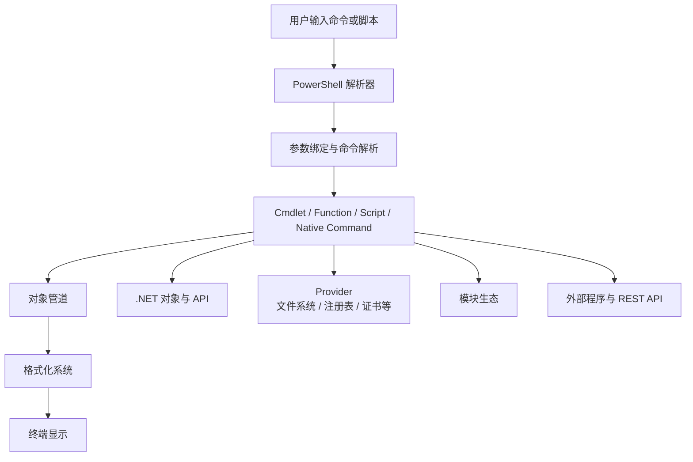

[toc]


## abstract

| 学习阶段     | 目标                                    | 重点内容                                               | 建议练习                                                  |
| ------------ | --------------------------------------- | ------------------------------------------------------ | --------------------------------------------------------- |
| 入门定位     | 明确 PowerShell 是什么、解决什么问题    | Shell、脚本语言、自动化平台、对象管道                  | 用 `Get-Process`、`Get-Service`、`Get-ChildItem` 探索系统 |
| 基础命令     | 掌握命令发现、帮助、参数、别名          | `Get-Command`、`Get-Help`、`Get-Member`、`Update-Help` | 查询命令帮助，找出某对象有哪些属性和方法                  |
| 对象管道     | 理解 PowerShell 与传统 Shell 的根本差异 | 对象流、属性、方法、筛选、排序、分组、选择             | `Get-Process                                              |
| 文件与文本   | 处理文件系统、CSV、JSON、XML、日志      | Provider、路径、编码、结构化数据转换                   | 读取日志、导出 CSV、调用 REST API                         |
| 脚本编写     | 写可维护、可复用的 `.ps1` 脚本          | 变量、条件、循环、函数、参数、错误处理                 | 写一个批量整理文件或健康检查脚本                          |
| 模块与生态   | 使用和发布模块                          | Module、Manifest、PowerShell Gallery、PSResourceGet    | 安装模块、编写简单模块                                    |
| 安全与可靠性 | 避免危险脚本和不可控副作用              | 执行策略、签名、Secret、最小权限、确认机制             | 给破坏性操作加 `-WhatIf` 和 `-Confirm`                    |
| 现代化实践   | 适配跨平台、CI/CD、云和自动化           | PowerShell 7、`pwsh`、GitHub Actions、Azure、REST API  | 写跨平台脚本并在 CI 中运行                                |
| 工程化提升   | 写像工具一样可靠的脚本                  | Pester、PSScriptAnalyzer、日志、测试、参数验证         | 为函数写测试和静态检查                                    |

------

## PowerShell 是什么

PowerShell 是一个跨平台任务自动化方案，由命令行 Shell、脚本语言和配置管理能力组成，运行在 Windows、Linux 和 macOS 上。它特别适合系统管理、DevOps、云平台自动化、批量处理、REST API 调用和结构化数据处理。微软官方文档也强调，PowerShell 的输入输出是 .NET 对象，而不是普通文本，这正是它区别于传统 Shell 的核心。([Microsoft Learn](https://learn.microsoft.com/en-us/powershell/scripting/overview?view=powershell-7.6&utm_source=chatgpt.com))

你可以把 PowerShell 理解为三层能力的组合：

| 角色         | 说明                              | 示例                                      |
| ------------ | --------------------------------- | ----------------------------------------- |
| 交互式 Shell | 像 Bash、cmd 一样输入命令         | `Get-Process`、`cd`、`ls`                 |
| 脚本语言     | 写 `.ps1` 文件自动执行任务        | 批量重命名、备份、巡检                    |
| 自动化平台   | 调用系统、云、API、模块、对象模型 | 管理 Azure、Microsoft 365、Windows Server |

PowerShell 的现代版本通常通过 `pwsh` 启动。Windows 自带的旧版通常是 **Windows PowerShell 5.1**，可执行文件是 `powershell.exe`。PowerShell 7 不会替换 Windows PowerShell 5.1，而是并排安装、独立运行；某些旧 Windows 模块仍可能需要 5.1，现代脚本一般优先使用 PowerShell 7。([Microsoft Learn](https://learn.microsoft.com/en-us/powershell/scripting/install/install-powershell-on-windows?view=powershell-7.6&utm_source=chatgpt.com))

------

## `powershell.exe` 与 `pwsh` 的区别

| 项目                | Windows PowerShell                    | PowerShell 7+                       |
| ------------------- | ------------------------------------- | ----------------------------------- |
| 启动命令            | `powershell.exe`                      | `pwsh`                              |
| 主要平台            | Windows                               | Windows、Linux、macOS               |
| 底层运行时          | .NET Framework                        | 现代 .NET                           |
| 默认随 Windows 安装 | 是，通常为 5.1                        | 通常需要单独安装                    |
| 兼容性              | 对传统 Windows 管理模块兼容性更好     | 跨平台、现代化、性能和语言特性更好  |
| 推荐场景            | 维护旧脚本、旧模块、传统 Windows 管理 | 新项目、跨平台脚本、CI/CD、云自动化 |

当前官方支持周期页面显示，PowerShell 7.6 系列已进入当前 LTS 线；旧 LTS 7.4 仍支持到 2026 年 11 月 10 日。实际生产环境选型时，应优先看官方支持周期，而不是只看本机已安装版本。([Microsoft Learn](https://learn.microsoft.com/en-us/powershell/scripting/install/powershell-support-lifecycle?view=powershell-7.6&utm_source=chatgpt.com))

查看本机版本：

```powershell
$PSVersionTable
```

常见输出中你尤其要看：

| 字段          | 含义                |
| ------------- | ------------------- |
| `PSVersion`   | PowerShell 版本     |
| `PSEdition`   | `Core` 或 `Desktop` |
| `GitCommitId` | 精确构建版本        |
| `OS`          | 当前操作系统        |
| `Platform`    | 平台类型            |

------

## PowerShell 的整体结构



这个结构说明了几个关键点：

PowerShell 不是简单地把命令输出拼成字符串，而是让命令产生对象；这些对象继续进入管道，被下一个命令按属性、类型或参数名接收。最后显示在屏幕上的表格只是格式化结果，不等于真实数据本身。

------

## 命令体系：Verb-Noun 命名规则

PowerShell 的命令通常叫 **cmdlet**，读作 “command-let”。标准命名形式是：

```powershell
Verb-Noun
```

例如：

```powershell
Get-Process
Stop-Service
New-Item
Set-ExecutionPolicy
Invoke-RestMethod
```

微软推荐 cmdlet 使用“动词-名词”命名，并且动词应使用批准动词。可以用 `Get-Verb` 查看官方批准动词列表。([Microsoft Learn](https://learn.microsoft.com/en-us/powershell/scripting/developer/cmdlet/approved-verbs-for-windows-powershell-commands?view=powershell-7.6&utm_source=chatgpt.com))

| 动词          | 常见含义               | 示例                |
| ------------- | ---------------------- | ------------------- |
| `Get`         | 获取资源，不应改变状态 | `Get-Process`       |
| `Set`         | 修改已有资源           | `Set-Location`      |
| `New`         | 创建资源               | `New-Item`          |
| `Remove`      | 删除资源               | `Remove-Item`       |
| `Start`       | 启动动作或服务         | `Start-Service`     |
| `Stop`        | 停止动作或服务         | `Stop-Process`      |
| `Invoke`      | 执行某个动作           | `Invoke-RestMethod` |
| `Test`        | 检查条件，返回布尔结果 | `Test-Path`         |
| `ConvertTo`   | 转换为某种格式         | `ConvertTo-Json`    |
| `ConvertFrom` | 从某种格式转换回来     | `ConvertFrom-Json`  |

好的 PowerShell 命令名应该让人一眼看出“做什么”和“作用于什么”。

------

## 命令发现与帮助系统

新手学习 PowerShell 最重要的不是背命令，而是学会自己发现命令。

| 任务         | 命令                         |
| ------------ | ---------------------------- |
| 查找命令     | `Get-Command`                |
| 查看帮助     | `Get-Help`                   |
| 查看示例     | `Get-Help <命令> -Examples`  |
| 查看完整帮助 | `Get-Help <命令> -Full`      |
| 在线帮助     | `Get-Help <命令> -Online`    |
| 查看对象成员 | `Get-Member`                 |
| 查看命令语法 | `Get-Command <命令> -Syntax` |

示例：

```powershell
Get-Command *Service*
Get-Help Get-Service -Examples
Get-Service | Get-Member
```

推荐第一次安装后更新帮助：

```powershell
Update-Help
```

在受限网络或无管理员权限环境中，可以先跳过，使用在线文档或 `Get-Help -Online`。

------

## 对象管道：PowerShell 的核心思想

传统 Shell 通常传递文本：

```bash
ps aux | grep nginx | awk '{print $2}'
```

PowerShell 传递对象：

```powershell
Get-Process |
    Where-Object ProcessName -like '*pwsh*' |
    Select-Object Id, ProcessName, CPU
```

这意味着管道中的每一项都不是一行字符串，而是带有属性和方法的对象。


| 命令             | 作用               | 示例                          |
| ---------------- | ------------------ | ----------------------------- |
| `Where-Object`   | 过滤对象           | `Where-Object CPU -gt 100`    |
| `Select-Object`  | 选择属性或前几项   | `Select-Object Name, Id`      |
| `Sort-Object`    | 排序               | `Sort-Object CPU -Descending` |
| `Group-Object`   | 分组统计           | `Group-Object Status`         |
| `Measure-Object` | 计数、求和、平均值 | `Measure-Object Length -Sum`  |
| `ForEach-Object` | 对每个对象执行动作 | `ForEach-Object { $_.Name }`  |

### `$_` 是什么

`$_` 表示当前管道对象。

```powershell
Get-Process | Where-Object { $_.CPU -gt 100 }
```

在这个例子中，`$_` 依次代表每一个进程对象。

PowerShell 也支持更简洁的写法：

```powershell
Get-Process | Where-Object CPU -gt 100
```

新手阶段建议先掌握完整写法，因为它更能帮助你理解对象模型。

------

## 管道不是字符串拼接

一个常见误区是认为 PowerShell 管道和 Bash 管道一样。实际上：

```powershell
Get-Process | Select-Object Name, Id
```

传递的是对象。只有在输出到屏幕、文件或外部程序时，PowerShell 才会把对象格式化为文本。

这会带来一个重要最佳实践：

**不要过早使用 `Format-\*` 命令。**

错误示例：

```powershell
Get-Process |
    Format-Table Name, Id |
    Export-Csv processes.csv
```

这里导出的不是原始进程数据，而是格式化对象。

正确示例：

```powershell
Get-Process |
    Select-Object Name, Id |
    Export-Csv processes.csv -NoTypeInformation
```

`Format-Table`、`Format-List` 适合最终展示，不适合继续处理数据。

------

## 参数、位置参数与命名参数

PowerShell 命令由命令名和参数组成：

```powershell
Get-ChildItem -Path ./logs -Filter *.log -Recurse
```

| 参数类型 | 说明                   | 示例                       |
| -------- | ---------------------- | -------------------------- |
| 命名参数 | 明确写出参数名         | `-Path ./logs`             |
| 位置参数 | 省略参数名，按位置绑定 | `Get-ChildItem ./logs`     |
| 开关参数 | 表示开启某个选项       | `-Recurse`                 |
| 通用参数 | 大多数 cmdlet 都支持   | `-Verbose`、`-ErrorAction` |

建议新手多使用命名参数，脚本中尤其如此：

```powershell
Copy-Item -Path ./source.txt -Destination ./backup/source.txt
```

比下面这种更可维护：

```powershell
Copy-Item ./source.txt ./backup/source.txt
```

------

## 常用通用参数

PowerShell cmdlet 普遍支持一组通用参数。

| 参数             | 用途               | 示例                              |
| ---------------- | ------------------ | --------------------------------- |
| `-Verbose`       | 输出详细执行信息   | `Remove-Item ./tmp -Verbose`      |
| `-Debug`         | 输出调试信息       | `Get-Process -Debug`              |
| `-ErrorAction`   | 控制错误行为       | `-ErrorAction Stop`               |
| `-WarningAction` | 控制警告行为       | `-WarningAction SilentlyContinue` |
| `-WhatIf`        | 预演将要执行的操作 | `Remove-Item ./tmp -WhatIf`       |
| `-Confirm`       | 操作前要求确认     | `Stop-Process -Id 1234 -Confirm`  |

对于删除、停止、覆盖、移动等破坏性操作，优先使用：

```powershell
-WhatIf
```

例如：

```powershell
Remove-Item -Path ./old-files -Recurse -WhatIf
```

确认输出无误后再真正执行：

```powershell
Remove-Item -Path ./old-files -Recurse
```

------

## Provider：把不同资源当作“路径”访问

PowerShell 的 Provider 机制可以把不同类型的资源呈现为类似文件系统的结构。

| Provider   | 示例路径                 | 用途           |
| ---------- | ------------------------ | -------------- |
| FileSystem | `C:\Users`、`/home/user` | 文件和目录     |
| Registry   | `HKLM:\Software`         | Windows 注册表 |
| Cert       | `Cert:\CurrentUser\My`   | 证书存储       |
| Env        | `Env:\PATH`              | 环境变量       |
| Alias      | `Alias:\ls`              | 命令别名       |
| Function   | `Function:\prompt`       | 当前会话函数   |
| Variable   | `Variable:\HOME`         | 变量           |

查看 Provider：

```powershell
Get-PSProvider
```

查看 PowerShell 驱动器：

```powershell
Get-PSDrive
```

环境变量示例：

```powershell
Get-ChildItem Env:
$env:PATH
$env:MY_APP_ENV = 'dev'
```

Windows 注册表示例：

```powershell
Get-ChildItem HKCU:\Software
```

跨平台脚本要注意：注册表 Provider 只在 Windows 上有意义。

------

## 文件与目录操作

PowerShell 的文件命令与传统 Shell 有相似之处，但它们返回对象。

| 任务             | 命令                         |
| ---------------- | ---------------------------- |
| 查看当前位置     | `Get-Location`               |
| 切换目录         | `Set-Location`               |
| 列出文件         | `Get-ChildItem`              |
| 创建文件或目录   | `New-Item`                   |
| 复制             | `Copy-Item`                  |
| 移动或重命名     | `Move-Item`、`Rename-Item`   |
| 删除             | `Remove-Item`                |
| 判断路径是否存在 | `Test-Path`                  |
| 读取文件内容     | `Get-Content`                |
| 写入文件内容     | `Set-Content`、`Add-Content` |

示例：找出当前目录下所有大于 10MB 的文件。

```powershell
Get-ChildItem -Path . -File -Recurse |
    Where-Object Length -gt 10MB |
    Select-Object FullName, Length
```

示例：批量把 `.txt` 文件改成 `.log`。

```powershell
Get-ChildItem -Path . -Filter *.txt |
    Rename-Item -NewName { $_.BaseName + '.log' } -WhatIf
```

确认无误后删除 `-WhatIf`。

------

## 变量与类型

PowerShell 变量以 `$` 开头：

```powershell
$name = 'Alice'
$count = 3
$items = @('a', 'b', 'c')
```

查看类型：

```powershell
$name.GetType()
$count.GetType()
$items.GetType()
```

常见类型：

| 类型       | 示例                                            |
| ---------- | ----------------------------------------------- |
| 字符串     | `'hello'`                                       |
| 整数       | `42`                                            |
| 布尔值     | `$true`、`$false`                               |
| 数组       | `@(1, 2, 3)`                                    |
| 哈希表     | `@{ Name = 'Alice'; Age = 30 }`                 |
| 日期       | `Get-Date`                                      |
| 自定义对象 | `[pscustomobject]@{ Name = 'Alice'; Age = 30 }` |

PowerShell 是动态类型语言，但可以显式声明类型：

```powershell
[int]$count = 10
[string]$name = 'Alice'
[datetime]$date = '2026-06-19'
```

最佳实践：脚本参数和函数参数应尽量声明类型，而临时变量可以保持简洁。

------

## 字符串：单引号与双引号

| 写法   | 是否展开变量 | 示例            |
| ------ | ------------ | --------------- |
| 单引号 | 不展开       | `'Hello $name'` |
| 双引号 | 展开变量     | `"Hello $name"` |

示例：

```powershell
$name = 'Alice'

'Hello $name'
"Hello $name"
```

输出分别是：

```text
Hello $name
Hello Alice
```

复杂表达式要用 `$()`：

```powershell
"Today is $(Get-Date -Format 'yyyy-MM-dd')"
```

多行字符串使用 here-string：

```powershell
$message = @"
Hello $name,

This is a multi-line string.
"@
```

不希望变量展开时使用单引号版本：

```powershell
$template = @'
Hello $name,

This keeps variables unchanged.
'@
```

------

## 数组与哈希表

数组：

```powershell
$names = @('Alice', 'Bob', 'Carol')
$names[0]
$names.Count
```

哈希表：

```powershell
$user = @{
    Name = 'Alice'
    Role = 'Admin'
    Enabled = $true
}

$user['Name']
$user.Role
```

自定义对象：

```powershell
[pscustomobject]@{
    Name = 'Alice'
    Role = 'Admin'
    Enabled = $true
}
```

在需要导出 CSV、JSON 或传入管道时，优先使用 `[pscustomobject]`，因为它更像一条结构化记录。

```powershell
$users = @(
    [pscustomobject]@{ Name = 'Alice'; Role = 'Admin' }
    [pscustomobject]@{ Name = 'Bob'; Role = 'User' }
)

$users | Export-Csv users.csv -NoTypeInformation
```

------

## 条件判断

```powershell
if ($value -gt 10) {
    'greater than 10'
}
elseif ($value -eq 10) {
    'equals 10'
}
else {
    'less than 10'
}
```

PowerShell 比较运算符不是 `>`、`==` 这种风格，而是：

| 运算符      | 含义         |
| ----------- | ------------ |
| `-eq`       | 等于         |
| `-ne`       | 不等于       |
| `-gt`       | 大于         |
| `-ge`       | 大于等于     |
| `-lt`       | 小于         |
| `-le`       | 小于等于     |
| `-like`     | 通配符匹配   |
| `-notlike`  | 通配符不匹配 |
| `-match`    | 正则匹配     |
| `-notmatch` | 正则不匹配   |
| `-contains` | 集合包含某值 |
| `-in`       | 某值属于集合 |

示例：

```powershell
'server01' -like 'server*'
'abc123' -match '\d+'
'admin' -in @('admin', 'operator')
```

大小写敏感版本通常加 `c`：

```powershell
'PowerShell' -eq 'powershell'   # True
'PowerShell' -ceq 'powershell'  # False
```

------

## 循环

`foreach` 适合脚本中遍历集合：

```powershell
$files = Get-ChildItem -File

foreach ($file in $files) {
    "$($file.Name): $($file.Length)"
}
```

管道中的 `ForEach-Object` 适合流式处理：

```powershell
Get-ChildItem -File |
    ForEach-Object {
        "$($_.Name): $($_.Length)"
    }
```

`while` 示例：

```powershell
$count = 0

while ($count -lt 3) {
    $count
    $count++
}
```

`switch` 示例：

```powershell
switch ($status) {
    'Running' { 'Service is running' }
    'Stopped' { 'Service is stopped' }
    default { 'Unknown status' }
}
```

------

## 函数与高级函数

简单函数：

```powershell
function Get-Greeting {
    param(
        [string]$Name
    )

    "Hello, $Name"
}

Get-Greeting -Name 'Alice'
```

推荐写成高级函数：

```powershell
function Get-Greeting {
    [CmdletBinding()]
    param(
        [Parameter(Mandatory)]
        [string]$Name
    )

    "Hello, $Name"
}
```

`[CmdletBinding()]` 会让函数获得更像 cmdlet 的能力，例如支持 `-Verbose`、`-Debug`、`-ErrorAction` 等通用参数。

带参数验证的示例：

```powershell
function Restart-AppService {
    [CmdletBinding(SupportsShouldProcess)]
    param(
        [Parameter(Mandatory)]
        [ValidateNotNullOrEmpty()]
        [string]$Name
    )

    if ($PSCmdlet.ShouldProcess($Name, 'Restart service')) {
        Restart-Service -Name $Name
    }
}
```

这个函数支持：

```powershell
Restart-AppService -Name 'Spooler' -WhatIf
```

这是专业 PowerShell 函数非常重要的写法。

------

## 错误处理

PowerShell 有两类常见错误：

| 类型       | 说明               | 示例                   |
| ---------- | ------------------ | ---------------------- |
| 非终止错误 | 命令报错但管道继续 | 找不到某个文件         |
| 终止错误   | 当前执行中断       | 语法错误、显式抛出异常 |

`try/catch/finally` 只能稳定捕获终止错误。很多 cmdlet 默认产生非终止错误，所以常配合 `-ErrorAction Stop`。

```powershell
try {
    Get-Item -Path './missing.txt' -ErrorAction Stop
}
catch {
    Write-Error "Failed: $($_.Exception.Message)"
}
finally {
    'Cleanup work here'
}
```

手动抛出错误：

```powershell
throw 'Something went wrong'
```

最佳实践：

| 场景             | 推荐做法                                         |
| ---------------- | ------------------------------------------------ |
| 需要捕获错误     | 使用 `-ErrorAction Stop`                         |
| 面向用户输出错误 | `Write-Error`                                    |
| 脚本内部终止     | `throw`                                          |
| 不建议           | 静默吞掉所有异常                                 |
| 批量处理         | 对每个项目单独 `try/catch`，避免一个失败影响全部 |

------

## 输出流

PowerShell 不只有标准输出和错误输出，还定义了多种流。

| 流          | 命令                              | 用途           |
| ----------- | --------------------------------- | -------------- |
| Success     | 直接输出对象或 `Write-Output`     | 正常数据输出   |
| Error       | `Write-Error`                     | 错误           |
| Warning     | `Write-Warning`                   | 警告           |
| Verbose     | `Write-Verbose`                   | 详细信息       |
| Debug       | `Write-Debug`                     | 调试           |
| Information | `Write-Information`、`Write-Host` | 面向用户的信息 |

最佳实践：

不要用 `Write-Host` 输出后续还要处理的数据。

不推荐：

```powershell
Write-Host $result
```

推荐：

```powershell
$result
```

或者：

```powershell
Write-Output $result
```

只有在确实要显示用户提示、彩色信息、交互提示时，才考虑 `Write-Host`。

------

## 结构化数据处理

PowerShell 很擅长处理 CSV、JSON、XML 这类结构化数据。

### CSV

```powershell
$users = Import-Csv ./users.csv

$users |
    Where-Object Department -eq 'IT' |
    Export-Csv ./it-users.csv -NoTypeInformation
```

### JSON

```powershell
$response = Invoke-RestMethod -Uri 'https://api.github.com/repos/PowerShell/PowerShell'

$response.name
$response.stargazers_count
```

导出 JSON：

```powershell
$data = [pscustomobject]@{
    Name = 'demo'
    Enabled = $true
    Tags = @('powershell', 'automation')
}

$data | ConvertTo-Json -Depth 5
```

注意 `ConvertTo-Json` 的 `-Depth`，复杂嵌套对象如果深度不够会被截断。

### XML

```powershell
[xml]$xml = Get-Content ./config.xml
$xml.Configuration.AppSettings
```

------

## 调用外部命令

PowerShell 可以调用原生命令：

```powershell
git status
docker ps
kubectl get pods
```

但要注意：外部命令通常返回文本，不是 PowerShell 对象。

常见建议：

| 场景             | 建议                   |
| ---------------- | ---------------------- |
| 工具能输出 JSON  | 优先用 JSON            |
| 工具只输出文本   | 再考虑正则或字符串解析 |
| 参数包含空格     | 用数组或明确引号       |
| 需要检查成功失败 | 检查 `$LASTEXITCODE`   |

示例：

```powershell
$json = kubectl get pods -o json | ConvertFrom-Json
$json.items | Select-Object metadata, status
```

检查外部程序退出码：

```powershell
git status

if ($LASTEXITCODE -ne 0) {
    throw "git failed with exit code $LASTEXITCODE"
}
```

------

## 模块

模块是 PowerShell 代码复用和分发的基本单位。

| 文件类型 | 用途               |
| -------- | ------------------ |
| `.ps1`   | 普通脚本           |
| `.psm1`  | 脚本模块           |
| `.psd1`  | 模块清单或数据文件 |

查看模块路径：

```powershell
$env:PSModulePath -split [IO.Path]::PathSeparator
```

查看已安装模块：

```powershell
Get-Module -ListAvailable
```

导入模块：

```powershell
Import-Module Microsoft.PowerShell.Management
```

查找命令来源：

```powershell
Get-Command Get-Process | Select-Object Name, Source
```

安装模块时，现代 PowerShell 生态中可以使用 PowerShell Gallery 和相关资源管理工具。对于生产环境，建议固定版本、记录依赖，不要让脚本隐式依赖“当前最新版本”。

------

## 执行策略

PowerShell 执行策略是一个安全功能，用于控制 PowerShell 在什么条件下加载配置文件和运行脚本。它有助于减少误执行恶意脚本的风险，但它不是完整的安全边界。微软文档明确说明执行策略是安全策略的一部分，而不是替代权限控制、代码审查、签名和终端安全。([Microsoft Learn](https://learn.microsoft.com/en-us/powershell/module/microsoft.powershell.core/about/about_execution_policies?view=powershell-7.6&utm_source=chatgpt.com))

查看当前策略：

```powershell
Get-ExecutionPolicy -List
```

常见策略：

| 策略           | 含义                                     | 常见用途                 |
| -------------- | ---------------------------------------- | ------------------------ |
| `Restricted`   | 不允许运行脚本                           | Windows 默认安全姿态之一 |
| `RemoteSigned` | 本地脚本可运行，下载脚本需签名或解除阻止 | 常见开发机设置           |
| `AllSigned`    | 所有脚本都要可信签名                     | 高安全环境               |
| `Unrestricted` | 限制较少                                 | 不推荐随意使用           |
| `Bypass`       | 绕过执行策略                             | CI 或受控自动化场景      |
| `Undefined`    | 未在该作用域设置                         | 继承其他作用域           |

设置当前用户策略：

```powershell
Set-ExecutionPolicy -Scope CurrentUser -ExecutionPolicy RemoteSigned
```

如果脚本是从互联网下载的，Windows 可能给文件加上 Mark of the Web，需要解除阻止：

```powershell
Unblock-File ./script.ps1
```

在 Linux 和 macOS 上，`Get-ExecutionPolicy` 通常返回 `Unrestricted`，因为执行策略主要是 Windows 平台安全机制。([Microsoft Learn](https://learn.microsoft.com/en-us/powershell/module/microsoft.powershell.security/get-executionpolicy?view=powershell-7.6&utm_source=chatgpt.com))

------

## Profile：启动配置文件

PowerShell 启动时可以加载配置文件，称为 profile。查看配置文件路径：

```powershell
$PROFILE
```

查看所有 profile 路径：

```powershell
$PROFILE | Get-Member -MemberType NoteProperty
```

创建当前用户当前主机的 profile：

```powershell
New-Item -Path $PROFILE -ItemType File -Force
```

常见用途：

| 用途         | 示例                                     |
| ------------ | ---------------------------------------- |
| 设置别名     | `Set-Alias ll Get-ChildItem`             |
| 设置提示符   | 自定义 `prompt` 函数                     |
| 导入模块     | `Import-Module posh-git`                 |
| 设置环境变量 | `$env:EDITOR = 'code'`                   |
| 定义常用函数 | `function croot { Set-Location ~/code }` |

最佳实践：

不要在 profile 中放复杂业务逻辑；不要让脚本依赖你的个人 profile；自动化环境中常用：

```powershell
pwsh -NoProfile -File ./build.ps1
```

------

## 脚本参数设计

一个好脚本应该像命令一样使用，而不是靠修改源码配置。

不推荐：

```powershell
$Path = './logs'
$Days = 7
```

推荐：

```powershell
param(
    [Parameter(Mandatory)]
    [string]$Path,

    [ValidateRange(1, 365)]
    [int]$Days = 7
)
```

使用：

```powershell
./Cleanup-Logs.ps1 -Path ./logs -Days 30
```

更专业的脚本结构：

```powershell
[CmdletBinding(SupportsShouldProcess)]
param(
    [Parameter(Mandatory)]
    [ValidateScript({ Test-Path $_ })]
    [string]$Path,

    [ValidateRange(1, 365)]
    [int]$Days = 30
)

$cutoff = (Get-Date).AddDays(-$Days)

Get-ChildItem -Path $Path -File -Recurse |
    Where-Object LastWriteTime -lt $cutoff |
    ForEach-Object {
        if ($PSCmdlet.ShouldProcess($_.FullName, 'Remove old file')) {
            Remove-Item -Path $_.FullName
        }
    }
```

运行预演：

```powershell
./Cleanup-Logs.ps1 -Path ./logs -Days 30 -WhatIf
```

------

## 跨平台脚本注意事项

PowerShell 7 是跨平台的，但你的脚本不一定天然跨平台。

| 问题       | Windows                    | Linux/macOS    | 建议                 |
| ---------- | -------------------------- | -------------- | -------------------- |
| 路径分隔符 | `\`                        | `/`            | 用 `Join-Path`       |
| 大小写     | 多数文件系统不敏感         | 通常敏感       | 文件名大小写保持一致 |
| 换行       | CRLF                       | LF             | 避免依赖换行格式     |
| 注册表     | 有                         | 无             | 判断 `$IsWindows`    |
| 服务管理   | `Get-Service` 侧重 Windows | 不同平台差异大 | 平台分支             |
| 外部命令   | `.exe` 常见                | POSIX 工具常见 | 检查命令是否存在     |
| 编码       | 历史复杂                   | UTF-8 常见     | 明确指定编码         |

平台变量：

```powershell
$IsWindows
$IsLinux
$IsMacOS
```

跨平台路径：

```powershell
$path = Join-Path -Path $HOME -ChildPath 'logs/app.log'
```

检查命令是否存在：

```powershell
if (-not (Get-Command git -ErrorAction SilentlyContinue)) {
    throw 'git is required.'
}
```

------

## 编码与中文处理

现代 PowerShell 7 的编码行为比 Windows PowerShell 5.1 更适合跨平台和 UTF-8 场景。官方文档中也提到 PowerShell 7.5 系列基于 .NET 9 运行时，继续沿着现代化方向演进。([Microsoft Learn](https://learn.microsoft.com/en-us/powershell/scripting/whats-new/what-s-new-in-powershell-75?view=powershell-7.6&utm_source=chatgpt.com))

建议：

| 场景                   | 建议                      |
| ---------------------- | ------------------------- |
| 新脚本                 | 使用 UTF-8                |
| 写文件                 | 明确 `-Encoding utf8`     |
| 跨平台                 | 避免依赖系统默认编码      |
| Windows PowerShell 5.1 | 特别注意 BOM 和控制台编码 |

示例：

```powershell
Set-Content -Path ./output.txt -Value '中文内容' -Encoding utf8
Get-Content -Path ./output.txt -Encoding utf8
```

------

## 安全最佳实践

| 风险         | 不推荐                                 | 推荐                                      |
| ------------ | -------------------------------------- | ----------------------------------------- |
| 执行远程脚本 | 直接复制粘贴运行                       | 阅读脚本、校验来源、固定版本              |
| 删除文件     | `Remove-Item -Recurse -Force` 直接执行 | 先 `-WhatIf`                              |
| 明文密码     | 写在脚本里                             | 使用 SecretManagement、环境变量或安全凭据 |
| 提权运行     | 长期开管理员终端                       | 仅在必要操作中提权                        |
| 模块依赖     | 自动安装最新版                         | 固定版本，记录依赖                        |
| 错误处理     | 忽略异常                               | 明确捕获并记录                            |
| 日志         | 输出敏感 token                         | 脱敏处理                                  |

危险示例：

```powershell
Invoke-Expression (Invoke-WebRequest 'https://example.com/install.ps1')
```

更安全的做法：

```powershell
Invoke-WebRequest -Uri 'https://example.com/install.ps1' -OutFile ./install.ps1
Get-Content ./install.ps1
# 人工审查后再执行
./install.ps1
```

尤其要谨慎 `Invoke-Expression`，因为它会把字符串当代码执行。

------

## 远程与并发

PowerShell 支持多种远程和并发方式。

| 能力                  | 命令                                  | 说明                |
| --------------------- | ------------------------------------- | ------------------- |
| 后台任务              | `Start-Job`、`Get-Job`、`Receive-Job` | 本机后台执行        |
| 线程任务              | `Start-ThreadJob`                     | 更轻量的本机并发    |
| 远程执行              | `Invoke-Command`                      | 对远程会话执行命令  |
| 会话                  | `New-PSSession`                       | 保持远程连接上下文  |
| PowerShell 7 后台管道 | 管道末尾加 `&`                        | 把管道作为 job 运行 |

PowerShell 7 支持在管道末尾使用 `&` 将管道作为后台 job 运行，返回 job 对象，并可用标准 `*-Job` cmdlet 管理。([Microsoft Learn](https://learn.microsoft.com/en-us/powershell/scripting/whats-new/differences-from-windows-powershell?view=powershell-7.6&utm_source=chatgpt.com))

示例：

```powershell
Get-ChildItem -Recurse | Where-Object Length -gt 100MB &
Get-Job
Receive-Job -Id 1
```

------

## 常见实用案例

### 查找占用 CPU 较高的进程

```powershell
Get-Process |
    Sort-Object CPU -Descending |
    Select-Object -First 10 Name, Id, CPU
```

### 查找最近修改的文件

```powershell
Get-ChildItem -Path . -File -Recurse |
    Sort-Object LastWriteTime -Descending |
    Select-Object -First 20 FullName, LastWriteTime
```

### 批量统计文件类型

```powershell
Get-ChildItem -Path . -File -Recurse |
    Group-Object Extension |
    Sort-Object Count -Descending |
    Select-Object Name, Count
```

### 读取 CSV 并筛选

```powershell
Import-Csv ./users.csv |
    Where-Object Department -eq 'IT' |
    Select-Object Name, Email
```

### 调用 REST API

```powershell
$repo = Invoke-RestMethod -Uri 'https://api.github.com/repos/PowerShell/PowerShell'

[pscustomobject]@{
    Name = $repo.name
    Stars = $repo.stargazers_count
    Forks = $repo.forks_count
}
```

### 检查多个网站状态

```powershell
$urls = @(
    'https://www.microsoft.com'
    'https://github.com'
)

foreach ($url in $urls) {
    try {
        $response = Invoke-WebRequest -Uri $url -Method Head -TimeoutSec 10 -ErrorAction Stop

        [pscustomobject]@{
            Url = $url
            StatusCode = $response.StatusCode
            Success = $true
        }
    }
    catch {
        [pscustomobject]@{
            Url = $url
            StatusCode = $null
            Success = $false
        }
    }
}
```

------

## 调试与排错

| 工具               | 用途                 |
| ------------------ | -------------------- |
| `Set-PSBreakpoint` | 设置断点             |
| `Get-PSCallStack`  | 查看调用栈           |
| `Write-Debug`      | 输出调试信息         |
| `Write-Verbose`    | 输出详细信息         |
| `$Error`           | 当前会话错误列表     |
| `$?`               | 上一个命令是否成功   |
| `$LASTEXITCODE`    | 原生命令退出码       |
| `Trace-Command`    | 追踪内部行为，较高级 |

示例：

```powershell
function Test-DebugDemo {
    [CmdletBinding()]
    param([string]$Name)

    Write-Verbose "Input name is $Name"
    "Hello, $Name"
}

Test-DebugDemo -Name Alice -Verbose
```

查看最近错误：

```powershell
$Error[0] | Format-List * -Force
```

------

## 测试与代码质量

PowerShell 工程化常用两个工具：

| 工具             | 用途                             |
| ---------------- | -------------------------------- |
| Pester           | 单元测试、集成测试               |
| PSScriptAnalyzer | 静态分析、风格检查、潜在问题检查 |

PSScriptAnalyzer 中有规则要求函数和 cmdlet 使用批准动词，这与 PowerShell 的 Verb-Noun 命名规范一致。([Microsoft Learn](https://learn.microsoft.com/en-us/powershell/utility-modules/psscriptanalyzer/rules/useapprovedverbs?view=ps-modules&utm_source=chatgpt.com))

安装示例：

```powershell
Install-Module Pester -Scope CurrentUser
Install-Module PSScriptAnalyzer -Scope CurrentUser
```

运行静态检查：

```powershell
Invoke-ScriptAnalyzer -Path ./MyScript.ps1
```

一个简单 Pester 测试示例：

```powershell
Describe 'Add-Numbers' {
    It 'adds two numbers' {
        function Add-Numbers {
            param([int]$A, [int]$B)
            $A + $B
        }

        Add-Numbers -A 2 -B 3 | Should -Be 5
    }
}
```

------

## PowerShell 脚本推荐目录结构

```text
MyTool/
  MyTool.psd1
  MyTool.psm1
  public/
    Get-Thing.ps1
    Set-Thing.ps1
  private/
    ConvertTo-InternalThing.ps1
  tests/
    MyTool.Tests.ps1
  README.md
```

| 目录或文件  | 作用                                 |
| ----------- | ------------------------------------ |
| `.psd1`     | 模块清单，声明版本、作者、导出函数等 |
| `.psm1`     | 模块入口                             |
| `public`    | 对外暴露的函数                       |
| `private`   | 内部辅助函数                         |
| `tests`     | 测试                                 |
| `README.md` | 使用说明                             |

小脚本不需要一开始就模块化，但当脚本超过几百行、多人使用、需要复用函数时，就应该考虑模块化。

------

## 新手常见误区

| 误区                    | 问题                 | 正确理解                                |
| ----------------------- | -------------------- | --------------------------------------- |
| 把 PowerShell 当 cmd    | 会错过对象管道优势   | 应围绕对象、属性和管道思考              |
| 过早使用 `Format-Table` | 后续无法正确导出数据 | 最后展示时才格式化                      |
| 滥用别名                | 脚本可读性差         | 交互可用别名，脚本写全名                |
| 忽略 `-WhatIf`          | 容易误删误改         | 破坏性操作先预演                        |
| 不写参数                | 脚本不可复用         | 用 `param()` 暴露输入                   |
| 不处理错误              | 自动化不可靠         | 使用 `try/catch` 和 `-ErrorAction Stop` |
| 把密码写进脚本          | 安全风险高           | 使用安全凭据和 Secret 工具              |
| 假设只在 Windows 运行   | 跨平台失败           | 使用 `$IsWindows`、`Join-Path`          |
| 混淆显示和数据          | 导出结果异常         | 理解格式化系统与对象流                  |

------

## 推荐学习路径

### 先掌握命令发现

每天练习这几个命令：

```powershell
Get-Command
Get-Help
Get-Member
```

例如：

```powershell
Get-Command *Process*
Get-Help Stop-Process -Examples
Get-Process | Get-Member
```

### 再掌握对象管道

练习模式：

```powershell
获取对象 | 过滤对象 | 排序对象 | 选择属性 | 导出或展示
```

对应 PowerShell：

```powershell
Get-Process |
    Where-Object CPU -gt 10 |
    Sort-Object CPU -Descending |
    Select-Object Name, Id, CPU |
    Export-Csv ./processes.csv -NoTypeInformation
```

### 然后写小脚本

从这些任务开始：

| 任务             | 涉及能力                    |
| ---------------- | --------------------------- |
| 清理 N 天前日志  | 文件、日期、参数、`-WhatIf` |
| 检查网站状态     | REST、错误处理、自定义对象  |
| 批量重命名文件   | 管道、文件系统、脚本块      |
| 导出系统进程报告 | 对象、排序、CSV             |
| 检查环境依赖     | `Get-Command`、条件、错误   |

### 最后工程化

当你写的脚本开始被别人使用，就加入：

| 能力     | 工具                                            |
| -------- | ----------------------------------------------- |
| 参数验证 | `[ValidateNotNullOrEmpty()]`、`[ValidateSet()]` |
| 帮助文档 | comment-based help                              |
| 测试     | Pester                                          |
| 静态分析 | PSScriptAnalyzer                                |
| 模块化   | `.psm1`、`.psd1`                                |
| CI/CD    | GitHub Actions、Azure Pipelines                 |

------

## 一份实用脚本模板

```powershell
<#
.SYNOPSIS
    Cleans old files from a directory.

.DESCRIPTION
    Finds files older than a specified number of days and removes them.
    Supports -WhatIf and -Confirm.

.PARAMETER Path
    Target directory path.

.PARAMETER Days
    Files older than this number of days are removed.

.EXAMPLE
    ./Clear-OldFiles.ps1 -Path ./logs -Days 30 -WhatIf
#>

[CmdletBinding(SupportsShouldProcess)]
param(
    [Parameter(Mandatory)]
    [ValidateScript({ Test-Path $_ -PathType Container })]
    [string]$Path,

    [ValidateRange(1, 3650)]
    [int]$Days = 30
)

Set-StrictMode -Version Latest

$cutoff = (Get-Date).AddDays(-$Days)

try {
    Get-ChildItem -Path $Path -File -Recurse -ErrorAction Stop |
        Where-Object LastWriteTime -lt $cutoff |
        ForEach-Object {
            if ($PSCmdlet.ShouldProcess($_.FullName, 'Remove file')) {
                Remove-Item -Path $_.FullName -ErrorAction Stop
            }
        }
}
catch {
    Write-Error "Cleanup failed: $($_.Exception.Message)"
    exit 1
}
```

这份模板体现了几个关键最佳实践：

| 实践                    | 价值                         |
| ----------------------- | ---------------------------- |
| `CmdletBinding`         | 获得通用参数能力             |
| `SupportsShouldProcess` | 支持 `-WhatIf` 和 `-Confirm` |
| `param()`               | 脚本可配置                   |
| 参数验证                | 提前拦截错误输入             |
| `Set-StrictMode`        | 更早发现变量和脚本问题       |
| `try/catch`             | 让失败可控                   |
| `Write-Error`           | 正确输出错误                 |
| `exit 1`                | 便于 CI/CD 判断失败          |

------

## 学习 PowerShell 的核心心法

PowerShell 的核心不是“命令很多”，而是下面这套思维：

| 心法                    | 解释                                         |
| ----------------------- | -------------------------------------------- |
| 命令是可发现的          | 不靠死记硬背，靠 `Get-Command` 和 `Get-Help` |
| 管道传递对象            | 少解析文本，多使用属性和方法                 |
| 输出应保持结构化        | 数据输出给管道，展示交给最后一步             |
| 脚本应像命令一样设计    | 有参数、有帮助、有错误处理                   |
| 破坏性操作必须可预演    | 支持 `-WhatIf` 和 `-Confirm`                 |
| 自动化脚本要可测试      | 用 Pester、PSScriptAnalyzer 和 CI            |
| 新项目优先 PowerShell 7 | 兼顾跨平台、现代 .NET 和长期维护             |
| 兼容旧环境时再考虑 5.1  | 尤其是旧 Windows 模块和遗留脚本              |

掌握这些原则后，PowerShell 就不只是“Windows 里的命令行”，而是一个可以连接操作系统、文件、服务、云平台、API、CI/CD 和业务流程的自动化语言。