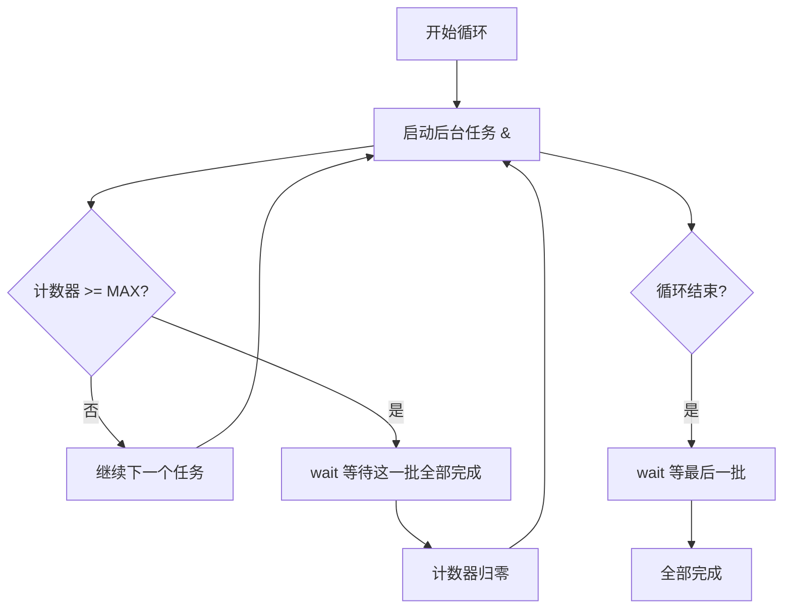
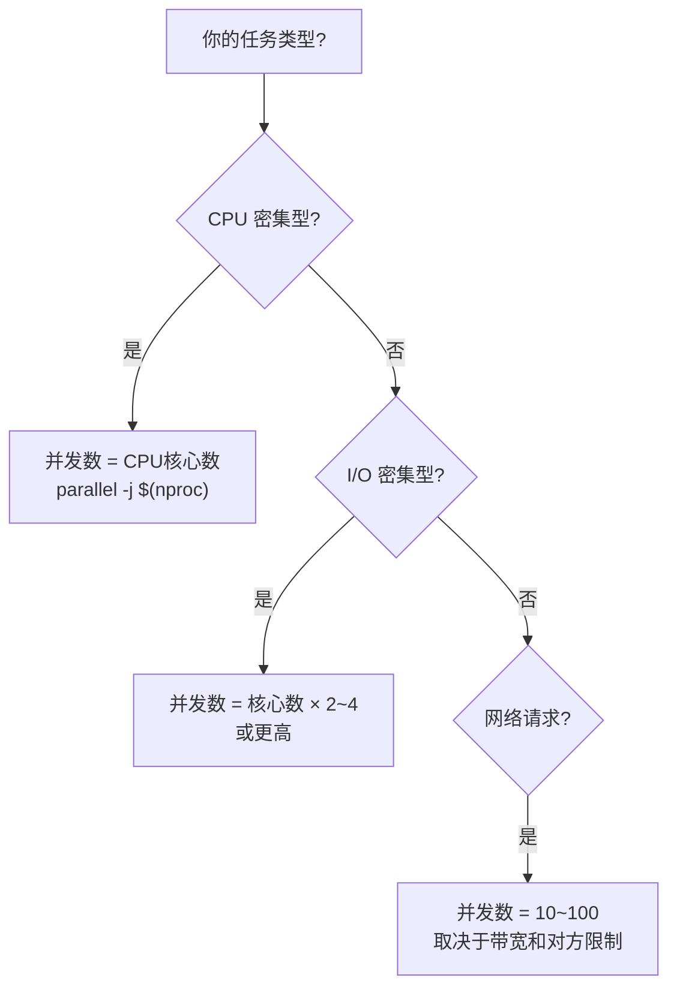
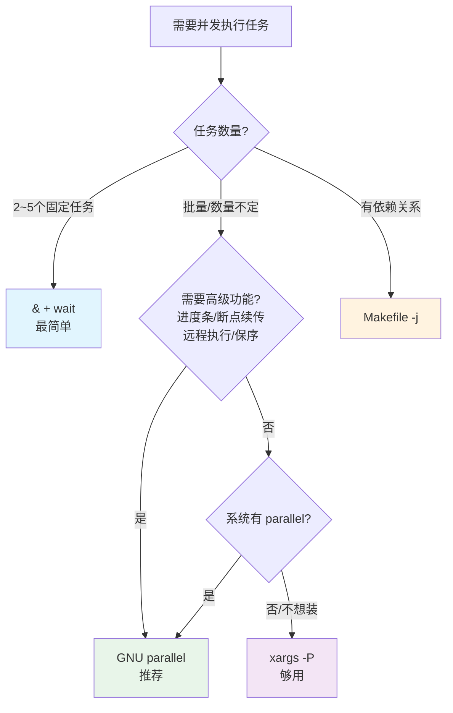

# Linux Shell 下的并发执行任务方案

## 一、为什么需要并发？


当你有大量**彼此独立、互不依赖**的任务时（批量压缩图片、并行下载、批量编译），并发能极大缩短总耗时。

---

## 二、方案全景对比

| 方案             | 复杂度 | 并发控制     | 适用场景         | 是否需安装 |
| ---------------- | ------ | ------------ | ---------------- | ---------- |
| `&` + `wait`     | ⭐      | ❌ 无上限控制 | 少量任务         | 内置       |
| `&` + 计数器控制 | ⭐⭐⭐    | ✅ 手动控制   | 需要限制并发数   | 内置       |
| `xargs -P`       | ⭐⭐     | ✅ 简单       | 批量处理列表     | 内置       |
| `GNU parallel`   | ⭐⭐     | ✅ 强大       | 生产级批量任务   | 需安装     |
| `FIFO 信号量`    | ⭐⭐⭐⭐   | ✅ 精细       | 高级自定义场景   | 内置       |
| `makefile -j`    | ⭐⭐     | ✅            | 有依赖关系的任务 | 内置       |
| `coproc`         | ⭐⭐⭐⭐   | ✅            | 需要双向通信     | Bash 4+    |

---

### python vs shell 并发方案选择

基础并发脚本使用shell足够,如果是复杂并发脚本,建议选择更加结构化的脚本语言实现;

| 维度           | Shell + GNU Parallel       | Python 并发                      |
| -------------- | -------------------------- | -------------------------------- |
| **擅长场景**   | 批量调用外部命令、文件处理 | **复杂逻辑、API 调用、数据处理** |
| **并发模型**   | 多进程（fork 外部命令）    | 多线程 / 多进程 / asyncio        |
| **错误处理**   | 基础（退出码、joblog）     | 精细（try/except、自定义重试）   |
| **状态共享**   | 困难（依赖文件/环境变量）  | 方便（队列、共享内存、锁）       |
| **可维护性**   | 短脚本好，长脚本差         | 长期项目优势明显                 |
| **依赖管理**   | 几乎为零                   | 需要虚拟环境等                   |
| **调试体验**   | 差（echo等打印日志）       | 好（pdb、IDE、日志库）           |
| **跨平台**     | Linux/macOS 好，Windows 差 | **全平台**                       |
| **性能开销**   | 极低（直接 fork）          | 有解释器开销，GIL 限制           |
| **任务间通信** | 很难                       | 原生支持（Queue、Pipe）          |

| 你的需求                               | 选择                                  |
| -------------------------------------- | ------------------------------------- |
| "我要批量 gzip / rsync / ffmpeg"       | **Shell + Parallel**                  |
| "我要并行跑100个独立脚本"              | **Shell + Parallel**                  |
| "一次性任务，快速写完就走"             | **Shell + Parallel**                  |
| "我要调 API 并解析 JSON 结果"          | **Python**                            |
| "任务之间有前后依赖"                   | **Python**                            |
| "需要复杂的错误处理和重试逻辑"         | **Python**                            |
| "要处理结构化数据（数据库/DataFrame）" | **Python**                            |
| "需要高并发（上千连接）"               | **Python asyncio**                    |
| "批量跑 Python 脚本"                   | **Parallel 调度 Python 脚本**（混合） |
| "长期维护的工程代码"                   | **Python**                            |

> **一句话总结**：如果你的任务可以用一行命令描述，用 GNU Parallel；如果你需要用"编程思维"来设计流程，用 Python。两者结合使用常常是最优解。

## 三、方案详解

### 方案 1：`&`（后台执行）+ `wait`（最基础）

#### 核心概念

| 符号/命令   | 含义                                                   |
| ----------- | ------------------------------------------------------ |
| `&`         | 将命令放入**后台**执行，Shell 不等待它完成就继续往下走 |
| `wait`      | 等待**所有后台子进程**结束                             |
| `wait $pid` | 等待**指定 PID** 的进程结束                            |
| `$!`        | 最近一个后台进程的 PID                                 |

#### 基础示例

```bash
#!/bin/bash

echo "开始并发任务..."

# 三个任务同时在后台执行
sleep 3 && echo "任务A完成" &
sleep 2 && echo "任务B完成" &
sleep 1 && echo "任务C完成" &

echo "所有任务已提交，等待完成..."
wait    # 阻塞，直到所有后台任务结束

echo "全部完成！"
```

**输出：**
```
开始并发任务...
所有任务已提交，等待完成...
任务C完成      ← 1秒后
任务B完成      ← 2秒后
任务A完成      ← 3秒后
全部完成！     ← 3秒后（总耗时3秒，而非6秒）
```

#### 获取每个任务的退出状态

```bash
#!/bin/bash

task_a() { sleep 2; return 0; }
task_b() { sleep 1; return 1; }   # 模拟失败
task_c() { sleep 3; return 0; }

task_a & pid_a=$!
task_b & pid_b=$!
task_c & pid_c=$!

# 逐个等待，获取退出码
wait $pid_a; echo "任务A退出码: $?"
wait $pid_b; echo "任务B退出码: $?"
wait $pid_c; echo "任务C退出码: $?"
```

**输出：**
```
任务A退出码: 0
任务B退出码: 1
任务C退出码: 0
```

#### ⚠️ 问题：没有并发数限制

```bash
# 危险！如果有10000个文件，会同时启动10000个进程
for file in /data/*.csv; do
    process "$file" &     # 瞬间 fork 爆炸💥
done
wait
```

---

### 方案 2：`&` + 手动计数器控制并发数

```bash
#!/bin/bash

MAX_JOBS=4    # 最大并发数
count=0

for i in {1..20}; do
    # 模拟任务
    (
        echo "任务 $i 开始 (PID: $$)"
        sleep $(( RANDOM % 5 + 1 ))
        echo "任务 $i 完成"
    ) &

    count=$(( count + 1 ))

    # 达到上限时，等待所有当前后台任务完成
    if [ "$count" -ge "$MAX_JOBS" ]; then
        wait        # 等待这一批全部完成
        count=0
    fi
done

wait    # 等待最后一批
echo "全部完成"
```



#### ⚠️ 缺点

> 这是**批次式**并发，不是**滑动窗口**。假设 MAX_JOBS=4：如果3个任务1秒完成，1个任务要60秒，其他3个CPU核心会**闲置等待**那1个慢任务。

---

### 方案 3：`xargs -P`（推荐入门方案）

#### 核心选项

| 选项    | 含义                                          |
| ------- | --------------------------------------------- |
| `-P N`  | 最多同时运行 **N** 个进程（`0` 表示尽可能多） |
| `-n N`  | 每次传 N 个参数给命令                         |
| `-L N`  | 每次传 N 行给命令                             |
| `-I {}` | 用 `{}` 作为参数占位符                        |

#### 示例 1：并行压缩文件

```bash
# 找到所有 .log 文件，4个进程并行 gzip 压缩
find /var/log -name "*.log" -print0 | xargs -0 -P 4 -n 1 gzip
```

解释：
```
-print0 / -0   使用 \0 分隔（处理含空格的文件名）
-P 4           最多 4 个 gzip 进程同时运行
-n 1           每个 gzip 进程处理 1 个文件
```

#### 示例 2：并行下载

```bash
cat urls.txt | xargs -P 8 -n 1 wget -q
```

#### 示例 3：用 `-I` 构建复杂命令

```bash
cat servers.txt | xargs -P 5 -I {} ssh {} "df -h / | tail -1"
```

#### 示例 4：配合 seq 做数值并行

```bash
seq 1 100 | xargs -P 4 -I {} bash -c '
    echo "处理任务 {} (PID: $$)"
    sleep 1
    echo "任务 {} 完成"
'
```

#### 示例 5：利用所有 CPU 核心

```bash
# -P 0 表示尽可能多（有多少输入起多少进程，慎用）
# 更好的做法：
NPROC=$(nproc)   # 获取 CPU 核心数
find . -name "*.png" | xargs -P "$NPROC" -n 1 optipng
```

---

### 方案 4：GNU Parallel（生产级首选 ⭐⭐⭐）

#### 安装

```bash
# Debian/Ubuntu
sudo apt install parallel

# CentOS/RHEL
sudo yum install parallel

# macOS
brew install parallel
```

#### 与 xargs 对比

| 特性                 | `xargs -P` | `GNU parallel`            |
| -------------------- | ---------- | ------------------------- |
| 并发控制             | ✅ 基本     | ✅ 强大                    |
| 进度条/ETA           | ❌          | ✅ `--bar` / `--eta`       |
| 输出顺序保持         | ❌ 输出混乱 | ✅ `--keep-order`          |
| 断点续传             | ❌          | ✅ `--resume` / `--joblog` |
| 远程执行             | ❌          | ✅ `--sshlogin`            |
| 结果分文件保存       | ❌          | ✅ `--results`             |
| 失败重试             | ❌          | ✅ `--retry-failed`        |
| 资源感知（CPU/内存） | ❌          | ✅ `--load` / `--memfree`  |
| 自动拆分输入         | 基本       | 正则、CSV、列分割         |

#### 示例 1：基础用法

```bash
# 等价于 xargs -P 4 -n 1
parallel -j 4 gzip ::: *.log

# ::: 后面直接跟参数列表
parallel echo "Hello {}" ::: Alice Bob Charlie
```

输出：
```
Hello Alice
Hello Bob
Hello Charlie
```

#### 示例 2：从文件/管道读取输入

```bash
# 从文件读取
parallel -j 8 wget -q < urls.txt

# 从管道读取
find . -name "*.jpg" | parallel -j 4 convert {} {.}.png
```

> `{.}` 是去掉扩展名的文件名（parallel 的特殊占位符）

#### 示例 3：parallel 的占位符系统

| 占位符 | 含义                 | 输入 `/home/user/photo.jpg` 时的值 |
| ------ | -------------------- | ---------------------------------- |
| `{}`   | 完整输入             | `/home/user/photo.jpg`             |
| `{.}`  | 去扩展名             | `/home/user/photo`                 |
| `{/}`  | 仅文件名（basename） | `photo.jpg`                        |
| `{//}` | 仅目录名（dirname）  | `/home/user`                       |
| `{/.}` | 文件名去扩展名       | `photo`                            |
| `{#}`  | 任务序号             | `1`, `2`, `3`...                   |
| `{%}`  | 槽位号 (job slot)    | `1`~`N`（N为并发数）               |

```bash
# 将 /input/*.mp4 转码输出到 /output/*.mp3
parallel -j 4 ffmpeg -i {} /output/{/.}.mp3 ::: /input/*.mp4
```

#### 示例 4：多参数组合

```bash
# 所有参数的笛卡尔积
parallel echo {1}-{2} ::: A B C ::: 1 2

# 输出：
# A-1
# A-2
# B-1
# B-2
# C-1
# C-2
```

```bash
# 一一配对（而非笛卡尔积）
parallel --link echo {1}-{2} ::: A B C ::: 1 2 3

# 输出：
# A-1
# B-2
# C-3
```

#### 示例 5：保持输出顺序

```bash
# 默认：谁先完成谁先输出（乱序）
seq 5 | parallel -j 5 'sleep $(( RANDOM % 3 )); echo "任务 {}"'

# --keep-order / -k：按输入顺序输出
seq 5 | parallel -j 5 -k 'sleep $(( RANDOM % 3 )); echo "任务 {}"'
```

#### 示例 6：进度显示

```bash
# 进度条
seq 100 | parallel -j 4 --bar 'sleep 0.1; echo {} > /dev/null'

# ETA 预估
seq 100 | parallel -j 4 --eta 'sleep 0.1'

# 详细进度
seq 100 | parallel -j 4 --progress 'sleep 0.1'
```

#### 示例 7：任务日志与断点续传

```bash
# 第一次运行（中途 Ctrl+C 中断）
seq 1 1000 | parallel --joblog job.log -j 4 'sleep 0.5; echo {}'

# 查看日志
cat job.log

# 续传：只运行失败/未完成的任务
seq 1 1000 | parallel --resume --joblog job.log -j 4 'sleep 0.5; echo {}'

# 只重试失败的
parallel --retry-failed --joblog job.log
```

#### 示例 8：远程分布式执行

```bash
# 在多台机器上分布式执行
parallel -j 2 --sshlogin server1,server2,server3 \
    'hostname; process {}' ::: task1 task2 task3 task4 task5 task6
```

#### 示例 9：资源感知

```bash
# 当系统负载 > 80% 时暂停启动新任务
parallel --load 80% -j 0 heavy_task ::: input*

# 当可用内存 < 1G 时暂停启动新任务
parallel --memfree 1G -j 0 heavy_task ::: input*
```

#### 示例 10：结果分文件保存

```bash
parallel --results output_dir/ -j 4 curl -s {} ::: \
    https://api.example.com/1 \
    https://api.example.com/2 \
    https://api.example.com/3

# 结果保存在 output_dir/ 下，按输入值分目录
```

---

### 方案 5：FIFO 命名管道 + 信号量（高级，真正的滑动窗口）

#### 原理


> 类似"停车场"：有N个车位（令牌），进场取一个，出场还一个。车位满时外面的车必须排队等。

#### 完整实现

```bash
#!/bin/bash

# ============ 配置 ============
MAX_JOBS=4                          # 最大并发数
FIFO="/tmp/.parallel_fifo_$$"       # FIFO 文件（$$ 防冲突）

# ============ 初始化信号量 ============
mkfifo "$FIFO"                      # 创建命名管道
exec 6<>"$FIFO"                     # 用文件描述符6打开（读写）
rm -f "$FIFO"                       # 删除文件（fd仍有效）

# 向管道中放入 MAX_JOBS 个令牌（用换行符作为令牌）
for (( i = 0; i < MAX_JOBS; i++ )); do
    echo >&6                        # 写入一个空行作为令牌
done

# ============ 提交任务 ============
for i in {1..20}; do
    read -u 6                       # 从管道取一个令牌（没有则阻塞⏸️）

    {   # 子shell中执行任务
        echo "[$(date +%T)] 任务 $i 开始"
        sleep $(( RANDOM % 5 + 1 ))     # 模拟耗时
        echo "[$(date +%T)] 任务 $i 完成"
        echo >&6                    # 任务完成，归还令牌🔄
    } &
done

# ============ 等待所有任务 ============
wait
exec 6>&-                           # 关闭文件描述符
echo "全部完成！"
```

#### 逐行解释关键操作

| 代码                   | 含义                                                |
| ---------------------- | --------------------------------------------------- |
| `mkfifo "$FIFO"`       | 创建命名管道文件（先进先出队列）                    |
| `exec 6<>"$FIFO"`      | 打开 FIFO，绑定到文件描述符 6（读写模式）           |
| `echo >&6`             | 向 fd6 写入一个换行符（= 放入一个令牌）             |
| `read -u 6`            | 从 fd6 读一行（= 取走一个令牌），若管道空则**阻塞** |
| `echo >&6`（子进程中） | 任务完成后归还令牌，使下一个等待的任务可以启动      |

> 与方案2（批次式）的区别：这里任务一完成就腾出位置给新任务，**CPU 不会闲置等待慢任务**。

---

### 方案 6：`Makefile -j`（有依赖关系的任务）

适合任务之间有**依赖关系**的场景。

```makefile
# Makefile
.PHONY: all clean

SOURCES := $(wildcard *.c)
OBJECTS := $(SOURCES:.c=.o)

all: $(OBJECTS)

%.o: %.c
	gcc -c $< -o $@

clean:
	rm -f *.o
```

```bash
# -j 4 表示最多 4 个任务并行
make -j 4

# 使用所有核心
make -j $(nproc)
```

> Make 会自动分析依赖关系，只并行执行**没有依赖冲突**的任务。

---

### 方案 7：`coproc`（Bash 4.0+ 协程）

用于需要与后台进程**双向通信**的高级场景。

```bash
#!/bin/bash

# 启动一个协程
coproc WORKER {
    while read -r line; do
        echo "处理: $line (结果: $((line * 2)))"
    done
}

# 向协程发送数据
echo "5" >&${WORKER[1]}
echo "10" >&${WORKER[1]}
echo "15" >&${WORKER[1]}

# 读取结果
for i in 1 2 3; do
    read -r result <&${WORKER[0]}
    echo "收到: $result"
done

# 关闭
exec {WORKER[1]}>&-
wait $WORKER_PID
```

---

## 四、实战经典场景

### 场景 1：批量图片处理

```bash
# 使用 parallel 将 PNG 转 WebP，保留目录结构
find ./images -name "*.png" | \
    parallel -j "$(nproc)" --bar \
    'mkdir -p ./output/{//}; cwebp -q 80 {} -o ./output/{.}.webp'
```

### 场景 2：批量 API 请求

```bash
# 并发请求 API，限制 10 并发，保持顺序，超时 30 秒
seq 1 500 | parallel -j 10 -k \
    'curl -s --max-time 30 "https://api.example.com/item/{}" || echo "FAIL: {}"'
```

### 场景 3：批量 SSH 巡检

```bash
cat servers.txt | parallel -j 20 --timeout 10 --tag \
    'ssh -o ConnectTimeout=5 {} "uptime"'
```

> `--tag` 在每行输出前加上对应的输入值（服务器名），方便区分。

### 场景 4：大文件并行处理

```bash
# 将 10GB 日志文件分块并行统计
parallel --pipepart --block 100M -a huge.log -j 4 \
    'grep "ERROR" | wc -l' | \
    awk '{sum+=$1} END{print sum}'
```

### 场景 5：并行数据库导入

```bash
find ./sql_dumps -name "*.sql" | \
    parallel -j 4 --joblog import.log \
    'mysql -u root -p"$PASS" mydb < {} && echo "{}: OK" || echo "{}: FAIL"'

# 如果中断，续传：
find ./sql_dumps -name "*.sql" | \
    parallel --resume --joblog import.log -j 4 \
    'mysql -u root -p"$PASS" mydb < {}'
```

---

## 五、输出混乱问题与解决

并发时多个进程同时输出，会导致**行交错**：

```
任务1: Hel任务2: Wolo rld
ld!
```

### 解决方案对比

| 方法                     | 命令                     | 效果                 |
| ------------------------ | ------------------------ | -------------------- |
| `parallel -k`            | 自动保序                 | ✅ 最简单             |
| `parallel --group`       | 默认，缓冲整个任务的输出 | ✅ 不混行             |
| `parallel --ungroup`     | 不缓冲（会混行但低延迟） | ❌ 会混               |
| `parallel --line-buffer` | 按行缓冲                 | ✅ 不混行，低延迟折中 |
| `flock` 锁               | 手动加锁                 | ✅ 适合脚本内控制     |
| 结果写文件               | 每个任务输出到独立文件   | ✅ 最安全             |

### flock 示例

```bash
#!/bin/bash
LOCKFILE="/tmp/output.lock"

for i in {1..10}; do
    {
        sleep $(( RANDOM % 3 ))
        # flock 确保同一时间只有一个进程写输出
        flock "$LOCKFILE" echo "任务 $i 的完整输出行"
    } &
done
wait
```

### 每个任务输出到独立文件

```bash
parallel -j 4 --results ./output/ my_command ::: arg1 arg2 arg3

# 目录结构：
# output/1/arg1/stdout
# output/1/arg1/stderr
# output/1/arg2/stdout
# ...
```

---

## 六、错误处理最佳实践

### 收集所有退出码

```bash
#!/bin/bash

pids=()
cmds=("task_a" "task_b" "task_c")

# 启动所有任务
for cmd in "${cmds[@]}"; do
    $cmd &
    pids+=($!)
done

# 等待并收集结果
failed=0
for i in "${!pids[@]}"; do
    if ! wait "${pids[$i]}"; then
        echo "❌ ${cmds[$i]} (PID: ${pids[$i]}) 失败"
        failed=$((failed + 1))
    else
        echo "✅ ${cmds[$i]} 成功"
    fi
done

if [ "$failed" -gt 0 ]; then
    echo "有 $failed 个任务失败"
    exit 1
fi
```

### GNU parallel 的错误处理

```bash
# --halt 策略
parallel --halt now,fail=1   ...    # 任何一个失败立即停止所有
parallel --halt soon,fail=1  ...    # 任何一个失败，不再启动新的，等当前完成
parallel --halt soon,fail=20% ...   # 失败率超过20%时停止

# 退出码
parallel ... ; echo "退出码: $?"
# 0   = 全部成功
# 1-100 = 有N个任务失败
# 101 = 超过100个失败
```

---

## 七、性能调优指南

### 并发数选择



### 具体建议

| 任务类型 | 示例           | 建议并发数          | 瓶颈            |
| -------- | -------------- | ------------------- | --------------- |
| CPU 密集 | 视频转码、编译 | `nproc`             | CPU             |
| 磁盘 I/O | 文件复制、压缩 | `nproc` 或稍多      | 磁盘带宽        |
| 网络 I/O | 下载、API 调用 | 10~100              | 带宽/服务端限制 |
| 内存密集 | 大数据处理     | `总内存/单任务内存` | 内存            |

### 监控资源

```bash
# 运行并发任务时，另一个终端监控
htop                    # 交互式进程监控
watch -n 1 'jobs -r'    # 查看后台运行的任务
vmstat 1                # CPU、内存、IO 实时状态
iostat -x 1             # 磁盘 IO 详情
```

---

## 八、安全注意事项

### ✅ DO（应该做的）

```bash
# 1. 处理特殊文件名（空格、换行）
find . -print0 | xargs -0 -P 4 ...
find . -print0 | parallel -0 -j 4 ...

# 2. 设置超时
parallel --timeout 60 -j 4 ...
timeout 60 my_command &

# 3. 限制资源
ulimit -u 100           # 限制用户最大进程数
parallel --memfree 500M  # 剩余内存不足时暂停

# 4. 用 joblog 记录，方便排查和续传
parallel --joblog job.log ...
```

### ❌ DON'T（不应该做的）

```bash
# 1. 不要无限制并发
cat huge_list.txt | xargs -P 0 -n 1 ...    # 可能 fork 炸💥

# 2. 不要在并发中共享写入同一文件（无锁）
parallel 'echo {} >> output.txt' ::: ...     # 数据会交错损坏

# 3. 不要忽略错误
some_cmd &     # 失败了你都不知道
```

---

## 九、快速选择决策树



---

## 十、一页速查表

```bash
# ======== 基础：& + wait ========
cmd1 & cmd2 & cmd3 &
wait                                    # 等全部完成

# ======== xargs -P ========
find . -name "*.gz" -print0 | xargs -0 -P 4 -n 1 gunzip
seq 100 | xargs -P 8 -I {} bash -c 'echo "处理 {}"'

# ======== GNU parallel ========
parallel -j 4 gzip ::: *.log           # 4 并发压缩
parallel -j 4 -k echo ::: A B C D      # 保持顺序
parallel -j 4 --bar cmd ::: *          # 带进度条
parallel -j 4 --joblog j.log cmd ::: * # 带日志
parallel --resume --joblog j.log ...   # 断点续传
parallel --halt soon,fail=1 ...        # 有一个失败即停
parallel -j 4 --timeout 60 ...        # 超时控制
find . -print0 | parallel -0 -j 4 ... # 安全处理文件名

# ======== 查看CPU核心数 ========
nproc                                  # Linux
sysctl -n hw.ncpu                      # macOS
```