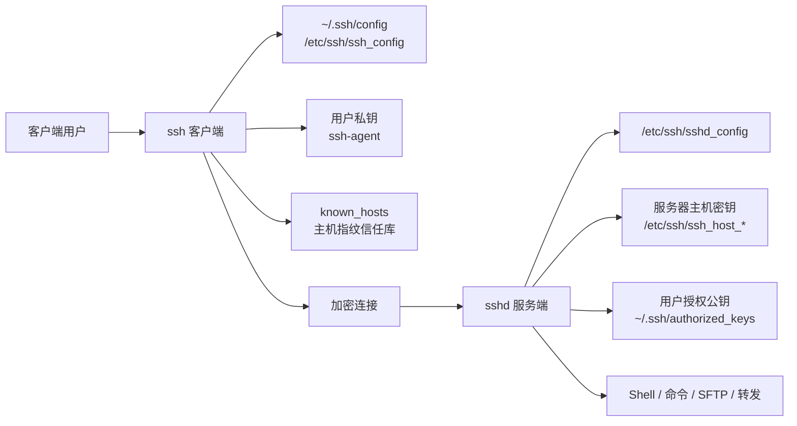

[toc]

## 范围说明

下面把“客户端”上的配置文件包括 Linux、macOS、Windows 桌面上的 `ssh`、`ssh-agent`、`~/.ssh/config`、`known_hosts` 等；

**服务端配置** 主要是`sshd_config`。OpenSSH 官方手册把 `ssh_config(5)` 定义为客户端配置文件，把 `sshd_config(5)` 定义为守护进程配置文件；

官方网页手册说明这些页面反映的是 OpenSSH 最新开发版本，因此实际发行版可能略有差异，学习时应结合本机 `man ssh_config`、`man sshd_config` 校验。([openssh.com](https://www.openssh.com/manual.html))

## 学习大纲

| 模块           | 学什么                                                       | 新手应掌握到什么程度                     |
| -------------- | ------------------------------------------------------------ | ---------------------------------------- |
| 配置文件地图   | 哪些文件属于客户端、客户端、服务端                           | 知道改哪个文件，不把客户端配置写进服务端 |
| 配置优先级     | 命令行、用户配置、系统配置、`Host`、`Match`                  | 能解释为什么某个配置没有生效             |
| 客户端配置     | `Host`、`HostName`、`User`、`Port`、`IdentityFile`、`ProxyJump`、连接复用 | 能把复杂 SSH 命令简化成 `ssh prod`       |
| 客户端密钥管理 | 私钥、公钥、`ssh-agent`、`known_hosts`、Windows 特殊路径     | 能安全保存私钥，并理解主机指纹提示       |
| 服务端配置     | `sshd_config`、认证、用户限制、端口转发、SFTP、日志、`Match` | 能安全开放 SSH 登录，不误锁自己          |
| 安全现代化     | Ed25519、FIDO 密钥、禁用弱算法、`ssh-rsa` 与 RSA 的区别、后量子密钥交换 | 能避免照抄过时教程                       |
| 调试与验证     | `ssh -G`、`ssh -vvv`、`sshd -t`、`sshd -T`                   | 修改配置前后会验证，出错能定位           |

## OpenSSH 配置文件地图

| 类别                   | 文件或目录                                             | 谁读取                 | 作用                                         | 常见注意点                                                   |
| ---------------------- | ------------------------------------------------------ | ---------------------- | -------------------------------------------- | ------------------------------------------------------------ |
| 客户端用户配置         | `~/.ssh/config`                                        | `ssh`、`scp`、`sftp`   | 给不同主机定义别名、用户、端口、密钥、跳板机 | 必须严格权限：用户可读写，不能被其他用户写入。([man.openbsd.org](https://man.openbsd.org/ssh_config)) |
| 客户端系统配置         | `/etc/ssh/ssh_config`                                  | 所有用户的客户端       | 系统默认客户端行为                           | 用户配置通常优先于系统配置。([man.openbsd.org](https://man.openbsd.org/ssh_config)) |
| 客户端片段目录         | `/etc/ssh/ssh_config.d/*.conf`、`~/.ssh/conf.d/*.conf` | 取决于 `Include`       | 拆分配置                                     | `Include` 支持通配符，并按字典序处理；没有绝对路径时，用户配置中相对 `~/.ssh`，系统配置中相对 `/etc/ssh`。([man.openbsd.org](https://man.openbsd.org/ssh_config)) |
| 主机信任库             | `~/.ssh/known_hosts`                                   | 客户端                 | 保存连接过的服务器主机公钥                   | 第一次连接会让用户确认指纹；之后主机密钥变更会触发警告。([man.openbsd.org](https://man.openbsd.org/ssh)) |
| 全局主机信任库         | `/etc/ssh/ssh_known_hosts`                             | 客户端                 | 管理员维护的全局主机公钥                     | 适合企业统一下发可信主机密钥。                               |
| 用户私钥               | `~/.ssh/id_ed25519`、`id_rsa` 等                       | 客户端                 | 用户身份凭据                                 | 私钥等同密码；权限过宽时 `ssh` 会忽略私钥。([man.openbsd.org](https://man.openbsd.org/ssh)) |
| 用户公钥               | `~/.ssh/id_ed25519.pub` 等                             | 放到服务端             | 允许服务端识别用户                           | 公钥可以公开，私钥不能公开。                                 |
| 服务端主配置           | `/etc/ssh/sshd_config`                                 | `sshd`                 | 控制远程登录服务                             | `sshd` 默认读取此文件，命令行 `-f` 可指定其他文件。([man.openbsd.org](https://man.openbsd.org/sshd_config)) |
| 服务端片段目录         | `/etc/ssh/sshd_config.d/*.conf`                        | 取决于 `Include`       | 拆分服务端配置                               | `Include` 可在 `Match` 块内使用，通配符按字典序处理。([man.openbsd.org](https://man.openbsd.org/sshd_config)) |
| 服务端主机密钥         | `/etc/ssh/ssh_host_ed25519_key` 等                     | `sshd`                 | 证明“这台服务器是谁”                         | 主机私钥不能被普通用户读取；服务端默认会使用 Ed25519、ECDSA、RSA 等主机密钥文件。([man.openbsd.org](https://man.openbsd.org/sshd_config)) |
| 授权公钥               | `~/.ssh/authorized_keys`                               | `sshd`                 | 指定哪些用户公钥可登录该账户                 | 每行一个公钥，可带 `restrict`、`command=`、`from=` 等限制。([man.openbsd.org](https://man.openbsd.org/sshd)) |
| Windows 服务端配置     | `%ProgramData%\ssh\sshd_config`                        | Windows OpenSSH Server | Windows 上的 `sshd_config`                   | Windows OpenSSH Server 默认读此路径；服务启动时若缺失可生成默认配置。([Microsoft Learn](https://learn.microsoft.com/en-us/windows-server/administration/openssh/openssh-server-configuration)) |
| Windows 管理员授权公钥 | `%ProgramData%\ssh\administrators_authorized_keys`     | Windows OpenSSH Server | 管理员组用户的公钥登录                       | 管理员组用户默认使用此文件，而不是个人目录下的 `authorized_keys`。([Microsoft Learn](https://learn.microsoft.com/en-us/windows-server/administration/openssh/openssh-server-configuration)) |

## 工作机制示意图



这张图的重点是区分两类身份：

- **服务器主机密钥**用于**让客户端确认**“我连到的是不是正确服务器”；

- **用户密钥**用于**让服务器确认**“这个用户是否有权登录”。

客户端的`known_hosts` 存的是服务器身份，`authorized_keys` 存的是允许登录用户账户的公钥。

## 配置语法与优先级

### 客户端配置读取顺序

OpenSSH 客户端按以下顺序获取配置：命令行选项、用户配置文件 `~/.ssh/config`、系统配置文件 `/etc/ssh/ssh_config`；除非某个选项另有说明，**第一个获得的值会被使用**。这意味着更具体的 `Host` 块应该写在前面，通用默认值应该写在后面。([man.openbsd.org](https://man.openbsd.org/ssh_config))

```sshconfig
Host prod
    HostName 203.0.113.10
    User deploy
    Port 22

Host *
    ServerAliveInterval 30
    IdentitiesOnly yes
```

上例中，`Host prod` 比 `Host *` 更具体，所以应放前面。`Host *` 适合放默认值。

### 服务端配置读取规则

`sshd_config` 由 `sshd` 读取，默认路径通常是 `/etc/ssh/sshd_config`；配置文件由一行一项的 `keyword argument` 组成，空行和 `#` 开头的行是注释，关键字大小写不敏感但参数通常大小写敏感。除非选项另有说明，服务端同样采用“第一个获得的值”。([man.openbsd.org](https://man.openbsd.org/sshd_config))

```sshconfig
# /etc/ssh/sshd_config
Port 22
PermitRootLogin no
PubkeyAuthentication yes
PasswordAuthentication no
```

`sshd` 的命令行选项会覆盖配置文件；服务端收到 `SIGHUP` 时会重新执行自身并重读配置，因此修改配置后通常可以 reload，而不是必须重启整个系统。([man.openbsd.org](https://man.openbsd.org/sshd))

## `Host` 与 `Match` 的核心规则

### 客户端 `Host`

`Host` 用来限制后续配置只对匹配的目标主机生效，直到下一个 `Host` 或 `Match`；`*` 表示所有主机，模式可以用 `!` 否定。因为客户端通常采用第一个命中值，所以配置时应遵循“精确在前，通用在后”。([man.openbsd.org](https://man.openbsd.org/ssh_config))

```sshconfig
Host github.com
    User git
    IdentityFile ~/.ssh/id_ed25519_github
    IdentitiesOnly yes

Host *.corp.example.com
    User alice
    ProxyJump bastion

Host *
    ServerAliveInterval 30
    ServerAliveCountMax 3
```

### 客户端 `Match`

`Match` 比 `Host` 更像条件判断，可按 `user`、`host`、`localuser`、`originalhost`、`exec`、`localnetwork`、`version` 等条件匹配。`localnetwork` 对移动设备很方便，但官方手册也提醒：网络地址不一定可信，例如 DHCP 自动配置场景，所以不要把它作为敏感安全策略的唯一依据。([man.openbsd.org](https://man.openbsd.org/ssh_config))

```sshconfig
Match localnetwork 192.168.10.0/24
    ProxyJump none

Match user root
    IdentitiesOnly yes
```

### 服务端 `Match`

服务端 `Match` 引入条件块，条件满足时后续选项覆盖全局配置，直到下一个 `Match` 或文件结束；可按 `User`、`Group`、`Host`、`LocalAddress`、`LocalPort`、`Address` 等匹配。并非所有服务端选项都能放进 `Match`，手册列出了可用关键词。([man.openbsd.org](https://man.openbsd.org/sshd_config))

```sshconfig
# 默认不允许密码登录
PasswordAuthentication no

# 仅允许内网维护账号临时使用密码
Match User breakglass Address 10.0.0.0/8
    PasswordAuthentication yes
```

## 客户端配置详解

### 常用选项速查

| 选项                  | 用途               | 示例                                  | 新手建议                                 |
| --------------------- | ------------------ | ------------------------------------- | ---------------------------------------- |
| `Host`                | 定义别名或匹配规则 | `Host prod`                           | 别名尽量短且有意义                       |
| `HostName`            | 真实主机名或 IP    | `HostName 203.0.113.10`               | 不要把别名和真实地址混淆                 |
| `User`                | 默认登录用户       | `User deploy`                         | 避免每次写 `user@host`                   |
| `Port`                | 目标 SSH 端口      | `Port 2222`                           | 改端口不是核心安全措施，但能减少噪声扫描 |
| `IdentityFile`        | 指定私钥           | `IdentityFile ~/.ssh/id_ed25519_prod` | 多密钥环境必配                           |
| `IdentitiesOnly`      | 只使用指定身份     | `IdentitiesOnly yes`                  | 避免 agent 里太多 key 导致认证失败       |
| `ProxyJump`           | 跳板机             | `ProxyJump bastion`                   | 优先用它替代复杂 `ProxyCommand`          |
| `ServerAliveInterval` | 客户端协议级保活   | `ServerAliveInterval 30`              | 适合网络不稳定环境                       |
| `ForwardAgent`        | 转发本地 agent     | `ForwardAgent no`                     | 默认不要开，只给可信跳板机开             |
| `ForwardX11`          | X11 图形转发       | `ForwardX11 no`                       | 桌面用户也不要默认开启                   |
| `ControlMaster`       | 连接复用           | `ControlMaster auto`                  | 适合频繁连接同一主机                     |

`IdentityFile` 默认会尝试多种常见身份文件，如 `id_rsa`、`id_ecdsa`、`id_ed25519`、安全密钥相关的 `id_ecdsa_sk`、`id_ed25519_sk`；多个 `IdentityFile` 会按顺序尝试，这一点和很多“第一个值生效”的选项不同。([man.openbsd.org](https://man.openbsd.org/ssh_config))

### 推荐客户端模板

```sshconfig
# ~/.ssh/config

Host bastion
    HostName bastion.example.com
    User alice
    IdentityFile ~/.ssh/id_ed25519_bastion
    IdentitiesOnly yes
    ForwardAgent no
    ServerAliveInterval 30
    ServerAliveCountMax 3

Host prod-*
    User deploy
    IdentityFile ~/.ssh/id_ed25519_prod
    IdentitiesOnly yes
    ProxyJump bastion
    StrictHostKeyChecking yes
    UpdateHostKeys yes

Host prod-web-1
    HostName 10.20.1.11

Host prod-db-1
    HostName 10.20.2.11

Host github.com
    User git
    IdentityFile ~/.ssh/id_ed25519_github
    IdentitiesOnly yes

Host *
    AddKeysToAgent no
    ForwardAgent no
    ForwardX11 no
    ServerAliveInterval 30
    ServerAliveCountMax 3
```

`ProxyJump` 可以指定一个或多个跳板，多个跳板用逗号分隔，客户端会先连跳板再建立到最终目标的 TCP 转发；命令行 `ssh -J jump target` 是 `ProxyJump` 的快捷方式。([man.openbsd.org](https://man.openbsd.org/ssh_config))

### 主机密钥与 `known_hosts`

第一次连接新服务器时，客户端会显示服务器主机公钥指纹，用户确认后写入 `known_hosts`；以后如果同一主机的密钥改变，客户端会拒绝或警告，这正是为了发现中间人攻击或服务器重装后的身份变化。([man.openbsd.org](https://man.openbsd.org/ssh))

| 选项                        | 含义                                                         | 建议                                    |
| --------------------------- | ------------------------------------------------------------ | --------------------------------------- |
| `StrictHostKeyChecking yes` | 不自动接受新主机密钥，主机密钥改变则拒绝连接                 | 生产环境、自动化环境推荐                |
| `StrictHostKeyChecking ask` | 新主机询问用户，密钥改变拒绝或警告                           | 个人桌面常见                            |
| `StrictHostKeyChecking no`  | 更宽松，可能自动接受                                         | 不建议用于生产                          |
| `UpdateHostKeys yes`        | 已信任主机认证完成后，接受服务端发送的额外主机密钥，方便轮换 | 推荐用于支持该扩展的现代 OpenSSH 服务端 |

`UpdateHostKeys` 的作用是让客户端学习服务器的其他主机密钥，支持平滑轮换；它只在一定前提下自动启用，例如用户没有改写默认 `UserKnownHostsFile` 且没有启用 `VerifyHostKeyDNS`。([man.openbsd.org](https://man.openbsd.org/ssh_config))

## 客户端密钥与 agent

### 私钥、公钥、agent 的关系

私钥文件相当于你的登录凭据，必须保护；公钥放到服务器账户的 `authorized_keys` 中；`ssh-agent` 用来在本机安全上下文中缓存已解锁的私钥，避免每次输入 passphrase。Windows 官方文档也强调，私钥等同密码，拿到私钥的人可登录你有权限的 SSH 服务器；生成密钥时通常不建议使用空 passphrase。([Microsoft Learn](https://learn.microsoft.com/en-us/windows-server/administration/openssh/openssh_keymanagement))

```bash
# 推荐：普通软件密钥
ssh-keygen -t ed25519 -f ~/.ssh/id_ed25519_prod -C "alice prod 2026"

# 如果使用 FIDO2/U2F 硬件安全密钥，常见为：
ssh-keygen -t ed25519-sk -f ~/.ssh/id_ed25519_sk_prod -C "alice prod security-key 2026"
```

### Windows 客户端特殊点

Windows OpenSSH Server 默认读取 `%ProgramData%\ssh\sshd_config`；Windows OpenSSH Client 默认读取 `%USERPROFILE%\.ssh\config`。Windows 管理员组用户做公钥登录时，默认使用 `%ProgramData%\ssh\administrators_authorized_keys`，并且该文件需要严格 ACL 权限。([Microsoft Learn](https://learn.microsoft.com/en-us/windows-server/administration/openssh/openssh-server-configuration))

Windows OpenSSH 与 Unix/Linux OpenSSH 不完全一致：例如 Windows 文档明确列出部分 `sshd_config` 指令不可用，`PermitRootLogin` 在 Windows 上不适用，限制管理员登录应使用 `DenyGroups Administrators` 这类方式。([Microsoft Learn](https://learn.microsoft.com/en-us/windows-server/administration/openssh/openssh-server-configuration))

## 服务端 `sshd_config` 详解

### 常用选项速查

| 选项                           | 作用                      | 常见安全建议                           |
| ------------------------------ | ------------------------- | -------------------------------------- |
| `Port`                         | 监听端口                  | 可以改，但不要把“改端口”当主要安全控制 |
| `ListenAddress`                | 限制监听地址              | 多网卡服务器建议只监听管理网           |
| `PermitRootLogin`              | 控制 root 是否可 SSH 登录 | 通常设为 `no`                          |
| `PubkeyAuthentication`         | 是否允许公钥认证          | 通常 `yes`                             |
| `PasswordAuthentication`       | 是否允许密码认证          | 互联网暴露主机通常设为 `no`            |
| `KbdInteractiveAuthentication` | 是否允许键盘交互认证      | 使用 PAM/MFA 时要理解其影响            |
| `AuthenticationMethods`        | 要求多种认证组合          | 可实现“公钥 + 密码/MFA”                |
| `AllowUsers` / `AllowGroups`   | 只允许特定用户/组         | 比全员开放更稳妥                       |
| `DenyUsers` / `DenyGroups`     | 拒绝特定用户/组           | 拒绝规则优先级要小心                   |
| `MaxAuthTries`                 | 单连接最大认证尝试        | 降低爆破尝试空间                       |
| `MaxStartups`                  | 未认证并发连接限制        | 面向公网时很重要                       |
| `ClientAliveInterval`          | 服务端协议级保活          | 可清理断线会话                         |
| `AllowTcpForwarding`           | 是否允许 TCP 转发         | 不需要就关；需要时尽量按用户限制       |
| `X11Forwarding`                | 是否允许 X11 转发         | 服务器默认通常不需要                   |
| `ForceCommand`                 | 强制执行命令              | SFTP-only、备份账号常用                |
| `ChrootDirectory`              | 登录后切换根目录          | SFTP 隔离常用，但权限要求严格          |

`PasswordAuthentication` 默认值在 OpenSSH 手册中是 `yes`，`PubkeyAuthentication` 默认值是 `yes`；`PermitRootLogin` 支持 `yes`、`prohibit-password`、`forced-commands-only`、`no`，默认是 `prohibit-password`，表示 root 不能用密码或键盘交互认证登录。([man.openbsd.org](https://man.openbsd.org/sshd_config))

### 推荐服务端基线

```sshconfig
# /etc/ssh/sshd_config

Port 22
Protocol 2

# 主机密钥通常由系统生成；不要随意复制其他机器的主机私钥
HostKey /etc/ssh/ssh_host_ed25519_key
HostKey /etc/ssh/ssh_host_ecdsa_key
HostKey /etc/ssh/ssh_host_rsa_key

PermitRootLogin no
PubkeyAuthentication yes
PasswordAuthentication no
KbdInteractiveAuthentication no
PermitEmptyPasswords no

AllowGroups ssh-login

MaxAuthTries 3
MaxSessions 10
MaxStartups 10:30:60

X11Forwarding no
AllowAgentForwarding no
AllowTcpForwarding no
PermitTunnel no

ClientAliveInterval 300
ClientAliveCountMax 2

Subsystem sftp internal-sftp
```

`MaxStartups` 用于限制同时处于未认证状态的连接数，支持 `start:rate:full` 形式；默认 `10:30:100` 表示未认证连接达到 10 个后按 30% 概率随机丢弃，直到 100 个时全部拒绝。([man.openbsd.org](https://man.openbsd.org/sshd_config))

### 只允许指定用户或组

```sshconfig
AllowGroups ssh-login
DenyUsers oldadmin test
```

`AllowUsers` 可按用户名或 `USER@HOST` 限制来源，`DenyUsers` 命中的用户不会再咨询 `AllowUsers`；组规则也有类似逻辑。Windows 上用户和组规则还有大小写、域账户格式等特殊要求，需按 Microsoft 文档处理。([man.openbsd.org](https://man.openbsd.org/sshd_config))

### 公钥登录与 `authorized_keys`

服务端通过 `AuthorizedKeysFile` 指定用户公钥文件，默认是 `.ssh/authorized_keys .ssh/authorized_keys2`；路径可以是绝对路径，也可以相对于用户家目录。([man.openbsd.org](https://man.openbsd.org/sshd_config))

```text
ssh-ed25519 AAAAC3NzaC1lZDI1NTE5AAAAI... alice@laptop
```

更安全的自动化 key 应该加限制，例如只允许从特定来源执行固定命令：

```text
restrict,from="203.0.113.0/24",command="/usr/local/bin/backup-receive" ssh-ed25519 AAAAC3... backup@host
```

`authorized_keys` 的 `restrict` 会禁用端口转发、agent 转发、X11 转发、PTY 分配和 `~/.ssh/rc`；`command=` 可强制该 key 只能执行固定命令；`from=` 可限制来源地址或主机模式；`permitopen`、`permitlisten` 可分别限制 `-L` 与 `-R` 转发。([man.openbsd.org](https://man.openbsd.org/sshd))

### SFTP-only 用户

```sshconfig
Subsystem sftp internal-sftp

Match Group sftp-only
    ChrootDirectory /srv/sftp/%u
    ForceCommand internal-sftp
    PasswordAuthentication no
    PubkeyAuthentication yes
    X11Forwarding no
    AllowAgentForwarding no
    AllowTcpForwarding no
    PermitTTY no
```

`ChrootDirectory` 要求路径的所有组成目录都由 root 拥有，且不能被组或其他用户写入；若使用内置 `internal-sftp`，SFTP chroot 通常不需要额外准备 shell 与设备文件。`ForceCommand internal-sftp` 常与 chroot 配合，但官方手册提醒，`ForceCommand` 本身不会自动限制 TCP、agent、socket、X11 等其他访问能力，不需要的转发要显式关闭，或使用 `DisableForwarding`。([man.openbsd.org](https://man.openbsd.org/sshd_config))

## 端口转发与跳板机

### 客户端转发类型

| 类型     | 命令                                          | 含义                         |
| -------- | --------------------------------------------- | ---------------------------- |
| 本地转发 | `ssh -L 127.0.0.1:5432:db:5432 bastion`       | 本机端口转到远端网络里的目标 |
| 远程转发 | `ssh -R 127.0.0.1:8080:localhost:3000 server` | 远端端口转回本机服务         |
| 动态转发 | `ssh -D 127.0.0.1:1080 bastion`               | 本机开 SOCKS 代理            |
| 跳板机   | `ssh -J bastion target`                       | 先连 bastion，再连 target    |

服务端 `AllowTcpForwarding` 控制是否允许 TCP 转发，可设为 `yes/all`、`no`、`local`、`remote`；但官方手册也提醒，如果用户仍有 shell 权限，单独禁用 TCP forwarding 并不能提供完整安全隔离，因为用户可以运行自己的转发程序。([man.openbsd.org](https://man.openbsd.org/sshd_config))

### 跳板机推荐客户端写法

```sshconfig
Host bastion
    HostName bastion.example.com
    User alice
    IdentityFile ~/.ssh/id_ed25519_bastion
    IdentitiesOnly yes

Host 10.30.* *.internal.example.com
    User deploy
    ProxyJump bastion
    IdentityFile ~/.ssh/id_ed25519_internal
    IdentitiesOnly yes
```

这样你可以直接：

```bash
ssh 10.30.1.25
```

而不必每次写：

```bash
ssh -J alice@bastion.example.com deploy@10.30.1.25
```

## 现代安全实践

### 密钥算法选择

| 场景             | 推荐                                         | 避免                                     |
| ---------------- | -------------------------------------------- | ---------------------------------------- |
| 新建普通用户密钥 | `ed25519`                                    | `dsa`                                    |
| 新建硬件安全密钥 | `ed25519-sk` 或 `ecdsa-sk`                   | 把硬件 key 当万能免密 key 使用           |
| 兼容旧系统       | RSA key 但使用 `rsa-sha2-256/512` 签名       | 重新启用 `ssh-rsa` 作为长期方案          |
| 主机密钥         | Ed25519 + ECDSA + RSA 组合                   | 所有服务器复制同一份主机私钥             |
| 自动化 key       | passphrase + agent，或受限 `authorized_keys` | 无限制、无来源限制、无命令限制的长期 key |

不要把 `ssh-rsa` 简单理解成“RSA 密钥”。在 OpenSSH 语境中，`ssh-rsa` 特指 RSA/SHA1 签名方案；RSA 密钥本身可以使用 `rsa-sha2-256` 或 `rsa-sha2-512`。OpenSSH 8.8 默认禁用了 RSA/SHA1，是因为 SHA-1 已被认为不安全；如果必须临时连接旧系统，可以针对单个主机加 `HostkeyAlgorithms +ssh-rsa`、`PubkeyAcceptedAlgorithms +ssh-rsa`，但官方建议这只能作为升级前的临时措施。([openssh.com](https://www.openssh.com/releasenotes.html))

DSA 也不应再用于新配置。OpenSSH 发布说明指出，DSA 在 SSHv2 中受限于 160 位私钥和 SHA1，安全级别约 80 位，并且 OpenSSH 早已默认禁用，后续走向移除。([openssh.com](https://www.openssh.com/releasenotes.html))

### 后量子密钥交换

OpenSSH 自 9.0 起默认提供后量子 key agreement；OpenSSH 9.9 加入 `mlkem768x25519-sha256`，OpenSSH 10.0 将其作为默认方案；OpenSSH 10.1 开始在连接协商到非后量子密钥交换时默认警告用户，这与“先存储、未来解密”的风险有关。([openssh.com](https://www.openssh.com/pq.html))

实践上，不建议新手手动乱改 `KexAlgorithms`、`Ciphers`、`MACs`。现代 OpenSSH 默认算法通常比网上旧教程安全；只有在合规、兼容旧设备或排错时，才针对单个主机最小化调整。

### agent 转发与 X11 转发

`ForwardAgent` 不会把私钥文件复制到远端，但远端若能访问转发出来的 agent socket，就可以让你的 agent 帮它做签名，从而“借用”你已加载的身份。官方手册明确建议谨慎开启 agent 转发。([man.openbsd.org](https://man.openbsd.org/ssh_config))

`ForwardX11` 也不应默认开启；官方手册提醒，X11 转发可能暴露客户端显示环境，尤其在可信 X11 转发下，远端程序可能进行按键监听等操作。([man.openbsd.org](https://man.openbsd.org/ssh_config))

推荐模式：

```sshconfig
Host *
    ForwardAgent no
    ForwardX11 no

Host trusted-bastion
    ForwardAgent yes
```

更好的做法是：不要通过 agent 转发登录下一跳，而是使用 `ProxyJump` 让本地客户端直接完成到目标主机的认证。

## 配置验证与排错

### 客户端排错命令

| 命令                                                       | 用途                                        |
| ---------------------------------------------------------- | ------------------------------------------- |
| `ssh -G prod`                                              | 打印 `Host`、`Match` 计算后的最终客户端配置 |
| `ssh -vvv prod`                                            | 查看连接、主机密钥、认证、转发等详细过程    |
| `ssh -Q key`                                               | 查看本机支持的 key 类型                     |
| `ssh -Q kex`                                               | 查看本机支持的密钥交换算法                  |
| `ssh -o IdentitiesOnly=yes -i ~/.ssh/id_ed25519 user@host` | 排除 agent 中其他 key 干扰                  |

`ssh -G` 会在计算 `Host` 与 `Match` 后打印最终配置，`ssh -v` 会输出调试信息，多个 `v` 最多增加到 3 级详细度。([man.openbsd.org](https://man.openbsd.org/ssh))

### 服务端排错命令

| 命令                                                         | 用途                                    |
| ------------------------------------------------------------ | --------------------------------------- |
| `sudo sshd -t`                                               | 只检查配置语法和主机密钥是否合理        |
| `sudo sshd -T`                                               | 打印服务端最终有效配置                  |
| `sudo sshd -T -C user=alice,addr=203.0.113.5,host=client.example.com` | 模拟某个连接，查看 `Match` 后的有效配置 |
| `journalctl -u ssh` 或 `journalctl -u sshd`                  | systemd 发行版查看日志                  |
| `sudo tail -f /var/log/auth.log`                             | Debian/Ubuntu 常见认证日志              |
| `sudo tail -f /var/log/secure`                               | RHEL 系常见认证日志                     |

`sshd -t` 是测试模式，只检查配置文件有效性和密钥合理性；`sshd -T` 会检查并输出有效配置，且可结合 `-C` 模拟 `Match` 条件。([man.openbsd.org](https://man.openbsd.org/sshd))

## 常见问题与判断方法

| 现象                                      | 常见原因                                                     | 检查方式                                                   |
| ----------------------------------------- | ------------------------------------------------------------ | ---------------------------------------------------------- |
| 明明写了 `IdentityFile`，却仍尝试很多 key | agent 中有多个 key，未设置 `IdentitiesOnly yes`              | `ssh -vvv host`                                            |
| 改了 `~/.ssh/config` 没生效               | 更早的 `Host` 块已经给了第一个值                             | `ssh -G host`                                              |
| 公钥登录失败，仍要求密码                  | 服务端 `authorized_keys` 路径、权限、用户不匹配              | 看服务端日志，检查 `AuthorizedKeysFile`                    |
| Windows 管理员公钥登录失败                | 公钥放错到个人 `authorized_keys`，应使用 `administrators_authorized_keys` | 查 `%ProgramData%\ssh\administrators_authorized_keys` 权限 |
| 修改 `sshd_config` 后无法连接             | 配置语法错或 `Match` 误伤用户                                | 修改前先开备用会话，执行 `sshd -t`                         |
| SFTP chroot 登录失败                      | chroot 目录不是 root 拥有，或可被普通用户写                  | 检查目录链权限                                             |
| `REMOTE HOST IDENTIFICATION HAS CHANGED`  | 服务器重装、主机密钥轮换，或存在中间人风险                   | 先核对服务器真实指纹，再清理 `known_hosts`                 |
| 旧服务器连不上，提示 `ssh-rsa`            | 旧服务端只支持 RSA/SHA1                                      | 临时对单主机启用 `+ssh-rsa`，长期升级服务端                |

## 推荐配置组合

### 个人桌面开发者

```sshconfig
# ~/.ssh/config

Host github.com
    User git
    IdentityFile ~/.ssh/id_ed25519_github
    IdentitiesOnly yes

Host lab
    HostName 192.168.56.10
    User dev
    IdentityFile ~/.ssh/id_ed25519_lab
    IdentitiesOnly yes
    ServerAliveInterval 30

Host *
    ForwardAgent no
    ForwardX11 no
    AddKeysToAgent no
```

### 小型服务器

```sshconfig
# /etc/ssh/sshd_config

Port 22
PermitRootLogin no
PubkeyAuthentication yes
PasswordAuthentication no
KbdInteractiveAuthentication no
PermitEmptyPasswords no

AllowGroups ssh-login

MaxAuthTries 3
MaxStartups 10:30:60

X11Forwarding no
AllowAgentForwarding no
AllowTcpForwarding no
PermitTunnel no

ClientAliveInterval 300
ClientAliveCountMax 2

Subsystem sftp internal-sftp
```

### 跳板机

```sshconfig
# /etc/ssh/sshd_config on bastion

PermitRootLogin no
PubkeyAuthentication yes
PasswordAuthentication no
AllowGroups bastion-users

AllowTcpForwarding local
X11Forwarding no
AllowAgentForwarding no
PermitTunnel no

MaxAuthTries 3
MaxStartups 20:30:100
```

客户端：

```sshconfig
Host bastion
    HostName bastion.example.com
    User alice
    IdentityFile ~/.ssh/id_ed25519_bastion
    IdentitiesOnly yes

Host *.internal.example.com
    User deploy
    ProxyJump bastion
    IdentityFile ~/.ssh/id_ed25519_internal
    IdentitiesOnly yes
```

## 新手实践顺序

先在客户端生成一个带 passphrase 的 Ed25519 key，把公钥加入测试服务器的 `~/.ssh/authorized_keys`。然后写一个最小 `~/.ssh/config`，用 `ssh -G alias` 验证最终配置，再用 `ssh -vvv alias` 观察认证过程。确认公钥登录稳定后，服务端再逐步设置 `PasswordAuthentication no`、`PermitRootLogin no`、`AllowGroups ssh-login`，每次修改都先运行 `sshd -t`，并保留一个已登录的备用管理会话，避免把自己锁在服务器外。