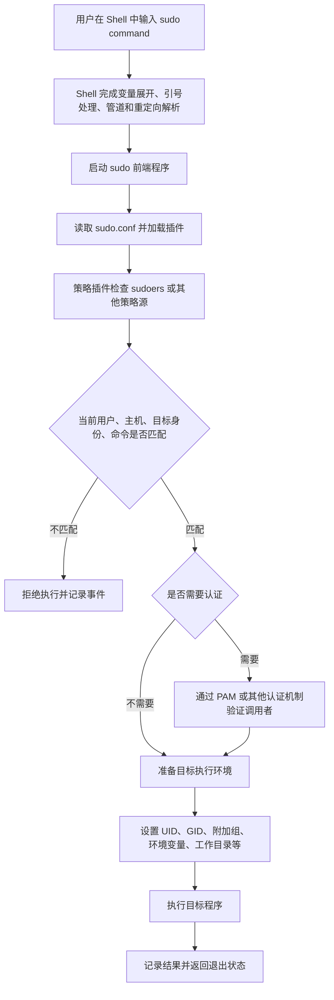

[toc]


## sudo 命令系统学习指南

以下内容按“先理解、再使用、后配置、重安全”的路线编排，并区分日常使用与管理员策略配置。

> 适用范围：Linux、BSD、macOS 等类 Unix 系统。
>
> 不同操作系统、发行版和软件版本可能采用不同的编译选项、PAM 配置及默认策略，因此实际操作时应优先查看本机的 `sudo --version`、`man sudo`、`man sudoers` 和 `man visudo`。
>
> 截至 2026 年 7 月 27 日，Sudo 项目上游公开的稳定版本为 `1.9.17p2`。发行版仓库中的版本可能更旧，也可能带有发行版补丁。([GitHub](https://github.com/sudo-project/sudo/releases))

## 内容编排思路

学习 `sudo` 时，最容易出现的误区是把它简单理解成“在命令前加上 sudo 就变成 root”。更准确的学习路径是：

| 学习层次   | 核心问题                 | 学习目标                            |
| ---------- | ------------------------ | ----------------------------------- |
| 基础认识   | `sudo` 到底做了什么      | 理解身份、权限和进程之间的关系      |
| 日常使用   | 常用参数如何使用         | 能安全执行单个管理命令              |
| Shell 关系 | 重定向、管道为何经常失效 | 理解哪些操作由 Shell 负责           |
| 策略配置   | 谁能以谁的身份运行什么   | 能读懂基本 `sudoers` 规则           |
| 安全控制   | 怎样实现最小权限         | 避免 `ALL`、通配符和 Shell 逃逸风险 |
| 自动化     | 脚本如何调用 sudo        | 避免脚本卡在密码提示或泄露密码      |
| 审计排错   | 如何查看规则和日志       | 能定位授权、认证、路径及配置问题    |

------

## sudo 是什么

`sudo` 是一个**权限委派工具**。它允许经过授权的用户，**以另一个用户的身份执行命令**；默认目标用户通常是超级用户 `root`。

名称通常被解释为：

- **superuser do**：以超级用户身份执行。
- **substitute user do**：以替代用户身份执行。

后一种解释更符合**现代** `sudo` 的功能，因为它不仅能切换到 `root`，还可以通过 `-u` 指定其他用户。

Sudo 项目的核心理念不是让用户长期拥有 root 身份，而是**仅授予完成工作所需的最少权限**，并记录特权活动。([GitHub](https://github.com/sudo-project/sudo))

最基本的形式是：

```bash
sudo command [arguments...]
```

例如：

```bash
sudo systemctl restart nginx
```

这里并不是当前 Shell 变成了 root，而是：

1. 当前 Shell 解析命令行。
2. Shell 启动 `sudo` 进程。
3. `sudo` 查询安全策略。
4. 必要时验证调用者身份。
5. `sudo` 创建或调整执行环境。
6. 目标程序以被授权的用户身份运行。
7. 程序结束后，当前 Shell 仍然是原来的普通用户 Shell。

可以通过下面的命令观察身份：

```bash
whoami
sudo whoami
whoami
```

典型输出：

```text
alice
root
alice
```

因此，`sudo` 提升的是**目标进程的权限**，而不是永久改变当前登录用户。

------

## sudo 的工作机制



默认的 `sudoers` 策略通常由 `/etc/sudoers` 和它包含的其他策略文件控制。现代 sudo 采用插件架构，可以分别加载策略插件、审计插件和输入输出日志插件。([man7.org](https://man7.org/linux/man-pages/man5/sudoers.5.html))

------

## sudo 不等于什么

### sudo 不等于登录 root

```bash
sudo command
```

只为一个命令创建特权执行环境。

而：

```bash
sudo -i
```

会**启动目标用户的登录式 Shell**，通常是 root 登录环境(使用`sudo -u <user> -i`来指定非root用户)。

后者的权限范围更大、持续时间更长，也更容易误操作。

### sudo 不会自动提升整行 Shell 语法

Shell 会先处理：

- 变量展开
- 通配符展开
- 重定向
- 管道
- 命令替换
- Here Document
- `&&`、`||`、`;` 等控制操作符

随后才启动 `sudo`。

因此，下面的命令并不意味着整行都由 root 执行：

```bash
sudo command > file
```

`command` 由 `sudo` 启动，但 `> file` 是当前普通用户 Shell 处理的。

### sudo 不是权限隔离沙箱

当一个程序被允许以 root 身份运行后，它通常可以执行该程序本身具备的全部功能。

例如，编辑器、分页器、解释器和某些管理工具可能支持：

- 启动 Shell
- 执行外部程序
- 写入任意文件
- 加载插件
- 运行脚本
- 修改服务配置

因此，“只允许运行一个命令”并不一定意味着“只允许完成一个操作”。

------

## sudo、su 和 root Shell 的区别

| 方式                      | 默认认证对象             | 权限持续范围     | 审计粒度             | 典型用途             |
| ------------------------- | ------------------------ | ---------------- | -------------------- | -------------------- |
| `sudo command`            | 通常验证当前调用者       | 单个命令         | 较细，可记录命令     | 推荐的日常管理方式   |
| `sudo -u user command`    | 通常验证当前调用者       | 单个命令         | 较细                 | 以服务账户身份操作   |
| `sudo -i`或`sudo --login` | 通常验证当前调用者       | 一个登录式 Shell | 后续命令粒度可能降低 | 集中完成多项管理任务 |
| `sudo -s`                 | 通常验证当前调用者       | 一个 Shell       | 后续命令粒度可能降低 | 临时特权 Shell       |
| `su user`                 | 通常**验证目标用户密码** | 一个 Shell       | 通常较粗             | 切换账户             |
| 直接登录 root             | root 凭据                | 整个会话         | 较粗                 | 恢复、救援或特殊环境 |

`sudoers` 默认验证的是调用者自己的凭据，而不是目标用户或 root 的密码；管理员可以通过策略改变该行为。([man7.org](https://man7.org/linux/man-pages/man5/sudoers.5.html))

最佳实践通常是：

```bash
sudo specific-command
```

而不是：

```bash
sudo -i
```

原因是单命令授权更容易审计，也能减少在 root Shell 中误执行普通命令的概率。

> 默认相当于`sudo -u root -i`.通过指定`-u`来指定用户身份

------

## 检查本机 sudo

### 查看版本

```bash
sudo --version
```

普通用户通常能看到版本和插件版本；以 root 身份执行时，往往还能看到更多编译参数。

### 查看程序位置

```bash
command -v sudo
type -a sudo
```

### 查看本机手册

```bash
man sudo
man sudoers
man visudo
man sudoedit
man sudo.conf
```

本机手册应优先于网络教程，因为以下内容可能因系统而不同：

- sudo 版本
- 文件路径
- 日志位置
- PAM 策略
- `secure_path`
- 认证缓存时间
- 是否启用输入输出日志
- 是否支持 `INTERCEPT`
- 是否启用 SELinux 或其他强制访问控制

------

## 最常用的 sudo 命令

### 执行单个命令

```bash
sudo id
sudo systemctl status sshd
sudo mkdir -p /srv/example
```

### 以其他用户身份执行

```bash
sudo -u postgres id
sudo -u www-data command
```

例如，以 PostgreSQL 服务账户进入数据库客户端：

```bash
sudo -u postgres psql
```

是否允许该操作取决于 sudo 策略。

### 指定目标主组

```bash
sudo -g developers command
```

同时指定用户和组：

```bash
sudo -u appuser -g appgroup command
```

### 查看自己被授予的权限

```bash
sudo -l
```

显示更详细的规则：

```bash
sudo -ll
```

检查某个具体命令是否获准：

```bash
sudo -l /usr/bin/systemctl
```

管理员查看其他用户的权限时可使用：

```bash
sudo -l -U alice
```

但 `-U` 本身也受到策略限制。([man7.org](https://man7.org/linux/man-pages/man5/sudoers.5.html))

------

## 常用参数速查

| 参数                  | 英文含义                      | 作用                             | 使用建议                    |
| --------------------- | ----------------------------- | -------------------------------- | --------------------------- |
| `-u user`             | user                          | 指定目标用户                     | 比进入 root Shell 更精确    |
| `-g group`            | group                         | 指定目标主组                     | 仅在确有组身份需求时使用    |
| `-l`                  | list                          | 列出允许执行的命令               | 排错时优先使用              |
| `-ll`                 | long list                     | 详细列出规则                     | 查看参数、标签和 RunAs 信息 |
| `-v`                  | validate                      | 刷新认证缓存但不执行命令         | 开始一组管理操作前使用      |
| `-k`                  | invalidate                    | 使当前会话的认证时间戳失效       | 完成管理工作后使用          |
| `-K`                  | remove timestamp              | 删除该用户的全部 sudo 缓存记录   | 比 `-k` 范围更大            |
| `-n`                  | non-interactive               | 禁止交互式询问密码               | 自动化脚本推荐使用          |
| `-i`                  | login                         | 启动目标用户的登录式 Shell       | 谨慎使用                    |
| `-s`                  | shell                         | 启动 Shell，但不完全模拟登录     | 谨慎使用                    |
| `-H`                  | set HOME                      | 请求将 `HOME` 设置为目标用户目录 | 行为仍受策略控制            |
| `-E`                  | preserve environment          | 请求保留环境变量                 | 风险较高，可能被策略拒绝    |
| `--preserve-env=LIST` | preserve selected environment | 只请求保留指定变量               | 优于无差别使用 `-E`         |
| `-e`                  | edit                          | 使用 `sudoedit` 安全编辑文件     | 优于直接 `sudo vim file`    |
| `-D directory`        | chdir                         | 在指定工作目录中执行             | 必须得到策略允许            |
| `-T duration`         | command timeout               | 设置命令运行超时                 | 需要策略显式允许            |
| `--`                  | end of options                | 结束 sudo 参数解析               | 命令参数以 `-` 开头时使用   |

相关参数的可用性和具体行为由 sudo 版本及安全策略共同决定。([man7.org](https://man7.org/linux/man-pages/man8/sudoedit.8.html?utm_source=chatgpt.com))

------

## 认证与时间戳缓存

多数系统不会在每次调用 `sudo` 时都要求输入密码，而是保存一个短期认证状态，称为凭据缓存或时间戳记录（timestamp record）。

上游 `sudoers` 的典型默认值是：

- 缓存时间：5 分钟。
- 缓存粒度：每个终端分别记录。
- 时间戳类型：`tty`。

也就是说，在一个终端完成认证，不一定能让另一个终端直接获得相同的认证状态。([man7.org](https://man7.org/linux/man-pages/man5/sudoers.5.html))

### 刷新缓存

```bash
sudo -v
```

它会进行必要的认证并更新时间戳，但不运行管理命令。

### 让当前缓存失效

```bash
sudo -k
```

下一次调用通常会重新认证。

### 删除全部缓存记录

```bash
sudo -K
```

`-K` 会删除该用户的所有缓存记录，不仅限于当前终端。([man7.org](https://man7.org/linux/man-pages/man8/sudoedit.8.html?utm_source=chatgpt.com))

### 推荐的管理操作流程

```bash
sudo -v
sudo command-one
sudo command-two
sudo -k
```

在共享电脑、远程跳板机或临时终端上，完成管理操作后执行 `sudo -k` 是一个良好习惯。

### 密码输入没有显示是正常现象

默认情况下，sudo 输入密码时：

- 不显示字符。
- 不显示星号。
- 光标可能完全没有变化。

这是终端关闭密码回显后的正常行为，并不代表程序卡死。

------

## sudo 与 Shell 的关键关系

这是新手使用 sudo 时最重要的知识点之一。

### 重定向失败

下面的命令经常失败：

```bash
sudo echo "enabled=true" > /etc/example.conf
```

原因不是 `echo` 没有 root 权限，而是：

1. 当前普通用户 Shell 先尝试打开 `/etc/example.conf`。
2. 文件打开失败。
3. `sudo echo` 甚至可能尚未执行。

#### 使用 tee 写入

```bash
printf '%s\n' 'enabled=true' | sudo tee /etc/example.conf >/dev/null
```

追加内容：

```bash
printf '%s\n' 'another=true' | sudo tee -a /etc/example.conf >/dev/null
```

`tee` 本身由 sudo 以 root 身份执行，因此文件打开和写入也具有目标权限。

#### 使用特权 Shell

```bash
sudo sh -c 'printf "%s\n" "enabled=true" > /etc/example.conf'
```

此时重定向位于传给 root Shell 的字符串中，因此由特权 Shell 处理。

但 `sh -c` 会引入额外的引号、变量展开和命令注入风险。能够使用 `tee`、`install`、`cp` 或专用管理工具时，应优先避免动态拼接 `sh -c` 字符串。

### 管道只提升一侧

```bash
sudo producer | consumer
```

只有 `producer` 经过 sudo。

```bash
producer | sudo consumer
```

只有 `consumer` 经过 sudo。

需要整个管道在目标身份下执行时，可以使用：

```bash
sudo sh -c 'producer | consumer'
```

但必须仔细处理引号和不可信输入。

更安全的思路通常是只提升真正需要权限的一侧。例如：

```bash
generate-config | sudo tee /etc/example.conf >/dev/null
```

### cd 无法改变当前 Shell

下面的命令通常不能达到预期：

```bash
sudo cd /root
```

`cd` 通常是 Shell 内建命令（shell builtin），不是独立程序。即使在子进程中成功改变目录，也无法改变父 Shell 的工作目录。

可以执行：

```bash
sudo sh -c 'cd /root && command'
```

或者在确实需要管理 Shell 时使用：

```bash
sudo -i
```

### 通配符可能在 sudo 之前展开

```bash
sudo rm /root/logs/*
```

`*` 可能由当前 Shell 在普通用户权限下展开。如果普通用户无法读取该目录，通配符可能保持原样，或产生与预期不同的结果。

需要目标 Shell 展开时：

```bash
sudo sh -c 'rm -- /root/logs/*'
```

不过，涉及批量删除时，更推荐先列出匹配结果，并使用专门的清理脚本，而不是直接运行高风险通配符命令。

------

## 环境变量与 PATH

`sudo` 不一定完整继承当前用户的环境变量。

安全策略可能：

- 删除危险变量。
- 只保留允许列表中的变量。
- 替换 `PATH`。
- 设置目标用户的 `HOME`。
- 重置 `USER`、`LOGNAME`。
- 添加 `SUDO_USER`、`SUDO_UID`、`SUDO_GID` 等信息。

常见的 sudo 环境变量包括：

| 变量           | 含义                      |
| -------------- | ------------------------- |
| `SUDO_USER`    | 调用 sudo 的原始用户名    |
| `SUDO_UID`     | 原始用户 UID              |
| `SUDO_GID`     | 原始用户 GID              |
| `SUDO_COMMAND` | sudo 启动的命令及参数     |
| `SUDO_TTY`     | 发起调用的终端            |
| `HOME`         | 由运行模式和策略共同决定  |
| `PATH`         | 可能由 `secure_path` 替换 |

### 查看差异

```bash
env | sort
sudo env | sort
```

不要假设普通用户环境中的以下变量会被保留：

```text
PATH
PYTHONPATH
NODE_PATH
GEM_HOME
VIRTUAL_ENV
LD_LIBRARY_PATH
SSH_AUTH_SOCK
HTTP_PROXY
HTTPS_PROXY
```

### 谨慎使用 -E

```bash
sudo -E command
```

`-E` 只是请求保留环境，策略可以拒绝。允许用户任意保留环境变量可能带来严重风险，因此 sudoers 中的 `SETENV` 权限只应授予可信用户。([man7.org](https://man7.org/linux/man-pages/man5/sudoers.5.html))

比起保留全部环境，更适合显式传递必要变量：

```bash
sudo APP_ENV=production /usr/local/sbin/deploy-app
```

或者：

```bash
sudo --preserve-env=HTTPS_PROXY command
```

前提仍然是策略允许这些变量。

### 使用绝对路径

策略文件和管理脚本中应尽量使用绝对路径：

```bash
/usr/bin/systemctl
/usr/bin/install
/usr/bin/tee
/usr/sbin/nginx
```

不要依赖：

```bash
systemctl
install
tee
nginx
```

`secure_path` 可以让 sudo 使用管理员指定的 `PATH`，从而降低通过恶意 PATH 劫持命令的风险。上游该选项本身并非强制启用，但许多发行版会在默认 sudoers 中配置它。([man7.org](https://man7.org/linux/man-pages/man5/sudoers.5.html))

------

## 登录式 Shell 与普通 Shell

### sudo -i

```bash
sudo -i
```

`-i` 模拟目标用户的初始登录环境，通常会：

- 使用目标用户的登录 Shell。
- 设置目标用户的 `HOME`。
- 切换到目标用户的主目录。
- 设置或重置部分登录环境变量。
- 加载目标用户对应的登录式 Shell 配置。

例如，目标为 root 时，提示符通常会变化：

```text
root@host:~#
```

退出：

```bash
exit
```

### sudo -s

```bash
sudo -s
```

`-s` 启动一个 Shell，但不完全等同于登录 Shell。它通常更依赖调用者现有环境和 `SHELL` 变量，同时仍受 sudoers 环境策略控制。

### 推荐原则

| 场景               | 推荐方式                         |
| ------------------ | -------------------------------- |
| 重启一个服务       | `sudo systemctl restart service` |
| 修改一个配置文件   | `sudoedit file`                  |
| 查看受限日志       | 为具体日志命令配置规则           |
| 连续执行少量命令   | 分别使用 `sudo command`          |
| 救援或复杂系统维护 | 谨慎使用 `sudo -i`               |
| 普通应用安装       | 使用系统包管理器的推荐方式       |

不要因为命令较多就习惯性进入 root Shell。可以先把普通用户能完成的准备工作做好，只对真正需要权限的步骤使用 sudo。

------

## sudoers 策略文件

默认的 `sudoers` 策略通常由以下位置提供：

```text
/etc/sudoers
/etc/sudoers.d/*
```

`sudoers` 文件主要包含两类信息：

- 别名（alias）。
- 用户授权规范（user specification）。

当多条规则都匹配时，规则按解析顺序应用，最后一个匹配项生效；它不一定是“看起来最具体”的那一条。([man7.org](https://man7.org/linux/man-pages/man5/sudoers.5.html))

### 不要直接使用普通编辑器修改

不推荐：

```bash
sudo vim /etc/sudoers
```

推荐：

```bash
sudo visudo
```

`visudo` 会：

- 锁定文件，避免多人同时修改。
- 检查基本有效性。
- 在安装修改后的策略前检查语法。
- 报告错误行号。
- 避免轻易保存一份使 sudo 完全失效的配置。([man7.org](https://man7.org/linux/man-pages/man8/visudo.8.html?utm_source=chatgpt.com))

### 检查现有配置

```bash
sudo visudo -c
```

严格检查：

```bash
sudo visudo -cs
```

`-c` 会检查主文件及其包含文件；检查成功时返回退出状态 `0`，失败时返回 `1`。([man7.org](https://man7.org/linux/man-pages/man8/visudo.8.html?utm_source=chatgpt.com))

### 修改独立规则文件

```bash
sudo visudo -f /etc/sudoers.d/40-myapp
```

完成后检查完整策略：

```bash
sudo visudo -c
```

只检查一个孤立的包含文件并不足以发现所有问题，例如跨文件别名冲突或引用关系。

------

## sudoers.d 文件命名规则

如果主策略包含：

```text
@includedir /etc/sudoers.d
```

sudo 会按词法排序读取该目录中的文件，并跳过：

- 文件名以 `~` 结尾的文件。
- 文件名中包含 `.` 的文件。

这是为了避开编辑器备份文件和软件包管理器生成的临时文件。([man7.org](https://man7.org/linux/man-pages/man5/sudoers.5.html))

推荐文件名：

```text
10-base
20-admins
40-myapp
90-local
```

不推荐：

```text
myapp.conf
myapp.rules
40-myapp.bak
```

由于按词法而不是数值排序：

```text
10_second
1_first
```

其中 `10_second` 可能反而先于 `1_first` 被读取。使用固定宽度的数字前缀可以避免这种问题。([man7.org](https://man7.org/linux/man-pages/man5/sudoers.5.html))

------

## sudoers 规则结构

基本结构可以抽象为：

```text
谁 在哪些主机上 = (以谁和哪个组运行) 标签: 允许的命令
```

通用形式：

```text
User_List Host_List = (Runas_User_List:Runas_Group_List) Tag_Spec: Cmnd_List
```

示例：

```sudoers
alice ALL=(root) /usr/bin/id
```

含义：

| 字段    | 内容          | 含义             |
| ------- | ------------- | ---------------- |
| User    | `alice`       | 被授权的调用者   |
| Host    | `ALL`         | 在任意匹配主机上 |
| RunAs   | `(root)`      | 以 root 身份运行 |
| Command | `/usr/bin/id` | 允许执行的命令   |

### 用户组

用户组名前使用 `%`：

```sudoers
%ops ALL=(root) /usr/bin/id
```

表示 `ops` 组成员可以执行该命令。

### 指定 RunAs 组

```sudoers
alice ALL=(appuser:appgroup) /usr/local/bin/appctl
```

这表示目标用户为 `appuser`，目标主组为 `appgroup`。

### 多条命令

```sudoers
alice ALL=(root) /usr/bin/id, /usr/bin/uptime
```

为了可维护性，实际配置中可使用命令别名。

------

## sudoers 中的别名

支持的主要别名类型包括：

| 别名          | 英文名称      | 用途               |
| ------------- | ------------- | ------------------ |
| `User_Alias`  | User Alias    | 组织用户或用户组   |
| `Host_Alias`  | Host Alias    | 组织主机           |
| `Runas_Alias` | RunAs Alias   | 组织目标用户或组   |
| `Cmnd_Alias`  | Command Alias | 组织允许执行的命令 |

示例：

```sudoers
User_Alias APP_OPERATORS = alice, bob, %appops
Host_Alias APP_SERVERS = app01, app02
Runas_Alias APP_ACCOUNTS = appuser
Cmnd_Alias APP_STATUS = /usr/local/sbin/app-status

APP_OPERATORS APP_SERVERS = (APP_ACCOUNTS) APP_STATUS
```

别名的价值主要是：

- 避免重复。
- 表达业务含义。
- 降低批量修改成本。
- 提高审查可读性。

别名名称通常使用大写字母、数字和下划线。

------

## 命令和参数匹配

这是 sudoers 配置中最容易产生严重漏洞的部分。

### 只写命令路径通常允许任意参数

```sudoers
alice ALL=(root) /usr/bin/systemctl
```

这通常不是“允许查看服务状态”，而是允许以 root 身份执行该程序并传递任意参数。

这可能包括大量管理能力。

### 指定固定参数

```sudoers
alice ALL=(root) /usr/bin/systemctl restart myapp.service
```

只有匹配的命令和参数才被允许。

执行：

```bash
sudo /usr/bin/systemctl restart myapp.service
```

可能获准。

执行：

```bash
sudo /usr/bin/systemctl stop myapp.service
```

不会匹配上述规则。

### 明确禁止任何参数

在命令后使用空参数标记：

```sudoers
alice ALL=(root) /usr/local/sbin/collect-status ""
```

这里的 `""` 表示该命令只能在没有命令行参数的情况下执行。([man7.org](https://man7.org/linux/man-pages/man5/sudoers.5.html))

### 使用本机实际路径

不同系统的命令路径可能不同，配置前检查：

```bash
command -v systemctl
command -v journalctl
command -v install
```

sudoers 中的普通命令通常应使用完整路径。

------

## 通配符与正则表达式

### 通配符不是正则表达式

sudoers 支持 Shell 风格通配符：

- `*`
- `?`
- `[...]`
- `[!...]`

在命令参数中，`*` 可以匹配空格和 `/`，因此风险比许多人想象的更大。

例如：

```sudoers
alice ALL=(root) /usr/bin/tool *
```

可能允许构造远超管理员预期的参数序列。

上游文档明确建议谨慎使用命令参数通配符；多数情况下，用锚定的正则表达式限制参数会更安全。([man7.org](https://man7.org/linux/man-pages/man5/sudoers.5.html))

### 现代 sudoers 正则表达式

从 sudo 1.9.10 开始，命令路径和参数可以使用 POSIX 扩展正则表达式。

规则要求：

- 以 `^` 开头。
- 以 `$` 结尾。
- 命令路径和参数分别匹配。
- 不能用一个正则同时匹配路径和全部参数。
- 最大长度受到限制。([man7.org](https://man7.org/linux/man-pages/man5/sudoers.5.html))

示例：

```sudoers
alice ALL=(root) /usr/bin/systemctl ^(start|stop|restart) myapp\.service$
```

不过，在新手阶段更推荐：

- 固定命令。
- 固定参数。
- 多条明确规则。
- 必要时使用受控包装脚本。

这样通常比复杂正则更容易审计。

------

## sudoers 标签

命令可以带有标签（tag）：

| 标签          | 作用                           | 风险提示               |
| ------------- | ------------------------------ | ---------------------- |
| `PASSWD`      | 执行前需要认证                 | 常规默认思路           |
| `NOPASSWD`    | 不要求输入密码                 | 不会减少命令本身的权限 |
| `SETENV`      | 允许更自由地设置环境变量       | 高风险，仅授予可信用户 |
| `NOSETENV`    | 限制环境变量设置               | 更适合默认使用         |
| `NOEXEC`      | 尝试阻止程序继续启动其他程序   | 不是完整安全边界       |
| `EXEC`        | 取消 `NOEXEC` 效果             | 谨慎使用               |
| `INTERCEPT`   | 对子命令重新进行策略检查和记录 | 依赖系统和编译支持     |
| `NOINTERCEPT` | 关闭子命令拦截                 |                        |
| `LOG_INPUT`   | 记录输入                       | 可能记录敏感内容       |
| `LOG_OUTPUT`  | 记录输出                       | 需考虑隐私和存储空间   |
| `FOLLOW`      | sudoedit 可以跟随符号链接      | 增加风险               |
| `NOFOLLOW`    | sudoedit 不跟随符号链接        | 更安全的方向           |

标签会影响后续命令，直到被相反标签覆盖。([man7.org](https://man7.org/linux/man-pages/man5/sudoers.5.html))

### NOPASSWD 示例

```sudoers
deploy ALL=(root) NOPASSWD: /usr/local/sbin/deploy-myapp ""
```

它表示：

- `deploy` 用户可以以 root 身份运行该脚本。
- 不需要密码。
- 脚本不允许接收参数。

`NOPASSWD` 不代表“低权限”。如果允许的程序可以执行任意命令，那么它仍然等价于无需密码的 root 权限。

### 恢复 PASSWD

```sudoers
alice ALL=(root) NOPASSWD: /usr/bin/id, PASSWD: /usr/bin/systemctl restart myapp.service
```

------

## 不要使用“允许全部，再排除少量”

危险设计：

```sudoers
alice ALL=(root) ALL, !/bin/sh, !/bin/bash
```

这种规则通常无法真正阻止用户取得 Shell，因为用户可能通过以下途径间接执行命令：

- Python、Perl、Ruby 等解释器。
- 编辑器的 Shell 逃逸。
- 分页器的命令功能。
- `find`、`awk` 等可执行外部程序的工具。
- 可写脚本或插件。
- 服务管理器。
- 动态加载机制。
- 复制或重命名命令。
- 其他可执行任意代码的程序。

sudoers 文档明确警告，将 `ALL` 与否定命令结合来实现“除了少数命令外全部允许”，很少能达到预期效果。([man7.org](https://man7.org/linux/man-pages/man5/sudoers.5.html))

应采用正向允许列表：

```sudoers
alice ALL=(root) /usr/local/sbin/safe-operation ""
```

------

## Shell 逃逸问题

一旦 sudo 启动了一个程序，该程序原则上可以执行自身支持的任何操作，包括启动其他程序。

常见高风险类别包括：

| 类别         | 典型风险                           |
| ------------ | ---------------------------------- |
| Shell        | 直接执行任意命令                   |
| 编辑器       | Shell 逃逸、写入其他文件、加载插件 |
| 分页器       | 执行 Shell 命令或打开其他文件      |
| 解释器       | 运行任意代码                       |
| 调试器       | 附加进程、读写内存、启动程序       |
| 压缩归档工具 | 写入任意路径、调用辅助程序         |
| 服务管理工具 | 启动或修改高权限服务               |
| 包管理器     | 安装带脚本的软件包                 |
| 文件同步工具 | 覆盖系统文件、保留所有权或权限     |

上游文档特别指出，Shell、编辑器、分页器、邮件工具和终端程序常带有 Shell 逃逸能力。([man7.org](https://man7.org/linux/man-pages/man5/sudoers.5.html))

### NOEXEC 的局限

```sudoers
alice ALL=(root) NOEXEC: /usr/bin/less
```

`NOEXEC` 可以在支持的系统上阻止动态链接程序继续执行其他程序，但它不是完整安全边界：

- 依赖操作系统和 sudo 编译支持。
- 某些实现依赖动态加载机制。
- 静态链接程序可能不受同样限制。
- 程序仍可能直接读写敏感文件。
- 程序本身可能已经足够强大。

因此，`NOEXEC` 是纵深防御措施，不是授予危险程序 root 权限的充分理由。([man7.org](https://man7.org/linux/man-pages/man5/sudoers.5.html))

### INTERCEPT

`INTERCEPT` 可以在支持的平台上拦截程序启动的子命令，并再次根据 sudoers 策略进行验证和记录。

```sudoers
alice ALL=(root) INTERCEPT: /usr/local/sbin/admin-tool
```

但它也存在兼容性、性能和平台限制，不能替代最小权限设计。([man7.org](https://man7.org/linux/man-pages/man5/sudoers.5.html))

------

## 使用 sudoedit 安全编辑文件

不推荐：

```bash
sudo vim /etc/myapp/myapp.conf
```

更推荐：

```bash
sudoedit /etc/myapp/myapp.conf
```

或者：

```bash
sudo -e /etc/myapp/myapp.conf
```

`sudoedit` 的典型过程是：

1. 以目标权限读取原文件。
2. 创建由调用者拥有的临时副本。
3. 编辑器以普通用户身份编辑临时副本。
4. 编辑完成后，由 sudo 将内容写回原位置。

这样可以避免让整个编辑器以 root 权限运行。

现代 sudoedit 默认还会限制：

- 编辑符号链接。
- 跟随位于用户可写目录中的符号链接。
- 编辑位于调用者可写目录中的文件。
- 编辑设备文件。([man7.org](https://man7.org/linux/man-pages/man8/sudoedit.8.html?utm_source=chatgpt.com))

sudoers 规则中的 `sudoedit` 是内建命令，不应依赖某个外部路径：

```sudoers
alice ALL=(root) sudoedit /etc/myapp/myapp.conf
```

安全编辑通常优于：

```sudoers
alice ALL=(root) /usr/bin/vim /etc/myapp/myapp.conf
```

------

## 使用包装脚本缩小权限

当一个管理任务需要多个步骤时，与其授权多个高风险通用命令，不如提供一个受控包装脚本。

例如：

```text
/usr/local/sbin/restart-myapp
```

sudoers：

```sudoers
%appops ALL=(root) /usr/local/sbin/restart-myapp ""
```

包装脚本应满足：

- 由 root 拥有。
- 普通用户不可写。
- 父目录普通用户不可写。
- 使用固定的绝对命令路径。
- 设置固定、精简的 `PATH`。
- 不使用 `eval`。
- 不执行用户可控路径中的程序。
- 不读取用户可写的高权限配置。
- 对所有输入进行白名单验证。
- 不使用不安全的临时文件。
- 必要时使用文件锁。
- 对失败状态进行明确处理。
- 记录关键操作。
- 默认拒绝未知输入。

文件检查：

```bash
sudo chown root:root /usr/local/sbin/restart-myapp
sudo chmod 0755 /usr/local/sbin/restart-myapp
namei -l /usr/local/sbin/restart-myapp
```

即使脚本文件本身不可写，只要它所在的某个父目录可以被普通用户替换或重命名，仍可能出现安全问题。

------

## 使用命令摘要绑定文件内容

sudoers 支持 SHA-2 命令摘要：

- `sha224`
- `sha256`
- `sha384`
- `sha512`

只有命令文件的摘要匹配时，规则才会生效。([man7.org](https://man7.org/linux/man-pages/man5/sudoers.5.html))

示意：

```sudoers
deploy ALL=(root) sha256:HASH_VALUE /usr/local/sbin/deploy-myapp ""
```

它适合：

- 绑定固定版本的管理脚本。
- 防止授权命令被悄悄替换。
- 对关键自动化工具进行完整性约束。

局限是：

- 脚本每次合法更新后都要更新摘要。
- 脚本调用的其他程序仍需单独考虑。
- 摘要不能修复脚本自身的不安全设计。
- 管理部署和策略更新必须同步。

------

## 配置 NOPASSWD 的正确思路

不推荐：

```sudoers
alice ALL=(ALL) NOPASSWD: ALL
```

这基本等同于允许该账户无需再次认证取得完整管理权限。

较合理的场景包括：

- 自动化账户需要执行一个固定动作。
- 监控系统读取一项固定状态。
- 部署账户运行一个经过审计的固定脚本。
- 关机终端只允许执行特定电源操作。
- 备份账户只允许运行固定备份入口。

推荐：

```sudoers
monitor ALL=(root) NOPASSWD: /usr/local/sbin/read-app-health ""
```

同时应确保：

```text
/usr/local/sbin/read-app-health
```

及其父目录不能被 `monitor` 修改。

### NOPASSWD 的安全问题

需要评估：

- 用户账户被盗后，是否能直接利用该权限。
- 命令是否允许指定配置文件。
- 命令是否支持插件或脚本。
- 命令是否能写任意文件。
- 命令是否能改变目标路径。
- 命令是否能执行外部程序。
- 参数是否包含通配符。
- 环境变量是否可影响行为。
- 是否可通过符号链接或竞态条件绕过限制。

------

## 自动化脚本中的 sudo

### 使用非交互模式

```bash
sudo -n /usr/local/sbin/task
```

`-n` 表示不允许交互式提示。如果需要密码或其他交互，命令立即失败，而不是无限等待。

示例：

```bash
if ! sudo -n /usr/local/sbin/task; then
    printf '%s\n' 'sudo permission unavailable' >&2
    exit 1
fi
```

### 不要把密码写进脚本

危险做法：

```bash
echo "password" | sudo -S command
```

问题包括：

- 密码可能出现在脚本文件中。
- 可能进入版本控制。
- 可能出现在日志、调试输出或终端历史中。
- 其他用户可能读取进程环境或相关文件。
- 密码轮换会使自动化失效。
- 破坏了最小权限设计。

`-S` 表示从标准输入读取密码，它并不是安全保存密码的机制。

自动化应使用：

- 精确的 sudoers 规则。
- `NOPASSWD` 绑定固定命令。
- 受控的 root-owned 包装脚本。
- systemd service 或 timer。
- 专用服务账户。
- 配置管理平台。
- 作业调度器或权限代理。

### 不要在脚本中无条件进入 root Shell

不推荐：

```bash
sudo -i
```

推荐直接执行目标命令：

```bash
sudo -n /usr/local/sbin/deploy-myapp
```

### 保留退出状态

sudo 成功启动目标程序后，通常会返回目标程序的退出状态。因此可以直接判断：

```bash
if sudo -n /usr/local/sbin/check-app; then
    echo "healthy"
else
    echo "failed"
fi
```

------

## 日志与审计

默认 `sudoers` 可以记录被允许和被拒绝的命令事件。上游策略默认启用 `log_allowed` 和 `log_denied`，但输入输出日志默认不启用。([man7.org](https://man7.org/linux/man-pages/man5/sudoers.5.html))

日志位置随系统而异，常见查询方式包括：

```bash
journalctl _COMM=sudo
journalctl -t sudo
```

部分系统可查看：

```bash
grep sudo /var/log/auth.log
grep sudo /var/log/secure
```

应优先使用本系统的日志文档和日志服务。

### 事件日志与输入输出日志的区别

| 日志类型     | 记录内容                     | 适用场景                   |
| ------------ | ---------------------------- | -------------------------- |
| 事件日志     | 谁在何时运行了什么、是否允许 | 常规审计                   |
| 退出状态日志 | 命令返回值或终止信号         | 自动化排错                 |
| 输入日志     | 用户键入或标准输入内容       | 高审计需求，但可能记录秘密 |
| 输出日志     | 终端输出、标准输出和错误     | 会话复盘                   |
| 子命令日志   | 特权程序进一步启动的程序     | Shell、脚本和复杂工具审计  |

### 输入日志可能包含敏感数据

启用 `LOG_INPUT` 或 `log_input` 时，可能记录：

- 密码以外的秘密输入。
- API Token。
- 数据库凭据。
- 私钥内容。
- 业务数据。
- 用户在交互程序中的所有输入。

因此，I/O 日志需要同时考虑：

- 访问控制。
- 加密。
- 日志保留周期。
- 隐私要求。
- 存储容量。
- 删除机制。
- 远程日志服务器的可用性。

### 伪终端默认变化

从 sudo 1.9.14 开始，使用 sudoers 策略时，命令默认通过新的伪终端（pseudo-terminal，PTY）运行。其目的之一是防止特权程序结束后继续访问用户原始终端设备。该模式会增加一个监控进程，用于转发终端控制信号和命令状态。([GitHub](https://github.com/sudo-project/sudo/blob/main/docs/UPGRADE.md))

这可能影响：

- 后台任务。
- 终端控制。
- 输入输出行为。
- 某些依赖原始终端的旧脚本。

如果系统行为与教程不同，应检查：

```bash
sudo --version
sudo -V
sudo -l
```

以及 sudoers 中的：

```sudoers
Defaults use_pty
```

不要仅为了兼容旧脚本就全局关闭安全特性；应先修复脚本或进行范围更小的配置。

------

## 常见错误与排查

| 现象                              | 常见原因                              | 排查方法                           |
| --------------------------------- | ------------------------------------- | ---------------------------------- |
| `user is not in the sudoers file` | 用户没有任何匹配规则                  | 使用管理员账户检查用户和组         |
| `not allowed to execute`          | 命令、参数、主机或 RunAs 不匹配       | 使用 `sudo -ll` 查看详细权限       |
| `command not found`               | sudo 使用了不同的 PATH                | 使用绝对路径，检查 `secure_path`   |
| 重定向权限不足                    | 重定向由普通用户 Shell 执行           | 使用 `sudo tee` 或受控的 `sh -c`   |
| 修改 sudoers 后 sudo 失效         | 语法、权限或所有者错误                | 从保留的 root 会话运行 `visudo -c` |
| sudo 一直要求密码                 | 时间戳失效、不同终端或策略要求        | 检查 `timestamp_timeout` 和标签    |
| sudo 从不要求密码                 | `NOPASSWD`、缓存仍有效或认证被关闭    | 使用 `sudo -ll`，执行 `sudo -k`    |
| `sudo -E` 被拒绝                  | 未授予保留环境权限                    | 配置有限的 `env_keep` 或显式变量   |
| 自动化卡住                        | sudo 正在等待密码或 MFA               | 使用 `sudo -n` 并处理非零状态      |
| sudoedit 拒绝文件                 | 符号链接或目录可写性检查              | 检查完整路径权限                   |
| sudoers.d 文件未生效              | 文件名包含点或以 `~` 结尾             | 改用无扩展名的规则文件             |
| 规则看似正确但被覆盖              | 后续匹配规则覆盖了前面规则            | 检查完整解析顺序                   |
| 服务账户命令失败                  | HOME、PATH、组或工作目录不同          | 使用 `sudo -u user env` 检查环境   |
| 在容器中 sudo 不工作              | 未安装、无 setuid、无 PAM 或已是 root | 检查容器身份和设计需求             |

------

## 安全修改 sudoers 的操作流程

推荐保留两个终端：

- 终端 A：保持现有的 root 或 sudo 会话，不要关闭。
- 终端 B：修改和测试新策略。

操作示例：

```bash
sudo -v
sudo visudo -f /etc/sudoers.d/40-myapp
sudo visudo -c
sudo -k
sudo -l
sudo /usr/local/sbin/test-operation
```

确认以下项目：

```bash
sudo stat /etc/sudoers.d/40-myapp
sudo visudo -c
sudo -ll
```

测试内容至少包括：

- 应允许的命令能够执行。
- 应拒绝的命令确实被拒绝。
- 替换参数后不能意外通过。
- 额外参数不能意外通过。
- 目标用户和目标组正确。
- 环境变量不能改变程序行为。
- 授权脚本和父目录不可被调用者修改。
- 日志能够记录操作。
- 无密码规则不会扩展到其他命令。

不要在尚未验证新规则时关闭最后一个可用的管理会话。

------

## 权限设计示例

### 允许查看服务状态

先确定完整命令：

```bash
command -v systemctl
```

策略示例：

```sudoers
%appops ALL=(root) /usr/bin/systemctl status myapp.service
```

需要注意，`systemctl status` 可能调用分页器。为了降低分页器相关风险，可以在操作流程中使用：

```bash
sudo /usr/bin/systemctl --no-pager status myapp.service
```

并在策略中匹配该固定参数序列：

```sudoers
%appops ALL=(root) /usr/bin/systemctl --no-pager status myapp.service
```

### 允许重启固定服务

```sudoers
%appops ALL=(root) /usr/bin/systemctl restart myapp.service
```

不要写成：

```sudoers
%appops ALL=(root) /usr/bin/systemctl *
```

### 允许编辑固定配置文件

```sudoers
%appops ALL=(root) sudoedit /etc/myapp/myapp.conf
```

### 自动化运行固定脚本

```sudoers
deploy ALL=(root) NOPASSWD: /usr/local/sbin/deploy-myapp ""
```

同时验证：

```bash
sudo chown root:root /usr/local/sbin/deploy-myapp
sudo chmod 0755 /usr/local/sbin/deploy-myapp
```

### 以服务账户运行固定工具

```sudoers
%dbops ALL=(postgres) /usr/local/sbin/db-health-check ""
```

执行：

```bash
sudo -u postgres /usr/local/sbin/db-health-check
```

------

## 高风险配置清单

下面这些配置需要重点审查。

### 完整 root 权限

```sudoers
alice ALL=(ALL:ALL) ALL
```

这相当于完整管理员权限。

### 无密码完整 root 权限

```sudoers
alice ALL=(ALL:ALL) NOPASSWD: ALL
```

账户一旦被接管，攻击者通常无需额外认证即可获得完整管理能力。

### 允许 Shell

```sudoers
alice ALL=(root) /bin/sh, /bin/bash
```

这直接授予 root Shell。

### 允许通用解释器

```sudoers
alice ALL=(root) /usr/bin/python3
```

用户可以直接执行任意 Python 代码。

### 允许任意参数的编辑器

```sudoers
alice ALL=(root) /usr/bin/vim
```

编辑器可能启动 Shell、执行命令或写入其他文件。

### 允许用户可写脚本

```sudoers
alice ALL=(root) /home/alice/admin-script
```

由于 `alice` 可以修改脚本，这近似于允许其以 root 身份执行任意代码。

### 允许可控配置文件

```sudoers
alice ALL=(root) /usr/bin/tool --config *
```

如果配置文件可以定义外部命令、插件或输出路径，可能形成任意代码执行或任意文件写入。

### 允许任意 systemctl

```sudoers
alice ALL=(root) /usr/bin/systemctl
```

服务管理器通常拥有非常广泛的控制能力。

### 使用 ALL 加否定规则

```sudoers
alice ALL=(root) ALL, !/bin/bash
```

这种排除方式无法可靠阻止取得等价权限。

------

## sudo 最佳实践

### 使用原则

- 默认拒绝，只允许明确需要的操作。
- 优先授予单个命令，而不是 root Shell。
- 优先使用固定路径和固定参数。
- 对无需参数的命令显式使用 `""`。
- 避免命令参数通配符。
- 避免 `ALL` 与否定规则组合。
- 避免授予解释器、编辑器、分页器和 Shell。
- 编辑文件时优先使用 `sudoedit`。
- 自动化使用 `sudo -n`。
- 不在脚本、环境变量或命令行中保存 sudo 密码。
- 仅对固定、经过审计的命令使用 `NOPASSWD`。
- 被授权脚本必须由 root 控制。
- 使用 `visudo` 修改和检查策略。
- 将本地策略拆分到 `/etc/sudoers.d`。
- 使用固定宽度数字前缀控制规则顺序。
- 每次修改后运行 `visudo -c`。
- 使用 `sudo -ll` 验证实际生效的权限。
- 同时测试允许路径和拒绝路径。
- 定期删除已离职用户、废弃脚本和无用别名。
- 对高风险操作启用适当的日志和集中审计。
- 完成临时管理任务后运行 `sudo -k`。

### 管理审查问题

每条规则都应能回答：

| 问题                         | 预期答案                   |
| ---------------------------- | -------------------------- |
| 谁需要这项权限               | 明确用户、组或服务账户     |
| 为什么需要                   | 有具体业务或运维目的       |
| 以谁的身份执行               | 通常是 root 或固定服务账户 |
| 允许哪个程序                 | 使用完整路径               |
| 允许哪些参数                 | 固定参数或严格白名单       |
| 是否允许环境变量             | 默认不允许或仅允许少量变量 |
| 程序能否启动其他命令         | 已完成 Shell 逃逸评估      |
| 程序或脚本是否可被调用者修改 | 必须不可修改               |
| 是否需要 NOPASSWD            | 有明确自动化理由           |
| 是否有日志                   | 能追踪调用者、命令和结果   |
| 如何撤销                     | 有负责人和清理流程         |
| 如何测试                     | 同时测试允许与拒绝用例     |

------

## 建议的新手练习路径

### 观察身份变化

```bash
id
sudo id
sudo -u nobody id
```

重点观察：

- UID
- GID
- 附加组
- 用户名

### 观察环境差异

```bash
env | sort
sudo env | sort
sudo -i env | sort
```

重点观察：

- `HOME`
- `PATH`
- `USER`
- `LOGNAME`
- `SUDO_USER`

### 理解重定向

在测试目录中比较：

```bash
sudo echo test > protected-file
```

和：

```bash
printf '%s\n' test | sudo tee protected-file >/dev/null
```

重点理解文件是由哪个进程打开的。

### 查看权限

```bash
sudo -l
sudo -ll
```

尝试判断：

- 允许以谁的身份运行。
- 是否需要密码。
- 参数是否被限制。
- 是否带有环境或日志标签。

### 在隔离环境学习 sudoers

建议在虚拟机、快照环境或临时测试主机中练习，不要直接在唯一的生产服务器上实验。

练习流程：

```bash
sudo visudo -f /etc/sudoers.d/90-learning
sudo visudo -c
sudo -k
sudo -ll
```

完成练习后删除测试规则并再次验证。

------

## 快速参考

```bash
# 查看版本
sudo --version

# 查看自己的权限
sudo -l
sudo -ll

# 执行单个命令
sudo command

# 以其他用户运行
sudo -u username command

# 刷新认证缓存
sudo -v

# 使当前认证缓存失效
sudo -k

# 删除全部认证缓存
sudo -K

# 非交互执行
sudo -n command

# 安全编辑受保护文件
sudoedit /path/to/file

# 编辑主 sudoers
sudo visudo

# 编辑独立规则文件
sudo visudo -f /etc/sudoers.d/40-example

# 检查完整配置
sudo visudo -c

# 启动登录式管理 Shell
sudo -i

# 将内容写入受保护文件
printf '%s\n' 'content' | sudo tee /path/to/file >/dev/null
```

## 核心结论

`sudo` 的本质不是“获得 root”，而是根据安全策略，将一个明确的操作委派给明确的用户身份。

可靠的 sudo 权限设计应尽量满足：

```text
明确的调用者
+ 明确的目标身份
+ 明确的程序路径
+ 明确的参数
+ 受控的环境
+ 不可篡改的程序
+ 可验证的配置
+ 可追踪的日志
```

最值得记住的实践是：

> 不要授予“用户可能需要的所有权限”，而要授予“完成某项已定义任务所必需的最少权限”。

后续可将这份内容进一步拆分为“新手教程版”“sudoers 配置案例集”或“安全审计检查表”。