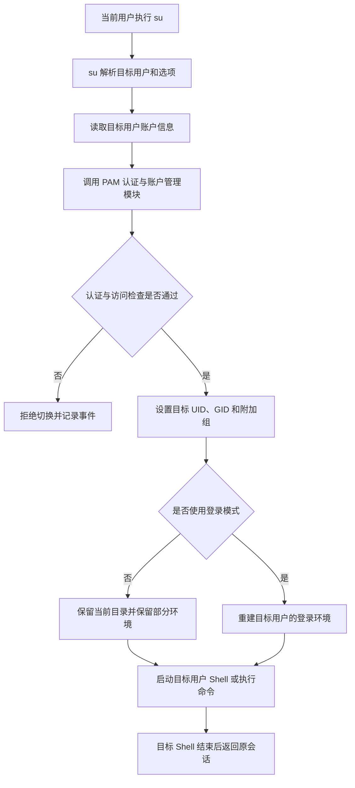
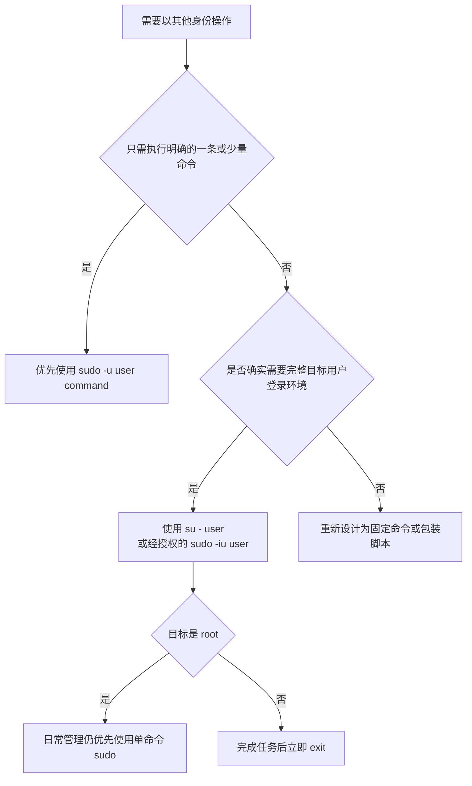

[toc]


## su 命令

`su` 用于以替代用户身份**启动 Shell** 或**执行命令**。`su` 通常解释为 **substitute user** 或 **switch user**。

现代 Linux 系统上的 `su` 通常由 `util-linux` 软件包提供。它可以切换用户 ID（User ID，UID）、组 ID（Group ID，GID）以及相关执行环境。未指定目标用户时，默认目标用户通常是 `root`。([man7.org](https://man7.org/linux/man-pages/man1/su.1.html?utm_source=chatgpt.com))

基本语法：

```bash
su [选项] [目标用户]
```

执行单个命令：

```bash
su [选项] [目标用户] -c 'command'
```

常见示例：

```bash
su
su -
su alice
su - alice
su -c 'id' alice
```

------

## su 的核心作用

执行：

```bash
su alice
```

通常会：

- 请求进行身份认证。
- 将进程身份切换为 `alice`。
- 启动 `alice` 对应的 Shell。
- 保留当前工作目录。
- 保留或重置部分环境变量，具体行为取决于参数、PAM 和系统配置。
- 在退出目标 Shell 后返回原用户会话。

执行：

```bash
su
```

等价于以默认目标用户 `root` 启动 Shell，但具体能否成功取决于：

- root 账户是否设置了可用密码。
- PAM 是否允许当前用户使用 `su`。
- 当前用户是否属于受允许的管理组。
- root 账户是否被锁定。
- 系统是否采用其他认证限制。

### 观察身份变化

```bash
whoami
su - alice
whoami
exit
whoami
```

典型结果：

```text
bob
Password:
alice
bob
```

这里的 `exit` 会终止目标用户的 Shell，回到原来的用户会话。

------

## su 的工作流程



在现代 Linux 发行版中，`su` 通常通过 **PAM（Pluggable Authentication Modules，可插拔认证模块）** 完成密码验证、账户限制、会话初始化和资源设置。

常见 PAM 配置文件为：

```text
/etc/pam.d/su
/etc/pam.d/su-l
```

不同发行版可能采用不同文件和模块组合。

------

## su 与 sudo 的本质区别

`su` 和 `sudo` 都可能改变程序的执行身份，但二者的授权模型不同。

| 比较项                 | `su`                           | `sudo`                     |
| ---------------------- | ------------------------------ | -------------------------- |
| 核心用途               | 切换到另一个用户会话           | 依据策略委派特定命令       |
| 默认目标用户           | root                           | root                       |
| 通常验证谁的密码       | 目标用户                       | 当前调用者                 |
| 权限控制方式           | 目标账户凭据和 PAM             | sudoers 或其他策略插件     |
| 默认使用形态           | 启动目标用户 Shell             | 执行一个具体命令           |
| 权限持续时间           | 通常持续到退出 Shell           | 通常只覆盖一个命令         |
| 命令级授权             | 较弱                           | 较强                       |
| 审计粒度               | 通常记录切换行为               | 通常可记录每次 sudo 命令   |
| 是否需要共享 root 密码 | 传统模式下可能需要             | 通常不需要                 |
| 适合场景               | 切换服务账户、维护完整用户环境 | 日常系统管理、最小权限委派 |

典型情况：

```bash
su -
```

通常需要 root 账户的密码。

```bash
sudo command
```

通常需要当前用户自己的密码。

这种行为可以通过 PAM 或 sudoers 配置改变，因此不能把它视为所有系统上的绝对规则。

------

## su、su - 和 su --login

下面两个命令通常等价：

```bash
su -
su --login
```

指定目标用户：

```bash
su - alice
su --login alice
```

`--login` 的短参数为一个单独的连字符：

```text
-
```

### 不带登录模式

```bash
su alice
```

这种方式通常：

- 保留当前工作目录。
- 保留较多当前用户环境。
- 启动目标用户的 Shell。
- 不完整模拟一次新的登录。
- 可能产生调用者环境和目标用户身份混合的情况。

### 使用登录模式

```bash
su - alice
```

这种方式通常：

- 切换到目标用户主目录。
- 清理大部分当前环境变量。
- 设置目标用户的 `HOME`。
- 设置目标用户的 `SHELL`。
- 设置目标用户的 `USER` 和 `LOGNAME`。
- 根据系统配置设置新的 `PATH`。
- 以登录式 Shell 方式启动目标 Shell。
- 加载目标用户的登录配置文件。

现代 `util-linux` 手册建议使用 `--login`，从而避免调用者环境与目标用户环境混合产生副作用。([man7.org](https://man7.org/linux/man-pages/man1/su.1.html?utm_source=chatgpt.com))

### 对比观察

```bash
pwd
echo "$HOME"
echo "$USER"
echo "$PATH"

su alice
pwd
echo "$HOME"
echo "$USER"
echo "$PATH"
exit
```

然后对比：

```bash
su - alice
pwd
echo "$HOME"
echo "$USER"
echo "$PATH"
exit
```

实际结果取决于：

- `su` 版本。
- PAM 配置。
- `/etc/login.defs`。
- 目标用户的 Shell。
- 发行版默认值。
- Shell 启动文件。

### 推荐原则

切换到另一个用户进行正常操作时，通常优先使用：

```bash
su - username
```

而不是：

```bash
su username
```

这样能减少错误继承以下内容的风险：

- 当前用户的 `PATH`。
- 当前用户的语言环境。
- 当前用户的代理设置。
- 当前用户的运行时环境。
- 当前用户的应用程序配置。
- 当前用户的临时目录变量。

------

## 常用参数

| 参数                                      | 英文含义              | 作用                                          |
| ----------------------------------------- | --------------------- | --------------------------------------------- |
| `-`                                       | login                 | 启动登录式 Shell                              |
| `-l`、`--login`                           | login                 | 与单独的 `-` 基本等价                         |
| `-c command`                              | command               | 使用目标用户的 Shell 执行一条命令             |
| `--session-command command`               | session command       | 执行命令但不创建新的 PAM 会话，不推荐日常使用 |
| `-s shell`、`--shell shell`               | shell                 | 指定要使用的 Shell                            |
| `-p`、`-m`、`--preserve-environment`      | preserve environment  | 尽量保留当前环境                              |
| `-w list`、`--whitelist-environment list` | whitelist environment | 登录模式下保留指定环境变量                    |
| `-g group`、`--group group`               | group                 | 指定主要组                                    |
| `-G list`、`--supp-group list`            | supplementary group   | 指定附加组                                    |
| `-P`、`--pty`                             | pseudo-terminal       | 为会话创建独立伪终端                          |
| `-f`、`--fast`                            | fast                  | 向部分 Shell 传递快速启动选项                 |

并非所有 Unix 系统都使用 `util-linux su`。在 macOS、BSD 或较旧 Linux 系统中，参数集合可能不同，应以本机手册为准：

```bash
man su
su --help
```

------

## 使用 su 执行单个命令

基本形式：

```bash
su -c 'command' username
```

例如：

```bash
su -c 'id' alice
```

以 root 身份执行：

```bash
su -c 'id'
```

由于未指定目标用户，默认目标通常是 root。

### 推荐使用登录环境

如果命令依赖目标用户的登录环境，可以使用：

```bash
su - alice -c 'command'
```

例如：

```bash
su - postgres -c 'psql -c "SELECT current_user;"'
```

不过，数据库工具通常具有自己的安全调用方式，实际使用时应遵循数据库和发行版文档。

### 引号处理

下面的命令中：

```bash
su - alice -c 'echo "$HOME"'
```

单引号会阻止当前 Shell 展开 `$HOME`，因此 `$HOME` 将由目标用户的 Shell 展开。

而：

```bash
su - alice -c "echo $HOME"
```

`$HOME` 很可能先被当前用户的 Shell 展开，再交给 `su`。

因此，简单命令通常优先使用外层单引号：

```bash
su - alice -c 'printf "%s\n" "$HOME"'
```

当命令包含不可信输入时，不要通过字符串拼接构造 `su -c`，否则容易产生 Shell 命令注入。

危险示例：

```bash
su - root -c "some-command $user_input"
```

更安全的方向包括：

- 使用固定脚本。
- 通过位置参数传值。
- 对输入使用严格白名单。
- 避免调用额外的 Shell。
- 使用程序自身提供的参数接口。

------

## su 的认证规则

### 通常验证目标用户密码

普通用户执行：

```bash
su - alice
```

通常需要输入 `alice` 的密码。

执行：

```bash
su -
```

通常需要输入 root 的密码。

这与 `sudo` 默认验证当前调用者自己的密码不同。

### root 使用 su

root 通常可以直接切换到其他用户而不输入目标用户密码：

```bash
su - alice
```

这是因为 root 已经拥有改变进程身份所需的系统权限。

PAM 仍然可能执行：

- 账户有效性检查。
- 会话初始化。
- 环境配置。
- 审计日志。
- 资源限制设置。

### root 账户锁定

某些发行版默认锁定 root 密码。在这类系统中：

```bash
su -
```

可能无法通过密码认证，即使当前用户可以运行：

```bash
sudo -i
```

这并不矛盾：

- `su -` 尝试使用 root 账户认证。
- `sudo -i` 使用 sudo 策略和调用者认证进入 root 环境。

不要仅为了让 `su` 可用而随意为 root 设置密码。是否启用 root 密码应依据系统安全模型决定。

------

## wheel 组与 su 访问控制

一些系统通过 `wheel` 组限制哪些用户可以使用 `su` 切换到 root。

相关 PAM 模块通常为：

```text
pam_wheel.so
```

它可以配置为仅允许特定组成员访问目标账户。默认组名通常为 `wheel`；如果不存在该组，具体回退行为取决于模块配置。([man7.org](https://man7.org/linux/man-pages/man8/pam_wheel.8.html?utm_source=chatgpt.com))

典型 PAM 配置示意：

```text
auth required pam_wheel.so use_uid
```

也可以指定其他组：

```text
auth required pam_wheel.so use_uid group=suusers
```

这些内容只是语法示意。修改 PAM 配置存在锁定管理访问的风险，必须：

- 保留一个现有 root 会话。
- 确认系统具有恢复控制台。
- 检查发行版文档。
- 在测试环境验证。
- 避免同时破坏 `su` 和 `sudo`。
- 确认组成员关系已经生效。

查看组成员：

```bash
getent group wheel
id alice
```

将用户加入组的具体命令因系统而异，例如：

```bash
sudo usermod -aG wheel alice
```

用户通常需要重新登录，新的附加组成员关系才会在登录会话中生效。

属于 `wheel` 组并不必然意味着无需密码。`pam_wheel` 可以限制谁有资格继续认证，而是否免除密码取决于 `trust` 等模块选项和完整 PAM 规则。不要把“允许使用 su”与“无需密码使用 su”混为一谈。

------

## PAM 在 su 中的作用

PAM 是 Linux 中可组合的认证框架。`su` 本身通常把许多安全判断委托给 PAM。

PAM 配置一般分为四类：

| 类型       | 英文名称            | 作用                                 |
| ---------- | ------------------- | ------------------------------------ |
| `auth`     | authentication      | 验证密码、限制认证来源               |
| `account`  | account management  | 检查账户是否过期、锁定或允许访问     |
| `password` | password management | 处理密码修改，与普通 su 会话关系较小 |
| `session`  | session management  | 创建会话、设置限制、记录登录状态     |

`/etc/pam.d/su` 中可能调用：

- `pam_rootok.so`
- `pam_wheel.so`
- `pam_unix.so`
- `pam_limits.so`
- `pam_env.so`
- `pam_systemd.so`
- `pam_keyinit.so`

模块组合和顺序具有安全意义，不同发行版差异很大。

查看配置：

```bash
sudo sed -n '1,200p' /etc/pam.d/su
```

不要在不了解 PAM 控制标志和模块顺序的情况下直接修改该文件。

------

## su 的环境处理

### 非登录模式的环境混合

执行：

```bash
su alice
```

为了向后兼容，`su` 通常不会完整重建目标用户环境，也不会自动改变当前目录。([man7.org](https://man7.org/linux/man-pages/man1/su.1.html?utm_source=chatgpt.com))

这可能造成：

```text
进程身份：alice
HOME：可能经过调整
当前目录：仍是原用户目录
PATH：可能保留或部分修改
其他变量：可能来自原用户
```

这种混合环境可能导致：

- 在错误的主目录中创建文件。
- 使用错误版本的命令。
- 读取原用户的配置。
- 生成所有者不符合预期的文件。
- 使用错误的代理、语言或运行时环境。
- 服务账户执行用户自定义程序。

### 登录模式的环境重建

执行：

```bash
su - alice
```

登录模式通常会清除大部分环境，并初始化：

- `HOME`
- `SHELL`
- `USER`
- `LOGNAME`
- `PATH`

然后由目标用户的登录 Shell 继续加载相应配置文件。

### preserve-environment

```bash
su --preserve-environment alice
```

短形式：

```bash
su -p alice
su -m alice
```

该选项会尽量避免重置环境，但某些变量仍可能受 PAM 或系统策略影响。

它可能保留：

- `HOME`
- `SHELL`
- `USER`
- `LOGNAME`
- `PATH`
- 语言环境。
- 代理变量。
- 应用配置变量。

保留环境可能产生安全和可预测性问题，因此不应习惯性使用。

### 环境白名单

现代 `util-linux su` 支持在登录模式下保留指定环境变量：

```bash
su - alice --whitelist-environment=LANG,LC_ALL
```

`HOME`、`SHELL`、`USER`、`LOGNAME` 和 `PATH` 等身份相关变量通常不适合作为普通白名单变量处理。

------

## 指定 Shell

指定目标 Shell：

```bash
su -s /bin/bash alice
```

或者：

```bash
su --shell /bin/bash alice
```

Shell 的选择通常遵循以下约束：

- 命令行指定的 Shell。
- `--preserve-environment` 下当前环境的 `SHELL`。
- 目标用户账户数据库中配置的 Shell。
- 最终回退到系统默认 Shell。

如果目标用户的 Shell 不在 `/etc/shells` 中，普通用户可能无法随意覆盖它，root 通常不受相同限制。

查看目标账户 Shell：

```bash
getent passwd alice
```

输出中的最后一个字段通常是登录 Shell：

```text
alice:x:1001:1001:Alice:/home/alice:/bin/bash
```

### nologin 账户

服务账户经常配置为：

```text
/usr/sbin/nologin
```

或：

```text
/bin/false
```

这表示该账户不应获得普通交互式登录 Shell。

例如：

```bash
su - serviceuser
```

可能被拒绝或立即退出。

不要为了方便而随意把服务账户 Shell 改为 `/bin/bash`。确实需要以服务账户执行固定命令时，更适合：

```bash
sudo -u serviceuser command
```

或者在严格控制下由 root 使用：

```bash
su -s /bin/sh serviceuser -c 'command'
```

是否可用仍取决于系统、PAM 和账户配置。

------

## 指定组身份

现代 `util-linux su` 支持指定主要组：

```bash
su -g appgroup appuser
```

指定一个或多个附加组：

```bash
su -G developers -G operators appuser
```

组合使用：

```bash
su -g appgroup -G developers appuser
```

这些功能通常只允许 root 使用，因为普通用户不能任意改变进程的组身份。

需要精确指定用户和组时，`sudo` 也可以使用：

```bash
sudo -u appuser -g appgroup command
```

是否允许取决于 sudoers 策略。

------

## 使用伪终端

现代 `util-linux su` 提供：

```bash
su --pty alice
```

短形式：

```bash
su -P alice
```

它会为目标会话创建独立的伪终端（pseudo-terminal，PTY）。

作用包括：

- 将目标进程与调用者原始终端分离。
- 改善终端控制。
- 转发输入和输出。
- 降低某些终端注入风险。
- 在部分自动化场景中提供更清晰的会话边界。

是否需要使用取决于交互方式和系统版本。管道传输二进制数据时，PTY 的行为可能影响数据处理，因此不能把它当成普通透明管道使用。

------

## su 与 Shell 重定向

和 `sudo` 类似，`su -c` 涉及多层 Shell 时，需要明确由哪个 Shell 处理重定向。

### 当前 Shell 处理重定向

```bash
su - alice -c 'generate-report' > report.txt
```

这里的：

```text
> report.txt
```

由当前调用者的 Shell 处理。

因此：

- 文件由当前用户创建。
- 当前用户必须有目标目录的写权限。
- 文件所有者通常是当前用户。

### 目标用户 Shell 处理重定向

```bash
su - alice -c 'generate-report > report.txt'
```

这里重定向位于 `-c` 命令字符串中，因此由目标用户的 Shell 处理。

通常结果为：

- 文件在目标用户的当前目录中创建。
- 文件所有者为目标用户。
- 目标用户必须具有目录写权限。

### 管道行为

```bash
su - alice -c 'producer' | consumer
```

只有 `producer` 在 `alice` 身份下运行，`consumer` 仍由当前用户运行。

整个管道都以目标用户运行：

```bash
su - alice -c 'producer | consumer'
```

当命令中包含外部输入时，应避免把未经验证的内容拼接到该字符串中。

------

## su 与资源限制

`su` 启动目标会话时，PAM 可能通过：

```text
pam_limits.so
```

应用：

```text
/etc/security/limits.conf
/etc/security/limits.d/*
```

中的资源限制。

需要注意的是，现代 `util-linux su` 在调用 PAM 前可能会重置某些资源限制，然后由 PAM 会话配置重新应用目标限制。

可能涉及：

- 最大文件大小。
- 最大进程数。
- 打开文件数。
- CPU 时间。
- 实时优先级。
- 锁定内存。
- 调度优先级。

因此：

```bash
su - appuser
ulimit -a
```

显示的限制不一定与原用户相同，也不一定与 systemd 服务单元中的限制相同。

对于 systemd 管理的服务，应优先通过单元文件配置：

```ini
[Service]
LimitNOFILE=65536
```

而不是依赖交互式 `su` 会话模拟服务环境。

------

## su 不等于完整登录会话

即使执行：

```bash
su - alice
```

它也不一定与 `alice` 通过 SSH、图形界面或本地控制台登录完全相同。

可能存在的差异包括：

- 没有新的 systemd 用户会话。
- 没有完整的 D-Bus 会话。
- 没有 SSH Agent。
- 没有图形显示授权。
- 没有独立的运行时目录。
- 没有桌面会话环境。
- 登录审计记录不同。
- PAM 模块组合不同。
- cgroup 和资源限制不同。

因此，以下变量可能缺失或不符合预期：

```text
XDG_RUNTIME_DIR
DBUS_SESSION_BUS_ADDRESS
DISPLAY
WAYLAND_DISPLAY
SSH_AUTH_SOCK
```

不要使用 `su` 模拟复杂桌面用户会话或 systemd 用户服务环境。

------

## su 的日志与审计

`su` 的认证成功和失败通常由 PAM、系统日志服务或审计系统记录。

常见查询方法：

```bash
journalctl _COMM=su
journalctl -t su
```

部分系统可能记录在：

```text
/var/log/auth.log
/var/log/secure
```

例如：

```bash
sudo grep ' su' /var/log/auth.log
```

或：

```bash
sudo grep ' su' /var/log/secure
```

实际日志位置取决于：

- systemd-journald。
- rsyslog 或 syslog-ng。
- PAM 配置。
- auditd。
- 发行版默认日志规则。

与 `sudo` 相比，`su` 通常只能清晰记录“某用户切换为另一用户”，但无法像逐条使用 `sudo command` 那样自然地记录每一个管理命令。

进入 root Shell 后：

```bash
su -
```

后续命令可能只存在于：

- Shell 历史。
- auditd。
- 终端会话记录。
- 应用自身日志。
- 其他集中审计系统。

Shell 历史并不是可靠的安全审计机制，因为它可能：

- 被禁用。
- 被修改。
- 未及时写入。
- 因异常退出而丢失。
- 不记录所有命令形式。
- 被有权限的用户删除。

------

## 常见使用场景

### 切换到另一个普通用户

```bash
su - alice
```

适用于：

- 管理员测试用户环境。
- 排查文件权限。
- 验证用户登录配置。
- 在明确授权下模拟用户操作。

### 切换到服务账户

```bash
su - postgres
```

一些服务账户配置了不可登录 Shell，因此该命令未必可用。

更精确的方式通常是：

```bash
sudo -u postgres command
```

### 进入 root 登录环境

```bash
su -
```

适用于：

- 已有 root 密码管理模式。
- 救援环境。
- 单用户维护。
- 不具备 sudo 的最小系统。
- 管理员确实需要持续 root 会话。

日常管理更推荐：

```bash
sudo specific-command
```

### 以目标用户执行单个命令

```bash
su - alice -c 'id'
```

这比进入交互式 Shell 后再运行一个命令更适合脚本化，但它仍可能要求输入目标用户密码，不适合作为普通无人值守自动化机制。

------

## 不推荐使用 su 进行自动化

下面的自动化方式通常存在问题：

```bash
printf '%s\n' "$PASSWORD" | su - root -c 'command'
```

原因包括：

- `su` 通常从终端读取密码，而不保证从标准输入读取。
- 密码可能暴露在脚本、日志或环境中。
- PAM 可能要求多因素认证。
- 会话可能依赖终端。
- 自动化流程容易卡住。
- root 密码需要分发给脚本。
- 难以实现最小权限。

更适合的自动化方案包括：

```bash
sudo -n /usr/local/sbin/fixed-task
```

配合精确的 sudoers 规则：

```sudoers
automation ALL=(root) NOPASSWD: /usr/local/sbin/fixed-task ""
```

或者使用：

- systemd service。
- systemd timer。
- cron 的系统级任务。
- 专用服务账户。
- 配置管理系统。
- 受控作业执行平台。

------

## 常见错误与排查

| 现象                                      | 常见原因                                 | 排查方向                              |
| ----------------------------------------- | ---------------------------------------- | ------------------------------------- |
| `Authentication failure`                  | 密码错误、账户锁定或 PAM 拒绝            | 检查目标账户和认证日志                |
| 普通用户不能 `su -`                       | root 密码锁定或 PAM 限制                 | 检查 root 状态和 `/etc/pam.d/su`      |
| wheel 用户仍被要求密码                    | wheel 仅控制准入，没有启用免密           | 检查 `pam_wheel` 完整参数             |
| `This account is currently not available` | 目标用户 Shell 为 `nologin`              | 检查 `/etc/passwd` 或 `getent passwd` |
| 切换后 PATH 不正确                        | 使用了非登录模式或系统 PATH 策略         | 使用 `su - user` 并检查配置           |
| 切换后仍在原目录                          | 非登录模式默认保留当前目录               | 使用 `su - user`                      |
| 用户配置未加载                            | Shell 不是登录模式，或配置文件条件不匹配 | 检查 Shell 启动规则                   |
| `su -c` 中变量值错误                      | 变量被当前 Shell 提前展开                | 检查单引号和双引号                    |
| 服务命令与正式服务环境不同                | su 会话不是 systemd 服务环境             | 使用 `systemctl` 和单元配置           |
| 组权限未生效                              | 当前登录会话仍使用旧附加组列表           | 重新登录并运行 `id`                   |
| 审计中看不到具体命令                      | su 只记录身份切换                        | 使用 sudo 单命令模式或 auditd         |

### 检查账户状态

```bash
getent passwd alice
sudo passwd -S alice
```

### 检查当前身份和组

```bash
id
id alice
```

### 检查 root 账户

```bash
sudo passwd -S root
```

不要在没有明确安全理由时解除 root 账户锁定。

### 检查 PAM 配置

```bash
sudo sed -n '1,200p' /etc/pam.d/su
```

### 检查认证日志

```bash
journalctl _COMM=su --since today
```

------

## 安全风险

### 共享 root 密码

如果多名管理员都使用：

```bash
su -
```

他们通常需要共享 root 密码。

这会带来：

- 无法根据个人账户单独撤销访问。
- 难以判断是谁取得了 root Shell。
- 人员离职后需要整体轮换密码。
- 密码可能通过不安全渠道传播。
- 容易形成长期共享秘密。

使用 `sudo` 可以让管理员使用各自账户认证，并通过组或规则分别撤销权限。

### 长时间 root Shell

进入：

```bash
su -
```

后，所有命令都以 root 身份运行，容易出现：

- 忘记当前身份。
- 在错误目录执行删除。
- 创建 root 所有文件。
- 以 root 运行图形程序。
- 把不可信脚本当作普通命令执行。
- 在 root 环境中运行用户项目构建。

使用 root Shell 时，应持续关注：

```bash
whoami
id
pwd
```

完成操作后立即：

```bash
exit
```

### 环境污染

使用：

```bash
su root
```

而不是：

```bash
su -
```

可能把普通用户环境带入 root 进程。

风险包括：

- root 使用普通用户 PATH。
- 调用用户目录中的同名程序。
- 读取用户可修改的配置。
- 使用用户代理或运行时环境。
- 将敏感文件写到普通用户主目录。

### 目标账户密码扩散

若多人需要切换到同一个服务账户，他们就可能共享该服务账户密码。

更好的方式是通过 sudoers 允许：

```bash
sudo -u appuser fixed-command
```

这样无需向管理员公开服务账户密码。

------

## 最佳实践

### 日常系统管理

优先使用：

```bash
sudo command
```

而不是：

```bash
su -
command
```

这样可以：

- 缩短特权持续时间。
- 保留调用者身份。
- 提高命令级审计能力。
- 避免共享 root 密码。
- 实现最小权限。

### 需要完整目标用户环境时

使用：

```bash
su - username
```

而不是：

```bash
su username
```

### 只执行一条命令时

可以使用：

```bash
su - username -c 'fixed-command'
```

但若属于日常管理或自动化，更推荐配置：

```bash
sudo -u username fixed-command
```

### 不共享账户密码

管理员应使用个人账户登录，再通过经过审计的权限委派机制执行管理操作。

### 谨慎修改 PAM

修改 `/etc/pam.d/su` 前：

- 保留现有 root 会话。
- 准备控制台恢复方式。
- 备份原配置。
- 在测试环境验证。
- 确认 `sudo` 仍可用。
- 逐项理解模块控制标志。

### 不把服务账户变成普通登录账户

不要仅为了方便运行命令，就为服务账户：

- 设置共享密码。
- 修改为交互式 Shell。
- 开放 SSH 登录。
- 创建不必要的主目录权限。

优先使用：

```bash
sudo -u serviceuser command
```

### 退出后确认身份

离开目标 Shell：

```bash
exit
```

然后确认：

```bash
whoami
id
```

------

## su 与 sudo 的对比🎈

> - **sudo**: substitute user do (execute a command as another `user`.)
> - **su**: substitute user (Change the effective user ID and group ID to that of `<user>`.) 将有效用户ID和组ID切换为`<user>`用户的ID。



| 需求                             | 建议命令                       |
| -------------------------------- | ------------------------------ |
| 运行一个 root 管理命令           | `sudo command`                 |
| 以服务用户运行一个命令           | `sudo -u serviceuser command`  |
| 查看自己可以执行什么             | `sudo -l`                      |
| 临时进入目标用户完整环境         | `su - username`                |
| 在 sudo 管理模式下进入目标环境   | `sudo -iu username`            |
| 在 root 密码模式下进入 root 环境 | `su -`                         |
| 无人值守执行固定管理任务         | `sudo -n fixed-command`        |
| 模拟 systemd 服务运行环境        | 不使用 su，应通过 systemd 测试 |
| 编辑受保护文件                   | `sudoedit file`                |

------

## 快速参考

```bash
# 切换到 root，保留较多当前环境
su

# 切换到 root 登录环境
su -

# 切换到指定用户
su alice

# 切换到指定用户的登录环境
su - alice

# 以指定用户执行一条命令
su - alice -c 'id'

# 指定 Shell
su -s /bin/bash alice

# 尽量保留当前环境
su --preserve-environment alice

# 使用独立伪终端
su --pty alice

# 退出目标用户 Shell
exit

# 查看 su 本机帮助
su --help
man su
```

## 核心结论

`su` 的核心模型是：

```text
获得目标账户的认证许可
+ 切换进程用户和组身份
+ 启动目标用户 Shell 或命令
```

`sudo` 的核心模型是：

```text
确认调用者身份
+ 根据管理员策略授权
+ 以指定身份执行明确命令
```

因此：

- `su` 更偏向“切换账户”。
- `sudo` 更偏向“委派权限”。
- `su -` 比普通 `su` 更适合建立干净的目标用户环境。
- 日常管理通常优先使用单命令 `sudo`。
- 需要排查完整用户登录环境时，可以使用 `su - user`。
- 自动化不应依赖向 `su` 提供账户密码。
- root Shell 应仅在确有必要时使用，并在完成任务后立即退出。

这部分也可以继续与原有内容整合，删除重复的 `sudo`/`su` 对照段落，形成一份结构统一的最终版本。