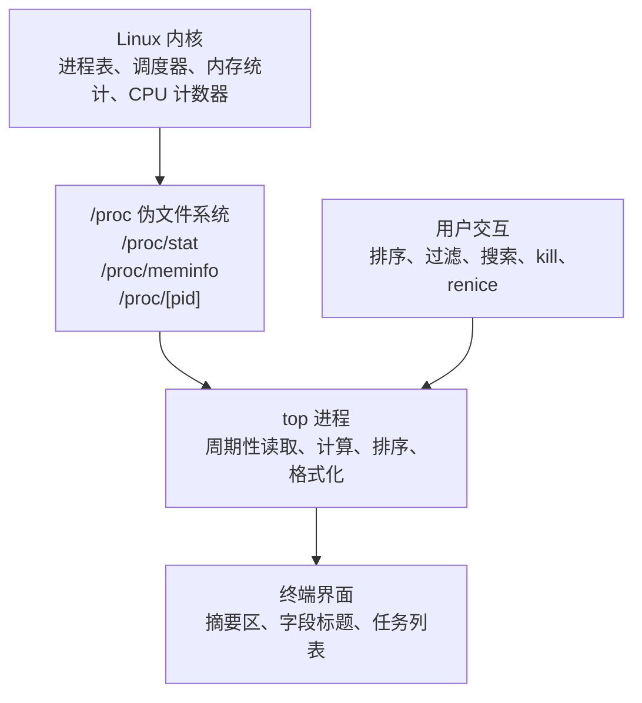
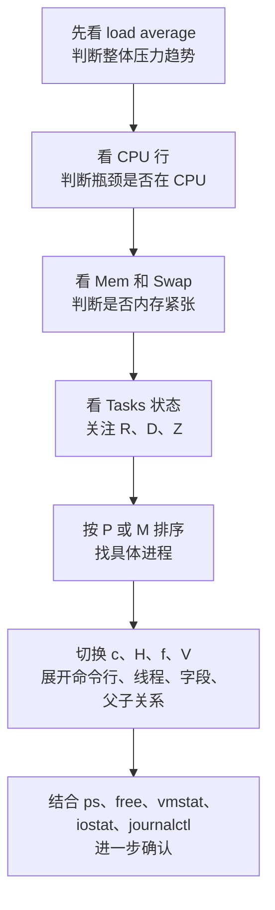

[toc]


## abstract

本文以 **Linux 上常见的 `procps-ng top`** 为主来讲解。不同系统的 `top` 不完全一样，例如 macOS、BSD、BusyBox、Solaris 的字段、快捷键、排序方式可能不同。Linux `top` 的官方手册将它定义为“动态、实时查看系统状态”的工具，可显示系统摘要信息，以及 Linux 内核正在管理的进程或线程列表，并且显示内容、字段顺序、字段大小、配置都可以自定义并持久化。([man7.org](https://man7.org/linux/man-pages/man1/top.1.html))

读完后，你应该能做到：

| 学习目标          | 能力表现                                                     |
| ----------------- | ------------------------------------------------------------ |
| 看懂 `top` 主界面 | 知道 uptime、load average、CPU、内存、任务状态、进程字段分别代表什么 |
| 快速定位问题      | 能判断 CPU 高、内存高、I/O 等待高、僵尸进程、线程膨胀等常见现象 |
| 熟练交互操作      | 会排序、过滤、搜索、切换线程视图、调整刷新间隔、切换内存单位 |
| 安全处理进程      | 知道何时查看、何时发送信号、何时调整 nice 值，以及应避免什么 |
| 用于脚本和排障    | 会用 batch 模式、指定 PID、指定用户、固定刷新次数等方式采集快照 |

------

## 详细大纲

| 模块         | 重点内容                                                     | 学习结果                                  |
| ------------ | ------------------------------------------------------------ | ----------------------------------------- |
| 基本定位     | `top` 是什么，和 `ps`、`htop`、`free`、`vmstat` 的关系       | 知道什么时候用 `top`                      |
| 工作机制     | 从 `/proc`、内核统计、终端刷新到界面展示                     | 理解为什么 `top` 是“近实时”而不是绝对实时 |
| 主界面结构   | 摘要区、字段标题、任务列表、提示区                           | 建立整体阅读顺序                          |
| 系统摘要     | uptime、load average、任务状态、CPU 状态、内存和 swap        | 能判断系统总体是否繁忙                    |
| 进程字段     | PID、USER、PR、NI、VIRT、RES、SHR、S、%CPU、%MEM、TIME+、COMMAND | 能定位“哪个进程在消耗什么资源”            |
| CPU 解读     | `%Cpu(s)`、单核/多核、线程、Irix/Solaris 模式、P 核/E 核、SMT | 避免误读 `%CPU > 100`                     |
| 内存解读     | VIRT、RES、SHR、RSS、PSS、Swap、buffer/cache、available      | 避免把 VIRT 当作真实占用                  |
| 交互快捷键   | 排序、搜索、过滤、字段管理、线程视图、树状视图、kill、renice | 能在现场排障中快速操作                    |
| 命令行选项   | `-b`、`-n`、`-d`、`-p`、`-u`、`-U`、`-H`、`-o`、`-E`、`-e`   | 能将 `top` 用于脚本或一次性观察           |
| 常见排障套路 | CPU 飙高、内存泄漏、I/O 等待、僵尸进程、容器进程、线程过多   | 形成实战思路                              |
| 最佳实践     | 刷新间隔、排序策略、权限、安全终止、保存配置、结合其他工具   | 建立可靠使用习惯                          |
| 易错点       | load average 误解、缓存误解、VIRT 误解、kill 滥用、采样误差  | 避免新手常见坑                            |

------

## `top` 是什么

`top` 是一个终端中的系统监控工具。它会周期性刷新系统状态，并按某种排序方式展示当前进程或线程。你可以把它理解为 Linux 终端里的“任务管理器”，但它更偏向系统管理员和开发者使用。

常见用途包括：

| 场景       | 用 `top` 能看到什么                                          |
| ---------- | ------------------------------------------------------------ |
| 系统变慢   | CPU 是否忙、load average 是否高、是否有大量运行态或不可中断睡眠进程 |
| CPU 飙高   | 哪个进程或线程占用 CPU，是否是多线程进程                     |
| 内存不足   | 哪些进程 RES 或 %MEM 高，swap 是否被使用                     |
| 服务卡死   | 进程状态是否为 `D`、`Z`、`T`，是否线程数异常                 |
| 临时排障   | 不安装额外工具即可观察系统整体状况                           |
| 远程服务器 | 通过 SSH 在终端直接查看资源状态                              |

`top` 不是唯一监控工具。它适合“交互式、即时观察”。如果你需要历史趋势，应该用 Prometheus、Grafana、sar、atop、sysstat、eBPF 工具等；如果你需要漂亮易用的交互界面，可以考虑 `htop`；如果你只需要一次性进程列表，`ps` 更合适。

------

## 工作机制

Linux 的 `procps-ng` 工具集主要从 `/proc` 这个伪文件系统读取内核暴露的进程和系统状态信息；`top` 则把这些数据按固定间隔采样、计算差值、排序并刷新到终端。([GitLab](https://gitlab.com/procps-ng/procps?utm_source=chatgpt.com))



这带来几个重要结论：

| 结论                 | 解释                                                         |
| -------------------- | ------------------------------------------------------------ |
| `top` 是采样工具     | 它显示的是两次刷新之间计算出来的状态，不是硬件级连续观测     |
| 刷新间隔影响读数     | 间隔越短，抖动越明显；间隔越长，趋势更平滑                   |
| 字段可能有权限差异   | 某些进程详情、命令行、内存细节可能受权限限制                 |
| 多核系统需要特别解读 | 单个进程的 `%CPU` 可能超过 100%，因为它可能使用多个 CPU 或多个线程 |
| 容器环境要谨慎       | 在容器里看到的 PID、CPU、内存可能受 namespace、cgroup、运行时限制影响 |

------

## 启动与退出

最基本用法：

```bash
top
```

退出：

```text
q
```

或者使用 `Ctrl+C`。

查看帮助：

```text
h
```

或：

```text
?
```

官方手册也明确提到，运行 `top` 时最重要的两个键是帮助键 `h` 或 `?`，以及退出键 `q`。([man7.org](https://man7.org/linux/man-pages/man1/top.1.html))

------

## 主界面结构

典型 `top` 界面大致分为三块：摘要区、字段标题、任务区。官方手册也将首次启动后的主界面概括为 Summary Area、Fields/Columns Header、Task Area。([man7.org](https://man7.org/linux/man-pages/man1/top.1.html))

```text
top - 15:20:10 up 12 days,  3:41,  2 users,  load average: 0.42, 0.60, 0.75
Tasks: 245 total,   1 running, 243 sleeping,   0 stopped,   1 zombie
%Cpu(s):  5.3 us,  2.1 sy,  0.0 ni, 91.8 id,  0.3 wa,  0.2 hi,  0.3 si,  0.0 st
MiB Mem :  15932.4 total,   1823.2 free,   8011.4 used,   6097.8 buff/cache
MiB Swap:   2048.0 total,   2048.0 free,      0.0 used.   7120.3 avail Mem

    PID USER      PR  NI    VIRT    RES    SHR S  %CPU  %MEM     TIME+ COMMAND
   1521 root      20   0 1234560 158320  48520 S  12.3   1.0  45:12.34 java
```

| 区域         | 作用                                         | 阅读重点                                           |
| ------------ | -------------------------------------------- | -------------------------------------------------- |
| 第一行       | 当前时间、运行时长、登录用户数、load average | 系统是否长期繁忙                                   |
| Tasks 行     | 进程或线程总数及状态                         | 是否有大量 running、D 状态、zombie                 |
| `%Cpu(s)` 行 | CPU 时间占比                                 | CPU 忙在哪里：用户态、内核态、I/O 等待、虚拟化偷取 |
| Mem/Swap 行  | 物理内存和交换空间                           | 是否内存紧张、swap 是否活跃                        |
| 字段标题     | 每列含义                                     | 当前排序字段和显示字段                             |
| 任务列表     | 具体进程或线程                               | 找出资源消耗者                                     |

------

## 摘要区：第一行

第一行通常类似：

```text
top - 15:20:10 up 12 days,  3:41,  2 users,  load average: 0.42, 0.60, 0.75
```

官方手册说明，这一行包含程序或窗口名、当前时间、系统自上次启动后的运行时长、用户数，以及 1、5、15 分钟的系统负载平均值。([man7.org](https://man7.org/linux/man-pages/man1/top.1.html))

| 字段           | 含义                  | 解读方式                     |
| -------------- | --------------------- | ---------------------------- |
| `15:20:10`     | 当前时间              | 用于和故障发生时间对照       |
| `up 12 days`   | 系统已运行时长        | 判断是否刚重启、是否长期运行 |
| `2 users`      | 当前登录用户数        | 可辅助判断是否有人正在操作   |
| `load average` | 1、5、15 分钟平均负载 | 判断系统短期、中期、长期压力 |

### load average 怎么看

load average 不是“CPU 使用率”。它大致表示一段时间内处于 **可运行状态** 或 **不可中断睡眠状态** 的任务数量平均值。新手可以先这样理解：

| 情况                          | 可能含义                                            |
| ----------------------------- | --------------------------------------------------- |
| 1 分钟负载明显高于 5、15 分钟 | 最近突然变忙                                        |
| 1、5、15 分钟都高             | 系统持续繁忙                                        |
| 1 分钟低于 5、15 分钟         | 压力正在缓解                                        |
| load 高，但 CPU idle 也高     | 可能不是 CPU 瓶颈，可能是 I/O、锁等待、D 状态任务等 |

粗略判断时，要结合 CPU 核心数。例如 4 核机器上 load average 长期接近 4 可能还算可接受；长期远高于 4，就要进一步检查。但这只是粗略判断，不能单靠 load 下结论。

------

## 摘要区：Tasks 行

示例：

```text
Tasks: 245 total,   1 running, 243 sleeping,   0 stopped,   1 zombie
```

官方手册说明，Tasks 行会展示任务或线程总数，并按状态分类：`R` 表示 running，`S` 及其他剩余状态通常归为 sleep，`D` 是 d-sleep，`T`/`t` 是 stopped，`Z` 是 zombie。([man7.org](https://man7.org/linux/man-pages/man1/top.1.html))

| 状态 | 全称或含义            | 常见解释                       | 排障关注度           |
| ---- | --------------------- | ------------------------------ | -------------------- |
| `R`  | Running 或 runnable   | 正在运行，或等待 CPU 调度      | 中到高               |
| `S`  | Sleeping              | 可中断睡眠，通常在等待事件     | 低                   |
| `D`  | Uninterruptible sleep | 不可中断睡眠，常见于 I/O 等待  | 高                   |
| `T`  | Stopped               | 被暂停，例如收到 SIGSTOP       | 中                   |
| `t`  | Tracing stop          | 被调试器暂停                   | 中                   |
| `Z`  | Zombie                | 僵尸进程，已退出但父进程未回收 | 高，需看数量和父进程 |

### 僵尸进程怎么看

少量、短暂的 zombie 不一定严重；长期存在或数量持续增长，通常说明父进程没有正确回收子进程。此时不要急着 `kill -9` 僵尸进程本身，因为僵尸进程已经结束，关键是定位父进程。

可在 `top` 中打开 PPID 字段，或结合：

```bash
ps -eo pid,ppid,state,cmd | awk '$3 ~ /Z/ {print}'
```

------

## 摘要区：CPU 行

示例：

```text
%Cpu(s):  5.3 us,  2.1 sy,  0.0 ni, 91.8 id,  0.3 wa,  0.2 hi,  0.3 si,  0.0 st
```

官方手册说明，CPU 百分比是基于上一次刷新以来的时间计算的，并列出 `us`、`sy`、`ni`、`id`、`wa`、`hi`、`si`、`st` 等类别。([man7.org](https://man7.org/linux/man-pages/man1/top.1.html))

| 字段 | 含义                             | 偏高时通常说明                                |
| ---- | -------------------------------- | --------------------------------------------- |
| `us` | user，普通用户态程序消耗         | 应用代码、计算任务、业务逻辑忙                |
| `sy` | system，内核态消耗               | 系统调用、网络、文件系统、驱动、内核工作多    |
| `ni` | nice，调整过 nice 值的用户态任务 | 低优先级任务在消耗 CPU                        |
| `id` | idle，空闲                       | 越高表示 CPU 越空闲                           |
| `wa` | iowait，等待 I/O 完成            | 磁盘、网络存储、块设备可能慢                  |
| `hi` | hardware interrupt               | 硬中断开销高，可能是设备或驱动压力            |
| `si` | software interrupt               | 软中断开销高，常见于网络包处理                |
| `st` | steal time                       | 虚拟机被宿主机或 hypervisor “偷走”的 CPU 时间 |

### CPU 行的排障直觉

| 现象              | 初步判断                                             |
| ----------------- | ---------------------------------------------------- |
| `us` 高           | 应用层计算忙，先按 `%CPU` 排序找进程                 |
| `sy` 高           | 内核开销高，关注系统调用、网络、文件系统、容器、驱动 |
| `wa` 高           | CPU 在等 I/O，不一定是 CPU 不够                      |
| `si` 高           | 常见于高网络吞吐、包处理、软中断压力                 |
| `st` 高           | 虚拟机资源被宿主机争用，云主机上尤其要关注           |
| `id` 很高但系统慢 | 可能瓶颈不在 CPU，继续看 I/O、内存、锁、网络         |

------

## 单核、多核与 `%CPU > 100`

`top` 的进程 `%CPU` 字段表示某个任务在上次刷新以来占用 CPU 时间的比例。官方手册特别说明，在真正的 SMP 多处理器环境中，如果进程是多线程的，并且 `top` 没有处于线程模式，可能显示超过 100% 的数值；也可以用 `H` 切换线程模式，用 `I` 切换 Irix/Solaris CPU 计算模式。([man7.org](https://man7.org/linux/man-pages/man1/top.1.html))

| 场景                             | 解释                                   |
| -------------------------------- | -------------------------------------- |
| 单线程进程约 100%                | 大致占满一个 CPU 逻辑核                |
| 多线程进程 400%                  | 可能占满约 4 个逻辑 CPU                |
| 总 CPU 看起来不高，但某进程 100% | 在多核机器上，它可能只是占满一个核     |
| 打开线程模式后看到多个线程都高   | 应该进一步定位具体线程、堆栈或代码路径 |

常用操作：

```text
1
```

显示每个 CPU 的使用情况。

```text
H
```

切换线程视图。

```text
I
```

切换 Irix/Solaris 模式。简单说，Irix 模式下进程 CPU 可按“单核 100%”累计，多线程进程可能超过 100%；Solaris 模式会按 CPU 总数折算，更接近“整机百分比”。

现代平台还可能存在 P 核/E 核、SMT、多 CPU 合并显示等需求。`top` 的手册中已经包含针对 P-Core/E-Core、合并 CPU、显示物理核心而非逻辑 CPU 的交互切换说明，分别涉及 `5`、`!`、`^` 等命令。([man7.org](https://man7.org/linux/man-pages/man1/top.1.html))

------

## 摘要区：内存与 Swap

示例：

```text
MiB Mem :  15932.4 total,   1823.2 free,   8011.4 used,   6097.8 buff/cache
MiB Swap:   2048.0 total,   2048.0 free,      0.0 used.   7120.3 avail Mem
```

`top` 的内存摘要可以按 KiB、MiB、GiB 等单位显示。手册说明，内存区域数值可以从 KiB 到 EiB 进行缩放，且 KiB、MiB、GiB 等是 1024 进制单位。([man7.org](https://man7.org/linux/man-pages/man1/top.1.html))

| 字段         | 含义                   | 新手解读                                       |
| ------------ | ---------------------- | ---------------------------------------------- |
| `total`      | 总物理内存或总 swap    | 机器资源规模                                   |
| `free`       | 完全空闲内存           | 低不一定有问题                                 |
| `used`       | 已使用内存             | 需要结合 buff/cache 和 available 看            |
| `buff/cache` | 缓冲区和页缓存         | Linux 会积极用空闲内存做缓存                   |
| `avail Mem`  | 估算可用于新程序的内存 | 比 `free` 更适合判断是否紧张                   |
| `Swap used`  | 已使用 swap            | 少量不一定有问题，持续增长或频繁换入换出要警惕 |

### 不要把 `free` 低直接当作内存不足

Linux 会把空闲内存用于缓存文件系统数据，所以 `free` 很低并不一定代表内存不够。更实用的观察顺序是：

| 优先级 | 看什么                                           |
| ------ | ------------------------------------------------ |
| 第一   | `avail Mem` 是否持续下降到危险水平               |
| 第二   | `Swap used` 是否增长                             |
| 第三   | 系统是否出现明显卡顿、OOM、频繁 major page fault |
| 第四   | 哪些进程的 `RES`、`%MEM`、`PSS` 异常             |

------

## 任务区：常见字段总览

典型字段：

```text
PID USER PR NI VIRT RES SHR S %CPU %MEM TIME+ COMMAND
```

| 字段      | 含义           | 重点说明                                    |
| --------- | -------------- | ------------------------------------------- |
| `PID`     | 进程 ID        | 唯一标识当前任务，后续 kill、查看详情都要用 |
| `USER`    | 进程所属用户   | 判断是系统进程、业务用户还是异常用户        |
| `PR`      | 调度优先级     | `rt` 表示实时调度优先级                     |
| `NI`      | nice 值        | 越高越“谦让”，越低越受调度器优待            |
| `VIRT`    | 虚拟内存大小   | 包括映射、保留地址空间，不等于真实物理占用  |
| `RES`     | 常驻内存       | 当前未被换出的物理内存，更接近实际占用      |
| `SHR`     | 共享内存       | 共享库、共享映射等，不能简单加总            |
| `S`       | 进程状态       | R、S、D、T、Z 等                            |
| `%CPU`    | CPU 使用率     | 多线程进程可能超过 100%                     |
| `%MEM`    | 物理内存占比   | 通常基于 RES 与总物理内存计算               |
| `TIME+`   | 累计 CPU 时间  | 进程自启动以来消耗的 CPU 时间               |
| `COMMAND` | 命令名或命令行 | 可用 `c` 在命令名和完整命令行间切换         |

官方手册对 `%MEM` 的解释很直接：它基本是 `RES` 除以总物理内存；对 `RES`、`SHR`、`VIRT`、`USED` 等也有更细的内存分类说明。([man7.org](https://man7.org/linux/man-pages/man1/top.1.html))

------

## 进程内存字段：VIRT、RES、SHR、RSS、PSS

内存字段最容易被误读。

| 字段   | 可以怎么理解                               | 常见误区                   |
| ------ | ------------------------------------------ | -------------------------- |
| `VIRT` | 进程虚拟地址空间总量，包括已用、映射、保留 | 不能直接当作真实占用       |
| `RES`  | 常驻物理内存，不含已换出的部分             | 比 VIRT 更接近当前实际占用 |
| `SHR`  | RES 中可能共享的部分                       | 多进程共享库不能简单相加   |
| `RSS`  | 来自 smaps 的更精确 resident 视图          | 获取成本更高               |
| `PSS`  | 按共享比例分摊后的常驻内存                 | 分析真实内存归属更有价值   |
| `SWAP` | 进程可能被换出的部分                       | 需要结合系统 swap 活动看   |
| `USED` | RES + SWAP                                 | 可作为进程总体内存压力参考 |

官方手册说明，`RES` 是进程当前使用的非 swap 物理内存子集；`RSS` 来自 `smaps_rollup`，通常比 `RES` 更精确但访问成本更高；`PSS` 会将共享页按共享进程数进行比例分摊，并且读取 smaps 相关值的成本明显更高，且查看其他用户的数据可能需要 root 权限。([man7.org](https://man7.org/linux/man-pages/man1/top.1.html))

### 实战上怎么看内存

| 目标                     | 推荐字段                                      |
| ------------------------ | --------------------------------------------- |
| 快速找大内存进程         | `%MEM`、`RES`                                 |
| 判断虚拟地址空间是否异常 | `VIRT`                                        |
| 多进程共享内存归属分析   | `PSS`                                         |
| 判断是否被换出           | `SWAP`                                        |
| 判断容器或服务实际压力   | 结合 cgroup、容器限制、`RES`、`PSS`、OOM 日志 |

------

## 常用交互快捷键

| 快捷键     | 作用                         | 典型用途                           |
| ---------- | ---------------------------- | ---------------------------------- |
| `q`        | 退出                         | 结束观察                           |
| `h` 或 `?` | 帮助                         | 忘记快捷键时查看                   |
| `d` 或 `s` | 修改刷新间隔                 | 降低刷新频率，减少干扰             |
| `1`        | 展开或合并每个 CPU 的显示    | 判断是否单核打满                   |
| `t`        | 切换 CPU 摘要显示模式        | 简化或图形化 CPU 行                |
| `m`        | 切换内存摘要显示模式         | 简化或图形化内存行                 |
| `E`        | 切换摘要区内存单位           | 例如 KiB、MiB、GiB                 |
| `e`        | 切换任务区内存单位           | 让 RES、VIRT 更易读                |
| `P`        | 按 CPU 排序                  | 找 CPU 消耗最高进程                |
| `M`        | 按内存排序                   | 找内存消耗最高进程                 |
| `T`        | 按累计 CPU 时间排序          | 找长期消耗 CPU 的进程              |
| `N`        | 按 PID 排序                  | 观察进程创建顺序                   |
| `c`        | 命令名和完整命令行切换       | 区分同名程序                       |
| `H`        | 线程模式切换                 | 分析多线程程序                     |
| `f`        | 字段管理                     | 添加、删除、调整字段、选择排序字段 |
| `u`        | 按有效用户过滤               | 只看某个用户的进程                 |
| `U`        | 按任意用户 ID 类型过滤       | 更广义的用户过滤                   |
| `L`        | 搜索字符串                   | 查找命令、用户、字段值             |
| `&`        | 查找下一个匹配               | 连续搜索                           |
| `o` 或 `O` | 其他过滤条件                 | 按字段表达式过滤                   |
| `V`        | 树状视图                     | 看父子进程关系                     |
| `v`        | 在树状视图中折叠或展开子进程 | 聚焦父进程                         |
| `k`        | 给进程发送信号               | 终止或通知进程                     |
| `r`        | renice 进程                  | 调整调度优先级                     |
| `W`        | 保存当前配置                 | 下次启动保持布局                   |

关于刷新间隔，手册明确提醒，`d` 或 `s` 可以修改两次刷新之间的秒数；设置为 0 会导致近乎连续刷新，显示效果和系统负载都可能不理想，因此应谨慎设置。([man7.org](https://man7.org/linux/man-pages/man1/top.1.html))

`H` 会切换线程模式：开启后显示各进程的单独线程，否则显示每个进程所有线程的汇总。`k` 会提示输入 PID 和信号，默认信号是 SIGTERM；`r` 会提示输入 PID 和 nice 值，普通用户通常只能增大 nice 值，也就是降低优先级。([man7.org](https://man7.org/linux/man-pages/man1/top.1.html))

------

## 字段管理

按：

```text
f
```

进入字段管理界面。

你可以做这些事：

| 操作目标       | 说明                                |
| -------------- | ----------------------------------- |
| 显示或隐藏字段 | 例如添加 `PPID`、`PSS`、`CGROUPS`   |
| 调整字段顺序   | 把常用字段放到左侧                  |
| 指定排序字段   | 不局限于 `P`、`M`、`T` 这些快捷排序 |
| 适配排障场景   | CPU 问题和内存问题需要的字段不同    |

官方手册说明，`f` 字段管理界面可以改变字段是否显示、字段顺序，也能指定排序字段。([man7.org](https://man7.org/linux/man-pages/man1/top.1.html))

### 推荐字段组合

| 场景         | 推荐字段                                                     |
| ------------ | ------------------------------------------------------------ |
| CPU 排障     | `PID`、`USER`、`PR`、`NI`、`S`、`%CPU`、`TIME+`、`COMMAND`   |
| 线程分析     | `PID`、`TID`、`USER`、`S`、`%CPU`、`TIME+`、`COMMAND`        |
| 内存分析     | `PID`、`USER`、`VIRT`、`RES`、`RSS`、`PSS`、`SHR`、`%MEM`、`COMMAND` |
| 父子进程分析 | `PID`、`PPID`、`S`、`%CPU`、`%MEM`、`COMMAND`                |
| 容器环境     | `PID`、`USER`、`CGROUPS`、`%CPU`、`RES`、`COMMAND`           |

------

## 排序

最常用排序键：

| 快捷键 | 排序字段 | 用途                      |
| ------ | -------- | ------------------------- |
| `P`    | `%CPU`   | 找当前最耗 CPU 的任务     |
| `M`    | `%MEM`   | 找当前最耗内存的任务      |
| `T`    | `TIME+`  | 找累计 CPU 时间最多的任务 |
| `N`    | `PID`    | 按 PID 排序               |

`top` 也支持通过字段管理选择任意可用字段作为排序字段。命令行中还可以用 `-o FIELDNAME` 指定排序字段，并且可用前缀 `+` 或 `-` 控制高到低或低到高排序；官方手册说明这个选项主要用于自动化或 batch 模式。([man7.org](https://man7.org/linux/man-pages/man1/top.1.html))

示例：

```bash
top -o %MEM
```

或：

```bash
top -o +%CPU
```

------

## 搜索与过滤

### 搜索

在 `top` 中按：

```text
L
```

输入要定位的字符串。按：

```text
&
```

查找下一个匹配项。

官方手册说明，`L` 会在当前窗口坐标之后定位包含某个值的任务行，搜索不限于单个字段，任务行中显示出来的值都可参与搜索；但字段是否显示、横向滚动位置、命令名或命令行模式、排序字段稳定性都会影响搜索结果。([man7.org](https://man7.org/linux/man-pages/man1/top.1.html))

### 按用户过滤

启动时：

```bash
top -u nginx
```

或：

```bash
top -U nginx
```

区别：

| 选项      | 含义                                                         |
| --------- | ------------------------------------------------------------ |
| `-u USER` | 按有效用户过滤                                               |
| `-U USER` | 按任意用户身份匹配，包括 real、effective、saved、filesystem 用户 |

官方手册说明，`-U` 匹配任意用户 ID 或用户名，而 `-u` 只匹配 effective user id；两者和 `-p` 互斥。([man7.org](https://man7.org/linux/man-pages/man1/top.1.html))

### 其他字段过滤

在 `top` 中按：

```text
o
```

或：

```text
O
```

可以输入字段过滤条件。

例子：

```text
COMMAND=java
%CPU>50
USER=root
!COMMAND=grep
```

官方手册说明，Other Filter 至少由字段名、操作符、选择值组成；字段名大小写敏感，选择值不必完整匹配，默认是包含匹配，前置 `!` 表示排除，并且多个过滤条件可以同时使用。([man7.org](https://man7.org/linux/man-pages/man1/top.1.html))

------

## 命令行选项

| 命令                 | 作用                   | 说明                       |
| -------------------- | ---------------------- | -------------------------- |
| `top`                | 交互式启动             | 默认模式                   |
| `top -d 2`           | 每 2 秒刷新            | 适合降低抖动               |
| `top -n 1`           | 刷新 1 次后退出        | 常用于采集快照             |
| `top -b`             | batch 模式             | 适合重定向到文件或脚本处理 |
| `top -b -n 1`        | 输出一次非交互快照     | 常用于日志或自动化         |
| `top -p 1234`        | 只观察指定 PID         | 聚焦某个进程               |
| `top -p 1234,5678`   | 观察多个 PID           | 最多数量受实现限制         |
| `top -u nginx`       | 只看某个有效用户的进程 | 排查服务用户               |
| `top -U nginx`       | 按任意用户身份过滤     | 更广义                     |
| `top -H`             | 启动时显示线程         | 排查多线程                 |
| `top -c`             | 切换命令行显示状态     | 看完整命令参数             |
| `top -o %MEM`        | 按字段排序             | 自动化或定制启动           |
| `top -E g`           | 摘要区内存用 GiB 显示  | 更易读                     |
| `top -e m`           | 任务区内存用 MiB 显示  | 更易读                     |
| `top -O`             | 列出可排序字段名       | 配合 `-o` 使用             |
| `top -v` 或 `top -V` | 查看版本               | 不同发行版可能选项不同     |

官方手册说明，`-b` 会以 batch 模式运行，适合把输出发送给其他程序或文件；该模式不接受交互输入，会运行到 `-n` 指定的迭代次数或被终止。`-d` 用于指定刷新间隔，`-H` 用于显示单独线程，`-n` 用于指定最大刷新次数，`-p` 用于指定 PID 列表。([man7.org](https://man7.org/linux/man-pages/man1/top.1.html))

------

## 常见实用命令

### 输出一次快照

```bash
top -b -n 1
```

适合快速保存当前状态：

```bash
top -b -n 1 > top_snapshot.txt
```

### 每 5 秒采样一次，共采样 12 次

```bash
top -b -d 5 -n 12 > top_1min.txt
```

### 只看某个进程

```bash
top -p 1234
```

### 只看某个用户

```bash
top -u nginx
```

### 看某个进程的线程

```bash
top -H -p 1234
```

### 按内存排序并输出一次

```bash
top -b -n 1 -o %MEM
```

### 按 CPU 排序并输出一次

```bash
top -b -n 1 -o %CPU
```

### 使用 GiB/MiB 更易读地显示

```bash
top -E g -e m
```

------

## 实战阅读顺序

新手看 `top` 时，不建议一上来就盯着进程列表。更稳妥的顺序是：



| 步骤       | 看什么                   | 目标                         |
| ---------- | ------------------------ | ---------------------------- |
| 先看 load  | 1、5、15 分钟趋势        | 判断是否瞬时抖动还是持续压力 |
| 再看 CPU   | `us`、`sy`、`wa`、`st`   | 判断 CPU、I/O、虚拟化争用    |
| 再看内存   | `avail Mem`、`Swap used` | 判断是否内存不足             |
| 再看状态   | `R`、`D`、`Z`            | 判断调度、I/O、僵尸进程问题  |
| 最后看进程 | `%CPU`、`RES`、`COMMAND` | 定位具体责任进程             |

------

## CPU 飙高排障套路

现象：

```text
%Cpu(s): 95.0 us,  3.0 sy,  0.0 ni,  2.0 id, ...
```

处理步骤：

| 步骤         | 操作                                                   |
| ------------ | ------------------------------------------------------ |
| 按 `P`       | 按 CPU 排序                                            |
| 按 `1`       | 看是否只有某个 CPU 核心被打满                          |
| 按 `c`       | 显示完整命令行                                         |
| 按 `H`       | 看具体线程                                             |
| 按 `f`       | 添加 `PID`、`TID`、`PPID`、`TIME+` 等字段              |
| 结合其他工具 | `ps`、`pidstat`、`perf`、`strace`、语言运行时 profiler |

常见判断：

| 现象                   | 可能原因                               |
| ---------------------- | -------------------------------------- |
| 单进程 `%CPU` 接近 100 | 单线程 CPU 密集任务                    |
| 单进程 `%CPU` 远超 100 | 多线程并发计算                         |
| `sy` 高                | 系统调用、网络、文件系统、内核路径压力 |
| `si` 高                | 网络软中断、包处理压力                 |
| `st` 高                | 云主机或虚拟机宿主机争用               |

------

## 内存异常排障套路

现象：

```text
MiB Mem : 15932 total, 200 free, 14000 used, 1700 buff/cache
MiB Swap: 2048 total, 500 free, 1548 used. 600 avail Mem
```

处理步骤：

| 步骤     | 操作                             |
| -------- | -------------------------------- |
| 按 `M`   | 按内存排序                       |
| 按 `e`   | 调整任务区内存单位               |
| 按 `f`   | 添加 `RSS`、`PSS`、`SWAP` 等字段 |
| 看 `RES` | 找当前物理内存占用大的进程       |
| 看 `PSS` | 更公平地分析共享内存             |
| 看 swap  | 判断是否发生换出                 |
| 结合日志 | 查 OOM、服务重启、内存泄漏迹象   |

注意：

| 字段        | 是否适合判断真实内存压力             |
| ----------- | ------------------------------------ |
| `VIRT`      | 不适合单独判断                       |
| `RES`       | 适合快速判断                         |
| `PSS`       | 更适合深入分析                       |
| `%MEM`      | 适合排序                             |
| `avail Mem` | 适合判断系统是否还能给新进程分配内存 |

------

## I/O 等待高排障套路

现象：

```text
%Cpu(s):  2.0 us,  1.0 sy,  0.0 ni, 60.0 id, 37.0 wa, ...
```

`wa` 高表示 CPU 有较多时间在等待 I/O 完成。它不等价于“CPU 忙”，反而常常说明 CPU 在等磁盘、网络存储或块设备。

处理步骤：

| 步骤        | 操作                                                     |
| ----------- | -------------------------------------------------------- |
| 看 `wa`     | 判断 I/O 等待是否明显                                    |
| 看 Tasks    | 是否有较多 `D` 状态进程                                  |
| 按 `P`、`M` | 找是否某进程同时 CPU 或内存异常                          |
| 看 COMMAND  | 判断是数据库、日志、备份、压缩、扫描任务                 |
| 结合工具    | `iostat -xz 1`、`iotop`、`pidstat -d`、`dmesg`、存储监控 |

`top` 只能提示 I/O 等待现象，不负责告诉你具体哪个磁盘、哪个文件、哪个 I/O 队列最慢。进一步定位应结合专用 I/O 工具。

------

## 僵尸进程排障套路

现象：

```text
Tasks: 300 total, 1 running, 250 sleeping, 0 stopped, 49 zombie
```

处理步骤：

| 步骤                 | 操作                                       |
| -------------------- | ------------------------------------------ |
| 添加 `PPID` 字段     | 找僵尸进程的父进程                         |
| 用树状视图 `V`       | 观察父子关系                               |
| 检查父进程           | 父进程是否异常、是否没有 wait 子进程       |
| 重启服务             | 如果是业务服务 bug，通常要修复或重启父进程 |
| 不要盲目 kill zombie | zombie 本身已退出，关键是父进程回收        |

常用辅助命令：

```bash
ps -eo pid,ppid,state,cmd | awk '$3 ~ /Z/ {print}'
```

------

## 线程过多排障套路

现象：

| 表现                               | 可能问题           |
| ---------------------------------- | ------------------ |
| Tasks 总数很高                     | 线程或进程数量膨胀 |
| 单个服务 PID 看似正常，但 CPU 很高 | 内部线程消耗       |
| load 高但进程列表看不明显          | 需要切换线程视图   |

操作：

```text
H
```

或者启动时：

```bash
top -H
```

只看某个进程的线程：

```bash
top -H -p 1234
```

在 Java、Go、Python、Nginx、数据库、消息队列等服务上，线程视图经常比进程视图更有用。

------

## 树状视图与父子关系

按：

```text
V
```

进入 forest view，也就是树状视图。

按：

```text
v
```

可以在树状视图中折叠或展开子进程。

官方手册说明，`V` 会按父子关系重排进程，`COMMAND` 列看起来像树；在 forest view 中仍然可以切换命令名和命令行，也可以切换进程和线程视图。`v` 则用于折叠或展开子进程。([man7.org](https://man7.org/linux/man-pages/man1/top.1.html))

适用场景：

| 场景                      | 为什么有用        |
| ------------------------- | ----------------- |
| 查僵尸进程                | 找父进程          |
| 查 shell 脚本拉起的子进程 | 看进程链          |
| 查服务 supervisor         | 看主进程和 worker |
| 查容器入口进程            | 看容器内进程树    |
| 查 fork bomb              | 看异常父子扩张    |

------

## kill 与 renice

### 给进程发送信号

在 `top` 中按：

```text
k
```

输入 PID 和信号。

默认通常是 SIGTERM。SIGTERM 是请求进程正常退出，进程有机会清理资源。SIGKILL，也就是常见的 `kill -9`，会强制终止，进程无法清理资源。

建议顺序：

| 顺序 | 信号                        | 说明       |
| ---- | --------------------------- | ---------- |
| 第一 | SIGTERM                     | 优雅退出   |
| 第二 | SIGINT 或服务自己的停止机制 | 视程序而定 |
| 第三 | SIGKILL                     | 最后手段   |

不要一上来就 `kill -9`，尤其是数据库、消息队列、文件写入密集型进程。强杀可能带来数据一致性、锁文件、临时文件、未刷盘数据等问题。

### 调整 nice 值

在 `top` 中按：

```text
r
```

输入 PID 和 nice 值。

nice 值越高，进程越“礼让”；nice 值越低，进程越容易获得 CPU。手册说明，普通用户通常只能增加 nice 值，也就是降低进程优先级，而不能降低 nice 值来提高优先级。([man7.org](https://man7.org/linux/man-pages/man1/top.1.html))

| nice 值变化 | 含义                           |
| ----------- | ------------------------------ |
| 从 0 到 10  | 降低优先级，让它少抢 CPU       |
| 从 10 到 0  | 提高优先级，通常需要权限       |
| 负 nice 值  | 更高优先级，通常需要 root 权限 |

------

## 配置持久化

你在 `top` 中调整的显示方式可以保存。

按：

```text
W
```

官方手册说明，`W` 会保存当前选项、切换状态、显示模式、延迟时间等，使下次启动时恢复相同状态；新的个人配置文件通常位于 `$XDG_CONFIG_HOME/procps/` 或 `$HOME/.config/procps/` 下。([man7.org](https://man7.org/linux/man-pages/man1/top.1.html))

常见做法：

| 需求                   | 做法                     |
| ---------------------- | ------------------------ |
| 希望默认显示完整命令行 | 按 `c` 后按 `W`          |
| 希望默认按内存排序     | 按 `M` 后按 `W`          |
| 希望默认用 MiB/GiB     | 按 `E`、`e` 调整后按 `W` |
| 希望默认显示特定字段   | 按 `f` 调整后按 `W`      |

如果临时想忽略个人配置，用构建默认值启动，可以查看当前系统是否支持：

```bash
top -A
```

官方手册说明，`-A` 会使用构建默认值运行，并忽略除 `/etc/toprc` 外的配置文件；该选项必须单独使用。([man7.org](https://man7.org/linux/man-pages/man1/top.1.html))

------

## 容器、cgroup 与现代 Linux 环境

现代 Linux 服务器经常运行容器、Kubernetes、systemd service、cgroup 限制。`top` 在这些环境中仍然有用，但要谨慎解读。

| 现象                   | 注意点                                         |
| ---------------------- | ---------------------------------------------- |
| 容器内运行 `top`       | 看到的 PID、CPU、内存可能是 namespace 视角     |
| 宿主机运行 `top`       | 能看到所有容器进程，但 COMMAND 可能不直观      |
| `%CPU` 看起来超过限制  | 需要结合 cgroup CPU quota、cpuset、容器运行时  |
| 内存看起来还有很多     | 容器可能有自己的内存限制，不能只看宿主机总内存 |
| 想知道进程属于哪个容器 | 添加 `CGROUPS` 字段可能有帮助                  |

`top` 的字段中包含 cgroup 相关信息，例如 `CGROUPS`、`CGNAME` 等；官方手册说明 cgroups 用于在安装定义的组之间分配、拒绝、优先化、管理和监控 CPU、内存、网络带宽等资源。([man7.org](https://man7.org/linux/man-pages/man1/top.1.html))

在 Kubernetes 环境中，通常还要结合：

```bash
kubectl top pod
kubectl top node
kubectl describe pod
kubectl logs
crictl stats
docker stats
```

`top` 适合看“进程级现场”，但容器资源限制和编排层状态要用容器工具确认。

------

## `top` 与其他工具的关系

| 工具         | 主要用途                       | 和 `top` 的关系         |
| ------------ | ------------------------------ | ----------------------- |
| `ps`         | 一次性进程快照                 | 适合脚本和精确字段输出  |
| `free`       | 查看内存摘要                   | 比 `top` 的内存行更直接 |
| `vmstat`     | CPU、内存、I/O、上下文切换趋势 | 适合持续采样            |
| `iostat`     | 块设备 I/O                     | 排查 `wa` 高时常用      |
| `pidstat`    | 按进程统计 CPU、内存、I/O      | 比 `top` 更适合记录趋势 |
| `iotop`      | 按进程看 I/O                   | 定位 I/O 消耗进程       |
| `htop`       | 更友好的交互式进程监控         | 适合人工观察            |
| `atop`       | 更强的历史和资源维度记录       | 适合事后分析            |
| `perf`       | CPU 性能剖析                   | 找热点函数              |
| `strace`     | 系统调用追踪                   | 看进程卡在哪些系统调用  |
| `journalctl` | 系统和服务日志                 | 解释资源异常背后的事件  |

`top` 的价值是“快、轻、到处都有”。但它不是万能诊断器。看到异常后，下一步通常要换更专门的工具。

------

## 经典场景示例

### 场景：服务器突然变慢

观察：

```text
load average: 18.0, 16.5, 15.2
%Cpu(s): 10 us, 5 sy, 0 ni, 20 id, 65 wa
```

判断：

| 指标             | 解释                 |
| ---------------- | -------------------- |
| load 很高        | 系统积压任务多       |
| CPU idle 仍有 20 | CPU 不一定是唯一瓶颈 |
| `wa` 65          | 大概率 I/O 等待严重  |

下一步：

```bash
iostat -xz 1
pidstat -d 1
dmesg -T | tail
```

### 场景：Java 服务 CPU 高

操作：

```bash
top -H -p <java_pid>
```

在 `top` 中按 `P` 排序，找最高 CPU 的线程。然后可结合 Java 工具把线程 ID 转成十六进制，与线程栈对应。

```bash
printf "%x\n" <tid>
jstack <pid> | less
```

### 场景：内存疑似泄漏

操作：

```bash
top -o %MEM
```

或在 `top` 中按 `M`。观察目标进程 `RES` 是否持续增长。必要时用 batch 模式定期记录：

```bash
while true; do
  date
  top -b -n 1 -o %MEM | head -40
  sleep 60
done >> top_mem_watch.log
```

### 场景：只想看 nginx 相关进程

```bash
top -u nginx
```

进入后按 `c` 看完整命令行，按 `V` 看父子关系。

### 场景：脚本中采集一次 top

```bash
top -b -n 1 -w 200 > /tmp/top.txt
```

`-w` 可以影响 batch 模式输出宽度；手册说明，在 batch 模式下，`-w` 可使用环境变量或指定列宽，最大可到 512 列。([man7.org](https://man7.org/linux/man-pages/man1/top.1.html))

------

## 新手最容易踩的坑

| 坑                             | 正确理解                                     |
| ------------------------------ | -------------------------------------------- |
| `free` 很低就认为内存不足      | 应优先看 `avail Mem`、swap、OOM、实际症状    |
| `VIRT` 很大就认为内存泄漏      | VIRT 是虚拟地址空间，不等于真实物理占用      |
| `%CPU` 超过 100 就认为显示错了 | 多核、多线程下正常                           |
| load 高就认为 CPU 不够         | load 也可能被 I/O 等待、D 状态任务拉高       |
| 看到 zombie 就 kill zombie     | 应定位父进程，zombie 本身已经退出            |
| 一上来 `kill -9`               | 应优先 SIGTERM 或服务自身停止机制            |
| 刷新间隔设太小                 | 会增加系统和终端负担，读数也更抖             |
| 只看 `top` 不看日志            | 资源现象需要结合服务日志、系统日志、监控趋势 |
| 在容器中只看宿主机内存         | 容器可能有独立 cgroup 限制                   |
| 忽略权限差异                   | 非 root 用户可能看不到部分进程细节           |

------

## 推荐学习路径

| 阶段 | 练习内容                                               |
| ---- | ------------------------------------------------------ |
| 入门 | 运行 `top`，学会 `q`、`h`、`P`、`M`、`1`、`c`          |
| 初级 | 看懂 load、CPU、Mem、Swap、Tasks                       |
| 中级 | 学会 `H`、`V`、`f`、`u`、`L`、`o`                      |
| 进阶 | 用 `top -b -n` 采集快照，配合 `ps`、`vmstat`、`iostat` |
| 实战 | 针对 CPU、内存、I/O、僵尸进程、线程膨胀做完整排障      |
| 专业 | 结合 perf、eBPF、容器监控、应用 profiler 做根因分析    |

------

## 常用速查表

| 目标                | 命令或快捷键   |
| ------------------- | -------------- |
| 启动                | `top`          |
| 退出                | `q`            |
| 帮助                | `h` 或 `?`     |
| 改刷新间隔          | `d` 或 `s`     |
| 每 CPU 展示         | `1`            |
| 按 CPU 排序         | `P`            |
| 按内存排序          | `M`            |
| 按累计 CPU 时间排序 | `T`            |
| 显示完整命令行      | `c`            |
| 显示线程            | `H`            |
| 字段管理            | `f`            |
| 搜索                | `L`            |
| 下一个搜索结果      | `&`            |
| 用户过滤            | `u`            |
| 其他过滤            | `o` 或 `O`     |
| 树状视图            | `V`            |
| 折叠子进程          | `v`            |
| kill 进程           | `k`            |
| renice 进程         | `r`            |
| 保存配置            | `W`            |
| batch 输出一次      | `top -b -n 1`  |
| 指定刷新间隔        | `top -d 2`     |
| 指定 PID            | `top -p 1234`  |
| 指定用户            | `top -u nginx` |
| 指定线程视图        | `top -H`       |
| 指定排序字段        | `top -o %MEM`  |

------

## 最佳实践总结

`top` 的正确使用方式不是“看到哪个数高就立刻处理”，而是先判断系统整体状态，再定位资源类型，最后定位具体进程或线程。

推荐顺序是：

```text
load average -> CPU 行 -> Mem/Swap 行 -> Tasks 状态 -> 排序定位进程 -> 展开字段和线程 -> 结合专用工具确认
```

日常使用中建议养成这些习惯：

| 建议                                  | 原因                               |
| ------------------------------------- | ---------------------------------- |
| 先看摘要区，再看进程列表              | 避免只盯单个进程而误判整体瓶颈     |
| CPU 问题按 `P`，内存问题按 `M`        | 快速定位资源消耗者                 |
| 多线程服务及时按 `H`                  | 进程汇总可能隐藏具体线程问题       |
| 按 `c` 显示完整命令行                 | 区分同名进程和启动参数             |
| 用 `f` 添加 PPID、PSS、CGROUPS 等字段 | 适应不同排障场景                   |
| 不要迷信单次刷新                      | 多观察几轮，必要时 batch 采样      |
| 不要滥用 `kill -9`                    | 强杀可能造成副作用                 |
| 用 `W` 保存个人布局                   | 提高长期使用效率                   |
| 容器环境结合 cgroup 和编排工具        | `top` 只反映一个视角               |
| 看到异常后继续用专用工具深入          | `top` 擅长发现现象，不一定能给根因 |