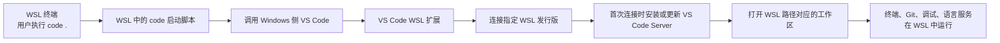

[toc]


## 定位：WSL 里的 `code` 命令到底是什么

在 WSL 终端里执行：

```bash
code .
```

看起来像是在 Linux 里启动了 VS Code，但本质上不是“在 WSL 里安装并运行一个 Linux 版 VS Code 桌面程序”。推荐做法是：**VS Code 安装在 Windows 侧，WSL 扩展负责把当前 WSL 发行版变成 VS Code 的远程开发环境**。Microsoft 文档也明确建议把 VS Code 安装在 Windows，而不是安装到 WSL 文件系统里，并安装 WSL 扩展；安装 VS Code 时勾选 “Add to PATH” 可以让你从 WSL 里使用 `code` 命令打开项目。([Microsoft Learn](https://learn.microsoft.com/en-us/windows/wsl/tutorials/wsl-vscode))

你可以把它理解成：

| 组件           | 运行位置            | 作用                                                         |
| -------------- | ------------------- | ------------------------------------------------------------ |
| VS Code 界面   | Windows             | 编辑器窗口、菜单、主题、快捷键、UI                           |
| WSL 发行版     | Linux 环境          | 存放项目、运行 Shell、Git、Node、Python、gcc 等 Linux 工具   |
| VS Code Server | WSL 内部            | 让 Windows 上的 VS Code 能操作 WSL 内的文件、终端、调试器、语言服务 |
| WSL 扩展       | VS Code 扩展体系    | 连接 Windows VS Code 与 WSL 环境                             |
| `code` 命令    | 可从 WSL Shell 调用 | 触发 Windows VS Code 打开当前 WSL 路径                       |

VS Code 官方把 Remote Development 描述为一种“把 WSL、容器或远程机器当作完整开发环境”的方式，扩展会在远程 OS 上安装 VS Code Server，且这个 Server 独立于远程系统中是否已有 VS Code 桌面版。([code.visualstudio.com](https://code.visualstudio.com/docs/remote/remote-overview))

## 核心原理：一次 `code .` 背后发生了什么



第一次执行 `code .` 时，VS Code 可能会拉取并安装 WSL 侧所需组件；完成后，窗口左下角会显示 WSL 状态指示，之后在该窗口中的编辑、文件操作、调试、终端等都会在 WSL 环境中执行。([code.visualstudio.com](https://code.visualstudio.com/docs/remote/wsl))

这就是新手最容易混淆的一点：

> `code .` 打开的不是普通 Windows 本地窗口，而是一个“连接到 WSL 的 VS Code 窗口”。

判断是否已经处在 WSL 模式，可以看 VS Code 左下角，通常会显示类似：

```text
WSL: Ubuntu
```

或者：

```text
WSL: Debian
```

## 最基础用法

### 打开当前目录

```bash
cd ~/projects/my-app
code .
```

这是最常见用法。`.` 表示当前目录。VS Code CLI 文档也把 `code .` 作为从命令行打开当前项目文件夹的典型方式。([code.visualstudio.com](https://code.visualstudio.com/docs/configure/command-line))

适合：

| 场景                 | 示例                                   |
| -------------------- | -------------------------------------- |
| 打开一个项目目录     | `code .`                               |
| 打开 home 下的项目   | `code ~/projects/app`                  |
| 打开当前目录中的文件 | `code README.md`                       |
| 创建并打开新文件     | `code notes.md`                        |
| 同时打开多个文件     | `code index.js package.json README.md` |

如果指定的文件不存在，VS Code 可以创建该文件，并把它标记为已编辑状态；相对路径会相对于你执行 `code` 命令时所在的目录解析。([code.visualstudio.com](https://code.visualstudio.com/docs/configure/command-line))

### 打开某个文件

```bash
code app.py
```

### 打开文件并跳到指定行列

```bash
code -g app.py:42
code --goto app.py:42:8
```

`-g` 或 `--goto` 用来打开 `file:line[:character]` 形式的路径，定位到指定行和可选字符位置。([code.visualstudio.com](https://code.visualstudio.com/docs/configure/command-line))

### 新窗口打开

```bash
code -n .
code --new-window .
```

### 复用已有窗口打开

```bash
code -r .
code --reuse-window .
```

### 等待 VS Code 关闭后再返回

```bash
code -w commit-message.txt
code --wait commit-message.txt
```

`--wait` 常用于 Git 编辑器场景，例如让 VS Code 作为 Git commit message 编辑器，关闭文件后命令行才继续执行。VS Code CLI 文档列出了 `--wait`、`--diff`、`--merge` 等核心参数。([code.visualstudio.com](https://code.visualstudio.com/docs/configure/command-line))

### 比较两个文件

```bash
code -d old.txt new.txt
code --diff old.txt new.txt
```

### 三方合并

```bash
code -m ours.txt theirs.txt base.txt result.txt
code --merge ours.txt theirs.txt base.txt result.txt
```

### 从标准输入打开内容

```bash
echo "hello from stdin" | code -
```

`-` 表示从 stdin 读取内容并在 VS Code 中打开。([code.visualstudio.com](https://code.visualstudio.com/docs/configure/command-line))

## WSL 中 `code` 与 Windows 中 `code` 的区别

同样是 `code .`，运行位置不同，含义也不同。

| 执行位置         | 命令                                    | 打开的路径类型                     | 典型结果                           |
| ---------------- | --------------------------------------- | ---------------------------------- | ---------------------------------- |
| WSL 终端         | `code .`                                | Linux 路径，如 `/home/me/app`      | 打开 WSL 远程窗口                  |
| PowerShell / CMD | `code .`                                | Windows 路径，如 `C:\Users\me\app` | 打开 Windows 本地窗口              |
| PowerShell / CMD | `code --remote wsl+Ubuntu /home/me/app` | 指定 WSL 发行版和 WSL 路径         | 从 Windows 命令行直接打开 WSL 项目 |

VS Code 官方文档说明，从 Windows 命令提示符直接打开 WSL 窗口时，可以使用：

```powershell
code --remote wsl+<distro name> <path in WSL>
```

例如：

```powershell
code --remote wsl+Ubuntu /home/jim/projects/c
```

([code.visualstudio.com](https://code.visualstudio.com/docs/remote/wsl))

## `code .`、`code ./`、`code file` 的路径规则

### 相对路径

```bash
cd ~/projects/app
code .
code src
code src/index.ts
```

这些路径都相对于当前 Shell 所在目录。

### 绝对路径

```bash
code /home/melissa/projects/app
code /etc/wsl.conf
```

### Windows 挂载路径

```bash
code /mnt/c/Users/Melissa/Desktop/demo
```

WSL 中的 `/mnt/c` 对应 Windows 的 `C:\`。Microsoft 文档说明，当 WSL 命令行路径中出现 `/mnt/`，通常意味着你正在访问挂载的 Windows 驱动器；例如 `C:\Users\<user>\Project` 在 WSL 中会表现为 `/mnt/c/Users/<user>/Project`。([Microsoft Learn](https://learn.microsoft.com/en-us/windows/wsl/filesystems?utm_source=chatgpt.com))

### 路径带空格

```bash
code "/mnt/c/Users/Melissa/My Projects/demo"
code "$HOME/my project"
```

只要路径中有空格，就用引号包起来。

## 文件还是文件夹：VS Code 如何判断

从 Windows 命令行用 `--remote` 打开 WSL 路径时，VS Code 会猜测输入路径是文件还是文件夹；如果路径看起来有文件扩展名，它可能被当作文件。官方文档给出两个强制方式：用 `--folder-uri` 强制作为文件夹，用 `--file-uri` 或 `--goto` 强制作为文件。([code.visualstudio.com](https://code.visualstudio.com/docs/remote/wsl))

例如，从 Windows PowerShell 打开一个名字里带点号的 WSL 文件夹：

```powershell
code --folder-uri vscode-remote://wsl+Ubuntu/home/ubuntu/folder.with.dot
```

打开一个没有扩展名的文件：

```powershell
code --file-uri vscode-remote://wsl+Ubuntu/home/ubuntu/fileWithoutExtension
```

或者：

```powershell
code --remote wsl+Ubuntu --goto /home/ubuntu/fileWithoutExtension
```

新手一般不需要一开始就记住 `vscode-remote://` URI，但要理解这个规则：**当 VS Code 猜错文件/文件夹类型时，用更明确的参数告诉它。**

## 从 VS Code 里面切换到 WSL

不一定非要从终端执行 `code .`。也可以在 VS Code 中使用命令面板：

```text
Ctrl + Shift + P
```

然后搜索：

```text
WSL
```

常见命令包括：

| 命令                               | 作用                                         |
| ---------------------------------- | -------------------------------------------- |
| `WSL: Connect to WSL`              | 连接默认 WSL 发行版                          |
| `WSL: Connect to WSL using Distro` | 指定某个发行版                               |
| `WSL: Reopen Folder in WSL`        | 把当前 Windows 本地文件夹重新以 WSL 模式打开 |
| `WSL: Reopen in Windows`           | 从 WSL 窗口切回 Windows 本地窗口             |

官方文档也提到，可以在 VS Code 中通过 F1/命令面板选择 `WSL: Connect to WSL` 或指定发行版；已有文件夹时，也可以使用 `WSL: Reopen Folder in WSL`。([code.visualstudio.com](https://code.visualstudio.com/docs/remote/wsl))

## 必须安装什么

### Windows 侧

| 项                        | 是否必需 | 说明                                        |
| ------------------------- | -------- | ------------------------------------------- |
| WSL                       | 必需     | 提供 Linux 环境                             |
| Linux 发行版，如 Ubuntu   | 必需     | 实际开发环境                                |
| Windows 版 VS Code        | 必需     | 图形界面运行在 Windows                      |
| VS Code WSL 扩展          | 必需     | 让 VS Code 连接 WSL                         |
| Remote Development 扩展包 | 可选     | 包含 WSL、Remote SSH、Dev Containers 等扩展 |

Microsoft 文档建议安装 Windows 版 VS Code，不要安装到 WSL 文件系统；同时安装 WSL 扩展，如果还要用远程机器或 Dev Containers，可以安装 Remote Development 扩展包。([Microsoft Learn](https://learn.microsoft.com/en-us/windows/wsl/tutorials/wsl-vscode))

### WSL 侧

通常不需要安装 Linux 版 VS Code 桌面程序。你需要的是开发工具链，例如：

```bash
sudo apt update
sudo apt install git curl build-essential
```

如果使用 Node.js、Python、Go、Rust 等，再安装相应运行时。

Microsoft 文档也建议更新 Linux 发行版，并指出某些 WSL Linux 发行版可能缺少 VS Code Server 启动所需库；例如 Debian/Ubuntu 可先执行 `sudo apt-get update`，并安装 `wget` 与 `ca-certificates`。([Microsoft Learn](https://learn.microsoft.com/en-us/windows/wsl/tutorials/wsl-vscode))

```bash
sudo apt-get update
sudo apt-get install wget ca-certificates
```

## 发行版选择：多个 WSL 发行版时怎么办

你可能安装了多个发行版：

```powershell
wsl -l -v
```

例如：

```text
  NAME            STATE           VERSION
* Ubuntu          Running         2
  Debian          Stopped         2
```

在 WSL 终端里执行 `code .` 时，使用的是**当前这个 WSL 发行版**。如果你打开的是 Ubuntu 终端，`code .` 就连接 Ubuntu；如果你打开 Debian 终端，`code .` 就连接 Debian。

从 Windows 侧指定发行版：

```powershell
code --remote wsl+Ubuntu /home/me/project
code --remote wsl+Debian /home/me/project
```

## 扩展安装规则：为什么有的扩展要装两次

WSL 模式下，VS Code 扩展分为两类：

| 扩展类型                         | 安装位置     | 示例                                                 |
| -------------------------------- | ------------ | ---------------------------------------------------- |
| UI 类扩展                        | Windows 本地 | 主题、图标、部分代码片段                             |
| 需要访问运行时/文件/调试器的扩展 | WSL 远程环境 | Python、ESLint、Go、Rust、C/C++、Docker 相关部分能力 |

官方文档说明，VS Code 在 WSL 中运行扩展时，会把扩展分成本地 UI/client 侧和 WSL 侧；主题、代码片段等通常在本地，很多开发相关扩展会安装在 WSL 中。扩展视图会按 `Local - Installed` 和 WSL 分组展示。([code.visualstudio.com](https://code.visualstudio.com/docs/remote/wsl))

这解释了一个常见现象：

> 你在 Windows 本地装过 Python 扩展，但打开 WSL 项目后，VS Code 仍提示 “Install in WSL”。

这不是错误。因为 Python 解释器、虚拟环境、调试器、lint 工具都在 WSL 里，Python 扩展也需要在 WSL 侧运行。

## 集成终端规则

当你通过 WSL 模式打开一个文件夹后，在 VS Code 中新建终端：

```text
Terminal > New Terminal
```

打开的就是 WSL 终端，而不是 PowerShell 或 CMD。官方文档说明，一旦文件夹在 WSL 中打开，VS Code 里的新终端会自动运行在 WSL 中。([code.visualstudio.com](https://code.visualstudio.com/docs/remote/wsl))

这意味着：

```bash
pwd
node -v
python3 --version
git status
```

这些命令都在 WSL 发行版中执行。

## 项目放在哪里：`/home` 还是 `/mnt/c`

这是 WSL 新手必须掌握的最佳实践。

### 推荐：Linux 项目放在 WSL 文件系统中

推荐位置：

```bash
/home/<你的用户名>/projects
```

例如：

```bash
mkdir -p ~/projects
cd ~/projects
git clone https://github.com/example/app.git
cd app
code .
```

Microsoft 文档说明，项目文件可以放在挂载的 Windows 驱动器上，但如果把文件直接存储在 WSL 的 Linux 文件系统中，性能会更好。([Microsoft Learn](https://learn.microsoft.com/en-us/windows/wsl/filesystems?utm_source=chatgpt.com))

### 不推荐：频繁开发的 Linux 项目放在 `/mnt/c`

可以这样做，但不推荐作为默认习惯：

```bash
cd /mnt/c/Users/Melissa/Desktop/app
code .
```

原因是：

| 维度                    | `/home/...` WSL 文件系统       | `/mnt/c/...` Windows 文件系统         |
| ----------------------- | ------------------------------ | ------------------------------------- |
| Linux 工具性能          | 通常更好                       | 大量小文件操作可能较慢                |
| Linux 权限语义          | 更自然                         | 受 Windows NTFS 权限影响              |
| Node/Python/Go 依赖目录 | 更适合                         | 可能遇到性能或权限问题                |
| Windows 工具直接访问    | 需要通过 `\\wsl.localhost\...` | Windows 直接访问方便                  |
| 推荐用途                | Linux 开发主目录               | 偶尔访问 Windows 文件、文档、下载目录 |

### 从 Windows 访问 WSL 文件

在 Windows 文件资源管理器地址栏中可以访问：

```text
\\wsl.localhost\Ubuntu\home\<你的用户名>
```

或者某些环境中仍可见：

```text
\\wsl$\Ubuntu\home\<你的用户名>
```

新手要避免直接去 Windows 用户目录里找 WSL 的虚拟磁盘文件，更不要手动修改发行版内部的底层存储文件。通过 `\\wsl.localhost\发行版名\...` 访问更安全。

## 推荐工作流

### Linux 项目开发工作流

```bash
cd ~
mkdir -p projects
cd projects
git clone https://github.com/example/my-app.git
cd my-app
code .
```

之后：

```bash
npm install
npm run dev
```

或者：

```bash
python3 -m venv .venv
source .venv/bin/activate
pip install -r requirements.txt
code .
```

这类项目建议放在 WSL 的 `/home` 下。

### Windows 文件临时编辑工作流

```bash
cd /mnt/c/Users/Melissa/Desktop
code notes.txt
```

适合临时编辑 Windows 桌面、下载目录、文档目录里的文件。

### 从 Windows PowerShell 直接打开 WSL 项目

```powershell
code --remote wsl+Ubuntu /home/melissa/projects/my-app
```

适合你已经在 Windows 终端中，但想直接打开 WSL 项目。

### 从 VS Code 本地窗口切到 WSL

在 VS Code 打开一个 Windows 项目后：

```text
Ctrl + Shift + P
WSL: Reopen Folder in WSL
```

适合你已经用 Windows 方式打开了项目，但想让工具链改在 WSL 里运行。

## 常用命令速查

| 命令                                    | 作用                                         |
| --------------------------------------- | -------------------------------------------- |
| `code .`                                | 用 VS Code 打开当前目录                      |
| `code file.txt`                         | 打开文件；不存在则创建                       |
| `code dir`                              | 打开目录                                     |
| `code -n .`                             | 新窗口打开当前目录                           |
| `code -r .`                             | 复用已有窗口                                 |
| `code -g app.py:10`                     | 打开文件并跳到第 10 行                       |
| `code -d a.txt b.txt`                   | 比较两个文件                                 |
| `code -w file.txt`                      | 等待 VS Code 关闭文件后再返回                |
| `code --help`                           | 查看 CLI 帮助                                |
| `code --version`                        | 查看版本、提交 ID、架构                      |
| `code --remote wsl+Ubuntu /home/me/app` | 从 Windows 命令行打开指定 WSL 发行版里的路径 |
| `code-insiders .`                       | 使用 VS Code Insiders 打开当前目录           |

如果你安装的是 VS Code Insiders，启动命令是 `code-insiders`，官方 CLI 文档也说明 Insiders 版本使用 `code-insiders`。([code.visualstudio.com](https://code.visualstudio.com/docs/configure/command-line))

## `code --help` 该怎么看

执行：

```bash
code --help
```

你会看到 VS Code CLI 支持的参数。官方文档也建议通过 `code --help` 查看版本、用法示例和命令行选项。([code.visualstudio.com](https://code.visualstudio.com/docs/configure/command-line))

初学者优先掌握这些即可：

| 参数 | 长参数           | 用途                 |
| ---- | ---------------- | -------------------- |
| `-h` | `--help`         | 查看帮助             |
| `-v` | `--version`      | 查看版本             |
| `-n` | `--new-window`   | 新窗口               |
| `-r` | `--reuse-window` | 复用窗口             |
| `-g` | `--goto`         | 跳转到行列           |
| `-d` | `--diff`         | 文件对比             |
| `-m` | `--merge`        | 三方合并             |
| `-w` | `--wait`         | 等待窗口关闭         |
| 无   | `--remote`       | 指定远程目标，如 WSL |

## 与 Git 配合

### 用 VS Code 作为 Git 编辑器

```bash
git config --global core.editor "code --wait"
```

之后执行：

```bash
git commit
```

Git 会打开 VS Code 编辑 commit message。你关闭编辑器标签页或窗口后，Git 命令才继续。

### 打开冲突文件

```bash
code .
```

然后在 Source Control 面板中处理冲突。

### 用 VS Code 做 diff

```bash
code --diff old.txt new.txt
```

### 行尾问题

如果同一个仓库会同时被 Windows 工具和 WSL 工具编辑，要注意 CRLF/LF 行尾一致性。VS Code WSL 文档也提醒，如果同一个仓库在 WSL 和 Windows 中使用，应设置一致的 line endings。([code.visualstudio.com](https://code.visualstudio.com/docs/remote/wsl))

常见建议是在仓库里放 `.gitattributes`，例如：

```gitattributes
* text=auto
*.sh text eol=lf
*.bat text eol=crlf
*.cmd text eol=crlf
```

## 与语言环境配合

### Node.js 项目

推荐：

```bash
cd ~/projects
git clone <repo>
cd <repo>
npm install
code .
```

不要把 `node_modules` 长期放在 `/mnt/c/...` 下做高频开发。大量小文件 I/O 在跨文件系统边界时通常更容易出现性能问题。

### Python 项目

```bash
cd ~/projects/my-python-app
python3 -m venv .venv
source .venv/bin/activate
pip install -r requirements.txt
code .
```

然后在 VS Code 中选择 WSL 内的 Python 解释器，例如：

```text
.venv/bin/python
```

### C/C++ 项目

```bash
sudo apt update
sudo apt install build-essential gdb
code .
```

在 WSL 模式下，编译器和调试器应该来自 WSL，而不是 Windows。

### Docker / Dev Containers

如果你使用 Docker Desktop + WSL 2，常见高性能工作流是：

```bash
cd ~/projects/my-app
code .
```

然后在 VS Code 中执行：

```text
Dev Containers: Reopen in Container
```

VS Code WSL 文档说明，在 WSL 2 且启用 Docker Desktop WSL 2 backend 时，可以从 WSL 中的源码目录重新打开到 Dev Container。([code.visualstudio.com](https://code.visualstudio.com/docs/remote/wsl))

## 常见问题与排查

### `code: command not found`

常见原因：

| 原因                         | 解决                                      |
| ---------------------------- | ----------------------------------------- |
| 安装 VS Code 时没有加入 PATH | 重新运行安装器，勾选 Add to PATH          |
| 终端还没刷新 PATH            | 关闭 WSL 终端后重新打开                   |
| WSL 没继承 Windows PATH      | 检查 `/etc/wsl.conf` 的 interop/path 设置 |
| 使用的是 Insiders            | 尝试 `code-insiders .`                    |

官方 WSL 文档也提示，如果 `code` 命令不能工作，可能需要重启终端，或者安装 VS Code 时没有加入 PATH。([code.visualstudio.com](https://code.visualstudio.com/docs/remote/wsl))

可以先检查：

```bash
which code
code --version
```

### 执行 `code .` 后打开的是 Windows 本地窗口，不是 WSL

检查左下角是否显示 `WSL: <发行版>`。

如果不是，可以在 VS Code 中执行：

```text
Ctrl + Shift + P
WSL: Reopen Folder in WSL
```

或者从 WSL 终端重新打开：

```bash
cd ~/projects/app
code .
```

### WSL 窗口打开后扩展不可用

打开 Extensions 面板，看扩展是否安装在 WSL 侧。开发类扩展需要点击：

```text
Install in WSL
```

官方文档说明，某些扩展如 Python 或涉及 lint/debug 的扩展，需要在每个 WSL 发行版中单独安装；VS Code 会显示提示并提供 “Install in WSL” 按钮。([Microsoft Learn](https://learn.microsoft.com/en-us/windows/wsl/tutorials/wsl-vscode))

### 打开项目很慢

优先检查项目是否位于：

```bash
/mnt/c/...
```

如果是高频开发项目，建议迁移到：

```bash
~/projects/...
```

Microsoft 的 WSL 文件系统文档指出，项目文件可以放在挂载驱动器中，但直接放在 WSL 文件系统里性能会更好。([Microsoft Learn](https://learn.microsoft.com/en-us/windows/wsl/filesystems?utm_source=chatgpt.com))

### 权限异常

例如：

```text
EACCES: permission denied
```

处理思路：

| 场景               | 建议                                        |
| ------------------ | ------------------------------------------- |
| 项目在 `/mnt/c`    | 尽量移动到 WSL 的 `/home`                   |
| 文件由 root 创建   | 用 `sudo chown -R $USER:$USER <dir>` 修正   |
| WSL 1 文件监听问题 | 升级到 WSL 2 或调整 file watcher 设置       |
| SSH key 权限错误   | 把 key 放在 WSL home 下，并设置 `chmod 600` |

VS Code WSL 文档列出过 WSL 1 中与文件系统监听相关的 EACCES 问题，并说明 WSL 2 不受该特定问题影响。([code.visualstudio.com](https://code.visualstudio.com/docs/remote/wsl))

### VS Code Server 启动失败

可以尝试：

```bash
sudo apt update
sudo apt install wget ca-certificates
```

如果仍有问题，可以在 VS Code 中执行：

```text
WSL: Show Log
```

官方文档提到，WSL 远程启动时不会运行 shell 启动脚本；如果需要额外环境设置，可以使用 `~/.vscode-server/server-env-setup`，但无效脚本可能导致 server 无法启动，需要从普通 WSL shell 删除或重命名该脚本，并可通过 `WSL: Show Log` 查看输出和错误。([code.visualstudio.com](https://code.visualstudio.com/docs/remote/wsl))

### 需要重置 VS Code Server

有时 VS Code Server 状态异常，可以在 WSL 中删除服务端目录，让 VS Code 下次重新安装：

```bash
rm -rf ~/.vscode-server
```

Insiders 版本对应：

```bash
rm -rf ~/.vscode-server-insiders
```

然后重新执行：

```bash
code .
```

这个操作会删除 WSL 侧 VS Code Server 和远程扩展缓存，通常不会删除你的项目代码。

## 重要概念对照

| 概念            | 新手容易误解       | 正确认知                                           |
| --------------- | ------------------ | -------------------------------------------------- |
| `code`          | Linux 版 VS Code   | 从命令行启动/连接 Windows VS Code 的 CLI           |
| `code .`        | 打开当前目录而已   | 在 WSL 中执行时，会打开 WSL 远程工作区             |
| VS Code Server  | 用户手动安装的软件 | 通常由 VS Code Remote/WSL 扩展自动安装维护         |
| 扩展            | 装一次就全局可用   | UI 扩展在本地，开发扩展常需要装到 WSL              |
| 终端            | 总是 PowerShell    | WSL 工作区中新终端默认是 WSL shell                 |
| `/mnt/c`        | 和 `/home` 没区别  | 一个是 Windows 文件系统挂载，一个是 Linux 文件系统 |
| `--remote`      | 只用于 SSH         | 也可用于从 Windows 命令行打开 WSL 目标             |
| `code-insiders` | 拼写错误           | VS Code Insiders 的 CLI 命令                       |

## 推荐配置习惯

### 项目目录结构

```bash
~/projects
├── frontend-app
├── backend-api
├── scripts
└── experiments
```

打开项目：

```bash
cd ~/projects/backend-api
code .
```

### 不要在 WSL 中安装 VS Code 桌面版

推荐架构是：

```text
Windows 安装 VS Code
WSL 安装开发工具链
VS Code WSL 扩展连接二者
```

这和官方安装建议一致：VS Code 安装在 Windows，不安装在 WSL 文件系统中。([Microsoft Learn](https://learn.microsoft.com/en-us/windows/wsl/tutorials/wsl-vscode))

### 一种语言一套 WSL 工具链

例如 Node.js 项目：

```bash
node -v
npm -v
which node
```

应该指向 WSL 内路径，而不是 Windows 路径。

Python 项目：

```bash
which python3
which pip
```

也应位于 WSL 发行版内。

### 项目依赖放在项目内部或 WSL home 下

例如：

```bash
~/projects/app/node_modules
~/projects/app/.venv
```

避免把 Linux 项目依赖长期放在 `/mnt/c` 下。

### Windows 工具和 Linux 工具不要混用同一套依赖

不要在 Windows PowerShell 中对 WSL 项目执行：

```powershell
npm install
```

然后又在 WSL 中执行：

```bash
npm run dev
```

更好的规则是：

| 项目主要运行环境 | 安装依赖的位置 | 启动命令位置 |
| ---------------- | -------------- | ------------ |
| Linux/WSL        | WSL            | WSL          |
| Windows          | Windows        | Windows      |
| 容器             | 容器或 WSL     | 容器或 WSL   |

## 学习路线

### 入门阶段

先熟练掌握：

```bash
code .
code file.txt
code -g file.txt:10
code --help
```

并理解：

```text
WSL 终端执行 code . = 打开 WSL 远程窗口
```

### 熟练阶段

掌握：

```bash
code -n .
code -r .
code -d a.txt b.txt
code -w file.txt
```

同时能判断扩展安装位置、终端运行环境、项目文件系统位置。

### 进阶阶段

掌握：

```powershell
code --remote wsl+Ubuntu /home/me/project
```

以及：

```bash
~/.vscode-server
~/.vscode-server/server-env-setup
```

再结合 Git、调试器、Dev Containers 使用。

## 一个完整示例：从零创建 WSL 项目并用 VS Code 打开

```bash
cd ~
mkdir -p projects
cd projects

mkdir hello-wsl-code
cd hello-wsl-code

cat > hello.py <<'EOF'
print("Hello from WSL and VS Code")
EOF

code .
```

打开后，在 VS Code 终端中执行：

```bash
python3 hello.py
```

你应该看到：

```text
Hello from WSL and VS Code
```

如果 VS Code 左下角显示 `WSL: Ubuntu` 之类的状态，说明你已经进入正确的 WSL 开发模式。

## 记住这几条原则

| 原则                                   | 解释                                             |
| -------------------------------------- | ------------------------------------------------ |
| VS Code 装 Windows 侧                  | WSL 只是开发环境，不是桌面编辑器宿主             |
| Linux 项目放 `/home`                   | 性能、权限、工具链行为更自然                     |
| 从 WSL 终端执行 `code .`               | 最直接、最少出错                                 |
| 看左下角 WSL 状态                      | 判断当前窗口是否真在 WSL 模式                    |
| 开发扩展装到 WSL                       | Python、Go、Rust、C++、ESLint 等通常需要远程安装 |
| 不混用 Windows/WSL 依赖                | Node、Python、编译器等尽量保持同一环境           |
| 遇到问题先看 `code --help` 和 WSL 日志 | CLI 帮助和 `WSL: Show Log` 是排查入口            |

`code` 命令的核心价值是：**让你从 Linux 命令行自然地进入 VS Code，同时保留 Linux 工具链和 Windows 桌面体验。** 对新手而言，最重要的不是背所有参数，而是建立这套心智模型：Windows 负责界面，WSL 负责运行环境，`code` 是两者之间的入口。