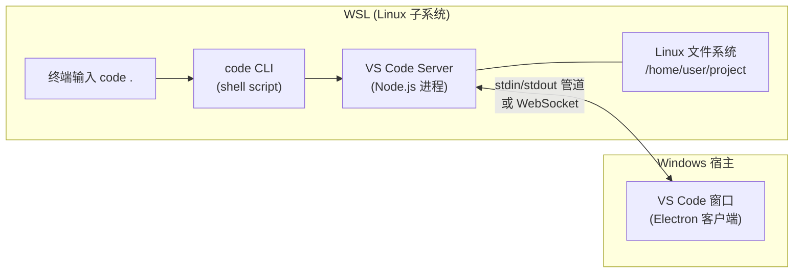
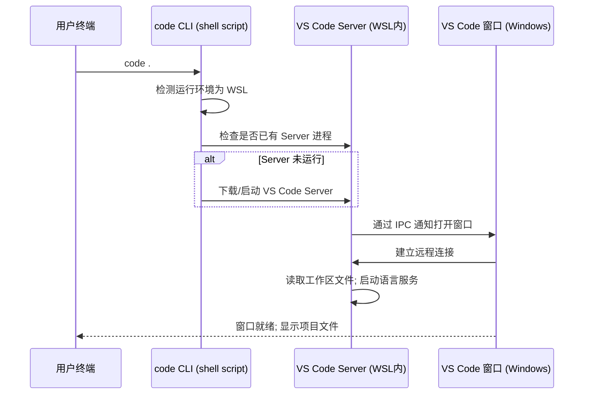
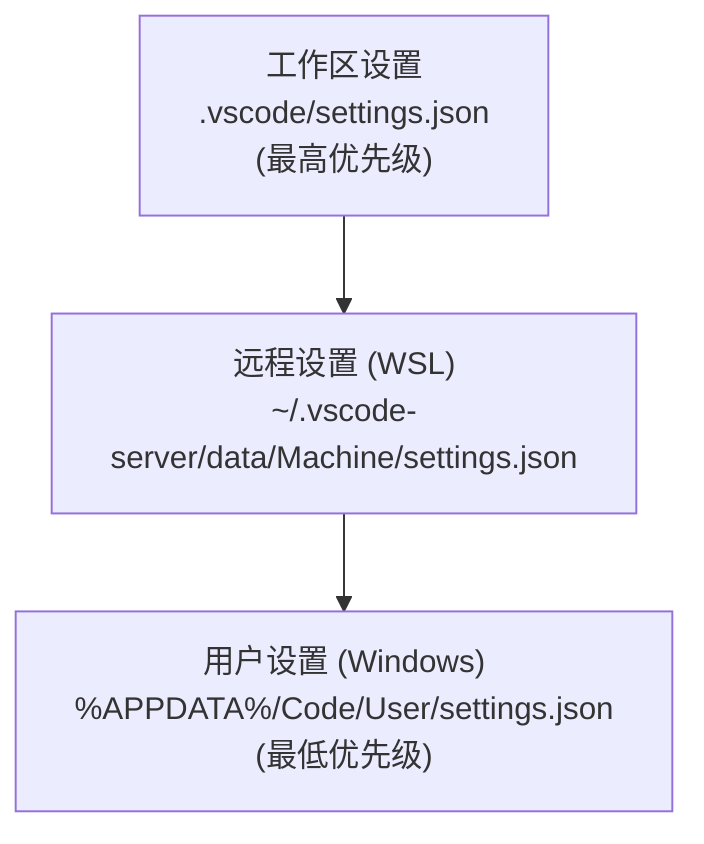
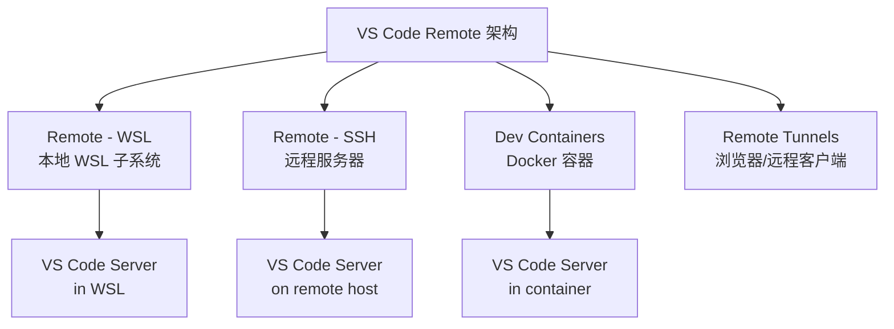
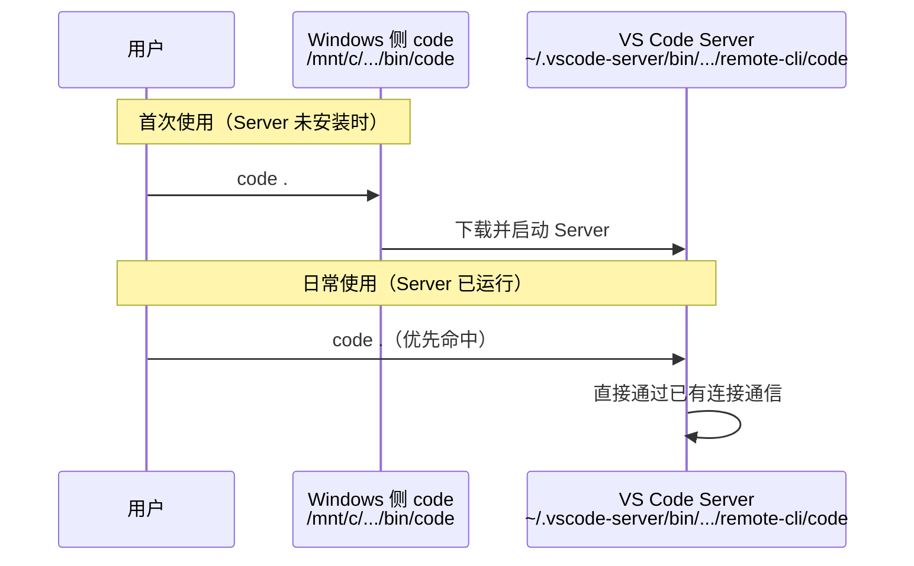

[toc]


# WSL 中的 `code` 命令（VS Code）

## 概述

`code` 命令是 VS Code 提供的命令行接口（CLI），在 WSL 环境中，它扮演着连接 Linux 子系统与 Windows 侧 VS Code 编辑器的桥梁角色。当你在 WSL 终端中执行 `code`，它并不是启动一个原生 Linux 版 VS Code，而是通过 **Remote - WSL** 架构，调起 Windows 侧的 VS Code 并建立远程连接。

## 工作架构



核心要点：

- **VS Code Server** 运行在 WSL 内部，负责文件读写、终端、扩展执行等重活
- **VS Code 客户端** 运行在 Windows 侧，只负责 UI 渲染
- 文件操作全部走 Linux 原生文件系统路径，不经过 `/mnt/c` 跨文件系统访问，性能远优于直接在 Windows 侧打开 WSL 文件

## 前置条件

| 条件                   | 说明                                                         |
| ---------------------- | ------------------------------------------------------------ |
| Windows 侧安装 VS Code | 需要完整安装，不能是便携版                                   |
| VS Code 加入 PATH      | 安装时默认勾选，或手动添加                                   |
| WSL 扩展               | VS Code 会在首次连接时自动安装（扩展 ID：`ms-vscode-remote.remote-wsl`） |
| WSL 发行版             | 任意已安装的发行版（Ubuntu、Debian 等）                      |

验证环境是否就绪：

```bash
# 在 WSL 终端中执行
which code
# 预期输出类似：/mnt/c/Users/<用户名>/AppData/Local/Programs/Microsoft VS Code/bin/code
```

如果 `which code` 无输出，说明 Windows 侧的 VS Code 未正确加入 PATH。

解决方法是在 Windows 侧重新运行 VS Code 安装程序并勾选"Add to PATH"，然后重启 WSL 终端。

另一种情况是环境变量的读取和Path变量的顺序问题导致的`code`命令发生混乱,例如

```bash
$ which code
/mnt/c/Program Files/Microsoft VS Code/bin/code
```

这个时候调用的code和在windows系统中的shell调用的code是一样的.

## 命令语法与常用参数

基本格式：

```bash
code [选项] [路径/文件...]
```

### 核心参数速查

| 参数                       | 作用                         | 示例                                              |
| -------------------------- | ---------------------------- | ------------------------------------------------- |
| `.`                        | 打开当前目录为工作区         | `code .`                                          |
| `<file>`                   | 打开指定文件                 | `code main.py`                                    |
| `-r` / `--reuse-window`    | 在已有窗口中打开，不新建窗口 | `code -r .`                                       |
| `-n` / `--new-window`      | 强制新建窗口                 | `code -n ~/project2`                              |
| `-g <file>:<line>:<col>`   | 打开文件并跳转到指定行列     | `code -g src/app.ts:42:5`                         |
| `-d <file1> <file2>`       | 对比两个文件（diff 模式）    | `code -d old.json new.json`                       |
| `-a` / `--add`             | 将文件夹添加到当前工作区     | `code -a ../lib`                                  |
| `--install-extension <id>` | 安装扩展                     | `code --install-extension esbenp.prettier-vscode` |
| `--list-extensions`        | 列出已安装扩展               | `code --list-extensions`                          |
| `-w` / `--wait`            | 阻塞终端直到编辑器窗口关闭   | `git commit`（配合 editor 配置）                  |
| `--diff`                   | 等同于 `-d`                  | `code --diff a.txt b.txt`                         |
| `--locale <lang>`          | 指定界面语言启动             | `code --locale zh-cn .`                           |
| `-v` / `--version`         | 输出版本信息                 | `code -v`                                         |

### 实用组合示例

```bash
# 打开项目并定位到特定文件的特定行
code ~/project -g ~/project/src/index.ts:15

# 将当前目录作为工作区，并打开 README
code . README.md

# 用 VS Code 作为 git 默认编辑器（支持 rebase 交互等场景）
git config --global core.editor "code --wait"

# 用 VS Code 作为 git diff/merge 工具
git config --global diff.tool vscode
git config --global difftool.vscode.cmd 'code --wait --diff $LOCAL $REMOTE'

# 批量安装扩展（脚本化环境配置）
cat extensions.txt | xargs -L 1 code --install-extension
```

## `code` CLI 的实际执行流程



首次执行 `code` 时，CLI 会自动下载与当前 VS Code 版本匹配的 Server 组件到 `~/.vscode-server/` 目录。后续执行会复用已有 Server。

## `--wait` 参数深度解析

`--wait` 是与终端工作流集成的关键参数。它使 `code` 命令阻塞当前 shell，直到用户关闭对应的编辑器标签页或窗口。

典型用途：

```bash
# 作为临时编辑器使用（替代 nano/vim）
code --wait temp.txt
echo "用户已关闭文件，继续执行"

# 用于交互式 git rebase
GIT_EDITOR="code --wait" git rebase -i HEAD~3

# 用作管道中的编辑步骤
cat data.json | code --wait --stdin-from pipe - | process_output
```

配置为 git 编辑器时的完整推荐设置：

```bash
git config --global core.editor "code --wait"
git config --global merge.tool vscode
git config --global mergetool.vscode.cmd 'code --wait $MERGED'
```

## 扩展管理

WSL 架构下扩展分为两类：

| 类别           | 运行位置         | 存储路径                       | 典型扩展                            |
| -------------- | ---------------- | ------------------------------ | ----------------------------------- |
| UI 扩展        | Windows 侧       | Windows 用户目录               | 主题、图标、键位映射                |
| Workspace 扩展 | WSL 内 Server 侧 | `~/.vscode-server/extensions/` | 语言服务、Linter、Formatter、调试器 |

VS Code 会自动判断扩展应该运行在哪一侧。大部分开发相关扩展都运行在 WSL 内，这意味着它们能直接访问 Linux 工具链（如 Python 解释器、Node.js、GCC 等）。

通过 CLI 管理扩展：

```bash
# 列出 WSL 侧已安装的扩展
code --list-extensions

# 安装扩展到 WSL 侧
code --install-extension ms-python.python

# 卸载
code --uninstall-extension ms-python.python

# 查看扩展详情（版本等）
code --list-extensions --show-versions
```

## `.vscode-server` 目录结构

```
~/.vscode-server/
├── bin/
│   └── <commit-hash>/          # Server 二进制文件（与 VS Code 版本对应）
│       ├── node
│       ├── server.sh
│       └── ...
├── extensions/                  # WSL 侧扩展
│   ├── ms-python.python-2024.x.x/
│   └── dbaeumer.vscode-eslint-3.x.x/
├── data/
│   ├── Machine/settings.json   # WSL 侧机器级设置
│   ├── logs/
│   └── CachedExtensionVSIXs/
└── cli/                         # CLI 工具缓存
```

清理磁盘空间时，可以安全删除旧版本的 `bin/<old-commit-hash>` 目录，但不要删除当前正在使用的版本。

## 设置层级

VS Code 在 WSL 模式下有三层设置，优先级从高到低：



实际使用建议：

- **项目相关配置**（格式化规则、调试配置）放在 `.vscode/settings.json`，可以提交到版本控制
- **WSL 环境配置**（终端路径、Python 解释器路径）放在远程设置
- **个人偏好**（字体、主题、快捷键）放在用户设置

## 最佳实践

### 性能相关

- 始终将项目文件存放在 WSL 文件系统中（`/home/user/` 下），而非 `/mnt/c/`。跨文件系统访问会导致文件监视（file watcher）和读写性能显著下降
- 如果项目有大量依赖（如 `node_modules`），确保它们也在 WSL 文件系统内
- 使用 `.gitignore` 风格的 `files.watcherExclude` 排除不需要监视的目录：

```json
{
  "files.watcherExclude": {
    "**/node_modules/**": true,
    "**/.git/objects/**": true,
    "**/dist/**": true
  }
}
```

### 开发环境配置

```bash
# 推荐的 shell 配置（加入 ~/.bashrc 或 ~/.zshrc）

# 快速打开常用项目
alias proj="code ~/projects/my-app"

# 打开最近的项目（利用 code 的工作区历史）
alias recent="code --reuse-window"
```

### 终端集成

在 VS Code 内置终端中，默认 shell 就是 WSL 的 shell。你可以在设置中指定：

```json
{
  "terminal.integrated.defaultProfile.linux": "bash",
  "terminal.integrated.profiles.linux": {
    "bash": { "path": "/bin/bash" },
    "zsh": { "path": "/usr/bin/zsh" }
  }
}
```

### 多发行版场景

如果安装了多个 WSL 发行版，可以指定连接目标：

```bash
# 在特定发行版中打开
code --remote wsl+Ubuntu-22.04 /home/user/project

# 列出可用发行版
wsl -l -v
```

## 常见问题排查

| 问题                      | 可能原因                       | 解决方案                                                   |
| ------------------------- | ------------------------------ | ---------------------------------------------------------- |
| `code: command not found` | PATH 未包含 Windows 侧 VS Code | 重装 VS Code 并勾选 PATH 选项，重启终端                    |
| 打开后无响应              | Server 进程异常                | 删除 `~/.vscode-server/bin/` 后重试                        |
| 扩展不工作                | 扩展未安装到 WSL 侧            | 在扩展面板中点击"Install in WSL"                           |
| 文件修改不触发热更新      | 项目在 `/mnt/c` 下             | 迁移到 WSL 文件系统                                        |
| Server 版本不匹配         | VS Code 更新后 Server 未更新   | 执行 `code .` 会自动更新，或手动删旧版本                   |
| 权限错误                  | `.vscode-server` 权限问题      | `chmod -R u+rwX ~/.vscode-server`                          |
| 连接超时                  | 网络代理或防火墙               | 检查 WSL 网络设置，或设置 `remote.WSL.useShellEnvironment` |

## 与其他远程模式的关系



这些模式共享相同的 Server 架构，`code` CLI 在 WSL 中的行为本质上就是 Remote 模式的一种。理解这一点后，你会发现在 SSH 远程主机或容器中也可以用类似的方式调用 `code` 命令（通过 Remote Tunnels）。

## 总结

`code` 命令在 WSL 中不仅仅是"打开编辑器"的快捷方式，它是整个 Remote 开发架构的入口。关键认知：

- 文件始终通过 Linux 原生路径访问，性能和兼容性最佳
- Server 进程驻留在 WSL 内，扩展和工具链都在 Linux 侧运行
- CLI 参数丰富，善用 `--wait`、`-g`、`-d` 等可以大幅提升工作流效率
- 遇到问题时，`~/.vscode-server/` 是关键排查目录

## `type -a code`列出的路径的含义

wsl中启动code后,可能观察到:

```bash
$ type -a code
code is /home/cxxu/.vscode-server/bin/69...131f1c/bin/remote-cli/code
code is '/mnt/c/Program Files/Microsoft VS Code/bin/code'
# 可能重复: code is '/mnt/c/Program Files/Microsoft VS Code/bin/code'
```

系统中存在两个不同来源的 `code` 命令，且优先级不同：

| 优先级 | 路径                                                     | 来源                                          | 说明                                 |
| ------ | -------------------------------------------------------- | --------------------------------------------- | ------------------------------------ |
| 最高   | `~/.vscode-server/bin/<commit-hash>/bin/remote-cli/code` | VS Code Server（WSL 内部）                    | 已建立远程连接后由 Server 提供的 CLI |
| 较低   | `/mnt/c/Program Files/Microsoft VS Code/bin/code`        | Windows 侧 VS Code 安装目录（通过 PATH 穿透） | 首次连接时的引导入口                 |

### 为什么有两个



**第一个路径**（优先级最高）是 VS Code Server 安装后自动注入到 PATH 中的版本。它的优势是直接通过已有的 Server 进程通信，响应更快，不需要再经过 Windows 侧中转。

**第二个路径**（出现两次是因为你的 PATH 中重复包含了该目录）是 Windows 安装目录通过 WSL 的 PATH 互通机制暴露进来的。它是"冷启动"入口——当 Server 还没运行时，靠它来引导整个连接流程。

### 实际效果

日常使用中，你执行 `code .` 命中的是第一个路径（Server 侧 CLI）。这意味着：

- 连接建立更快（不经过 Windows 侧 shell 脚本中转）
- 该 CLI 中的 commit hash（`6928394f...`）与你当前运行的 VS Code Server 版本精确对应

### 关于 PATH 重复

Windows 侧路径出现了两次，通常是因为系统 PATH 和用户 PATH 中都包含了 VS Code 的目录。无害，但如果你有洁癖，可以在 Windows 侧清理掉重复的环境变量条目，或者在 WSL 中通过 `/etc/wsl.conf` 控制 PATH 穿透行为：

```ini
# /etc/wsl.conf
[interop]
appendWindowsPath = true  # 设为 false 可完全禁止 Windows PATH 注入
```

不过一般不建议关闭，因为关掉后 `code`、`explorer.exe` 等 Windows 互操作命令都需要手动指定完整路径。