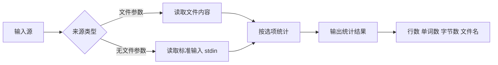
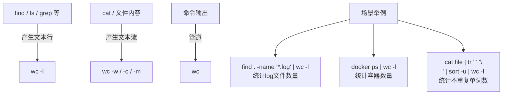

[toc]


# `wc` 命令完全指南

官方文档

[wc invocation (GNU Coreutils 9.10)](https://www.gnu.org/software/coreutils/manual/html_node/wc-invocation.html)

## 一、概述

`wc`（**W**ord **C**ount）是 Unix/Linux 系统中用于**统计文本数据量**的核心工具。它能快速统计文件或输入流中的**行数、单词数、字符数和字节数**。虽然名字叫"Word Count"，但它的功能远不止统计单词。

> **核心理念**：`wc` 遵循 Unix 哲学——"做好一件事"，它专注于文本计数，并能通过管道与其他命令无缝协作。

---

## 二、基本语法

```bash
wc [选项]... [文件]...
```

**处理流程：**



---

## 三、核心选项速查表

| 选项 | 长选项              | 功能                                   | 统计单位说明                                  |
| :--: | :------------------ | :------------------------------------- | :-------------------------------------------- |
| `-l` | `--lines`           | 统计**行数**                           | 以换行符 `\n` 为分隔符计数                    |
| `-w` | `--words`           | 统计**单词数**                         | 以空白字符（空格/Tab/换行）分隔的连续字符序列 |
| `-c` | `--bytes`           | 统计**字节数**                         | 每个字节计数一次（与编码有关）                |
| `-m` | `--chars`           | 统计**字符数**                         | 多字节字符（如中文）计为1个字符               |
| `-L` | `--max-line-length` | 最长行的**显示宽度**                   | 宽字符（如中文）通常计为宽度2                 |
|      | `--files0-from=F`   | 从文件 F 中读取以 NUL 分隔的文件名列表 | 适合处理含特殊字符的文件名                    |

---

## 四、核心概念深入解析

### 4.1 什么是"行"？

`wc -l` 统计的是**换行符 `\n` 的个数**，而不是"肉眼看到的行数"尤其是windows平台上创建的文本文件,可能不是以换行符结尾的。

```bash
# 重要区别演示
$ printf "hello"    | wc -l    # 输出: 0  （没有换行符！）
$ printf "hello\n"  | wc -l    # 输出: 1  （有一个换行符）
$ printf "a\nb\nc"  | wc -l    # 输出: 2  （只有2个 \n，虽然看到3行）
$ printf "a\nb\nc\n"| wc -l    # 输出: 3
```

> ⚠️ **新手常见困惑**：文件末尾如果没有换行符，最后一"行"不会被 `wc -l` 计入。**POSIX 标准规定文本文件应以换行符结尾**。

### 4.2 什么是"单词"？

`wc` 中的"单词"是**由空白字符（空格、Tab、换行符）分隔的非空字符序列**。

```bash
$ echo "Hello   World" | wc -w       # 输出: 2（连续空格不影响）
$ echo "one,two,three" | wc -w       # 输出: 1（逗号不是分隔符！）
$ echo "Hello    World   foo" | wc -w # 输出: 3
```

### 4.3 字节 vs 字符（`-c` vs `-m`）

这是在多字节编码（如 UTF-8）下的关键区别：

| 内容   | `-c`（字节数） | `-m`（字符数） | 说明                        |
| :----- | :------------: | :------------: | :-------------------------- |
| `ABC`  |       3        |       3        | ASCII 每字符1字节           |
| `你好` |       6        |       2        | UTF-8 中每个中文字符占3字节 |
| `café` |       5        |       4        | `é` 在 UTF-8 中占2字节      |
| `🎉`    |       4        |       1        | Emoji 在 UTF-8 中占4字节    |

计算字符数时,使用`echo`通常配合`-n`,或者使用`printf`,否则会受到`echo`自动追加换行符的影响

```bash
$ echo -n "你好" | wc -c    # 输出: 6
$ echo -n "你好" | wc -m    # 输出: 2
```

---

```bash
$ echo "你好"|wc -m
3
$ echo "你好"|wc -c
7
```


## 五、输出格式说明

### 5.1 默认输出（不带选项）

```bash
$ wc file.txt
  42  350 2891 file.txt
```

输出顺序**固定**为：

```
行数  单词数  字节数  文件名
```

### 5.2 多文件统计

```bash
$ wc *.txt
   10   50   320 a.txt
   20  100   640 b.txt
    5   25   160 c.txt
   35  175  1120 total
```

> 多文件时自动追加 **`total`（汇总行）**。

### 5.3 指定选项时的输出顺序

无论命令行中选项的书写顺序如何，输出始终按照 **`l → w → c/m → L`** 的固定顺序：

```bash
$ wc -w -l -c file.txt      # 写的顺序: w, l, c
   42  350 2891 file.txt     # 输出顺序仍然是: l, w, c
```

---

## 六、经典使用场景与示例

### 6.1 基础用法

```bash
# 统计单个文件
$ wc README.md
  120  580 4096 README.md

# 只看行数
$ wc -l access.log
  1048576 access.log

# 只看单词数
$ wc -w essay.txt
  2500 essay.txt
```

### 6.2 管道组合（重点）

```bash
# 统计当前目录下文件个数
$ ls -1 | wc -l

# 统计正在运行的进程数（减去标题行）
$ ps aux | tail -n +2 | wc -l

# 统计代码行数（排除空行）
$ grep -v '^\s*$' main.py | wc -l

# 统计 Git 仓库中有多少个提交
$ git log --oneline | wc -l

# 统计某个单词在文件中出现的次数
$ grep -o "error" app.log | wc -l

# 统计当前登录用户数
$ who | wc -l
```

### 6.3 统计项目代码行数

```bash
# 统计所有 Python 文件总行数
$ find . -name "*.py" -exec cat {} + | wc -l

# 更安全的写法（处理含空格的文件名）
$ find . -name "*.py" -print0 | xargs -0 cat | wc -l

# 使用 --files0-from（GNU wc）
$ find . -name "*.py" -print0 | wc -l --files0-from=-
```

### 6.4 查找最长行

```bash
# 检查代码是否超过80字符宽度限制
$ wc -L main.py
  127 main.py      # 最长行有127个字符宽度

# 找出超过80字符的行的具体内容
$ awk 'length > 80' main.py
```

### 6.5 从标准输入读取

```bash
# 交互式输入（Ctrl+D 结束）
$ wc
This is a test
of wc command
^D
       2       8      28

# Here Document
$ wc -w <<EOF
Hello World
Goodbye World
EOF
4
```

---

## 七、实用组合技巧

### 7.1 常见管道组合模式



### 7.2 批量文件统计排序

```bash
# 按行数排序，找出最大的文件
$ find . -name "*.py" -exec wc -l {} + | sort -n | tail -10

# 按行数排序（降序），排除 total 行
$ wc -l *.c | sort -rn | grep -v total
```

### 7.3 结合 `awk` 做精确提取

```bash
# 只提取数字（去掉文件名）
$ wc -l < file.txt     # 方法1: 输入重定向（不显示文件名）
42

$ wc -l file.txt | awk '{print $1}'   # 方法2: awk 提取
42

# 计算多个文件的平均行数
$ wc -l *.txt | grep total | awk '{print $1 / (NR)}' 
```

> 💡 **技巧**：`wc -l < file` 使用输入重定向时，输出不会包含文件名，这在脚本中提取纯数字时非常有用。

---

## 八、注意事项与陷阱

### 8.1 常见陷阱一览

| 陷阱                     | 说明                           | 正确做法                                                     |
| :----------------------- | :----------------------------- | :----------------------------------------------------------- |
| `ls \| wc -l` 统计文件数 | 文件名含换行符时会出错         | `find . -maxdepth 1 -type f -print0 \| tr -dc '\0' \| wc -c` |
| `wc -l` 末尾行无换行     | 最后一行不被计数               | 用 `grep -c ''` 替代，或确保文件以 `\n` 结尾                 |
| `-c` 和 `-m` 同时使用    | 只有最后指定的生效（某些实现） | 分开执行两次                                                 |
| 二进制文件               | `wc` 不会报错但结果无意义      | 确保只处理文本文件                                           |
| 多字节字符宽度           | `-L` 对中文按显示宽度2计算     | 注意区分"字符数"和"显示宽度"                                 |

### 8.2 `-l` 的替代方案

```bash
# 如果担心末尾无换行符的情况：
$ grep -c '' file.txt     # 统计匹配空模式的行数（包含无换行结尾的最后一行）

# 对比
$ printf "a\nb" | wc -l       # 输出: 1
$ printf "a\nb" | grep -c ''  # 输出: 2
```

---

## 九、在脚本中的最佳实践

### 9.1 获取纯数字结果

```bash
# ✅ 推荐：用输入重定向（无文件名输出）
lines=$(wc -l < "$file")

# ❌ 不推荐：需要额外处理文件名和前导空格
lines=$(wc -l "$file" | awk '{print $1}')
```

### 9.2 条件判断

```bash
# 检查日志文件是否超过10000行
if [ "$(wc -l < /var/log/app.log)" -gt 10000 ]; then
    echo "日志文件过大，需要轮转"
    logrotate /etc/logrotate.d/app
fi
```

### 9.3 处理空文件

```bash
# wc 对空文件也能正常工作
$ wc -l /dev/null
0 /dev/null

# 在脚本中安全使用
file_lines=$(wc -l < "$file" 2>/dev/null || echo 0)
```

### 9.4 处理大量文件

```bash
# ✅ 推荐：使用 find + -exec
$ find /var/log -name "*.log" -exec wc -l {} +

# ✅ 推荐：使用 --files0-from（GNU coreutils 8.25+）
$ find . -name "*.py" -print0 | wc -l --files0-from=-

# ❌ 避免：文件数过多可能超过参数限制
$ wc -l $(find . -name "*.py")     # 文件太多会报 "Argument list too long"
```

---

## 十、跨平台差异

| 特性            | GNU (Linux) | BSD (macOS) | 说明              |
| :-------------- | :---------: | :---------: | :---------------- |
| `--files0-from` |      ✅      |      ❌      | GNU 扩展选项      |
| `-L`            | 最长行宽度  | 最长行字节  | **语义不同！**    |
| 输出对齐        |   右对齐    |   右对齐    | 列宽可能不同      |
| `--total`       |  ✅ (8.25+)  |      ❌      | 控制 total 行显示 |

```bash
# macOS 上安装 GNU wc
$ brew install coreutils
$ gwc -l file.txt       # GNU 版本命名为 gwc
```

---

## 十一、速查摘要

```bash
wc file              # 行数 + 单词数 + 字节数
wc -l file            # 仅行数
wc -w file            # 仅单词数
wc -c file            # 仅字节数
wc -m file            # 仅字符数（多字节安全）
wc -L file            # 最长行显示宽度
wc -l *.txt           # 多文件统计 + total
wc -l < file          # 输出不含文件名（脚本友好）
cat file | wc -l      # 管道用法
find . -name "*.py" -exec wc -l {} +   # 递归统计
```

> **一句话总结**：`wc` 是文本世界的"计数器"，记住 **`-l`（行）、`-w`（词）、`-c`（字节）、`-m`（字符）** 四个选项，配合管道使用，能解决绝大多数统计需求。