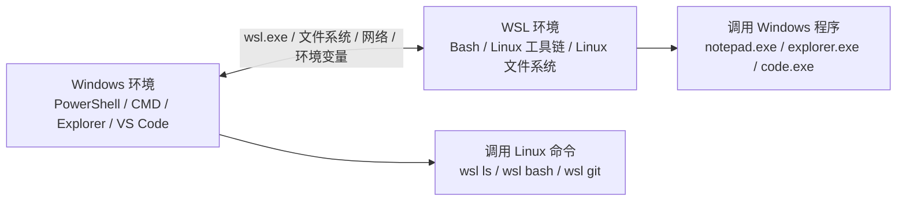
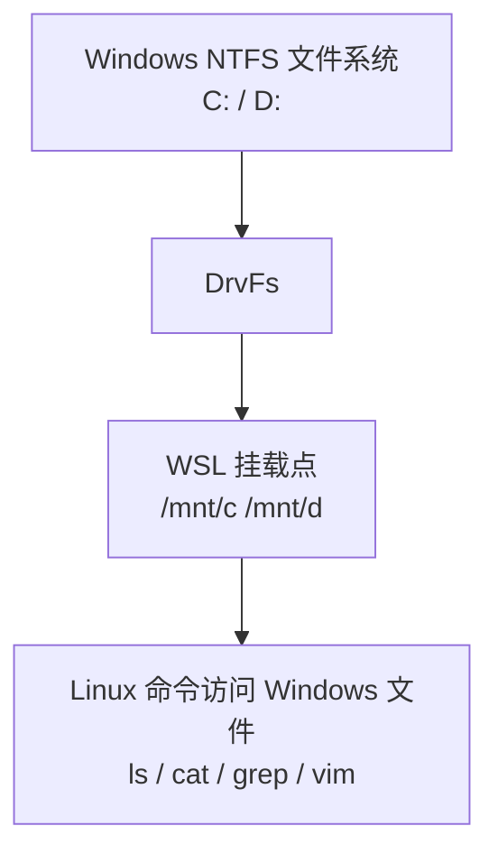
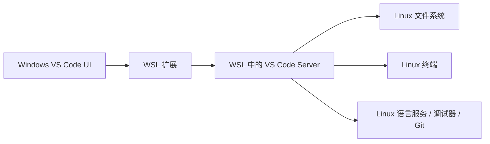

[toc]


## 总体理解：什么是 WSL 与 Windows 的互操作

WSL 的一个核心设计目标就是让 Linux 环境和 Windows 环境能够彼此配合，而不是完全隔离。

你可以在 WSL 的 Bash、Zsh、Fish 中调用 Windows 程序，也可以在 PowerShell、CMD、Windows Terminal 中调用 Linux 命令。Microsoft 的 WSL 文档也把这种能力称为跨 Windows 与 Linux 文件系统、命令和开发环境协作的一部分。([Microsoft Learn](https://learn.microsoft.com/en-us/windows/wsl/filesystems?utm_source=chatgpt.com))



互操作主要包括这些方面：

| 互操作类型   | 从 WSL 到 Windows                                          | 从 Windows 到 WSL                               |
| ------------ | ---------------------------------------------------------- | ----------------------------------------------- |
| 命令调用     | `notepad.exe file.txt`、`explorer.exe .`、`powershell.exe` | `wsl ls`、`wsl -d Ubuntu`、`wsl bash -lc "..."` |
| 文件访问     | 访问 `/mnt/c/...`                                          | 访问 `\\wsl.localhost\Ubuntu\...`               |
| 路径转换     | `wslpath -w file`                                          | `wsl wslpath -u "C:\..."`                       |
| 环境变量     | 通过 `WSLENV` 传递变量                                     | 通过 `WSLENV` 传递变量                          |
| 网络互通     | WSL 访问 Windows 服务                                      | Windows 访问 WSL 服务                           |
| GUI 与编辑器 | `code .`、`explorer.exe .`                                 | VS Code WSL、Windows Terminal                   |
| 开发工具链   | Linux 工具调用 Windows 工具                                | Windows shell 调用 Linux 工具                   |

## 从 WSL 调用 Windows 程序

在 WSL 中，可以直接调用很多 Windows 可执行文件，只要它们在 PATH 中，或者你写出完整路径。

### 调用 Windows GUI 程序

```bash
notepad.exe README.md
```

这会用 Windows 记事本打开 WSL 当前目录下的文件。

```bash
explorer.exe .
```

这会用 Windows 文件资源管理器打开当前 WSL 目录。对于新手来说，这是最实用的命令之一。

```bash
code .
```

这会从 WSL 目录启动 Windows 侧 VS Code，并通过 WSL 扩展连接当前 Linux 项目。VS Code 的 WSL 扩展允许你在 Windows 上使用 VS Code，同时把 WSL 作为完整开发环境。([Visual Studio Code](https://code.visualstudio.com/docs/remote/wsl?utm_source=chatgpt.com))

### 调用 Windows 命令行程序

```bash
cmd.exe /c dir
powershell.exe -Command "Get-ChildItem"
pwsh.exe -Command "Get-Date"
```

如果你安装了 PowerShell 7，通常命令是 `pwsh.exe`；Windows PowerShell 通常是 `powershell.exe`。

### 调用 Windows 开发工具

例如：

```bash
where.exe notepad
ipconfig.exe
clip.exe
```

其中 `clip.exe` 很实用，可以把 WSL 命令输出复制到 Windows 剪贴板：

```bash
cat ~/.ssh/id_rsa.pub | clip.exe
```

这会把 SSH 公钥复制到 Windows 剪贴板，方便粘贴到 GitHub、GitLab 等网站。

## Windows 程序的参数规则

从 WSL 调用 Windows 程序时，需要注意一个核心问题：**Windows 程序通常不理解 Linux 路径**。

例如：

```bash
notepad.exe /home/melissa/demo.txt
```

这可能不符合 Windows 程序预期，因为 Windows 程序更习惯看到：

```text
\\wsl.localhost\Ubuntu\home\melissa\demo.txt
```

或者：

```text
C:\Users\Melissa\demo.txt
```

所以经常需要做路径转换。

## 路径转换：`wslpath`

`wslpath` 是 **WSL 中**非常重要的互操作命令，用于在 Linux 路径和 Windows 路径之间转换。

### Linux 路径转 Windows 路径

```bash
wslpath -w ~/demo.txt
```

用例:

```bash
# cxxu @ CxxuDesk in ~ [9:27:50]
$ wslpath -w ~/log.log
\\wsl.localhost\archlinux\home\cxxu\log.log

# 当前路径位于/mnt/c的子目录下的情况
# cxxu @ CxxuDesk in /mnt/c/temp [9:28:31] C:1
$ wslpath -w ./spider
C:\temp\spider
```

或者某些场景下输出 Windows 风格路径。

常见用法：

```bash
notepad.exe "$(wslpath -w ~/demo.txt)"
```

### Windows 路径转 Linux 路径

```bash
wslpath -u 'C:\Users\Melissa\Desktop'
```

输出类似：

```text
/mnt/c/Users/Melissa/Desktop
```

### 输出不同格式

| 命令         | 含义                           | 示例                             |
| ------------ | ------------------------------ | -------------------------------- |
| `wslpath -u` | Windows 路径转 Unix/Linux 路径 | `C:\Users\A` 转 `/mnt/c/Users/A` |
| `wslpath -w` | Linux 路径转 Windows 路径      | `/mnt/c/Users/A` 转 `C:\Users\A` |
| `wslpath -m` | Linux 路径转混合格式           | `/mnt/c/Users/A` 转 `C:/Users/A` |
| `wslpath -a` | 转为绝对路径                   | `./file` 转绝对路径              |

实用例子：

```bash
explorer.exe "$(wslpath -w .)"
powershell.exe -Command "Get-Content '$(wslpath -w ./config.json)'"
```

不过要注意：命令嵌套、引号、空格路径是互操作中最常见的坑。

## 从 Windows 调用 WSL 命令

Windows 侧通过 `wsl.exe` 调用 Linux 环境。Microsoft 的基本命令文档说明，在 PowerShell 或 CMD 中使用的是 `wsl` 命令；如果从 Linux 发行版内部调用，则需要写成 `wsl.exe`。([Microsoft Learn](https://learn.microsoft.com/en-us/windows/wsl/basic-commands?utm_source=chatgpt.com))

### 进入默认 WSL 发行版

在 PowerShell 或 CMD 中执行：

```powershell
wsl
```

### 执行单个 Linux 命令

```powershell
wsl ls -la
wsl pwd
wsl uname -a
```

### 指定发行版执行命令

```powershell
wsl -d Ubuntu
wsl -d Debian
```

执行命令：

```powershell
wsl -d Ubuntu ls -la /home
```

### 使用 Bash 解析复杂命令

如果命令里有管道、重定向、变量展开，推荐交给 Bash 处理：

```powershell
wsl bash -lc "cd ~/projects && ls -la | grep app"
```

或者指定发行版：

```powershell
wsl -d Ubuntu bash -lc "cd ~/projects && npm test"
```

这条规则很重要：

| 命令形式                       | 谁解析命令                 | 适合场景                     |
| ------------------------------ | -------------------------- | ---------------------------- |
| `wsl ls -la`                   | Windows 先解析，再交给 WSL | 简单命令                     |
| `wsl bash -lc "..."`           | Bash 解析                  | 管道、变量、重定向、复杂脚本 |
| `wsl -d Ubuntu bash -lc "..."` | 指定发行版中的 Bash 解析   | 多发行版环境                 |

## 文件系统互访

WSL 和 Windows 的文件系统互访是最常见、也最容易出性能问题的部分。

## WSL 访问 Windows 文件

Windows 磁盘会挂载到 WSL 的 `/mnt` 下。Microsoft 文档说明，当你在 WSL 路径中看到 `/mnt/`，通常意味着你正在访问挂载的 Windows 驱动器；例如 Windows 的 `C:\Users\<user>\Project` 在 WSL 中会表现为 `/mnt/c/Users/<user>/Project`。([Microsoft Learn](https://learn.microsoft.com/zh-tw/windows/wsl/filesystems?utm_source=chatgpt.com))

| Windows 路径          | WSL 路径                  |
| --------------------- | ------------------------- |
| `C:\Users\Melissa`    | `/mnt/c/Users/Melissa`    |
| `D:\Projects`         | `/mnt/d/Projects`         |
| `C:\Windows\System32` | `/mnt/c/Windows/System32` |

示例：

```bash
cd /mnt/c/Users/Melissa/Desktop
ls
cp ~/report.txt /mnt/c/Users/Melissa/Desktop/
```

## Windows 访问 WSL 文件

Windows 可以通过网络共享风格路径访问 WSL 文件系统：

```text
\\wsl.localhost\Ubuntu\home\melissa
```

旧资料中也经常看到：

```text
\\wsl$\Ubuntu\home\melissa
```

更推荐使用当前文档常见的 `\\wsl.localhost\...` 形式。

在 WSL 中打开当前目录：

```bash
explorer.exe .
```

这会自动把当前 WSL 目录交给 Windows Explorer 打开。

## 文件系统最佳实践

Microsoft 文档说明，项目文件可以放在挂载的 Windows 驱动器中，但如果直接存储在 WSL 的 Linux 文件系统中，通常会获得更好的性能。([Microsoft Learn](https://learn.microsoft.com/zh-tw/windows/wsl/filesystems?utm_source=chatgpt.com))

因此：

| 项目类型                               | 推荐位置                   | 原因                                 |
| -------------------------------------- | -------------------------- | ------------------------------------ |
| Linux / Node / Python / Go / Rust 项目 | `~/projects/...`           | Linux 工具链性能和权限语义更自然     |
| Windows 专用项目                       | `C:\Users\...\Projects`    | 更适合 Visual Studio、Windows SDK 等 |
| 临时共享文件                           | `/mnt/c/Users/.../Desktop` | 方便 Windows 与 WSL 都访问           |
| 大量小文件项目，如 `node_modules`      | 优先 WSL 文件系统          | 避免跨文件系统 I/O 变慢              |

推荐：

```bash
mkdir -p ~/projects
cd ~/projects
git clone <repo>
cd <repo>
code .
```

不推荐把长期 Linux 开发项目放在：

```bash
/mnt/c/Users/Melissa/Desktop/my-node-app
```

尤其是 Node.js、Python 虚拟环境、Rust target、Go build cache、C++ build 目录等会产生大量小文件的项目。

## DrvFs：为什么 `/mnt/c` 能存在

WSL 使用名为 DrvFs 的文件系统插件来支持 Windows 文件系统挂载到 Linux 环境中。Microsoft 的 WSL 高级配置文档说明，DrvFs 的设计目标就是支持 WSL 和 Windows 文件系统之间的互操作，并允许把 Windows 驱动器挂载到 `/mnt/c`、`/mnt/d` 等路径。([Microsoft Learn](https://learn.microsoft.com/zh-tw/windows/wsl/wsl-config?utm_source=chatgpt.com))

可以把它理解为：



这也是为什么你可以在 WSL 中执行：

```bash
grep -R "keyword" /mnt/c/Users/Melissa/Documents
```

但不应该默认把所有 Linux 项目都放在 `/mnt/c`。

## 环境变量互操作

WSL 与 Windows 环境变量并不是天然完全一致。两边有各自的环境变量系统，但 WSL 提供了专门的 `WSLENV` 机制来共享和转换变量。Microsoft Command Line 团队介绍过，`WSLENV` 是一个在 Win32 和 WSL 环境中共享的特殊环境变量，用来指定哪些变量需要在两边传递，以及传递时如何转换路径。([Microsoft for Developers](https://devblogs.microsoft.com/commandline/share-environment-vars-between-wsl-and-windows/?utm_source=chatgpt.com))

## 普通环境变量

在 WSL 中：

```bash
echo $PATH
echo $HOME
echo $USER
```

在 PowerShell 中：

```powershell
$env:PATH
$env:USERPROFILE
$env:USERNAME
```

它们不是同一套变量。

例如：

| 含义     | Windows                               | WSL                               |
| -------- | ------------------------------------- | --------------------------------- |
| 用户目录 | `%USERPROFILE%` 或 `$env:USERPROFILE` | `$HOME`                           |
| 用户名   | `%USERNAME%` 或 `$env:USERNAME`       | `$USER`                           |
| PATH     | Windows PATH                          | Linux PATH，可能附加 Windows PATH |
| 临时目录 | `%TEMP%`                              | `/tmp` 或 `$TMPDIR`               |

## `WSLENV` 的作用

`WSLENV` 用于声明哪些变量在 Windows 和 WSL 之间共享，并可附加标记来处理路径转换、列表转换等。

概念示例：

```bash
export MYPROJECT=/home/melissa/projects/app
export WSLENV=MYPROJECT/p
```

其中 `/p` 表示这个变量是路径，跨环境传递时需要路径转换。

常见标记：

| 标记 | 含义                                        |
| ---- | ------------------------------------------- |
| `/p` | 路径变量，需要在 Windows/Linux 路径之间转换 |
| `/l` | 列表变量，路径列表分隔符需要转换            |
| `/u` | 仅从 Windows 传到 WSL                       |
| `/w` | 仅从 WSL 传到 Windows                       |

例如：

```bash
export GOPATH=$HOME/go
export WSLENV=GOPATH/p
```

然后从 WSL 调用 Windows 程序时，Windows 侧可以接收到转换后的 `GOPATH`。

## PATH 互操作与 `appendWindowsPath`

默认情况下，WSL 通常会把 Windows PATH 附加到 Linux PATH 中，所以你可以在 WSL 里直接运行：

```bash
notepad.exe
code.exe
explorer.exe
```

但这也可能导致问题：比如你在 Windows 和 WSL 中都安装了 `node`、`python`、`java`、`mvn`，WSL 可能意外调用到 Windows 版本。

你可以检查：

```bash
which node
which python
which java
```

如果输出类似：

```text
/mnt/c/Program Files/nodejs/node.exe
```

说明你在 WSL 中调用到了 Windows 的 Node.js，而不是 Linux 的 Node.js。

WSL 的高级配置支持在 `/etc/wsl.conf` 中控制一些互操作行为；相关文档中也提到 DrvFs、挂载、interop、PATH 等配置项。([Microsoft Learn](https://learn.microsoft.com/en-us/windows/wsl/wsl-config?utm_source=chatgpt.com))

常见配置：

```ini
[interop]
appendWindowsPath = false
```

配置文件位置：

```bash
sudo nano /etc/wsl.conf
```

修改后需要关闭 WSL 再重启：

```powershell
wsl --shutdown
```

然后重新打开 WSL。

是否关闭 Windows PATH，要看你的使用习惯：

| 选择                     | 优点                                              | 缺点                                        | 适合人群               |
| ------------------------ | ------------------------------------------------- | ------------------------------------------- | ---------------------- |
| 保留 Windows PATH        | 方便调用 `code.exe`、`explorer.exe`、Windows 工具 | 可能误调用 Windows 版开发工具               | 初学者、混合工作流     |
| 关闭 `appendWindowsPath` | Linux 环境更纯净                                  | 调用 Windows 工具要写完整路径或自定义 alias | 偏 Linux、追求环境隔离 |

## 网络互操作

WSL 和 Windows 之间还可以通过网络互相访问本地服务。Microsoft 的 WSL 网络文档说明，在新的 mirrored networking 模式下，Windows 主机和 WSL 2 VM 可以用 `localhost` 互相连接；而在默认 NAT 模式下，有时需要查询对方 IP。([Microsoft Learn](https://learn.microsoft.com/en-us/windows/wsl/networking?utm_source=chatgpt.com))

## Windows 访问 WSL 中的服务

在 WSL 中启动服务：

```bash
python3 -m http.server 8000
```

然后在 Windows 浏览器访问：

```text
http://localhost:8000
```

这通常可以直接工作。

Node.js 示例：

```bash
npm run dev
```

如果服务监听：

```text
localhost:3000
```

Windows 浏览器通常访问：

```text
http://localhost:3000
```

## WSL 访问 Windows 中的服务

如果 Windows 上运行了一个服务，例如：

```text
http://localhost:5000
```

在较新的 mirrored networking 模式下，WSL 也可以用 `localhost` 访问 Windows 服务；Microsoft 文档说明 mirrored 模式支持 Windows host 和 WSL2 VM 使用 `localhost` 互相连接。([Microsoft Learn](https://learn.microsoft.com/en-us/windows/wsl/networking?utm_source=chatgpt.com))

如果是默认 NAT 模式，可能需要访问 Windows 主机 IP。常见方法是查看 `/etc/resolv.conf` 中的 nameserver：

```bash
cat /etc/resolv.conf
```

然后访问：

```bash
curl http://<Windows主机IP>:5000
```

更现代的建议是：在 Windows 11 22H2 及以上版本，条件允许时考虑使用 mirrored networking。Microsoft 文档列出 mirrored networking 的优点包括 IPv6、更好的 VPN 网络兼容性、多播支持，以及从 LAN 直接连接 WSL 等。([Microsoft Learn](https://learn.microsoft.com/ko-kr/windows/wsl/networking?utm_source=chatgpt.com))

## 命令管道互操作

WSL 和 Windows 命令可以互相通过标准输入、标准输出配合。

### WSL 输出传给 Windows 剪贴板

```bash
cat file.txt | clip.exe
```

### Windows 命令输出给 Linux 命令处理

```bash
powershell.exe -Command "Get-Process" | head
```

### Linux 命令生成内容，用 Windows 程序打开

```bash
ls -la > listing.txt
notepad.exe listing.txt
```

### PowerShell 调用 Linux 命令并接收输出

```powershell
wsl ls -la
$files = wsl ls /home
$files
```

不过要注意编码、换行符、路径格式。

## 换行符：CRLF 与 LF

Windows 文本文件常见换行符是 CRLF，Linux 常见换行符是 LF。混合开发时，换行符不一致可能导致脚本执行失败。

典型错误：

```text
/bin/bash^M: bad interpreter
```

这通常说明 shell 脚本用了 Windows CRLF。

解决：

```bash
dos2unix script.sh
```

或者用 `sed`：

```bash
sed -i 's/\r$//' script.sh
```

Git 项目中建议用 `.gitattributes` 控制：

```gitattributes
* text=auto
*.sh text eol=lf
*.ps1 text eol=crlf
*.bat text eol=crlf
*.cmd text eol=crlf
```

如果一个仓库经常被 Windows 和 WSL 同时编辑，明确行尾规则非常重要。

## 大小写敏感差异

Linux 文件系统通常大小写敏感：

```text
App.js
app.js
```

可以是两个不同文件。

Windows 文件系统通常大小写不敏感，虽然 NTFS 支持某些目录启用大小写敏感，但默认体验和 Linux 不一样。

因此，在 `/mnt/c` 下开发 Linux 项目时，要特别小心大小写问题。例如：

```javascript
import utils from "./Utils";
```

但真实文件名是：

```text
utils.js
```

这在某些 Windows 工具中可能不报错，在 Linux 构建或 CI 中可能失败。

最佳实践：

| 场景       | 建议                              |
| ---------- | --------------------------------- |
| Linux 项目 | 放在 WSL 文件系统                 |
| 跨平台项目 | 文件名大小写保持一致              |
| Git 仓库   | 避免只改文件名大小写              |
| 前端项目   | import 路径大小写严格匹配真实文件 |

## 权限与可执行位

Linux 有可执行权限：

```bash
chmod +x script.sh
```

Windows 文件系统上的文件权限语义与 Linux 不完全一样。DrvFs 会做兼容映射，但并不等价于原生 Linux 文件系统。

常见问题：

```bash
./script.sh
```

报错：

```text
Permission denied
```

解决：

```bash
chmod +x script.sh
```

如果脚本在 `/mnt/c` 下仍然出现权限或行为怪异，建议移到 WSL 文件系统：

```bash
cp -r /mnt/c/Users/Melissa/project ~/projects/project
cd ~/projects/project
```

## GUI 应用互操作

### 从 WSL 打开 Windows GUI 应用

```bash
explorer.exe .
notepad.exe file.txt
code .
```

这是 WSL 最常用的 GUI 互操作方式。

### 运行 Linux GUI 应用

现代 WSL 也支持运行 Linux GUI 应用。Microsoft 的 WSL 文档中也将运行 Linux GUI Apps 作为 WSL 2 的能力之一提及。([Microsoft Learn](https://learn.microsoft.com/en-us/windows/wsl/?utm_source=chatgpt.com))

例如安装一个 Linux GUI 程序：

```bash
sudo apt update
sudo apt install x11-apps
xeyes
```

是否可用取决于 Windows 版本、WSLg 支持和系统配置。

不过对于开发者，新手最常用的仍然是：

```bash
code .
```

也就是 Windows VS Code + WSL 后端，而不是在 WSL 中安装 Linux 版 VS Code 桌面程序。

## VS Code 是最典型的互操作案例

VS Code WSL 的本质是：



从 WSL 中：

```bash
code .
```

从 Windows 中：

```powershell
code --remote wsl+Ubuntu /home/melissa/projects/app
```

VS Code 官方文档说明，WSL 扩展可以让你直接把 WSL 作为完整开发环境使用，获得 Windows 上 VS Code 的体验，同时使用 Linux 工具、运行时和实用程序。([Visual Studio Code](https://code.visualstudio.com/docs/remote/wsl?utm_source=chatgpt.com))

## 互操作中的命令解析差异

这部分非常重要，尤其是写脚本时。

### PowerShell 与 Bash 的变量不同

PowerShell：

```powershell
$env:USERPROFILE
```

Bash：

```bash
$HOME
```

PowerShell：

```powershell
$files = Get-ChildItem
```

Bash：

```bash
files=$(ls)
```

### 引号规则不同

Bash：

```bash
echo "$HOME"
echo '$HOME'
```

PowerShell：

```powershell
echo "$env:USERPROFILE"
echo '$env:USERPROFILE'
```

两者的变量展开、转义字符、数组、管道对象模型都不同。

### 管道模型不同

Bash 管道传递文本：

```bash
ps aux | grep node
```

PowerShell 管道传递对象：

```powershell
Get-Process | Where-Object Name -like "*node*"
```

当你通过 WSL 与 PowerShell 混用时，要意识到跨边界后通常会变成文本流，而不是 PowerShell 对象。

## 常见实用模式

### 用 WSL 处理 Windows 文件

```bash
grep -R "TODO" /mnt/c/Users/Melissa/Documents
find /mnt/c/Users/Melissa/Desktop -name "*.log" -size +10M
```

### 用 Windows 打开 WSL 当前目录

```bash
explorer.exe .
```

### 用 Windows 浏览器打开 WSL 服务

```bash
python3 -m http.server 8080
```

然后 Windows 浏览器访问：

```text
http://localhost:8080
```

### WSL 中复制内容到 Windows 剪贴板

```bash
pwd | clip.exe
cat ~/.ssh/id_ed25519.pub | clip.exe
```

### Windows 中运行 Linux 构建命令

```powershell
wsl -d Ubuntu bash -lc "cd ~/projects/app && npm test"
```

### Windows 任务计划调用 WSL 脚本

可以在 Windows 任务计划程序里执行：

```powershell
wsl -d Ubuntu bash -lc "/home/melissa/scripts/backup.sh"
```

### Git Bash、PowerShell、WSL 的边界

很多新手会同时装：

| Shell        | 运行环境                  | 适合                                  |
| ------------ | ------------------------- | ------------------------------------- |
| PowerShell   | Windows                   | Windows 管理、Azure、.NET、系统自动化 |
| CMD          | Windows                   | 兼容旧批处理                          |
| Git Bash     | Windows 上的类 Unix Shell | 简单 Git 和 Bash 命令                 |
| WSL Bash/Zsh | 真正的 Linux 用户态       | Linux 开发、包管理、编译、部署模拟    |

如果你已经使用 WSL，做 Linux 开发时优先用 WSL Shell，而不是 Git Bash。

## `.exe` 后缀规则

从 WSL 调用 Windows 程序时，通常要写 `.exe`：

```bash
notepad.exe
explorer.exe
cmd.exe
powershell.exe
```

而在 PowerShell 中调用 WSL 命令则通常写：

```powershell
wsl
```

如果你在 WSL 中要调用 Windows 的 `wsl` 管理命令，需要写：

```bash
wsl.exe --list --verbose
```

因为在 Linux 环境中，`wsl` 可能不是一个 Linux 命令；`wsl.exe` 才是 Windows 侧的 WSL 管理程序。

## WSL 中的 alias 封装

为了方便使用 Windows 工具，可以加一些 alias。

编辑：

```bash
nano ~/.bashrc
```

加入：

```bash
alias open='explorer.exe'
alias pbcopy='clip.exe'
alias winpwd='wslpath -w "$PWD"'
```

不过 `winpwd` 这种带变量的 alias 不总是理想，更推荐函数：

```bash
winpath() {
  wslpath -w "${1:-.}"
}

openwin() {
  explorer.exe "$(wslpath -w "${1:-.}")"
}
```

使用：

```bash
winpath .
openwin .
openwin ~/projects/app
```

如果使用 Zsh，可以放到：

```bash
~/.zshrc
```

## 脚本互操作示例

### Bash 脚本调用 Windows 通知

```bash
#!/usr/bin/env bash

message="Build finished"

powershell.exe -Command "
Add-Type -AssemblyName PresentationFramework
[System.Windows.MessageBox]::Show('$message')
"
```

### Bash 脚本打开构建产物

```bash
#!/usr/bin/env bash

set -e

npm run build
explorer.exe "$(wslpath -w ./dist)"
```

### PowerShell 脚本调用 WSL 构建

```powershell
wsl -d Ubuntu bash -lc "cd ~/projects/my-app && npm ci && npm run build"
```

### PowerShell 读取 WSL 命令输出

```powershell
$kernel = wsl uname -r
Write-Host "WSL kernel: $kernel"
```

## 最容易踩坑的问题

| 问题                 | 典型表现                          | 原因                            | 建议                                              |
| -------------------- | --------------------------------- | ------------------------------- | ------------------------------------------------- |
| 调用了错误版本的工具 | `node`、`python`、`java` 行为异常 | WSL PATH 中混入 Windows 工具    | `which node` 检查；必要时关闭 `appendWindowsPath` |
| 路径不识别           | Windows 程序打不开 `/home/...`    | Windows 程序不理解 Linux 路径   | 用 `wslpath -w`                                   |
| 项目很慢             | `npm install`、`git status` 很慢  | 项目在 `/mnt/c`                 | 移到 `~/projects`                                 |
| 脚本无法执行         | `bad interpreter: ^M`             | CRLF 换行                       | 使用 LF；配置 `.gitattributes`                    |
| 文件大小写问题       | 本地正常，CI 失败                 | Windows 与 Linux 大小写规则不同 | import 路径大小写严格一致                         |
| 权限问题             | `Permission denied`               | Linux 权限或 DrvFs 映射差异     | 使用 `chmod`；项目放 WSL 文件系统                 |
| localhost 不通       | WSL 访问 Windows 服务失败         | WSL2 NAT / 防火墙 / 监听地址    | 检查 mirrored networking、IP、防火墙              |
| 引号混乱             | 参数被拆错                        | Bash 和 PowerShell 解析规则不同 | 复杂命令用 `bash -lc` 或脚本文件                  |

## 推荐的工作流边界

### 推荐：Linux 项目全程在 WSL 内完成

```bash
cd ~/projects/app
code .
npm install
npm run dev
git status
```

编辑器是 Windows VS Code，但项目文件、终端、依赖、Git 都在 WSL 中。

### 推荐：Windows 项目全程在 Windows 内完成

```powershell
cd C:\Users\Melissa\Projects\App
code .
dotnet build
```

如果是 Visual Studio、Windows SDK、PowerShell 模块、.NET Windows 桌面项目，放 Windows 文件系统通常更自然。

### 谨慎：项目放 Windows，工具用 WSL

```bash
cd /mnt/c/Users/Melissa/Projects/app
npm install
```

这可以用，但不应作为默认 Linux 开发方式，尤其是大型项目。

### 谨慎：项目放 WSL，工具用 Windows

例如从 Windows Node.js 操作 WSL 目录。这种组合也容易遇到路径、文件监听和性能问题。更推荐用 VS Code WSL 或 `wsl.exe` 进入 Linux 工具链。

## 一套清晰的选择规则

| 你要做什么                     | 推荐 Shell                 | 推荐文件位置           |
| ------------------------------ | -------------------------- | ---------------------- |
| Linux 后端开发                 | WSL Bash/Zsh               | `~/projects`           |
| 前端项目，目标部署 Linux       | WSL Bash/Zsh               | `~/projects`           |
| Python 数据处理，依赖 Linux 包 | WSL Bash/Zsh               | `~/projects`           |
| Windows 自动化                 | PowerShell                 | `C:\Users\...\Scripts` |
| .NET Windows 桌面开发          | PowerShell / Visual Studio | Windows 文件系统       |
| 临时处理 Windows 文件          | WSL 或 PowerShell 都可     | `/mnt/c/...`           |
| 用 VS Code 编辑 WSL 项目       | WSL 中 `code .`            | `~/projects`           |
| 用浏览器访问 WSL 服务          | Windows 浏览器             | WSL 服务监听 localhost |

## 推荐配置示例

### 保持默认互操作，适合新手

默认通常可以直接：

```bash
code .
explorer.exe .
notepad.exe file.txt
clip.exe
```

适合刚开始学习 WSL。

### 偏纯 Linux 环境，减少 Windows PATH 干扰

编辑：

```bash
sudo nano /etc/wsl.conf
```

写入：

```ini
[interop]
appendWindowsPath = false
```

然后在 PowerShell 中：

```powershell
wsl --shutdown
```

重新进入 WSL。

这种方式适合已经能明确区分 Windows 与 Linux 工具链的人。

### 自定义便捷函数

```bash
# ~/.bashrc or ~/.zshrc

openwin() {
  explorer.exe "$(wslpath -w "${1:-.}")"
}

copywin() {
  clip.exe
}

codew() {
  code "${1:-.}"
}
```

使用：

```bash
openwin .
echo "hello" | copywin
codew .
```

## 实战案例：前端项目

推荐：

```bash
cd ~
mkdir -p projects
cd projects
git clone <repo-url>
cd app
npm install
code .
npm run dev
```

Windows 浏览器访问：

```text
http://localhost:3000
```

不要默认这样：

```bash
cd /mnt/c/Users/Melissa/Desktop/app
npm install
npm run dev
```

除非你明确知道为什么要把项目放在 Windows 文件系统中。

## 实战案例：把 WSL 命令集成到 Windows Terminal

Windows Terminal 可以配置多个 profile：

| Profile        | 启动内容          |
| -------------- | ----------------- |
| PowerShell     | Windows 管理      |
| Command Prompt | 兼容旧命令        |
| Ubuntu         | WSL 开发环境      |
| Debian         | 另一个 WSL 发行版 |

日常开发建议直接打开 Ubuntu profile，然后：

```bash
cd ~/projects/app
code .
```

## 实战案例：Windows 调用 WSL 自动化任务

PowerShell：

```powershell
wsl -d Ubuntu bash -lc "cd ~/projects/app && git pull && npm test"
```

如果命令越来越复杂，不要把所有逻辑都塞进 PowerShell 字符串。更好的方式是在 WSL 中写脚本：

```bash
# ~/scripts/test-app.sh
#!/usr/bin/env bash
set -e

cd ~/projects/app
git pull
npm test
```

赋权：

```bash
chmod +x ~/scripts/test-app.sh
```

Windows 调用：

```powershell
wsl -d Ubuntu bash -lc "~/scripts/test-app.sh"
```

这样更容易维护，也减少引号转义问题。

## 实战案例：WSL 调用 Windows 工具处理结果

```bash
python3 generate_report.py
explorer.exe "$(wslpath -w ./output)"
```

或者：

```bash
python3 generate_report.py
notepad.exe "$(wslpath -w ./output/report.txt)"
```

## 安全与维护建议

| 建议                                              | 原因                      |
| ------------------------------------------------- | ------------------------- |
| 不要手动修改 WSL 发行版底层虚拟磁盘文件           | 可能损坏 Linux 文件系统   |
| 通过 `\\wsl.localhost\发行版名\...` 访问 WSL 文件 | 这是面向用户的访问方式    |
| Linux 项目尽量放 WSL home                         | 性能和权限更稳定          |
| Windows 项目尽量放 Windows 文件系统               | 与 Windows 工具兼容性更好 |
| 不要混用 Windows 与 Linux 包管理器                | 避免依赖污染              |
| 定期检查 `which node/python/git`                  | 确认调用的是预期工具      |
| 复杂跨环境命令写成脚本                            | 避免引号、路径、转义混乱  |

## 新手最应该记住的命令

| 命令                    | 在哪里执行 | 作用                             |
| ----------------------- | ---------- | -------------------------------- |
| `code .`                | WSL        | 用 VS Code 打开当前 WSL 项目     |
| `explorer.exe .`        | WSL        | 用 Windows Explorer 打开当前目录 |
| `notepad.exe file.txt`  | WSL        | 用 Windows 记事本打开文件        |
| `cat file|clip.exe`     | WSL        | 复制内容到 Windows 剪贴板        |
| `wsl`                   | Windows    | 进入默认 WSL                     |
| `wsl -d Ubuntu`         | Windows    | 进入指定发行版                   |
| `wsl ls -la`            | Windows    | 从 Windows 执行 Linux 命令       |
| `wsl bash -lc "..."`    | Windows    | 执行复杂 Bash 命令               |
| `wslpath -w .`          | WSL        | Linux 路径转 Windows 路径        |
| `wslpath -u "C:\Users"` | WSL        | Windows 路径转 Linux 路径        |

## 最核心的原则

WSL 与 Windows 的互操作不是让你随意混用所有工具，而是让你**在清晰边界下组合两边优势**：

| Windows 擅长                                    | WSL 擅长                                                 |
| ----------------------------------------------- | -------------------------------------------------------- |
| 桌面 GUI、浏览器、Office、系统管理、Windows SDK | Linux 命令行、包管理、服务端开发、开源工具链、类生产环境 |
| VS Code UI                                      | VS Code Server、Linux 终端、语言服务                     |
| 文件资源管理器                                  | Bash、grep、sed、awk、find                               |
| PowerShell 自动化                               | Shell 脚本、Linux 构建工具                               |

最推荐的开发心智模型是：

```text
Windows 负责桌面体验
WSL 负责 Linux 开发环境
VS Code / wsl.exe / 文件系统挂载 / localhost 负责桥接两者
```

只要记住这条边界，大多数互操作问题都能自然判断：
Linux 项目放 WSL，Windows 项目放 Windows；需要跨边界时，用 `wsl.exe`、`.exe`、`wslpath`、`\\wsl.localhost` 和 `localhost`。