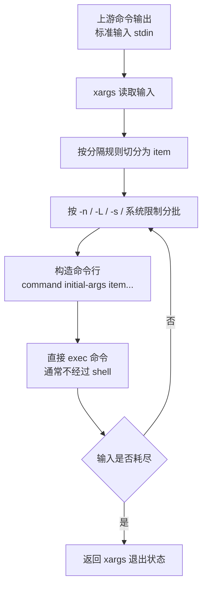

[toc]


## abstract

本文以 GNU/Linux 常见的 GNU `xargs` 为主，同时提醒 POSIX 与 BSD/FreeBSD 差异。GNU 手册将 `xargs` 定义为：读取标准输入中的项目，把它们追加到指定命令及其初始参数之后，然后一次或多次执行该命令；如果没有显式命令，默认命令是 `echo`。([GNU](https://www.gnu.org/software/findutils/manual/html_node/find_html/Invoking-xargs.html))

| 学习主题   | 你需要掌握的问题                         | 典型命令                             |
| ---------- | ---------------------------------------- | ------------------------------------ |
| 基本定位   | `xargs` 是什么，为什么不是普通循环       | `printf '%s\n' a b c | xargs echo`   |
| 输入解析   | 默认如何切分输入，为什么文件名会出问题   | `xargs`、`xargs -0`、`xargs -d '\n'` |
| 批量执行   | 如何控制每次传几个参数、几行、多少字符   | `-n`、`-L`、`-s`、`-x`               |
| 占位替换   | 参数不在命令末尾时怎么办                 | `-I {}`、`sh -c '...'`               |
| 空输入行为 | 没有输入时命令是否还会执行               | `-r`                                 |
| 并行执行   | 如何用 `xargs` 做轻量并发                | `-P`、`-n`                           |
| 安全实践   | 如何正确处理空格、换行、引号、恶意文件名 | `find -print0 | xargs -0`            |
| 可移植性   | GNU、BSD、POSIX 之间有哪些差异           | `-0`、`-r`、`-d`、`-J`               |
| 实战模板   | 删除、复制、压缩、批量请求、批量 grep    | `find ... -print0 | xargs -0 ...`    |
| 排错能力   | 如何定位参数过长、命令失败、并发混乱     | `-t`、`-p`、`--show-limits`          |

## `xargs` 的核心定位

`xargs` 的名字可以理解为 “extended arguments” 或 “把输入变成参数”。它最常见的用途是把前一个命令的输出，转换成后一个命令的命令行参数。

```bash
printf '%s\n' apple banana cherry | xargs echo
```

结果等价于执行：

```bash
echo apple banana cherry
```

但 `xargs` 真正有价值的地方不只是“转换输入”，而是它会根据系统命令行长度限制，自动把大量输入分批拼成若干次命令调用。GNU `xargs` 会尽量减少被调用命令的执行次数，这通常比逐项启动外部命令更高效；GNU `findutils` 手册也明确建议，在需要减少外部程序调用次数时可以用 `xargs` 做扩展过滤。([man7.org](https://man7.org/linux/man-pages/man1/xargs.1.html))

## 工作机制示意图



一个关键点是：`xargs` 通常直接执行你指定的命令，不会自动调用 shell。这更高效，也能避免 shell 元字符被意外解释；只有当你显式写 `sh -c '...'` 时，才会进入 shell 解释层。([GNU](https://www.gnu.org/software/findutils/manual/html_node/find_html/Invoking-the-shell-from-xargs.html))

## 基本语法

```bash
xargs [选项] [命令 [初始参数...]]
```

常见形态如下：

```bash
# 把输入追加到 echo 后面
printf '%s\n' a b c | xargs echo

# 每 2 个输入执行一次 echo
printf '%s\n' a b c d e | xargs -n 2 echo

# 用 find 找文件，再交给 rm
find . -name '*.tmp' -type f -print0 | xargs -0 rm -f
```

可以把它理解成：

```text
上游输出 -> xargs -> command initial-args item1 item2 item3 ...
```

`initial-args` 是你写在命令后面的固定参数，输入项目通常追加在最后。例如：

```bash
printf '%s\n' file1 file2 | xargs tar -rvf archive.tar
```

近似变成：

```bash
tar -rvf archive.tar file1 file2
```

## `xargs` 解决的主要问题

| 问题                     | 没有 `xargs` 时的常见写法                  | `xargs` 的作用          |
| ------------------------ | ------------------------------------------ | ----------------------- |
| 标准输入不是参数         | `cmd` 只能接收参数，不能直接消费 stdin     | 把 stdin 转成 argv 参数 |
| 参数太多                 | `rm *.log` 可能触发 argument list too long | 自动分批执行            |
| 每个文件启动一次程序太慢 | `for f in ...; do cmd "$f"; done`          | 多个项目合并到一次命令  |
| 需要控制批次大小         | 手写循环复杂                               | `-n`、`-L`、`-s`        |
| 需要轻量并发             | 手写后台任务麻烦                           | `-P`                    |

`xargs` 构造命令行时会受系统 `exec` 参数长度限制影响。GNU `xargs` 支持 `--show-limits` 查看当前系统、环境变量和 `xargs` 自身缓冲区共同决定的限制；GNU/Linux 手册也提醒，可移植脚本不能假设系统允许很长的参数列表。([man7.org](https://man7.org/linux/man-pages/man1/xargs.1.html))

## 默认输入解析规则

默认情况下，`xargs` 用空白字符切分输入，包括空格、制表符、换行；引号和反斜杠有特殊含义，空行会被忽略。这个行为适合简单单词列表，但非常不适合任意文件名，因为 Unix 文件名可以包含空格甚至换行。GNU 手册明确指出，默认行为会错误处理包含空格或换行的文件名，应使用 `-0` 并确保上游也输出 NUL 分隔数据，例如 `find -print0`。([man7.org](https://man7.org/linux/man-pages/man1/xargs.1.html))

示例：

```bash
printf '%s\n' "hello world" | xargs printf '<%s>\n'
```

输出可能是：

```text
<hello>
<world>
```

这不是一个参数，而是被拆成了两个参数。

使用 NUL 分隔更可靠：

```bash
printf '%s\0' "hello world" | xargs -0 printf '<%s>\n'
```

输出：

```text
<hello world>
```

## `-0` 是处理文件名的首选规则

处理文件名时，优先使用：

```bash
find . -type f -print0 | xargs -0 command
```

原因是 NUL 字符不能出现在 Unix 路径名中，所以它天然适合作为“不会和文件名冲突”的分隔符。GNU 文档说明，`xargs -0` 使用 NUL 作为分隔符，并且引号、反斜杠不再具有特殊意义；GNU `find -print0` 能产生适配这种模式的输入。([GNU](https://www.gnu.org/software/findutils/manual/html_node/find_html/xargs-options.html))

不要写：

```bash
find . -type f | xargs rm
```

安全写法是：

```bash
find . -type f -print0 | xargs -0 rm
```

GNU `findutils` 的安全说明指出，如果攻击者能创建特殊文件名，`find ... -print | xargs ...` 可能因为空格、换行、引号等解析规则导致命令处理到并非原意的路径；避免这类问题的方法包括不用 `xargs`，改用 `find -exec` / `-execdir`，或者在可用时使用 `-0`。([GNU](https://www.gnu.org/software/findutils/manual/html_node/find_html/Security-Considerations-for-xargs.html))

## 常用选项总览

| 选项            | 含义                               | 常见用途                 | 注意点                                    |
| --------------- | ---------------------------------- | ------------------------ | ----------------------------------------- |
| `-0` / `--null` | 输入以 NUL 分隔                    | 配合 `find -print0`      | 处理文件名首选                            |
| `-d DELIM`      | 指定分隔符                         | GNU 环境下处理按行数据   | GNU 常见，非 POSIX 通用；多字节字符不支持 |
| `-n N`          | 每次最多使用 N 个输入参数          | 控制批大小               | 与 `-I`、`-L` 通常互斥                    |
| `-L N`          | 每次读取 N 行输入                  | 按行分组                 | 与 `-n`、`-I` 通常互斥                    |
| `-I STR`        | 占位替换                           | 参数要放在中间或多个位置 | 隐含 `-L 1` 和 `-x`，通常较慢             |
| `-P N`          | 最多并行 N 个进程                  | 批量压缩、请求、转换     | 注意输出顺序和共享资源                    |
| `-r`            | 空输入时不执行命令                 | 防止误执行               | GNU 扩展；BSD/FreeBSD 行为不同            |
| `-t`            | 执行前打印命令                     | 调试                     | 输出到 stderr                             |
| `-p`            | 每次执行前询问                     | 危险操作确认             | 隐含 `-t`                                 |
| `-s N`          | 限制命令行字符数                   | 控制参数长度             | 受系统限制影响                            |
| `-x`            | 超过大小限制时报错退出             | 防止自动拆分             | 常与 `-n`、`-s` 理解                      |
| `-a FILE`       | 从文件读取输入                     | 保留子命令 stdin         | GNU 支持                                  |
| `-o`            | 子命令 stdin 重新打开为 `/dev/tty` | 用 `xargs` 启动交互程序  | GNU/BSD 支持，非完全可移植                |
| `--show-limits` | 显示命令行长度限制                 | 排查参数过长             | GNU 常用                                  |

GNU 手册对这些选项有集中说明：`-0` 改用 NUL 分隔，`-I` 做替换并隐含 `-L 1` 与 `-x`，`-n` 限制每次参数个数，`-P` 控制并发数，`-r` 避免空输入时执行，`--show-limits` 用于显示命令行长度限制。([GNU](https://www.gnu.org/software/findutils/manual/html_node/find_html/xargs-options.html))

## `-n` 控制每批几个参数

`-n` 是学习 `xargs` 最重要的选项之一。

```bash
printf '%s\n' a b c d e | xargs -n 2 echo
```

输出：

```text
a b
c d
e
```

含义是：每次最多把 2 个输入项目追加到命令后面。

常见用途：

```bash
# 每次处理 100 个文件
find . -type f -name '*.log' -print0 | xargs -0 -n 100 gzip
```

`-n` 控制的是“输入参数个数”，不是命令执行次数。输入 1000 个项目，`-n 100` 大致会执行 10 次；但如果命令行长度限制先达到，`xargs` 可能使用少于 `N` 个参数。GNU 手册说明，`-n` 的批次还会受 `-s` 指定的大小限制影响。([GNU](https://www.gnu.org/software/findutils/manual/html_node/find_html/xargs-options.html))

## `-L` 按行分组

`-L N` 表示每次使用最多 N 个非空输入行。

```bash
seq 1 9 | xargs -L 3 echo
```

输出：

```text
1 2 3
4 5 6
7 8 9
```

FreeBSD 手册也给出了类似的矩阵示例：`seq 1 9 | xargs -L3 echo` 会让每个 `echo` 接收三行作为参数。([FreeBSD手册](https://man.freebsd.org/cgi/man.cgi?query=xargs&sektion=1))

`-L` 适合“输入天然按行构成记录”的场景，例如每行是一组参数。但处理文件名时仍应优先考虑 NUL 分隔，而不是依赖换行。

## `-I` 占位替换

默认情况下，`xargs` 把输入追加到命令末尾：

```bash
printf '%s\n' a b | xargs echo prefix
```

近似执行：

```bash
echo prefix a b
```

但有时输入参数必须出现在命令中间。例如复制到固定目录：

```bash
printf '%s\n' file1 file2 | xargs -I {} cp {} /backup/
```

`{}` 是占位符，`xargs` 会把每一行输入替换到 `{}` 的位置。

也可以出现多次：

```bash
printf '%s\n' a b c | xargs -I {} echo "{} -> {}.bak"
```

`-I` 的代价是：它通常每行执行一次命令，并且隐含 `-L 1` 和 `-x`。GNU 文档明确说明 `-I replace-str` 会以换行作为输入分隔，替换初始参数中的占位符，并隐含 `-x` 与 `-L 1`。([GNU](https://www.gnu.org/software/findutils/manual/html_node/find_html/xargs-options.html))

因此，能用“追加到末尾”的写法时，不要滥用 `-I`。

较低效：

```bash
find . -type f -print0 | xargs -0 -I {} rm {}
```

更高效：

```bash
find . -type f -print0 | xargs -0 rm
```

## `-I`、`-n`、`-L` 的互斥关系

这是新手常踩坑之一。GNU `findutils` 文档指出，`--max-lines` / `-L`、`--replace` / `-I`、`--max-args` / `-n` 通常互斥；如果同时指定，`xargs` 一般采用命令行中最后出现的选项，并对前面的冲突选项发出警告。([GNU](https://www.gnu.org/software/findutils/manual/html_node/find_html/Conflicting-xargs-options.html))

容易误解的命令：

```bash
seq 10 | xargs -n 3 -I {} echo {}
```

很多人以为这会“三个一组再替换”，但 `-I` 会倾向于按行处理，和 `-n` 的语义冲突。更清晰的写法是二选一：

```bash
# 每 3 个参数一批
seq 10 | xargs -n 3 echo

# 每行替换一次
seq 10 | xargs -I {} echo "item={}"
```

## `sh -c`：当命令需要管道、重定向、变量或复杂逻辑

因为 `xargs` 默认不经过 shell，所以这类写法不会按你想的工作：

```bash
printf '%s\n' a b | xargs echo {} '>' out.txt
```

`>` 不会作为 shell 重定向生效，它只是普通参数，除非你显式调用 shell。

正确模式：

```bash
printf '%s\n' a b |
xargs sh -c 'printf "%s\n" "$@" >> out.txt' sh
```

更经典的安全模板：

```bash
find . -type f -name '*.log' -print0 |
xargs -0 sh -c 'grep -H "ERROR" "$@"' sh
```

这里最后的 `sh` 是传给子 shell 的 `$0`。真正的输入参数从 `$1` 开始，并通过 `"$@"` 安全展开。GNU 手册专门提醒：使用 `sh -c` 时，`$@` 应避免被父 shell 提前展开，且需要提供一个 `$0` 占位名，否则第一个文件名会变成 `$0`，不会出现在 `"$@"` 中。([GNU](https://www.gnu.org/software/findutils/manual/html_node/find_html/Invoking-the-shell-from-xargs.html))

通用模板：

```bash
producer |
xargs sh -c '
  # "$@" 是 xargs 传入的一批参数
  command "$@"
' sh
```

处理文件名时：

```bash
find . -type f -print0 |
xargs -0 sh -c '
  for f do
    printf "processing: %s\n" "$f"
  done
' sh
```

在 `sh` 中，`for f do ... done` 等价于遍历 `"$@"`。

## 空输入行为与 `-r`

GNU `xargs` 默认情况下，即使没有输入，也会执行一次命令；`-r` / `--no-run-if-empty` 可以阻止这种行为。GNU 手册明确说明：如果标准输入完全为空，`-r` 会让命令不执行；默认则会执行一次。([GNU](https://www.gnu.org/software/findutils/manual/html_node/find_html/xargs-options.html))

危险示例：

```bash
find . -name '*.tmp' -print0 | xargs -0 rm -f
```

在 GNU `xargs` 下，如果没有匹配项，`rm -f` 仍可能被执行一次。对 `rm -f` 来说通常无害，但对其他命令可能有副作用。

GNU/Linux 上建议写：

```bash
find . -name '*.tmp' -type f -print0 | xargs -r -0 rm -f
```

可移植性注意：FreeBSD 手册说明，FreeBSD `xargs` 在空输入时本来就不会运行命令，`-r` 只是为了兼容 GNU 命令行，实际不改变行为。([FreeBSD手册](https://man.freebsd.org/cgi/man.cgi?query=xargs&sektion=1))

## 并行执行：`-P`

`-P N` 表示最多同时运行 N 个子进程：

```bash
printf '%s\n' url1 url2 url3 url4 |
xargs -n 1 -P 4 curl -O
```

典型搭配是：

```bash
xargs -n 1 -P 4 command
```

含义是每次给命令 1 个输入参数，最多并发 4 个命令。

例如批量压缩图片：

```bash
find images -type f -name '*.png' -print0 |
xargs -0 -n 1 -P 4 optipng
```

并行时要注意共享资源。GNU/Linux 手册提醒，`-P` 并行启动的进程需要自行处理对共享资源的访问；多个进程同时写标准输出时，输出顺序不确定，甚至可能混杂。([man7.org](https://man7.org/linux/man-pages/man1/xargs.1.html))

适合并行的任务：

| 任务             | 是否适合 `-P` | 原因               |
| ---------------- | ------------- | ------------------ |
| 图片压缩         | 适合          | 每个文件相对独立   |
| 批量 HTTP 请求   | 适合但要限流  | 可能触发服务端限制 |
| 编码转换         | 适合          | CPU/IO 可并行      |
| 写同一个输出文件 | 不适合        | 容易竞争、内容混杂 |
| 数据库写入       | 谨慎          | 需要事务、锁、限流 |
| 删除大量文件     | 谨慎          | 可能造成 IO 峰值   |

不要盲目使用 `-P 0`。GNU 与 FreeBSD 都支持 `-P 0` 表示尽可能多地并行运行，但这可能迅速打满 CPU、IO、网络或目标服务。([GNU](https://www.gnu.org/software/findutils/manual/html_node/find_html/xargs-options.html))

## `-t` 与 `-p`：调试和确认

`-t` 会在执行前把将要运行的命令打印到标准错误：

```bash
printf '%s\n' a b c | xargs -n 2 -t echo
```

适合调试复杂命令，尤其是删除、移动、远程请求之前。

`-p` 会在执行前询问用户是否确认，并隐含 `-t`。GNU 文档说明，只有响应以 `y` 或 `Y` 开头时才执行该命令。([GNU](https://www.gnu.org/software/findutils/manual/html_node/find_html/xargs-options.html))

```bash
find . -name '*.bak' -print0 | xargs -0 -p rm
```

## `-s`、`-x` 与命令行长度限制

每个系统对一次 `exec` 能传入的参数和环境大小有限制。`xargs` 的一个重要职责就是在接近限制前拆批执行。

查看当前限制：

```bash
xargs --show-limits < /dev/null
```

限制每次命令行最大字符数：

```bash
printf '%s\n' {1..10000} | xargs -s 1024 echo
```

如果你希望“超过限制就失败，不要自动拆批”，使用 `-x`：

```bash
printf '%s\n' {1..10000} | xargs -n 10000 -s 1024 -x echo
```

GNU 手册说明，`-s` 限制每条命令行的字符数，包含命令、初始参数和参数字符串结尾的 NUL；`-x` 表示如果大小超限就退出。([GNU](https://www.gnu.org/software/findutils/manual/html_node/find_html/xargs-options.html))

## `xargs` 与 `find -exec` 的关系

`find` 和 `xargs` 经常一起出现，但它们不是互相替代的简单关系。

| 写法                              | 特点                           | 适用场景               |
| --------------------------------- | ------------------------------ | ---------------------- |
| `find ... -exec cmd {} \;`        | 每个文件执行一次               | 简单、直观、慢一些     |
| `find ... -exec cmd {} +`         | 多个文件合并执行               | 很多场景可替代 `xargs` |
| `find ... -print0 | xargs -0 cmd` | NUL 管道，批量执行             | 需要和其他管道组合     |
| `find ... -execdir cmd {} \;`     | 在文件所在目录执行，安全性更好 | 处理不可信目录更推荐   |
| `find ... -delete`                | 由 `find` 自己删除             | 删除文件时通常更简单   |

GNU `findutils` 安全总结指出，在不可信用户能创建或影响文件名的环境中，`find`、`locate`、`xargs` 的很多用法都有安全问题；相对安全的情况包括仅做信息用途、使用 `find -delete`，以及在可信 `PATH` 条件下使用 `find -execdir`。([GNU](https://www.gnu.org/software/findutils/manual/html_node/find_html/Security-Summary.html))

删除文件时，优先考虑：

```bash
find . -type f -name '*.tmp' -delete
```

需要传给外部命令时：

```bash
find . -type f -name '*.jpg' -print0 |
xargs -0 -n 50 jpegoptim
```

## `xargs` 与 `while read` 的关系

很多任务既可以用 `xargs`，也可以用 shell 循环。

| 需求                           | 更推荐                          |
| ------------------------------ | ------------------------------- |
| 批量把很多参数传给同一个命令   | `xargs`                         |
| 需要自动分批规避命令行长度限制 | `xargs`                         |
| 需要并发                       | `xargs -P`                      |
| 每项都要复杂判断               | `while read`                    |
| 每项之间有状态依赖             | `while read`                    |
| 输入必须逐字节精确处理         | `while IFS= read -r` 或专门工具 |
| 处理文件名且命令支持批量参数   | `find -print0 | xargs -0`       |

`while read` 的安全按行读取模板：

```bash
while IFS= read -r line; do
  printf '<%s>\n' "$line"
done
```

但它是“一行一处理”，不会自动合并参数，也不会自动并行。`xargs` 的优势是批量构造 argv。

## 经典实战示例

### 批量删除临时文件

推荐优先用 `find -delete`：

```bash
find . -type f -name '*.tmp' -delete
```

需要用 `xargs` 时：

```bash
find . -type f -name '*.tmp' -print0 |
xargs -r -0 rm -f
```

### 批量 grep

```bash
find src -type f -name '*.py' -print0 |
xargs -0 grep -nH 'TODO'
```

说明：

| 部分           | 含义             |
| -------------- | ---------------- |
| `find src`     | 在 `src` 下查找  |
| `-type f`      | 只要普通文件     |
| `-name '*.py'` | 匹配 Python 文件 |
| `-print0`      | 用 NUL 输出      |
| `xargs -0`     | 用 NUL 读取      |
| `grep -nH`     | 显示行号和文件名 |

### 批量压缩日志

```bash
find /var/log/myapp -type f -name '*.log' -mtime +7 -print0 |
xargs -r -0 -n 100 gzip
```

### 批量复制到目录

如果命令支持目标目录前置参数，例如 GNU `cp -t`：

```bash
find . -type f -name '*.conf' -print0 |
xargs -r -0 cp -t backup/
```

更通用但可能较慢：

```bash
find . -type f -name '*.conf' -print0 |
xargs -0 -I {} cp {} backup/
```

### 批量移动并处理目标在最后的问题

`mv "$@" /archive` 这种“目标目录必须在最后”的命令，适合用 `sh -c`：

```bash
find /foo -maxdepth 1 -atime +366 -print0 |
xargs -r -0 sh -c 'mv "$@" /archive' move
```

GNU 手册就展示了这种模式，并解释了为什么最后的 `move` 用作子 shell 的 `$0`。([GNU](https://www.gnu.org/software/findutils/manual/html_node/find_html/Invoking-the-shell-from-xargs.html))

### 批量并发处理文件

```bash
find videos -type f -name '*.mp4' -print0 |
xargs -0 -n 1 -P 4 sh -c '
  ffmpeg -i "$1" "${1%.mp4}.webm"
' sh
```

这里每次处理一个文件，最多并发 4 个。

### 批量下载 URL

```bash
cat urls.txt |
xargs -n 1 -P 4 curl -LO
```

如果 URL 每行一个，且可能包含特殊字符，GNU 环境可用：

```bash
xargs -d '\n' -n 1 -P 4 curl -LO < urls.txt
```

但 `-d` 不是所有系统都支持，GNU 文档也说明 `-d` 不支持多字节字符；能设计成 NUL 分隔时，`-0` 更稳妥。([GNU](https://www.gnu.org/software/findutils/manual/html_node/find_html/xargs-options.html))

### 对每个输入生成多个输出

```bash
printf '%s\n' alpha beta |
xargs -I {} sh -c '
  mkdir -p "out/{}"
  printf "%s\n" "{}" > "out/{}/name.txt"
'
```

注意：这里 `{}` 被替换进 shell 脚本文本。如果输入来自不可信来源，这种写法可能引入 shell 注入风险。更安全的写法是把输入作为参数传给 shell：

```bash
printf '%s\n' alpha beta |
xargs -n 1 sh -c '
  name=$1
  mkdir -p "out/$name"
  printf "%s\n" "$name" > "out/$name/name.txt"
' sh
```

## 安全最佳实践

| 场景            | 推荐写法                            | 不推荐写法                    |
| --------------- | ----------------------------------- | ----------------------------- |
| 处理文件名      | `find ... -print0 | xargs -0 ...`   | `find ... -print | xargs ...` |
| 删除文件        | `find ... -delete` 或 `xargs -0 rm` | `ls | xargs rm`               |
| 空输入          | GNU 上加 `-r`                       | 假设所有平台行为相同          |
| 复杂 shell 逻辑 | `xargs sh -c 'cmd "$@"' sh`         | 把 `{}` 直接拼进 shell 字符串 |
| 并行写输出      | 每任务写独立文件                    | 多进程写同一个 stdout/文件    |
| 预演危险命令    | 先用 `-t` 或 `-p`                   | 直接执行 `rm`、`mv`           |
| 不可信目录      | 优先 `find -execdir` / `-delete`    | 盲目 `find | xargs`           |

尤其不要使用：

```bash
ls | xargs rm
```

原因很多：`ls` 输出不是稳定的数据接口，文件名可能包含空格、换行、转义字符，甚至以 `-` 开头。安全写法是：

```bash
find . -maxdepth 1 -type f -print0 | xargs -0 rm --
```

`rm --` 中的 `--` 用于结束选项解析，避免以 `-` 开头的文件名被当成选项。GNU `xargs` 自身也支持 `--` 来结束它自己的选项列表。([GNU](https://www.gnu.org/software/findutils/manual/html_node/find_html/xargs-options.html))

## 可移植性差异

| 特性           | GNU `xargs`        | BSD/FreeBSD `xargs`                | 建议                       |
| -------------- | ------------------ | ---------------------------------- | -------------------------- |
| 默认空输入行为 | 默认仍执行一次命令 | FreeBSD 默认不执行                 | GNU 脚本加 `-r`            |
| `-r`           | 有实际作用         | FreeBSD 为兼容而支持，但无实际作用 | 跨平台一般可写，但理解差异 |
| `-0`           | 支持               | FreeBSD 支持                       | 处理文件名优先用           |
| `-d`           | GNU 支持           | FreeBSD 手册中不列为标准选项       | 跨平台避免依赖             |
| `-J`           | 非 GNU 常规选项    | FreeBSD 支持                       | BSD 特有，跨平台避免       |
| `-P`           | 支持               | FreeBSD 支持但属扩展               | 可用前检查 `man xargs`     |
| `-i`、`-l`     | 已废弃形式         | 历史兼容差异                       | 用 `-I`、`-L`              |

FreeBSD 手册明确说 `-J`、`-o`、`-P`、`-R`、`-S` 是 FreeBSD 非标准扩展，可能不在其他系统上可用；GNU 手册也指出 `-i`、`-l` 是废弃形式，应分别使用 POSIX 风格的 `-I`、`-L`。([FreeBSD手册](https://man.freebsd.org/cgi/man.cgi?query=xargs&sektion=1))

## 退出状态与错误处理

GNU `xargs` 的退出状态有特殊语义：成功返回 0；如果被调用命令返回 1 到 125，`xargs` 返回 123；被调用命令返回 255 时，`xargs` 返回 124；命令被信号杀死返回 125；命令无法运行返回 126；命令找不到返回 127；其他错误返回 1。([GNU](https://www.gnu.org/software/findutils/manual/html_node/find_html/Invoking-xargs.html))

| 情况                    | GNU `xargs` 退出码    |
| ----------------------- | --------------------- |
| 全部成功                | `0`                   |
| 子命令返回 `1` 到 `125` | `123`                 |
| 子命令返回 `255`        | `124`，并停止继续读取 |
| 子命令被信号杀死        | `125`                 |
| 子命令无法执行          | `126`                 |
| 子命令找不到            | `127`                 |
| 其他错误                | `1`                   |

GNU 错误说明还指出，如果子命令返回 255，`xargs` 会停止；如果这不是你想要的行为，需要用包装脚本或 shell 包装避免返回 255。([GNU](https://www.gnu.org/software/findutils/manual/html_node/find_html/Error-Messages-From-xargs.html))

示例：

```bash
printf '%s\n' a b c |
xargs -n 1 sh -c '
  [ "$1" = b ] && exit 255
  echo "$1"
' sh
```

当处理到 `b` 时，`xargs` 会停止后续处理。

## 常见误区

### 误区：`xargs` 会逐行处理

默认不是。默认是按空白切分，然后尽量合并成较少的命令调用。

```bash
printf 'a b\nc d\n' | xargs -n 1 echo
```

得到的是四个项目：`a`、`b`、`c`、`d`。

### 误区：`xargs` 会自动保护文件名

不会。默认模式会把空格、换行当分隔符。处理文件名要用 `-0`。

```bash
find . -type f -print0 | xargs -0 command
```

### 误区：`-I {}` 总是最佳写法

不是。`-I` 更灵活，但通常会让命令按行执行，批量优势下降。能把参数追加到末尾时，直接使用默认模式更高效。

### 误区：并行越大越快

不是。`-P` 过大可能造成磁盘抖动、网络限流、输出混乱、数据库锁竞争。并行数应该根据任务类型设置。

```bash
# CPU 密集型，通常接近 CPU 核数
xargs -n 1 -P 4 command

# 网络请求，通常需要考虑服务端限流
xargs -n 1 -P 8 curl -O
```

### 误区：管道里的命令还能正常读 stdin

`xargs` 会消费标准输入。GNU `xargs -a file` 可以从文件读取输入，从而让被执行命令保留原 stdin；`-o` 可以让子命令把 stdin 重新打开为 `/dev/tty`，适合启动交互程序。([GNU](https://www.gnu.org/software/findutils/manual/html_node/find_html/xargs-options.html))

示例：

```bash
# 从 files.txt 读参数，让 vi 仍能使用终端
xargs -a files.txt -o -n 1 vi
```

## 新手推荐记忆模板

### 最重要模板

```bash
find . -type f -print0 | xargs -0 command
```

### GNU/Linux 更稳模板

```bash
find . -type f -print0 | xargs -r -0 command
```

### 每个文件一个任务，并发处理

```bash
find . -type f -print0 | xargs -0 -n 1 -P 4 command
```

### 需要把参数放中间

```bash
producer | xargs -I {} command before {} after
```

### 复杂 shell 逻辑

```bash
producer |
xargs sh -c '
  for item do
    command "$item"
  done
' sh
```

### 文件名安全加复杂逻辑

```bash
find . -type f -print0 |
xargs -0 sh -c '
  for file do
    command "$file"
  done
' sh
```

## 学习路线建议

| 阶段     | 目标                             | 练习                               |
| -------- | -------------------------------- | ---------------------------------- |
| 入门     | 理解 stdin 到 argv 的转换        | `printf '%s\n' a b c | xargs echo` |
| 基础     | 掌握分批                         | `seq 10 | xargs -n 3 echo`         |
| 文件处理 | 形成 `-print0` / `-0` 习惯       | 创建带空格文件名测试               |
| 替换     | 掌握 `-I` 的用途和代价           | `xargs -I {} echo before {} after` |
| 并发     | 用 `-P` 做可控并行               | `xargs -n 1 -P 4`                  |
| 安全     | 避免 `ls | xargs` 和 shell 注入  | 对比安全与不安全写法               |
| 排错     | 会用 `-t`、`-p`、`--show-limits` | 先打印命令再执行                   |

## 总结

`xargs` 的本质是：读取输入、切分项目、构造参数列表、分批执行命令。它最适合把“列表”高效传给“接收参数的命令”。新手学习时，先牢牢记住三条规则：

| 规则                                         | 说明                             |
| -------------------------------------------- | -------------------------------- |
| 处理文件名必须优先 `find -print0 | xargs -0` | 避免空格、换行、引号等文件名问题 |
| 能不用 `-I` 就不用 `-I`                      | 默认追加模式更能发挥批量执行优势 |
| 危险命令先 `-t` / `-p` 预演                  | 删除、移动、覆盖前先确认         |

真正熟练以后，`xargs` 会成为 shell 管道里非常强的“参数桥接器”：它把文本流变成命令参数，把单次处理变成批量处理，把串行任务变成可控并发。