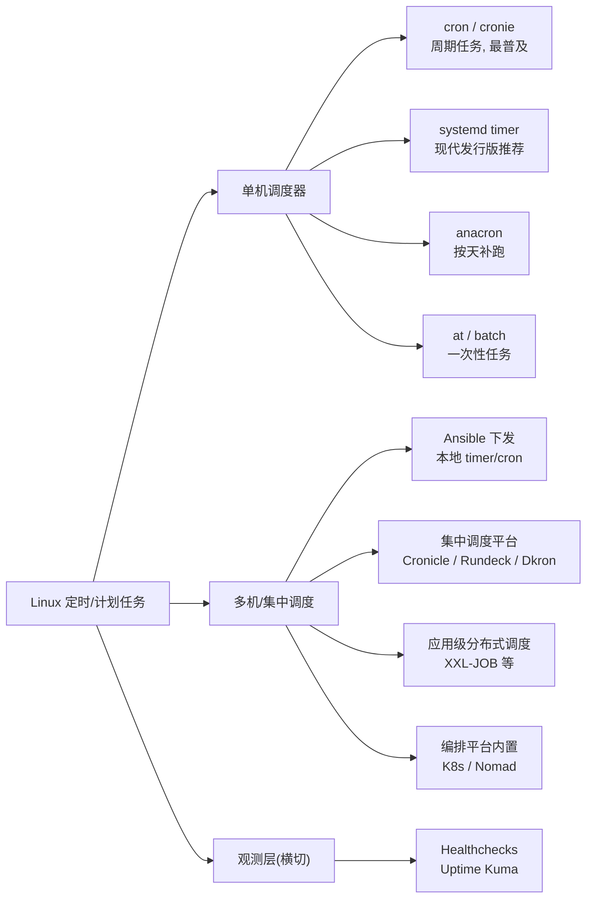
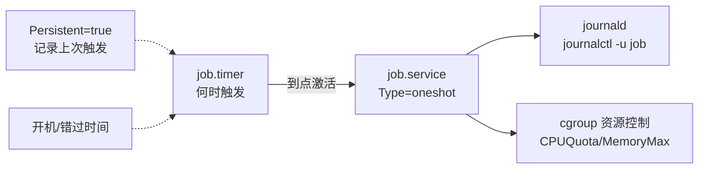
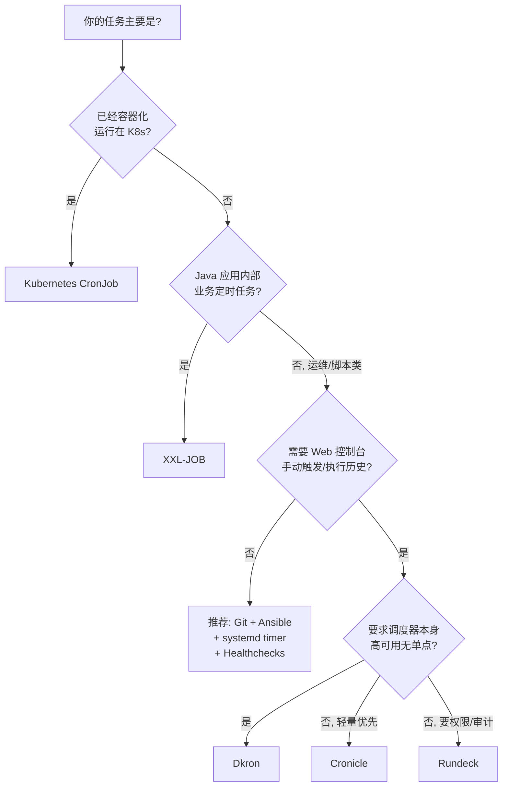

[toc]

## linux系统计划任务方案

调度器只解决"到点执行"这一件事。真正决定运维质量的，是**执行环境是否可复现、失败是否看得见、多台机器上的配置是否一致**。本文先给出选型结论，再分别展开 cron 与 systemd timer 的规则和坑点，最后用一个真实需求——10 台服务器每天各跑两次 WordPress functions 更新——演示批量配置的完整落地方式。

## 结论速览

- **单机、简单任务、老系统或非 systemd 环境**：用 **cron**（发行版里通常是 `cronie` 或 Debian 系的 `cron`）。几乎每个发行版都预装，一行配置就能用，资料和习惯积累最多。
- **现代发行版上的新任务**：推荐 **systemd timer**。日志自动进 journal，关机错过的任务能补跑（`Persistent=`），能随机打散多台机器的执行时间（`RandomizedDelaySec=`），还能手动触发测试、限制资源。
- **多台服务器**：推荐分层组合，不要求一步上平台。
  - **任务定义放 Git**，**用 Ansible 下发**到各主机，生成 **systemd timer**（或 cron）。
  - **每台机器各自执行**，用 **Healthchecks（或 Uptime Kuma 的 Push 监控）做心跳告警**。
  - 这套方案适合几台到几十台机器，零常驻 Agent，免费开源。
- **本文的 10 台服务器案例**：两条任务都是"同一脚本、不同 `--src` 参数"，因此拆成**两个 timer**；用 Ansible 一次下发到 10 台；每台每任务一个心跳，共 20 个 check。
- **时区**：业务时间统一按**北京时间**（`Asia/Shanghai`，UTC+8，无夏令时）描述；`OnCalendar` 和脚本进程都显式设时区，不要只依赖系统时区，零点任务尤其要核对日期。
- **需要 Web 界面、手动触发、执行历史、多节点编排**时，再加一个**集中调度平台**：
  - 通用脚本类选 **Cronicle**（轻量）或 **Rundeck**（企业风格，通过 SSH 执行）。
  - 要高可用、无单点选 **Dkron**。
  - **Java 业务应用内部的定时任务**选 **XXL-JOB**（国内事实标准之一）。
  - **已经容器化上了 K8s** 的，直接用 **Kubernetes CronJob**。

## 工具全景与选型

### 工具分类



图把工具分成三层：**单机调度器**负责"到点在本机执行"；**多机/集中调度**负责"在哪些机器上、由谁统一管理"；**观测层**与前两者都不冲突，负责回答"任务到底有没有按时跑成功"。多服务器的问题，往往缺的正是观测层。

### 单机工具对比

| 工具                             | 典型场景                         | 优点                                                     | 局限                                                         | 新项目建议                                                   |
| -------------------------------- | -------------------------------- | -------------------------------------------------------- | ------------------------------------------------------------ | ------------------------------------------------------------ |
| **cron**（cronie / Debian cron） | 周期任务                         | 无处不在，一行配置，资料多                               | 环境变量少，日志靠重定向或邮件，关机错过不补跑，不会自动防重叠 | 简单任务、老系统、兼容性优先时**可以用**                     |
| **systemd timer**                | 周期或开机后延时任务             | journal 日志、补跑、随机延时、依赖、资源限制、可手动触发 | 要写两个单元文件，上手门槛略高                               | 现代发行版上**推荐**                                         |
| **anacron**                      | 每天、每周、每月任务，机器不常开 | 开机后补跑                                               | 粒度只到天                                                   | 笔记本、桌面可用；服务器一般用 timer 的 `Persistent=` 代替   |
| **at / batch**                   | "今晚 23:00 跑一次"              | 一次性任务很方便                                         | 不适合周期任务；需要 `atd` 服务                              | 偶尔临时用**可以**；也可以用 `systemd-run --on-calendar` 代替 |

关于 systemd timer 的优势，多篇较新的教程看法一致：它能做 cron 能做的一切，并且**日志写进 journal、重启后补跑错过的任务、随机延时避免"惊群"（thundering herd）、不用等调度时间就能用 `systemctl start` 测试**（来源：[computingforgeeks](https://computingforgeeks.com/systemd-timers-linux/)、[linuxblog.io](https://linuxblog.io/systemd-timers-alternative-cron-linux/)）。也有文章指出代价：前期要写的东西**比 crontab 一行多**（linuxblog.io）。

### 选择规则

- **推荐**：RHEL 8/9、Debian 11+、Ubuntu 20.04+ 这类 systemd 系统上的新任务，用 **systemd timer**。
- **可以**：简单任务、需要兼容非 systemd 环境、团队对 cron 非常熟悉时，用 **cron + flock + 日志重定向 + 心跳监控**。
- **避免**：同一台机器上同一个任务**既写在 cron 里又写成 timer**，排障时很容易漏看。
- 容器里没有 systemd，要跑 cron 时，可以考虑专门为容器设计的 `supercronic`（输出到 stdout，方便 `docker logs` 查看）。

## 时区：以北京时间为准

中国没有夏令时，北京时间固定为 UTC+8，换算不随季节变化。真正要分别管住的是三件事：**调度器按哪个时区触发、脚本看到的是哪个时区、日志和告警按哪个时区显示**。三者可以不一致，必须分别设置。

### 推荐策略

业务时间一律用北京时间描述，并在配置里显式写死：

| 环节     | 做法                                                                 | 原因                                             |
| -------- | -------------------------------------------------------------------- | ------------------------------------------------ |
| 调度触发 | `OnCalendar=... 16:00:00 Asia/Shanghai`                               | 服务器是 UTC 也按北京时间触发                    |
| 脚本进程 | service 里 `Environment=TZ=Asia/Shanghai`；cron 文件里 `TZ=Asia/Shanghai` | `date`、按日期命名的文件才按北京时间             |
| 系统时区 | 海外机保持 UTC，国内机可设为 `Asia/Shanghai`，但不要作为唯一依据      | 改系统时区会影响全机日志、应用和数据库           |
| 观测展示 | Healthchecks、Uptime Kuma、日志平台尽量按北京时间显示（账户或容器设置 `TZ`） | 告警时间不用心算                                 |
| 时钟同步 | `timedatectl` 确认 `System clock synchronized: yes`                   | 时区对但时钟漂移，照样错过时间点                 |

### 落地方式

| 场景                    | 做法                                                                 | 说明                                     |
| ----------------------- | -------------------------------------------------------------------- | ---------------------------------------- |
| 用 systemd timer（推荐） | `OnCalendar=... Asia/Shanghai` 加 `Environment=TZ=Asia/Shanghai`      | 与系统时区无关，国内、海外同一套写法     |
| 用 cron，系统是 UTC      | 北京时间 16:00 写 `0 8`，00:00 写 `0 16`；文件里加 `TZ=Asia/Shanghai` | 触发按 UTC，脚本内按北京时间             |
| 用 cron，系统是北京时间  | 直接写 `0 16` / `0 0`；可加 `TZ=Asia/Shanghai` 保持一致               | 最直观，但系统时区要维护一致             |

**timer 路径不要求改系统时区**：`OnCalendar` 的后缀决定触发时刻，`TZ` 决定脚本看到的时间，两者都显式写死，国内机和海外机可以用同一份清单。改系统时区只是为了 `date`、日志、`journalctl` 默认更直观，不是 timer 运行的前提。

`OnCalendar` 的时区后缀在较新的 systemd 上可用；如果 `systemd-analyze calendar` 报解析错误，说明版本过旧，只能改系统时区或按 UTC 换算。

### 改系统时区对定时任务的影响

`timedatectl set-timezone` 只改**时区解释**，不改时钟瞬间：`date` 的显示会跳 8 小时，但 epoch 不变。受影响的是所有"按墙上时钟匹配"的调度。

| 对象                                                     | 影响                                                                 |
| -------------------------------------------------------- | -------------------------------------------------------------------- |
| cron 的所有表（用户表、`/etc/crontab`、`/etc/cron.d`）   | 触发时刻按新时区重新解释。UTC 改成 `Asia/Shanghai` 后，`0 16` 从北京时间 00:00 变成 16:00，原来按 UTC 写的任务整体提前 8 小时 |
| cron 的 `@daily` 等宏                                    | 同样按新时区解释；`@daily` 从北京时间 08:00 变成 00:00               |
| systemd timer，`OnCalendar` 不带时区                     | 与 cron 相同，按新时区重算；切换后用 `systemctl list-timers` 核对下一次触发，不要假设它仍按原来的绝对时刻运行 |
| systemd timer，`OnCalendar` 带 `Asia/Shanghai`           | **不受影响**，触发时刻固定                                           |
| `OnBootSec` / `OnUnitActiveSec`                          | 单调计时，不受影响                                                   |
| `Persistent=true`                                        | 上次触发时间按绝对时间保存，不会因时区变化丢失；下一次触发按新时区重算 |
| 已启动的进程                                             | 多数进程在首次解析时区后缓存，重启才完全切换；日志里的时间可能还是旧时区 |
| journald / 文件 mtime                                    | 存的是绝对时间，`journalctl`、`ls` 按新时区显示，历史记录看起来整体平移，数据本身没变 |
| rsyslog 文本日志                                         | 新写入的行用新时区，旧行保留旧时区，同一个文件里会出现两种偏移       |
| PHP / MySQL                                              | 各自独立：PHP 看 `date.timezone`，MySQL 看 `time_zone`；MySQL 为 `SYSTEM` 时新连接跟随系统时区，`TIMESTAMP` 按会话时区换算，`DATETIME` 不换算 |

**切换当天可能漏跑或重复跑**：本地时间前移（UTC 改成 `Asia/Shanghai`）时，10:00 直接跳到 18:00，原定 12:00 的 cron 任务当天不会触发；本地时间后移（`Asia/Shanghai` 改成 UTC）时，18:00 回到 10:00，12:00–18:00 的任务可能在当天再跑一次。不同 cron 实现对时钟跳变的处理略有差异，切换窗口内不要安排关键任务。

迁移按下面的顺序做：

1. 盘点存量任务：`crontab -l`、`/etc/crontab`、`/etc/cron.d/*`、`systemctl list-timers --all`，逐条标明现在按哪个时区写的。
2. 分类：按 UTC 写的，切换后要改时间字段才能保持原来的绝对时刻；按北京时间写的，时间字段不用改，但绝对触发时刻会随系统时区一起移动（原本就跑偏的会回到预期）。
3. 选窗口：放在关键任务都跑完之后、当天不再有按旧时区解释的任务时切换，避开任务密集的整点。
4. 切换：`sudo timedatectl set-timezone Asia/Shanghai`，重启 cron，逐项核对 `date`、`systemctl list-timers`、`crontab -l`。
5. 验证：手动触发一次关键任务，确认脚本内的 `date` 和日志时间都是北京时间。

按本文写成的两条任务（timer 带 `Asia/Shanghai` + service 设 `TZ`）**不受系统时区变化影响**；受影响的只是其他没有显式时区的 cron/timer。这正是推荐显式时区的原因。

`timedatectl set-time` 是另一回事：它改的是时钟瞬间，向前跳会漏跑、向后跳会重复跑，非必要不要手工改时钟，交给 NTP。

### 零点这条最容易出错

北京时间 00:00 等于 UTC 前一天 16:00。只改触发时间、不改进程的 `TZ`，脚本里的 `date +%F` 会得到"昨天"，按日期生成的文件名、增量判断、日志归档都会错位。16:00 这条没有跨日问题，00:00 这条有。

两个位置都要检查：

- systemd：`Environment=TZ=Asia/Shanghai` 是否写进了 service。
- cron：文件里的 `TZ=Asia/Shanghai` 是否生效。Debian 的 cron 不认 `CRON_TZ`，在 crontab 里写 `TZ` 只影响任务进程，**不会改变触发时刻**。

### 简写宏的时区行为

cron 的 `@daily`、`@monthly` 按**系统时区**解释，也不能带时区。系统是 UTC 时，`@daily` 实际是北京时间 08:00；按北京时间写任务时用完整表达式 `0 0 * * *`，并另行处理触发时区。

systemd 的 `daily`、`hourly` 可以带时区后缀。`systemd-analyze calendar 'daily Asia/Shanghai'` 的归一化结果是 `*-*-* 00:00:00 Asia/Shanghai`，可以放心使用；写成完整表达式只是更直观、更容易检查。

### 时区要覆盖整条链路

`TZ` 只影响遵循它的程序，常见的断点：

- shell 的 `date` 遵循 `TZ`。
- PHP 的时区由 `date.timezone` 决定（常见为 UTC），systemd 的 `TZ` 不会改它。
- MySQL 会话时区由 `time_zone` 决定，写入 `TIMESTAMP` 时按会话时区换算。
- Docker 容器默认继承宿主或镜像的时区，不少镜像里没有 tzdata。

任务只在本机改文件时，通常管好 shell 就够；一旦脚本调用 PHP、写数据库或发带时间的通知，就要逐层确认。

### 验证

```bash
# 系统时区与时钟同步状态
timedatectl

# 指定时区后进程看到的时间（应输出 +0800）
TZ=Asia/Shanghai date +"%F %T %z"

# timer 的下次触发（在目标机上执行, 注意输出里带的时区）
systemd-analyze calendar --iterations=3 '*-*-* 00:00:00 Asia/Shanghai'

# 系统是 UTC 时, 看日志临时切到北京时间
TZ=Asia/Shanghai journalctl -u job-wp-functions-24.service -n 20 --no-pager
```

## cron：最常用的经典方案

> Linux 定时任务工具 `cron` 本身并不是一个严格的英文首字母缩写，它的词源主要有两种说法：
>
> 词源解释
>
> - **源自希腊语“时间”**：这是最主流的说法。`cron` 来源于古希腊语单词 **chronos**（χρόνος），原意就是“时间”。这也解释了为什么它被用来命名基于时间的任务调度系统。
> - **民间词源解释**：有一种说法将其解释为 **“Command Run On Notice”**（接到通知即运行的命令）的缩写，但这通常被认为是一种为了方便记忆而事后附会的说法，并非其真正的起源。

### 工作机制

常驻守护进程 `crond`（Debian 系叫 `cron`）**每分钟醒来一次**，扫描各个 crontab，把到点的任务 fork 出来执行。

一次调度包含三个动作：

- `crond` 醒来后扫描用户表和系统表，逐条比对当前分钟。
- 发现匹配条目，就以该条目指定的用户身份 fork 一个子进程执行命令。
- 子进程的输出默认并入邮件；生产上应改为重定向到日志文件。

没有匹配条目时，`crond` 直接回到休眠，下一分钟再检查。

### 安装与服务名

| 发行版                  | 软件包   | 服务名   | 安装与启用                                |
| ----------------------- | -------- | -------- | ----------------------------------------- |
| Debian / Ubuntu         | `cron`   | `cron`   | 通常预装；`sudo systemctl enable --now cron` |
| RHEL / CentOS / Fedora  | `cronie` | `crond`  | 通常预装；`sudo systemctl enable --now crond` |
| Arch Linux              | `cronie` | `cronie` | 默认不预装：`sudo pacman -S cronie` 后 `sudo systemctl enable --now cronie` |
| Alpine（OpenRC）        | busybox  | `crond`  | `rc-update add crond default` 后 `rc-service crond start` |

Arch 官方更推荐 **systemd timer**，`cronie` 需要自己安装并启用；用 `systemctl status cronie` 可以看到 `active (running)`、`inactive (dead)` 或 `not-found` 三种状态，分别对应正常运行、未启动、未安装。

### 配置文件体系

| 位置                                                      | 归属         | 是否有"用户"字段 | 说明                                                         |
| --------------------------------------------------------- | ------------ | ---------------- | ------------------------------------------------------------ |
| `crontab -e` 编辑的用户表（存放在 `/var/spool/cron/` 下） | 各用户       | 无               | **必须**用 `crontab -e` 或 `crontab -l` 操作，**避免**直接改文件 |
| `/etc/crontab`                                            | 系统         | **有**           | 系统级，升级时可能被包管理器关注，**不推荐**往里加业务任务   |
| `/etc/cron.d/*`                                           | 系统和软件包 | **有**           | **推荐**放系统级业务任务的位置，一个任务一个文件，方便自动化下发 |
| `/etc/cron.{hourly,daily,weekly,monthly}/`                | 系统         | 不适用           | 放可执行脚本，由 `run-parts` 或 anacron 调用，**文件名不能带 `.`** |
| `/etc/cron.allow`、`/etc/cron.deny`                       | 系统         | 不适用           | 控制哪些用户可以使用 `crontab`                               |

权限判定规则：如果 `cron.allow` 存在，则只有其中列出的用户可以使用；如果不存在则检查 `cron.deny`，其中列出的用户被禁止使用；两个文件都不存在时，是否允许普通用户取决于发行版配置。

Debian 系还要求 `/etc/cron.d/` 里的文件名只含字母、数字、下划线和连字符，**带点会被忽略**；`/etc/cron.{hourly,daily,weekly,monthly}/` 下的脚本名同样不能带点，否则 `run-parts` 不会执行。

### crontab 命令

| 命令                   | 功能                              | 示例                          |
| ---------------------- | --------------------------------- | ----------------------------- |
| `crontab -e`           | 编辑当前用户的 crontab            | 打开编辑器进行编辑            |
| `crontab -l`           | 查看当前用户的 crontab            | 列出所有已设定的任务          |
| `crontab -r`           | 删除当前用户的**全部** crontab    | 危险操作，**无确认提示**      |
| `crontab -ri`          | 交互式删除（有确认提示）          | 更安全的删除方式              |
| `crontab -u <user> -e` | 编辑指定用户的 crontab（需 root） | `sudo crontab -u www-data -e` |
| `crontab <file>`       | 从文件导入 crontab（**覆盖式**）  | `crontab my_crontab.txt`      |

批量操作前先备份：`crontab -l > ~/crontab.bak`。恢复时 `crontab ~/crontab.bak` 会**整体覆盖**当前表，不会合并。

### 编辑器设置

`crontab -e` 默认打开哪个编辑器由 `VISUAL`、`EDITOR` 决定，多数程序优先看 `VISUAL`，没有再回退 `EDITOR`。两个变量并存是历史原因：`VISUAL` 原指全屏可视化编辑器，`EDITOR` 原指 `ed` 一类的行编辑器，现在两者都指向自己顺手的编辑器即可。

- 临时生效：`EDITOR=nano crontab -e`（赋值只作用于这一条命令）。
- 永久生效：在 `~/.bashrc` 里写 `export EDITOR=vim` 和 `export VISUAL=vim`，再 `source ~/.bashrc`。
- Debian/Ubuntu 可以用 `sudo select-editor` 交互选择。

### 语法与字段

用户 crontab 的一行格式是 `minute hour day-of-month month day-of-week command`；`/etc/crontab` 和 `/etc/cron.d/` 里会在 `command` 前多一个 `user` 字段。

```bash
# .---------------- 分钟 (0-59)
# |  .------------- 小时 (0-23)
# |  |  .---------- 日 (1-31)
# |  |  |  .------- 月 (1-12 或 jan-dec)
# |  |  |  |  .---- 星期 (0-7, 0 和 7 都是周日)
# |  |  |  |  |
# *  *  *  *  *  command
```

| 字段           | 取值范围            | 说明                                                   |
| -------------- | ------------------- | ------------------------------------------------------ |
| `minute`       | 0–59                | 分                                                     |
| `hour`         | 0–23                | 时（24 小时制）                                        |
| `day-of-month` | 1–31                | 一个月中的第几天                                       |
| `month`        | 1–12 或 `jan`–`dec` | 月                                                     |
| `day-of-week`  | 0–7 或 `sun`–`sat`  | 星期几，**0 和 7 都表示周日**                          |
| `user`         | 用户名              | **只在**系统表（`/etc/crontab`、`/etc/cron.d/`）里出现 |
| `command`      | Shell 命令          | 默认交给 `/bin/sh` 执行（不是 bash，除非设置 `SHELL`） |

各字段支持的写法：

| 符号 | 名称   | 含义                         | 示例                                  |
| ---- | ------ | ---------------------------- | ------------------------------------- |
| `*`  | 星号   | 匹配该字段**所有**可能的值   | `* * * * *` → 每分钟                  |
| `,`  | 逗号   | 列举**多个**离散值           | `1,15,30 * * * *` → 第 1、15、30 分钟 |
| `-`  | 连字符 | 指定**连续范围**             | `1-5 * * * *` → 第 1 到 5 分钟        |
| `/`  | 斜杠   | 指定**步长/间隔**            | `*/10 * * * *` → 每 10 分钟           |
| `?`  | 问号   | 不指定值（部分扩展实现支持） | 标准 cron 不支持，**不要用**          |

常用的**特殊字符串**：

| 宏                      | 等价表达式  | 含义                |
| ----------------------- | ----------- | ------------------- |
| `@reboot`               | —           | 系统启动时执行一次  |
| `@yearly` / `@annually` | `0 0 1 1 *` | 每年 1 月 1 日 0:00 |
| `@monthly`              | `0 0 1 * *` | 每月 1 日 0:00      |
| `@weekly`               | `0 0 * * 0` | 每周日 0:00         |
| `@daily` / `@midnight`  | `0 0 * * *` | 每天 0:00           |
| `@hourly`               | `0 * * * *` | 每小时整点          |

这些宏按**系统时区**解释，不能带时区；系统是 UTC 时 `@daily` 实际是北京时间 08:00。按北京时间写任务时改用完整表达式。

### 容易混淆的规则

- **`day-of-month` 和 `day-of-week` 同时指定（都不是 `*`）时，两者是"或"的关系，不是"且"**。例如 `0 3 1 * 1` 表示"每月 1 号**或**每周一"的 03:00，不是"恰好落在周一的 1 号"。
- **`%` 在 command 里有特殊含义**，表示换行，`%` 之后的内容会变成标准输入。所以 `date +%F` **必须**写成 `date +\%F`。Ansible 的 cron 模块文档也特意提醒，使用 `%` 这类符号时**必须正确转义**（[ansible.builtin.cron](https://docs.ansible.com/projects/ansible/latest/collections/ansible/builtin/cron_module.html)）。最稳妥的做法是把带 `%` 的逻辑写进脚本文件。
- **`*/15` 不等于"距离上次运行 15 分钟"**，而是"分钟数能被 15 整除的时刻"（0、15、30、45）。

写表达式时可以先在 [crontab.guru](https://crontab.guru/) 上确认含义。

### 系统级配置：/etc/crontab 与 /etc/cron.d

| 对比项   | `crontab -e`（用户级） | `/etc/crontab`、`/etc/cron.d/`（系统级） |
| -------- | ---------------------- | ---------------------------------------- |
| 编辑方式 | `crontab -e` 命令      | 直接用文本编辑器编辑文件                 |
| 用户字段 | 无（隐含为当前用户）   | **必须指定**运行用户                     |
| 适用场景 | 个人用户的定时任务     | 系统维护、软件包自带任务、自动化下发     |
| 语法检查 | 保存时自动检查         | 无自动检查，需人工确认                   |

**业务任务优先放 `/etc/cron.d/`**：一个任务一个文件，可以用 Git 管理、用 Ansible 整体覆盖，也不会碰到用户的 crontab。

### 完整示例

场景：一台 Web 服务器，需要每天凌晨清理 7 天前的应用日志，每 5 分钟同步一次配置，并且出错时要能查到原因。把下面的内容保存为 `/etc/cron.d/webapp`：

```bash
# /etc/cron.d/webapp —— 系统级 cron 表(含 user 字段)
SHELL=/bin/bash
PATH=/usr/local/sbin:/usr/local/bin:/usr/sbin:/usr/bin:/sbin:/bin
LANG=C.UTF-8
MAILTO=""
# CRON_TZ=Asia/Shanghai   # 仅 cronie 支持; Debian 的 cron 不认, 见上文"时区"一节

# 每天 03:17 清理 7 天前日志; 用 flock 防重叠, 输出追加到日志文件
17 3 * * *  root  flock -n /run/lock/clean-logs.lock find /var/log/webapp -name '*.log' -mtime +7 -delete >>/var/log/cron-webapp.log 2>&1

# 每 5 分钟同步配置, 最长运行 4 分钟; 注意 date 里的 % 要转义
*/5 * * * * deploy  timeout 4m /opt/webapp/bin/sync-config.sh >>/var/log/cron-webapp.log 2>&1 && echo "$(date +\%F_\%T) sync ok" >>/var/log/cron-webapp.log
```

逐项说明：

- `SHELL`、`PATH`：**cron 的环境非常精简**，`PATH` 通常只有 `/usr/bin:/bin`。"手动能跑、cron 里跑不了"最常见的原因就在这里。**必须**显式设置 `PATH`，或者在命令里用绝对路径。
- `LANG=C.UTF-8`：cron 环境默认没有 locale，脚本输出中文时可能出现乱码或 `?`。**应该**显式设置 UTF-8 locale（这条对中文用户尤其重要）。
- `MAILTO=""`：不发本地邮件。很多服务器根本没有配置 MTA，邮件只会堆在 `/var/mail` 里没人看。**推荐**改用重定向到日志文件，再配合心跳监控。
- 时间分钟选 `17`，没有选整点：**避免**和大量"整点任务"挤在一起。
- `flock -n`：拿不到锁就立即退出。**cron 本身不会防止上一次还没跑完、下一次又启动**，这一点必须自己处理。
- `timeout 4m`：给任务设置上限，避免卡死后越堆越多。

### 执行环境

cron 执行任务时使用的是一个**极简环境**，默认 `PATH` 通常只有 `/usr/bin:/bin`，`SHELL` 是 `/bin/sh`，`HOME` 取自用户信息。交互式 shell 里的 `alias`、`~/.bashrc` 里导出的变量、`nvm`/`pyenv` 之类都**不会**生效。

crontab 里可以设置的变量：

| 变量        | 说明                    | 示例                                |
| ----------- | ----------------------- | ----------------------------------- |
| `SHELL`     | 指定执行命令的 shell    | `SHELL=/bin/bash`                   |
| `PATH`      | 命令搜索路径            | `PATH=/usr/local/bin:/usr/bin:/bin` |
| `MAILTO`    | 输出邮件发送给谁        | `MAILTO=admin@example.com`          |
| `MAILTO=""` | 禁止发送任何邮件        | 避免邮件堆积                        |
| `HOME`      | 设置工作目录            | `HOME=/opt/myapp`                   |
| `CRON_TZ`   | 设置时区（仅 cronie）   | `CRON_TZ=Asia/Shanghai`             |

三种应对方式，按推荐度排列：

- 在 crontab 顶部设置 `PATH`、`SHELL`、`LANG`，命令仍用绝对路径。
- 在脚本开头 `cd` 到固定目录，并显式设置需要的工作目录。
- 用 `env -i SHELL=/bin/bash PATH=/usr/bin:/bin HOME=$HOME /opt/scripts/my_task.sh` 模拟 cron 环境，提前发现问题。

### 输出与日志

cron 默认把任务的 stdout 和 stderr 都通过邮件发给用户（`MAILTO`）。生产上应显式重定向：

| 写法                                   | 效果                             |
| -------------------------------------- | -------------------------------- |
| `* * * * * /opt/scripts/task.sh`       | 输出走邮件                       |
| `... >> /var/log/task.log 2>&1`        | 追加到日志，stderr 合并进 stdout |
| `... > /dev/null 2>&1`                 | 完全丢弃                         |
| `... > /dev/null 2>> /var/log/err.log` | 只保留错误                       |

查看 cron 自身的执行记录（任务有没有被启动）：

```bash
# Debian/Ubuntu（rsyslog）
grep CRON /var/log/syslog

# RHEL/CentOS/Fedora
cat /var/log/cron

# systemd 系统上统一用 journal
journalctl -u cron
journalctl -u crond
journalctl -u cron --since "1 hour ago"
```

注意：`journalctl -u cron` 记录的是 cron 自己的活动（是否启动任务、报错），不记录脚本内部的输出。脚本自己的日志由上面的重定向负责。

### 防重叠：flock

cron 不关心上一次是否还在跑，到点就再 fork 一个。长任务必须自己加锁：

```bash
# -n: 拿不到锁立即退出; -w 60: 最多等 60 秒
*/10 * * * * /usr/bin/flock -n /var/lock/my_task.lock /opt/scripts/my_task.sh
```

锁的行为只有三种：

- **拿到锁**：执行任务，进程结束（包括被 kill）时锁自动释放。
- **拿不到锁**：`-n` 立即退出，本轮跳过；`-w 60` 则最多等 60 秒。
- **异常退出**：锁随文件描述符关闭而释放，不会留下"死锁文件"。

`flock` 加在文件描述符上是这一保证的关键：锁绑定的是进程持有的 fd，不是文件里的一条记录。

### 调试与排错

排查按固定顺序走，每一步只回答一个问题：

1. **crond 是否在运行**：`systemctl status cron`（Debian/Ubuntu）或 `systemctl status crond`（RHEL/CentOS）；没运行就启动并设开机自启。
2. **cron 是否启动过任务**：查 `journalctl -u cron`、`/var/log/cron` 或 `/var/log/syslog` 里的 `CRON` 记录。没有记录说明表达式或保存有问题，先用 `crontab -l` 确认条目存在。
3. **命令是否执行成功**：有启动记录但结果不对，检查 `PATH`、绝对路径、执行权限、shebang、工作目录和运行用户。
4. **任务自己的日志说了什么**：输出重定向到哪里就看哪里；没有重定向时只剩邮件，先补上重定向。
5. **仍然无法定位**：用 `env -i` 模拟极简环境手动执行，或加一条每分钟探针，确认调度链路本身是通的。

常用命令：

```bash
# 服务状态
sudo systemctl status cron      # Debian/Ubuntu
sudo systemctl status crond     # RHEL/CentOS

# 当前用户的表
crontab -l

# 模拟 cron 的极简环境
env -i SHELL=/bin/bash PATH=/usr/bin:/bin HOME=$HOME /opt/scripts/my_task.sh

# 加一个每分钟的探针, 确认调度链路本身是通的
* * * * * echo "cron works at $(date)" >> /tmp/cron_test.log

# 检查是否被允许使用 crontab
cat /etc/cron.allow 2>/dev/null
cat /etc/cron.deny  2>/dev/null
```

常见错误对照：

| 现象                  | 可能原因                          | 解决方法                                        |
| --------------------- | --------------------------------- | ----------------------------------------------- |
| 任务完全没执行        | crond 未启动                      | `systemctl start cron && systemctl enable cron` |
| 任务没执行            | 用户在 `/etc/cron.deny` 中        | 从 deny 文件中移除该用户                        |
| 手动能执行，cron 不行 | PATH 不同，命令找不到             | 使用绝对路径或在 crontab 中设置 PATH            |
| 脚本执行但结果异常    | 工作目录不同                      | 脚本开头 `cd /proper/path` 或设置 `HOME`        |
| 收到大量邮件          | 输出未重定向                      | 添加 `>> logfile 2>&1` 或设 `MAILTO=""`         |
| `%` 导致命令截断      | crontab 中 `%` 是特殊字符（换行） | 用 `\%` 转义，或把逻辑放入脚本文件              |
| 任务重复执行          | 上一次没执行完又触发了            | 使用 `flock` 加锁                               |

`%` 坑的具体写法：

```bash
# 错误: % 未转义, 命令被截断
0 0 * * * echo "Today is $(date +%Y-%m-%d)"

# 正确: 转义 %
0 0 * * * echo "Today is $(date +\%Y-\%m-\%d)"

# 更稳妥: 把逻辑放进脚本, crontab 只调用脚本
0 0 * * * /opt/scripts/print_date.sh
```

## systemd timer：现代发行版的推荐做法

### 工作机制



一个定时任务由**两个同名单元**组成：`.timer` 负责"什么时候"，`.service` 负责"做什么"。timer 到点后激活同名的 service（也可以用 `Unit=` 指定别的 service）。service 由 systemd 拉起，所以**天然有日志、资源控制和依赖管理**。另外，**同一个 service 还在运行时，timer 不会再启动第二个实例**，等于自带防重叠。

### 完整示例：每日备份

场景：每天 02:00（北京时间）把 `/etc` 和应用配置打包备份。允许最多 15 分钟随机延迟，服务器关机错过的话开机后补跑，运行时降低优先级，不影响业务。

`/etc/systemd/system/daily-backup.service`：

```ini
[Unit]
Description=Daily backup of critical configs
Wants=network-online.target
After=network-online.target

[Service]
Type=oneshot
User=root
Environment=LANG=C.UTF-8
Environment=TZ=Asia/Shanghai
ExecStart=/usr/local/bin/backup-configs.sh
Nice=10
IOSchedulingClass=idle
```

`/etc/systemd/system/daily-backup.timer`：

```ini
[Unit]
Description=Run daily-backup.service every day at 02:00 Beijing time

[Timer]
OnCalendar=*-*-* 02:00:00 Asia/Shanghai
RandomizedDelaySec=15min
Persistent=true
AccuracySec=1min

[Install]
WantedBy=timers.target
```

启用和验证：

```bash
sudo systemctl daemon-reload
sudo systemctl enable --now daily-backup.timer   # 注意: enable 的是 .timer, 不是 .service
systemctl list-timers daily-backup.timer          # 查看下次和上次触发时间
sudo systemctl start daily-backup.service         # 立即手动跑一次, 测试用
journalctl -u daily-backup.service -n 50          # 查看本次输出
systemctl status daily-backup.service             # 查看最近一次的退出状态
```

### 关键指令

| 指令                     | 所在段      | 含义                                                         | 实践建议                                                     |
| ------------------------ | ----------- | ------------------------------------------------------------ | ------------------------------------------------------------ |
| `OnCalendar=`            | `[Timer]`   | **按日历时间**触发（墙上时钟）                               | 最常用；可以写多行，表示多个时间点                           |
| `OnBootSec=`             | `[Timer]`   | 开机后多久触发                                               | 和 `OnUnitActiveSec=` 搭配，实现"开机 5 分钟后，此后每小时一次" |
| `OnUnitActiveSec=`       | `[Timer]`   | 距离所激活单元**上次启动**多久再触发                         | 单调定时器（monotonic），不受改系统时间影响                  |
| `Persistent=`            | `[Timer]`   | `true` 时把上次触发时间存到磁盘，**错过的那次在开机后立即补跑** | 备份这类"不能漏"的任务**应该**打开；只对 `OnCalendar=` 生效  |
| `RandomizedDelaySec=`    | `[Timer]`   | 每次触发额外加 0 到 N 的随机延迟                             | **多台机器同一时刻跑同样任务时必须考虑**，避免同时打满备份目标或 API |
| `FixedRandomDelay=`      | `[Timer]`   | `true` 时随机延迟在每台主机上固定不变（systemd 247 起）      | 想让每台机器"错峰但时间稳定"时用；RHEL 8（systemd 239）不认这个指令 |
| `AccuracySec=`           | `[Timer]`   | 触发精度窗口，**默认 1 分钟**，systemd 会在窗口内合并唤醒    | 需要准确到秒时设为 `1s`；一般保持默认即可                    |
| `Unit=`                  | `[Timer]`   | 指定要激活的单元，默认是同名 `.service`                      | 一般不用写                                                   |
| `WakeSystem=`            | `[Timer]`   | 是否从挂起中唤醒机器                                         | 服务器基本不用                                               |
| `Type=oneshot`           | `[Service]` | 执行完就退出的任务                                           | 定时任务**应该**用这个类型                                   |
| `WantedBy=timers.target` | `[Install]` | 让 timer 随系统启动                                          | **必须**写在 `.timer` 里，否则 `enable` 不生效               |

`RandomizedDelaySec` 和 `AccuracySec` 的区别：前者是**主动加随机延迟来错峰**，后者是**允许 systemd 为了省电合并唤醒的误差范围**。一篇 2026 年的教程举例说，`RandomizedDelaySec=300` 会让每次启动随机推迟 0 到 300 秒，**在一批调度时间相同的主机上可以避免同时出现负载尖峰**（[centron](https://www.centron.de/en/tutorials/systemd-timers-instead-of-cron)）。

### OnCalendar 语法

格式是 `[星期] 年-月-日 时:分:秒 [时区]`，其中星期和时区可以省略，`*` 表示任意，`..` 表示范围，`/` 表示步长，`,` 表示列表。

| 需求                 | OnCalendar 写法                                 | 对应的 cron 写法         |
| -------------------- | ----------------------------------------------- | ------------------------ |
| 每天 00:00           | `*-*-* 00:00:00`                                 | `0 0 * * *`              |
| 每天 02:00           | `*-*-* 02:00:00`                                | `0 2 * * *`              |
| 每 15 分钟           | `*:0/15`                                        | `*/15 * * * *`           |
| 工作日 09:30         | `Mon..Fri *-*-* 09:30:00`                       | `30 9 * * 1-5`           |
| 每月 1 号 04:00      | `*-*-01 04:00:00`                               | `0 4 1 * *`              |
| 每月最后一天 23:00   | `*-*~01 23:00:00`                               | cron 无法直接表达        |
| 按北京时间每天 16:00 | `*-*-* 16:00:00 Asia/Shanghai`                  | 需要 cronie 的 `CRON_TZ` |

**写完之后必须验证**：`systemd-analyze calendar --iterations=5 'Mon..Fri *-*-* 09:30:00'` 会列出接下来 5 次触发时间，作用和 crontab.guru 一样。带时区的写法也用它验证，输出里会标明时区，可以直接看到换算后的时间。

### 临时任务与用户级 timer

- **一次性或临时周期任务**（可以代替 at）：`sudo systemd-run --on-calendar='2026-11-01 23:00' --unit=oneoff-reindex /opt/app/bin/reindex.sh`，不用写单元文件。用 `systemctl list-timers` 查看，用 `systemctl stop oneoff-reindex.timer` 取消。
- **不需要 root 的个人任务**：单元文件放在 `~/.config/systemd/user/`，用 `systemctl --user enable --now xxx.timer` 启用。**注意**：用户退出登录后用户级 systemd 会停止，需要先执行 `sudo loginctl enable-linger <user>`。

### cron 与 timer 的取舍

| 维度     | cron                                                   | systemd timer                                                |
| -------- | ------------------------------------------------------ | ------------------------------------------------------------ |
| 上手成本 | **低**，一行搞定                                       | 中，要写两个文件                                             |
| 日志     | 自己重定向，或本地邮件                                 | **自动进 journal**，`journalctl -u` 就能查                   |
| 错过补跑 | 不补（anacron 可补，但只到天）                         | `Persistent=true`                                            |
| 多机错峰 | 只能自己 `sleep $((RANDOM % 900))`                     | `RandomizedDelaySec=`                                        |
| 防重叠   | 要用 `flock`                                           | 同一 service 运行中不会重复启动                              |
| 资源控制 | `nice`、`ionice`                                       | `CPUQuota=`、`MemoryMax=`、`IOSchedulingClass=` 等 cgroup 能力 |
| 手动测试 | 复制命令手动执行（环境和 cron 不同）                   | `systemctl start xxx.service`，**环境完全一致**              |
| 状态查询 | 没有统一视图                                           | `systemctl list-timers`                                      |
| 可移植性 | **所有 Unix-like 系统**，包括 Alpine 和非 systemd 容器 | 只限 systemd 系统                                            |

## 多服务器：难点与方案

服务器从 1 台变成 N 台后，"定时任务"的难点从"语法"变成了下面这些**管理问题**：

| 问题           | 表现                                                         | 解决思路                                            |
| -------------- | ------------------------------------------------------------ | --------------------------------------------------- |
| **配置漂移**   | 每台机器手动 `crontab -e`，没人说得清哪台跑了什么            | 任务定义**代码化**，放进 Git，用工具统一下发        |
| **静默失败**   | 备份脚本已经坏了三个月才发现                                 | **心跳监控**（dead man's switch）：没按时报到就告警 |
| **同时触发**   | 20 台机器 02:00 整点同时备份，存储和带宽被打满               | 随机延迟、错峰                                      |
| **重复或单点** | "全局只应该跑一次"的任务（比如发日报），放在一台机器上有单点，放在多台上会重复 | 指定唯一执行节点，或用带选主/HA 的调度平台          |
| **可见性**     | 想看执行历史、手动重跑，只能逐台 SSH 上去                    | Web 控制台（集中调度平台）或日志集中                |

很多场景其实**不需要**马上上调度平台。前三个问题，用"**Git + Ansible + 本地 timer + 心跳监控**"就能解决得很好；只有"重复或单点"和"可见性"很突出时，才值得引入平台。

### 分层架构

| 层           | 载体                            | 职责与要点                                                                 |
| ------------ | ------------------------------- | -------------------------------------------------------------------------- |
| **定义层**   | Git 仓库的 `group_vars/all.yml` | 所有任务写在清单里，改任务就是改代码，**能 Code Review、能回滚、能审计**     |
| **分发层**   | Ansible 控制机                  | 通过 SSH 推送配置，被管机器**不需要安装 Agent**，且是幂等的                 |
| **执行层**   | 每台服务器的 systemd timer      | 本地到点执行，**没有中心单点**；控制机挂了也不影响任务按时运行              |
| **观测层**   | Healthchecks + journald         | 任务开始和结束时发 ping，**超时或非 0 退出码就告警**；journald 留执行记录    |

这四层可以独立替换：执行层换成 cron 不影响定义层和观测层；观测层换成 Uptime Kuma 的 Push 监控，也不影响其余三层。

### 方案对比

| 方案                             | 类型                     | 许可证                                 | 典型规模和场景                    | 优点                                                         | 代价和注意事项                                     |
| -------------------------------- | ------------------------ | -------------------------------------- | --------------------------------- | ------------------------------------------------------------ | -------------------------------------------------- |
| **Ansible + systemd timer/cron** | 配置下发 + 本地执行      | GPL-3.0（ansible-core）                | 几台到几百台，运维脚本类          | 无 Agent，无中心单点，Git 化                                 | 没有 Web 控制台；"全局只跑一次"要自己指定节点      |
| **Cronicle**                     | 集中调度平台（Node.js）  | MIT                                    | 中小团队，想要 Web UI             | 部署轻量，Web 界面、实时日志、多服务器、插件可以用任何语言写 | 自带主备切换，但生态比 Rundeck 小                  |
| **Rundeck 社区版**               | 运维自动化平台（Java）   | Apache 2.0                             | 企业运维、自助运维                | 权限控制、日志、执行历史，**通过 SSH 在多节点执行**          | 较重；部分高可用能力只在企业版提供                 |
| **Dkron**                        | 分布式 cron（Go）        | 以仓库 LICENSE 为准（不同资料标注不一致） | 云原生、要求无单点                | Raft 共识、选主切换、按标签选节点、插件                      | 需要每个节点运行 Agent                             |
| **XXL-JOB**                      | 应用级分布式调度（Java） | GPL-3.0                                | **Java 微服务内部的业务定时任务** | 调度中心和执行器解耦，分片广播，路由策略，国内资料非常多     | 依赖 MySQL；主要面向应用代码，拿来跑运维脚本有点重 |
| **Kubernetes CronJob**           | 编排平台内置             | Apache 2.0                             | 已经容器化                        | `concurrencyPolicy`、`timeZone`、失败重试，声明式            | 只适用于 K8s 内的工作负载                          |
| **Nomad periodic**               | 编排平台内置             | BUSL（1.7 起）                         | 已经在用 Nomad                    | `prohibit_overlap`、时区                                     | 许可证已经不是 OSI 开源                            |

依据和补充：

- AIMultiple 的开源调度器汇总把 Rundeck 社区版描述为能**通过 SSH 跨多节点运行作业**、带访问控制和执行历史的平台；同时说明 Dkron **基于 Raft 共识、支持多节点定向和插件、目标是消除单点**（[aimultiple](https://aimultiple.com/open-source-job-scheduler)，约 2026 年 8 月）。
- LinuxLinks 介绍 Dkron 时提到它**通过选主切换和分布式协调避免单点**，并且**用标签选择目标节点**（[linuxlinks](https://www.linuxlinks.com/dkron-distributed-job-scheduling-system/)）。
- Cronicle 的介绍资料显示它是 MIT 许可、2015 年起维护的 Node.js 多服务器调度器，并且一直在更新（[BrightCoding](https://www.blog.brightcoding.dev/2026/10/01/jhuckabycronicle-distributed-task-scheduler-with-web-ui)）。同一来源的对比表把 Rundeck 的 Failover（故障切换）标为 "Enterprise only"。这是第三方博客的说法，**建议以官方文档为准**。
- XXL-JOB 的设计思想是**把调度行为抽象成"调度中心"，把任务抽象成分散的 JobHandler 交给"执行器"**，支持 Cron、固定间隔、API、父子任务等多种触发方式（[阿里云开发者社区](https://developer.aliyun.com/article/1324158)，官方文档 [xuxueli.com/xxl-job](https://www.xuxueli.com/xxl-job/)）。阿里云 MSE 还提供托管的 XXL-JOB 版。
- Apache Airflow、DolphinScheduler 这类**数据工作流（DAG）编排**工具不在本文范围内。只有在有复杂依赖的数据管道场景才考虑它们，不要拿来代替 cron。

### 按场景选型



**对大多数"我有几台到几十台服务器"的读者，推荐路径是图中的 "Git + Ansible + systemd timer + Healthchecks"**。等出现"要给开发或业务同事一个点按钮的界面""要集中看执行历史"这类需求时，再引入 Cronicle 或 Rundeck。两者并不冲突：平台负责那部分需要编排的任务，Ansible 继续管各机器上的基础运维任务。

### 观测层：心跳监控

不管选哪种调度方案，都**应该**给重要任务加心跳监控。原理很简单：任务开始时请求 `<ping_url>/start`，结束时请求 `<ping_url>/<退出码>`。监控端在约定时间内没收到成功 ping，就告警。

- Healthchecks 官方文档说明，只要服务器上有 `curl` 或 `wget`，**就不需要额外安装任何软件**（[Healthchecks docs](https://healthchecks.io/docs/monitoring_cron_jobs/)）。
- 它的代码是 **BSD 许可、可以自托管**，托管服务的**免费套餐可以监控 20 个任务**（[Capterra](https://www.capterra.com/p/249957/Healthchecksio/)）。
- 它专门用来抓传统可用性监控发现不了的"**静默失败**"：任务没跑、超时、同步没完成（[CubePath docs](https://cubepath.com/docs/server-tools/healthchecks-self-hosted-cron-monitoring)）。
- 国内流行的 **Uptime Kuma** 有 "Push" 类型的监控，也能做简化版心跳；**Cronitor** 是商业替代品（官方对比：[Healthchecks vs Cronitor](https://healthchecks.io/docs/healthchecks_cronitor_comparison/)）。
- 告警渠道方面，Healthchecks 内置了邮件、Telegram、Webhook 等多种集成。钉钉、飞书可以通过 Webhook 接入（具体格式以各平台机器人文档为准）。

心跳的配置要点：**周期要覆盖任务的真实调度间隔，宽限期要覆盖随机延迟和正常执行时长**。每天一次的任务配 1 天周期加 1 小时宽限，比配成"每分钟检查"更不容易误报。

## 实战：10 台服务器的两条任务

### 需求拆解

需求是：10 台服务器，每台每天执行两条命令。

| 任务              | 时间    | 命令                                                                                       | 频率 |
| ----------------- | ------- | ------------------------------------------------------------------------------------------ | ---- |
| functions4 更新   | 每天 16:00 | `bash /www/sh/wp-functions-update/update_wp_functions.sh --src /www/functions4.php`     | 每天 |
| functions24 更新  | 每天 00:00 | `bash /www/sh/wp-functions-update/update_wp_functions.sh --src /www/functions24.php`    | 每天 |

以下时间均指**北京时间**（`Asia/Shanghai`，UTC+8）。

拆解出的关键事实：

- **同一脚本、不同参数**：两条任务没有逻辑差异，只有 `--src` 不同。因此**不需要**写两个脚本，但**应该**写成两个调度单元：时间不同、失败要能分别告警、要能单独重跑。
- **10 台机器完全同构**：没有"只在某一台上跑"的需求，因此可以用一个主机组一次下发。
- **任务本身是本地文件操作**：脚本读 `/www/functions4.php`、写 WordPress 的 `functions.php`，不依赖中心调度器。这是"本地执行 + 集中下发"方案最合适的形状。
- **时间点特殊**：`00:00` 是整点里最拥挤的时刻，10 台机器同时触发会有可观测的负载尖峰（脚本若访问远程源，还会同时打到同一目标）。
- **路径形态像宝塔面板**：`/www` 是宝塔（aaPanel）的默认根目录。宝塔自带的"计划任务"写的是 root 的 crontab，**和 systemd timer 混用会导致同一任务执行两次**，落地前必须确认。

### 方案选择

先排除几种看起来更快、实际会留下债的做法：

| 方案                        | 10 台的工作量                  | 幂等 | 执行记录     | 失败告警 | 结论                 |
| --------------------------- | ------------------------------ | ---- | ------------ | -------- | -------------------- |
| 逐台 `crontab -e`           | 20 次重复编辑                  | 否   | 要自己重定向 | 无       | 只在临时排障时用     |
| `for` 循环 SSH 追加         | 一条命令，但重复执行会重复追加 | 否   | 要自己重定向 | 无       | **不要**用于长期任务 |
| 宝塔面板逐台点              | 20 次点击                      | 否   | 面板里看     | 面板有限 | 机器多时不可维护     |
| Ansible + `/etc/cron.d/`    | 一个 playbook                  | 是   | 要自己重定向 | 需额外接 | 轻量替代，**可用**   |
| **Ansible + systemd timer** | 一个 playbook                  | 是   | journal 自带 | 需额外接 | **推荐**             |
| Cronicle / Rundeck          | 先部署平台，再录任务           | 是   | Web 界面     | 平台内置 | 需要控制台时再上     |

**推荐方案：Git 管理任务清单，Ansible 下发两个 systemd timer，每台每任务接一个 Healthchecks 心跳。** 理由：

- 10 台机器只需要维护一份 YAML，改时间、改参数、加机器都是改一行再跑一次。
- systemd 自带防重叠和 journal 日志，配合包装器补上超时与心跳，排障不用登机器翻 `/var/log`。
- 没有中心调度器，Ansible 控制机离线时任务照常执行。
- 心跳把"没跑"和"跑失败"都变成告警，而不是等下一个人发现文件没更新。

如果这 10 台机器里有非 systemd 的老系统，或者团队明确要求统一用 crontab，用后面的 **cron 变体**，其余设计不变。

### 关键设计决策

- **两个 timer，而不是一个脚本里 `sleep` 切换**：时间点、参数、告警都独立，失败影响面最小。
- **任务名跟随 `--src`**：`wp-functions-4` 与 `wp-functions-24`。名字表达"应用哪个源文件"，而不是"几点跑"，将来调时间不用改名。
- **运行用户固定为 root**：与人工执行时一致。脚本若以"写临时文件再替换"的方式更新 `functions.php`，新文件的属主会变成运行用户；换成 `www` 用户运行前必须确认 Web 进程的写入权限。
- **显式时区，两处都写**：`OnCalendar` 带 `Asia/Shanghai` 决定"何时触发"；service 的 `Environment=TZ=Asia/Shanghai` 决定"脚本看到什么时间"。只写前者，00:00 这条在 UTC 机器上会按前一天处理日期。
- **不改系统时区**：示例保持服务器原时区（海外机通常是 UTC），业务时间靠上面两处配置固定为北京时间，避免影响日志、应用和数据库。
- **时钟同步**：确认 `timedatectl` 里 `System clock synchronized: yes`。时区正确但时钟漂移，16:00 一样会漂。
- **小随机延迟**：`RandomizedDelaySec=3min`，把 10 台机器的实际触发时间摊开。代价是"16:00"实际是 16:00–16:03；如果业务要求严格整点，改成 `0`。
- **补跑**：`Persistent=true`。这类"把配置同步到目标状态"的任务，错过了应该在开机后补上。
- **超时 10 分钟**：脚本正常应在秒级完成；超时值按实际观测调整，先给一个保守上限，防止卡死后堆积。
- **不共享锁**：两次运行相隔 8 小时，且 `timeout 10m` 保证任何一次都会在 8 小时内结束，并发不可能发生。若将来把两次改到相近时间，改成共享锁名即可。
- **每台每任务一个心跳**：10 台 × 2 个任务 = 20 个 check，命名 `<主机名>-<任务名>`，一眼能定位是哪台机器的哪个任务。

### 仓库结构

```
wp-cron/
├── inventory.yml
├── group_vars/
│   └── all.yml
├── files/
│   └── jobwrap.sh
├── templates/
│   ├── job.service.j2
│   └── job.timer.j2
└── site.yml
```

一个目录就是一个"任务定义仓库"，可以单独放进 Git，也可以作为现有运维仓库的子目录。

### 主机清单

`inventory.yml`：

```yaml
all:
  hosts:
    wp-01: { ansible_host: 203.0.113.11 }
    wp-02: { ansible_host: 203.0.113.12 }
    wp-03: { ansible_host: 203.0.113.13 }
    wp-04: { ansible_host: 203.0.113.14 }
    wp-05: { ansible_host: 203.0.113.15 }
    wp-06: { ansible_host: 203.0.113.16 }
    wp-07: { ansible_host: 203.0.113.17 }
    wp-08: { ansible_host: 203.0.113.18 }
    wp-09: { ansible_host: 203.0.113.19 }
    wp-10: { ansible_host: 203.0.113.20 }
  vars:
    ansible_user: root
    # SSH 端口、密钥、跳板机等按实际环境补充; 也可以全部写进 ~/.ssh/config
```

`203.0.113.0/24` 是文档专用地址段，实际使用时替换成真实 IP。这里用 root 直连是因为宝塔环境通常只开 root 的 SSH；条件允许时**推荐**改成普通运维用户加 `become: true`，并在 playbook 里保留 `become`。

主机名建议与真实主机名一致。心跳 slug 会用 `inventory_hostname`，如果清单里写的是别名而机器上 `hostname` 是别的名字，两者不要混用，统一以清单为准。

### 任务定义

`group_vars/all.yml`：

```yaml
# Healthchecks 的 ping key; 每台机器每个任务拼成 <hc_base>/<主机名>-<任务名>
hc_base: "https://hc-ping.com/YOUR_PING_KEY"

# 业务时间统一按北京时间; 定时器与脚本进程都用它
job_timezone: "Asia/Shanghai"

# 被调用的脚本; 调度配置只负责"何时跑", 脚本内容由应用发布流程负责
wp_script: "/www/sh/wp-functions-update/update_wp_functions.sh"

wp_jobs:
  - name: wp-functions-4
    description: "应用 functions4.php (每天 16:00 北京时间)"
    src: "/www/functions4.php"
    on_calendar: "*-*-* 16:00:00"
    randomized_delay: "3min"
    timeout: "10m"

  - name: wp-functions-24
    description: "应用 functions24.php (每天 00:00 北京时间)"
    src: "/www/functions24.php"
    on_calendar: "*-*-* 00:00:00"
    randomized_delay: "3min"
    timeout: "10m"

# 已下线、需要清理的旧任务名; 新增任务不用管它
wp_jobs_absent: []
```

字段说明：

| 字段               | 含义           | 说明                                                         |
| ------------------ | -------------- | ------------------------------------------------------------ |
| `name`             | 任务标识       | 生成单元文件名 `job-<name>.service/.timer`、锁名和心跳 slug；**只用小写字母、数字和连字符** |
| `description`      | 描述           | 写进 `Description=`，用 `systemctl status job-<name>.timer` 查看 |
| `src`              | 传给脚本的参数 | 对应 `--src`，**用绝对路径**；不写 `command` 时由它拼出默认命令             |
| `command`          | 完整命令       | 可选，用于不是"`wp_script --src`"形状的任务；写了就覆盖默认拼法             |
| `on_calendar`      | 调度时间       | `OnCalendar=` 语法，模板会拼上 `job_timezone`；上线前用 `systemd-analyze calendar` 验证 |
| `randomized_delay` | 随机延迟上限   | `RandomizedDelaySec=`；`"0"` 表示不延迟                      |
| `timeout`          | 最长运行时间   | 传给 `jobwrap.sh -t`，也是防堆积的上限                       |

### 通用包装器

`files/jobwrap.sh` 让每个任务自动具备**防重叠、超时、日志、心跳上报**能力，cron 和 systemd timer 都能直接用。沙箱测试结果：正常退出码透传（3）、超时返回 124、重叠运行返回 75、参数错误返回 64，四种情况都符合预期。

```bash
#!/usr/bin/env bash
# jobwrap.sh - 通用定时任务包装器: 防重叠 + 超时 + 日志 + 心跳监控
# 用法: jobwrap.sh [-n 名称] [-t 超时] [-u 心跳URL] [-l 锁目录] -- 命令 [参数...]
set -uo pipefail

usage() {
  cat <<'USAGE'
Usage: jobwrap.sh [-n NAME] [-t TIMEOUT] [-u PING_URL] [-l LOCK_DIR] -- CMD [ARGS...]
  -n NAME      任务名, 用于锁文件名与日志标签 (默认: 命令的basename)
  -t TIMEOUT   最长运行时间, timeout(1) 语法, 如 30m, 2h (默认: 1h)
  -u PING_URL  Healthchecks 风格心跳地址; 也可用环境变量 JOB_PING_URL
  -l LOCK_DIR  锁文件目录 (默认: /run/lock, 不可写时退回 /tmp)
  -h           显示帮助
退出码: 与被包装命令一致; 75 表示上一次仍在运行而被跳过; 124 表示超时
USAGE
}

name="" timeout_s="1h" ping_url="${JOB_PING_URL:-}" lock_dir="/run/lock"
while getopts ":n:t:u:l:h" opt; do
  case "$opt" in
    n) name="$OPTARG" ;;
    t) timeout_s="$OPTARG" ;;
    u) ping_url="$OPTARG" ;;
    l) lock_dir="$OPTARG" ;;
    h) usage; exit 0 ;;
    :) echo "选项 -$OPTARG 需要参数" >&2; usage >&2; exit 64 ;;
    \?) echo "未知选项 -$OPTARG" >&2; usage >&2; exit 64 ;;
  esac
done
shift $((OPTIND - 1))
[[ "${1:-}" == "--" ]] && shift
(($# > 0)) || { usage >&2; exit 64; }

name="${name:-$(basename "$1")}"
[[ -w "$lock_dir" ]] || lock_dir="/tmp"
lock_file="${lock_dir}/jobwrap-${name}.lock"

log() { logger -t "jobwrap[${name}]" -- "$*" 2>/dev/null || true; echo "[$(date '+%F %T')] [${name}] $*" >&2; }

ping_hc() { # $1: 后缀, 如 /start 或 /0 /1 ...
  [[ -n "$ping_url" ]] || return 0
  curl -fsS -m 10 --retry 3 -o /dev/null "${ping_url}$1" || log "心跳上报失败: ${ping_url}$1"
}

exec 9>"$lock_file" || { log "无法打开锁文件 $lock_file"; exit 73; }
if ! flock -n 9; then
  log "上一次运行尚未结束, 本次跳过"
  exit 75
fi

ping_hc "/start"
log "开始执行: $*"
start_ts=$(date +%s)
timeout --kill-after=30s "$timeout_s" "$@"
rc=$?
log "结束, 退出码=${rc}, 耗时=$(($(date +%s) - start_ts))s"
ping_hc "/${rc}"
exit "$rc"
```

设计要点：

- **`flock -n` 加在文件描述符 9 上**：锁跟着进程走，进程退出（包括被 kill）后锁自动释放，不会留下"死锁文件"。
- **`timeout --kill-after=30s`**：超时后先发 SIGTERM，30 秒后还没退出就 SIGKILL。
- **心跳用 `/<退出码>`**：Healthchecks 把 0 当作成功，非 0 当作失败，并且能在界面上看到具体退出码。`/start` 用来统计运行时长和发现"开始了但没结束"的情况。
- **心跳失败不影响任务退出码**，避免监控系统故障导致任务被误判失败。
- 在 systemd 下 stderr 本来就会进 journal，`logger` 会多写一份，是可以接受的冗余。介意的话可以删掉 `log()` 里的 `logger` 调用。
- 在 systemd timer 下，同一个 service 本来就不会重复启动，flock 主要防"**cron 调用或手动执行与定时执行撞车**"。
- 上线前**推荐**用 `shellcheck jobwrap.sh` 和 `shfmt -d -i 2 jobwrap.sh` 检查一遍。

### 单元模板

`templates/job.service.j2`：

```ini
# 由 Ansible 管理, 请勿手动修改
[Unit]
Description={{ item.description }}
Wants=network-online.target
After=network-online.target

[Service]
Type=oneshot
User={{ item.user | default('root') }}
Environment=LANG=C.UTF-8
Environment=TZ={{ job_timezone }}
Environment=JOB_PING_URL={{ hc_base }}/{{ inventory_hostname }}-{{ item.name }}
ExecStart=/usr/local/bin/jobwrap.sh -n {{ item.name }} -t {{ item.timeout }} -- {{ item.command if item.command is defined else '/bin/bash ' ~ wp_script ~ ' --src ' ~ item.src }}
Nice=10
IOSchedulingClass=idle
```

`templates/job.timer.j2`：

```ini
# 由 Ansible 管理, 请勿手动修改
[Unit]
Description=Timer for {{ item.name }}

[Timer]
OnCalendar={{ item.on_calendar }} {{ job_timezone }}
RandomizedDelaySec={{ item.randomized_delay }}
Persistent=true
AccuracySec=1min

[Install]
WantedBy=timers.target
```

几点说明：

- `ExecStart` 里用 `/bin/bash` 而不是 `bash`：systemd 要求可执行文件是绝对路径，不查 `PATH`。这也顺带绕开了脚本没有可执行位的问题。
- `Environment=TZ={{ job_timezone }}` 是**必须**的：timer 的时区只决定"何时触发"，不会改变进程看到的时间。少了这一行，海外 UTC 机器上 00:00 触发的任务，脚本里 `date +%F` 会认为是前一天。
- `ExecStart` 末尾先看 `item.command`：任务定义了完整命令就用它，否则用 `/bin/bash <wp_script> --src <src>` 拼出默认命令，所以两个 WordPress 任务不需要重复写命令。
- `Environment=JOB_PING_URL=...` 把心跳地址交给包装器，包装器内部用 `curl` 追加 `/start` 和 `/<rc>`。
- 单元名统一加 `job-` 前缀，`systemctl list-timers 'job-*'` 可以一次筛出来，也不会和系统自带 timer 混在一起。
- 如果所有机器的 systemd 都在 247 以上，可以在 `[Timer]` 里加 `FixedRandomDelay=true`，让每台机器的错峰时间固定下来，排障时更容易预期。

### Playbook

`site.yml`：

```yaml
- name: 下发 WordPress functions 更新任务
  hosts: all
  become: true
  tasks:
    - name: 预检脚本与源文件是否存在
      ansible.builtin.stat:
        path: "{{ item }}"
      loop: "{{ [wp_script] + (wp_jobs | selectattr('src', 'defined') | map(attribute='src') | list) }}"
      register: wp_precheck
      failed_when: not wp_precheck.stat.exists

    - name: 安装任务包装器
      ansible.builtin.copy:
        src: files/jobwrap.sh
        dest: /usr/local/bin/jobwrap.sh
        owner: root
        group: root
        mode: "0755"

    - name: 渲染 service 与 timer 单元
      ansible.builtin.template:
        src: "templates/job.{{ item.1 }}.j2"
        dest: "/etc/systemd/system/job-{{ item.0.name }}.{{ item.1 }}"
        owner: root
        group: root
        mode: "0644"
      loop: "{{ wp_jobs | product(['service', 'timer']) | list }}"
      loop_control:
        label: "job-{{ item.0.name }}.{{ item.1 }}"
      notify: Reload systemd

    - name: 立即执行 daemon-reload
      ansible.builtin.meta: flush_handlers

    - name: 启用并启动 timer
      ansible.builtin.systemd_service:
        name: "job-{{ item.name }}.timer"
        enabled: true
        state: started
      loop: "{{ wp_jobs }}"
      loop_control:
        label: "{{ item.name }}"

    - name: 读出 timer 状态
      ansible.builtin.command:
        cmd: systemctl list-timers 'job-wp-functions-*' --no-pager
      register: wp_timers
      changed_when: false

    - name: 显示 timer 状态
      ansible.builtin.debug:
        var: wp_timers.stdout_lines

  handlers:
    - name: Reload systemd
      ansible.builtin.systemd_service:
        daemon_reload: true
```

几个关键点：

- **预检**：脚本或 `/www/functions4.php` 不存在时立即失败，而不是等到 16:00 静默报错。`failed_when` 在 `loop` 里按每个结果判定。
- `product(['service', 'timer'])` 把每个任务和两种单元类型组合起来，`item.0` 是任务，`item.1` 是单元类型，一个 task 就能渲染两个文件。
- `notify` 配合 handler：**只有单元文件真的变化时**才执行 `daemon-reload`，保证幂等。`meta: flush_handlers` 保证在启用 timer 之前重载完成。
- `ansible.builtin.systemd_service` 是较新 ansible-core 里 `systemd` 模块的正式名字。老版本把它换成 `ansible.builtin.systemd` 即可。
- 每个任务的文件名、锁名、心跳 slug 都来自同一个 `name`，不会出现"单元叫 A、锁叫 B、告警显示 C"的错位。

### 下发与验证

按顺序执行，先灰度再全量：

```bash
# 语法检查
ansible-playbook -i inventory.yml site.yml --syntax-check

# 预演: --check 不落盘, --diff 显示将要改动的文件内容
ansible-playbook -i inventory.yml site.yml --check --diff

# 先灰度一台
ansible-playbook -i inventory.yml site.yml --limit wp-01

# 全量下发
ansible-playbook -i inventory.yml site.yml
```

在灰度机器上确认五件事，再推全量：

```bash
# timer 已加载, NEXT 是下一次触发时间
systemctl list-timers 'job-wp-functions-*' --no-pager

# 时区与时钟: 系统时区、同步状态、service 里的 TZ
timedatectl
systemctl show job-wp-functions-4.service -p Environment
TZ=Asia/Shanghai date +"%F %T %z"

# 手动触发一次, 观察退出码
systemctl start job-wp-functions-4.service
systemctl status job-wp-functions-4.service

# 看这次执行的输出
journalctl -u job-wp-functions-4.service -n 50 --no-pager

# 确认 cgroup 资源限制与运行用户
systemctl show job-wp-functions-4.service -p User -p Nice -p IOSchedulingClass
```

批量核对（不用逐台登录）：

```bash
# 所有机器的 timer 状态
ansible all -i inventory.yml -b -m ansible.builtin.command \
  -a "systemctl list-timers 'job-wp-functions-*' --no-pager"

# 所有机器手动跑一次; 任一失败会直接报错
ansible all -i inventory.yml -b -m ansible.builtin.command \
  -a "systemctl start job-wp-functions-4.service"

# 所有机器最近一次日志
ansible all -i inventory.yml -b -m ansible.builtin.command \
  -a "journalctl -u job-wp-functions-4.service -n 20 --no-pager"
```

### 结果核对

`systemctl list-timers` 的正常输出形如（时间与 `LEFT` 随当前时刻变化）：

```
NEXT                        LEFT     LAST                        PASSED   UNIT                      ACTIVATES
Wed 2026-10-28 16:02:41 CST 3h 12m   Tue 2026-10-27 16:01:55 CST 20h ago  job-wp-functions-4.timer  job-wp-functions-4.service
Thu 2026-10-29 00:01:23 CST 11h 11m  Wed 2026-10-28 00:02:07 CST 15h ago  job-wp-functions-24.timer job-wp-functions-24.service
```

上面是系统时区为 `Asia/Shanghai` 时的显示。系统保持 UTC 时，同两条 timer 显示为 `08:0x UTC` 和 `16:0x UTC`，对应北京时间 16:00 和 00:00。

| 检查项       | 命令或位置                                              | 期望结果                                             |
| ------------ | ------------------------------------------------------- | ---------------------------------------------------- |
| timer 已加载 | `systemctl list-timers 'job-wp-functions-*'`            | 两个 timer，`NEXT` 对应北京时间明天 16:00 和 00:00（系统是 UTC 时显示 08:00 和 16:00） |
| 时区一致     | `systemctl show job-wp-functions-4.service -p Environment` | 含 `TZ=Asia/Shanghai`；`TZ=Asia/Shanghai date` 输出 +0800 |
| 最近一次结果 | `systemctl status job-wp-functions-4.service`           | `status=0/SUCCESS`，无残留进程                       |
| 执行日志     | `journalctl -u job-wp-functions-4.service`              | 有"开始执行"与"结束, 退出码=0"                       |
| 心跳         | Healthchecks 面板                                       | 20 个 check 全部 `up`，能看到最近 ping 的时间和耗时  |
| 文件生效     | 对比 `functions.php` 的修改时间与内容                    | 与 `/www/functions4.php` 一致                        |

服务器系统时区是 UTC 时，`journalctl` 默认按 UTC 显示时间；核对北京时间要加 `TZ=Asia/Shanghai journalctl ...`，或用 `journalctl -o short-iso` 看带 `+0800` 偏移的时间。

心跳的周期建议设为 **1 天**、宽限 **1 小时**：任务每天只跑一次，宽限太短会被随机延迟和短暂网络抖动打成误报，太长则失去告警意义。20 个 check 可以用 Healthchecks 的 API 批量创建，命名统一为 `<主机名>-<任务名>`。10 台 × 2 个任务正好用满免费额度，后续再加任务要考虑自托管或付费。

### 变更、回滚与删除

| 变更类型     | 操作                                                                 | 生效方式                          |
| ------------ | -------------------------------------------------------------------- | --------------------------------- |
| 改时间       | 修改 `on_calendar`，先 `--check --diff`，再全量                       | handler 触发 `daemon-reload` 后生效 |
| 改参数       | 修改 `src` 或 `timeout`                                              | 同上                              |
| 加机器       | 在 `inventory.yml` 增加一行，全量执行                                | 只影响新机器                      |
| 回滚         | `git revert` 对应提交后重跑 playbook；紧急时 `systemctl disable --now` | 配置回到上一版                    |
| 删除任务     | 从 `wp_jobs` 移除，同时把名字加入 `wp_jobs_absent`                   | 见下方清理任务                    |

**只从清单删掉任务，机器上的单元文件不会自动消失，timer 还会继续跑。** 需要一个显式的清理步骤：

```yaml
- name: 停用已下线任务的 timer
  ansible.builtin.systemd_service:
    name: "job-{{ item }}.timer"
    state: stopped
    enabled: false
  loop: "{{ wp_jobs_absent }}"

- name: 删除已下线任务的单元文件
  ansible.builtin.file:
    path: "/etc/systemd/system/job-{{ item.0 }}.{{ item.1 }}"
    state: absent
  loop: "{{ wp_jobs_absent | product(['service', 'timer']) | list }}"
  notify: Reload systemd
```

删除前先确认没有别的机器或监控还在引用这个任务名。如果该单元本来就不存在，`systemd_service` 模块会报错，可按需加 `failed_when: false`，或用 `stat` 先判断文件是否存在。

### 变体：必须用 cron

目标机器没有 systemd，或团队要求统一用 crontab 时，调度层换成 cron，**包装器、心跳、预检逻辑全部不变**：

`/etc/cron.d/wp-functions`：

```bash
# 由 Ansible 管理, 请勿手动修改
# 假设本机系统时区为 UTC: 下面已把北京时间换算成 UTC
# 北京时间 16:00 -> UTC 08:00; 北京时间 00:00 -> UTC 16:00
# 若本机系统时区是 Asia/Shanghai, 改回 0 16 / 0 0
SHELL=/bin/bash
PATH=/usr/local/sbin:/usr/local/bin:/usr/sbin:/usr/bin:/sbin:/bin
LANG=C.UTF-8
TZ=Asia/Shanghai
MAILTO=""

0 8  * * * root /usr/local/bin/jobwrap.sh -n wp-functions-4 -u https://hc-ping.com/YOUR_PING_KEY/{{ inventory_hostname }}-wp-functions-4 -t 10m -- /bin/bash /www/sh/wp-functions-update/update_wp_functions.sh --src /www/functions4.php
0 16 * * * root /usr/local/bin/jobwrap.sh -n wp-functions-24 -u https://hc-ping.com/YOUR_PING_KEY/{{ inventory_hostname }}-wp-functions-24 -t 10m -- /bin/bash /www/sh/wp-functions-update/update_wp_functions.sh --src /www/functions24.php
```

用 `ansible.builtin.template` 渲染到 `/etc/cron.d/wp-functions`，`owner: root`、`group: root`、`mode: "0644"`。cron 会忽略属主或权限不正确的文件，这一步不能省。

`TZ=Asia/Shanghai` 只让任务进程看到北京时间，**触发时刻仍按系统时区解释**。本机是 UTC 时不要照抄 `0 16` / `0 0`，否则 16:00 这条会在北京时间 00:00 跑、00:00 这条会在北京时间 08:00 跑。

如果希望由 Ansible 逐条管理，用 `ansible.builtin.cron` 模块，它会用 `#Ansible: <name>` 注释识别条目：

```yaml
- name: 以 cron 形式下发
  ansible.builtin.cron:
    name: "{{ item.name }}"
    cron_file: wp-functions
    user: root
    minute: "{{ item.minute }}"
    hour: "{{ item.hour }}"
    job: >-
      JOB_PING_URL={{ hc_base }}/{{ inventory_hostname }}-{{ item.name }}
      TZ=Asia/Shanghai
      /usr/local/bin/jobwrap.sh -n {{ item.name }} -t {{ item.timeout }}
      -- /bin/bash {{ wp_script }} --src {{ item.src }}
  loop:
    # hour 已按 UTC 换算为 8 和 16; 本机是北京时间时改成 16 和 0
    - { name: wp-functions-4, minute: "0", hour: "8", src: /www/functions4.php, timeout: 10m }
    - { name: wp-functions-24, minute: "0", hour: "16", src: /www/functions24.php, timeout: 10m }
```

cron 变体的额外代价：

- **不补跑**：关机错过就没了。需要补跑只能用 anacron 或改回 timer。
- **没有原生错峰**：要么在包装器里加 `sleep $((RANDOM % 180))`，要么手动把 10 台机器的分钟错开（例如 16:00、16:03、16:06……），后者会让清单失去"所有机器配置相同"的简洁性。
- **时区换算**：Debian 的 cron 不认 `CRON_TZ`。服务器是 UTC 而要求北京时间时，要求北京时间 16:00 就写 `0 8 * * *`，要求北京时间 00:00 就写 `0 16 * * *`（即前一天 16:00 UTC）。
- **环境变量要自己补**：用 `cron` 模块时，`job` 只写命令本身，`PATH`、`LANG` 需要通过 `env: true` 追加，或在命令里全用绝对路径。
- **两套方案不能同时启用**：切换前先 `systemctl disable --now 'job-wp-functions-*'`，再检查 `crontab -l` 和 `/etc/cron.d/` 里没有同名的旧条目。

### 变体：按组下发与唯一执行节点

不是所有任务都要在所有机器上跑时，给任务加一个 `target_groups` 字段，用 `group_names` 过滤：

```yaml
# group_vars/all.yml
wp_jobs:
  - name: wp-functions-4
    # ...
    target_groups: [all]

  - name: push-stats
    description: "每小时推送统计(全局只跑一次)"
    command: "/opt/webapp/bin/push-stats.sh"
    on_calendar: "hourly"
    randomized_delay: "0"
    timeout: "10m"
    target_groups: [stats_runner]
```

```yaml
# site.yml 中"渲染单元"和"启用 timer"两个循环都加上 when
loop: "{{ wp_jobs | product(['service', 'timer']) | list }}"
when: item.0.target_groups | intersect(group_names + ['all']) | length > 0
```

启用 timer 的循环里 `item` 是任务本身，条件写成 `item.target_groups | intersect(group_names + ['all']) | length > 0`。两处漏掉任何一处，都会出现"单元没渲染但 timer 被启用"或"渲染了却在所有机器上启用"的不一致。

`stats_runner` 组里只放一台机器（例如 `wp-01`，在 `inventory.yml` 的 `all` 下加 `children.stats_runner.hosts.wp-01`），"全局只跑一次"就在配置上确定了，不会因为清单同步出错而重复执行。代价是这台机器宕机时任务不会跑，但心跳会告警；需要自动切换时，才到了该考虑 Dkron、Cronicle 这类有选主能力平台的时候。

### 常见坑

| 现象                              | 原因                                                     | 处理                                                         |
| --------------------------------- | -------------------------------------------------------- | ------------------------------------------------------------ |
| 手动能跑，timer 里失败            | `PATH`、工作目录或运行用户不同                           | `ExecStart` 用绝对路径；必要时加 `WorkingDirectory=`；用 `User=` 固定身份 |
| `bash: command not found`         | `ExecStart` 用了相对路径                                 | 改成 `/bin/bash`，其余命令也写绝对路径                       |
| `bash\r: No such file`            | 脚本在 Windows 上编辑后带 CRLF                           | 仓库加 `.gitattributes`：`*.sh text eol=lf`、`*.j2 text eol=lf` |
| 中文输出乱码                      | 环境没有 UTF-8 locale                                    | `Environment=LANG=C.UTF-8`                                   |
| 任务在错误的时间跑                | 服务器时区是 UTC，`OnCalendar` 没写时区                  | 显式写 `Asia/Shanghai`，用 `systemd-analyze calendar` 验证   |
| 零点任务实际在早上 8 点跑         | 用了 cron 的 `@daily` 或 systemd 的裸 `daily`，按系统时区解释 | cron 用完整表达式；systemd 写 `daily Asia/Shanghai` 或完整表达式 |
| 脚本里的日期差一天                | 进程 `TZ` 没设；00:00 北京时间在 UTC 还是前一天          | service 加 `Environment=TZ=Asia/Shanghai`；cron 文件加 `TZ=Asia/Shanghai` |
| 同一任务执行了两次                | 宝塔面板的计划任务和 systemd timer 同时存在               | `crontab -l` 与 `/etc/cron.d/` 全查一遍，只保留一套          |
| 10 台同时触发，负载尖峰           | 00:00 整点 + 无随机延迟                                  | `RandomizedDelaySec=3min`，或 `FixedRandomDelay=true`        |
| 任务失败但没人知道                | 只写了 `MAILTO=""`，没有心跳                             | 接 Healthchecks，失败和"没跑"都要告警                        |
| 两个任务并发写同一个文件          | 调度时间被改到相近时刻                                   | 让两个任务用同一个 `-n` 名字共享锁（心跳仍由各自的 `JOB_PING_URL` 区分），或错开时间 |
| 改完清单后发现旧任务还在跑        | 只删了 YAML，没删机器上的单元                            | 用 `wp_jobs_absent` 显式停用并删除                           |
| 脚本被发版覆盖或路径变更          | 调度配置与脚本内容分属两个流程                           | 预检 `stat` 脚本与源文件；脚本变更纳入发布流程               |

## 网络环境与跨平台

- **Ansible 控制机**：Ansible 的控制端**不支持原生 Windows**。Windows 用户**推荐**在 **WSL2** 里安装（`pipx install ansible-core` 或用发行版的包），macOS 和 Linux 直接安装即可。被管机器只需要 SSH 和 Python。
- **国内安装依赖**：
  - pip 可以用镜像源，例如 `pip install -i https://pypi.tuna.tsinghua.edu.cn/simple ansible-core`。
  - 或者先设置代理再安装：Linux/macOS 用 `export https_proxy=http://127.0.0.1:7890`（以 mihomo 的默认混合端口为例），Windows PowerShell 用 `$env:HTTPS_PROXY="http://127.0.0.1:7890"`。
- **GitHub 资源**：下载 Cronicle、Dkron 的 release 时，没有代理可以用 gh-proxy 一类的加速前缀。这类镜像的可用性经常变化，使用前先测试一下。生产服务器在海外的话，通常可以直接访问。
- **Healthchecks 自托管**：官方提供 Docker 镜像。国内拉取 Docker Hub 可能不稳定，镜像加速源也经常失效，**推荐**直接部署在海外服务器上，或者先用免费托管版（20 个 check）。
- **换行符**：在 Windows 上编辑 `jobwrap.sh` 或单元文件后提交到 Git，**必须**保证是 `LF` 换行。可以在仓库里加 `.gitattributes`，内容写 `*.sh text eol=lf` 和 `*.j2 text eol=lf`。否则会出现 `/usr/bin/env: 'bash\r': No such file or directory`。
- **中文问题**：cron 环境和 systemd service 默认不一定有 UTF-8 locale，**应该**显式设置 `LANG=C.UTF-8`。任务名、单元名、Healthchecks 的 slug **避免**用中文，描述字段可以用中文。

## 最佳实践清单

**必须**：

- **防重叠**：cron 里用 `flock -n`；systemd timer 本身就有这个能力。
- **设置超时**：`timeout` 或 `TimeoutStartSec=`，防止任务卡死后越堆越多。
- **命令用绝对路径**，或者显式设置 `PATH`，不要依赖交互式 shell 的环境。
- **重要任务配心跳监控**，失败和"没跑"都要能告警。
- **cron 命令里的 `%` 要转义成 `\%`**，或把逻辑放进脚本。
- **systemd timer 要 `enable` 的是 `.timer`**，并且 `[Install]` 里要写 `WantedBy=timers.target`。
- **始终重定向 cron 的输出**，避免邮件堆积，也留下排障线索。
- **上线前用 `systemd-analyze calendar` 或 crontab.guru 验证时间表达式**。

**应该/推荐**：

- 现代发行版上的新任务**优先用 systemd timer**。
- 多台机器跑同样的任务时，**加随机延迟错峰**（`RandomizedDelaySec=`）。
- 不能漏跑的任务**打开 `Persistent=true`**。
- 任务定义**放进 Git**，用 Ansible 下发，**禁止**在生产机上手动 `crontab -e`。
- "全局只跑一次"的任务**明确指定唯一执行节点**，或者交给有选主能力的平台。
- 业务时间统一用**北京时间**描述：`OnCalendar` 带 `Asia/Shanghai`，服务进程设 `TZ=Asia/Shanghai`，不要只依赖系统时区。
- 用 `timedatectl` 确认系统时钟已同步，避免时区正确但时间漂移。
- 日志文件配 `logrotate`，防止无限增长。
- 最小权限：能用普通用户跑的任务不要用 root。

**可以**：

- 需要 Web 控制台时，引入 Cronicle 或 Rundeck，和 Ansible 方案并存。
- 用 `systemd-run --on-calendar` 代替 `at` 处理临时任务。
- 用 `CPUQuota=`、`MemoryMax=` 限制重型任务的资源占用。

**避免**：

- **避免**同一个任务同时出现在 cron 和 timer 里，也避免面板计划任务与 systemd timer 双写。
- **避免**大量任务都定在整点或 `0 0 * * *`。
- **避免**把业务任务写进 `/etc/crontab`，或者依赖本地邮件 `MAILTO` 当作唯一的告警手段。
- **避免**拿 XXL-JOB、Airflow 这类重型平台来跑简单的运维脚本。
- **避免**用 `for` 循环 SSH 追加 crontab 条目，重复执行会重复追加。

## 速查表

### cron 表达式

| 表达式           | 含义                                                |
| ---------------- | --------------------------------------------------- |
| `30 8 * * *`     | 每天 08:30 执行                                     |
| `0 */2 * * *`    | 每 2 小时整点执行                                   |
| `0 9-18 * * 1-5` | 工作日（周一到周五）的 9:00 到 18:00 每小时整点执行 |
| `*/5 * * * *`    | 每 5 分钟执行                                       |
| `0 0 1,15 * *`   | 每月 1 号和 15 号的 0:00 执行                       |
| `0 3 * * 0`      | 每周日凌晨 3:00 执行                                |
| `0 0 * * *`      | 每天午夜 0:00 执行                                  |
| `5 4 * * 6,0`    | 每周六、周日凌晨 4:05 执行                          |

### cron 命令

```bash
crontab -e              # 编辑
crontab -l              # 查看
crontab -l > backup.txt # 备份
crontab backup.txt      # 从文件恢复（覆盖当前）
crontab -r              # 删除全部（危险, 无确认）
```

几个常见任务写法：

```bash
# 每天 02:30 备份数据库
30 2 * * * /usr/local/bin/backup_mysql.sh >> /var/log/backup.log 2>&1

# 开机启动应用
@reboot /opt/myapp/start.sh

# 每天 0:00 续签证书并重载 Nginx
0 0 * * * certbot renew --quiet --post-hook "systemctl reload nginx"
```

### OnCalendar 对照

| cron            | OnCalendar                 |
| --------------- | -------------------------- |
| `0 0 * * *`     | `*-*-* 00:00:00`           |
| `0 16 * * *`    | `*-*-* 16:00:00`           |
| `*/5 * * * *`   | `*:0/5`                    |
| `30 9 * * 1-5`  | `Mon..Fri *-*-* 09:30:00`  |
| `0 4 1 * *`     | `*-*-01 04:00:00`          |

需要固定北京时间的，在表达式末尾加 ` Asia/Shanghai`，例如 `*-*-* 16:00:00 Asia/Shanghai`。

### 调试命令

```bash
# systemd timer
systemctl list-timers 'job-*' --no-pager
systemctl status job-wp-functions-4.service
journalctl -u job-wp-functions-4.service -n 50 --no-pager
systemd-analyze calendar --iterations=5 '*-*-* 16:00:00 Asia/Shanghai'

# cron
crontab -l
grep CRON /var/log/syslog
journalctl -u cron --since today

# 包装器自身
env -i SHELL=/bin/bash PATH=/usr/bin:/bin HOME=$HOME /usr/local/bin/jobwrap.sh -n test -t 1m -- /bin/true
```

## 落地前需要确认的信息

以下内容不影响方案成立，但会影响具体参数，上线前应按实际情况补齐：

- **服务器系统时区**：本文推荐保持原时区（海外机通常是 UTC），靠显式配置固定北京时间；如果希望日志、`date` 默认就是北京时间，国内机可以设为 `Asia/Shanghai`，但要清楚它会影响全机。无论哪种，先用 `timedatectl` 确认系统时区与同步状态。
- **脚本链路里的时区**：shell 的 `date` 受 `TZ` 控制；PHP 的 `date.timezone`、MySQL 的 `time_zone` 各自独立。脚本若跨到 PHP 或数据库，要逐层确认。
- **脚本是否会访问远程服务**：如果 `update_wp_functions.sh` 会从中心服务器拉取文件，10 台同时执行会同时打到同一目标，`RandomizedDelaySec` 应保留甚至调大。
- **脚本的实际耗时与并发安全**：`timeout 10m` 是保守估计值，应按首次上线后的 `journalctl` 耗时分布调整；若脚本自身已有锁，外层锁可以简化。
- **`functions4.php` 与 `functions24.php` 的语义**：两者是否互斥、能否在一天内先后应用、失败后是否需要回滚。这决定是否要加"失败即停"之类的保护。
- **是否在使用宝塔面板**：面板自带的计划任务与本文方案只能保留一套，切换前必须清理。
- **是否有非 systemd 主机**：决定统一用 timer 还是统一用 cron，避免两套并存。
