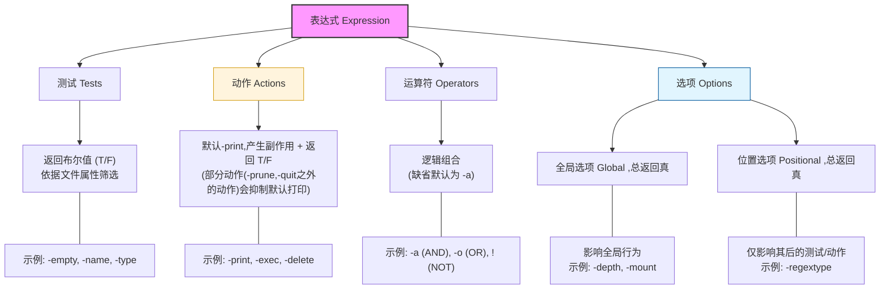
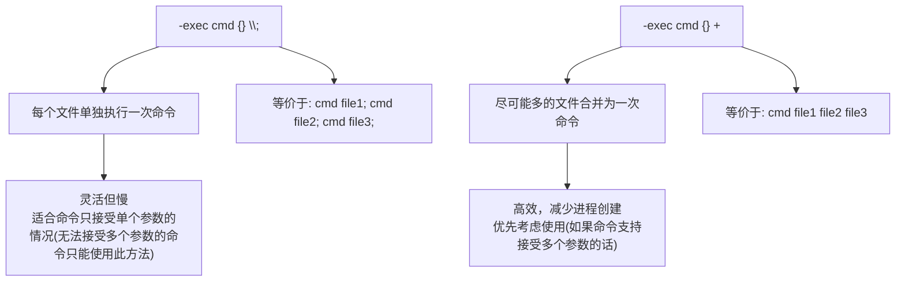
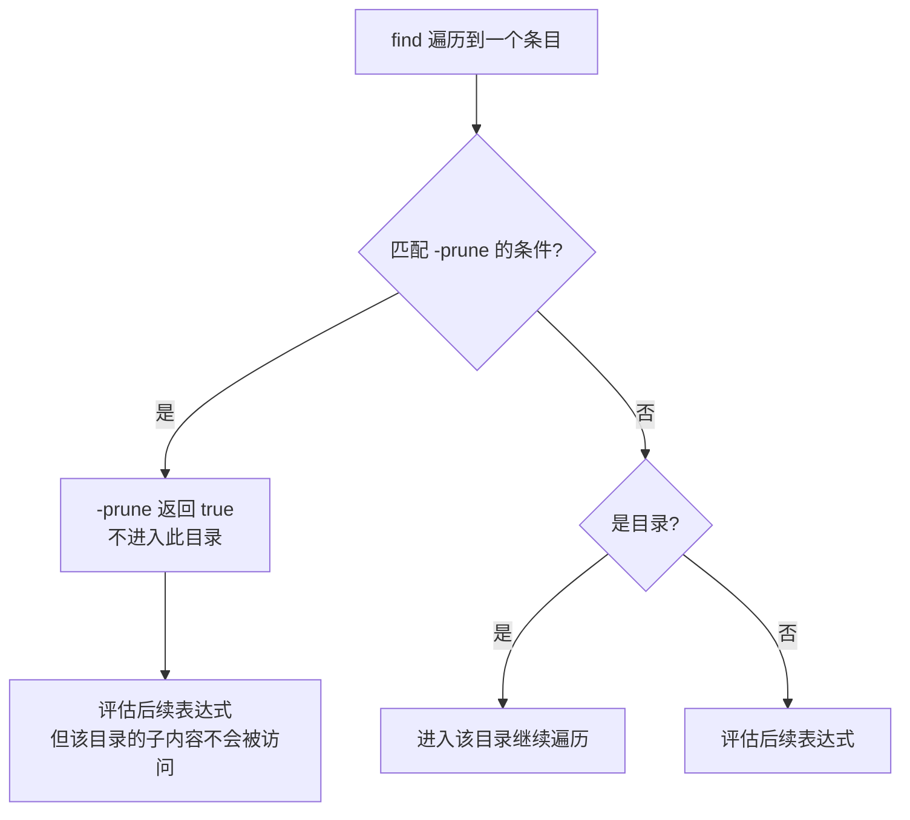

[toc]

# Linux `find` 命令学习指南

## 一、概述

`find` 命令属于 **GNU Findutils** 套件。`find` 命令在几乎所有 Linux 发行版中都是自带的。

GNU `find` 是 Linux 下最强大的文件搜索工具，它从指定目录出发，**递归遍历目录树**，根据用户定义的条件匹配文件，并可对结果执行操作。

本文介绍的是**GNU find**,注意**busybox**中的find命令是精简版的,部分功能不可用.


GNU`find` 命令属于 Linux/Unix 系统中最复杂、功能最强大的命令之一。初学者在使用find时容易犯错,尤其是编写复杂搜索表达式时.

- **非线性语法**：大多数命令的参数顺序不那么严格，但 `find` 的参数（谓词）是有顺序逻辑的，甚至支持 **逻辑运算**（与 `-a`、或 `-o`、非 `!`）。
- **自身实现逻辑**：它不仅能找文件，还能直接对找到的文件执行后续操作（通过 `-exec` 或 `-delete`），这涉及到进程的调用。
- **性能差异**：不同的写法在扫描大规模磁盘时的性能表现完全不同。

### findutils

The tools supplied with this package are:
本软件包包含以下工具：

- **find** - search for files in a directory hierarchy
  **查找** - 在目录层次结构中搜索文件
- **locate** - list files in databases that match a pattern
  **定位** - 列出数据库中与特定模式匹配的文件
- **updatedb** - update a file name database
  **updatedb** - 更新文件名数据库
- **xargs** - build and execute command lines from standard input
  **xargs** - 从标准输入构建和执行命令行


### 参考资料

本文不会介绍全部的find用法,仅介绍核心部分,最常用的功能和选项,了解find命令的设计理念.

完整说明请查看手册.

`man find` 是最权威的参考。

- [findutils - GNU Project - Free Software Foundation (FSF)](https://www.gnu.org/software/findutils/)
- [GNU Findutils ](https://www.gnu.org/software/findutils/manual/html_mono/find.html)
- 现代化版本find竞品fd:[sharkdp/fd: A simple, fast and user-friendly alternative to 'find'](https://github.com/sharkdp/fd)

### 基本语法

```bash
Usage: find [-H] [-L] [-P] [-Olevel] [-D debugopts] [path...] [expression]
find [前置选项] [搜索起点...] [表达式]
```

前置选项(可选)包括:`[-H] [-L] [-P] [-Olevel] [-D debugopts]`,这部分选项用的少

- `-H`：如果遇到符号链接（symlink），则仅跟随命令行参数中指定的符号链接，而不会跟随 `find` 过程中遇到的符号链接。

- `-L`：跟随符号链接，即 `find` 会解析并进入符号链接指向的目录或文件。

- `-P`：默认行为，不跟随符号链接，`find` 仅按路径名处理符号链接，而不会解析它们。

- `-Olevel`：优化级别，`level` 可选 `0-3`，数值越大，执行速度越快，但占用的资源可能更多。

- ```
  -D debugopts
  ```

  启用调试模式，

  ```
  debugopts
  ```

   选项可选：

  - `exec`：显示 `-exec` 或 `-ok` 执行的命令。
  - `tree`：显示 `find` 的目录遍历结构。
  - `stat`：显示 `find` 如何对文件调用 `stat()`。
  - `rates`：显示 `find` 处理文件的速率信息。

`[Path...]`规定了find要在哪些目录中开始查找,可以指定多个起始目录,可以一个都不写(有默认值),**不使用参数时,默认查找当前工作目录**;

- find是递归查找,确定合适的查找起点有利于节约查找时间;在expression中使用全局选项`-maxdepth`可以限制递归深度.
- 参数**path**是位置参数,不需要也没有前导的选项来引出path,并且根据语法标记`[path...]`可知,`find`命令允许省略path或者传入多个path

- 不要和`expression`中的条件测试(Test)的`-path`和`-name`混淆;

`expression`是find命令最灵活的部分,具有大量可用的属性,可以指定复杂的匹配规则,最常用的规则是根据名字特点来找文件,通过`-name`来指定此规则;

对于初学者,语法可以简化为

```bash
Usage: find [path...] [expression]
```


| 组成部分               | 说明                      | 示例                                         |
| ---------------------- | ------------------------- | -------------------------------------------- |
| **搜索起点**           | 一个或多个目录路径        | `.` `/home` `/var/log`                       |
| **测试（Test）**       | 筛选条件，返回 true/false | `-name "*.log"`                              |
| **动作（Action）**     | 对匹配文件执行的操作      | `-print`、`-delete`、`-exec`                 |
| **运算符（Operator）** | 逻辑组合多个条件          | `-and`、`-or`、`-not`、`()`                  |
| **选项（Option）**     | 控制 find 自身行为        | `-depth`,`-maxdepth`、`-mindepth`、`-follow` |

---


**表达式(expression)**由以下要素组成：

> 而expression中可以出现的选项(options)分为2类:
>
> - Positional options (always true):
>   -  -daystart
>   -  -follow 
>   - -nowarn 
>   - -regextype 
>   - -warn
> - Normal options(Global options) (always true, specified before other expressions):
>   - -depth 
>   - -files0-from FILE 
>   - -maxdepth LEVELS 
>   - -mindepth LEVELS
>   - -mount -noleaf 
>   - -xdev 
>   - -ignore_readdir_race 
>   - -noignore_readdir_race

### 思维模型



### `find` 表达式逻辑行为表

| **元素类型**       | **返回值 (True/False)** | **主要作用**            | **备注**                         |
| ------------------ | ----------------------- | ----------------------- | -------------------------------- |
| **测试 (Tests)**   | **动态返回**            | 过滤文件（如：`-name`） | 根据文件属性实时计算。           |
| **动作 (Actions)** | **动态返回**            | 执行操作（如：`-exec`） | 成功执行通常返回 T，失败返回 F。 |
| **全局选项**       | **恒为 True**           | 配置全局参数            | 无论放在哪，都影响整个进程。     |
| **位置选项**       | **恒为 True**           | 设置局部参数            | 仅影响其后的测试/动作。          |
| **运算符**         | **组合结果**            | 逻辑连接                | 控制 T/F 信号的流向。            |

------

为什么要这样设计？

这种“全员布尔化”(5个元素都有Test的属性,而不仅仅Test会返回True/False)的设计方案（特别是让“动作”和“选项”也返回 T/F）主要出于以下三个深层考量：

1. 实现“短路逻辑” (Short-circuit Evaluation)

这是 `find` 最精妙的地方。它利用逻辑运算符（`-a`, `-o`）来控制命令的执行流：

- **AND (`-a`)**：如果前面的测试为 F，后面的动作**不会执行**。
  - `find . -name "*.log" -delete`：只有当 `-name` 返回 T 时，才会执行 `-delete`。
- **OR (`-o`)**：如果前面的测试为 T，后面的动作**不会执行**。

2. 将“动作”作为“过滤条件”

因为动作也返回 T/F，你可以根据前一个动作的成败来决定下一个动作：

- `find . -name "*.sh" -exec chmod +x {} \; -print`
  - 这里 `-exec` 充当了“门卫”。只有当 `chmod` 执行成功（返回 T）时，`-print` 才会打印文件名。

3. 统一的解析引擎

通过让所有元素都符合 `(element) -> boolean` 的模型，`find` 的内部解析器**不需要区分“这是在过滤”还是“这是在操作”**。它只需要维护一个巨大的布尔表达式树：

> **[路径] -> [表达式树] -> 如果最终为 True 且无排他动作 -> 打印**

### `find` 命令表expression

在 `find` 命令中，紧跟在起始路径列表之后的部分被称为 **表达式（Expression）**。这是一种查询规范，用于描述如何匹配文件以及对匹配到的文件执行什么操作。

一个表达式由以下五类元素序列组成：

### 1. 测试 (Tests)

测试会根据文件的某种属性返回 **真 (true)** 或 **假 (false)**。

- **示例：** `-empty` 测试只有在当前文件为空时才返回真。

### 2. 动作 (Actions)

动作会产生“副作用”（例如在标准输出上打印内容），并根据**执行是否成功**返回 **真** 或 **假**。

- **示例：** `-print` 动作会将当前文件名打印到屏幕上。

### 3. 全局选项 (Global options)

全局选项会影响命令行中所有测试和动作的操作方式。它们总是返回 **真**。

- **示例：** `-depth` 选项让 `find` 以“深度优先”的顺序遍历文件系统。

### 4. 位置选项 (Positional options)

位置选项仅影响其**后面**出现的测试或动作。它们总是返回 **真**。

- **示例：** `-regextype` 选项是位置性的，用于指定其后出现的正则表达式所使用的方言。

### 5. 操作符 (Operators)

操作符用于将上述元素组合在一起。

- **示例：** `-o` 表示逻辑“或（OR）”，`-a` 表示逻辑“与（AND）”。
- **注意：** 如果两个元素之间没有写操作符，默认视为使用 `-a`。

------

### 关于 `-print` 的自动执行规则

如果整个表达式的结果为 **真**，`find` 默认会对该文件执行 `-print` 动作。

但如果表达式中已经包含了除 `-prune` 或 `-quit` 之外的其他动作，默认的 `-print` 就会被抑制（失效）。

> 用户显示使用`-print`也会抑制默认的`-print`,在不需要多余的(默认)打印动作时,显示使用`-print`是有必要的.

**会抑制默认打印行为的动作包括：** `-delete`, `-exec`, `-execdir`, `-fls`, `-fprint`, `-fprint0`, `-fprintf`, `-ls`, `-ok`, `-okdir`, `-print0`, `-printf` 以及显式写的 `-print`。

> **特别提示：** `-delete` 动作的行为也类似于选项（因为它隐含了 `-depth` 选项）。

> **核心原理**：`find` 对目录树中的每一个文件/目录，**从左到右依次评估表达式**。
>
> 表达式的**每个部分**返回 `true` 或 `false`，最终决定是否对该文件执行动作。这就是为什么**参数顺序很重要**。

在 `find` 命令的三个要素中，**最灵活且最核心的是：Tests（测试条件）**。

虽然 Operators（操作符）负责逻辑组合，Action（动作）负责结果处理，但 `find` 之所以被称为“搜索神器”，正是因为它拥有极其丰富且细致的 **Tests** 维度。

**Tests** 决定了 `find` 的“触手”能伸多远。它不只是简单的“按文件名查找”，而是能深入到文件系统的元数据（Metadata）中。

1. 极高的灵活性（多维度筛选）

你可以像拼积木一样，利用 Tests 描述出几乎任何复杂的需求：

- **按时间偏移**：`find -mtime -1`（过去 24 小时修改过的）。
- **按权限状态**：`find -perm /u+s`（查找带有 SUID 权限的文件，常用于安全审计）。
- **按空间占用**：`find -size +100M -size -500M`（查找 100M 到 500M 之间的文件）。
- **按文件类型**：`find -type l`（只找软链接）。

2. 它是 Action 的前提

没有精准的 Tests，Action 就是盲目的。比如你想清理日志，Tests 帮你精确定位到“30天前修改、后缀名为 .log、且大于 50MB”的文件，此时一个 `-delete` 动作才具有生产价值。

三者的协作关系（逻辑大脑）

如果把 `find` 比作一个执行任务的机器人：

- **Tests (测试条件)**：是机器人的**眼睛**，负责识别目标（“是不是红色的？”“重不重？”）。
- **Operators (操作符)**：是机器人的**逻辑大脑**（`-a` 与, `-o` 或, `!` 非），负责组合条件（“找红色的 **且** 重量超过 5kg 的”）。
- **Actions (动作)**：是机器人的**手**，负责处理结果（打印、删除、执行脚本）。

---

### shell特殊字符

分两方面介绍

#### 元字符回顾

在 **Bash shell** 中，元字符（metacharacters）是具有**特殊语法意义**的字符，用于控制命令解析、重定向、通配、进程控制等行为。

A character that, when unquoted, separates words. A metacharacter is a `space`, `tab`, `newline`, or one of the following characters: '|', '&', ';', '(', ')', '<', or '>'. 

一个字符，当未被引用时，用于分隔单词。元字符是 `space` 、 `tab` 、 `newline` ，或者是以下字符之一：' | '、' & '、' ; '、' ( '、' ) '、' < ' 或 ' > '。

| **字符**  | **名称**       | **主要功能说明**                                             |
| --------- | -------------- | ------------------------------------------------------------ |
| `|`       | 管道符         | 构成**管道**(pipeline),一个 `pipeline` 是由一个或多个命令组成的序列 |
| `&`       | **后台运行**   | 在命令末尾使用，使命令在后台异步执行。                       |
| `;`       | **命令分隔符** | 在同一行执行多个命令，按顺序排列。                           |
| `<`       | **输入重定向** | 改变命令的标准输入源（从文件读取）。                         |
| `>`       | **输出重定向** | 改变命令的标准输出（覆盖写入文件）。                         |
| `(` `)`   | **子 Shell**   | 在子 Shell 环境中运行括号内的命令组。                        |
| `space`   | **空格**       | 分隔命令名和参数。                                           |
| `tab`     | **制表符**     | 同空格，通常用于自动补全或分隔。                             |
| `newline` | **换行符**     | 提交并执行当前命令行。                                       |

#### 控制字符

`control operator` 

> A `token` that performs a control function. It is a `newline` or one of the following: '||’, '&&’, '&’, ';’, ';;’, ';&’, ';;&’, '|’, '|&’, '(’, or ')’.

 一个执行控制功能的符号。它可以是 `newline` 或以下之一：' ||', ' &&', ' &', ' ;', ' ;;', ' ;&', ' ;;&', ' |', ' |&', ' (', 或 ' )'。

## 二 表达式选项(options)

### **位置选项**（总是为真）

这些选项总是返回 `true`，用于指定全局设置，通常不会影响后续的条件测试。

- `-daystart`：以当前一天的起始时刻作为文件的时间基准，而不是当前时刻。
- `-follow`：跟随符号链接，递归访问符号链接的目标文件。
- `-nowarn`：禁用警告信息。
- `-regextype`：指定正则表达式类型。
- `-warn`：启用警告信息。

### 常规(全局)选项（总是为真，且必须在其他表达式之前指定）

这些选项通常用于**控制搜索行为或限制搜索范围**。

- `-depth`：深度优先遍历，先处理子目录，再处理父目录。
- `-files0-from FILE`：从指定的文件中读取文件名，文件名以 null 字符 (`\0`) 结束。
- `-maxdepth LEVELS`：限制搜索的最大深度，`LEVELS` 是深度的数量。
- `-mindepth LEVELS`：指定搜索的最小深度。
- `-mount`：限制查找仅在当前挂载点内进行，不跨越文件系统边界。
- `-noleaf`：关闭对文件系统叶子节点优化的假设。
- `-xdev`：限制查找仅在当前文件系统内，避免跨文件系统查找。
- `-ignore_readdir_race`：忽略目录读取竞争（例如，目录的内容在搜索过程中被修改）。
- `-noignore_readdir_race`：不忽略目录读取竞争。


### 按深度控制(`-*depth`系列)

| 选项          | 说明                   | 示例                                                         |
| ------------- | ---------------------- | ------------------------------------------------------------ |
| `-maxdepth n` | 最多搜索 n 层深度      | `-maxdepth 1` 只搜索当前目录                                 |
| `-mindepth n` | 从第 n 层开始匹配      | `-mindepth 2` 跳过当前目录和一级子目录                       |
| `-depth`      | 启用深度优先顺序(开关) | 用于特殊的目录重命名等任务中,文件删除任务`-delete`会隐含使用此选项 |

`-maxdepth` (最大深度)

限制 `find` 向下搜索的最大层级。

- `-maxdepth 0`：只检查命令行参数本身（通常没意义）。
- `-maxdepth 1`：只在当前层级（指定的目录本身）搜索，**不进入任何子目录**。
- `-maxdepth 2`：搜索当前层级及下一级子目录。

`-mindepth` (最小深度)

要求 `find` 在达到指定深度之后才开始搜索。

- `-mindepth 1`：处理除命令行参数（搜索路径本身）之外的所有文件。
- `-mindepth 2`：忽略当前层级的文件，从子目录内部开始搜索。

⚠️ `-maxdepth` 和 `-mindepth` 是**全局选项**，必须放在其他测试/动作**之前**。

还有一个选项`-depth`:这是一个开关式选项,启用深度优先顺序,在部分场景下用得上.

> **先内容，后目录**：在处理文件系统时，它会先处理目录里的文件，最后才处理目录本身。
>
> **`-delete` 的隐式调用**：如果你使用了 `-delete` 参数，`find` 会自动启用 `-depth`。这非常聪明，因为你不能在一个文件夹还有内容的时候就把它删掉。

简单用例:

```bash
# 只在当前目录查找（不递归）
find . -maxdepth 1 -type f -name "*.sh"

# 只查找第 2 层及以下
find . -mindepth 2 -name "*.conf"
```


### 关于`-depth`

如果不使用 `-depth`，默认情况下 `find` 会先处理文件夹，再进入其内部。

但在以下两个场景中，这种默认行为会导致报错或失败。

1. 批量重命名目录及其子项

- 如果你想修改目录名，必须先修改它里面的文件，最后再改目录名。

- 如果你先重命名了父目录 `old_dir` 变成 `new_dir`，那么 `find` 接下来去寻找 `old_dir/file.txt` 时，会因为路径已经不存在而报错。

  假设你有一个嵌套结构：`./project_old/data_old/`

  ```bash
  # (base) cxxu@CxxuDesk 18:27:39> <~/dir>
  $ mkdir -p ./project_old/data_old/
  mkdir: created directory './project_old'
  mkdir: created directory './project_old/data_old/'
  
  # 对比find在使用和不使用depth选项时输出的路径顺序(显然是有区别的)
  # (base) cxxu@CxxuDesk 18:47:53> <~/dir>
  $ find . -depth -name "*old*" -type d
  ./project_old/data_old
  ./project_old
  
  # (base) cxxu@CxxuDesk 18:48:00> <~/dir>
  $ find .  -name "*old*" -type d
  ./project_old
  ./project_old/data_old
  
  # 实验1
  # 将所有目录名中的 "old" 替换为 "new";为了使用bash的字符串替换语法,这里用bash -c 包装占位符为位置参数
  # 观察mv的详情打印可以发现,子目录data_old的重命名过程是工作目录切换到project_old内,然后
  # (base) cxxu@CxxuDesk 18:27:46> <~/dir>
  $ find . -depth -name "*old*" -type d -execdir bash -c 'mv -v "$1" "${1//old/new}"' -- {} \;
  renamed './data_old' -> './data_new'
  renamed './project_old' -> './project_new'
  # 增加pwd $1语句更清晰地观察过程
  $ find . -depth -name "*old*" -type d -execdir bash -c 'pwd $1;mv -v "$1" "${1//old/new}"' -- {} \;
  /home/cxxu/dir/project_old
  renamed './data_old' -> './data_new'
  /home/cxxu/dir
  renamed './project_old' -> './project_new'
  
  # 重置环境进行实验2
  # (base) cxxu@CxxuDesk 18:33:13> <~/dir>
  $ rm -rf ./project_old ./project_new ; mkdir -p ./project_old/data_old/
  mkdir: created directory './project_old'
  mkdir: created directory './project_old/data_old/'
  
  # 如果将-execdir替换为普通的-exec,会出现错误(父目录率先成功替换,但是原来的子目录由于父目录发生变换,mv命令发现找不到路径了)
  # (base) cxxu@CxxuDesk 18:33:17> <~/dir>
  $ find . -depth -name "*old*" -type d -exec bash -c 'mv -v "$1" "${1//old/new}"' -- {} \;
  mv: cannot move './project_old/data_old' to './project_new/data_new': No such file or directory
  renamed './project_old' -> './project_new'
  
  # 重置环境进行实验3
  $ rm -rf ./project_old ./project_new ; mkdir -p ./project_old/data_old/
  # 不使用depth也会报错,父目录率先重命名,同样导致子目录路径失效(find层面发现路径已经失效)
  $ find .  -name "*old*" -type d -execdir bash -c 'mv -v "$1" "${1//old/new}"' -- {} \;
  renamed './project_old' -> './project_new'
  find: ‘./project_old’: No such file or directory # 此时无论使用-exec还是-execdir的,结果相同
  ```

  `find` 会先深入到最底层，把子文件夹改名，最后才回来改最顶层的文件夹。

  - **使用 `-depth`（正确做法）：**Depth-first search
    1. `find` 先找到最深层的 `./project_old/data_old/`。
    2. 将其重命名为 `./project_old/data_new/`。
    3. 然后再处理父目录 `./project_old/`，将其重命名为 `./project_new/`。
    4. **结果：** 成功得到 `./project_new/data_new/`。
  - **不使用 `-depth`（报错做法）：**
    1. `find` 先找到并处理父目录 `./project_old/`。
    2. 将其重命名为 `./project_new/`。
    3. 接下来 `find` 尝试去原来的路径下找子目录 `./project_old/data_old/`。
    4. **报错：** 路径已不存在，因为它的父文件夹名字已经变了。

  `-execdir `  在文件所在目录中执行命令  更安全，避免路径竞争

  **`-exec`**: 在当前运行命令的目录下执行，传递的是相对路径（如 `./a/b/c`）。

  **`-execdir`**: 先 `cd` 进入目标文件所在的目录，再执行命令。它处理的是当前目录下的文件名（如 `./c`）。

  而实验2中的错误实际上是因为执行如下命令而报的错误(`mv`命令中第一个路径存在,第二个参数中`./project_new`不存在)

  ```bash
  # 源路径检查
  $ ls -d ./project_old/data_old
  ./project_old/data_old
  
  $ mv -v ./project_old/data_old ./project_new/data_new
  mv: cannot move './project_old/data_old' to './project_new/data_new': No such file or directory
  ```

  

2. 删除空目录（`-depth`配合 `-empty`）

   放到`-empty`一节中说明.


## 三、搜索条件测试(Test)

### 3.1 按名称搜索`-name`,`-path`等

| 条件              | 说明                                     | 示例                           |
| ----------------- | ---------------------------------------- | ------------------------------ |
| `-name pattern`   | 文件名匹配（**区分大小写**），支持通配符 | `find . -name "*.txt"`         |
| `-iname pattern`  | 文件名匹配（**不区分大小写**）           | `find . -iname "*.JPG"`        |
| `-path pattern`   | 匹配完整路径                             | `find . -path "*/src/*.java"`  |
| `-regex pattern`  | 用正则匹配完整路径                       | `find . -regex ".*\.\(c\|h\)"` |
| `-iregex pattern` | 正则匹配（不区分大小写）                 | `find . -iregex ".*\.jpe?g"`   |

#### 通配表达式陷阱

`-name` 的参数包含通配符 `*`、`?`、`[]` 时必须**加引号**(也就是阻止shell(比如bash)展开通配符),否则会被 Shell 提前展开。

`-name`最终接受到的参数可能就不是原来的样子,可能导致`-name`的选项参数不是一个而是很多个,这通常不是我想要的。

`find`命令的`-name`可以理解通配表达式字符串，解释通配符的任务应该交给`find`而不应该被shell执行.

> ```bash
> # ❌ 错误：Shell 会展开 *.txt
> find . -name *.txt
> 
> # ✅ 正确：引号(单引号或双引号)保护通配符
> find . -name "*.txt"
> ```

#### 对比`-path`和`-name`,`-regex`

这两个选项的区别主要在于：**`-name` 只盯着“文件名”看，而 `-path` 会盯着“整个路径”看。**

- `-path PATTERN`:查找路径名匹配模式`PATTERN`的文件,这个选项会将文件的“路径 + 文件名”作为一个整体字符串进行匹配。必须匹配从头到尾的全部字符
- `-regex REGEX`:和`-path`相似,但是`PATTERN`改为正则表达式,使其变成最强大的按名称搜索的选项.必须匹配从头到尾的全部字符.
- `-name PATTERN`:查找文件名匹配匹配`PATTERN`的文件,检查的部分仅限文件名（Basename）

在需要排除搜索目录时,配合`-prune`一般是`-path`而不是`-name`,下面我们仅讨论`-path`,`-regex`视为`-path`的增强版本

> 使用 `-regex` 的注意事项：
>
> 1. **它匹配的是“全路径”，不是文件名**： 如果你在当前目录下有一个 `test.txt`，用 `-regex "test\.txt"` 是**找不到**它的。你必须写成 `-regex ".*test\.txt"`，因为它匹配的是 `./test.txt`。
>
> 2. **正则类型的差异**： `find` 默认使用的是 **Emacs 正则表达式**。如果你习惯用 Perl 或 Python 的正则（比如用 `|` 表示“或”而不需要加斜杠），你需要配合 `-regextype` 参数：
>
>    ```bash
>    find . -regextype posix-extended -regex ".*\.(jpg|png|gif)"
>    ```
>
> 3. **转义字符**： 在正则中，点号 `.` 表示任意字符。如果你想匹配真正的“点”，必须写成 `\.`。

| **特性**          | **-name**                                    | **-path**                                |
| ----------------- | -------------------------------------------- | ---------------------------------------- |
| **匹配范围**      | 仅最后的文件名                               | 目录前缀 + 文件名                        |
| **对 `/` 的处理** | 不识别 `/`（识别为路径一部分会报错或无匹配） | 识别 `/`，可以跨目录层级匹配             |
| **通配符行为**    | `*` 只能匹配文件名中的字符                   | `*` 可以匹配包含 `/` 在内的整串路径      |
| **典型场景**      | “找所有后缀名为 .jpg 的文件”                 | “找在以 backup 命名的文件夹下的所有文件” |

处理逻辑的差异：局部 vs 全局

我们可以通过一个对比表来看出两者的“思考方式”：

| **需求**                  | **使用 -name (局部视图)**   | **使用 -path (全局视图)**                              |
| ------------------------- | --------------------------- | ------------------------------------------------------ |
| **搜索所有 `.conf` 文件** | `-name "*.conf"` (简单直接) | `-path "./**/*.conf"` (需要考虑通配符递归)             |
| **精准定位**              | 无法限制目录                | `find . -path "./logs/*.log"` (精准限制在 logs 文件夹) |
| **排除干扰**              | 只看名字，不被路径干扰      | 极易因为路径中包含关键字而导致“误报”                   |


### 3.2 按类型搜索`-type`,`-xtype`

**`-type`**：检查文件**本身**的类型。如果是一个链接，它就告诉你这是个链接（`l`）。

**`-xtype`**：**解引用（Dereference）**检查。它会跳过链接本身，去看看链接背后的“真身”是什么。

| `-type` 参数 | 含义           | 说明   |
| :----------: | -------------- | ------ |
|     `f`      | 普通文件       | 最常用 |
|     `d`      | 目录           |        |
|     `l`      | 符号链接       |        |
|     `b`      | 块设备         | 如磁盘 |
|     `c`      | 字符设备       | 如终端 |
|     `p`      | 命名管道(FIFO) |        |
|     `s`      | 套接字(Socket) |        |

| **参数**       | **如果目标是“指向文件的链接”** | **如果目标是“指向目录的链接”** | **如果链接断开了（死链接）** |
| -------------- | ------------------------------ | ------------------------------ | ---------------------------- |
| `-type l`      | 匹配（它是链接）               | 匹配（它是链接）               | 匹配                         |
| **`-xtype f`** | **匹配**（真身是文件）         | 不匹配                         | 不匹配                       |
| **`-xtype d`** | 不匹配                         | **匹配**（真身是目录）         | 不匹配                       |
| **`-xtype l`** | 不匹配                         | 不匹配                         | **匹配**（见下文解释）       |

如果链接是**有效**的：`-xtype` 检查它指向的目标类型。

如果链接是**断开**的（死链接）：`-xtype` 会表现得像 `-type` 一样，检查链接本身。

与 `-L` 参数的配合

当你使用了 `-L`（跟随符号链接）选项时，`-type` 和 `-xtype` 的行为会**互换**：

在 `-L` 模式下：`-type` 检查目标，`-xtype` 检查链接本身

`find` 命令在处理 `-xtype` 时，会尝试**彻底追踪（Follow）**链接链，直到找到那个“非链接”的真实目标

```bash
-xtype c
              The same as -type unless the file is a symbolic link.  For
              symbolic links: if the -H or -P option was specified, true
              if the file is a link to a file of type c; if the -L option
              has been given, true if c is `l'.  In other words, for
              symbolic links, -xtype checks the type of the file that
              -type does not check.  If a symbolic link is broken
              (because the thing it points to does not exist or the link
              points to itself) then -xtype will behave the same as
              -type
```

**-xtype c** 除非文件是符号链接（symbolic link），否则其作用与 `-type` 相同。

**对于符号链接：**

- 如果指定了 `-H` 或 `-P` 选项（即不追踪链接）：如果该链接指向的文件类型是 *c*，则返回真（true）。
- 如果指定了 `-L` 选项（即追踪链接）：如果类型 *c* 是 `l`（即符号链接本身），则返回真。

**换句话说：** 对于符号链接，`-xtype` 检查的是 `-type` **不检查**的那个部分。

**特殊情况：** 如果符号链接是**损坏的**（因为指向的目标不存在，或者链接指向了它自己），那么 `-xtype` 的行为将变得与 `-type` 完全一致。

```bash
mkdir real_dir          # 创建真实目录 d
ln -s real_dir t1       # 创建链接 t1 -> d
ln -s t1 a              # 创建链接 a -> t1

# 此时运行：
find a -xtype d         # 结果：a (匹配，因为最终指向目录)
find a -xtype l         # 结果：空 (不匹配，因为链接是通的)

# 如果删除 real_dir：
rmdir real_dir
find a -xtype l         # 结果：a (匹配！因为链接断了)
```


```bash
# 只查找目录
find /var -type d -name "log"

# 只查找普通文件
find . -type f -name "*.conf"

# 查找损坏的符号链接
find . -xtype l
```

### 3.3 按大小搜索`-size`

`-size n` 选项指定基于文件大小的测试规则

**大小单位说明**：

| 后缀 | 含义            |
| :--: | --------------- |
| `c`  | 字节(byte)      |
| `k`  | KiB (1024 字节) |
| `M`  | MiB (1024 KiB)  |
| `G`  | GiB (1024 MiB)  |

> 说明:以KiB和KB的区别为例
>
> 这两个单位的区别在于**进制**的不同：**KB** 是基于 10 进制的，而 **KiB** 是基于 2 进制的。

虽然在日常生活中（比如 Windows 的显示或口语中）大家经常混用，但在计算机科学和严谨的硬件规格中，它们的定义是有严格区分的。

| **单位** | **全称** | **进制 (Base)** | **具体数值 (Bytes)** | **常用领域**                        |
| -------- | -------- | --------------- | -------------------- | ----------------------------------- |
| **KB**   | Kilobyte | $10^3$          | $1,000$              | 硬盘容量、网络带宽、国际单位制 (SI) |
| **KiB**  | Kibibyte | $2^{10}$        | $1,024$              | 操作系统内存、缓存、Linux 内核统计  |

**前缀含义**（这是 `find` 中数值参数的通用规则）：

|     前缀      | 含义       | 示例                         |
| :-----------: | ---------- | ---------------------------- |
|     `+n`      | 大于 n     | `-size +100M` → 大于 100 MiB |
|     `-n`      | 小于 n     | `-size -1k` → 小于 1 KiB     |
| `n`（无前缀） | 恰好等于 n | `-size 0` → 空文件           |

```bash
# 查找大于 500MB 的文件
find / -type f -size +500M

# 查找空文件
find . -type f -empty

# 查找空目录
find . -type d -empty
```

### 3.4 按时间搜索`-*time`,`-*min`


`find` 中有三组时间戳：

| 属性                            |   按天   | 按分钟  | 含义                                           |
| ------------------------------- | :------: | :-----: | ---------------------------------------------- |
| **修改时间**(Modification time) | `-mtime` | `-mmin` | 文件**内容**最后被修改的时间                   |
| **访问时间**(Access time)       | `-atime` | `-amin` | 文件最后被读取的时间                           |
| **状态变更时间**(Change time)   | `-ctime` | `-cmin` | 文件**元数据**（权限、所有者等）最后变更的时间 |

这几个选项名中的第一个字母`m,a,c`分被表示`modify,access,change`.

基本的时间单位有天和分钟,小时不是基本时间单位(通过乘以60可以模拟按小时);

其中,后缀`time`是按天,后缀`min`是按分钟

Test: **-mtime** n

True if the file was last accessed (or its status changed, or it was modified) n*24 hours ago. The number of 24-hour periods since the file's timestamp is always rounded down; therefore 0 means “less than 24 hours ago”, 1 means “between 24 and 48 hours ago”, and so forth. Fractional values are supported but this only really makes sense for the case where ranges ('+n' and '-n') are used. 

如果文件上次访问（或其状态更改，或其文件被修改）是在 n天(n * 24 小时)前，则返回 true。

> 换句话说,如果把文件上次访问(修改)时间点距离当前时间的天数记为`t`天,且`int(t)==n`,那么对于`-mtime n`可以命中此文件.
>
> 也就是时间往更早的时间偏移,误差不超过1天(24小时)

自文件时间戳以来经过的 24 小时周期数始终向下取整；因此，0 表示“不到 24 小时前”，1 表示“24 到 48 小时前”，依此类推。

支持小数，但这仅在使用范围（' +n ' 和 ' -n '）时才有意义,如果是`n`,则相当于小数被截断(丢弃)。

借助时间轴来描述和理解时间选项:

**`+n` / `-n` / `n` 在时间中的精确含义**（以 `-mtime` 为例）：

其中

- `n`,这种情况下理解为距现在`[n,n+1)`个时间单位之前被访问

- `+n`,距离现在`n+1`及以上个时间单位(`+n`表示大于`n`,而满足此条件的最小整数为`n+1`)
- `-n`,距离现在`n`以内个时间单位

例如

- -mtime 0  →  [0, 1) 天前修改  → 24小时内(例如某个文件在当前时间点之前的0.5天(12小时)时间点发生了修改,则会命中)
- -mtime 1  →  [1, 2) 天前修改
- -mtime +1 →  ≥2 天前修改（严格大于1个完整24h周期）
- -mtime -1 →  <1 天前修改（即不到24小时）

```bash
# 最近 7 天内修改过的文件
find . -type f -mtime -7

# 超过 30 天未访问的文件
find . -type f -atime +30

# 最近 10 分钟内修改的文件
find . -type f -mmin -10

# 比 reference.txt 更新的文件
find . -type f -newer reference.txt
```

### 3.5 按权限和所有者搜索`-perm`

`-perm`(permission)

我们要把数字拆解成二进制的“开关”来看

> 在 Linux 权限体系中，权限位实际上是由 **4 位八进制数** 组成的，而不仅仅是常见的 3 位。
>
> 最左边的第一位代表 **特殊权限位 (Special Bits)**。它的构成如下：
>
> - **4**: SUID (Set User ID)
> - **2**: SGID (Set Group ID)
> - **1**: Sticky Bit (粘滞位)
> - **0**: 表示没有任何特殊权限（普通文件/目录）。

| 条件          | 说明                             | 示例                                    |
| ------------- | -------------------------------- | --------------------------------------- |
| `-perm mode`  | 权限**精确等于** mode            | `-perm 0755`                            |
| `-perm -mode` | 权限中**至少包含** mode 的所有位 | `-perm -0111`（至少所有人都有执行权限） |
| `-perm /mode` | 权限中**包含 mode 的任意一位**   | `-perm /0111`（任何人有执行权限）       |
| `-user name`  | 属于指定用户                     | `-user root`                            |
| `-group name` | 属于指定组                       | `-group www-data`                       |
| `-nouser`     | 没有有效用户（孤儿文件）         | 常用于安全审计                          |
| `-nogroup`    | 没有有效组                       | 常用于安全审计                          |

假设我们以 `644` 为基准：

- **`-perm -644` (逻辑与/AND)**：
  - 要求：所有者有 `rw`，小组有 `r`，其他人有 `r`。
  - 结果：`755` (rwxr-xr-x) 会被匹配，因为它“覆盖”了 `644`。如果某个文件是`600` 则不会被匹配。
- **`-perm /644` (逻辑或/OR)**：
  - 要求：满足以下任意条件之一即可:所有者(owner)有 `r` 或 `w`，或者小组有 `r`，或者其他人有 `r` 即可。
  - 结果：权限为 `004` (-------r--) 的文件也会被匹配。


```bash
# 查找全局可写文件（安全审计）
find / -type f -perm -0002

# 查找 SUID 程序（安全审计）
find / -type f -perm -4000

# 查找属于已删除用户的文件
find /home -nouser
```

### 3.6 按文件或目录是否为空`-empty`

`-empty` 是**实时求值**的谓词

`-empty` 不是预先扫描全部目录后标记结果，而是 **在 find 遍历到该目录的那一刻**，实时打开目录、检查是否有条目

关键点：它检查的是当前磁盘上的真实状态，不是遍历开始时的快照。

find 的谓词是**流式逐条求值**的;find 不会先收集所有结果再统一操作，而是：遍历到一个条目 → 立即对它求值所有谓词 → 执行动作 → 遍历下一个条目.

基于上述事实,可以推断出

> **`-exec rmdir {} +` 批处理模式** 与`-depth -empty`嵌套空**目录删除**存在冲突,而`-exec rmdir {} \;`则不会冲突.

`{} +` 批处理模式下，所有谓词求值完毕后才执行动作，`-empty` 求值时子目录还没被删，所以父目录不匹配 `-empty`，根本不会被收集。

### 空目录删除问题

和查找空目录不同(这是一个简单任务),删除空目录要考虑到东西更多.因为删除意味着引起文件(目录)树的变化,空目录的布局可能发生变化.

最简单的情况是删除指定目录下一级的空目录(空目录嵌套的情况视为非空目录)

这个任务需要着重考虑的是空目录嵌套问题:

- 如果使用`find -type d -depth ... -exec rmdir {} +`方案这和使用`-delete`的效果是不同的(无法一次性删除嵌套空目录.)

#### 推荐方案(`-delete`)

可以使用GNU `find`的`-delete`选项,方便(隐含使用了`-depth`),可以删除递归嵌套空目录的情况

```bash
# 可以删除递归嵌套空目录的情况
find /path/to/search -type d -empty -delete
```

**最佳实践**：任何删除操作前，先将 `-delete` 替换为 `-print` 预览结果！

> 注意`-empty`可以判断空目录和空文件,如果要移除空目录,务必配合`-type d`

---


####  POSIX 兼容（无 GNU 扩展）方案

```bash
find /path/to/dir -depth -type d -empty -exec rmdir {} \; -print #-print 可以选,可以帮助我们观察哪些路径被删除
#或
find /path/to/dir -depth -type d -exec rmdir {} + 2>/dev/null # 此写法不要使用-empty
```

> 第二个方案借助`rmdir`的默认特性(仅删除空目录),但是在遇到非空目录会产生stderr 输出（需 `2>/dev/null` 抑制）；效率略低

`-delete` 是**逐条立即执行**的动作（类似 `\;`），不存在批处理延迟。

##### 分析

```bash
# 初始话测试环境
# (base) cxxu@CxxuDesk 10:26:29> <~/dir>
$ tree
.
├── 1.txt
├── 2.txt
├── e1
│   └── e2
│       └── e3
└── project
    └── abc.txt

5 directories, 3 files
```


```bash
# 使用 -empty -delete 组合可以删除嵌套的空目录.
$ find . -type d -empty -delete -print
./e1/e2/e3
./e1/e2
./e1
```

 使用 `-exec rmdir {} ...` 的效果

如果使用`+`结尾,无论是否使用`-depth`,都只能删除最深的一级空目录.

```bash
# (base) cxxu@CxxuDesk 10:26:30> <~/dir>
$ find . -type d -empty -exec rmdir {} + -print #使用-print将被删除的路径打印出来
./e1/e2/e3

# (base) cxxu@CxxuDesk 10:28:35> <~/dir>
$ tree
.
├── 1.txt
├── 2.txt
├── e1
│   └── e2
└── project
    └── abc.txt

4 directories, 3 files
```

使用`-depth`也不行:

```bash
# (base) cxxu@CxxuDesk 10:49:07> <~/dir>
$ tree
.
├── 1.txt
├── 2.txt
├── e1
│   └── e2
│       └── e3
└── project
    └── abc.txt

5 directories, 3 files

# (base) cxxu@CxxuDesk 10:49:26> <~/dir>
$ find . -depth -type d -empty -exec rmdir {} + -print
./e1/e2/e3

# (base) cxxu@CxxuDesk 10:49:53> <~/dir>
$ tree
.
├── 1.txt
├── 2.txt
├── e1
│   └── e2
└── project
    └── abc.txt

4 directories, 3 files
```

对于`find -depth` 遍历顺序：e3 → e2 → e1

Step 1: 访问 e3/ → -type d ✅ → -empty? 检查磁盘 → 空 ✅ → 加入批次(`-exec ... +`不会立即删除,而是等待批次结束再一口气删除)
Step 2: 访问 e2/ → -type d ✅ → -empty? 检查磁盘 → (上一个加入批次的e3没有被删除)有 e3/,此时e2/非空 → ❌ 跳过！(e2不会加入到待删除批次列表)
Step 3: 访问 e1/ → -type d ✅ → -empty? 检查磁盘 → 有 e2/ → ❌ 跳过！

批次执行：`rmdir ./e1/e2/e3`   （只收集到一个）

将`-exec rmdir {} +`更改为`-exec rmdir {} \;`再配合`-depth`可以**递归删除嵌套的空目录**

```bash
# (base) cxxu@CxxuDesk 10:50:26> <~/dir>
$ tree
.
├── 1.txt
├── 2.txt
├── e1
│   └── e2
│       └── e3
└── project
    └── abc.txt

5 directories, 3 files

# (base) cxxu@CxxuDesk 10:50:27> <~/dir>
$ find . -depth -type d -empty -exec rmdir {} \; -print
./e1/e2/e3
./e1/e2
./e1

# (base) cxxu@CxxuDesk 10:50:45> <~/dir>
$ tree
.
├── 1.txt
├── 2.txt
└── project
    └── abc.txt

2 directories, 3 files
```

如果去掉`-depth`就会遇到路径错误

```bash
# (base) cxxu@CxxuDesk 10:50:26> <~/dir>
$ tree
.
├── 1.txt
├── 2.txt
├── e1
│   └── e2
│       └── e3
└── project
    └── abc.txt

5 directories, 3 files
# 去掉`-depth`后,发现最深一级空目录被删除了,但是父级没有被删除
$ find .  -type d -empty -exec rmdir {} \; -print
./e1/e2/e3
find: ‘./e1/e2/e3’: No such file or directory

$ tree
.
├── 1.txt
├── 2.txt
├── e1
│   └── e2
└── project
    └── abc.txt

4 directories, 3 files
```

GNU find 手册明确写道：

> **`-delete` implies `-depth`**

这不是优化，是**安全要求**——必须先删子再删父，否则子目录就随父目录一起消失，find 遍历会出错。

```bash
$ find . -depth -type d -print
./e1/e2/e3
./e1/e2
./e1
./project
.

# 使用-depth和rmdir直接删除,而不使用`-empty`来解决空目录嵌套删除问题
$ find . -depth -type d -exec rmdir {} + -print
./e1/e2/e3
./e1/e2
./e1
./project
.
rmdir: failed to remove './project': Directory not empty
rmdir: failed to remove '.': Invalid argument

```

`-type d`扫描出所有层级目录,无论是否为空,

然后调用`rmdir`(默认仅删除空目录,非空目录不跳过处理,并打印一条错误信息,可以通过`2> /dev/null`屏蔽掉)

这里`-depth`的使用至关重要,从深嵌套目录开始删除.否则嵌套的空目录被视为非空目录难以删除.

| 方案                 | 命令                                               | 嵌套空目录                            | 安全性                | 性能 | 可移植性  |
| -------------------- | -------------------------------------------------- | ------------------------------------- | --------------------- | ---- | --------- |
| `-empty -delete`     | `find ... -type d -empty -delete`                  | ✅ 一次清理（`-delete` 隐含 `-depth`） | ⭐⭐⭐                   | ⭐⭐⭐  | GNU find  |
| `-exec rmdir`        | `find -type d -depth ... -exec rmdir {} +`         | ✅ 逐层清理                            | ⭐⭐⭐⭐ (rmdir 天然安全) | ⭐⭐   | ⭐⭐⭐ POSIX |
| `-empty -exec rmdir` | `find -type d -depth ... -empty -exec rmdir {} \;` | ❌ 需多次运行                          | ⭐⭐⭐⭐                  | ⭐⭐   | GNU find  |
| 循环删除             | `while ... done`                                   | ✅ 彻底                                | ⭐⭐⭐⭐                  | ⭐    | ⭐⭐⭐       |
| 排除规则             | `find  ... ! -path ... -delete`                    | ✅                                     | ⭐⭐⭐⭐⭐                 | ⭐⭐⭐  | GNU find  |

---


## 四、逻辑运算符(Operator)

### 4.1 运算符一览

| 运算符     | 简写       | 说明                                                         |
| ---------- | ---------- | ------------------------------------------------------------ |
| `-and`     | `-a`       | 逻辑与（**默认行为**，可省略）                               |
| `-or`      | `-o`       | 逻辑或                                                       |
| `-not`     | `!`        | 逻辑非                                                       |
| `( expr )` | `( expr )` | 分组（需转义括号,也就是在shell中要写成`\(expr\)`,否则`()`可能会被解释为创建子进程） |
| `,`        | `,`        | 按顺序依次执行,在编写复杂的 `find` 脚本或需要一次性执行多个不相关操作时，它能起到关键作用。 |

- `EXPR1 -a EXPR2` 或 `EXPR1 -and EXPR2`：逻辑与，要求两个子表达式都为真。
- `EXPR1 -o EXPR2` 或 `EXPR1 -or EXPR2`：逻辑或，只需要其中一个子表达式为真。
- `! EXPR` 或 `-not EXPR`：取反（表示“非”操作），对表达式的结果取反。
- `( EXPR )`：括号可以用来组合多个表达式。使用时注意转义`\( EXPR \)`
- `EXPR1 , EXPR2`：按顺序依次执行，先执行 `EXPR1`，然后执行 `EXPR2`。

> bash中的圆括号 `( )`：子 Shell (Subshell)
>
> 当你把命令放在圆括号中时，Bash 会创建一个**子进程**（Subshell）来执行这些命令。因此需要转移

**短路求值**：和大多数编程语言一样：

> - `-and`：左边为 false 则不评估右边
> - `-or`：左边为 true 则不评估右边

### 4.2 运算符优先级（从高到低）

|  优先级   | 运算符                   |
| :-------: | ------------------------ |
| 1（最高） | `( )` 分组               |
|     2     | `!` / `-not`(单目运算符) |
|     3     | `-and` / `-a`（默认）    |
|     4     | `-or` / `-o`             |
|  5(最低)  | `,`                      |

假设你想找出所有的 `.log` 文件，在屏幕上显示它们，同时把它们移动到 `/tmp`。

当你希望对同一组文件**同时进行两个互不干扰的操作**，且不希望因为第一个操作的失败而跳过第二个操作时，逗号就派上用场了。

```bash
find . -name "*.log" \( -print , -exec mv {} /tmp/ \; \)
```

`expr1 -o expr2 , expr3` 由于逗号优先级最低，`find` 会先计算 `(expr1 -o expr2)` 的逻辑结果，然后**不管结果如何**，再去跑 `expr3`。

### 4.3 组合条件实例

```bash
# 查找 .jpg 或 .png 文件
find . -type f \( -name "*.jpg" -o -name "*.png" \)

# 查找非 .log 文件
find . -type f ! -name "*.log"

# 查找大于 10MB 且 30 天未修改的文件
find . -type f -size +10M -mtime +30

# 复杂组合：查找 .py 或 .js 文件，但排除 node_modules 目录
find . \( -name "*.py" -o -name "*.js" \) ! -path "*/node_modules/*"
```

⚠️ **括号必须转义**：`\( \)` 或 `'(' ')'`，因为圆括号`(expr)`在 Shell 中有特殊含义。
如果你想找“所有的图片”或者“所有的文档”，并对它们统一执行某个动作，就需要用到括号。

| **需求场景** | **逻辑表达式**                                | **结果**                                        |
| ------------ | --------------------------------------------- | ----------------------------------------------- |
| **无括号**   | `-name "*.txt" -o -name "*.pdf" -print`       | 仅打印 PDF，TXT 虽然会被找到但不会触发 `-print` |
| **有括号**   | `\( -name "*.txt" -o -name "*.pdf" \) -print` | TXT 和 PDF 都会被找到并打印                     |

---

## 五、执行动作(Action)

动作定义了 `find` 查找结果后应该执行的操作。

| 特性 / 模式        | -exec ... \;                                                 | -exec ... +                                                  | xargs (配合 -0)                                              |
| ------------------ | ------------------------------------------------------------ | ------------------------------------------------------------ | ------------------------------------------------------------ |
| 执行机制           | 逐个文件启动进程                                             | 合并参数后启动进程                                           | 管道传递，合并参数启动进程                                   |
| 执行效率           | 慢 (I/O 和 CPU 切换开销大)                                   | 快(命令支持多参数时)                                         | 快(命令支持多参数时)                                         |
| 并行处理           | 不支持                                                       | 支持 (`-P` 参数)                                             | 不支持                                                       |
| 空白分隔符安全处理 | 原生支持，很安全                                             | 需配合 `-0` 使用                                             | 原生支持，很安全                                             |
| 核心优点           | **逻辑严密**：每个文件独立处理，互不干扰。支持交互式确认（`-ok`）。 | **原生高效**：无需管道转换，直接在 `find` 内部完成参数合并，极其安全。 | **并发王者**：支持多进程并行（`-P`），处理海量数据时速度最快。 |
| 用场景             | 1. **低频/少量文件**：如修改几个配置文件的权限。 2. **需要人工介入**：使用 `-ok` 代替 `-exec` 可以在删除前逐一确认。 | 1. **大规模只读/删除操作**：如 `grep` 搜索成千上万个文件的内容。 2. **脚本编写**：因为它处理带空格的文件名最稳健。 | 1. **高负载任务**：如图片压缩、视频转码等耗时操作。 2. **复杂管道流**：当文件名需要经过 `sed` 或 `sort` 处理后再执行时。 |
| 典型命令           | `find /etc -name "*.conf" -exec chmod 644 {} \;`             | `find . -type f -name "*.log" -exec rm {} +`                 | `find . -name "*.jpg" -print0 | xargs -0 -P 4 -n 10 convert` |

> 这里的命令支持多参数,指的是像`rm`这样可以同时指定多个文件的命令
>
> 如果命令(用法)应该是一次接受指定数量的参数,则使用`-n`来指定.

| 场景         | 推荐                         | 原因                     |
| ------------ | ---------------------------- | ------------------------ |
| 简单逐个操作 | **`-exec \;`**               | 写法最简，无需关心分隔符 |
| 需要并行加速 | **`xargs -P`**               | `-exec` 无并行能力       |
| 可批量化操作 | **`-exec +`** 或 **`xargs`** | 减少 fork 次数           |
| 非 find 来源 | **`xargs`**                  | `-exec` 只能配合 find    |

### 5.1 动作一览


| 动作                   | 说明                                    | 示例                                                    |
| ---------------------- | --------------------------------------- | ------------------------------------------------------- |
| `-print`               | 打印文件路径（**默认动作**）            | 每行一个结果                                            |
| `-print0`              | 以 null 字符分隔输出                    | 配合 `xargs -0` 处理特殊文件名                          |
| `-printf format`       | 按自定义格式输出(细节较多,单独章节介绍) | `find . -printf '%p %s %T+\n'`（路径、大小、时间）      |
| `-ls`                  | 以 `ls -l` 格式显示                     | 查看详细信息                                            |
| `-fprint file`         | 将 `-print` 的输出写入指定文件          | `find . -name "*.conf" -fprint /tmp/list.txt`           |
| `-fprint0 file`        | 将 `-print0` 的输出写入指定文件         | 同上，null 分隔版本                                     |
| `-fprintf file format` | 将 `-printf` 的输出写入指定文件         | `find . -fprintf /tmp/out.txt '%p %u\n'`                |
| `-fls file`            | 将 `-ls` 的输出写入指定文件             | `find / -name "*.log" -fls /tmp/result.txt`             |
| `-delete`              | 删除匹配的文件                          | **危险操作，先 -print 确认！**                          |
| `-exec cmd {} \;`      | 对每个文件执行命令                      | `{}` 代表当前文件路径，理解为占位符（匿名变量）         |
| `-exec cmd {} +`       | 尽可能多个文件一次性传给命令            | **类似 xargs，效率更高**                                |
| `-execdir cmd {} \;`   | 在文件所在目录中执行命令                | 更安全，避免路径竞争                                    |
| `-execdir cmd {} +`    | 同上，批量版本                          | 在文件所在目录中批量执行                                |
| `-ok cmd {} \;`        | 同 `-exec`，但每次执行前确认            | 交互式，适合谨慎操作                                    |
| `-okdir cmd {} \;`     | 同 `-execdir`，但每次执行前确认         | 交互式 + 在文件所在目录执行                             |
| `-quit`                | 找到第一个匹配后立即退出                | `find / -name "target.txt" -print -quit`                |
| `-prune`               | 不进入当前目录（排除目录）              | `find . -path "./cache" -prune -o -name "*.txt" -print` |

前4个选项是最基础的操作,后面的形式扩展了find可用的动作.

`cmd`表示要执行的命令

`{}` 是占位符，代表当前找到的文件。

> 在powershell中,类似的角色通常表示为`$_`

`\;` 是必须的，用来告诉 `find` 命令到此结束。**反斜杠不能少**，否则 `;` 会被 Shell 解释为命令分隔符。

`find`命令的`-exec`这类选项需要读取一个分号`;`来表明action语句的结束,而shell会解释`;`导致`find`无法接收到此`;`号,为了避免shell解释`;`,需要使用`\;`阻止shell解释,而传递给`find`命令时就能得到`;`

#### 用例

```bash
# 自定义格式：路径 | 大小 | 权限 | 属主 | 修改时间
find . -type f -printf '%p | %s bytes | %M | %u | %T+\n'

# 输出为 CSV 格式
find . -type f -printf '"%p","%s","%u","%TY-%Tm-%Td"\n'

# 找到第一个匹配就退出
find / -name "my.cnf" -print -quit

# 排除目录
find . -path "./.git" -prune -o -type f -name "*.py" -print

# 结果写入文件（不影响终端输出）
find /var/log -name "*.log" -fprintf /tmp/logs.txt '%p %s\n' -print

# 交互式删除（每次确认）
find /tmp -name "*.tmp" -ok rm {} \;

# 在文件所在目录执行（避免路径问题）
find . -name "Makefile" -execdir make clean \;
```


### 5.2 `-exec` 的两种形式详解



并不是所有命令都支持多参数

虽然 `find` 帮你解决了参数长度问题，但你调用的 `cmd` 必须能接受多个文件名作为参数。

- **适用**：`rm`, `cp`, `mv`, `ls`, `grep`（它们都可以处理 `cmd file1 file2 ...`）。
- **不适用**：某些只能接收单一目标的自定义脚本。

尽管`-exec cmd {} +`在cmd支持多个参数,`find`查找到的文件可能很多, 也不需要担心参数过多的限制

> `Argument list too long`通常发生在 Shell 尝试扩展通配符（如 `rm *`）时。
>
> 而 `find ... {} +` 内部有一套智能机制来规避这个限制。
>
> 当你使用 `+` 结尾时，`find` 命令的行为如下：
>
> 1. **分批处理**：`find` 会获取系统允许的最大命令行参数长度（由内核参数 `ARG_MAX` 决定）。
> 2. **动态构建**：它会尽可能多地将文件名填入命令缓冲区，直到接近上限。
> 3. **多次调用**：如果文件总数超过了单次命令的长度上限，`find` 会自动将任务拆分为**多次调用**。
>    - 例如：如果有 100 万个文件，`find` 可能会分 50 次执行 `cmd`，每次携带 2 万个参数。

#### 用例

```bash
# \; 形式：每个文件执行一次 chmod
find . -type f -name "*.sh" -exec chmod +x {} \;

# + 形式：所有文件一次性传给 chmod（推荐，更高效）
find . -type f -name "*.sh" -exec chmod +x {} +

# 将每个 .bak 文件移动到 /tmp（只能用 \; 因为命令中 {} 不在末尾）
find . -name "*.bak" -exec mv {} /tmp/ \;

# 交互式删除（每个文件都询问）
find . -name "*.tmp" -ok rm {} \;

# 将文件重命名(备份),这类用法无法批量传参优化,使用-exec ...\;是最直观的方法,但是如果要并行执行,则使用xargs (配合-I和-P)
find . -type f -name "*.txt" -exec mv {} {}.bak \;
```


### 5.3 配合 `xargs`

```bash
# 基本用法（文件名无特殊字符时）
find . -name "*.log" | xargs wc -l

# ✅ 最佳实践：处理含空格/特殊字符的文件名
find . -name "*.log" -print0 | xargs -0 wc -l

# 限制每次传递的参数数量
find . -name "*.jpg" -print0 | xargs -0 -n 10 convert_images

# 并行执行（GNU xargs）
find . -name "*.gz" -print0 | xargs -0 -P 4 gunzip
```

> **`-exec {} +` vs `xargs` 的选择**：
>
> | 特性           |   `-exec {} +`    |        `xargs`        |
> | -------------- | :---------------: | :-------------------: |
> | 处理特殊文件名 |    ✅ 自动安全     | 需要 `-print0` + `-0` |
> | 并行执行       |         ❌         |      ✅ `-P` 参数      |
> | 灵活的参数位置 | ❌ `{}` 必须在最后 |       ✅ `-I {}`       |
> | 管道组合       |         ❌         |           ✅           |
> | 额外进程开销   |        无         |  有（但通常可忽略）   |

---


### 排除目录（`-prune`）

`-prune` 是 `find` 中的一个常用action.这个选项也比较特别,一般要和Operator(`-o`)配合使用,引出不被排除的expression

它的作用是：**当 `find` 遍历到某个目录时，阻止进入该目录**。

其他 action 都是**对匹配到的文件做某事**（打印、删除、执行命令），而 `-prune` 是**告诉 find 不要递归进入这个目录**，改变的是 find 的**遍历行为**本身。

> 虽然find将`-prune`归类为动作,但是理解为"**流程控制**"更加贴切.

例如，若要跳过 `src/emacs` 目录及其下的所有文件和子目录，并打印出找到的**其他文件名**，可以按照如下方式操作： `find . -path ./src/emacs -prune -o -print`

最常见的用法是:`-prune`前置一个Test,后面跟随`-o`(`-or`)

`-prune`为什么几乎总是和 `-o` 一起使用?

最常见的需求是:"遇到这个目录就跳过，**其他的**`(-or)`才做处理";`-o` 在这里起到 else 分支的作用。

例如:跳过`./cache`目录,其他的路径做处理(本例中查找`.txt`文件并打印)

```bash
# 查找位于./cache目录之外的所有.txt文件打印出来.
find . -path "./cache" -prune -o -name "*.txt" -print
```

> **顺序很重要**：你必须先写 `-prune` 规则，再写 `-print`。如果你直接写 `find . -print -path ./src/emacs -prune`，它会先打印出所有文件，剪枝就没意义了。

**关于删除**：手册中特别提到 `-delete` 会让 `-prune` 失效。如果你想删除除某个目录以外的所有内容，通常需要结合 `-not -path` 来实现，而不是用 `-prune`。

```bash
       -prune True; if the file is a directory, do not descend into it.
              If -depth is given, then -prune has no effect.  Because
              -delete implies -depth, you cannot usefully use -prune and
              -delete together.  For example, to skip the directory
              src/emacs and all files and directories under it, and print
              the names of the other files found, do something like this:
                  find . -path ./src/emacs -prune -o -print
```

**-prune** 结果为真(`-prune` **始终返回 true**，这一点至关重要。)；

```bash
find . -path "./cache" -prune
```

它会**打印** `./cache` 这个目录本身（因为 `-prune` 返回 true，默认的`-and`操作符触发默认的动作 `-print`,`-prune`不会抑制默认的`-print`动作），但不会进入 `./cache` 内部。

> 上述命令等价于`find . -path "./cache" -prune -and -print`

如果该文件是一个目录，则**不进入**该目录进行搜索。 

- 如果指定了 `-depth` 选项，则 `-prune` 将**失效**。直接或间接使用`-depth`都会导致`-prune`失效,前者的优先级高.
- 此外间接包含`-depth`的例子:由于 `-delete` 选项隐含了 `-depth` 条件，因此你无法有效地同时使用 `-prune` 和 `-delete`。

#### 工作原理



#### 典型用例

```bash
# 排除 .git 目录
find . -path "./.git" -prune -o -type f -name "*.py" -print

# 排除多个目录
find . \( -path ./node_modules -o -path ./.git -o -path ./vendor \) \
       -prune -o -type f -name "*.js" -print
```

> ⚠️ **关键细节**：使用 `-prune` 时，`-print` 必须**显式写出**。如果省略，被 prune 的目录本身也会被打印出来（因为 `-prune` 返回 true）。

```bash
# (base) cxxu@CxxuDesk 16:59:25> <~/dir>
$ rm test_safe_snippet.sh

# (base) cxxu@CxxuDesk 16:59:27> <~/dir>
$ ls
1.txt  2.txt  project

# (base) cxxu@CxxuDesk 16:59:28> <~/dir>
$ find .  -path ./project -prune -o -type f -name "*.txt" -print
./2.txt
./1.txt

# (base) cxxu@CxxuDesk 16:59:38> <~/dir>
$ find .  -path ./project -prune -o -type f -name "*.txt"
./project
./2.txt
./1.txt
```

可见,如果没有使用`-print`,被`-prune`排除在外的目录也会被打印出来.

#### `-prune` 的固定套路

```bash
find [起点] [排除条件] -prune -o [真正的搜索条件] -print #是否使用-print取决于需要,可以用来预览
#           ↑排除部分↑         ↑    ↑实际搜索部分↑
#                              或
```

---

### 对比`-not`和`-prune`

这两个选项一个是Operator,一个是Action;都可以作为排除...目的使用,但是存在显著的区别.

- `-not` 只是一个逻辑运算符。它会让 `find` 进入目录，扫描每一个文件，然后**仅仅在最后输出结果时**把符合条件的文件剔除掉
- `-prune` 的意思是“修剪”。当 `find` 遇到指定的目录时，它会**直接跳过**该目录及其所有子内容，根本不进去扫描。

如果你只想排除**某种类型的文件**（比如“不要 .tmp 文件”），用 **`-not`**。

如果你想排除**整个巨大的文件夹**（比如“不要搜那 100GB 的备份文件夹”），请务必用 **`-prune`**。

| **特性**     | **-not / !**                   | **-prune**                                               |
| ------------ | ------------------------------ | -------------------------------------------------------- |
| **本质**     | 逻辑判断（不符合就不要）       | 动作（不要进去）                                         |
| **性能**     | 较低（依然会遍历目录内容）     | 较高（直接跳过整个目录树）                               |
| **处理对象** | 通常针对具体文件属性           | 通常针对目录路径                                         |
| **配合使用** | 常配合 `-name`, `-type`        | 常配合 `-path` 和 `-o` (OR)                              |
| 适用场景     | 排除特定的文件名、类型或时间戳 | 排除大型文件夹（如 `.git`, `node_modules`, `backup` 等） |

```bash
find /var/log -type f -not -name "*.log"
find /home -path "*/.git" -prune -o -print
```


## 六.`-printf` 动作常用格式指令

`-printf` 是最灵活的输出动作,内容较多单独一节，格式指令非常丰富：

> 这个部分不是find的核心内容,属于扩展功能

### 文件信息

| 指令 | 含义                                 | 输出示例           |
| ---- | ------------------------------------ | ------------------ |
| `%p` | 完整路径                             | `./dir/file.txt`   |
| `%P` | 相对于搜索起点的路径（去掉起始路径） | `dir/file.txt`     |
| `%f` | 文件名（不含目录）                   | `file.txt`         |
| `%h` | 目录部分（不含文件名）               | `./dir`            |
| `%H` | 搜索起始路径                         | `.`                |
| `%l` | 符号链接目标                         | `/usr/bin/python3` |

### 文件属性

| 指令 | 含义                       | 输出示例                      |
| ---- | -------------------------- | ----------------------------- |
| `%s` | 文件大小（字节）           | `4096`                        |
| `%k` | 文件占用磁盘空间（KB）     | `4`                           |
| `%b` | 文件占用的 512 字节块数    | `8`                           |
| `%d` | 文件在目录树中的深度       | `2`                           |
| `%D` | 文件所在设备号（十进制）   | `2049`                        |
| `%i` | inode 号                   | `1310725`                     |
| `%n` | 硬链接数                   | `1`                           |
| `%y` | 文件类型（单字符）         | `f`(文件) `d`(目录) `l`(链接) |
| `%Y` | 符号链接解引用后的文件类型 | 同上，但跟踪链接              |

### 权限与所有者

| 指令 | 含义             | 输出示例     |
| ---- | ---------------- | ------------ |
| `%m` | 权限（八进制）   | `644`        |
| `%M` | 权限（符号格式） | `-rw-r--r--` |
| `%u` | 属主用户名       | `root`       |
| `%U` | 属主 UID         | `0`          |
| `%g` | 属组名           | `root`       |
| `%G` | 属组 GID         | `0`          |

### 时间相关

| 指令  | 含义                          | 输出示例                      |
| ----- | ----------------------------- | ----------------------------- |
| `%a`  | 最后访问时间（atime）         | `Mon Jun 30 10:30:00`         |
| `%A+` | atime（`+` 为 strftime 格式） | `%AY-%Am-%Ad` → `2025-06-30`  |
| `%t`  | 最后修改时间（mtime）         | `Mon Jun 30 10:30:00`         |
| `%T+` | mtime（`+` 为 strftime 格式） | `%T+` → `2025-06-30+10:30:00` |
| `%c`  | 最后状态更改时间（ctime）     | `Mon Jun 30 10:30:00`         |
| `%C+` | ctime（`+` 为 strftime 格式） | 同上格式                      |

#### strftime 子格式

用于 `%A`、`%T`、`%C` 后面

| 子格式 | 含义              | 示例                  |
| ------ | ----------------- | --------------------- |
| `+`    | ISO 日期+时间     | `2025-06-30+10:30:00` |
| `Y`    | 年                | `2025`                |
| `m`    | 月                | `06`                  |
| `d`    | 日                | `30`                  |
| `H`    | 时                | `10`                  |
| `M`    | 分                | `30`                  |
| `S`    | 秒                | `00`                  |
| `@`    | Unix 时间戳（秒） | `1751270400`          |

### 特殊字符

| 指令 | 含义      |
| ---- | --------- |
| `\n` | 换行      |
| `\t` | 制表符    |
| `\0` | null 字符 |
| `\\` | 反斜杠    |

## 七、实用场景与经典用例

### 7.1 日常文件管理

```bash
# 1. 查找并删除所有 .DS_Store 文件（macOS 残留）
find . -name ".DS_Store" -delete

# 2. 查找重复的大文件（大于 100MB）
find / -type f -size +100M -exec ls -lhS {} + 2>/dev/null

# 3. 查找最近 24 小时修改过的文件
find . -type f -mtime 0

# 4. 查找并统计各类型文件数量(根据文件扩展名统计)
find . -type f | sed 's/.*\.//' | sort | uniq -c | sort -rn | head -20

# 5. 查找空目录并删除
find . -type d -empty -delete
```

### 7.2 权限与安全审计

```bash
# 1. 查找全局可写文件（排除 /proc 和 /sys）
find / \( -path /proc -o -path /sys \) -prune \
       -o -type f -perm -0002 -print

# 2. 查找 SUID/SGID 程序
find / -type f \( -perm -4000 -o -perm -2000 \) -exec ls -l {} +

# 3. 查找无主文件
find / -nouser -o -nogroup 2>/dev/null

# 4. 修复目录和文件权限
find /var/www -type d -exec chmod 755 {} +
find /var/www -type f -exec chmod 644 {} +
```

### 7.3 磁盘清理

```bash
# 1. 查找大文件 TOP 20
find / -type f -exec du -h {} + 2>/dev/null | sort -rh | head -20

# 2. 删除 30 天前的日志文件
find /var/log -name "*.log" -type f -mtime +30 -delete

# 3. 清理旧的 core dump 文件
find / -name "core" -type f -size +1M -mtime +7 -delete

# 4. 查找指定时间范围内的文件（2024年1月的文件）
find . -type f -newermt "2024-01-01" ! -newermt "2024-02-01"
```

比较下面两个find命令(目的相同),哪个写法好点?

```bash
find /var/log -name "*.log" -type f -mtime +30 -delete
和
find /var/log  -type f -name "*.log" -mtime +30 -delete

```

第一种写法效率更高:

**过滤效率：** `find` 命令是按顺序从左到右评估表达式的。

- 在 `/var/log` 下，文件数量通常远多于目录。
- **`-name "\*.log"`** 是一个简单的字符串匹配，能快速排除掉绝大部分不符合要求的文件。
- **`-type f`** 需要调用系统内核查看文件元数据（inode 信息），这比纯文件名匹配开销略大。
- 先匹配名字再检查类型，理论上减少了对不相关文件执行 `stat` 系统调用的次数。

**符合直觉：** 我们通常习惯先确定“我要找什么名字的东西”，再细化“它必须是文件”。

### 7.4 开发场景

```bash
# 1. 项目中搜索代码（排除依赖目录）
## 按文件内容查找（`-exec grep`）
find . \( -path ./node_modules -o -path ./.git -o -path ./vendor \) \
       -prune -o -type f \( -name "*.js" -o -name "*.ts" \) -print \
       | xargs grep -l "TODO"

#### 在 `.txt` 文件中搜索 "error"
find /home -name "*.txt" -exec grep "error" {} \;

# 2. 查找所有 Python 文件并统计行数
find . -name "*.py" -type f -exec cat {} + | wc -l

# 3. 批量替换文件中的字符串
find . -name "*.conf" -type f -exec \
    sed -i 's/old_server/new_server/g' {} +

# 4. 查找最近修改的源码文件
find src/ -name "*.java" -mmin -60

# 5. 为所有 shell 脚本添加执行权限
find scripts/ -name "*.sh" -type f ! -perm -0100 -exec chmod +x {} +
```

### 7.5 文件备份与同步

```bash
# 1. 查找修改过的文件并打包
find /etc -type f -mtime -1 -print0 | tar czf /backup/etc-changes.tar.gz --null -T -

# 2. 复制目录结构（不复制文件）
find src/ -type d -exec mkdir -p dest/{} \;

# 3. 同步特定类型的文件
find . -name "*.pdf" -newer /tmp/last_sync -exec cp {} /backup/pdfs/ \;
```

---

## 八、性能优化

### 8.1 优化原则

| **类别**           | **示例**                                | **理由**                                       |
| ------------------ | --------------------------------------- | ---------------------------------------------- |
| **路径(搜索范围)** | `/path/start/find`,`-maxdepth`,`-prune` | 告诉程序去哪找。跳过哪些路径                   |
| **高效过滤**       | `-name`                                 | 字符串匹配最快，优先剔除无关项。               |
| **属性过滤**       | `-type`, `-mtime`                       | 需要读取 inode 信息的放在中间。                |
| **动作**           | `-print`, `-delete`, `-exec`            | **必须放在最后**，确保只对完全匹配的对象执行。 |


考虑替代工具:

- locate: 基于数据库的查找
- fd: 现代化替代品


### 8.2 性能对比

| 场景     | 慢 ❌                       | 快 ✅                               | 原因                         |
| -------- | -------------------------- | ---------------------------------- | ---------------------------- |
| 删除文件 | `-exec rm {} \;`           | `-delete`                          | 避免为每个文件 fork 进程     |
| 批量操作 | `-exec cmd {} \;`          | `-exec cmd {} +`                   | 合并执行，减少进程数         |
| 排除目录 | `! -path "*/dir/*"`        | `-path ./dir -prune -o ... -print` | prune 直接跳过，不遍历子内容 |
| 组合条件 | `-exec test ... \;` 放前面 | `-name` / `-type` 放前面           | 文件名/类型检查是 O(1)       |

```bash
# ❌ 慢：每个文件启动一个 rm 进程
find . -name "*.tmp" -exec rm {} \;

# ✅ 快：find 内置删除(但是busybox中的find不支持此选项.)
find . -name "*.tmp" -delete

# ✅ 快（兼容性好的方案）：合并参数
find . -name "*.tmp" -exec rm {} +
```

### 8.3 现代替代工具对比

| 特性             | `find` |     `fd`     |    `locate`     |
| ---------------- | :----: | :----------: | :-------------: |
| 实时搜索         |   ✅    |      ✅       | ❌（依赖数据库） |
| 速度（大目录树） |   中   | 快（多线程） |      极快       |
| 默认忽略 .git    |   ❌    |      ✅       |       N/A       |
| 正则语法         | POSIX  |     默认     |    简单通配     |
| 内置操作         |  丰富  |     基本     |       无        |
| 预装             |   ✅    |      ❌       |     通常是      |
| 复杂条件组合     | ✅ 强大 |     有限     |        ❌        |

```bash
# fd 的等价用法（供参考）
fd "\.py$"                    # find . -name "*.py"
fd -e jpg -e png              # find . -name "*.jpg" -o -name "*.png"
fd -H -I "config"             # 包含隐藏文件和 gitignore 忽略的文件
```

---

## 九、最佳实践总结

在 `find` 命令中，`expression`（表达式）的**书写顺序非常关键**，因为 `find` 是从左到右**顺序求值**的。它遵循一套类似于编程语言的“短路逻辑”（Short-circuit logic）。

理解这个顺序，不仅能帮你写出正确的命令，还能大幅提升搜索效率。

------

### 1. 核心规则：从左到右，短路求值

`find` 在处理每一个文件时，会按照你写的顺序逐一检查条件：

- **-a (AND/与):** 默认逻辑。如果左边的条件为**假**，右边的条件就不再看（直接跳过该文件）。
- **-o (OR/或):** 如果左边的条件为**真**，右边的条件就不再看。
- **Action (动作):** 如 `-print`, `-exec`, `-delete` 也是表达式的一部分。只有当它们左边的所有条件都满足时，动作才会执行。

------

### 2. 建议的书写结构

为了效率和逻辑清晰，建议遵循以下顺序：

**[路径] [过滤/排除条件] [搜索匹配条件] [执行动作]**

#### 第一步：排除法（越早越好）

如果你想跳过某些大型目录（如 `.git` 或 `node_modules`），必须把它们放在最前面。

```bash
# 正确：先看到 .git 目录就 prune（剪枝/跳过），再找内容
find . -path "./.git" -prune -o -name "*.js" -print
```

*如果把 `-name` 放在 `-prune` 前面，`find` 还是会去扫描整个 `.git` 目录。*

#### 第二步：高过滤性条件优先

将最可能排除掉大量文件的条件放在左边。

- **效率高：** `-type f` (只找文件), `-mindepth 2`
- **效率低：** `-name` (字符串匹配), `-mtime` (检查索引节点)

```bash
# 推荐：先确定是文件，再检查名字，最后看修改时间
find . -type f -name "*.log" -mtime -7
```

#### 第三步：动作放在最后

所有的“动作”(action)类参数（`-print`, `-ls`, `-exec`）都应该放在条件的末尾，否则它们可能会在条件还没过滤完时就触发。

------

### 3. 优先级：AND 优先于 OR

由于两个测试表达式之间默认`-and`链接(可以省略不写),如果省略不写,需要注意优先级以及小心避免逻辑错误

在没有任何括号的情况下，`find` 会先结合 `-a`。

假设`A,B,C,D`都是Test表达式

| **表达式**    | **实际逻辑含义**            |
| ------------- | --------------------------- |
| `A B -o C D`  | `(A -and B) -or (C -and D)` |
| `A -o B -a C` | `A -or (B -and C)`          |

不过考虑到在shell中,find使用括号需要转移,所以为了书写方便很多时候采用的是简写形式

**案例分析：**

如果你想找“名为 a.txt 或 b.txt”且“大小大于 1k”的文件：

- ❌ **错误：** `find . -name a.txt -o -name b.txt -size +1k`
  - *逻辑变成了：(名为 a.txt) OR (名为 b.txt 且 大于 1k)。结果是 a.txt 无论多大都会被搜出来。*
- ✅ **正确：** `find . \( -name a.txt -o -name b.txt \) -size +1k`


###  推荐做法示例

```bash
# 1. 删除前先预览
find . -name "*.bak" -print        # 先看看会删什么
find . -name "*.bak" -delete       # 确认后再删除

# 2. 始终使用 -print0 + xargs -0 处理文件名
find . -type f -print0 | xargs -0 grep "pattern"

# 3. 使用 {} + 代替 {} \; 提升性能
find . -name "*.log" -exec gzip {} +

# 4. 使用 -maxdepth 限制不必要的递归
find /var/log -maxdepth 2 -name "*.log"

# 5. 用 -prune 排除目录而非 ! -path
find . -path ./node_modules -prune -o -name "*.js" -print

# 6. 重定向错误（避免权限拒绝的噪音）
find / -name "myfile" -type f 2>/dev/null
```

### 常见错误写法

```bash
# 1. 忘记引号 → Shell 展开通配符
find . -name *.txt           # ❌
find . -name "*.txt"         # ✅

# 2. -delete 放在条件之前 → 删除所有文件！
find . -delete -name "*.tmp" # ❌ 极其危险！
find . -name "*.tmp" -delete # ✅

# 3. -prune 时忘记 -print → 被 prune 的目录也会输出
find . -path ./.git -prune -o -name "*.py"        # ❌ 会输出 .git
find . -path ./.git -prune -o -name "*.py" -print # ✅

# 4. -exec 忘记 \; 或 + 结尾
find . -name "*.sh" -exec chmod +x {}      # ❌ 语法错误
find . -name "*.sh" -exec chmod +x {} \;   # ✅

# 5. -maxdepth 位置错误
find . -name "*.log" -maxdepth 2   # ⚠️ 会警告，应放在条件之前
find . -maxdepth 2 -name "*.log"   # ✅
```

---

## 十、速查备忘表

```bash
# ─── 基础搜索 ──────────────────────────────
find . -name "*.py"                        # 按名称
find . -type f                             # 按类型
find . -size +100M                         # 按大小
find . -mtime -7                           # 7天内修改
find . -user alice                         # 按用户
find . -perm 0644                          # 按权限

# ─── 组合条件 ──────────────────────────────
find . -name "*.js" -o -name "*.ts"        # 或
find . -type f ! -name "*.log"             # 非
find . -type f -size +1M -mtime +30        # 与（默认）

# ─── 执行操作 ──────────────────────────────
find . -name "*.tmp" -delete               # 删除
find . -name "*.sh" -exec chmod +x {} +    # 批量执行
find . -name "*.log" -exec gzip {} \;      # 逐个执行
find . -type f -print0 | xargs -0 cmd      # 安全管道

# ─── 高级技巧 ──────────────────────────────
find . -path ./.git -prune -o -print       # 排除目录
find . -maxdepth 1 -type f                 # 不递归
find . -newer ref_file                     # 比较时间
find . -samefile hardlink_target           # 查找硬链接
find . -printf "%s %p\n" | sort -rn        # 自定义输出格式
```

---

