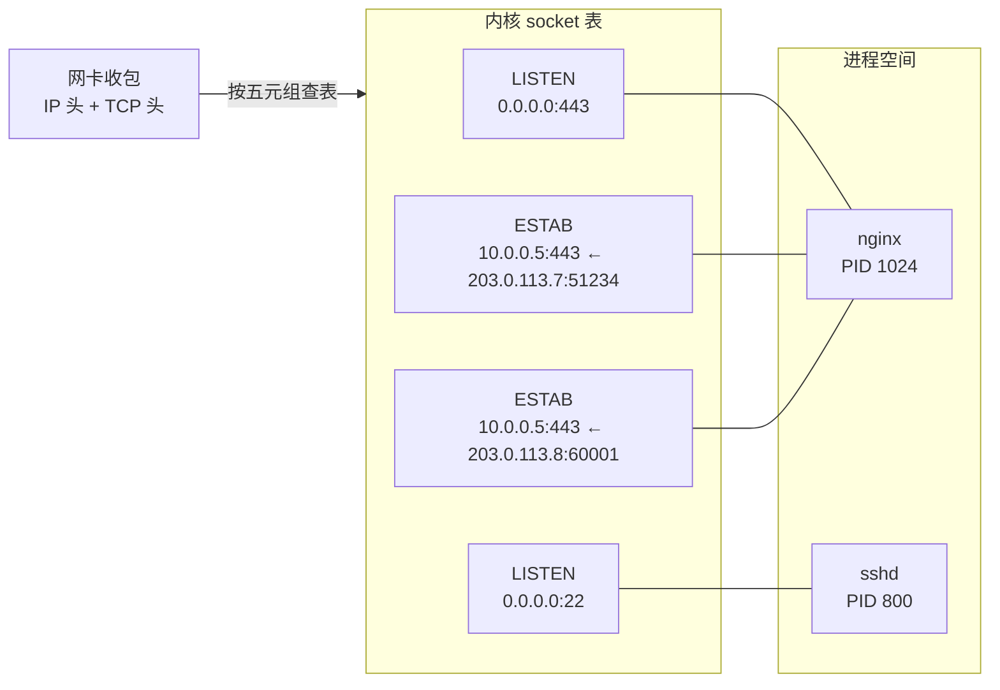
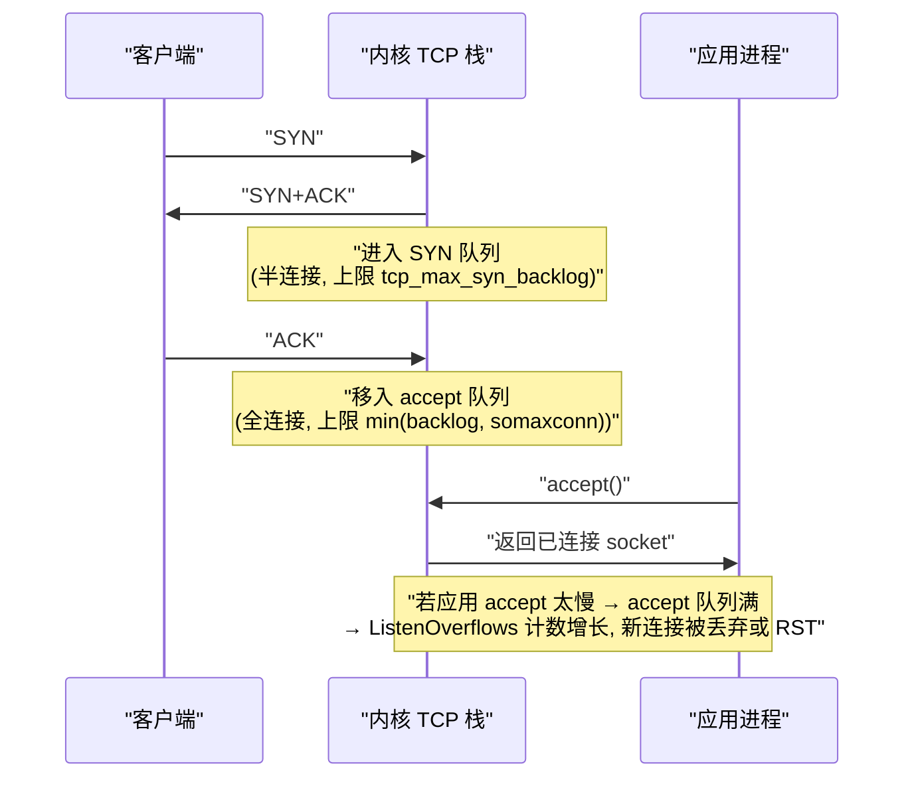
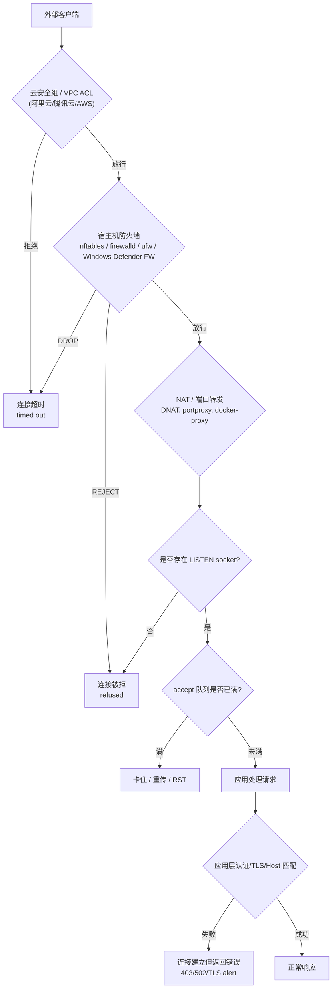
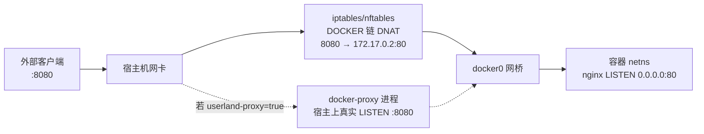
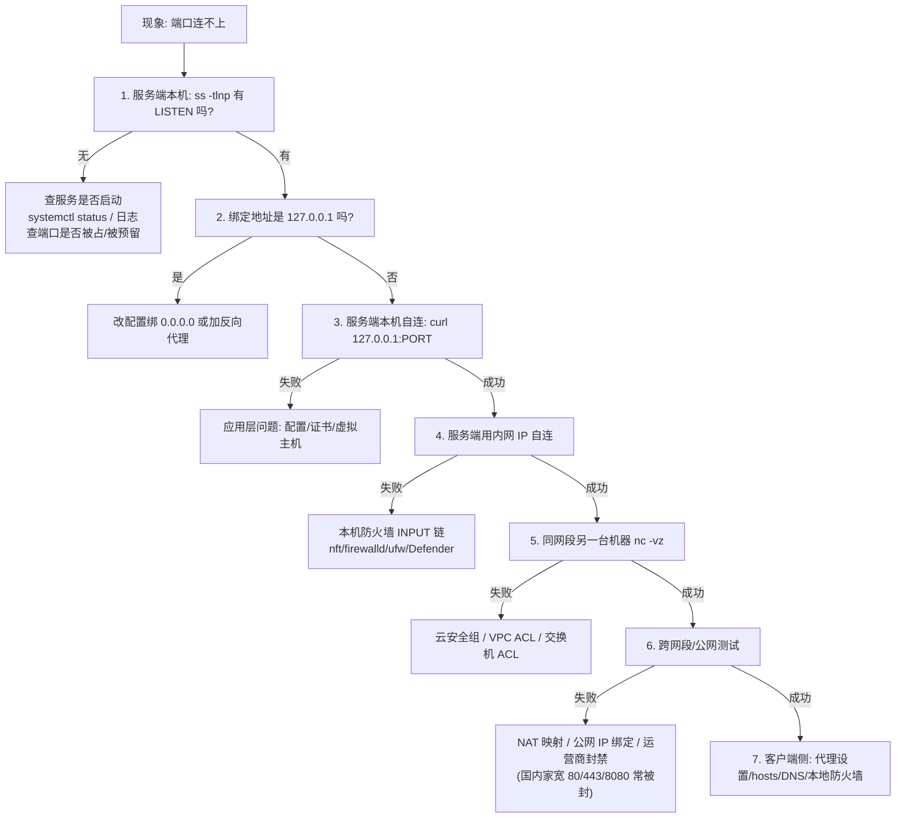

[toc]


## 网络端口是什么

很多排障失败，根因是把端口想象成“机器上的一个洞”。**准确的定义是：端口是传输层（TCP/UDP）的 16 位复用标识符（取值 0–65535），用来把到达同一 IP 的数据分发给不同的 socket**。SCTP/DCCP 也有端口概念，但日常排障几乎只涉及 TCP/UDP。

**两个关键推论，新手务必先建立**：

1. **TCP 的 80 端口和 UDP 的 80 端口是两个完全独立的命名空间**，互不冲突。`ss -tlnp` 只看 TCP，`ss -ulnp` 只看 UDP，两者要分开查。
2. **操作系统真正管理的对象不是“端口”，而是 socket（套接字）**。你所有的查看和排障命令，本质都是在查询内核的 socket 表。

举例：`ss -tlnp` 看到 `0.0.0.0:80`，含义是“本机有一个 TCP socket，绑定了所有 IPv4 网卡的 80 端口，当前处于 LISTEN 状态”，而不是“机器上开了个洞”。

### 四元组与“端口冲突”的真正判定规则

**适用范围**：本节给出 TCP（含同理的 UDP）排障中“端口占用/冲突”的唯一判定口径。后文所有 `Address already in use`（EADDRINUSE）均按本规则解释。

**术语定义**：

- **监听套接字（Listening Socket）**：由三元组 `(协议, 本地 IP, 本地端口)` 标识，处于 `LISTEN` 状态，等待对端发起连接。
- **已连接套接字（Connected Socket）**：由四元组 `(源 IP, 源端口, 目的 IP, 目的端口)` 唯一标识；加上协议号即为**五元组**。内核按五元组把到达同一 IP 的报文分发给不同套接字。

| 概念 | 标识 | 常见误解与正解 |
| ---- | ---- | -------------- |
| **监听套接字** | `(协议, 本地 IP, 本地端口)` | 误：“一个端口只能有一个套接字”。正：监听只有一个，但其派生的已连接套接字可有上百万个 |
| **已连接套接字** | `(源 IP, 源端口, 目的 IP, 目的端口)` + 协议 | 误：“服务器 80 端口最多接 65535 个连接”。正：连接数受文件描述符、内存、CPU 约束，不受本地端口总数约束 |
| **绑定冲突（EADDRINUSE）** | 仅当三元组重叠时发生 | 误：“`127.0.0.1:8080` 与 `0.0.0.0:8080` 不冲突”。正：`0.0.0.0` 包含本机全部 IPv4 地址，二者重叠，必然冲突 |

**判定规则（如果 A 则 B，否则 C）**：如果新套接字与已有监听套接字的**协议相同**，且**本地端口相同**，且**本地 IP 存在重叠**（含通配地址覆盖），则 `bind()` 返回 EADDRINUSE；否则绑定成功。其中 `0.0.0.0` 与本机任一 IPv4 地址重叠；`::` 的覆盖行为取决于 `bindv6only`，详见“绑定地址语义”一节。

**冲突矩阵（假设本机含 `127.0.0.1` 与 `10.0.0.5`、`10.0.0.6`，均为示例地址）**：

| 已有监听 | 新绑定 | 是否冲突 | 原因 |
| -------- | ------ | -------- | ---- |
| TCP `127.0.0.1:8080` | TCP `0.0.0.0:8080` | **冲突** | 通配地址覆盖回环地址 |
| TCP `0.0.0.0:8080` | TCP `127.0.0.1:8080` | **冲突** | 同上，与绑定先后无关 |
| TCP `10.0.0.5:8080` | TCP `10.0.0.6:8080` | 不冲突 | 本地 IP 不同 |
| TCP `10.0.0.5:8080` | UDP `10.0.0.5:8080` | 不冲突 | 协议不同，命名空间独立 |
| TCP `10.0.0.5:8080` | TCP `10.0.0.5:8081` | 不冲突 | 本地端口不同 |
| TCP `10.0.0.5:8080`（`SO_REUSEPORT`） | TCP `10.0.0.5:8080`（`SO_REUSEPORT`） | 不冲突（特例） | 双方均声明端口复用，内核做负载均衡，详见“套接字选项”一节 |

**示例 1：回环与通配必然冲突（建议亲手复现一次）**：

```bash
# 终端 1：占用回环 8080
python3 -m http.server 8080 --bind 127.0.0.1
# 终端 2：再绑全网卡 8080，立即失败
python3 -m http.server 8080 --bind 0.0.0.0
# OSError: [Errno 98] Address already in use
```

**示例 2：不同网卡 IP 可共享同一端口**：先后绑定 `10.0.0.5:8080` 与 `10.0.0.6:8080`（假设本机双网卡具此二地址），两次均成功，`ss -tlnp` 将显示两行 LISTEN。

**示例 3：同号不同协议不冲突**：`nginx` 监听 TCP `0.0.0.0:80` 的同时，另一起服务可监听 UDP `0.0.0.0:80`（如 QUIC/HTTP/3 场景），二者互不干扰。排查时须用 `ss -tlnp` 与 `ss -ulnp` 分开确认。

**推论**：一台 Web 服务器的 443 端口可同时承载上百万连接，因为各连接的对端 `(IP, 端口)` 不同，四元组不重复。反之，**本机作为客户端**向同一远端服务发起连接时，可用源端口受临时端口范围约束（约 2–3 万，见下节），这才是“端口不够用”的真正限定场景。

**排障动作（按序执行）**：

1. 用 `sudo ss -lptn 'sport = :<端口>'` 列出该端口的全部监听者，核对 `Local Address` 列是否存在重叠；
2. 如果输出为空但仍报 EADDRINUSE，则按“系统预留端口”（Windows `excludedportrange`）或 `TIME_WAIT`/`SO_REUSEADDR` 路径继续排查；
3. 如果输出多行同端口且进程不同，先查是否为 `SO_REUSEPORT` 刻意复用，而非直接杀进程。



**图解**：左侧 `P` 为进程空间（谁持有端口），右侧 `K` 为内核套接字表（端口到底通向哪里），`NIC` 为网卡收包入口。读图分三步：① 网卡按五元组（协议 + 四元组）查表，决定报文交给哪个套接字；② `S1` 与 `S3`/`S4` 同属 `nginx`，证明“一个监听套接字可派生出大量已连接套接字”；③ `S3` 与 `S4` 本地同为 `10.0.0.5:443`，但对端不同（`203.0.113.7:51234` 与 `203.0.113.8:60001`），四元组不重复，故可共存。对应查证：`S1`/`S2` 用 `ss -tlnp` 看监听，`S3`/`S4` 用 `ss -tanp` 看连接。

### 端口号的分区(IANA / RFC 6335)

[IANA](https://www.iana.org/assignments/service-names-port-numbers/service-names-port-numbers.xhtml) 依据 **RFC 6335** 将 0–65535 划分为三段:

| 范围            | 官方名称                      | 中文习惯叫法                     | 特点                                                         |
| --------------- | ----------------------------- | -------------------------------- | ------------------------------------------------------------ |
| **0–1023**      | System Ports / Well-Known     | **系统端口、知名端口**           | 分配需 IETF Review;*nix 上绑定需特权                         |
| **1024–49151**  | User Ports / Registered       | **注册端口**                     | 向 IANA 申请登记即可(如 3306 MySQL、5432 PostgreSQL、6379 Redis) |
| **49152–65535** | Dynamic / Private / Ephemeral | **动态端口、私有端口、临时端口** | IANA 不分配,由 OS 临时分配给客户端                           |

**但这是"建议",不是各 OS 的实际行为**——这是排障高频坑点:

| 平台                              | 默认临时端口范围(ephemeral port range) | 查看方式                                                     |
| --------------------------------- | -------------------------------------- | ------------------------------------------------------------ |
| **Linux**                         | **32768–60999**（常见默认值，请以 `cat /proc/sys/net/ipv4/ip_local_port_range` 为准）    | `sysctl net.ipv4.ip_local_port_range`                        |
| **Windows Vista+ / Server 2008+** | **49152–65535**(符合 IANA)             | `netsh int ipv4 show dynamicport tcp`                        |
| **Windows XP/2003(历史)**         | 1025–5000                              | 已淘汰,但老文档仍在流传                                      |
| **macOS / FreeBSD**               | 49152–65535                            | `sysctl net.inet.ip.portrange.first net.inet.ip.portrange.last` |

> 微软官方文档明确了 Vista 起默认动态范围改为 49152–65535,并建议在跨服务器场景放行该区间([Microsoft Learn](https://learn.microsoft.com/en-us/troubleshoot/windows-server/networking/default-dynamic-port-range-tcpip-chang))。

**实践含义**:如果你在 Linux 上把服务监听端口设成 `35000`,它落在临时端口范围内,**某天重启后可能抢不到端口**(被某个客户端连接先占了)。**最佳实践:自建服务的固定端口选在 1024–32767 之间**(Linux)，或显式预留：

```bash
cat /proc/sys/net/ipv4/ip_local_port_range   # 例：32768  60999
# 把 35000 预留出来，内核不再把它分配给客户端
sysctl -w net.ipv4.ip_local_reserved_ports=35000
# 永久生效：写入 /etc/sysctl.d/99-ports.conf
# net.ipv4.ip_local_reserved_ports = 35000,35001
```

另记：端口 `0` 是保留值，`bind(0)` 表示“请内核随机分配一个可用端口”，常见于客户端和测试代码，不要把服务固定配成 `0`。

### 绑定地址语义:比端口号更容易出错的地方

`bind()` 的地址决定了“谁能连上你”。这是**“本机能连、别人连不上”**类故障的第一嫌疑。先看一个最小复现：

```bash
sudo ss -tlnp | grep 3306
# 127.0.0.1:3306  → 只有本机能连，PHP/MySQL 默认如此，属安全配置
# 0.0.0.0:3306    → 所有网卡都能连，改 my.cnf 里 bind-address=0.0.0.0 后会出现
curl -v --connect-timeout 3 127.0.0.1:3306   # 本机通不代表局域网通
nc -vz 10.0.0.5 3306                          # 换内网 IP 再测一次，分水岭就在这里
```

| 绑定地址    | 显示形式               | 可达范围                                    | 典型场景                                       |
| ----------- | ---------------------- | ------------------------------------------- | ---------------------------------------------- |
| `127.0.0.1` | `127.0.0.1:3306`       | **仅本机回环**                              | 数据库默认安全配置;Docker 里会导致容器外不可达 |
| `0.0.0.0`   | `0.0.0.0:80` 或 `*:80` | 本机所有 IPv4 地址                          | 对外服务                                       |
| `::`        | `[::]:80` 或 `*:80`    | 所有 IPv6;**若 `v6only=0` 则同时覆盖 IPv4** | 双栈服务                                       |
| `::1`       | `[::1]:8080`           | 仅 IPv6 回环                                | 纯 IPv6 本地调试                               |
| 具体 IP     | `10.0.0.5:8080`        | 仅该网卡地址                                | 多网卡分流;**换 IP/DHCP 后服务起不来**         |

**IPv6 双栈的跨平台差异(必须知道)**:

- **Linux**:`net.ipv6.bindv6only` 默认 `0`,即绑定 `::` 会**同时接收 IPv4 流量**(通过 IPv4-mapped 地址 `::ffff:a.b.c.d`)。所以 `ss -tln` 只看到 `[::]:80` 也是正常的。
- **Windows**:`IPV6_V6ONLY` **默认为 1**,即绑定 `::` **不会**自动覆盖 IPv4,程序必须显式关掉该选项或分别绑定。这是很多 .NET/Java 服务"IPv6 能通、IPv4 不通"的根源。
- **应用层覆盖**:Java 有 `-Djava.net.preferIPv4Stack=true`;Node.js 监听 `localhost` 在不同版本/系统上可能解析到 `::1` 而非 `127.0.0.1`(Node 17 起 DNS 结果不再自动重排),导致"明明起了服务却连不上"。

### 两个关键 socket 选项:`SO_REUSEADDR` 与 `SO_REUSEPORT`

| 选项               | 作用                                                      | 平台差异                                                     | 使用场景                                       |
| ------------------ | --------------------------------------------------------- | ------------------------------------------------------------ | ---------------------------------------------- |
| **`SO_REUSEADDR`** | 允许绑定处于 `TIME_WAIT` 的本地地址                       | **Windows 上语义不同**:它允许"抢占"别人正在监听的端口(安全风险),对应 *nix 语义的是 `SO_EXCLUSIVEADDRUSE` 的反面 | 服务重启避免 `Address already in use`          |
| **`SO_REUSEPORT`** | 多个进程/线程**同时**绑定同一 `(IP, 端口)`,内核做负载均衡 | Linux 3.9+、FreeBSD/macOS(语义略不同);Windows 无             | Nginx `reuseport`、Envoy 多 worker、零停机重启 |

**所以：`ss -tlnp` 里同一个端口出现多行、多个 PID，不一定是 bug，可能是 `SO_REUSEPORT`**。验证示例（Nginx 开 `reuseport` 后）：

```nginx
listen 80 reuseport;
```

```bash
sudo ss -tlnp | grep :80
# LISTEN 0 128 0.0.0.0:80 ... users:(("nginx",pid=101,fd=6))
# LISTEN 0 128 0.0.0.0:80 ... users:(("nginx",pid=102,fd=6))
# 两个 worker 共享同一端口，由内核负载均衡，属正常现象
```

---

## 工具全景:该用什么,不该用什么

**核心判断:`net-tools`(`netstat`、`ifconfig`、`route`、`arp`)在现代 Linux 上已是遗留工具**,应迁移到 `iproute2`(`ss`、`ip`)。Red Hat 官方博客直接给出了 netstat→ss 的对照迁移表,指出 `ss` 是"取代 netstat 的 socket 统计命令"([Red Hat Blog](https://www.redhat.com/en/blog/ss-command));技术原因是 **`ss` 通过 `netlink`(`NETLINK_INET_DIAG`)直接查询内核 socket 表,而 `netstat` 逐行解析 `/proc/net/tcp`**,在数万连接时性能差距是数量级的,且 `ss` 对 IPv6 支持更完整([Baeldung](https://www.baeldung.com/linux/netstat-alternatives))。

### 跨平台工具对照总表

| 需求              | **Linux(首选)**                                              | **Windows(首选)**                                            | **macOS(首选)**                    |
| ----------------- | ------------------------------------------------------------ | ------------------------------------------------------------ | ---------------------------------- |
| 列监听端口 + 进程 | `ss -tulnpH`                                                 | `Get-NetTCPConnection -State Listen`                         | `sudo lsof -nP -iTCP -sTCP:LISTEN` |
| 列全部连接        | `ss -tanp`                                                   | `netstat -ano`                                               | `netstat -an`                      |
| 查谁占用某端口    | `ss -lptn "sport = :8080"`                                   | `Get-Process -Id (Get-NetTCPConnection -LocalPort 8080).OwningProcess` | `lsof -nP -i :8080`                |
| 按端口杀进程      | `fuser -k 8080/tcp`                                          | `Stop-Process -Id <PID> -Force`                              | `kill -9 $(lsof -ti :8080)`        |
| 连通性测试        | `nc -vz host port`                                           | `Test-NetConnection host -Port 443`                          | `nc -vz host port`                 |
| 端口扫描          | `nmap -Pn -p 1-1024 host`                                    | `nmap`(需装)/ `Test-NetConnection` 循环                      | `nmap`                             |
| 实时流量归属      | `nethogs`、`iftop`、`bpftool`                                | 资源监视器、`TCPView`                                        | `nettop`                           |
| 抓包              | `tcpdump` / `tshark`                                         | `pktmon` / `Wireshark`                                       | `tcpdump`                          |
| 防火墙查看        | `nft list ruleset` / `firewall-cmd --list-all` / `ufw status` | `Get-NetFirewallRule`                                        | `sudo pfctl -sr`                   |
| 统计指标          | `nstat`、`ss -s`、`netstat -s`                               | `netstat -s`、`Get-NetTCPSetting`                            | `netstat -s`                       |
| 极简容器无工具    | 读 `/proc/net/tcp`(见文末脚本)                               | —                                                            | —                                  |

### 常用相关工具特点总结

| 工具               | 主要用途                               | 特点与定位                                                   | 备注                                                         |
| :----------------- | :------------------------------------- | :----------------------------------------------------------- | :----------------------------------------------------------- |
| **`ss`**           | 查看本地网络连接和监听端口。           | **现代、高效、推荐**。直接从内核获取信息，速度极快，输出简洁。是 `netstat` 的替代品。 | **系统管理员日常诊断的首选工具。**                           |
| **`netstat`**      | 查看本地网络连接和监听端口。           | **经典、全面、但过时**。功能强大，但速度慢于 `ss`。在某些旧系统中可能仍是默认选择。 | 了解即可，新环境中应优先使用 `ss`。                          |
| **`lsof`**         | 列出被进程打开的文件（包括网络端口）。 | **功能强大、定位精准**。不仅能看网络，还能查看文件、目录等被谁占用。语法与其他工具略有不同。 | 当需要精确查找“某个文件/端口被谁占用”时的终极武器。          |
| **`nc` (netcat)**  | 网络工具的“瑞士军刀”。                 | **灵活、轻量、脚本友好**。可用于端口测试、端口扫描、文件传输、甚至作为简单的网络服务器/客户端。`-vz` 组合是端口测试的黄金标准。 | **网络调试和脚本编写的利器。**                               |
| **`telnet`**       | 远程登录（旧式）和端口测试。           | **简单、直观、专用于TCP**。Windows 默认未安装（需在“启用或关闭 Windows 功能”中勾选 Telnet 客户端），精简 Linux 镜像也常缺省。输出直观，是测试 TCP 端口连通性的经典方法。 | 对于初学者来说非常直观，但功能单一，且明文传输，勿作日常远程登录。                         |
| **`nmap`**         | 网络发现和安全审计（端口扫描）。       | **专业、强大、全面**。能进行主机发现、端口扫描、服务版本探测、操作系统识别等。功能远超简单端口测试。 | **注意：未经授权扫描他人网络可能是非法的。** 用于审计自己的网络。 |
| **`ufw`**          | 简化 iptables 防火墙配置。             | **简单、易用、人性化**。为 iptables 提供了一个用户友好的命令行接口。特别适合桌面用户和防火墙初学者。 | Ubuntu 系统的默认防火墙配置工具。                            |
| **`firewall-cmd`** | 配置 firewalld 动态防火墙。            | **强大、灵活、基于区域**。CentOS/RHEL/Fedora 等系统的默认防火墙管理工具。使用“区域”和“服务”的概念，管理更高级。 | 红帽系列发行版的标准工具。                                   |
| **`iptables`**     | 配置 Linux 内核内置的防火墙规则。      | **底层、强大、复杂**。是 Linux 防火墙的基石，`ufw` 和 `firewalld` 都是它的前端。直接使用它需要对网络有较深理解。 | 学习它可以深入理解 Linux 防火墙的工作原理。                  |

**工具选择建议**：

*   **日常快速检查**：`ss` + `nc`。
*   **精准问题定位**：`lsof`。
*   **简单防火墙配置**：`ufw`（Debian/Ubuntu）或 `firewall-cmd`（RHEL/CentOS）。
*   **专业网络探测**：`nmap`。
*   **诊断流程**：先 `ss`（查本地） -> 再 `nc`（测远程）。

**旧命令的现代替代速查(Linux)**:

| 旧(net-tools)    | 新(iproute2)          |
| ---------------- | --------------------- |
| `netstat -tulpn` | `ss -tulpn`           |
| `netstat -an`    | `ss -an`              |
| `netstat -r`     | `ip route`            |
| `netstat -i`     | `ip -s link`          |
| `netstat -g`     | `ip maddr`            |
| `ifconfig`       | `ip addr` / `ip link` |
| `arp -a`         | `ip neigh`            |

---

## Linux:`ss` 全解(重点章节)

### 命令形式与占位符

```
ss [选项] [ FILTER ]
FILTER := [ state STATE-FILTER ] [ EXPRESSION ]
```

| 占位符             | 含义                 | 说明与取值                                                   |
| ------------------ | -------------------- | ------------------------------------------------------------ |
| **`选项`**         | 控制输出内容与协议族 | 见下表                                                       |
| **`STATE-FILTER`** | TCP 状态过滤         | 具体状态名(`established`、`listening`、`time-wait`、`syn-sent`…)或状态组:`all`、`connected`(除 listen/closed)、`synchronized`(connected 除 syn-sent)、`bucket`(`time-wait`+`syn-recv`,即"迷你 socket")、`big`(bucket 的补集) |
| **`EXPRESSION`**   | 地址/端口布尔表达式  | 由 `sport`、`dport`、`src`、`dst`、`autobound` 等键与 `= != < > <= >=`、`and/or/not` 组合。**注意方位：`sport` 是本机端口，`dport` 是对端端口**。查“谁占了本机 8080”用 `sport`，查“谁在连远端 443”用 `dport` |

举例拆解：

```bash
ss -lptn 'sport = :8080'                    # 本机 8080 有谁在监听
ss -tnp 'dst 203.0.113.10 and dport = :443' # 本机有哪些连接到 203.0.113.10:443
ss -tn state established '( dport = :443 or dport = :80 )'  # 到 80/443 的已建连
```

### 常用选项详解

| 选项        | 长选项             | 作用                                                   | 备注                                                         |
| ----------- | ------------------ | ------------------------------------------------------ | ------------------------------------------------------------ |
| `-t`        | `--tcp`            | 只看 TCP                                               |                                                              |
| `-u`        | `--udp`            | 只看 UDP                                               | UDP 无连接,"LISTEN"概念不适用,显示为 `UNCONN`                |
| `-x`        | `--unix`           | Unix 域套接字                                          | 排查 `/var/run/*.sock`(如 Docker、PHP-FPM)必用               |
| `-w` / `-S` | `--raw` / `--sctp` | RAW / SCTP                                             | `ping`、电信信令场景                                         |
| `-l`        | `--listening`      | 只看监听态                                             | **等价于 `state listening`**                                 |
| `-a`        | `--all`            | 监听态 + 非监听态                                      |                                                              |
| `-n`        | `--numeric`        | **不解析端口名/主机名**                                | **强烈建议永远带上**:避免 DNS 反查卡顿,且 `/etc/services` 名字会误导 |
| `-p`        | `--processes`      | 显示持有 socket 的进程                                 | **需 root 才能看到别人的进程**                               |
| `-e`        | `--extended`       | 显示 uid、inode、socket cookie                         | 关联 `/proc` 用                                              |
| `-i`        | `--info`           | TCP 内部信息:`rtt`、`cwnd`、`ssthresh`、重传、拥塞算法 | 性能排障核心                                                 |
| `-m`        | `--memory`         | socket 内存占用(`skmem`)                               | 排查缓冲区堆积                                               |
| `-o`        | `--options`        | 定时器信息(`timer:(keepalive,...)`)                    | 判断重传/保活                                                |
| `-s`        | `--summary`        | 全局摘要统计                                           | 快速看 TIME_WAIT 规模                                        |
| `-H`        | `--no-header`      | 不打印表头                                             | **脚本化友好**                                               |
| `-K`        | `--kill`           | **强制关闭匹配的 socket**                              | 需内核 `CONFIG_INET_DIAG_DESTROY`;慎用                       |
| `-N NSNAME` | `--net=`           | 在指定网络命名空间中执行                               | 容器排查利器                                                 |
| `-4` / `-6` |                    | 限定 IPv4 / IPv6                                       |                                                              |
| `-Z` / `-z` |                    | SELinux 上下文                                         | RHEL 系                                                      |

### 最常用的 10 条配方(带完整场景)

**1)日常第一条命令:看本机所有监听端口和进程**

```bash
sudo ss -tulnpH
```
输出列依次为 `Netid State Recv-Q Send-Q Local-Address:Port Peer-Address:Port Process`（`ss` 新版本还会追加 `Netid` 如 `tcp`/`udp`）。带 `H` 去表头便于 `awk` 处理。示例（截断）：

```text
tcp LISTEN 0 128 0.0.0.0:22 0.0.0.0:* users:(("sshd",pid=800,fd=3))
tcp LISTEN 0 128 127.0.0.1:3306 0.0.0.0:* users:(("mysqld",pid=1234,fd=21))
```

读法：第一行是 sshd 在所有 IPv4 网卡监听 22；第二行是 MySQL 只绑了回环，外网连不上它就是正常的。

**2)精确查"谁占了 8080"**

```bash
sudo ss -lptn 'sport = :8080'
```
比 `ss -tlnp | grep 8080` 更准——后者会误匹配 `18080`、`8080` 出现在 PID 里等情况。

**3)看某个远端的所有连接(排查"连不上支付网关")**

```bash
ss -tnp 'dst 203.0.113.10 and dport = :443'
```

**4)看有多少连接卡在半开状态(疑似 SYN flood 或对端不回 ACK)**

```bash
ss -tn state syn-recv
ss -tn state syn-sent   # 本机发起但对端无响应 → 多半是防火墙静默丢包
```

**5)统计 TIME_WAIT 规模**

```bash
ss -s
ss -tan state time-wait | wc -l
```

**6)按对端 IP 排名找出连接数最多的客户端(防刷/定位异常客户端)**

```bash
ss -tanH state established | awk '{print $5}' | sed 's/.*://;s/]$//' | sort | uniq -c | sort -rn | head
```
说明:`$5` 是 Peer 地址列（在 `-H` 去表头的 `-tan` 输出中）；`sed` 取最后一个 `:` 之后的部分（兼容 IPv4 和 `[IPv6]:port` 两种形式），只保留 IP。早期写法 `s/:[0-9]*$//` 在 IPv6 下会切错，特此修正。

**7)看单条连接的 RTT 与重传(判断“慢”是网络还是应用)**

```bash
ss -tin dst 203.0.113.10
# 输出节选：rtt:12.3/4.5 rttvar:2.1 cwnd:10 retrans:0/128 ...
```
关注 `rtt:12.3/4.5`（均值/抖动，单位 ms）、`retrans:0/128`（当前/累计重传）、`cwnd`、拥塞算法（`bbr`/`cubic`）。**重传持续增长 → 链路丢包；RTT 低但响应慢 → 应用层问题**。

**8)查 Unix 域套接字(Docker 报 `permission denied` 时)**

```bash
ss -xlp | grep docker
```

**9)进入容器的网络命名空间看端口**

```bash
pid=$(docker inspect -f '{{.State.Pid}}' <容器名>)
sudo nsenter -t "$pid" -n ss -tulnp
```

**10)审计对外暴露的监听（安全基线检查）**

```bash
sudo ss -tulnpH | awk '$5 !~ /^127\.|^\[::1\]/ {print}'
```
筛出**所有非回环监听**（含 `0.0.0.0:*`、`[::]:*`、公网 IP），这是最实用的一条**安全自查命令**。注意：`$5` 是去表头后的 Local 列；若不带 `-H`，表头会把列序号顶偏，务必带 `-H` 再取 `$5`。

### 读懂 `Recv-Q` 与 `Send-Q`（含义随状态变化）

这两列的含义**随状态改变**，死记一列必错：

| 状态                   | `Recv-Q`                                               | `Send-Q`                                           |
| ---------------------- | ------------------------------------------------------ | -------------------------------------------------- |
| **`LISTEN`**           | **当前已完成三次握手、但应用还没 `accept()` 的连接数** | **accept 队列容量上限**(`min(backlog, somaxconn)`) |
| **其他状态(如 ESTAB)** | 内核收到但应用未读取的字节数                           | 应用已写入但未被对端 ACK 的字节数                  |



**图解**：时序分三段。① `SYN` 到达后连接进入 **SYN 队列**（半连接），此时 `ss` 可见 `SYN-RECV`；② 第三次握手 `ACK` 到达后连接移入 **accept 队列**（全连接），对应 `ss -ltn` 中 LISTEN 行的 `Recv-Q` 计数；③ 应用调用 `accept()` 取走连接，队列计数回落。若应用取走过慢，accept 队列堆积至 `Send-Q` 所示上限，新连接被丢弃或 RST，`nstat` 中 `TcpExtListenOverflows` 持续增长。下节“排障动作”即按此因果设计：先看队列是否堆积，再看计数是否增长，最后才调 `somaxconn`/`backlog`。

**排障动作**（先看现象，再看计数）：

```bash
ss -ltn                      # 看 LISTEN 行的 Recv-Q 是否持续接近 Send-Q
# 示例：Recv-Q 5 / Send-Q 128 表示有 5 个已握手连接堆在 accept 队列里
#       Recv-Q 0 / Send-Q 128 且长期为 0 表示空闲健康；ESTAB 行的 Q 是字节数，不要混读
nstat -az TcpExtListenOverflows TcpExtListenDrops
sysctl net.core.somaxconn    # 现代内核默认 4096(旧内核 128)
```

**若 `ListenOverflows` 持续增长**:先查应用为何 `accept()` 慢(线程池耗尽、GC、阻塞 IO),**再考虑**调大 `somaxconn` 和应用自身的 `backlog`(Nginx `listen 80 backlog=4096;`)。**只调内核参数而不修应用,是治标不治本**。

### `lsof`:以"文件"视角看端口

```
lsof -i [46][protocol][@hostname|@ip][:service|port]
```

| 占位符           | 含义                                 | 示例                   |
| ---------------- | ------------------------------------ | ---------------------- |
| `4` / `6`        | IP 版本                              | `lsof -i4`             |
| `protocol`       | `TCP` 或 `UDP`                       | `lsof -iTCP`           |
| `@hostname\|@ip` | 限定本地或远端地址                   | `lsof -i@203.0.113.10` |
| `:service\|port` | 服务名或端口(可用 `-P` 禁止转服务名) | `lsof -i:8080`         |

**常用固定搭配（建议背下来）**：

```bash
sudo lsof -nP -iTCP -sTCP:LISTEN   # 所有 TCP 监听
sudo lsof -nP -i :8080             # 8080 被谁占（含 TCP/UDP）
sudo lsof -nP -iTCP:8080           # 只看 TCP 8080
sudo lsof -ti :8080 | xargs -r kill -9   # 取 PID 并杀掉（-t 只输出 PID）
```

| 参数           | 作用                                            |
| -------------- | ----------------------------------------------- |
| `-n`           | 不做 DNS 反解(**避免卡死**)                     |
| `-P`           | 不把端口号转成服务名(**避免 `http` 掩盖 `80`**) |
| `-i`           | 限定网络文件                                    |
| `-sTCP:LISTEN` | 只保留 TCP 处于 LISTEN 的                       |

| `-t` 的单独用法 | 只输出 PID（便于管道给 `kill`），如 `lsof -ti :8080`，常配 `xargs kill` |

`lsof` 的独特价值:**它能同时看到端口、文件、目录、库,适合定位"进程持有了什么"**;缺点是**在大型服务器上比 `ss` 慢得多**,因为要遍历 `/proc/*/fd`。

### `fuser`：一行搞定“谁在用这个端口”

```bash
fuser -v 8080/tcp         # 先看详情（用户、PID、命令），确认后再杀
fuser 8080/tcp            # 精简输出，仅列 PID
sudo fuser -k -TERM 8080/tcp  # 更温和：先发 SIGTERM，给进程清理机会
sudo fuser -k 8080/tcp    # 最后手段：发 SIGKILL（等价 -KILL），可能丢数据
# 注意：8080/tcp 与 8080/udp 是不同命名空间，UDP 服务要用 fuser 8080/udp
```

**警告:生产环境慎用 `-k`**,优先 `systemctl stop` 让服务优雅退出。

### 看不到进程怎么办(高频疑难)

| 现象                             | 根因                                                   | 处理                                                         |
| -------------------------------- | ------------------------------------------------------ | ------------------------------------------------------------ |
| `ss -tlnp` 有端口但 Process 列空 | **没用 root**                                          | `sudo`                                                       |
| 加了 sudo 仍为空                 | socket 属于**其他网络命名空间**(容器)                  | `lsns -t net`、`nsenter -t <PID> -n ss -tlnp`、`ss -N <netns>` |
| 仍为空且进程不存在               | **内核态 socket**（NFS、`rpcbind`、内核模块、eBPF 程序） | `sudo ss -e` 取 inode，再 `sudo grep -r <inode> /proc/[0-9]*/fd 2>/dev/null`；确认是内核服务后勿强杀 |
| 我在容器里看不到宿主端口         | **PID/net namespace 隔离**                             | 到宿主执行,或容器加 `--net=host --pid=host` 调试             |

> 提示：若 `ss` 显示 `0.0.0.0:2024` 这类监听但 PROCESS 列为 `-`，通常意味着 socket 属于其他网络命名空间（如宿主机、别的容器）或权限不足。这正是判断“这是不是我这个容器里的服务”的实用信号：先 `sudo` 重试，再用 `lsns -t net` / `nsenter` 到宿主确认。

---

## Windows:从 `netstat -ano` 到 PowerShell

### `netstat`(仍然可用,且部分能力独家)

```
netstat [-a] [-b] [-n] [-o] [-q] [-p 协议] [-s] [间隔秒数]
```

| 参数                        | 含义                                               | 备注                                                         |
| --------------------------- | -------------------------------------------------- | ------------------------------------------------------------ |
| `-a`                        | 所有连接和监听端口                                 |                                                              |
| `-n`                        | 数字形式显示地址和端口                             | 同样建议常带                                                 |
| `-o`                        | **显示 PID**                                       | 与任务管理器"详细信息"页 PID 列对应                          |
| `-b`                        | 显示**可执行文件名**及调用组件                     | **需管理员**,很慢                                            |
| `-q`                        | **显示所有连接、监听端口和"已绑定但未监听"的端口** | **独家能力**:`Get-NetTCPConnection` 看不到"bound not listening",排查"端口被预留却没人监听"必用 |
| `-p TCP\|UDP\|TCPv6\|UDPv6` | 限定协议                                           |                                                              |
| `-s`                        | 协议统计                                           | 看重传、丢弃                                                 |
| `-e`                        | 以太网统计                                         |                                                              |
| `5`                         | 每 5 秒刷新                                        | 用 `Ctrl+C` 停止                                             |

**经典三连**（注意 `findstr ":8080"` 会连带命中 `:18080`，精确排障请加 `LISTENING` 双重过滤）：

```powershell
netstat -ano | findstr ":8080"
netstat -ano | findstr "LISTENING" | findstr ":8080"
netstat -anob | findstr /i "LISTENING"
netstat -anoq | findstr ":50000"
```

### PowerShell cmdlet(推荐:结构化对象,可直接管道处理)

微软官方文档说明 `Get-NetTCPConnection` 用于获取当前 TCP 连接及其本地/远端地址端口和状态([Microsoft Learn](https://learn.microsoft.com/en-us/powershell/module/nettcpip/get-nettcpconnection));与传统 `netstat` 不同,**PowerShell 把 TCP 与 UDP 拆成了两个独立 cmdlet**([Windows OS Hub](https://woshub.com/get-nettcpconnection-windows-powershell/))。

| Cmdlet                                        | 用途                                | 关键参数                                                     |
| --------------------------------------------- | ----------------------------------- | ------------------------------------------------------------ |
| **`Get-NetTCPConnection`**                    | TCP 连接与监听                      | `-LocalPort`、`-LocalAddress`、`-RemotePort`、`-RemoteAddress`、`-State`、`-OwningProcess` |
| **`Get-NetUDPEndpoint`**                      | **UDP 端点(TCP cmdlet 查不到 UDP)** | `-LocalPort`、`-OwningProcess`                               |
| **`Test-NetConnection`**                      | 连通性测试(TCP/ICMP/路由)           | `-Port`、`-TraceRoute`、`-InformationLevel Detailed`         |
| **`Get-NetTCPSetting` / `Set-NetTCPSetting`** | TCP 全局参数(拥塞算法、自动调优)    | `-SettingName`                                               |
| **`Get-NetFirewallRule`**                     | 防火墙规则                          | 配合 `Get-NetFirewallPortFilter`                             |

**生产级组合示例 1:一屏看清"端口 → 进程 → 路径 → 用户"**

```powershell
Get-NetTCPConnection -State Listen |
  ForEach-Object {
    $proc = Get-Process -Id $_.OwningProcess -ErrorAction SilentlyContinue
    [pscustomobject]@{
      LocalAddress  = $_.LocalAddress
      LocalPort     = $_.LocalPort
      PID           = $_.OwningProcess
      Process       = $proc.ProcessName
      Path          = $proc.Path
    }
  } |
  Sort-Object LocalPort | Format-Table -AutoSize
```

> 写法说明：每个连接只查一次 `Get-Process`（原示例调了两次，连接多时会明显变慢）；字段含义见下表。

| 字段            | 含义                                                         |
| --------------- | ------------------------------------------------------------ |
| `LocalAddress`  | 绑定地址,`0.0.0.0` = 所有 IPv4,`::` = 所有 IPv6,`127.0.0.1` = 仅本机 |
| `LocalPort`     | 监听端口                                                     |
| `OwningProcess` | **持有 socket 的 PID**(注意:不是服务名)                      |
| `@{N=..;E=..}`  | PowerShell **计算属性**语法,`N` = Name(列名),`E` = Expression(取值脚本块) |
| `$_`            | 管道中的**当前对象**                                         |

**组合示例 2：精确定位 8080 的占用者并优雅结束**（注意一端口可能对应多连接，取第一个前先确认）：

```powershell
$conns = Get-NetTCPConnection -LocalPort 8080 -State Listen -ErrorAction SilentlyContinue
$conns | Select-Object LocalAddress, LocalPort, OwningProcess, State
if ($conns) {
    $firstPid = ($conns | Select-Object -First 1).OwningProcess
    Get-Process -Id $firstPid | Format-List Id, ProcessName, Path, StartTime
    # 确认无误后再执行（先温和，再强制）：
    # Stop-Process -Id $firstPid
    # Stop-Process -Id $firstPid -Force
} else { "端口 8080 当前无监听" }
```

**组合示例 3:`svchost.exe` 占端口时,查出是哪个 Windows 服务**

```powershell
$pid80 = (Get-NetTCPConnection -LocalPort 80 -State Listen -ErrorAction SilentlyContinue | Select-Object -First 1).OwningProcess
if ($pid80) { Get-CimInstance Win32_Service -Filter "ProcessId=$pid80" | Select-Object Name, DisplayName, PathName }
```
**这是 Windows 独有的必备技能**:`svchost.exe` 是共享宿主进程,只看进程名毫无意义。

**特殊 PID 速查**:

| PID / 进程                                          | 含义                                                         |
| --------------------------------------------------- | ------------------------------------------------------------ |
| **`0`**                                             | **System Idle Process**;端口显示归属它,通常表示是**内核/HTTP.sys 等驱动层持有** |
| **`4` (System)**                                    | **内核进程**,SMB(445)、HTTP.sys 代理的端口(80/443)常挂在这里 |
| `svchost.exe`                                       | 服务宿主,需用上面的 `Win32_Service` 反查                     |
| `wslrelay.exe` / `vmmem` / `Docker Desktop Backend` | WSL2 / Hyper-V 侧代理                                        |

### Windows 独有陷阱一:被系统"预留"的端口(极高频)

**症状**:端口明明没人监听,`netstat -ano` 里找不到任何占用,但程序绑定就报 `An attempt was made to access a socket in a way forbidden by its access permissions`(WSAEACCES / 错误 10013)。

**根因**:Hyper-V / WSL2 / Docker Desktop / WinNAT 会**从动态端口范围内批量预留(exclude)大段端口**。这些预留不体现为"监听"。

**诊断命令**:

```powershell
netsh int ipv4 show dynamicport tcp        # 当前动态范围起点与数量
netsh int ipv4 show excludedportrange tcp  # 被排除/预留的区间
netsh int ipv4 show excludedportrange udp
# 输出节选：Start Port / End Port 两列即被占区间，若你的端口落进去，bind 必报 10013
# Start Port    End Port
# ----------    --------
#      50000       50059
```

社区与官方排障文章均把 `netsh int ipv4 show excludedportrange protocol=tcp` 作为定位"端口被禁止访问"的第一命令([Miha Jakovac](https://www.mihajakovac.com/forbidden-access-to-a-socket-on-windows-and-how-to-solve-it/));微软的端口耗尽排障文档则给出了分 TCP/UDP、分 IPv4/IPv6 查看动态范围的完整命令组([Microsoft Learn](https://learn.microsoft.com/windows/client-management/troubleshoot-tcpip-port-exhaust))。

**修复方案(按推荐度排序)**:

| 方案                              | 命令                                                         | 适用与代价                                                  |
| --------------------------------- | ------------------------------------------------------------ | ----------------------------------------------------------- |
| **1. 重启 WinNAT 释放预留（最轻）** | 以**管理员**身份 `net stop winnat` 然后 `net start winnat` | **首选**，立刻见效；会短暂中断 Docker/WSL 网络，随后立刻启动你的服务抢占端口 |
| **2. 把你的端口显式预留给自己**   | `netsh int ipv4 add excludedportrange protocol=tcp startport=8080 numberofports=1` | 永久占位,防止被 Hyper-V 抢;需管理员;**须先停 winnat 再加**  |
| **3. 上移动态端口范围**           | `netsh int ipv4 set dynamic tcp start=49152 num=16384`       | 让开低端口区;需重启生效                                     |
| **4. 换端口**                     | —                                                            | 最省事,但治标                                               |

**方案 2 的字段解释**:

| 字段            | 含义                                    |
| --------------- | --------------------------------------- |
| `protocol`      | `tcp` 或 `udp`,**两者独立,需分别设置**  |
| `startport`     | 预留区间起始端口                        |
| `numberofports` | 预留端口个数(从 `startport` 起连续计数) |

### Windows 独有陷阱二:HTTP.sys 与 URL ACL

**症状**:`System`(PID 4)占用了 80/443,或非管理员程序无法监听 HTTP。

**原因**:Windows 的 **HTTP.sys** 是内核态 HTTP 栈,IIS、WinRM、BranchCache、SQL Server Reporting、部分 .NET 应用都通过它共享 80/443。

```powershell
netsh http show servicestate | Select-String "URL|Process"  # 输出很长，先过滤关键字
netsh http show urlacl                # 查看 URL 保留(谁被授权监听哪个 URL)
netsh http add urlacl url=http://+:8080/ user="NT AUTHORITY\NETWORK SERVICE"   # 示例：授权服务账户
```

| `urlacl` 字段 | 含义                                                         |
| ------------- | ------------------------------------------------------------ |
| `url`         | 形如 `http://+:8080/`;`+` = 强通配(所有主机名),`*` = 弱通配,也可写具体主机名 |
| `user`        | 被授权的账户;可用 `Everyone`(不推荐)或服务账户               |

### Windows 端口转发:`netsh interface portproxy`

```
netsh interface portproxy add v4tov4 listenport=<端口> listenaddress=<地址> connectport=<端口> connectaddress=<地址>
```

| 字段             | 含义         | 常见取值                          |
| ---------------- | ------------ | --------------------------------- |
| `v4tov4`         | 转发类型     | 还有 `v4tov6`、`v6tov4`、`v6tov6` |
| `listenaddress`  | 本机监听地址 | `0.0.0.0` 对外;省略默认所有地址   |
| `listenport`     | 本机监听端口 |                                   |
| `connectaddress` | 目标地址     | 如 WSL2 的 IP                     |
| `connectport`    | 目标端口     |                                   |

```powershell
# 场景:局域网同事要访问你 WSL2 里跑的 3000 端口开发服务
$wslIp = ((wsl hostname -I).Trim() -split '\s+')[0]  # WSL 可能返回多个 IP，取第一个
netsh interface portproxy add v4tov4 listenport=3000 listenaddress=0.0.0.0 connectport=3000 connectaddress=$wslIp
netsh interface portproxy show all
New-NetFirewallRule -DisplayName "WSL2 dev 3000" -Direction Inbound -LocalPort 3000 -Protocol TCP -Action Allow
# 清理
# netsh interface portproxy delete v4tov4 listenport=3000 listenaddress=0.0.0.0
```

**注意**:WSL2 的 IP 每次重启会变,所以脚本里要动态取。**Windows 11 的 WSL2 "镜像网络模式(mirrored networking mode)"**(在 `.wslconfig` 中设 `networkingMode=mirrored`)可以让 WSL 与 Windows **共享同一网络栈**,localhost 互通、无需 portproxy,是目前更现代的解法——但会带来端口冲突可能(两侧不能占用同一端口)。

### 图形化与进阶工具

| 工具                     | 来源                        | 用途                                                         |
| ------------------------ | --------------------------- | ------------------------------------------------------------ |
| **TCPView**              | Sysinternals(微软官方,免费) | **实时端口/连接监视,可直接右键结束进程、Whois**;排障首选 GUI |
| **资源监视器**(`resmon`) | 系统自带                    | "网络"页签 → "侦听端口",普通用户最易上手                     |
| **`pktmon`**             | Win10 1809+ 自带            | **无需装 Wireshark 的内核抓包**,`pktmon start --etw -c --comp nics`,可导出 pcapng |
| **`PortQry`**            | 微软官方下载                | 远程端口探测,支持 UDP 应用层探测(LDAP/RPC)                   |

---

## macOS:BSD 血统带来的差异

**关键差异:macOS 的 `netstat` 是 BSD 版本，`-p` 的含义与 Linux 完全不同**(Linux `-p` = 显示进程，BSD `-p` = 指定协议，如 `-p tcp`)。所以在 macOS 上**看不到进程列是正常的**，不要加 `sudo` 死磕。多篇实践文章都指出这一点，并把 `lsof` 作为 macOS 上查端口的主力([Manfath](https://manfath.dev/blog/find-process-on-port-macos/)、[Armand.nz](https://www.armand.nz/notes/MacOS/lsof,%20netstat%20and%20other%20network%20tools%20on%20MacOS))。

**标准做法**:

```bash
sudo lsof -nP -iTCP -sTCP:LISTEN          # 所有监听端口
sudo lsof -nP -i :3000                    # 指定端口
kill -9 $(lsof -ti :3000)                 # 一行终结(-t 只输出 PID)
netstat -anv -p tcp | grep LISTEN         # 纯 BSD 方式(看不到进程)
nettop -m tcp                             # 实时按进程看 TCP 流量(macOS 独有，按 q 退出)
```

**macOS 专属坑点清单**:

| 坑                                | 说明                                                         | 处理                                                         |
| --------------------------------- | ------------------------------------------------------------ | ------------------------------------------------------------ |
| **5000 / 7000 被占**              | macOS Monterey 起 **AirPlay 接收器(ControlCenter)** 默认占用 5000、7000 | 系统设置 → 通用 → 隔空投送与接力 → 关闭"隔空播放接收器";或改用别的端口(Flask/.NET 默认 5000 的老教程常踩) |
| **`netstat` 无进程列**            | BSD 实现                                                     | 用 `lsof`                                                    |
| **防火墙是应用级**                | macOS 自带的是**应用防火墙**而非端口防火墙                   | `/usr/libexec/ApplicationFirewall/socketfilterfw --getglobalstate`;要做端口级规则需用 `pfctl` |
| **`pf` 语法与 iptables 完全不同** |                                                              | `sudo pfctl -sr` 看规则,`/etc/pf.conf`                       |
| **`< 1024` 需要 root**            | 同 *nix                                                      | 开发时用高端口 + `pf` 重定向                                 |

---

## 特权端口与"非 root 如何监听 80"

这是部署环节的常见需求,**三个平台策略完全不同**:

| 平台                     | 机制                                  | 做法                                                         |
| ------------------------ | ------------------------------------- | ------------------------------------------------------------ |
| **Linux（推荐）**          | `CAP_NET_BIND_SERVICE` 能力           | `sudo setcap 'cap_net_bind_service=+ep' /usr/local/bin/myapp`，用 `getcap /usr/local/bin/myapp` 验证（注意：程序升级后 capability 会丢失；对脚本语言如 `python3` 赋权等于对所有脚本放行，**不推荐**） |
| **Linux(更推荐,服务化)** | **systemd socket activation**         | 写 `.socket` unit,由 systemd 以 root 打开端口再交给非特权服务;`systemctl list-sockets` 查看 |
| **Linux(全局放宽)**      | `net.ipv4.ip_unprivileged_port_start` | `sysctl -w net.ipv4.ip_unprivileged_port_start=80`(**降低安全性,谨慎**) |
| **Linux(转发法)**        | nftables/iptables REDIRECT            | 应用听 8080,内核把 80 重定向过去;**容器/K8s 环境最常见**     |
| **Windows**              | **没有特权端口概念**                  | 但受 **URL ACL** 与端口预留约束,见上文                       |
| **macOS**                | 需 root                               | 用 `pf` 的 `rdr` 规则重定向                                  |

**systemd socket activation 最小示例**（需 `.socket` + `.service` 配对，缺一不可）：

```ini
# /etc/systemd/system/myapp.socket
[Unit]
Description=myapp socket

[Socket]
ListenStream=0.0.0.0:80
# 可选:多进程负载均衡
# ReusePort=true

[Install]
WantedBy=sockets.target
```

```ini
# /etc/systemd/system/myapp.service（与上面同名配套）
[Unit]
Requires=myapp.socket
After=network.target

[Service]
ExecStart=/usr/local/bin/myapp
NonBlocking=true
# 你的程序需支持从 systemd 继承 fd（Go/Python 需显式处理 LISTEN_FDS，Nginx/Apache 原生支持更好）

[Install]
WantedBy=multi-user.target
```

```bash
sudo systemctl daemon-reload
sudo systemctl enable --now myapp.socket
systemctl list-sockets | grep myapp
```

| 字段                      | 含义                                             |
| ------------------------- | ------------------------------------------------ |
| `ListenStream`            | 监听**流式(TCP)**端口;UDP 用 `ListenDatagram`    |
| `ReusePort`               | 启用 `SO_REUSEPORT`                              |
| `WantedBy=sockets.target` | 开机时由 systemd 提前打开端口,请求到来才拉起服务 |

**收益**:服务重启期间端口不丢,连接被内核缓冲,**实现近似零停机**。

---

## 防火墙与转发:端口"通不通"的第二战场

**核心认知:`ss` 显示 LISTEN 只证明"应用准备好了",不证明"外部能连上"**。数据包要穿过多道关卡。



**这张图就是排障顺序表**。请自上而下（由外向内：云安全组 → 宿主机防火墙 → 转发 → 套接字 → 应用）逐层排除，不要跳跃。

**图解**：图中菱形为判定点，`X1`–`X4` 为四类终局症状。`X1`（连接超时）对应防火墙或安全组的静默丢弃（DROP），报文无回音；`X2`（连接被拒）对应本机无监听或防火墙显式拒绝（REJECT），对端回 `RST`；`X3`（卡住/重传/RST）对应监听存在但 accept 队列已满；`X4`（连接通但返回 403/502/TLS 错误）对应应用层准入失败。走查示例：若客户端报超时，则沿 `A→B→C` 自上而下核对“安全组是否放行 → 宿主机防火墙是 DROP 还是 REJECT”，先定性为 `X1` 还是 `X2`，再决定查网络策略还是查服务本身。

### Linux 三套防火墙前端的选择

| 方案                  | 定位                                                     | 适用                           | 典型命令                       |
| --------------------- | -------------------------------------------------------- | ------------------------------ | ------------------------------ |
| **`nftables`(`nft`)** | **现代内核原生框架,替代 iptables**                       | 新系统、需要高性能与复杂规则集 | `sudo nft list ruleset`        |
| **`firewalld`**       | RHEL/CentOS/Fedora/openEuler 默认前端(底层已用 nftables) | 企业 Linux、需要 zone 概念     | `sudo firewall-cmd --list-all` |
| **`ufw`**             | Ubuntu/Debian 默认前端,**最易用**                        | 个人服务器、快速上手           | `sudo ufw status verbose`      |
| **`iptables`**        | 遗留接口(多数发行版已是 `iptables-nft` 兼容层)           | 老脚本、老文档                 | `sudo iptables -L -n -v`       |

**开放端口的标准操作**:

```bash
# ufw(Debian/Ubuntu)，新版支持 comment，老版本请去掉 comment 段
sudo ufw allow 8080/tcp comment 'myapp'
sudo ufw allow from 10.0.0.0/8 to any port 3306 proto tcp   # 只对内网开放数据库
sudo ufw status numbered && sudo ufw delete <编号>

# firewalld(RHEL 系，注意 --permanent 写完必须 --reload 才生效)
sudo firewall-cmd --permanent --add-port=8080/tcp
sudo firewall-cmd --permanent --add-rich-rule='rule family="ipv4" source address="10.0.0.0/8" port port="3306" protocol="tcp" accept'
sudo firewall-cmd --reload
sudo firewall-cmd --list-all   # 输出含 zone、services、ports，确认 8080/3306 已在列

# nftables 原生
sudo nft add rule inet filter input tcp dport 8080 accept
```

**最佳实践:数据库、Redis、Elasticsearch 等永远不要 `allow 3306` 全开**,必须带源地址限定或只听 `127.0.0.1` + SSH 隧道。

#### 查看已放行端口

```bash
sudo ufw status verbose
sudo ufw status numbered   # 带编号显示，便于按编号删除
sudo ufw deny 3306         # 关闭端口访问
```

示例输出：

```bash
$ sudo ufw status verbose
Status: active
Logging: on (low)
Default: deny (incoming), allow (outgoing), disabled (routed)
New profiles: skip

To                         Action      From
--                         ------      ----
20/tcp                     ALLOW IN    Anywhere
21/tcp                     ALLOW IN    Anywhere
22/tcp                     ALLOW IN    Anywhere
80/tcp                     ALLOW IN    Anywhere
443/tcp                    ALLOW IN    Anywhere
888/tcp                    ALLOW IN    Anywhere
18444/tcp                  ALLOW IN    Anywhere
39000:40000/tcp            ALLOW IN    Anywhere
22022/tcp                  ALLOW IN    Anywhere
20/tcp (v6)                ALLOW IN    Anywhere (v6)
21/tcp (v6)                ALLOW IN    Anywhere (v6)
22/tcp (v6)                ALLOW IN    Anywhere (v6)
80/tcp (v6)                ALLOW IN    Anywhere (v6)
443/tcp (v6)               ALLOW IN    Anywhere (v6)
888/tcp (v6)               ALLOW IN    Anywhere (v6)
18444/tcp (v6)             ALLOW IN    Anywhere (v6)
39000:40000/tcp (v6)       ALLOW IN    Anywhere (v6)
22022/tcp (v6)             ALLOW IN    Anywhere (v6)
```

#### 端口管理本质:服务进程 + 防火墙共同决定

```bash
sudo systemctl stop nginx    # 停止服务，从而关闭其监听的端口
sudo systemctl start nginx   # 启动服务，从而打开其监听的端口
sudo iptables -A INPUT -p tcp --dport 22 -j ACCEPT  # 底层防火墙规则示例
```

### 端口转发/隧道:`ssh` 的三种模式(必须讲清占位符)

**本地转发(Local Forwarding):把远端服务"搬"到本地**

```
ssh -L [bind_address:]local_port:dest_host:dest_port user@ssh_server
```

| 占位符            | 含义             | 说明                                                         |
| ----------------- | ---------------- | ------------------------------------------------------------ |
| `bind_address`    | **本地**监听地址 | 省略默认 `127.0.0.1`（仅本机可连）；写 `0.0.0.0` 则局域网可连。**本地转发不受服务端 `GatewayPorts` 限制，这是纯本地行为** |
| `local_port`      | **本地**监听端口 | 你在本机访问的端口                                           |
| `dest_host`       | 目标主机         | **注意:这是从 `ssh_server` 视角解析的地址**,常写 `localhost` 表示 ssh 服务器自身 |
| `dest_port`       | 目标端口         |                                                              |
| `user@ssh_server` | 跳板机登录信息   |                                                              |

**真实场景**:生产数据库 `db-prod` 只允许堡垒机 `bastion.example.com` 访问,你要用本地 DBeaver 连:

```bash
ssh -N -L 13306:db-prod.internal:3306 ops@bastion.example.com
# 然后 DBeaver 连 127.0.0.1:13306
```
`-N` 表示不执行远程命令(只做转发);加 `-f` 可后台运行。**验证**:`ss -tlnp 'sport = :13306'` 应看到 ssh 进程在监听。

**远程转发(Remote Forwarding):把本地服务暴露到远端**

```
ssh -R [bind_address:]remote_port:local_host:local_port user@ssh_server
```

| 占位符         | 含义                                                         |
| -------------- | ------------------------------------------------------------ |
| `bind_address` | **在 ssh 服务器上**监听的地址;**要让它监听 `0.0.0.0`,服务端 `sshd_config` 必须设 `GatewayPorts yes`**,否则只绑 `127.0.0.1` |
| `remote_port`  | **在 ssh 服务器上**监听的端口                                |
| `local_host`   | 从**本机(客户端)视角**解析的目标主机,通常 `localhost`        |
| `local_port`   | 本机上的服务端口                                             |

**真实场景**:你在公司内网笔记本跑了个 Webhook 接收服务(3000 端口),第三方平台要回调,你有一台公网 VPS:

```bash
ssh -N -R 0.0.0.0:8000:localhost:3000 ops@vps.example.com
```
然后第三方回调 `http://vps.example.com:8000`。**别忘了在 VPS 上放行 8000 且确认 `GatewayPorts yes`**。

**动态转发(SOCKS 代理)**

```
ssh -D [bind_address:]port user@ssh_server
```
建立本地 **SOCKS5** 代理,浏览器/工具指向 `127.0.0.1:port` 即可通过跳板机出网。**国内访问受限资源的轻量方案之一**(前提是你有海外 VPS)。

### 更通用的 `socat`(调试神器)

```bash
# 把本机 8080 转发到内网 10.0.0.5:80（仅本机调试用，显式绑回环更安全）
socat TCP-LISTEN:8080,bind=127.0.0.1,reuseaddr,fork TCP:10.0.0.5:80
# 验证另开终端：curl -v --connect-timeout 3 http://127.0.0.1:8080/
```

| 字段              | 含义                                              |
| ----------------- | ------------------------------------------------- |
| `TCP-LISTEN:8080` | 监听本地 8080                                     |
| `reuseaddr`       | 设置 `SO_REUSEADDR`,避免重启报端口占用            |
| `fork`            | **每个连接 fork 一个子进程**,否则只能服务一个连接 |
| `TCP:10.0.0.5:80` | 上游目标                                          |

**它还能做 Unix socket 与 TCP 互转**(调试 Docker socket 极有用):

```bash
socat TCP-LISTEN:2375,bind=127.0.0.1,reuseaddr,fork UNIX-CONNECT:/var/run/docker.sock
```
**安全警告:这等于把 Docker 的 root 权限暴露到网络,仅限本机临时调试**。

---

## 容器、K8s 与虚拟化下的端口(现代环境的主战场)

### Docker 端口发布的真实路径



**图解**：实线为主路径（默认必经）：外部客户端 → 宿主机网卡 → `iptables`/`nftables` 的 `DOCKER` 链做目的地址转换（DNAT，如 `8080 → 172.17.0.2:80`）→ `docker0` 网桥 → 容器网络命名空间内的监听套接字。虚线为兜底路径：当 `userland-proxy=true`（默认）时，宿主机上另有一个 `docker-proxy` 进程真实监听该端口，用于回环访问等 DNAT 不易覆盖的场景。验证时二者分开查：宿主 `ss -tlnp` 看到 `docker-proxy` 即走虚线；关闭代理后 `ss` 无显示但端口仍通，即纯 DNAT 生效，此时须查 `iptables -t nat -L DOCKER -n` 或 `nft list table ip nat`。下表“高频困惑”即按此二分法组织。

**由此产生的高频困惑与答案**:

| 困惑                                                        | 解释                                                         |
| ----------------------------------------------------------- | ------------------------------------------------------------ |
| 宿主 `ss -tlnp` 看到 `docker-proxy` 占着端口                | Docker 默认 `userland-proxy=true`,起一个用户态代理进程兜底(主要为支持回环访问与部分场景);**这是正常的** |
| 关掉 `userland-proxy` 后宿主 `ss` 里什么都看不到,但端口能通 | 因为转发纯靠 **DNAT**,不存在宿主监听 socket。**必须查 `iptables -t nat -L DOCKER -n` 或 `nft list table ip nat`** |
| **UFW 放行了却还是全网可访问 / 或反之**                     | **Docker 直接写 `nat` 表,绕过 ufw 的 filter 规则**。这是著名的 `ufw` + Docker 冲突。**正解:用 `-p 127.0.0.1:8080:80` 只绑回环,再由宿主 Nginx 反代;或使用 `ufw-docker` 方案** |
| 容器内 `ss` 装不了                                          | 用 `nsenter -t <PID> -n ss -tulnp` 从宿主查,**无需在镜像里装工具** |
| 容器里连 `127.0.0.1` 连不到宿主服务                         | 容器有独立 netns,`127.0.0.1` 是容器自己。用 `host.docker.internal`(Docker Desktop)或宿主网桥 IP |

**端口映射语法完整版**:

```
docker run -p [宿主IP:][宿主端口:]容器端口[/协议]
```

| 形式                   | 含义                            | 安全性                         |
| ---------------------- | ------------------------------- | ------------------------------ |
| `-p 80`                | 随机宿主端口 → 容器 80（`docker ps` 显示如 `0.0.0.0:32768->80/tcp`） |                                |
| `-p 8080:80`           | **所有网卡**的 8080 → 容器 80   | ⚠ 对公网暴露                   |
| `-p 127.0.0.1:8080:80` | **仅宿主回环**的 8080 → 容器 80 | ✅ **推荐用于数据库等内部服务** |
| `-p 8080:80/udp`       | 指定 UDP                        |                                |

### Kubernetes 相关

```bash
kubectl get svc -A                                  # 看 NodePort / ClusterIP / LoadBalancer
# NodePort 默认范围 30000-32767（kube-apiserver --service-node-port-range），自建端口不要撞车
kubectl port-forward svc/myapp 8080:80              # 本地 8080 → Service 80(调试神器，仅本机回环)
kubectl port-forward pod/mypod 8080:80 --address 0.0.0.0  # 暴露到局域网，慎用
kubectl exec -it mypod -- ss -tulnp                 # 若镜像有工具
kubectl debug -it mypod --image=nicolaka/netshoot   # 临时注入网络工具容器(强烈推荐)
```
**`nicolaka/netshoot` 是社区事实标准的网络排障镜像**,内含 `ss`、`tcpdump`、`dig`、`iperf3`、`nmap` 等,适用于 distroless 业务镜像。

---

## 排障方法论:按故障现象对号入座

### 现象 → 根因 → 命令 速查表

| 错误现象                                             | 最可能根因                                                   | 首查命令(Linux)                                              | 首查命令(Windows)                                            |
| ---------------------------------------------------- | ------------------------------------------------------------ | ------------------------------------------------------------ | ------------------------------------------------------------ |
| **`Address already in use`(EADDRINUSE)**             | 端口被占;或上次进程未退干净;或 `TIME_WAIT` 未设 `SO_REUSEADDR` | `ss -lptn 'sport = :PORT'`                                   | `Get-NetTCPConnection -LocalPort PORT`;再查 `netsh int ipv4 show excludedportrange tcp` |
| **`Connection refused`(ECONNREFUSED)**               | **没有进程在监听**,或监听在别的地址(如只听 `127.0.0.1`);或防火墙 REJECT | `ss -tlnp` 确认绑定地址                                      | `Get-NetTCPConnection -State Listen`                         |
| **`Connection timed out`(ETIMEDOUT)**                | 防火墙/安全组 **DROP**;路由不通;对端宕机                     | `nc -vz IP PORT`、`traceroute -T -p PORT IP`、`nft list ruleset` | `Test-NetConnection IP -Port PORT -InformationLevel Detailed` |
| **`Connection reset by peer`(ECONNRESET)**           | 应用崩溃/主动 RST;中间设备(LB、WAF)重置;TLS 版本不匹配       | `tcpdump -ni any port PORT -c 50`(看谁发 RST)                | `pktmon` / Wireshark                                         |
| **`Cannot assign requested address`(EADDRNOTAVAIL)** | **本地临时端口耗尽**;或绑定了不存在的 IP                     | `ss -s`、`sysctl net.ipv4.ip_local_port_range`               | `netstat -anq`、微软端口耗尽文档流程                         |
| **握手成功但很慢**                                   | accept 队列满;DNS 反解超时;TLS 握手慢                        | `ss -ltn` 看 Recv-Q;`nstat` 看 ListenOverflows               | 性能监视器 TCPv4 计数器                                      |
| **间歇性丢连接**                                     | conntrack 表满；NAT 端口复用冲突；keepalive 与 LB 空闲超时不匹配 | `cat /proc/sys/net/netfilter/nf_conntrack_count`（无 `conntrack` 命令时的兜底）、`sysctl net.netfilter.nf_conntrack_max`、`dmesg \| grep -i conntrack` | —（Windows 无 conntrack，按超时/重传查） |
| **本机能连,别人连不上**                              | 绑定了 `127.0.0.1`;防火墙;云安全组                           | `ss -tlnp` 看 Local Address 列                               | 同左                                                         |

### 实战示例:以 3306 为例

按“先看监听 → 再测连通 → 再开防火墙 → 再看服务日志”四步走（不要一上来就关防火墙）：

| 步骤 | 操作 | 命令 |
| ---- | ---- | ---- |
| 1. 查看端口监听 | 精确过滤，避免 `grep 3306` 误命中 `13306` | `sudo ss -tlnp "sport = :3306"` |
| 2. 测试远程端口 | `nc` 测 TCP 握手；MySQL 不是 HTTP，`curl` 不适用 | `nc -vz 10.0.0.5 3306` |
| 3a. 开放防火墙（Ubuntu） | 立即生效 | `sudo ufw allow from 10.0.0.0/8 to any port 3306 proto tcp` |
| 3b. 开放防火墙（CentOS） | **`--permanent` 写完必须 `--reload`，否则不生效** | `sudo firewall-cmd --permanent --add-port=3306/tcp && sudo firewall-cmd --reload` |
| 4. 重启服务 | 服务名因发行版而异：`mysql` / `mysqld` / `mariadb`，先 `systemctl status` 确认 | `sudo systemctl restart mysql` |
| 5. 查看日志 | 路径也因包而异，下为 Debian 系默认 | `sudo tail -f /var/log/mysql/error.log` |

### 标准排查流程(建议贴在墙上)



**图解**：本流程按“由近及远”分四层。步骤 1–2 定性应用自身（有无监听、绑定地址是否为回环）；步骤 3–4 用本机自连隔离“应用问题”与“本机防火墙问题”；步骤 5–6 用跨机器探测隔离“云安全组/ACL”与“NAT/运营商”问题；步骤 7 收尾客户端环境。任一步失败即按其右侧方框处置，通过才进入下一步。注意步骤 3 的 `curl 127.0.0.1:PORT` 仅适用于 HTTP 类服务；MySQL、Redis 等非 HTTP 服务请改用 `nc -vz 127.0.0.1 PORT` 或对应客户端自连，否则“自连失败”属测试方法错误，而非应用故障。

**第 7 步在国内环境尤其重要**:很多"连不上"其实是**系统代理(如 mihomo/Clash 的 7890、7897 混合端口)把内网地址也代理走了**。检查:

```bash
env | grep -i proxy                       # Linux/macOS，含 http_proxy/https_proxy/no_proxy
printenv NO_PROXY NO_PROXY no_proxy        # 为空说明没配绕行，最易踩坑
```
```powershell
Get-Item Env:\*PROXY* ; netsh winhttp show proxy   # Windows
```
**最佳实践:务必配置 `NO_PROXY`/绕过列表**,至少包含 `localhost,127.0.0.1,::1,10.0.0.0/8,172.16.0.0/12,192.168.0.0/16,*.local,*.internal`。

### 连通性测试工具的正确用法与陷阱

| 工具                     | 命令                                                  | 测的是什么                     | 陷阱                                                         |
| ------------------------ | ----------------------------------------------------- | ------------------------------ | ------------------------------------------------------------ |
| **`ping`**               | `ping host`                                           | **ICMP,不测端口**              | 很多云主机默认禁 ICMP,ping 不通不代表端口不通                |
| **`nc`(netcat)**         | `nc -vz host 443`                                     | **TCP 三次握手**               | `-z` = 扫描后立即关闭（`-vz` 与 `-zv` 等价，全文统一写 `-vz`）；**OpenBSD 版与 GNU 版参数有差异**（超时一个用 `-w 3`，一个还需 `-G 3`，脚本里先 `nc -h` 确认）；UDP(`-u`)结果不可靠 |
| **`Test-NetConnection`** | `Test-NetConnection host -Port 443`                   | TCP + 路由 + 网卡              | **只支持 TCP**;比较慢                                        |
| **PowerShell 7+**        | `Test-Connection host -TcpPort 443`                   | TCP                            | 比 `Test-NetConnection` 快,跨平台                            |
| **bash 内建**            | `timeout 3 bash -c '</dev/tcp/203.0.113.10/443' && echo open` | TCP | **零依赖**，容器里没有 `nc` 时救命；注意是 `bash` 特性，`sh`/`dash` 不支持；IP 与端口请替换为实测目标 |
| **`curl`**               | `curl -v telnet://host:443` 或 `curl -I https://host` | TCP + 应用层                   | 能同时验证 TLS 与 HTTP                                       |
| **`nmap`**               | `nmap -Pn -p 80,443 host`                             | 端口状态(open/closed/filtered) | **`filtered` = 被防火墙静默丢弃**,这是最有价值的区分;未授权扫描属违规行为 |
| **`traceroute -T`**      | `sudo traceroute -T -p 443 host`                      | **TCP 路径**,定位在哪一跳被拦  | 需 root                                                      |
| **`mtr`**                | `mtr -T -P 443 host`                                  | 持续路径质量                   | **国内跨运营商排障首选**                                     |

**关键辨析:`closed` vs `filtered`**

- **`closed`**:主机回了 `RST`,说明**包到达了主机,但没人监听** → 查服务。
- **`filtered`**:**没有任何回应** → 包被防火墙/安全组 DROP → 查网络策略。

### TIME_WAIT 与端口耗尽:正确认知

**`TIME_WAIT` 的存在是必要的**（保证延迟报文不污染新连接、确保对端能收到最后的 ACK），持续 `2*MSL`，Linux 上为 **60 秒**（`TCP_TIMEWAIT_LEN` 硬编码，不建议改；不要与 `tcp_fin_timeout` 混淆，后者管的是 FIN-WAIT-2）。

| 误区                    | 事实                                                         |
| ----------------------- | ------------------------------------------------------------ |
| "TIME_WAIT 多 = 有问题" | **服务端** TIME_WAIT 多通常无害(它们只占内存,不占端口配额,因为四元组不同) |
| "开 `tcp_tw_recycle`"   | **`net.ipv4.tcp_tw_recycle` 在 Linux 4.12 已被彻底删除**,它在 NAT 环境下会导致随机丢连接。**任何还教你开这个的文章都已过时** |
| "开 `tcp_tw_reuse`"     | `net.ipv4.tcp_tw_reuse=1`(或 `=2` 仅回环)**只对主动发起连接的一方(客户端)有效**,依赖 TCP 时间戳。适合**高频对外发起短连接**的场景(如网关、爬虫) |
| "调大端口范围就行"      | 治标。**根治是用长连接/连接池(HTTP Keep-Alive、数据库连接池)** |

**客户端端口耗尽的诊断与处置**:

```bash
ss -s                                             # 看 timewait 总量
sysctl net.ipv4.ip_local_port_range               # 默认 32768 60999 ≈ 28000 个
sysctl -w net.ipv4.ip_local_port_range="10240 65000"   # 扩容(临时，重启失效)
sysctl -w net.ipv4.tcp_tw_reuse=1                 # 仅客户端高频短连接场景
# 永久化示例 /etc/sysctl.d/99-network.conf（配置文件中不要加引号）：
# net.ipv4.ip_local_port_range = 10240 65000
# 然后 sudo sysctl --system 生效
```

**优先级排序:① 改用连接池/长连接 → ② 增加源 IP(多 IP 出站)→ ③ `tcp_tw_reuse` → ④ 扩大端口范围**。

Windows 侧微软给出了完整的端口耗尽排障路径,核心是分别检查 TCP/UDP、IPv4/IPv6 的动态范围并结合 `netstat -anq` 定位([Microsoft Learn](https://learn.microsoft.com/windows/client-management/troubleshoot-tcpip-port-exhaust))。

---

## 极简环境(distroless / 救援模式)下的兜底手段

**当容器里没有 `ss`、`netstat`、`lsof` 时**(现代 distroless 镜像的常态),有三条路:

1. **从宿主进容器 netns**:`sudo nsenter -t <PID> -n ss -tulnp`(**最推荐,零侵入**)。
2. **注入调试容器**:`kubectl debug`、`docker run --net=container:<id> nicolaka/netshoot`。
3. **直接读 `/proc/net/*`**：下文 Python 脚本仅依赖 `/proc`，在无工具的 distroless/救援环境可用。

```bash
# 最原始的一行(看十进制端口，需 gawk；BusyBox awk 无 strtonum，请改用下文 Python 版)
cat /proc/net/tcp | awk 'NR>1 {split($2,a,":"); print strtonum("0x" a[2])}' | sort -n | uniq
```

完整可读版(纯 Python 标准库)：

```bash
python3 proc-ports.py           # 仅列 TCP LISTEN + UDP 端点
python3 proc-ports.py --all     # 列出全部 TCP 状态（含 ESTABLISHED/TIME_WAIT）
```

```python
#!/usr/bin/env python3
"""无 ss/netstat/lsof 的极简环境下列出监听端口。仅依赖 /proc。"""
import os, socket, struct, sys, glob

TCP_STATES = {"01": "ESTABLISHED", "02": "SYN_SENT", "03": "SYN_RECV", "04": "FIN_WAIT1",
              "05": "FIN_WAIT2", "06": "TIME_WAIT", "07": "CLOSE", "08": "CLOSE_WAIT",
              "09": "LAST_ACK", "0A": "LISTEN", "0B": "CLOSING"}

def hex_to_addr(h):
    if len(h) == 8:                      # IPv4:主机字节序小端
        return socket.inet_ntop(socket.AF_INET, struct.pack("<I", int(h, 16)))
    words = [int(h[i:i+8], 16) for i in range(0, 32, 8)]
    return socket.inet_ntop(socket.AF_INET6, struct.pack("<4I", *words))

def inode_to_pid():
    m = {}
    for fd in glob.glob("/proc/[0-9]*/fd/*"):
        try: t = os.readlink(fd)
        except OSError: continue
        if t.startswith("socket:["):
            pid = fd.split("/")[2]
            try: comm = open(f"/proc/{pid}/comm").read().strip()
            except OSError: comm = "?"
            m[t[8:-1]] = (pid, comm)
    return m

def parse(path, proto, want_all):
    rows = []
    try: lines = open(path).read().splitlines()[1:]
    except OSError: return rows
    for line in lines:
        f = line.split()
        state = TCP_STATES.get(f[3], f[3]) if proto.startswith("tcp") else "-"
        if not want_all and proto.startswith("tcp") and state != "LISTEN":
            continue
        la, lp = f[1].split(":"); ra, rp = f[2].split(":")
        rows.append((proto, state, f"{hex_to_addr(la)}:{int(lp,16)}",
                     f"{hex_to_addr(ra)}:{int(rp,16)}", f[9]))
    return rows

def main():
    want_all = "--all" in sys.argv
    imap = inode_to_pid()
    rows = []
    for proto, path in (("tcp", "/proc/net/tcp"), ("tcp6", "/proc/net/tcp6"),
                        ("udp", "/proc/net/udp"), ("udp6", "/proc/net/udp6")):
        rows += parse(path, proto, want_all)
    print(f"{'PROTO':<6}{'STATE':<12}{'LOCAL':<34}{'PEER':<34}PROCESS")
    for proto, state, local, peer, inode in rows:
        pid, comm = imap.get(inode, ("-", "-"))
        print(f"{proto:<6}{state:<12}{local:<34}{peer:<34}{comm}/{pid}")

if __name__ == "__main__":
    main()
```

**实测输出示例**（Ubuntu 22.04，`python3/271` 为临时起的 `http.server`，`-/-` 表示该 socket 属于不可见的其它命名空间/无权限进程）：

| PROTO | STATE  | LOCAL             | PROCESS                                 |
| ----- | ------ | ----------------- | --------------------------------------- |
| tcp   | LISTEN | `0.0.0.0:2024`    | `-/-`(外部命名空间进程,不可见)          |
| tcp   | LISTEN | `0.0.0.0:18080`   | `python3/271`(我临时起的 `http.server`) |
| udp   | -      | `192.0.2.2:56621` | `claude/239`                            |

**要点说明**:`/proc/net/tcp` 中地址和端口都是**十六进制**,而且 IPv4 地址是**主机字节序(x86 上为小端)**,所以要用 `struct.pack("<I", ...)` 反转;第 10 列(索引 9)是 **socket inode**,通过遍历 `/proc/<pid>/fd/*` 的符号链接 `socket:[inode]` 才能反查进程——**这正是 `netstat` 的工作原理,也是它慢的原因**。

---

## 一键巡检脚本

### Linux / macOS（`port-audit.sh`，全文统一此名）

**设计说明**:遵循 `shellcheck` 规范(`set -euo pipefail`、变量全引用、`[[ ]]` 判断),支持 Linux 与 macOS 自动适配。

```bash
#!/usr/bin/env bash
# port-audit.sh - 跨 Linux/macOS 的端口巡检
# 用法:
#   ./port-audit.sh              # 列出所有监听端口
#   ./port-audit.sh -e           # 仅列出对外暴露(非回环)的监听端口
#   ./port-audit.sh -p 8080      # 查询指定端口占用
#   ./port-audit.sh -s           # 输出连接状态统计
set -euo pipefail

OS="$(uname -s)"
MODE="all"
PORT=""

usage() {
  cat >&2 <<'EOF'
用法: port-audit.sh [-a|-e|-s] [-p PORT]
  -a  列出全部监听端口(默认)
  -e  仅列出非回环(对外暴露)监听端口 —— 安全基线自查
  -s  输出 TCP 连接状态统计
  -p  查询指定端口的占用进程
  -h  显示帮助
EOF
  exit 1
}

while getopts ":aesp:h" opt; do
  case "$opt" in
    a) MODE="all" ;;
    e) MODE="exposed" ;;
    s) MODE="stats" ;;
    p) MODE="port"; PORT="$OPTARG" ;;
    h|\?|:) usage ;;
  esac
done

if [[ "$MODE" == "port" && ! "$PORT" =~ ^[0-9]+$ ]]; then
  printf '错误: -p 后必须是数字端口，如 -p 8080\n' >&2; exit 1
fi

need_root() {
  if [[ "$(id -u)" -ne 0 ]]; then
    printf '提示: 非 root 运行, 进程信息可能缺失, 建议 sudo\n\n' >&2
  fi
}

list_linux() {
  case "$MODE" in
    all)     ss -tulnp ;;
    exposed) ss -tulnpH | awk '$5 !~ /^(127\.|\[::1\])/ { print }' ;;
    stats)   ss -s ;;
    port)    ss -tulnp "sport = :${PORT}" ;;
  esac
}

list_bsd() {   # macOS
  case "$MODE" in
    all)     lsof -nP -iTCP -sTCP:LISTEN; lsof -nP -iUDP ;;
    exposed) lsof -nP -iTCP -sTCP:LISTEN | awk 'NR==1 || $9 !~ /^(127\.0\.0\.1|\[::1\])/' ;;
    stats)   netstat -an -p tcp | awk 'NR>2 {print $6}' | sort | uniq -c | sort -rn ;;
    port)    lsof -nP -i ":${PORT}" ;;
  esac
}

need_root
case "$OS" in
  Linux)  list_linux ;;
  Darwin) list_bsd ;;
  *) printf '不支持的系统: %s\n' "$OS" >&2; exit 2 ;;
esac
```

**质量保障建议**(请在本地执行，下例按 `port-audit.sh` 统一文件名)：

```bash
shellcheck -S style port-audit.sh    # 静态检查
shfmt -i 2 -ci -w port-audit.sh      # 统一格式化(2 空格缩进,switch case 缩进)
```

| 工具参数   | 含义                         |
| ---------- | ---------------------------- |
| `-S style` | 报告级别下探到 style(最严格) |
| `-i 2`     | 缩进 2 空格                  |
| `-ci`      | `case` 分支缩进              |
| `-w`       | 原地写回文件                 |

### Windows(`Port-Audit.ps1`)

```powershell
#Requires -Version 5.1
<#
.SYNOPSIS
  Windows 端口巡检:监听端口、进程归属、被系统预留的端口区间
.EXAMPLE
  .\Port-Audit.ps1
  .\Port-Audit.ps1 -Port 8080
  .\Port-Audit.ps1 -ExposedOnly
#>
[CmdletBinding()]
param(
    [int]    $Port,
    [switch] $ExposedOnly
)

function Get-PortOwners {
    param([int]$FilterPort)

    $conns = if ($FilterPort -gt 0) {
        Get-NetTCPConnection -LocalPort $FilterPort -ErrorAction SilentlyContinue
    } else {
        Get-NetTCPConnection -State Listen -ErrorAction SilentlyContinue
    }

    foreach ($c in $conns) {
        $p   = Get-Process -Id $c.OwningProcess -ErrorAction SilentlyContinue
        $svc = Get-CimInstance Win32_Service -Filter "ProcessId=$($c.OwningProcess)" -ErrorAction SilentlyContinue
        [pscustomobject]@{
            Proto   = 'TCP'
            Local   = "$($c.LocalAddress):$($c.LocalPort)"
            State   = $c.State
            PID     = $c.OwningProcess
            Process = $p.ProcessName
            Service = ($svc.Name -join ',')
            Path    = $p.Path
        }
    }

    $udpEndpoints = if ($FilterPort -gt 0) {
        Get-NetUDPEndpoint -LocalPort $FilterPort -ErrorAction SilentlyContinue
    } else {
        Get-NetUDPEndpoint -ErrorAction SilentlyContinue
    }
    $udpEndpoints |
        ForEach-Object {
            $p = Get-Process -Id $_.OwningProcess -ErrorAction SilentlyContinue
            [pscustomobject]@{
                Proto = 'UDP'; Local = "$($_.LocalAddress):$($_.LocalPort)"
                State = 'UNCONN'; PID = $_.OwningProcess
                Process = $p.ProcessName; Service = ''; Path = $p.Path
            }
        }
}

$rows = Get-PortOwners -FilterPort $Port
if ($ExposedOnly) {
    $rows = $rows | Where-Object { $_.Local -notmatch '^(127\.0\.0\.1|::1)' }
}
$rows | Sort-Object Proto, Local | Format-Table -AutoSize

Write-Host "`n=== 动态端口范围 ===" -ForegroundColor Cyan
netsh int ipv4 show dynamicport tcp
Write-Host "=== 被排除/预留的 TCP 端口区间(Hyper-V/WSL2 常见元凶) ===" -ForegroundColor Cyan
netsh int ipv4 show excludedportrange tcp
```

**中文显示注意**:PowerShell 5.1 在部分终端下输出 `netsh` 中文内容可能乱码。建议在脚本开头加:

```powershell
[Console]::OutputEncoding = [System.Text.Encoding]::UTF8
# 或在 cmd 中先执行 chcp 65001
```
**根治方案:改用 Windows Terminal + PowerShell 7**,默认 UTF-8,基本无乱码。另外 Windows 11 24H2 起系统默认启用 UTF-8 的比例上升,但**第三方工具(尤其是 Go/Rust 编写的 CLI)在 GBK 代码页下仍可能输出问号**。

---

## 国内网络环境下的特别提示

| 议题                   | 要点                                                         |
| ---------------------- | ------------------------------------------------------------ |
| **家宽端口封禁**       | 国内多数家庭宽带**封禁入站 80、443、8080**,且默认无公网 IPv4(CGNAT)。自建服务优先用**高位端口**或走**内网穿透**(frp、Cloudflare Tunnel、ngrok 替代品),或启用 **IPv6**(国内 IPv6 入站通常不封,但需路由器放行防火墙) |
| **备案**               | 国内服务器对公网提供 80/443 的 Web 服务需 ICP 备案,未备案会被运营商阻断 |
| **代理端口约定**       | 常见混合代理端口:`7890`(Clash 系传统)、`7897`(Clash Verge Rev 默认混合端口)、`1080`(SOCKS 传统)、`10808/10809`(v2rayN)。排障时先 `ss -tlnp 'sport = :7890'` 确认代理本体在听 |
| **代理设置跨平台差异** | **Linux/macOS**:`export https_proxy=http://127.0.0.1:7890`(注意 `NO_PROXY`);**Windows**:系统代理(设置界面)只对部分程序生效,`git`、`npm`、`pip` 需单独配置,PowerShell 用 `$env:HTTPS_PROXY='http://127.0.0.1:7890'`;WSL2 默认网络模式下要指向**宿主 IP**而非 `127.0.0.1`(镜像网络模式下才可用 `127.0.0.1`) |
| **GitHub 资源获取**    | 无代理时可用镜像/加速前缀包裹原始链接(社区方案,**可用性会变动,使用前请自行验证**),参考聚合页 [GitHub 文件加速](https://yishijie.gitlab.io/ziyuan/) 与 [gh-proxy 项目讨论](https://github.com/hunshcn/gh-proxy/issues/116);也可用 `ghproxy` 自建 |
| **工具安装**           | `nmap`、`socat`、`tcpdump` 在国内可用清华/中科大/阿里云镜像源加速 apt/yum;Windows 用 `winget`/`scoop`(scoop 可配国内 bucket 镜像) |

---

## 最佳实践清单(可直接落地)

**查看层面**

- **永远带 `-n`/`-P`**,避免 DNS 反解拖慢并防止服务名误导。
- **用 `ss` 取代 `netstat`**;Windows 用 **PowerShell cmdlet** 取代 `netstat` 做脚本化,但保留 `netstat -anoq` 用于查"已绑定未监听"。
- **用表达式过滤而非 `grep`**:`ss -lptn 'sport = :8080'` 优于 `ss -tlnp | grep 8080`。

**管理层面**

- **最小暴露原则**:内部服务只绑 `127.0.0.1`,对外由反向代理统一出口;Docker 用 `-p 127.0.0.1:port:port`。
- **固定服务端口避开临时端口范围**(Linux 选 1024–32767),必要时用 `net.ipv4.ip_local_reserved_ports` 预留。
- **用 systemd socket activation 或 `setcap` 而非 root 跑服务**。
- **防火墙规则带注释与源地址限定**:`ufw allow from 10.0.0.0/8 to any port 3306 proto tcp comment 'db from intranet'`。
- **定期做暴露面审计**：`sudo ss -tulnpH | awk '$5 !~ /^127\.|^\[::1\]/'`（`$5` 仅在带 `-H` 去表头时才是 Local 列），或 `./port-audit.sh -e`。

**排障层面**

- **严格按"应用 → 绑定地址 → 本机防火墙 → 中间网络 → 对端"顺序**,每层用对应工具验证,不要跳步。
- **区分 `refused`(有主机无服务)与 `timeout`/`filtered`(被丢包)**,这一步决定了后续查应用还是查网络。
- **优先怀疑连接池/长连接缺失**,而不是急着调 `tcp_tw_*` 内核参数。
- **不要再使用 `tcp_tw_recycle`**(内核 4.12 已移除)。
- **Windows 上 `10013` 错误第一反应:`netsh int ipv4 show excludedportrange tcp` + `net stop winnat`**。

---

## 信息依据与知识时效声明

**不同内容的可靠度不同**，请按此预期使用：

| 内容 | 依据 | 可靠度 |
| ---- | ---- | ------ |
| `ss` 取代 `netstat`、net-tools 弃用 | Red Hat 官方博客、Baeldung、Linux Audit | 高 |
| `Get-NetTCPConnection` 语义与参数 | Microsoft Learn 官方 cmdlet 文档 | 高 |
| 端口三段分区（RFC 6335） | IANA 定义原文 | 高 |
| Windows 动态端口范围与 `excludedportrange` | Microsoft Learn 官方排障文档 | 高 |
| macOS `netstat -p` 系协议参数、`lsof` 为主力 | 社区实践文章交叉验证 | 中高 |
| Linux `ip_local_port_range` 默认值（发行版/内核版本有关，常见 `32768 60999`） | Ubuntu 22.04 实测，请以 `cat /proc/sys/net/ipv4/ip_local_port_range` 为准 | 中高 |
| `/proc/net/tcp` 解析脚本 | Ubuntu 22.04 + Python 3 实测通过，`struct.pack("<I", …)` 仅适用于 x86 小端 | 高（限同架构） |
| 防火墙（nft/firewalld/ufw）、Docker 端口机制、WSL2 镜像网络、TIME_WAIT/`tcp_tw_recycle` 移除、HTTP.sys URL ACL、macOS AirPlay 占 5000/7000、国内网络实践 | 作者既有经验总结，未逐条贴官方链接 | **中**，关键命令请先在测试环境验证 |

> 时效提示：内核默认值（如 `somaxconn`、`ip_local_port_range`）、WSL/Clash 默认端口、镜像站可用性都会随版本变化，复制命令前先用 `sysctl` / `--help` / 官网确认一次。

