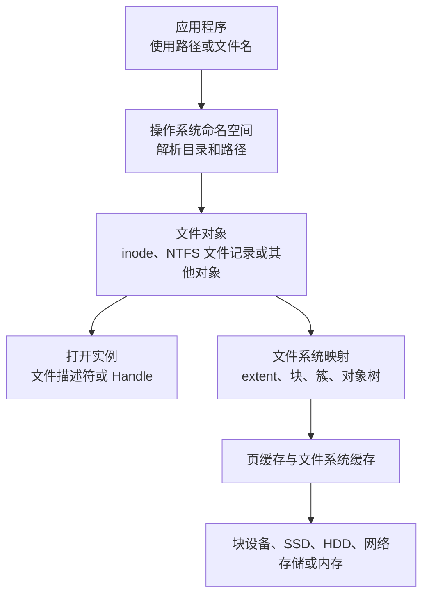
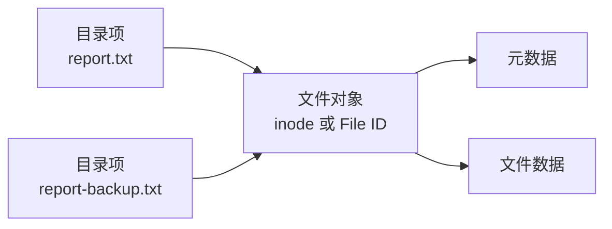
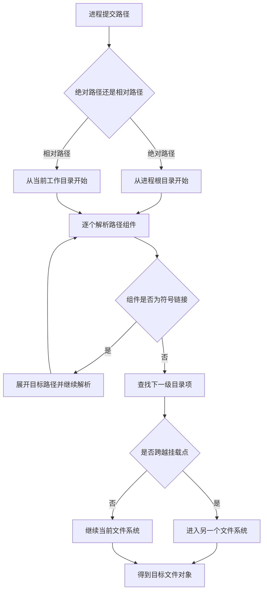
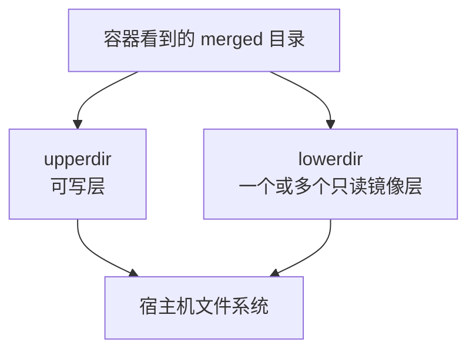
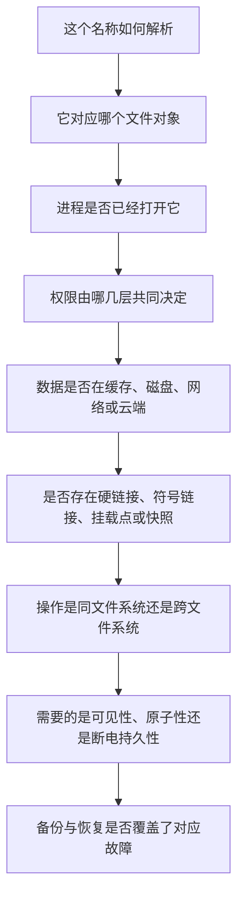

[toc]


## 学习大纲

下面这套大纲按照“抽象模型、系统调用、磁盘实现、操作系统差异、工程实践”的顺序展开。学习时不要一开始就背 NTFS、ext4、APFS 的结构，而应先建立统一模型，再理解各系统如何实现它。

| 学习模块       | 核心问题                                       | 应掌握的结果                                       |
| -------------- | ---------------------------------------------- | -------------------------------------------------- |
| 文件的本质     | 文件名、文件对象、内容、打开句柄是否是同一事物 | 能区分路径、目录项、文件身份、打开状态和磁盘数据   |
| 目录的本质     | 目录究竟是不是“装文件的盒子”                   | 理解目录主要是“名称到文件对象”的映射               |
| 路径解析       | 系统如何把路径变成真正的文件                   | 理解绝对路径、相对路径、当前目录、挂载点、符号链接 |
| 文件身份       | 改名后还是不是同一个文件                       | 理解 inode、文件 ID、硬链接和对象身份              |
| 文件生命周期   | 删除文件时究竟删除了什么                       | 理解 unlink、删除待定、打开句柄、空间释放时机      |
| 元数据         | 文件除内容外还保存什么                         | 理解权限、所有者、时间戳、扩展属性、ACL、数据流    |
| 数据存储       | 文件内容如何放到磁盘上                         | 理解块、簇、extent、稀疏文件、碎片、写时复制       |
| 一致性与持久化 | 写入成功是否意味着断电不丢                     | 理解缓存、flush、fsync、日志、原子替换             |
| 文件系统设计   | ext4、XFS、Btrfs、NTFS、APFS 有何区别          | 能根据工作负载选择文件系统                         |
| 安全模型       | 为什么有时管理员也打不开文件                   | 理解 POSIX 权限、ACL、DACL、SACL、应用沙箱         |
| 虚拟化与容器   | 容器中的 `/etc` 是否等于宿主机 `/etc`          | 理解挂载命名空间、OverlayFS 和联合目录             |
| 网络与云文件   | 路径存在是否意味着内容在本机                   | 理解 SMB、NFS、云占位文件和缓存一致性              |
| 运维实践       | 如何避免误删、权限混乱、写坏文件               | 掌握命名、备份、原子写入、监控和恢复原则           |

------

## 先建立一个统一模型

理解文件系统最重要的一步，是把下面四件事彻底分开：

- **名称与路径层**：例如 `/srv/data/report.csv` 或 `C:\Data\report.csv`
- **文件对象与元数据层**：文件身份、大小、权限、时间戳、数据位置
- **打开状态层**：进程持有的文件描述符或句柄、当前位置、访问模式
- **存储层**：真正位于 SSD、HDD、内存或远程服务器中的数据块



一个路径不是文件本身，文件名也不是文件本身。路径只是进程在某个文件系统命名空间中寻找对象的方法。

POSIX 将目录项定义为“把文件名与文件关联起来的对象”，并明确允许多个目录项关联到同一个文件；Linux ext4 文档也将目录描述为从任意字节串名称到 inode 编号的映射。([Open Group](https://pubs.opengroup.org/onlinepubs/9799919799/basedefs/V1_chap03.html?utm_source=chatgpt.com))

------

## 文件究竟是什么

### 用户视角

普通用户通常把文件理解为：

> 一个有名字、可以长期保存的数据集合。

例如：

- 文本文档
- 图片
- 视频
- 数据库文件
- 程序
- 压缩包

这是一种有用但不完整的认识。

### 操作系统视角

操作系统更倾向于把文件看成：

> 一个具有身份、类型、元数据和一组可执行操作的对象。

对普通文件，主要操作包括：

- 打开
- 读取
- 写入
- 定位
- 截断
- 查询属性
- 修改权限
- 建立链接
- 删除名称

Linux、macOS 等 Unix 系统还把很多其他对象放入文件系统命名空间：

- 目录
- 字符设备
- 块设备
- FIFO 命名管道
- Unix 域套接字
- 符号链接
- `/proc`、`/sys` 中的内核接口

- “Unix 中一切皆文件”**并不意味着所有对象都是"磁盘上的普通字节文件"**，而是说**许多资源可以通过类似文件的接口进行访问**。
- Windows 的 `CreateFile` 名称也容易让新手误解。它不仅可以打开普通文件，还可以打开目录、物理磁盘、卷、控制台、管道、通信设备等，并返回一个**内核对象句柄**。([Microsoft Learn](https://learn.microsoft.com/en-us/windows/win32/api/fileapi/nf-fileapi-createfile3?utm_source=chatgpt.com))

------

## 目录究竟是什么

### 目录不是物理盒子

图形界面把目录显示为“文件夹”，很容易让人形成一个直觉：

> 文件内容似乎真的装在文件夹里面。

更准确的模型是：

> 目录保存一组“名称到对象”的**关联关系**。

例如一个目录可能保存：

| 名称         | 对应对象          |
| ------------ | ----------------- |
| `report.txt` | 文件对象 3712     |
| `images`     | 目录对象 9811     |
| `latest`     | 符号链接对象 1245 |

在 ext4 中，**目录项**主要包含**文件名、inode 编号以及可选的文件类型**。文件的大小、权限、所有者和数据位置等主体元数据通常存放在 **inode** 中，而不是重复存放在每个目录项中。([Linux Kernel 文档](https://docs.kernel.org/filesystems/ext4/directory.html?utm_source=chatgpt.com))

### 目录也有自己的元数据

目录自身同样有：

- 所有者
- 权限
- 时间戳
- 文件系统对象身份
- 扩展属性
- ACL
- 占用的元数据空间

因此**目录本身也是一种文件系统对象**，只是它的内容**由文件系统解释为目录项**，而不应由普通应用直接当作任意字节修改。

### “目录大小”不是其下文件大小之和

在 `ls -l` 或 `stat` 中看到的**目录大小**，通常是目录自身索引结构占用或逻辑长度，不是全部后代文件大小之和。

计算整个目录树大小需要遍历：

```bash
du -sh /srv/data
```

这也是为什么磁盘分析工具面对数千万文件时可能很慢：它不是读取一个“目录总大小”字段，而是需要遍历大量目录项和文件元数据。

------

## 名称不是身份

这是整个文件系统知识体系中最关键的概念之一。

假设存在：

```text
/data/report.txt
```

以下操作不一定改变文件对象本身：

- 把它改名为 `final-report.txt`
- 把它移动到同一文件系统内的另一个目录
- 为它建立一个硬链接
- 删除其中一个硬链接名称

可以用下面的模型理解：



`report.txt` 和 `report-backup.txt` 可以是同一个文件的两个名称。

### Linux 和 POSIX 文件身份

在传统 Unix 模型中，文件通常可由以下组合在本地文件系统中标识：

```text
设备 ID + inode 编号
```

单独使用 inode 编号不够，因为不同文件系统可以有相同 inode 编号。

查看：

```bash
stat file.txt
ls -li file.txt
```

### Windows 文件身份

NTFS 也有独立于普通路径的文件记录和文件 ID。路径只是访问该记录的一种方式。应用打开文件后，Windows 返回句柄，后续读写可以通过句柄完成，而不必再次解析原路径。([Microsoft Learn](https://learn.microsoft.com/en-us/windows/win32/fileio/creating-and-opening-files?utm_source=chatgpt.com))

### 文件 ID 也不是永久全球 ID

不能把 inode 或本地文件 ID 当作永远有效的全球唯一标识：

- 文件删除后编号可能被复用
- 备份恢复后可能产生新身份
- 跨文件系统复制会创建新对象
- 网络协议可能映射或隐藏底层身份
- 快照、克隆和容器层可能改变可观察身份

需要长期、跨机器标识数据时，应在应用层使用 UUID、内容哈希或数据库主键。

------

## 路径是如何解析的

路径解析不是字符串查找这么简单，而是逐级解析目录组件。

例如：

```text
/srv/projects/demo/config.yaml
```

系统大体执行：

1. 从根目录开始。
2. 在根目录中查找 `srv`。
3. 确认它是可遍历的目录。
4. 在 `srv` 中查找 `projects`。
5. 继续查找 `demo`。
6. 最后查找 `config.yaml`。
7. 对每一级执行权限、挂载点和链接处理。

Linux VFS 为不同文件系统提供统一接口，并利用**目录项**缓存，也就是 dentry cache，**减少重复路径解析成本**。目录项缓存存在于内存中，并不是永久写入磁盘的目录结构。([Linux Kernel 文档](https://docs.kernel.org/filesystems/vfs.html?utm_source=chatgpt.com))



### 绝对路径与相对路径

Linux 和 macOS：

```text
/etc/ssh/sshd_config
```

以 `/` 开头的是绝对路径。

```text
../config/settings.json
```

是相对于当前工作目录解析的。

Windows：

```text
C:\Users\Alice\Documents
```

是驱动器绝对路径。

```text
\\server\share\folder
```

是 UNC 网络路径。

```text
\\?\C:\very-long-path
```

是扩展长度路径形式。现代 Windows 可以通过应用清单和系统策略**启用长路径**，因此不能再简单地认为所有 Windows 路径都永久限制为 260 个字符。([Microsoft Learn](https://learn.microsoft.com/en-us/windows/win32/fileio/naming-a-file?utm_source=chatgpt.com))

### `~` 不是文件系统的一部分

在 Shell 中：

```bash
cd ~/Documents
```

`~` 通常**由 Shell 展开为用户主目录**。内核文件系统路径解析本身并不认识 `~`。

同样，环境变量：

```powershell
$env:USERPROFILE
```

也由命令解释器或应用展开，不属于文件系统路径语法本身。

------

## 路径解析存在安全风险

下面这种程序逻辑有竞态条件：

1. 检查 `/tmp/file` 是否安全。
2. 隔了一段时间再次按路径打开 `/tmp/file`。
3. 攻击者在两步之间把它替换成符号链接。

这类问题称为：

> 检查时与使用时竞态条件
> Time-of-check to time-of-use，TOCTOU

更安全的设计包括：

- 尽量一次性安全打开目标。
- 打开后使用文件描述符或句柄，不要反复依赖路径。
- Linux 中优先使用 `openat()`、`openat2()` 等基于目录文件描述符的接口。
- 必要时禁止跟随符号链接。
- 临时文件使用安全的随机创建接口，不要先猜文件名再创建。
- 不要通过“先判断存在，再打开”的方式避免覆盖，应使用原子创建标志。

------

## 打开文件后发生了什么

### POSIX 文件描述符

Linux、macOS 等系统中，`open()` 成功后通常返回一个非负整数，称为：

> 文件描述符
> File Descriptor，FD

例如：

```text
3
4
5
```

文件描述符只是当前进程文件描述符表中的索引。它指向一个“打开文件描述”，其中保存：

- 当前文件偏移量
- 打开状态标志
- 对文件对象的引用

多个文件描述符可能指向同一个打开文件描述，例如 `dup()` 或 `fork()` 之后。文件被改名或原路径被删除后，已经打开的文件描述符仍可继续引用原对象。([man7.org](https://man7.org/linux/man-pages/man2/open.2.html?utm_source=chatgpt.com))

### Windows 句柄

Windows 使用：

> 句柄
> Handle

打开时除了请求读写权限，还要指定共享模式：

- 是否允许其他进程同时读
- 是否允许其他进程同时写
- 是否允许其他进程删除或改名

如果某个程序打开文件时没有允许共享写入或共享删除，其他程序的相应操作就可能收到“文件正在使用”或共享冲突错误。([Microsoft Learn](https://learn.microsoft.com/en-us/windows/win32/api/fileapi/nf-fileapi-createfilea?utm_source=chatgpt.com))

### 二者的关键差异

| 方面           | POSIX/Linux 常见语义           | Windows Win32 常见语义         |
| -------------- | ------------------------------ | ------------------------------ |
| 打开结果       | 文件描述符                     | 句柄                           |
| 共享控制       | 通常默认允许并发打开，另行加锁 | 打开时声明共享读、写、删除     |
| 删除已打开文件 | 通常允许先 unlink              | 取决于现有句柄是否允许共享删除 |
| 改名已打开文件 | 通常允许                       | 取决于句柄共享模式及具体操作   |
| 文件锁         | 多数是建议锁                   | 共享模式本身可强制阻止冲突打开 |
| 删除后继续访问 | 打开 FD 可继续使用             | 删除通常处于待关闭状态         |

------

## 删除文件究竟删除了什么

### POSIX 的 unlink 模型

在 Unix 模型中，删除普通文件更准确的说法是：

> 删除一个目录项，也就是取消一个名称与文件对象的关联。

`unlink()` 的名字就体现了这一点。

如果：

- 最后一个硬链接已经删除；
- 但仍有进程打开该文件；

那么文件对象和数据仍然存在，直到最后一个文件描述符关闭。([Open Group](https://pubs.opengroup.org/onlinepubs/9699919799/functions/unlink.html?utm_source=chatgpt.com))

这解释了 Linux 服务器上的经典现象：

1. 日志文件很大。
2. 管理员执行 `rm application.log`。
3. `df` 显示磁盘空间没有释放。
4. 原因是服务进程仍持有已删除日志的文件描述符。

排查：

```bash
sudo lsof +L1
```

解决方法通常是让程序重新打开日志，或安全重启相应服务，而不是继续删除其他文件。

### Windows 的删除待定

经典 Win32 删除模型通常是：

1. 请求删除权限。
2. 文件被标记为删除待定。
3. 等最后一个相关句柄关闭后完成删除。

如果已有句柄没有使用 `FILE_SHARE_DELETE` 共享删除，删除可能直接失败。Microsoft 文档明确说明，`DeleteFile` 通常将文件标记为关闭时删除，最终删除要等最后一个句柄关闭。([Microsoft Learn](https://learn.microsoft.com/en-us/windows/win32/api/winbase/nf-winbase-deletefile?utm_source=chatgpt.com))

### 回收站不是文件系统删除语义

图形界面中的回收站通常是桌面环境或文件管理器实现的高层功能：

- 将文件移动到特殊目录；
- 保存原路径等恢复信息；
- 以后再真正删除。

以下操作通常不会进入桌面回收站：

- Linux 命令行 `rm`
- Windows PowerShell `Remove-Item`
- 程序直接调用删除 API
- 远程共享上的部分删除
- 超过回收站策略限制的文件

因此不能把回收站当作备份。

------

## 改名和移动

### 同一文件系统内改名

在 POSIX 语义中，同一文件系统内的 `rename()` 通常是目录项层面的原子操作。

如果目标路径已经存在，符合条件时可以原子替换，其他进程不会观察到目标名称处于“先消失再出现”的中间状态。打开的文件描述符和其他硬链接不受改名影响。([man7.org](https://man7.org/linux/man-pages/man2/rename.2.html?utm_source=chatgpt.com))

### 跨文件系统移动

下面两个路径可能位于不同文件系统：

```text
/home/user/file
/mnt/archive/file
```

跨文件系统不能仅修改目录项，因为两个文件系统有各自独立的对象和分配结构。

此时 `mv` 一类工具通常需要：

1. 在目标文件系统创建新文件。
2. 复制内容。
3. 复制部分元数据。
4. 删除源文件。

所以跨文件系统移动：

- 不是瞬时操作；
- 通常不是整体原子的；
- 中途失败可能产生不完整副本；
- 可能丢失某些 ACL、扩展属性、稀疏布局或链接关系。

------

## 硬链接、符号链接和 Windows 重解析点

### 硬链接

硬链接是另一个目录项，直接关联到同一个文件对象。

```bash
ln original.dat second-name.dat
```

特点：

- 两个名称地位相同。
- 没有真正的“原始名称”。
- 修改任一名称看到的内容，另一个也会变化。
- 删除一个名称不会删除另一个。
- 通常不能跨文件系统。
- 普通用户通常不能给目录创建硬链接，以避免目录环和结构破坏。

POSIX 和 Linux 文档明确指出，两个硬链接引用的是同一文件，无法从对象本身判断哪个名称是“原始名称”。([Open Group](https://pubs.opengroup.org/onlinepubs/9699919799/functions/link.html?utm_source=chatgpt.com))

### 符号链接

符号链接保存的是目标路径文本：

```bash
ln -s /srv/releases/v2 current
```

特点：

- 可以跨文件系统。
- 可以指向目录。
- 可以指向尚不存在的目标。
- 目标删除后，链接会变成悬空链接。
- 相对符号链接相对于符号链接所在目录解释，而不是调用者当前目录。

POSIX 明确允许符号链接跨文件系统，且创建时目标不必存在。([Open Group](https://pubs.opengroup.org/onlinepubs/009695299/functions/symlink.html?utm_source=chatgpt.com))

### Windows 链接体系

NTFS 常见链接和重定向对象包括：

| 类型              | 典型用途                         |
| ----------------- | -------------------------------- |
| 硬链接            | 为同一普通文件增加名称           |
| 符号链接          | 指向文件或目录                   |
| 目录联接 Junction | 将目录链接到另一个目录或卷       |
| 卷挂载点          | 将卷挂载在目录中                 |
| 其他重解析点      | 云占位文件、筛选驱动、存储分层等 |

Windows 的符号链接、联接和部分特殊文件功能建立在重解析点机制之上。重解析点中的数据由相应文件系统驱动或筛选驱动解释。([Microsoft Learn](https://learn.microsoft.com/en-us/windows/win32/fileio/hard-links-and-junctions?utm_source=chatgpt.com))

### 遍历工具为什么默认不应跟随链接

递归工具若无条件跟随符号链接，可能遇到：

- 目录环
- 重复扫描
- 跨入其他文件系统
- 进入网络挂载
- 穿越安全边界
- 扫描容器或备份快照多次

因此备份、查找和容量分析工具通常应明确设置：

- 是否跟随符号链接；
- 是否跨文件系统；
- 是否处理挂载点；
- 如何识别重复对象。

------

## 文件名和路径规则的系统差异

### 核心对比

| 特性             | Windows 常见行为        | Linux 常见行为        | macOS 默认 APFS              |
| ---------------- | ----------------------- | --------------------- | ---------------------------- |
| 根结构           | 多驱动器和 UNC 命名空间 | 单一 `/` 根树         | 单一 `/` 根树                |
| 路径分隔符       | 主要为反斜杠            | 正斜杠                | 正斜杠                       |
| 大小写           | 通常不敏感但保留大小写  | 通常敏感              | 默认通常不敏感但保留大小写   |
| 大小写变体共存   | 默认通常不允许          | 通常允许              | 默认格式通常不允许           |
| 常见本地文件系统 | NTFS、ReFS              | ext4、XFS、Btrfs、ZFS | APFS                         |
| 网络路径         | UNC、SMB                | 挂载 NFS、SMB 等      | 挂载 SMB、NFS 等             |
| 卷呈现方式       | 盘符或目录挂载点        | 挂载到任意目录        | 通常挂载到 `/Volumes` 等位置 |

Windows 文档要求应用不要假定文件名大小写敏感；NTFS 支持大小写敏感语义，但这不是默认行为。macOS 的 APFS 提供普通、加密、大小写敏感、大小写敏感且加密等格式。([Microsoft Learn](https://learn.microsoft.com/en-us/windows/win32/fileio/naming-a-file?utm_source=chatgpt.com))

### Linux 文件名更接近字节序列

在多数传统 Linux 文件系统中，内核不会把所有文件名都强制解释为某一种文本编码。ext4 文档将目录名称描述为任意字节串映射，实际显示效果由应用、区域设置和终端编码共同决定。([Linux Kernel 文档](https://docs.kernel.org/filesystems/ext4/directory.html?utm_source=chatgpt.com))

因此可能出现：

- 文件名字节有效，但不是合法 UTF-8；
- 两个视觉上相同的 Unicode 名称实际字节不同；
- 脚本在不同区域设置下显示或排序不同；
- 备份到其他系统时发生名称冲突。

### macOS 与 Unicode 规范化

同一个可见字符可能有多种 Unicode 编码方式。例如带音标字符可以是：

- 一个预组合字符；
- 基础字符加组合音标。

APFS 会保留文件名原有的规范化形式，同时使用规范化后的形式进行相应比较。这意味着应用不应自己假设磁盘上的字符串一定使用某一种固定 Unicode 规范化形式。([Apple Developer](https://developer.apple.com/library/archive/documentation/FileManagement/Conceptual/APFS_Guide/FAQ/FAQ.html?utm_source=chatgpt.com))

### 跨平台安全命名建议

对于需要在 Windows、Linux、macOS、NAS、压缩包和云存储之间传递的文件，建议：

- 使用字母、数字、连字符、下划线和句点。
- 不要只靠大小写区分两个文件。
- 不要以空格或句点结尾。
- 避免 Windows 保留设备名，如 `CON`、`NUL`、`COM1`。
- 避免控制字符。
- 避免路径组件过长。
- 不要把完整业务语义全部塞进文件名。
- 使用明确、固定的 Unicode 规范化策略。
- 对用户输入名称执行冲突检查，而不是简单改写后静默覆盖。

一个较安全的例子：

```text
2026-07-10_project-alpha_experiment-03.csv
```

不太安全的例子：

```text
最终版|真正最终版：实验结果?.csv
```

------

## 文件元数据

文件不只是内容，还包含大量元数据。

### 常见元数据分类

| 类型       | 示例                               |
| ---------- | ---------------------------------- |
| 身份       | inode、文件 ID                     |
| 类型       | 普通文件、目录、链接、设备、套接字 |
| 大小       | 逻辑大小、已分配空间               |
| 所有权     | 用户、组、SID                      |
| 权限       | rwx、ACL、DACL                     |
| 时间       | 访问、修改、状态变化、创建         |
| 布局       | extent、数据块、稀疏范围           |
| 特殊属性   | 只读、隐藏、不可变、压缩           |
| 扩展元数据 | xattr、资源叉、替代数据流          |
| 完整性信息 | 校验和、verity 元数据              |
| 安全标签   | SELinux、AppArmor、隔离或来源属性  |

### 三种大小不要混淆

#### 逻辑大小

文件对应用表现出的字节长度。

例如：

```bash
stat --format='%s' file
```

#### 已分配大小

文件系统实际为文件分配的块数量。

稀疏文件的已分配大小可能远小于逻辑大小。

#### 独占物理空间

在写时复制、reflink、压缩和快照文件系统中，部分数据块可能被多个文件或快照共享，因此“这个文件独占多少空间”未必容易计算。

这解释了为什么下面几种数字可能不同：

- 文件管理器显示大小
- `ls -l` 显示大小
- `du` 统计大小
- `df` 显示文件系统已使用空间
- 快照工具显示的引用空间和独占空间

### 时间戳

Unix 常见时间戳包括：

| 名称                  | 含义                               |
| --------------------- | ---------------------------------- |
| `atime`               | 最后访问时间                       |
| `mtime`               | 文件数据最后修改时间               |
| `ctime`               | inode 状态最后变化时间             |
| `btime` 或 birth time | 创建时间，取决于文件系统和接口支持 |

最容易误解的是：

> `ctime` 不是 creation time，而是 change time。

修改权限、所有者、链接数等元数据也可能改变 `ctime`。POSIX 对访问时间、数据修改时间和文件状态变化时间作了区分。([Open Group](https://pubs.opengroup.org/onlinepubs/9699919799/basedefs/V1_chap04.html?utm_source=chatgpt.com))

### 目录时间戳

在目录中创建、删除或改名直接子项，通常会改变该目录的 `mtime`。

但修改后代文件的内容，不一定改变所有祖先目录的 `mtime`。因此不能只看顶层目录时间判断整个目录树是否发生变化。

------

## 扩展属性、替代数据流和资源数据

### Linux 扩展属性

扩展属性通常称为：

> Extended Attributes，xattr

用于存放：

- SELinux 标签
- 文件能力
- 用户自定义元数据
- 来源信息
- ACL 的底层表示
- 应用标记

查看示例：

```bash
getfattr -d file
getfacl file
```

复制文件时只复制内容，并不一定会复制扩展属性。

### NTFS 替代数据流

NTFS 一个文件可以关联多个命名数据流：

```text
file.txt
file.txt:metadata
```

默认看到的内容是未命名主数据流。其他流可能存储附加信息。Microsoft 将 NTFS 文件流定义为与文件关联的字节序列，每个流可以有自己的分配大小和有效数据长度。([Microsoft Learn](https://learn.microsoft.com/en-us/windows/win32/fileio/file-streams?utm_source=chatgpt.com))

查看：

```powershell
Get-Item .\file.txt -Stream *
```

或：

```cmd
dir /r
```

把 NTFS 文件复制到不支持数据流的文件系统时，附加流可能丢失。

### macOS 扩展属性

macOS 广泛使用扩展属性保存：

- Finder 信息
- 来源或隔离信息
- 应用元数据
- 下载来源标记

查看：

```bash
xattr -l file
ls -l@
```

因此跨平台复制时，“文件内容相同”不一定意味着文件的所有语义都被完整保存。

------

## 权限模型

## Linux 和 POSIX 权限

传统 Unix 权限由三组对象构成：

- 所有者 user
- 所属组 group
- 其他用户 other

每组有：

- `r`：read
- `w`：write
- `x`：execute

普通文件示例：

```text
-rw-r-----
```

表示：

- 所有者可读写；
- 所属组可读；
- 其他用户无权限。

### 目录上的 rwx 含义不同

这是新手必须掌握的重点。

| 权限 | 对目录的含义                 |
| ---- | ---------------------------- |
| `r`  | 读取目录项名称列表           |
| `w`  | 创建、删除或改名目录项       |
| `x`  | 搜索、穿越目录并访问其中对象 |

因此可能出现：

- 有 `x` 没有 `r`：知道准确名称时可以访问，但不能列出目录。
- 有 `r` 没有 `x`：能看到部分名称，但不能正常进入或访问对象。
- 有 `w` 和 `x`：通常可以删除目录中的文件，即使不能修改文件内容。

删除文件主要受父目录权限控制，而不是只看文件本身是否可写。

### sticky bit

共享目录 `/tmp` 通常带 sticky bit：

```text
drwxrwxrwt
```

它允许多人创建文件，但通常只有文件所有者、目录所有者或特权用户能够删除对应项目。

### umask

新文件的最终基础权限受到 `umask` 影响。

例如：

```bash
umask 027
```

通常意味着：

- 所有者保留较完整权限；
- 组权限受限；
- 其他用户无权限。

服务器上不应养成遇到权限问题就执行：

```bash
chmod -R 777 directory
```

这会掩盖所有权、组设计、ACL、服务账户和挂载配置等真正问题。

### POSIX ACL

POSIX ACL 可以为额外用户和组设置更细粒度权限，并让目录具有默认 ACL。Linux ACL 文档将其定义为对传统自主访问权限的细化扩展。([man7.org](https://man7.org/linux/man-pages/man5/acl.5.html?utm_source=chatgpt.com))

查看：

```bash
getfacl /srv/project
```

设置默认组权限：

```bash
setfacl -m g:developers:rwx /srv/project
setfacl -m d:g:developers:rwx /srv/project
```

------

## Windows 权限

Windows 文件和目录通常有安全描述符，主要包括：

- 所有者 SID
- 主要组 SID
- DACL
- SACL
- 控制与继承标志

### DACL

> Discretionary Access Control List

DACL 包含多个 ACE，每个 ACE 指定：

- 对哪个用户或组；
- 允许还是拒绝；
- 允许或拒绝哪些访问权；
- 是否向子对象继承。

### SACL

> System Access Control List

SACL 主要决定哪些成功或失败访问应生成审计记录。

Windows 在访问检查时，将进程或线程访问令牌中的 SID 和特权，与文件安全描述符中的 DACL 比较。DACL 控制允许与拒绝，SACL 用于审计。([Microsoft Learn](https://learn.microsoft.com/en-us/windows/win32/secauthz/access-control-lists?utm_source=chatgpt.com))

查看：

```powershell
Get-Acl C:\Data\report.txt | Format-List
```

### 继承不是简单复制

Windows ACL 支持：

- 父目录继承
- 只对子目录继承
- 只对文件继承
- 直接 ACE
- 继承 ACE
- 禁止继承
- 将继承项转换为显式项

直接应用的 ACE 和继承 ACE 具有规则化顺序，不能简单地认为“上层允许就一定允许”。Microsoft 文档说明新对象通常继承父对象的可继承 ACE，并允许通过保护标志阻止继承。([Microsoft Learn](https://learn.microsoft.com/en-us/windows/win32/secauthz/security-descriptors-for-new-objects?utm_source=chatgpt.com))

------

## macOS 权限是多层的

macOS 同时可能涉及：

- POSIX 所有者、组和 rwx 权限
- ACL
- APFS 卷权限
- 应用沙箱
- 隐私与安全中的“文件与文件夹”授权
- Full Disk Access
- 系统完整性保护等更高层机制

所以即使传统 Unix 权限看起来允许，应用仍可能因为隐私控制或沙箱而无法访问桌面、文稿等目录。Apple 将这些位置的应用访问独立放在“隐私与安全”的文件与文件夹设置中管理。([苹果支持](https://support.apple.com/en-ca/guide/mac-help/mchld5a35146/mac?utm_source=chatgpt.com))

------

## 文件内容如何映射到磁盘

### 块和簇

存储设备按扇区工作，文件系统通常再按块或簇分配空间。

文件长度不一定刚好是块大小的整数倍。例如一个 1 字节文件仍可能占用一个完整分配块，外加目录和 inode 等元数据。

### extent

现代文件系统通常使用：

> Extent，连续区间

一个 extent 表示：

```text
文件逻辑偏移范围 -> 一段连续物理块
```

相较于逐块记录，extent 更适合大文件，减少元数据量。

ext4、XFS 等现代文件系统都广泛使用 extent。XFS 还大量使用 B 树管理目录、extent 和空闲空间，以支持大型文件和高并发工作负载。([Linux Kernel 文档](https://docs.kernel.org/filesystems/ext4/dynamic.html?utm_source=chatgpt.com))

### 碎片

文件碎片表示一个文件分散到多个不连续区域。

HDD 上碎片可能导致更多机械寻道；SSD 没有机械寻道，但碎片仍可能增加：

- 映射元数据量
- I/O 请求数量
- 写放大
- extent 管理开销

不过现代文件系统、缓存和 SSD 控制器使“碎片越少一定越快”不再是绝对规则。

### 稀疏文件

稀疏文件的逻辑地址空间中可以存在“洞”。读取洞时返回零，但文件系统未必真的分配物理块。

实验：

```bash
mkdir -p /tmp/fs-lab
cd /tmp/fs-lab

truncate -s 10G sparse.img

ls -lh sparse.img
du -h sparse.img
```

可能看到：

- `ls` 显示逻辑大小 10 GiB；
- `du` 显示实际占用很小。

复制稀疏文件时，应使用能保留洞的工具，否则目标可能真的占用 10 GiB。

------

## 硬链接、reflink 和普通复制不是一回事

| 操作         | 是否共享文件对象 | 是否共享数据块     | 修改一方的影响       |
| ------------ | ---------------- | ------------------ | -------------------- |
| 普通复制     | 否               | 通常否             | 互不影响             |
| 硬链接       | 是               | 是，因为是同一文件 | 另一名称立即看到变化 |
| reflink 克隆 | 否               | 初始共享           | 修改区域发生写时复制 |
| 快照         | 独立时间点视图   | 大量共享           | 后续修改保留旧块     |

### reflink

reflink 创建一个新的文件对象，但初始数据块与原文件共享。

当其中一方被修改时，文件系统只为修改的区域分配新块，这就是：

> 写时复制
> Copy-on-Write，CoW

与硬链接不同，reflink 的两个文件具有独立元数据和独立内容演化过程。

Linux 的 iomap 接口中明确存在对 reflink 共享数据进行取消共享的操作。([Linux Kernel 文档](https://docs.kernel.org/filesystems/iomap/operations.html?utm_source=chatgpt.com))

------

## 缓存、写入和持久化

### 写入成功不一定表示已经写入物理介质

应用执行写操作时，数据通常经历：


某个 API 返回成功，可能只说明数据已经进入某层缓存。

### `close()` 不等于持久化保证

关闭文件通常意味着：

- 进程不再持有该打开引用；
- 用户态缓冲可能已提交给内核；
- 内核最终会安排回写。

但它通常不自动提供“此刻拔电也一定保留”的强保证。

POSIX 使用 `fsync()` 强制排队中的相关 I/O 同步到存储；Windows 提供 `FlushFileBuffers`，并支持 write-through 等模式。([Open Group](https://pubs.opengroup.org/onlinepubs/009695399/functions/fsync.html?utm_source=chatgpt.com))

### 日志文件系统不等于每次写入都立即落盘

日志文件系统主要解决：

- 崩溃后元数据结构不至于处于任意半更新状态；
- 可以重放或回滚未完成事务；
- 减少完整文件系统检查需求。

它不自动等于：

- 每次 `write()` 都已持久化；
- 应用最后一批数据绝不会丢；
- 数据库不需要自己的 WAL 和同步协议；
- 不需要 UPS、可靠控制器和备份。

------

## 安全保存文件的原子替换模式

配置文件、文档和状态文件不应直接这样更新：

1. 打开原文件。
2. 截断为零。
3. 写入新内容。

如果中途崩溃，可能留下空文件或半个文件。

更安全的模式是：

1. 在目标目录创建临时文件。
2. 写入完整新内容。
3. 刷新临时文件数据。
4. 设置所需权限和元数据。
5. 用同一文件系统内的原子改名替换目标。
6. 在要求严格崩溃一致性的 Unix 场景中，再同步父目录。

概念示例：

```text
config.json
config.json.tmp-随机值
```

写完临时文件后，再把它原子改名为 `config.json`。

为什么临时文件要在同一目录或至少同一文件系统？

因为跨文件系统改名不能作为原子目录项替换。

------

## 日志式文件系统与写时复制文件系统

### 日志式更新

传统日志式文件系统通常会：

1. 把即将执行的元数据变更写入日志。
2. 提交日志事务。
3. 更新主文件系统结构。
4. 回收日志空间。

典型代表：

- NTFS
- ext4
- XFS

ext4 使用 JBD2 日志机制；XFS 是高性能日志文件系统，并使用 extent 和 B 树实现扩展性。([Linux Kernel 文档](https://docs.kernel.org/filesystems/journalling.html?utm_source=chatgpt.com))

### 写时复制更新

CoW 文件系统通常不原地覆盖关键旧块，而是：

1. 分配新块。
2. 写入新数据或元数据。
3. 建立新的树节点。
4. 最后原子切换根指针或事务状态。
5. 旧块仍可被快照引用。

典型代表：

- Btrfs
- APFS
- ZFS

Btrfs 官方定位就是面向容错、修复和管理能力的 Linux 写时复制文件系统。APFS 提供空间共享、快照和加密等能力。ZFS 结合存储池、快照和端到端校验和。([Linux Kernel 文档](https://docs.kernel.org/filesystems/btrfs.html?utm_source=chatgpt.com))

### CoW 也有代价

写时复制可能带来：

- 随机覆盖写放大
- 元数据放大
- 碎片增加
- 快照长期保留导致空间难以回收
- 数据库或虚拟机镜像性能波动
- 空间不足时行为更复杂

所以“支持快照”不等于对所有工作负载都更快。

------

## 常见文件系统对比

| 文件系统 | 常见平台与定位                | 核心特点                                      | 适合场景                           | 主要注意点                              |
| -------- | ----------------------------- | --------------------------------------------- | ---------------------------------- | --------------------------------------- |
| NTFS     | Windows 默认通用文件系统      | 日志、ACL、硬链接、重解析点、数据流、稀疏文件 | Windows 系统盘、桌面、通用服务器   | 跨平台工具对 ACL 和数据流支持不一定完整 |
| ReFS     | Windows Server 和特定工作负载 | 完整性、可用性、大规模数据、块克隆等现代能力  | 虚拟化、数据卷、特定服务器场景     | 功能和可用性取决于 Windows 版本与用途   |
| ext4     | Linux 通用文件系统            | 成熟、日志、extent、元数据校验、工具生态完善  | 通用 Linux 服务器和桌面            | 原生快照和完整数据校验能力有限          |
| XFS      | Linux 高性能大型文件系统      | 并行、extent、B 树、大文件和大型卷扩展性      | 大文件、日志、媒体、数据库数据卷   | 缩容和恢复运维应提前规划                |
| Btrfs    | Linux CoW 文件系统            | 快照、子卷、校验和、压缩、reflink、多设备     | 桌面、开发、容器、需要快照的服务器 | 快照、空间和碎片管理更复杂              |
| APFS     | Apple 平台默认文件系统        | CoW、空间共享、快照、加密、克隆能力           | macOS、iOS 及 Apple 设备           | 大小写格式选择和跨平台兼容需注意        |
| ZFS      | 服务器和存储平台              | 存储池、CoW、快照、校验和、自愈、压缩         | NAS、大容量存储、数据完整性优先    | 内存、运维模型和设备规划要求较高        |
| exFAT    | 跨平台移动介质                | 简单、支持大文件、兼容性较广                  | U 盘、移动硬盘交换数据             | 缺少完善权限、日志、快照等服务器能力    |
| FAT32    | 老旧设备兼容                  | 极高兼容性、结构简单                          | 固件、相机、小型移动介质           | 单文件大小限制和可靠性能力明显落后      |

Microsoft 将 ReFS 定位为面向高可用、可扩展和数据完整性的现代文件系统；ext4 强调成熟的可扩展性和可靠性；XFS 强调多线程、大文件、extent 与 B 树；Btrfs 强调写时复制和高级管理功能。([Microsoft Learn](https://learn.microsoft.com/en-us/windows-server/storage/refs/refs-overview?utm_source=chatgpt.com))

### 实际选择建议

#### Windows

普通桌面和大多数通用 Windows 工作负载：

> 优先 NTFS。

需要 ReFS 特定能力时，应先确认：

- Windows 版本是否支持；
- 是否作为系统卷；
- 备份、杀毒、快照和监控工具兼容性；
- 应用是否依赖 NTFS 特有功能。

#### Linux 通用服务器

没有特殊需求时：

> ext4 是稳妥的默认选择。

需要大型文件、高并行和成熟企业运维：

> 考虑 XFS。

需要快照、压缩、子卷和容器友好克隆：

> 考虑 Btrfs。

需要存储池、端到端校验、快照复制和数据完整性：

> 考虑 ZFS。

#### macOS

内部 SSD 和普通 Mac 数据卷：

> 使用 APFS。

需要区分大小写的开发或测试环境，可创建大小写敏感 APFS 卷，但要确认应用兼容性。Apple 的普通 APFS 和 APFS 大小写敏感格式是不同选项。([苹果支持](https://support.apple.com/lv-lv/guide/disk-utility/dsku19ed921c/mac?utm_source=chatgpt.com))

#### 跨平台移动盘

Windows、macOS 和 Linux 之间交换大型文件：

> 通常使用 exFAT。

但重要数据不应只保存在一个 exFAT 移动盘上，因为它不是为了服务器级权限、快照和崩溃恢复而设计的。

------

## APFS 的空间共享

传统分区通常预先固定容量：

```text
系统卷 500 GB
数据卷 500 GB
```

即使系统卷只用了 100 GB，数据卷也不一定能自动使用剩余 400 GB。

APFS 容器中的多个卷可以共享容器空闲空间，并可设置：

- Reserve Size：保留容量
- Quota Size：最大配额

Apple 文档说明，同一 APFS 容器中的卷可以共享可用空间，并允许为卷设置保留量和配额。([苹果支持](https://support.apple.com/guide/disk-utility/add-delete-or-erase-apfs-volumes-dskua9e6a110/mac?utm_source=chatgpt.com))

这是一种“逻辑卷动态共享底层空间”的现代设计。

------

## ZFS 的存储池模型

ZFS 不仅是单个文件系统格式，还将：

- 设备
- 冗余
- 存储池
- 数据集
- 快照
- 校验和
- 压缩
- 配额

整合在同一个管理体系中。

一个 ZFS 池可以包含多个 dataset，每个 dataset 可以有自己的：

- 挂载点
- 压缩策略
- 配额
- 快照策略
- 记录大小
- 访问控制属性

ZFS 快照最初共享现有数据块，创建速度快且初始几乎不增加数据占用；随着活动数据变化，快照保留的旧块才逐渐占用额外空间。([OpenZFS](https://openzfs.github.io/openzfs-docs/man/v0.8/8/zfs.8.html?utm_source=chatgpt.com))

------

## 快照不是备份

快照能够防范：

- 用户误删
- 错误升级
- 部分勒索软件破坏
- 配置回滚需求
- 短期历史恢复

但快照通常不能单独防范：

- 整个磁盘或存储池物理损坏
- 控制器故障
- 管理员删除所有快照
- 攻击者获得同等存储管理权限
- 机房火灾
- 存储设备丢失
- 文件系统严重损坏
- 同一设备上的恶意擦除

合理策略应包括：

- 本地快照用于快速恢复；
- 独立介质或独立存储上的备份；
- 异地或离线副本；
- 定期恢复演练；
- 对备份本身进行完整性验证。

“备份成功”日志不等于“能够成功恢复”。

------

## 容器中的文件系统

现代 Linux 容器经常使用 OverlayFS。

它通常由以下层组成：

| 层       | 含义               |
| -------- | ------------------ |
| lowerdir | 只读基础镜像层     |
| upperdir | 当前容器可写层     |
| workdir  | OverlayFS 工作目录 |
| merged   | 容器看到的合并视图 |



### Copy-up

容器修改只读基础层中的文件时，OverlayFS 通常先把文件复制到 upperdir，再修改上层副本。

### Whiteout

容器“删除”基础镜像中的文件时，不能真的修改只读 lowerdir，于是 upperdir 中会创建特殊隐藏标记，表示：

> 在合并视图中隐藏下层的这个对象。

Linux 内核 OverlayFS 文档明确描述了 upper、lower、索引和 whiteout 等机制。([Linux Kernel 文档](https://docs.kernel.org/filesystems/overlayfs.html?utm_source=chatgpt.com))

### 为什么容器磁盘统计容易令人困惑

可能出现：

- 多个容器共享同一镜像层；
- 每个容器看起来都有相同文件；
- 实际物理块只保存一份；
- `du` 在不同层和命名空间中看到不同结果；
- 删除容器内文件不一定马上释放镜像层空间；
- 日志写入容器可写层导致 upperdir 快速增长。

最佳实践是：

- 数据库和持久数据放入明确的数据卷；
- 不把重要数据只留在容器可写层；
- 限制和轮转容器日志；
- 区分镜像、容器层、volume 和 bind mount。

------

## 挂载与文件系统命名空间

### Linux 的单一目录树

Linux 将不同文件系统挂载到同一个目录树中：

```text
/
├── home
├── var
├── srv
└── mnt
    └── archive
```

其中：

- `/` 可能是 ext4；
- `/home` 可能是 XFS；
- `/srv/data` 可能是 NFS；
- `/mnt/archive` 可能是 ZFS dataset。

用户看到一棵树，但实际可能跨越多个文件系统。

### Windows 也不只支持盘符

Windows 常见盘符：

```text
C:
D:
E:
```

但 NTFS 卷也可以挂载到目录：

```text
C:\Volumes\Data
```

因此“Windows 一定按盘符、Linux 一定按目录挂载”只是表面差异，不是绝对技术限制。

### 挂载命名空间

Linux 可以让不同进程看到不同挂载视图。

因此：

- 宿主机的 `/etc`；
- 容器 A 的 `/etc`；
- 容器 B 的 `/etc`；

可能对应完全不同的对象。

这也是为什么从容器里看到的绝对路径，不一定能直接用于宿主机。

------

## 网络文件系统不是本地文件系统的简单延长

SMB、NFS、分布式文件系统和对象网关可能改变很多语义：

- 缓存一致性
- 锁行为
- 大小写处理
- 用户身份映射
- ACL 表达
- 文件 ID 稳定性
- 改名原子性边界
- 删除已打开文件行为
- 时间戳精度
- 扩展属性支持
- 断线后的错误恢复

例如 Linux 客户端通过 SMB 访问 Windows 共享时，最终权限可能同时受：

- Linux 挂载参数；
- SMB 会话身份；
- 服务器端 NTFS ACL；
- 共享权限；
- 域用户和组映射；

共同影响。

排查网络文件权限时，不应只执行 `chmod` 就认定问题已经解决。

------

## 云同步文件不一定已经位于本机

现代云同步客户端可能创建：

- 占位文件
- 按需下载文件
- 重解析点
- 文件提供者对象
- 仅元数据条目

文件在资源管理器或 Finder 中可见，不代表完整内容已下载。

当应用读取时，系统或同步客户端才触发：

1. 联系云服务。
2. 下载内容。
3. 写入本地缓存。
4. 返回给应用。

因此“文件存在”至少可能有三种含义：

- 命名空间中存在条目；
- 本地有部分元数据；
- 完整内容已经驻留本机。

对备份和离线任务，应明确要求“始终保留在本机”，或者验证文件是否已经完全水合。

------

## 文件系统搜索为什么有时很慢

按名称查找可能采用两种模式。

### 实时遍历

例如：

```bash
find /srv/data -name '*.csv'
```

系统需要逐级：

- 读取目录；
- 解析目录项；
- 必要时读取 inode；
- 检查权限；
- 继续递归。

优点是结果新鲜。

缺点是文件数量巨大时非常慢。

### 预先索引

例如：

- Windows Everything
- Linux plocate
- macOS Spotlight

索引系统提前保存：

- 文件名
- 路径
- 部分元数据
- 有时还包括文件内容和语义信息

查询时直接访问索引，而不是重新遍历磁盘。

因此必须区分：

> 文件系统自身的目录索引
> 与搜索软件建立的全局搜索索引。

它们不是同一个概念。

------

## 文件系统目录索引

现代文件系统不会总是对大目录做简单线性查找。

例如：

- ext4 可使用哈希树目录；
- XFS 大量使用 B 树；
- NTFS 目录使用索引结构；
- APFS 使用树结构管理元数据。

这些索引主要加速：

> 已知父目录和具体名称时，查找一个目录项。

它们并不直接回答：

```text
整块磁盘里所有名称包含 report 的文件在哪里？
```

全盘模糊搜索仍需要遍历或建立额外全局索引。

------

## 文件锁定

### 建议锁

Unix 上很多锁属于：

> Advisory Lock，建议锁

含义是：

- 遵守锁协议的程序会互相协调；
- 不遵守锁协议的程序仍可能直接访问文件。

因此锁不是天然等于权限控制。

### Windows 共享模式

Windows 打开文件时的共享模式更直接：

- 当前句柄不允许共享写；
- 后来的冲突写打开可能立即失败。

此外仍可以使用字节范围锁和其他同步机制。

### 锁文件不等于锁

很多程序创建：

```text
application.lock
```

它只是一个协议标志。可靠实现必须处理：

- 程序崩溃后的陈旧锁文件；
- PID 被复用；
- 网络文件系统原子性；
- 多主机竞争；
- 锁文件创建本身是否原子；
- 操作系统锁是否随进程退出自动释放。

------

## 文件复制应考虑什么

普通“复制内容”可能遗漏：

- 所有者
- 组
- 权限
- ACL
- 扩展属性
- SELinux 标签
- 硬链接关系
- 稀疏布局
- 资源叉
- NTFS 数据流
- 创建时间
- 文件能力
- reflink 共享关系
- 加密属性

### Linux 常用选择

普通目录归档复制：

```bash
rsync -aHAX --numeric-ids source/ destination/
```

其中常见含义：

- `-a`：归档模式
- `-H`：保留硬链接关系
- `-A`：保留 ACL
- `-X`：保留扩展属性
- `--numeric-ids`：按数字 UID 和 GID 处理

但目标文件系统必须支持相应能力。

### Windows

使用 `robocopy` 时应明确：

- 复制数据还是全部安全信息；
- 是否保留时间戳；
- 是否复制备用数据流；
- 是否跨卷；
- 如何处理联接和重解析点；
- 是否可能递归进入目录环。

不要在不了解链接结构时无条件使用“复制全部并跟随所有目录”。

------

## 安全删除的现代认识

### 普通删除不是擦除

删除通常只是：

- 删除目录项；
- 更新空闲空间结构；
- 允许以后复用数据块。

原始数据可能暂时仍存在。

### SSD 上反复覆盖并不可靠

SSD 使用：

- 闪存转换层
- 磨损均衡
- 备用块
- TRIM
- 垃圾回收

应用覆盖同一逻辑地址，不保证写到同一物理 NAND 页面。

CoW 文件系统和快照还可能保留旧版本块。

因此现代安全策略更应依赖：

- 从一开始启用全盘或文件级加密；
- 安全管理密钥；
- 销毁密钥完成加密擦除；
- 使用设备厂商的安全擦除功能；
- 删除全部快照和备份副本；
- 对极高敏感介质进行物理销毁。

Apple 也明确指出，Disk Utility 不对 SSD 提供传统多次覆盖式安全擦除选项，并建议从开始使用时启用 FileVault 加密。([苹果支持](https://support.apple.com/en-ca/guide/disk-utility/dskutl14079/mac?utm_source=chatgpt.com))

------

## 服务器文件与目录最佳实践

### 命名与结构

- 不依赖大小写区分关键文件。
- 避免目录名称中使用控制字符、换行和难以输入的 Unicode 字符。
- 不把数百万小文件无规划地堆在一个业务目录中。
- 按业务、生命周期和权限边界划分目录，而不只是按文件类型划分。
- 缓存、日志、临时文件和永久数据分开。
- 对可重新生成的数据和不可替代数据使用不同备份策略。

一个较好的服务器结构：

```text
/srv/myapp/
├── config/
├── data/
├── uploads/
├── cache/
├── tmp/
└── backups/
```

实际生产环境中，`backups` 最好位于独立文件系统或远程存储，而不是和原数据共用同一故障域。

### 权限

- 服务使用独立账户运行。
- 通过组和 ACL 授予协作权限。
- 避免长期使用 root 运行普通服务。
- 避免 `chmod -R 777`。
- 避免无差别递归 `chown`。
- 对上传目录禁用执行能力或使用独立挂载选项。
- 将密钥、配置和普通公开数据分开。
- 定期检查权限继承和异常 ACL。

### 写入

- 重要配置使用临时文件加原子替换。
- 数据库依靠数据库自身事务，不要手工复制活动数据库文件。
- 对关键状态显式执行持久化同步。
- 处理磁盘满、配额满、只读重挂载和 I/O 错误。
- 不假设一次 `write()` 一定写完全部数据。
- 不假设断电后最后一次成功返回的普通写入一定存在。

### 链接

- 递归任务默认不跟随符号链接。
- 复制和备份前明确硬链接、符号链接和挂载点策略。
- 不把外部可写目录通过链接引入高权限服务目录。
- 清理脚本必须验证规范化后的路径边界。
- 不通过字符串前缀判断路径是否位于某目录下。

### 备份

- 快照与备份结合。
- 至少保留一个独立故障域副本。
- 重要备份使用不可变或离线策略。
- 备份 ACL、扩展属性和加密密钥。
- 定期执行恢复演练。
- 记录恢复点目标 RPO 和恢复时间目标 RTO。
- 不要只看备份任务退出码，要验证数据。

### 监控

同时监控块空间和 inode：

```bash
df -h
df -i
```

文件系统可能出现：

- 磁盘还有容量，但 inode 用完；
- inode 还有很多，但数据块用完；
- 普通视图空间不大，但快照占用很高；
- 文件已删除，但进程仍保持打开；
- reserved blocks 导致普通用户先看到空间不足；
- 配额耗尽但整个文件系统仍有空间。

------

## 实用排查命令

### Linux

查看文件对象：

```bash
stat file
ls -li file
```

查看文件系统和挂载：

```bash
findmnt
df -hT
df -ih
```

查看目录占用：

```bash
du -xhd1 /srv
```

逐级查看路径和权限：

```bash
namei -l /srv/project/data/file
```

查看 ACL 和扩展属性：

```bash
getfacl file
getfattr -d file
```

查看已删除但仍打开的文件：

```bash
sudo lsof +L1
```

查看文件 extent 和碎片情况：

```bash
filefrag -v file
```

查看当前进程文件描述符：

```bash
ls -l /proc/$$/fd
```

识别文件真实类型：

```bash
file filename
```

注意：扩展名只是名称的一部分，Linux 内核不会因为文件名以 `.jpg` 结尾就认定它是图片。

### Windows PowerShell

查看完整属性：

```powershell
Get-Item C:\Data\file.txt | Format-List *
```

查看 ACL：

```powershell
Get-Acl C:\Data\file.txt | Format-List
```

查看卷：

```powershell
Get-Volume
Get-Partition
```

查看隐藏项目：

```powershell
Get-ChildItem C:\Data -Force
```

查看 NTFS 数据流：

```powershell
Get-Item C:\Data\file.txt -Stream *
```

查看硬链接：

```cmd
fsutil hardlink list C:\Data\file.txt
```

查看文件 ID：

```cmd
fsutil file queryfileid C:\Data\file.txt
```

观察实时文件系统操作：

```text
Process Monitor
```

Microsoft 的 Process Monitor 可以实时显示文件系统、注册表和进程线程活动，适合排查“哪个程序正在反复访问或锁定某文件”。([Microsoft Learn](https://learn.microsoft.com/en-us/sysinternals/downloads/procmon?utm_source=chatgpt.com))

### macOS

查看文件：

```bash
stat -x file
ls -le@ file
```

查看扩展属性：

```bash
xattr -l file
```

查看文件系统：

```bash
diskutil info /
diskutil apfs list
```

查看本地快照：

```bash
tmutil listlocalsnapshots /
```

------

## 建议完成的经典实验

### 验证硬链接

```bash
mkdir -p /tmp/fs-lab
cd /tmp/fs-lab

printf 'hello\n' > first.txt
ln first.txt second.txt

ls -li first.txt second.txt
```

两个名称应显示相同 inode。

修改：

```bash
printf 'world\n' >> second.txt
cat first.txt
```

`first.txt` 也会看到新增内容，因为它们是同一个文件对象。

删除一个名称：

```bash
rm first.txt
cat second.txt
```

文件仍然存在。

### 验证符号链接

```bash
ln -s second.txt current.txt
ls -l current.txt
cat current.txt
```

然后：

```bash
rm second.txt
cat current.txt
```

此时符号链接仍存在，但目标不存在。

### 验证已删除但仍打开

终端一：

```bash
mkdir -p /tmp/fs-lab
printf 'persistent data\n' > /tmp/fs-lab/open-file.txt

python3 -c '
import os, time
f = open("/tmp/fs-lab/open-file.txt", "r")
print("pid:", os.getpid())
print("content:", f.read().strip())
time.sleep(300)
'
```

终端二：

```bash
rm /tmp/fs-lab/open-file.txt
sudo lsof +L1
```

路径已经消失，但 Python 进程仍持有打开对象。

### 验证同文件系统原子替换

```bash
mkdir -p /tmp/fs-lab
cd /tmp/fs-lab

printf 'old\n' > config.txt
printf 'new\n' > config.txt.tmp
mv config.txt.tmp config.txt
cat config.txt
```

在同一文件系统内，改名替换是构造可靠配置更新的重要基础。

### 验证大小写差异

Linux 或大小写敏感卷：

```bash
touch Demo.txt
touch demo.txt
ls
```

Windows 默认 NTFS 或普通 APFS 卷中，这两个名称通常会冲突。

------

## 新手最容易形成的错误认识

| 错误认识                       | 正确认识                                 |
| ------------------------------ | ---------------------------------------- |
| 文件名就是文件                 | 文件名只是目录项中的名称                 |
| 文件夹里物理装着文件           | 目录主要建立名称到对象的映射             |
| 改名会复制文件                 | 同文件系统内通常只是修改目录关系         |
| 删除就是立刻擦除磁盘数据       | 删除主要取消名称并回收引用               |
| 文件被删除后一定不能访问       | 已打开句柄可能继续访问                   |
| `ctime` 是创建时间             | POSIX 中通常是状态变化时间               |
| `close()` 后一定断电不丢       | 关键数据需要持久化同步机制               |
| 日志文件系统保证应用数据零丢失 | 日志主要保证文件系统一致性               |
| 快照就是备份                   | 快照通常与原数据共享故障域               |
| root 或管理员永远不受限制      | 还可能有 MAC、沙箱、加密和隐私层         |
| 扩展名决定文件类型             | 扩展名只是名称约定                       |
| 目录可写就一定能读目录         | 目录的 r、w、x 含义不同                  |
| `chmod 777` 能解决权限问题     | 它通常制造安全问题并掩盖根因             |
| 复制文件就保留了一切           | ACL、xattr、流、硬链接和稀疏布局可能丢失 |
| SSD 上覆盖一次就是安全擦除     | 磨损均衡、CoW 和快照会破坏该假设         |
| 容器中的绝对路径就是宿主机路径 | 不同挂载命名空间可以映射到不同对象       |

------

## 最终应形成的核心认知

面对任何文件系统问题，都可以按以下顺序分析：



真正深刻的认识不是记住某个命令，而是理解：

> **路径是寻找对象的方法，目录是名称关系，文件对象承载身份和元数据，打开句柄维持运行时引用，文件系统负责把这些对象可靠地映射到存储。**

掌握这个模型以后，权限异常、文件占用、删除不释放空间、链接循环、跨卷移动、容器层膨胀、快照占用、云文件未下载等看似无关的问题，就可以放进同一套逻辑中分析。