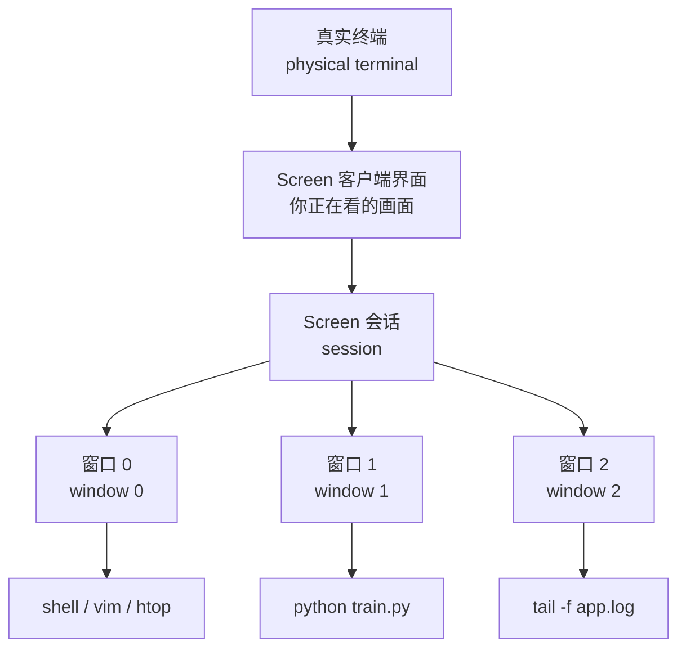
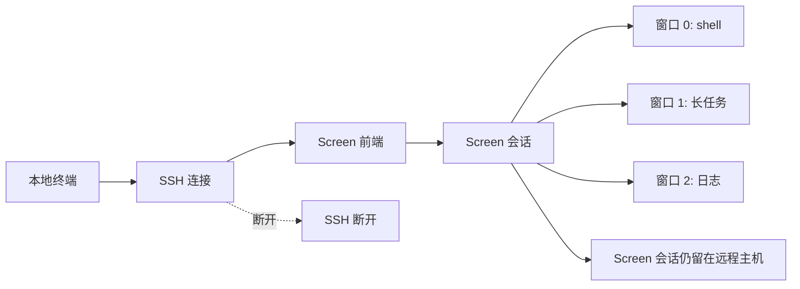
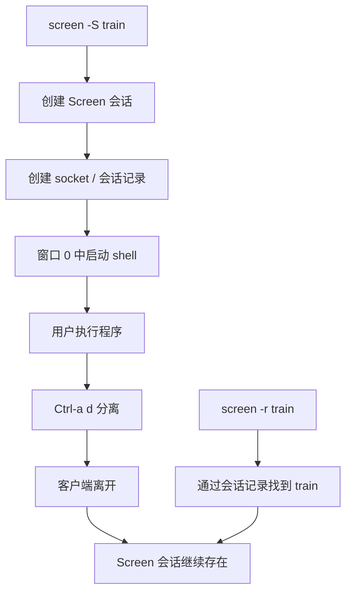
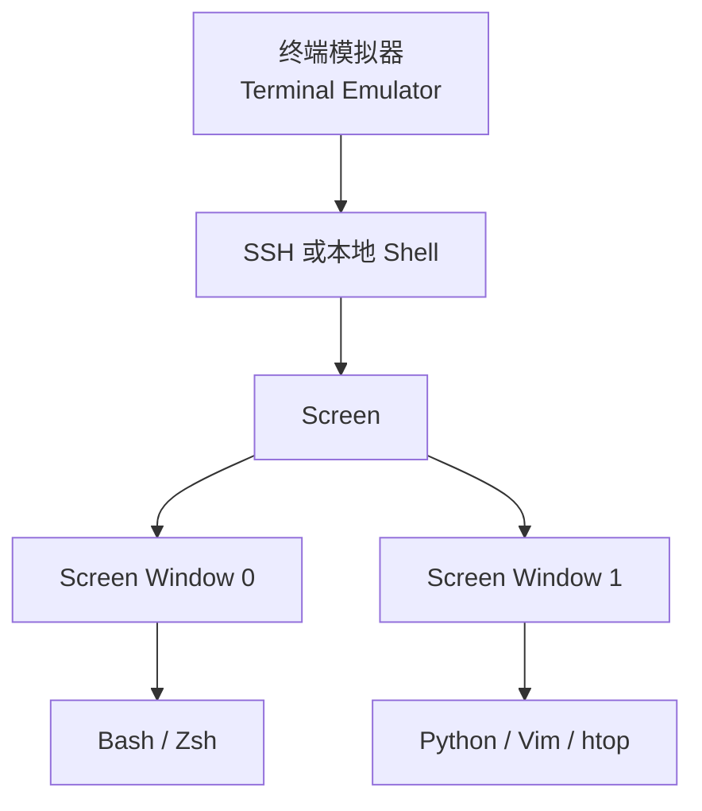
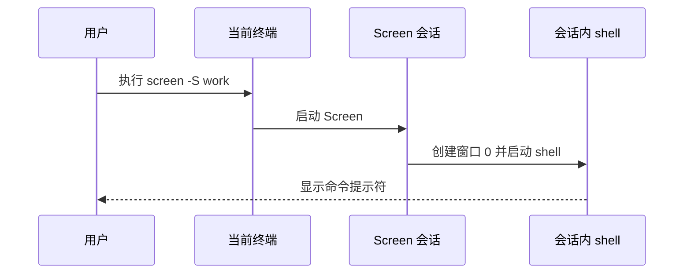
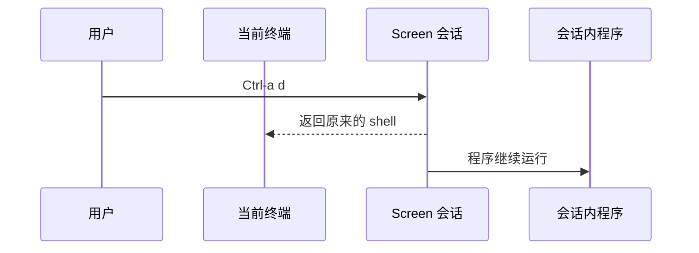
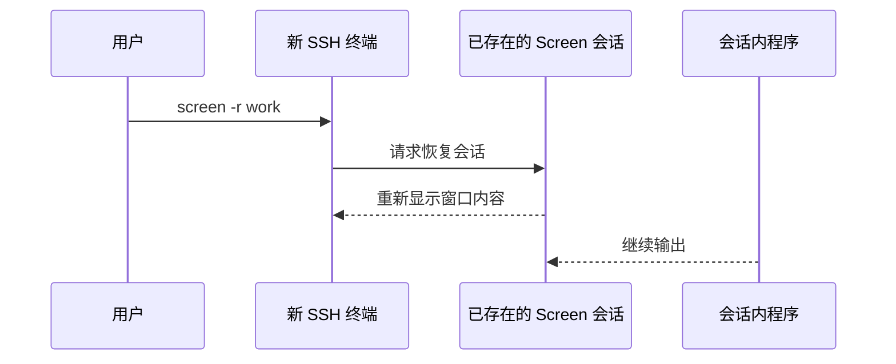

[toc]

## abstract

> Screen 本质上是在“终端和程序之间加了一层管理器”

GNU Screen 可以理解为一个运行在终端里的“文本窗口管理器”。

它把一个**真实终端复用给多个程序**，让多个 shell、编辑器、日志查看器、远程任务**同时存在于同一个 Screen 会话**中。

> Screen 手册对它的定义是：Screen 是一个全屏窗口管理器，可以把一个物理终端复用给多个进程；
>
> 每个虚拟终端都有自己的回滚缓冲区，并且窗口中的程序在窗口不可见、甚至整个 Screen 会话被分离时**仍会继续运行**。([Man7.org](https://man7.org/linux/man-pages/man1/screen.1.html))

先建立一个最重要的心智模型：



你看到的是 Screen 当前展示的某个窗口；但 Screen 背后可以同时维护多个窗口。你切换窗口，只是改变“当前显示哪一个虚拟终端”，不是暂停其他窗口里的程序。

## 基础概念

### 物理终端与虚拟终端

Screen 要解决的核心问题是：**一个真实终端不够用，而且终端断开时不希望程序跟着死掉。**

| 概念     | 英文术语             | 解释                                                         |
| -------- | -------------------- | ------------------------------------------------------------ |
| 窗口     | window               | Screen 中的一个**全屏虚拟终端**                              |
| 物理终端 | physical terminal    | 你当前真正连接的终端，可以是本地终端窗口，也可以是 SSH 登录后的终端 |
| 虚拟终端 | virtual terminal     | Screen 为每个窗口模拟出来的终端环境                          |
| 伪终端   | pseudo-terminal，PTY | Unix/Linux 中用于模拟终端设备的机制                          |
| 会话     | session              | Screen 管理的**一组窗口和状态**                              |
| 前缀键   | command prefix       | Screen 默认用 `Ctrl-a` 进入命令模式                          |
| 分离     | **detach**           | 离开 Screen 会话，但不结束其中程序                           |
| 重连     | reattach             | 重新连接到之前的 Screen 会话                                 |

普通 SSH 情况下，大致是这样：


如果 SSH 断开，远程 shell 和它启动的子进程可能受到影响。

使用 Screen 后，大致变成这样：



关键变化是：**程序不再直接依附于你当前这条 SSH 连接，而是依附于 Screen 会话。**

### 会话(session)是最重要的管理单位

**一个 Screen 会话**可以理解为一个**独立工作区**。

例如：

```bash
screen -S train
```

这会创建一个名为 `train` 的 Screen 会话。

在这个会话里，你可以：

```bash
python train.py
```

然后按：

```text
Ctrl-a d
```

这表示**分离当前 Screen 会话**。

之后你可以退出 SSH，甚至网络断开。下次重新登录服务器后：

```bash
screen -r train
```

即可回到原来的会话。

Screen 的 `-S` 选项用于创建会话时指定有意义的会话名，这个名字会出现在 `screen -list` 结果中，也可以用于 `screen -r` 恢复会话。([Man7.org](https://man7.org/linux/man-pages/man1/screen.1.html))

### 窗口(window )不是图形窗口，而是一个全屏终端

Screen 中的 window 更像“终端标签页”，不是桌面环境里的图形窗口。

例如你在一个 Screen 会话中：

| 窗口编号 | 用途         |
| -------- | ------------ |
| 0        | 编辑代码     |
| 1        | 运行服务     |
| 2        | 查看日志     |
| 3        | 数据库命令行 |
| 4        | 系统监控     |

常用快捷键：

| 操作           | 快捷键                     |
| -------------- | -------------------------- |
| 新建窗口       | `Ctrl-a c`                 |
| 下一个窗口     | `Ctrl-a n`                 |
| 上一个窗口     | `Ctrl-a p`                 |
| 窗口列表       | `Ctrl-a "`                 |
| 切换到编号窗口 | `Ctrl-a 0` 到 `Ctrl-a 9`   |
| 重命名当前窗口 | `Ctrl-a A`                 |
| 关闭当前窗口   | 在窗口 shell 中输入 `exit` |

Screen 手册说明，默认情况下每个 Screen 命令都由 `Ctrl-a` 加另一个按键组成，并且 `Ctrl-a c` 是创建新窗口的标准方式。([Man7.org](https://man7.org/linux/man-pages/man1/screen.1.html))

### 分离(detach)不是退出

这是 Screen 新手最容易犯错的地方。

| 操作             | 含义                 | 程序是否继续运行        |
| ---------------- | -------------------- | ----------------------- |
| `Ctrl-a d`       | detach，分离会话     | 继续运行                |
| `exit`           | 退出当前 shell       | 当前窗口结束            |
| `Ctrl-d`         | 通常等价于退出 shell | 当前窗口可能结束        |
| 关闭终端窗口     | 断开外层终端         | Screen 会话可能继续存在 |
| `screen -X quit` | 让 Screen 会话退出   | 会话内程序会结束        |

Screen 手册明确说明，`-d` 的效果类似于在 Screen 控制终端中输入 `Ctrl-a d`，即分离正在运行的 Screen 会话。([Man7.org](https://man7.org/linux/man-pages/man1/screen.1.html))

所以，正确习惯是：

```text
离开但保留任务：Ctrl-a d
结束当前 shell：exit
结束整个会话：关闭所有窗口，或谨慎使用 screen -X quit
```

### Screen 有自己的后台状态

Screen 不是每次执行命令都“临时运行一下”。当你创建会话后，它会在系统中维护会话状态。

Screen 使用 socket 目录来管理会话连接。手册中说明，socket 目录默认可能位于 `$HOME/.screen`、`/tmp/screens` 或编译时指定的目录；如果用户需要，也可以通过 `$SCREENDIR` 指定替代 socket 目录。([Man7.org](https://man7.org/linux/man-pages/man1/screen.1.html))

可以粗略理解为：



这也是为什么你可以先查看会话：

```bash
screen -ls
```

再恢复：

```bash
screen -r train
```

Screen 的 `-ls` 或 `-list` 会列出当前 Screen 会话，标记为 `detached` 的会话可以用 `screen -r` 恢复；标记为 `attached` 的会话表示仍有控制终端连接。([Man7.org](https://man7.org/linux/man-pages/man1/screen.1.html))

### `$STY`：判断自己是否在 Screen 里

进入 Screen 后，环境变量 `$STY` 通常会存在。Screen 手册提到，Screen 会通过 `$STY` 环境变量识别当前 Screen window manager，并且 `screen -m` 可以忽略 `$STY`，强制创建新会话。([Man7.org](https://man7.org/linux/man-pages/man1/screen.1.html))

你可以这样检查：

```bash
echo "$STY"
```

如果输出类似：

```text
12345.train
```

说明你当前在 Screen 会话中。

实际用途：

```bash
if [ -n "$STY" ]; then
  echo "当前已经在 Screen 中"
else
  echo "当前不在 Screen 中"
fi
```

### Screen 与 shell 的关系

Screen 不是 Bash、Zsh、Fish 这种 shell。它是在 shell 外面或里面再加的一层终端管理器。

常见层次是：



每个 Screen window 里通常运行一个 shell，但也可以直接运行某个命令：

```bash
screen -S monitor htop
```

或者：

```bash
screen -S train python train.py
```

当这个命令结束时，对应的 Screen 窗口通常也会结束。

## Screen 的工作流程

### 创建会话

```bash
screen -S work
```

执行后发生的事情大致是：



### 在会话中创建多个窗口

你按：

```text
Ctrl-a c
```

Screen 创建一个新窗口。每个窗口里的程序相互独立。手册也说明，所有窗口中的程序彼此独立运行，当前不可见甚至整个会话 detached 时也会继续运行。([Man7.org](https://man7.org/linux/man-pages/man1/screen.1.html))

### 分离会话

你按：

```text
Ctrl-a d
```

会变成：



### 恢复会话

```bash
screen -r work
```

恢复时，Screen 会把当前终端重新接到已有会话上。



### 强制接管旧连接

有时你会遇到：

```text
There is a screen on:
    12345.work    (Attached)
There is no screen to be resumed matching work.
```

这表示 Screen 认为这个会话已经被某个终端连接着。可能是你之前的 SSH 连接异常断开，旧连接状态还没清理。

此时常用：

```bash
screen -d -r work
```

含义是：

```text
先 detach 旧连接，再 reattach 到当前终端
```

Screen 手册明确列出了 `-d -r` 的组合含义：重新连接一个会话，如果需要则先分离它。([Man7.org](https://man7.org/linux/man-pages/man1/screen.1.html))

如果更强硬，可以使用：

```bash
screen -D -r work
```

`-D -r` 表示必要时远程分离并 logout 原连接，再重新连接当前会话。([Man7.org](https://man7.org/linux/man-pages/man1/screen.1.html))

## Screen 的常用选项总览

下面按使用频率和应用场景整理。

| 选项            | 作用                                 | 常见场景                         |
| --------------- | ------------------------------------ | -------------------------------- |
| `-S name`       | 指定会话名                           | 创建易识别的任务会话             |
| `-ls` / `-list` | 列出会话                             | 查看有哪些 Screen 会话           |
| `-r`            | 恢复 detached 会话                   | 回到之前的任务                   |
| `-d`            | 分离其他正在连接的会话               | 旧 SSH 占用时使用                |
| `-d -r`         | 先分离再恢复                         | 最常用的强制恢复方式             |
| `-D -r`         | 强制分离并 logout 原连接后恢复       | 旧连接异常时使用                 |
| `-R`            | 有会话就恢复，没有就创建             | 登录后快速进入工作环境           |
| `-RR`           | 更激进地恢复第一个可用会话，否则创建 | 个人默认入口脚本                 |
| `-m`            | 忽略 `$STY`，强制创建新会话          | 在 Screen 内再开独立会话         |
| `-d -m`         | 后台创建 detached 会话               | 启动脚本、后台任务               |
| `-L`            | 开启自动日志                         | 记录窗口输出                     |
| `-Logfile file` | 指定日志文件名                       | 把输出写到指定文件               |
| `-h num`        | 设置回滚历史行数                     | 长日志查看                       |
| `-c file`       | 指定配置文件                         | 项目专用 Screen 配置             |
| `-e xy`         | 修改前缀键                           | 避免和 shell/readline 快捷键冲突 |
| `-t name`       | 设置默认窗口标题                     | 启动时标识窗口用途               |
| `-T term`       | 指定 `$TERM`                         | 解决终端兼容问题                 |
| `-U`            | 使用 UTF-8 模式                      | 中文、Unicode 环境               |
| `-x`            | 附加到未分离会话，多显示模式         | 多终端共享同一会话               |
| `-X`            | 向运行中的 Screen 发送命令           | 自动化控制 Screen                |
| `-p`            | 预选窗口                             | 恢复到指定窗口或配合 `-X`        |
| `-wipe`         | 清理 dead 会话记录                   | 清理坏掉的会话列表               |
| `-q`            | 减少错误输出，用退出码判断           | 脚本中检测会话                   |
| `-Q`            | 查询运行中 Screen 的信息             | 脚本获取窗口列表等               |
| `-s program`    | 指定默认 shell                       | 使用特定 shell 启动窗口          |
| `-v`            | 显示版本                             | 检查版本                         |

这些选项均来自 Screen 手册的 command-line options 部分；其中 `-d -m` 被手册明确描述为在 detached 模式启动新会话，适合系统启动脚本。([Man7.org](https://man7.org/linux/man-pages/man1/screen.1.html))

## 会话相关选项

### `-S name`：给会话命名

最推荐新手养成这个习惯。

```bash
screen -S train
```

不要只写：

```bash
screen
```

因为会话多了以后你会分不清哪个是哪个。

推荐命名：

```bash
screen -S gpu-train
screen -S api-server
screen -S log-watch
screen -S db-migration
```

查看时：

```bash
screen -ls
```

你会看到类似：

```text
There are screens on:
    12345.gpu-train    (Detached)
    23456.api-server   (Attached)
```

应用场景：

| 场景     | 命名建议       |
| -------- | -------------- |
| 训练模型 | `gpu-train`    |
| 跑爬虫   | `crawler`      |
| 后端服务 | `api-dev`      |
| 数据迁移 | `db-migration` |
| 线上排障 | `prod-debug`   |
| 日志观察 | `log-watch`    |

### `-ls` / `-list`：列出会话

```bash
screen -ls
```

或者：

```bash
screen -list
```

常见状态：

| 状态          | 含义                       | 处理                                    |
| ------------- | -------------------------- | --------------------------------------- |
| `Detached`    | 会话已分离，可以恢复       | `screen -r name`                        |
| `Attached`    | 会话正在被某个终端连接     | `screen -x name` 或 `screen -d -r name` |
| `Dead`        | 会话已经坏掉或进程不存在   | 检查后用 `screen -wipe`                 |
| `Unreachable` | 可能是其他主机或不可达会话 | 谨慎检查                                |

Screen 手册说明，`-ls` 会显示会话列表，`detached` 会话可用 `screen -r` 恢复，`dead` 会话应检查后用 `-wipe` 清理。([Man7.org](https://man7.org/linux/man-pages/man1/screen.1.html))

### `-r`：恢复会话

```bash
screen -r train
```

如果只有一个 detached 会话，可以：

```bash
screen -r
```

如果有多个 detached 会话，必须指定：

```bash
screen -r 12345.train
```

或：

```bash
screen -r train
```

应用场景：

```bash
ssh user@server
screen -ls
screen -r gpu-train
```

### `-d -r`：最常用的强制恢复

```bash
screen -d -r train
```

适合这种情况：

| 情况                   | 说明                   |
| ---------------------- | ---------------------- |
| SSH 异常断开           | 旧终端没正常 detach    |
| Screen 显示 `Attached` | 但你已经无法回到旧终端 |
| 想把会话拉回当前终端   | 先踢掉旧连接，再恢复   |

这是服务器使用 Screen 时非常常见的命令。

### `-D -r`：更强硬的恢复

```bash
screen -D -r train
```

相比 `-d -r`，它更激进。一般在旧连接状态异常、普通 detach 无法处理时使用。

建议顺序：

```bash
screen -r train
```

不行再用：

```bash
screen -d -r train
```

还不行再考虑：

```bash
screen -D -r train
```

### `-R` 和 `-RR`：有就进，没有就建

```bash
screen -R work
```

含义大致是：如果能明确找到会话就恢复，否则创建新会话。

更自动化一点：

```bash
screen -RR work
```

适合写到登录脚本或个人快捷命令中。

例如：

```bash
alias sw='screen -RR work'
```

以后登录服务器后：

```bash
sw
```

就能进入你的默认工作会话。

注意：在多人服务器上，不建议过度依赖模糊恢复，最好还是明确会话名。

## 后台运行相关选项

### `-d -m`：创建后立即分离

这是非常实用的选项组合。

```bash
screen -d -m -S train python train.py
```

含义是：

- 创建一个名为 train 的 Screen 会话
- 在里面运行 python train.py
- 但不进入这个会话

之后查看：

```bash
screen -ls
```

恢复：

```bash
screen -r train
```

应用场景：

| 场景             | 示例                                    |
| ---------------- | --------------------------------------- |
| 后台启动训练任务 | `screen -d -m -S train python train.py` |
| 后台启动日志监控 | `screen -d -m -S logs tail -f app.log`  |
| 启动开发服务     | `screen -d -m -S api npm run dev`       |
| 临时批处理       | `screen -d -m -S job bash run.sh`       |

Screen 手册说明，`-d -m` 会以 detached 模式启动新会话，创建会话但不连接它，适合系统启动脚本。([Man7.org](https://man7.org/linux/man-pages/man1/screen.1.html))

不过要注意：**正式生产服务不建议只靠 Screen 托管。**
如果需要开机自启、失败重启、日志轮转、权限隔离，更推荐 systemd、supervisor、Docker、Kubernetes 等工具。

### `-m`：强制新建会话

```bash
screen -m -S nested
```

`-m` 会让 Screen 忽略 `$STY`，即使你当前已经在 Screen 里，也强制创建新会话。Screen 手册说明，`-m` 会忽略 `$STY` 环境变量，并强制创建新会话。([Man7.org](https://man7.org/linux/man-pages/man1/screen.1.html))

一般新手不常用。它适合：

| 场景               | 说明                              |
| ------------------ | --------------------------------- |
| 脚本中确保新建会话 | 不受当前是否在 Screen 中影响      |
| 嵌套环境           | 明确需要 Screen 中再开独立 Screen |
| 启动器脚本         | 防止命令被误发送到当前 Screen     |

但不建议随便嵌套 Screen。嵌套后快捷键容易混乱。

## 日志与回滚相关选项

### `-L`：开启日志记录

```bash
screen -L -S train
```

默认日志文件通常类似：

```text
screenlog.0
```

也可以在 Screen 中用快捷键打开或关闭当前窗口日志：

```text
Ctrl-a H
```

Screen 手册列出 `Ctrl-a H` 用于开始或结束当前窗口到 `screenlog.n` 的日志记录；`-L` 则用于为窗口开启自动输出日志。([Man7.org](https://man7.org/linux/man-pages/man1/screen.1.html))

应用场景：

| 场景           | 说明             |
| -------------- | ---------------- |
| 记录安装过程   | 防止忘记中间输出 |
| 记录训练日志   | 方便后续分析     |
| 记录排障过程   | 便于复盘         |
| 记录交互式命令 | 保留历史证据     |

但更推荐重要程序自己写日志：

```bash
python train.py > train.log 2>&1
```

或者同时显示和保存：

```bash
python train.py 2>&1 | tee train.log
```

### `-Logfile file`：指定日志文件

```bash
screen -L -Logfile train.log -S train
```

这个命令会创建名为 `train` 的会话，并把日志写到 `train.log`。

常见写法：

```bash
screen -L -Logfile logs/train.log -S train
```

注意：目录要提前存在。

```bash
mkdir -p logs
screen -L -Logfile logs/train.log -S train
```

### `-h num`：设置历史回滚行数

```bash
screen -h 10000 -S work
```

`-h num` 用于指定历史回滚缓冲区行数；Screen 手册中该选项说明为把 history scrollback buffer 设置为指定行数。([Man7.org](https://man7.org/linux/man-pages/man1/screen.1.html))

应用场景：

| 场景         | 推荐                              |
| ------------ | --------------------------------- |
| 普通 shell   | 1000 到 5000 行                   |
| 查看日志     | 10000 行以上                      |
| 训练输出很多 | 不要只依赖 scrollback，必须写日志 |
| 内存受限机器 | 不要设置过大                      |

进入滚屏模式：

```text
Ctrl-a [
```

退出滚屏模式：

```text
Esc
```

或：

```text
q
```

## 配置相关选项

### `-c file`：使用指定配置文件

默认用户配置通常是：

```bash
~/.screenrc
```

你也可以临时指定：

```bash
screen -c ./project.screenrc -S project
```

Screen 手册说明，Screen 启动时会读取初始化命令，用户配置会从 `$SCREENRC` 或 `$HOME/.screenrc` 搜索，而命令行选项 `-c` 优先级更高。([Man7.org](https://man7.org/linux/man-pages/man1/screen.1.html))

适合场景：

| 场景           | 说明                     |
| -------------- | ------------------------ |
| 项目专用工作区 | 自动创建若干窗口         |
| 教学环境       | 固定快捷键和状态栏       |
| 临时排障       | 使用更大的 scrollback    |
| 特殊终端环境   | 使用特定 TERM 或兼容配置 |

示例 `project.screenrc`：

```screen
startup_message off
defscrollback 10000
caption always "%{= kw}%-w%{= kG}%n %t%{-}%+w"

screen -t editor 0 bash
screen -t server 1 bash
screen -t logs 2 bash
```

启动：

```bash
screen -c ./project.screenrc -S project
```

### `-e xy`：修改命令前缀键

Screen 默认前缀键是：

```text
Ctrl-a
```

但 `Ctrl-a` 在 shell/readline 里原本表示“移动到行首”。如果你经常需要在命令行里用 `Ctrl-a`，可能会觉得冲突。

可以改前缀键，例如：

```bash
screen -e^Bb -S work
```

这里表示把命令前缀改为 `Ctrl-b`，并用 `b` 发送字面意义的前缀键。Screen 手册说明，`-e xy` 用于指定命令字符为 `x`，以及跟在命令字符后用于生成字面命令字符的 `y`；默认是 `Ctrl-a` 和 `a`。([Man7.org](https://man7.org/linux/man-pages/man1/screen.1.html))

不过新手不建议一开始就改，因为大多数教程都默认 `Ctrl-a`。

### `-s program`：指定默认 shell

```bash
screen -s /bin/bash -S bash-work
```

或者：

```bash
screen -s /usr/bin/zsh -S zsh-work
```

Screen 手册说明，`-s program` 会把默认 shell 设置为指定程序，而不是使用环境变量 `$SHELL` 或 `/bin/sh`。([Man7.org](https://man7.org/linux/man-pages/man1/screen.1.html))

适合场景：

| 场景                  | 说明                 |
| --------------------- | -------------------- |
| 默认 shell 不符合预期 | 强制使用 Bash 或 Zsh |
| 脚本环境              | 保证 shell 行为一致  |
| 教学环境              | 统一学生 shell 环境  |

## 标题、终端类型与编码相关选项

### `-t name`：设置窗口标题

```bash
screen -S work -t editor
```

也可以直接运行命令：

```bash
screen -S monitor -t htop htop
```

`-t name` 用来设置默认 shell 或指定程序的窗口标题。([Man7.org](https://man7.org/linux/man-pages/man1/screen.1.html))

窗口多时，标题非常有用：

| 窗口标题  | 用途         |
| --------- | ------------ |
| `editor`  | 编辑代码     |
| `server`  | 运行服务     |
| `logs`    | 看日志       |
| `db`      | 数据库命令行 |
| `monitor` | 系统监控     |

在 Screen 内也可以按：

```text
Ctrl-a A
```

给当前窗口改名。

### `-T term`：指定 `$TERM`

```bash
screen -T screen-256color -S work
```

`-T term` 会设置 Screen 窗口中的 `$TERM` 环境变量。([Man7.org](https://man7.org/linux/man-pages/man1/screen.1.html))

适合场景：

| 问题                   | 可能处理               |
| ---------------------- | ---------------------- |
| vim 颜色异常           | 尝试 `screen-256color` |
| 全屏程序显示错乱       | 检查 `$TERM`           |
| 远程主机 terminfo 缺失 | 使用更通用的 term      |
| 老系统不支持 256 色    | 降级使用 `screen`      |

检查：

```bash
echo "$TERM"
```

常见值：

```text
screen
screen-256color
xterm-256color
```

不要随便把 Screen 内的 `$TERM` 设成外层终端的值。Screen 本身会做终端能力抽象，错误的 `$TERM` 可能导致 vim、less、top 等程序显示异常。

### `-U`：UTF-8 模式

```bash
screen -U -S work
```

`-U` 表示 Screen 运行在 UTF-8 模式，并把新窗口默认编码设置为 `utf8`。([Man7.org](https://man7.org/linux/man-pages/man1/screen.1.html))

适合场景：

| 场景            | 说明               |
| --------------- | ------------------ |
| 中文环境        | 避免中文乱码       |
| Unicode 符号    | 避免宽字符显示错乱 |
| 现代 Linux 终端 | 通常建议使用 UTF-8 |

如果遇到中文显示问题，检查这些：

```bash
locale
echo "$LANG"
echo "$TERM"
```

## 多终端连接与共享相关选项

### `-x`：附加到已连接的会话

```bash
screen -x work
```

`-x` 可以连接到一个未分离的 Screen 会话，也就是多显示模式。Screen 手册说明，`-x` 会 attach 到一个 not detached 的 Screen 会话，即 multi display mode。([Man7.org](https://man7.org/linux/man-pages/man1/screen.1.html))

典型场景：

| 场景                         | 用法                 |
| ---------------------------- | -------------------- |
| 两个终端同时看同一任务       | `screen -x work`     |
| 本地多个窗口共享同一远程会话 | 一个操作，一个看日志 |
| 教学演示                     | 学生或同事看你的操作 |
| 协助排障                     | 两人共同看同一终端   |

注意：`screen -x` 是“共享同一会话”，不是复制一个独立副本。一个人输入，另一个人会看到；两个人同时输入会互相干扰。

### 多用户模式

Screen 支持多用户访问和 ACL。手册中 `acladd` / `addacl` 命令用于允许用户访问当前 Screen 会话，并且这是 multi user mode 下的能力。([Man7.org](https://man7.org/linux/man-pages/man1/screen.1.html))

这属于进阶用法。新手先知道它存在即可。

大致场景：

| 场景     | 说明                      |
| -------- | ------------------------- |
| 远程协助 | 允许另一个系统用户连接    |
| 结对排障 | 两人看同一现场            |
| 教学演示 | 老师操作，学生观察        |
| 权限控制 | 通过 ACL 限制读写执行权限 |

但生产环境要谨慎使用，因为共享终端可能暴露密钥、密码、token、数据库连接等敏感信息。

## 自动化控制相关选项

### `-X`：向运行中的 Screen 发送命令

```bash
screen -S work -X quit
```

这会向名为 `work` 的会话发送 `quit` 命令，结束整个会话。

更温和的例子：

```bash
screen -S work -X screen -t logs
```

这会让运行中的 Screen 会话创建一个名为 `logs` 的新窗口。

Screen 手册说明，`-X` 用于向运行中的 Screen 会话发送指定命令，可配合 `-S` 指定目标会话；如果会话受密码保护，该命令不起作用。([Man7.org](https://man7.org/linux/man-pages/man1/screen.1.html))

常见用途：

| 用法                           | 含义             |
| ------------------------------ | ---------------- |
| `screen -S name -X quit`       | 结束会话         |
| `screen -S name -X screen`     | 新建窗口         |
| `screen -S name -X stuff text` | 向窗口输入文本   |
| `screen -S name -X title logs` | 修改当前窗口标题 |

谨慎使用 `stuff`，因为它相当于模拟键盘输入，很容易把命令发到错误窗口。

### `-p`：指定目标窗口

`-p` 常与 `-X` 配合使用。

例如：

```bash
screen -S work -p 1 -X stuff "echo hello"
```

通常还需要发送回车：

```bash
screen -S work -p 1 -X stuff $'echo hello\n'
```

这表示向 `work` 会话的窗口 1 发送命令。

Screen 手册说明，`-p` 可以预选窗口，适合恢复到特定窗口，或通过 `-X` 向指定窗口发送命令。([Man7.org](https://man7.org/linux/man-pages/man1/screen.1.html))

应用场景：

| 场景             | 说明                        |
| ---------------- | --------------------------- |
| 自动启动多个服务 | 向不同窗口发送不同命令      |
| 简单任务编排     | 用脚本控制 Screen 窗口      |
| 教学环境初始化   | 自动打开编辑器、日志、shell |
| 老系统无 tmux    | 用 Screen 做简易工作区脚本  |

不过，复杂自动化建议优先考虑 tmux、systemd、supervisor 或容器编排工具。

### `-Q`：查询 Screen 状态

```bash
screen -S work -Q windows
```

`-Q` 可以查询运行中 Screen 会话的一些信息，例如 `windows`、`info`、`number`、`title` 等。Screen 手册列出 `-Q` 可用于查询远程 session 中的部分命令，并把结果输出到标准输出。([Man7.org](https://man7.org/linux/man-pages/man1/screen.1.html))

适合脚本判断：

```bash
screen -S work -Q windows
```

例如你可以用它检查某个会话里有哪些窗口。

### `-q`：脚本中安静判断

```bash
screen -q -ls
```

`-q` 会减少错误输出，并且在和 `-ls`、`-r` 配合时通过退出码表达会话状态。Screen 手册说明了 `-q` 与 `-ls`、`-r` 组合时的退出码含义。([Man7.org](https://man7.org/linux/man-pages/man1/screen.1.html))

新手不常手动使用，主要用于脚本。

示例：

```bash
if screen -q -ls train; then
  echo "可能存在 train 会话"
else
  echo "没有找到 train 会话"
fi
```

## 清理和维护相关选项

### `-wipe`：清理 dead 会话

```bash
screen -wipe
```

当你看到：

```text
Dead ???
```

可以先检查，再清理：

```bash
screen -ls
screen -wipe
screen -ls
```

`-wipe` 的作用类似 `screen -ls`，但会移除已经 destroyed 的会话，而不是只标记为 dead。([Man7.org](https://man7.org/linux/man-pages/man1/screen.1.html))

应用场景：

| 场景                     | 说明              |
| ------------------------ | ----------------- |
| 服务器重启后残留会话记录 | 清理 dead entries |
| Screen 异常退出          | 清理坏记录        |
| `screen -ls` 输出混乱    | 先 wipe 再看      |

不要把 `-wipe` 当成杀会话命令。它主要是清理已经坏掉或不存在的会话记录。

### `-v`：查看版本

```bash
screen -v
```

适合排查兼容性问题。

GNU Screen 在 2024 年发布了 5.0.0；该版本包括认证机制重写、新的 `auth`、`status`、`truecolor`、`multiinput` 命令等变化。([GNU 列表](https://lists.gnu.org/archive/html/info-gnu/2024-08/msg00004.html?utm_source=chatgpt.com))

如果你在不同服务器上使用 Screen，版本差异可能导致配置项或命令可用性不同。

## 网络相关选项

### `-4` 和 `-6`

```bash
screen -4
screen -6
```

这两个选项用于主机名解析时只使用 IPv4 或 IPv6。Screen 手册列出 `-4` 表示只解析 IPv4 地址，`-6` 表示只解析 IPv6 地址。([Man7.org](https://man7.org/linux/man-pages/man1/screen.1.html))

新手很少用到。更多出现在特殊网络环境、老式 telnet/serial 相关使用中。

## 典型应用场景

### 远程长任务保活

最经典场景：

```bash
ssh user@server
screen -S train
python train.py
```

分离：

```text
Ctrl-a d
```

恢复：

```bash
screen -r train
```

如果异常断线：

```bash
screen -d -r train
```

建议增强版：

```bash
mkdir -p logs
screen -S train
python train.py > logs/train.log 2>&1
```

这样即使 Screen 回滚不够，也能从日志文件中恢复信息。

### 后台启动任务

```bash
screen -d -m -S crawler bash run_crawler.sh
```

查看：

```bash
screen -ls
```

进入：

```bash
screen -r crawler
```

适合临时任务，但不适合正式服务托管。

### 打开固定工作区

可以创建一个 `.screenrc`：

```screen
startup_message off
defscrollback 10000
caption always "%{= kw}%-w%{= kG}%n %t%{-}%+w"

screen -t shell 0 bash
screen -t logs 1 bash
screen -t monitor 2 htop
```

启动：

```bash
screen -c project.screenrc -S project
```

这样每次都能得到类似结构：

| 窗口 | 用途    |
| ---- | ------- |
| 0    | shell   |
| 1    | logs    |
| 2    | monitor |

### 多终端共享同一会话

第一个终端：

```bash
screen -S demo
```

第二个终端：

```bash
screen -x demo
```

适合演示、协助、结对排障。

注意：

| 风险           | 建议                          |
| -------------- | ----------------------------- |
| 两人同时输入   | 明确谁操作                    |
| 敏感信息暴露   | 不要打开密钥、token、密码文件 |
| 误操作生产环境 | 使用低权限用户                |
| 命令历史泄露   | 共享前清理敏感命令            |

### 快速恢复个人工作环境

写一个 alias：

```bash
alias swork='screen -D -RR work'
```

之后登录服务器：

```bash
swork
```

含义接近：

```text
如果 work 存在，就尽量恢复
如果旧连接占用，就踢掉旧连接
如果不存在，就创建
```

不过在关键服务器上更建议保守一点：

```bash
alias swork='screen -R work'
```

## 常见错误与正确做法

| 错误做法                | 问题               | 推荐做法                            |
| ----------------------- | ------------------ | ----------------------------------- |
| 直接输入 `screen`       | 会话名难以识别     | `screen -S name`                    |
| 用 `Ctrl-d` 离开        | 可能退出 shell     | 用 `Ctrl-a d`                       |
| 训练任务不写日志        | 输出可能丢失       | 重定向到日志文件                    |
| 把生产服务长期放 Screen | 无自动重启、无管理 | 用 systemd 或 supervisor            |
| 嵌套多个 Screen         | 快捷键混乱         | 避免嵌套，或明确使用 `-m`           |
| 随便 `screen -X quit`   | 可能杀错会话       | 先 `screen -ls` 确认                |
| 共享会话中操作敏感文件  | 泄露风险           | 使用低权限或临时环境                |
| 乱改 `$TERM`            | 显示异常           | 优先使用 `screen-256color` 或默认值 |

## 推荐的 Screen 使用模板

### 日常远程任务模板

```bash
screen -S task-name
```

进入后运行：

```bash
your-command > task.log 2>&1
```

分离：

```text
Ctrl-a d
```

恢复：

```bash
screen -r task-name
```

异常恢复：

```bash
screen -d -r task-name
```

### 后台启动模板

```bash
screen -d -m -S task-name bash -lc 'your-command > task.log 2>&1'
```

示例：

```bash
screen -d -m -S train bash -lc 'python train.py > train.log 2>&1'
```

### 带日志的交互模板

```bash
mkdir -p logs
screen -L -Logfile logs/session.log -h 10000 -S work
```

含义：

| 部分                        | 作用         |
| --------------------------- | ------------ |
| `-L`                        | 开启日志     |
| `-Logfile logs/session.log` | 指定日志文件 |
| `-h 10000`                  | 设置回滚行数 |
| `-S work`                   | 命名会话     |

### 安全恢复模板

```bash
screen -ls
screen -r name
```

如果提示 attached：

```bash
screen -d -r name
```

如果状态异常：

```bash
screen -wipe
screen -ls
```

## 一句话总结

Screen 的核心原理是：**它在真实终端和实际程序之间创建一个可持久存在的会话层；你可以随时连接、分离、重连这个会话，而会话内部的窗口和程序继续运行。**

常用选项里最重要的是：

```bash
screen -S name       # 创建命名会话
screen -ls           # 查看会话
screen -r name       # 恢复会话
screen -d -r name    # 强制恢复
screen -d -m -S name command  # 后台创建并运行命令
screen -L -Logfile file -S name  # 记录日志
```

掌握这些，已经可以应对绝大多数服务器长任务、SSH 断线恢复、远程排障和日常终端管理场景。