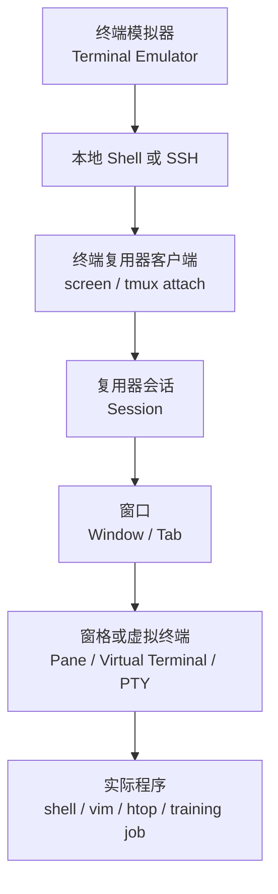
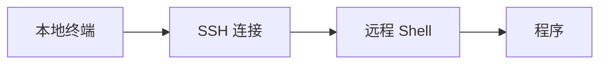
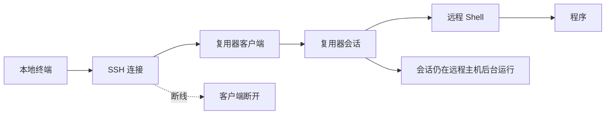

[toc]

## abstract

本文围绕 **GNU Screen** 与 **终端复用器**（terminal multiplexer）展开，可以按下面路线学习：

| 模块           | 重点问题                                  | 学习目标                                       |
| -------------- | ----------------------------------------- | ---------------------------------------------- |
| 概念定位       | Screen 到底解决什么问题                   | 理解“一个终端里管理多个会话”的价值             |
| 工作原理       | 为什么断开 SSH 后程序还能继续跑           | 理解 PTY、会话、分离、重连、客户端与服务端模型 |
| GNU Screen     | Screen 的核心命令和使用规则               | 能独立创建、分离、恢复、管理 Screen 会话       |
| 现代竞品       | tmux、Zellij、WezTerm、Byobu、Mosh 的区别 | 知道新项目该选哪个工具                         |
| 实战场景       | 远程训练、服务器运维、长期任务、多人协作  | 把工具用于真实工作流                           |
| 配置与最佳实践 | 命名、日志、滚屏、快捷键、安全、故障恢复  | 避免新手常见坑                                 |
| 学习路径       | 从 Screen 入门到 tmux 或 Zellij 进阶      | 建立长期可维护的终端工作习惯                   |

## 核心结论

**Screen 仍然有价值，但新手的默认推荐通常是 tmux 或 Zellij。**

GNU Screen 是老牌工具，GNU 官方把它定义为一种“全屏窗口管理器”，可以把一个物理终端复用给多个进程，每个虚拟终端有自己的回滚缓冲区、复制粘贴机制和独立运行的程序；程序即使当前窗口不可见，甚至整个 Screen 会话被分离，也能继续运行。([GNU](https://www.gnu.org/software/screen/))

tmux 是当前服务器与开发场景中更常见的默认选择。tmux 官方文档称它是 terminal multiplexer，可以在一个终端中切换多个程序，把会话分离到后台，并在另一个终端重新连接；tmux 当前文档还显示其主页已更新到 2026 年，并提供 tmux 3.7a 下载入口。([GitHub](https://github.com/tmux/tmux/wiki))

Zellij 是更现代、更面向新手体验的终端工作区工具。项目自称是“terminal workspace with batteries included”，强调开箱即用、布局、插件、浮动窗格、堆叠窗格、多人协作和 Web 客户端。([GitHub](https://github.com/zellij-org/zellij))

## 什么是终端复用器

**终端复用器**（terminal multiplexer）是一类命令行工具，它允许你在一个终端窗口中创建、切换、分离、恢复多个终端环境。

它解决的不是“让终端变漂亮”，而是这些更底层的问题：

| 问题           | 没有复用器时             | 使用复用器后                   |
| -------------- | ------------------------ | ------------------------------ |
| SSH 断线       | 远程程序可能被中断       | 会话保留，重新连上即可恢复     |
| 一个窗口不够用 | 开很多终端窗口或标签页   | 一个会话中管理多个窗口和窗格   |
| 长任务运行     | 关掉终端就担心任务挂掉   | 分离会话后任务继续跑           |
| 远程开发       | 编辑器、日志、监控分散   | 统一放在一个工作区             |
| 现场排障       | 操作过程难以共享         | 可共享同一个会话或只读观察     |
| 工作流恢复     | 每次重新打开都要重建环境 | 会话、窗口、布局可保留或脚本化 |

注意：**terminal multiplexer 不是 shell，也不是 terminal emulator。**

| 名称         | 英文术语             | 代表工具                                   | 主要职责                     |
| ------------ | -------------------- | ------------------------------------------ | ---------------------------- |
| 终端模拟器   | terminal emulator    | GNOME Terminal、iTerm2、Alacritty、WezTerm | 提供图形窗口，显示终端界面   |
| Shell        | shell                | Bash、Zsh、Fish                            | 解释命令，运行程序           |
| 终端复用器   | terminal multiplexer | screen、tmux、Zellij                       | 管理多个终端会话、窗口、窗格 |
| 远程连接工具 | remote shell         | ssh、mosh                                  | 连接远程主机                 |
| 作业守护工具 | job persistence tool | nohup、systemd、supervisor                 | 让进程后台运行或服务化       |

简单理解：



## 为什么断开 SSH 后程序还能继续跑

这里涉及几个关键概念。

**PTY** 是 **pseudo-terminal**，即“伪终端”。命令行程序通常以为自己运行在一个终端上，但实际上它可能连接到一个伪终端。tmux 手册明确说明，一个 session 是由 tmux 管理的一组 pseudo terminals，窗口可以被拆成多个 pane，每个 pane 是一个独立的 pseudo terminal。([OpenBSD Man Pages](https://man.openbsd.org/OpenBSD-current/man1/tmux.1))

普通 SSH 登录时，大致是：



如果 SSH 连接断开，远程 shell 可能收到挂断信号，下面运行的程序也可能退出。

使用 Screen 或 tmux 时，大致变成：



也就是说，**你断开的只是“观看和操作这个会话的客户端”，不是会话本身。**

tmux 手册明确写到：tmux 可以从屏幕上分离并在后台继续运行，之后再重新连接；它的 session 是持久的，可以在 SSH 超时或主动分离后继续存在。([OpenBSD Man Pages](https://man.openbsd.org/OpenBSD-current/man1/tmux.1))

## Screen 的基本模型

GNU Screen 的核心层级可以这样理解：

| Screen 概念 | 英文术语          | 含义                                            |
| ----------- | ----------------- | ----------------------------------------------- |
| 会话        | session           | 一个 Screen 工作空间，可分离和重连              |
| 窗口        | window            | 会话中的一个全屏虚拟终端                        |
| 当前窗口    | current window    | 你正在看的窗口                                  |
| 回滚缓冲区  | scrollback buffer | 每个窗口自己的历史输出                          |
| 命令前缀键  | command prefix    | 默认是 `Ctrl-a`，表示接下来输入的是 Screen 命令 |
| 分离        | detach            | 暂时离开会话，但不结束里面的程序                |
| 重连        | reattach          | 回到之前分离的会话                              |
| 多用户模式  | multiuser mode    | 允许多个用户连接同一 Screen 会话                |

Screen 的特点是：**每个窗口基本是全屏的虚拟终端**。它也支持分屏，但整体体验更偏传统，操作和配置不如 tmux、Zellij 现代。

## Screen 快速入门

### 安装

常见 Linux 发行版一般可以直接用包管理器安装：

```bash
# Debian / Ubuntu
sudo apt install screen

# Fedora / RHEL 系
sudo dnf install screen

# Arch Linux
sudo pacman -S screen

# macOS Homebrew
brew install screen
```

### 创建命名会话

```bash
screen -S train
```

这里 `train` 是会话名。建议永远给会话命名，不要只输入 `screen`。

好的会话名示例：

```bash
screen -S project-api
screen -S gpu-train
screen -S db-migration
screen -S log-watch
```

### 分离会话

在 Screen 会话中按：

```text
Ctrl-a d
```

含义是：

先按 `Ctrl-a`，松开，再按 `d`。

Screen 手册中 `-d` 选项说明了它与在控制终端中输入 `C-a d` 的效果类似，即分离正在运行的 Screen 会话。([Man7.org](https://man7.org/linux/man-pages/man1/screen.1.html))

### 查看已有会话

```bash
screen -ls
```

或者：

```bash
screen -list
```

Screen 手册说明，`-ls` 或 `-list` 会打印当前 Screen 会话列表，其中标记为 `detached` 的会话可以用 `screen -r` 恢复。([Man7.org](https://man7.org/linux/man-pages/man1/screen.1.html))

### 恢复会话

```bash
screen -r train
```

如果只有一个会话，也可以直接：

```bash
screen -r
```

### 强制恢复被占用的会话

有时你会看到会话状态是 `Attached`，比如之前的 SSH 异常断开，但 Screen 还以为旧终端连着。

可以使用：

```bash
screen -d -r train
```

含义是：**先分离旧连接，再重新连接**。Screen 手册也明确列出了 `-d -r` 表示必要时先 detach，然后 reattach。([Man7.org](https://man7.org/linux/man-pages/man1/screen.1.html))

更强硬的方式是：

```bash
screen -D -r train
```

`-D -r` 会**在必要时远程分离并注销旧连接**，适合旧 SSH 已经死掉的情况；Screen 手册也列出了 `-D -r`、`-D -R` 等组合行为。([Man7.org](https://man7.org/linux/man-pages/man1/screen.1.html))

## Screen 常用快捷键

Screen 的默认前缀键是 `Ctrl-a`。

| 操作              | 快捷键                   | 说明            |
| ----------------- | ------------------------ | --------------- |
| 分离当前会话      | `Ctrl-a d`               | 最常用          |
| 创建新窗口        | `Ctrl-a c`               | 新建一个 shell  |
| 下一个窗口        | `Ctrl-a n`               | next            |
| 上一个窗口        | `Ctrl-a p`               | previous        |
| 查看窗口列表      | `Ctrl-a "`               | 选择窗口        |
| 切换到指定窗口    | `Ctrl-a 0` 到 `Ctrl-a 9` | 按编号切换      |
| 重命名窗口        | `Ctrl-a A`               | 给窗口起名      |
| 关闭当前窗口      | 输入 `exit`              | 退出 shell 即可 |
| 进入复制/滚屏模式 | `Ctrl-a [`               | 查看历史输出    |
| 退出复制/滚屏模式 | `Esc` 或 `q`             | 回到正常输入    |
| 显示帮助          | `Ctrl-a ?`               | 查看快捷键      |
| 发送真正的 Ctrl-a | `Ctrl-a a`               | 传给程序本身    |

新手最容易混淆的是：**`Ctrl-a d` 不是退出程序，而是离开 Screen 会话。**
要结束窗口里的 shell，应该输入：

```bash
exit
```

要结束整个 Screen 会话，需要关闭里面所有窗口。

## Screen 常用命令速查

| 场景             | 命令                                      |
| ---------------- | ----------------------------------------- |
| 新建命名会话     | `screen -S name`                          |
| 查看会话         | `screen -ls`                              |
| 恢复会话         | `screen -r name`                          |
| 强制恢复会话     | `screen -d -r name`                       |
| 创建但不进入会话 | `screen -dmS name command`                |
| 进入共享会话     | `screen -x name`                          |
| 记录输出日志     | `screen -L -S name`                       |
| 指定滚屏行数     | `screen -h 5000 -S name`                  |
| 退出当前窗口     | `exit`                                    |
| 杀掉会话         | 进入后关闭所有窗口，或用 `screen -X quit` |

示例：后台运行一个训练任务。

```bash
screen -dmS train python train.py
```

之后查看：

```bash
screen -ls
screen -r train
```

## Screen 配置文件

Screen 的用户配置文件通常是：

```bash
~/.screenrc
```

一个适合新手的基础配置：

```screen
startup_message off
defscrollback 10000
term screen-256color
altscreen on
vbell off

hardstatus alwayslastline
hardstatus string "%{= kG}[%S] %{= kw}%w %=%{= kC}%Y-%m-%d %c"
```

解释：

| 配置                        | 含义                          |
| --------------------------- | ----------------------------- |
| `startup_message off`       | 关闭启动欢迎信息              |
| `defscrollback 10000`       | 默认保留 10000 行历史         |
| `term screen-256color`      | 启用更好的颜色支持            |
| `altscreen on`              | 改善 vim、less 等全屏程序体验 |
| `vbell off`                 | 关闭视觉响铃                  |
| `hardstatus alwayslastline` | 底部显示状态栏                |
| `hardstatus string ...`     | 自定义状态栏内容              |

如果你经常从 Screen 迁移到 tmux，可以把 Screen 理解成“传统版 tmux”，但不要把 tmux 配置直接照搬到 Screen，两者语法完全不同。

## tmux：现代默认选择

tmux 的模型比 Screen 更清晰：

| tmux 概念  | 英文术语   | 类比                   |
| ---------- | ---------- | ---------------------- |
| server     | server     | tmux 后台管理进程      |
| client     | client     | 当前连接到 tmux 的终端 |
| session    | session    | 一个工作区             |
| window     | window     | 工作区里的标签页       |
| pane       | pane       | 一个窗口中的分屏区域   |
| prefix key | prefix key | 默认 `Ctrl-b`          |

tmux 手册说明：启动 tmux 会创建一个 session，里面有一个 window；window 占据整个屏幕，可以拆分成 rectangular panes，每个 pane 都是独立的 pseudo terminal；多个 tmux 客户端可以连接到同一个 session。([OpenBSD Man Pages](https://man.openbsd.org/OpenBSD-current/man1/tmux.1))

tmux 的默认前缀键是：

```text
Ctrl-b
```

### tmux 基本命令

```bash
tmux new -s work
tmux ls
tmux attach -t work
tmux detach
tmux kill-session -t work
```

### tmux 常用快捷键

| 操作          | 快捷键          |
| ------------- | --------------- |
| 分离会话      | `Ctrl-b d`      |
| 新建窗口      | `Ctrl-b c`      |
| 下一个窗口    | `Ctrl-b n`      |
| 上一个窗口    | `Ctrl-b p`      |
| 水平分屏      | `Ctrl-b "`      |
| 垂直分屏      | `Ctrl-b %`      |
| 切换窗格      | `Ctrl-b 方向键` |
| 关闭窗格      | `Ctrl-b x`      |
| 窗格放大/恢复 | `Ctrl-b z`      |
| 进入复制模式  | `Ctrl-b [`      |
| 查看快捷键    | `Ctrl-b ?`      |
| 命令模式      | `Ctrl-b :`      |

tmux 手册列出了默认按键，包括 `C-b d` 分离客户端、`"` 上下分屏、`%` 左右分屏、`c` 新建窗口、`[` 进入 copy mode、`z` 缩放窗格等。([OpenBSD Man Pages](https://man.openbsd.org/OpenBSD-current/man1/tmux.1))

### tmux 和 Screen 的关键区别

| 对比项       | GNU Screen           | tmux                                  |
| ------------ | -------------------- | ------------------------------------- |
| 默认前缀键   | `Ctrl-a`             | `Ctrl-b`                              |
| 抽象模型     | session、window      | server、client、session、window、pane |
| 分屏体验     | 可用但较传统         | 更自然、更常用                        |
| 配置能力     | 有，但语法老派       | 强大，适合深度定制                    |
| 状态栏       | 可配置               | 高度可配置                            |
| 脚本化       | 可以                 | 更适合自动化                          |
| 插件生态     | 较弱                 | 较强，如 TPM                          |
| 新手友好度   | 中等偏低             | 中等                                  |
| 服务器普及度 | 老系统常见           | 现代系统更常见                        |
| 适合人群     | 维护老环境、简单保活 | 大多数开发、运维、远程工作            |

## Zellij：更现代、更适合新手的终端工作区

Zellij 不只是“另一个 tmux”。它更强调 **可发现性**（discoverability）和 **开箱即用**。

Zellij 官方介绍称，它面向开发者、运维人员和终端爱好者，类似工具有时被称为 terminal multiplexers；它同时提供布局、多人协作、浮动窗格、堆叠窗格、WebAssembly 插件系统和内置 Web 客户端。([GitHub](https://github.com/zellij-org/zellij))

Zellij 的优势：

| 能力         | 说明                               |
| ------------ | ---------------------------------- |
| 模式提示明显 | 屏幕底部会提示当前可用快捷键       |
| 布局文件     | 可以用 KDL 文件定义 panes 和 tabs  |
| 浮动窗格     | 类似终端里的小窗口                 |
| 堆叠窗格     | 多个 pane 叠放，节省空间           |
| 会话管理     | 可视化切换、创建、恢复会话         |
| 会话复活     | 可恢复已退出会话的结构和命令上下文 |
| Web 客户端   | 浏览器里访问终端会话               |
| 插件系统     | 使用 WebAssembly / WASI 扩展       |

Zellij 文档说明，layout 是定义 Zellij panes 和 tabs 排列的文本文件，可以在启动时通过 `zellij --layout /path/to/layout_file.kdl` 应用。([Zellij](https://zellij.dev/documentation/layouts)) 其功能页还介绍了 session manager、session resurrection、Web client 和 WebAssembly 插件系统等能力。([Zellij](https://zellij.dev/features/?utm_source=chatgpt.com))

适合 Zellij 的人：

| 你是这种用户             | 是否适合 Zellij           |
| ------------------------ | ------------------------- |
| 新手，讨厌背快捷键       | 很适合                    |
| 想要更漂亮的终端工作区   | 很适合                    |
| 想用布局自动恢复项目环境 | 很适合                    |
| 想要浏览器共享终端       | 很适合                    |
| 极度追求稳定和最小依赖   | 可能更适合 tmux           |
| 经常登录老服务器         | 可能更适合 screen 或 tmux |

## WezTerm：终端模拟器内置复用能力

WezTerm 首先是一个现代终端模拟器（terminal emulator），同时内置 multiplexing 功能。官方文档称 WezTerm 是跨平台终端模拟器和 multiplexer，支持 Linux、macOS、Windows、FreeBSD、NetBSD，并支持本地和远程主机上的 panes、tabs、windows 复用。([WezTerm](https://wezterm.org/index.html))

WezTerm 的复用模型基于 **multiplexing domains**。官方文档说明，一个 domain 是一组 windows 和 tabs；WezTerm 启动时会创建默认 local domain，也可以连接额外 domain。官方也提醒：WezTerm multiplexing 仍是较年轻并快速演进的功能。([WezTerm](https://wezterm.org/multiplexing.html))

适合 WezTerm 的场景：

| 场景                       | 说明                                            |
| -------------------------- | ----------------------------------------------- |
| 你想统一终端模拟器和复用器 | WezTerm 很适合                                  |
| 你在本地开发为主           | tabs、panes、workspaces 很舒服                  |
| 你需要跨平台一致体验       | Linux、macOS、Windows 都支持                    |
| 你经常登录陌生服务器       | 不一定适合，因为远程 mux 需要对端有兼容 WezTerm |
| 你需要传统服务器保活       | tmux 仍更通用                                   |

## Byobu：Screen/tmux 的友好外壳

Byobu 不是完全独立的底层复用器，而是一个更友好的文本窗口管理器与终端复用器前端。Byobu 官网称它包装了 tmux 或 GNU Screen，提供优雅快捷键、可切换系统状态通知、配置文件管理和分屏布局。([Byobu](https://byobu.org/?utm_source=chatgpt.com))

适合 Byobu 的人：

| 用户类型               | 推荐理由                  |
| ---------------------- | ------------------------- |
| Ubuntu 服务器新手      | 默认体验比裸 tmux 更友好  |
| 想要状态栏显示系统信息 | CPU、内存、负载等信息方便 |
| 不想自己配置 tmux      | Byobu 帮你做了一层封装    |
| 想深入掌握 tmux        | 后期建议直接学 tmux       |

## Mosh：不是复用器，但经常和复用器一起用

Mosh 是 **mobile shell**，它不是 screen/tmux 的替代品，而是 SSH 的增强替代方案。

Mosh 官方说明，它是支持漫游、间歇连接、智能本地回显的远程终端应用；它比 SSH 更适合 Wi-Fi、蜂窝网络和长距离连接。([Mosh](https://mosh.org/)) Mosh 会先通过 SSH 登录，然后在远端启动 `mosh-server`，再通过 UDP 连接；它还可以和 screen 或 tmux 一起使用，例如官方示例中有 `mosh pello -- screen -dr` 用于重连长期运行的 Screen 会话。([Mosh](https://mosh.org/))

经典组合：

```bash
mosh user@server -- tmux attach
```

或者：

```bash
mosh user@server -- screen -d -r train
```

选择逻辑：

| 网络情况                         | 推荐            |
| -------------------------------- | --------------- |
| 普通稳定网络                     | SSH 加 tmux     |
| 经常切 Wi-Fi、睡眠唤醒、网络抖动 | Mosh 加 tmux    |
| 公司防火墙禁 UDP                 | SSH 加 tmux     |
| 移动网络远程操作                 | Mosh 很值得考虑 |

## abduco 和 dtach：极简派选择

abduco 和 dtach 只关注“分离和重连”，不提供完整窗口/窗格管理。

abduco 的项目说明称，它提供 session management，让程序可以脱离 controlling terminal 后台运行并之后重新连接；搭配 dvtm 时，可以作为 tmux 或 screen 的更简单替代。([GitHub](https://github.com/martanne/abduco))

适合场景：

| 工具   | 特点                                             |
| ------ | ------------------------------------------------ |
| dtach  | 极简，只做 detach/attach                         |
| abduco | 比 dtach 更现代一点，有 session 列表、只读连接等 |
| dvtm   | 终端平铺窗口管理器，常与 abduco 搭配             |

新手一般不用从它们开始，除非你明确喜欢极简 Unix 工具链。

## 主流工具选择建议

| 需求                 | 推荐工具             | 理由                                  |
| -------------------- | -------------------- | ------------------------------------- |
| 新手学习终端复用     | tmux 或 Zellij       | tmux 通用，Zellij 更直观              |
| 老服务器、最小环境   | Screen               | 很多旧系统仍可能有                    |
| 现代服务器开发       | tmux                 | 稳定、通用、脚本化强                  |
| 图形体验和跨平台终端 | WezTerm              | 终端模拟器和复用能力结合              |
| 不想配置             | Byobu                | 对 tmux/screen 做友好封装             |
| 网络很差             | Mosh 加 tmux         | Mosh 解决网络抖动，tmux 解决会话持久  |
| 极简后台保活         | abduco 或 dtach      | 只要 detach/attach                    |
| 团队共享终端         | tmux、Zellij、Screen | Zellij Web client 更现代，tmux 更常见 |
| 远程深度工作流       | tmux                 | 最稳妥的默认答案                      |

## Screen、tmux、Zellij、WezTerm 总表对比

| 维度           | Screen         | tmux                 | Zellij           | WezTerm                     |
| -------------- | -------------- | -------------------- | ---------------- | --------------------------- |
| 类型           | 经典终端复用器 | 现代经典终端复用器   | 现代终端工作区   | 终端模拟器加复用器          |
| 学习难度       | 中等           | 中等                 | 较低             | 中等                        |
| 默认前缀       | `Ctrl-a`       | `Ctrl-b`             | 模式化快捷键     | 取决于配置                  |
| 会话持久       | 支持           | 支持                 | 支持             | 支持，但模型不同            |
| 窗口           | 支持           | 支持                 | tabs             | tabs                        |
| 窗格           | 支持但较老派   | 强                   | 强，含浮动和堆叠 | 强                          |
| 配置           | `.screenrc`    | `.tmux.conf`         | KDL 配置         | Lua 配置                    |
| 插件生态       | 弱             | 强                   | WebAssembly 插件 | Lua 生态                    |
| 远程服务器普及 | 老环境较常见   | 很常见               | 需要安装         | 远端高级功能需 WezTerm 支持 |
| 新手提示       | 弱             | 弱到中等             | 强               | 中等                        |
| 最适合         | 保活、老系统   | 开发、运维、远程工作 | 新手、现代工作区 | 跨平台终端重度用户          |

## 典型实战场景

### 远程跑训练任务

使用 Screen：

```bash
ssh user@server
screen -S gpu-train
python train.py --config config.yaml
```

分离：

```text
Ctrl-a d
```

下次回来：

```bash
ssh user@server
screen -r gpu-train
```

更推荐 tmux：

```bash
tmux new -s gpu-train
python train.py --config config.yaml
```

分离：

```text
Ctrl-b d
```

恢复：

```bash
tmux attach -t gpu-train
```

建议：机器学习训练、爬虫、数据处理等任务，不要只依赖终端复用器。重要任务最好还要写日志：

```bash
python train.py --config config.yaml > train.log 2>&1
```

或者：

```bash
python train.py --config config.yaml 2>&1 | tee train.log
```

上面这类管道命令不要塞进 Markdown 表格单元格里，容易破坏表格结构。

### 服务器排障

一个 tmux 或 Zellij 工作区可以这样安排：

| 区域   | 内容               |
| ------ | ------------------ |
| 窗口一 | 编辑配置文件       |
| 窗口二 | 查看服务日志       |
| 窗口三 | 运行监控命令       |
| 窗口四 | 数据库或缓存客户端 |
| 窗口五 | 备用 shell         |

Screen 也可以这样做，只是分屏和窗口管理体验不如 tmux 自然。

### 远程协作

Screen 可以用 `screen -x` 共享同一会话。tmux 也可以通过同一用户连接同一 session，或者通过 socket 权限做更细的控制。Zellij 则提供更现代的多人协作和 Web client 方向；其项目说明明确提到 true multiplayer collaboration 和内置 web-client。([GitHub](https://github.com/zellij-org/zellij))

协作时要注意：

| 风险             | 建议                           |
| ---------------- | ------------------------------ |
| 两个人同时输入   | 先约定谁操作                   |
| 误执行危险命令   | 共享前切到安全目录             |
| 泄露密钥或 token | 不要在共享会话中打开敏感文件   |
| 权限过大         | 尽量使用临时用户或只读观察方案 |

## 最佳实践

### 永远给会话命名

不要这样：

```bash
screen
tmux
```

建议这样：

```bash
screen -S api-prod
tmux new -s api-prod
```

命名规则建议：

| 类型         | 示例             |
| ------------ | ---------------- |
| 项目名       | `project-alpha`  |
| 任务名       | `db-migration`   |
| 机器名加任务 | `gpu01-train`    |
| 环境加服务   | `prod-api`       |
| 日期加任务   | `2026-07-report` |

### 一个项目一个会话

不要把所有事情都塞进一个巨大的 session。建议：

```bash
tmux new -s backend
tmux new -s frontend
tmux new -s ops
```

或者 Screen：

```bash
screen -S backend
screen -S frontend
screen -S ops
```

这样恢复、清理、排错都更简单。

### 长任务必须写日志

终端复用器不是日志系统。你可能会误关窗口，或者回滚缓冲不够。

建议：

```bash
mkdir -p logs
python train.py > logs/train-$(date +%F-%H%M).log 2>&1
```

Screen 自带 logging，但更推荐程序自己写日志，或者用 `tee` 同时输出到屏幕和文件。

### 不要把生产服务长期跑在 Screen 里

Screen/tmux 适合临时任务、交互式任务、开发任务。正式生产服务更适合：

| 场景         | 更推荐                          |
| ------------ | ------------------------------- |
| Web 服务     | systemd、supervisor、容器       |
| 定时任务     | cron、systemd timer             |
| 队列 worker  | systemd、supervisor、Kubernetes |
| 机器学习实验 | tmux 加日志，或任务调度系统     |
| 一次性迁移   | tmux/screen 可以                |

判断标准：
**如果这个进程需要开机自启、失败重启、日志轮转、权限隔离，就不该只依赖 Screen。**

### 学会区分 detach、exit、kill

| 操作             | 含义               | 后果                 |
| ---------------- | ------------------ | -------------------- |
| detach           | 分离会话           | 程序继续跑           |
| exit             | 退出当前 shell     | 当前窗口结束         |
| kill window/pane | 强制关闭窗口或窗格 | 里面程序会结束       |
| kill session     | 杀掉整个会话       | 所有窗口和程序都结束 |

新手最常犯的错误是：
以为 `Ctrl-d` 是“分离”。实际上 `Ctrl-d` 通常会退出 shell，可能直接关闭当前窗口。

### 远程连接建议组合

| 网络与任务     | 推荐组合                     |
| -------------- | ---------------------------- |
| 稳定内网服务器 | SSH 加 tmux                  |
| 普通云服务器   | SSH 加 tmux                  |
| 经常断线       | SSH 加 tmux，或 Mosh 加 tmux |
| 移动网络       | Mosh 加 tmux                 |
| 老旧服务器     | SSH 加 Screen                |
| 临时教学演示   | Zellij 或 tmux 共享          |
| 本地长期开发   | WezTerm、tmux 或 Zellij      |

### 安全建议

| 风险               | 建议                                |
| ------------------ | ----------------------------------- |
| 会话中保留敏感命令 | 避免把密码写在命令行参数中          |
| 共享会话误操作     | 使用低权限账号或只读方式            |
| socket 权限问题    | 不要把 tmux/socket 目录设成全局可写 |
| root 会话遗留      | 不要长期保留 root screen/tmux       |
| 多人服务器         | 会话名不要包含敏感信息              |
| 历史输出泄密       | 清屏不等于清除 scrollback           |

### 故障恢复经验

| 现象                      | 可能原因                   | 处理                                        |
| ------------------------- | -------------------------- | ------------------------------------------- |
| `screen -r` 提示 attached | 旧 SSH 异常断开            | `screen -d -r name`                         |
| 找不到 Screen 会话        | 会话已退出或换用户了       | 检查用户、主机、`screen -ls`                |
| tmux attach 失败          | session 名写错             | `tmux ls`                                   |
| tmux socket 丢失          | `/tmp` 中 socket 被清理    | 尝试给 tmux server 发 `SIGUSR1`，或重建会话 |
| 颜色异常                  | TERM 设置不匹配            | 尝试 `screen-256color` 或 `tmux-256color`   |
| vim 显示错乱              | 终端能力或 alt screen 问题 | 检查终端、TERM 和配置                       |
| 复制粘贴困难              | copy mode 不熟             | 学 tmux copy-mode 或使用终端自身复制        |

tmux 手册提到 tmux server 和 client 通过 `/tmp` 下的 socket 通信；如果 socket 被意外删除，可以向 tmux server 发送 `SIGUSR1` 让它重新创建。([OpenBSD Man Pages](https://man.openbsd.org/OpenBSD-current/man1/tmux.1))

## 新手学习路线

### 阶段一：只学会保活

先掌握这几个命令就够：

```bash
screen -S name
screen -ls
screen -r name
screen -d -r name
```

或者 tmux：

```bash
tmux new -s name
tmux ls
tmux attach -t name
```

目标：
能让远程任务在 SSH 断开后继续运行。

### 阶段二：学会窗口管理

Screen：

```text
Ctrl-a c
Ctrl-a n
Ctrl-a p
Ctrl-a "
```

tmux：

```text
Ctrl-b c
Ctrl-b n
Ctrl-b p
Ctrl-b w
```

目标：
一个项目放一个 session，不同任务放不同 window。

### 阶段三：学会分屏

tmux 更推荐：

```text
Ctrl-b %
Ctrl-b "
Ctrl-b 方向键
Ctrl-b z
```

目标：
一边编辑、一边看日志、一边跑命令。

### 阶段四：学会配置

Screen 配 `.screenrc`。
tmux 配 `.tmux.conf`。
Zellij 配 KDL 文件。
WezTerm 配 Lua 文件。

目标：
让工具适配你的习惯，而不是每次重新手动整理。

### 阶段五：把工作流脚本化

例如 tmux 可以用脚本创建固定布局：

```bash
#!/usr/bin/env bash

tmux new-session -d -s project -n editor
tmux send-keys -t project:editor 'nvim .' C-m

tmux new-window -t project -n server
tmux send-keys -t project:server 'npm run dev' C-m

tmux new-window -t project -n logs
tmux send-keys -t project:logs 'tail -f logs/app.log' C-m

tmux attach -t project
```

这类脚本的意义是：
**把“每天手动打开一堆终端”的动作变成一条命令。**

## 该从 Screen 开始，还是直接学 tmux

建议如下：

| 情况                                | 选择                  |
| ----------------------------------- | --------------------- |
| 老师、教程或服务器只要求 Screen     | 先学 Screen           |
| 你是 Linux 新手，目标是远程任务保活 | Screen 和 tmux 都可以 |
| 你要长期做开发或运维                | 直接学 tmux           |
| 你不想背太多快捷键                  | 试 Zellij             |
| 你已经使用 WezTerm                  | 可以研究 WezTerm mux  |
| 你只需要最简单的后台重连            | Screen 足够           |
| 你想形成可迁移技能                  | tmux 优先             |

我的推荐顺序：

```text
只想解决断线问题：Screen 或 tmux
想长期提升效率：tmux
想降低学习门槛：Zellij
想统一终端体验：WezTerm
网络特别差：Mosh 加 tmux
```

## 一份实用的新手决策表

| 你现在的目标                 | 直接用什么                   |
| ---------------------------- | ---------------------------- |
| 服务器上跑一个不能中断的脚本 | `tmux new -s task`           |
| 服务器只有 Screen            | `screen -S task`             |
| SSH 老断                     | `mosh server -- tmux attach` |
| 想分屏看日志和编辑代码       | tmux                         |
| 想有更直观的快捷键提示       | Zellij                       |
| 想配置漂亮跨平台终端         | WezTerm                      |
| 想少折腾配置                 | Byobu                        |
| 想正式托管服务               | systemd，不是 Screen/tmux    |

## 最小可用命令清单

Screen 版：

```bash
screen -S work
screen -ls
screen -r work
screen -d -r work
```

Screen 快捷键：

```text
Ctrl-a d      分离
Ctrl-a c      新窗口
Ctrl-a n      下一个窗口
Ctrl-a p      上一个窗口
Ctrl-a "      窗口列表
Ctrl-a [      滚屏/复制模式
```

tmux 版：

```bash
tmux new -s work
tmux ls
tmux attach -t work
tmux kill-session -t work
```

tmux 快捷键：

```text
Ctrl-b d      分离
Ctrl-b c      新窗口
Ctrl-b n      下一个窗口
Ctrl-b p      上一个窗口
Ctrl-b %      左右分屏
Ctrl-b "      上下分屏
Ctrl-b z      放大/恢复窗格
Ctrl-b [      复制模式
```

## 最后建议

对于今天的新手，我建议这样学：

先用 **tmux** 作为主力，因为它在现代服务器、开发环境、教程和社区中都更通用；同时了解 **Screen**，因为你可能会在老系统、课程材料、旧服务器脚本中遇到它。想要更现代、更低门槛的体验，可以尝试 **Zellij**；如果你已经在寻找一个跨平台现代终端模拟器，可以考虑 **WezTerm**；如果痛点是移动网络或 SSH 经常断，则把 **Mosh** 和 tmux 组合使用。