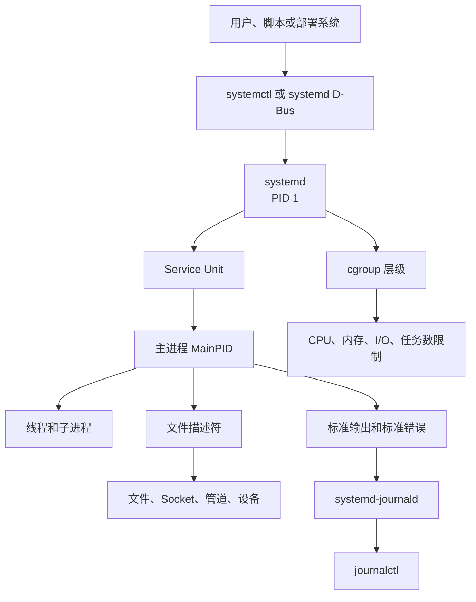
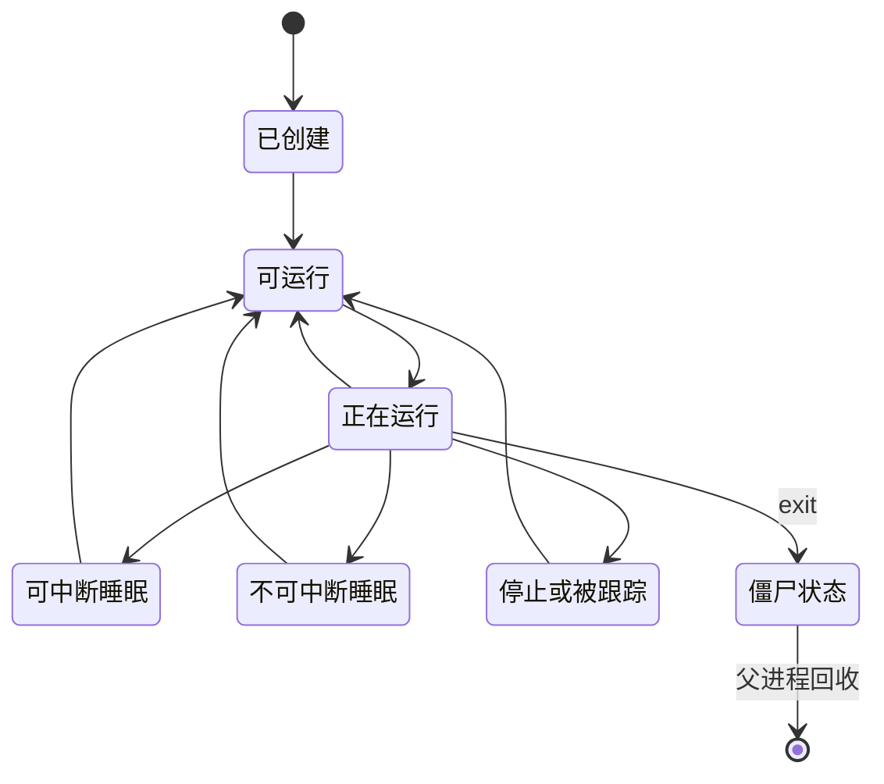
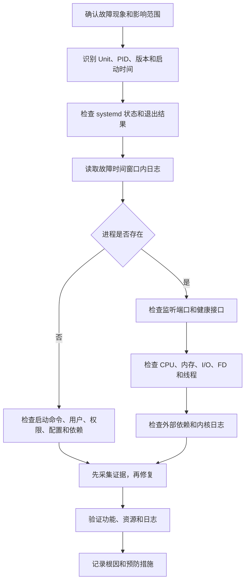

[toc]

## abstract

本文以现代 Linux 服务器和开发环境中最常见的 `systemd` 为主线，同时覆盖传统**进程管理**、`/proc`、信号、日志、网络端口、文件描述符、资源限制、`cgroups v2`、性能诊断以及容器环境中的差异。

开始前先确认当前系统的初始化系统类别：

```bash
ps -p 1 -o pid,comm,args
```

- 若 PID 1 是 `systemd`，本文命令可直接使用；
- 若是 `openrc-init`、`runit`、`busybox init` 等，则进程排查方法仍然适用，但服务管理命令需要替换。

`systemd` 作为 PID 1 时负责系统初始化、服务监督和单元依赖管理，`systemctl` 是主要控制工具。

> 不同发行版所带的 systemd 版本可能落后于上游文档，因此具体指令支持情况应以本机的 `systemd --version` 和本机手册页为准。([自由桌面](https://www.freedesktop.org/software/systemd/man/systemd.html?utm_source=chatgpt.com))

------

## 详细大纲

### 基础知识

- 程序、进程、线程、任务之间的关系
- PID、PPID、进程树、进程组、会话和终端
- 用户、组、权限、Capabilities
- 文件描述符、Socket、管道和标准输入输出
- 进程状态与生命周期
- 信号和退出状态
- 前台任务、后台任务和守护进程
- `/proc` 伪文件系统
- CPU、内存、I/O、网络等资源指标
- cgroups、Namespaces 与容器

### 服务管理

- 服务、守护进程和 systemd 单元的区别
- systemd Unit 类型
- Unit 文件目录和覆盖规则
- 服务启动类型
- 启动、停止、重启、重载、启用和屏蔽
- 依赖关系与启动顺序
- 日志与 journald
- 失败重启、超时、Watchdog
- 资源限制与安全加固
- 系统级服务和用户级服务

### 开发场景排查

- 服务启动失败
- 进程存在但服务不可用
- 端口被占用
- CPU 使用率过高
- 内存持续增长或触发 OOM
- 磁盘 I/O 高或进程卡在 D 状态
- 文件描述符耗尽
- 僵尸进程
- 服务停止卡死
- 服务不断自动重启
- 程序崩溃和 Core Dump
- 容器内外 PID 不一致

### 工程化实践

- 将自研应用注册为 systemd 服务
- 无停机或低停机部署
- 健康检查和可观测性
- 最小权限运行
- 资源隔离
- 安全停止和回滚
- 排障记录与复盘

------

## Linux 进程与服务的整体关系



可以把它理解为三个层次：

- **进程层**：内核实际调度和运行的对象。
- **服务层**：对一个长期运行功能的抽象，可能包含多个进程。
- **管理层**：systemd 负责启动、停止、监督、记录状态并限制服务资源。

------

## 必须掌握的知识

| 知识领域   | 核心内容                               | 开发中的用途             |
| ---------- | -------------------------------------- | ------------------------ |
| Shell 基础 | 命令、参数、退出码、重定向、管道、变量 | 执行和组合排障命令       |
| 进程模型   | PID、PPID、线程、进程树、状态          | 确认程序究竟是否运行     |
| 信号机制   | TERM、KILL、HUP、INT、USR1、USR2       | 安全停止、重载和触发诊断 |
| 权限模型   | UID、GID、文件权限、sudo、Capabilities | 排查 Permission denied   |
| 文件描述符 | 文件、Socket、管道、设备               | 排查端口、日志、连接泄漏 |
| `/proc`    | 进程命令行、环境、内存映射、FD、状态   | 获取内核看到的真实信息   |
| 网络基础   | 地址、端口、监听、连接状态、DNS        | 排查“进程在但接口不通”   |
| systemd    | Unit、依赖、日志、重启策略、资源控制   | 管理生产服务             |
| 性能基础   | CPU、RSS、PSS、Load、I/O、上下文切换   | 定位高负载问题           |
| cgroups    | CPU、内存、I/O、任务数的分组控制       | 服务隔离和防止资源失控   |
| 调试工具   | strace、gdb、perf、coredumpctl         | 分析卡死、崩溃和性能热点 |
| 可观测性   | 日志、指标、追踪、健康检查             | 从“看进程”升级到“看服务” |

------

## 程序、进程、线程与服务

### 程序

程序（Program）是磁盘上的可执行文件或脚本，例如：

```text
/usr/bin/python3
/opt/myapp/bin/server
/home/dev/project/app.py
```

程序本身是静态的。

### 进程

进程（Process）是程序的一次运行实例。一个程序可以同时产生多个进程。

例如启动两个 Python 程序：

```bash
python3 worker.py
python3 worker.py
```

磁盘上的解释器都是 `/usr/bin/python3`，但内核会为两次运行分配不同的 PID。

### 线程

线程（Thread）是进程内部的执行单元。一个多线程服务器通常只有一个进程 PID，但内部可能有几十个线程。

查看线程：

```bash
ps -T -p 1234
```

或者：

```bash
top -H -p 1234
```

Linux 内核会给线程分配任务 ID，工具中常称为 TID 或 LWP。

### 守护进程

守护进程（Daemon）通常指长期在后台运行、不直接依赖交互终端的进程，例如：

- `sshd`
- `nginx`
- `postgres`
- 自研 API Server
- 消息队列消费者

“后台运行”不等于“守护进程”。在终端中执行：

```bash
python3 app.py &
```

只是把 Shell 作业放到后台，它仍可能依赖当前会话、终端、环境变量和工作目录。

### 服务

服务（Service）是操作系统或业务层面的功能单元。一个服务可能对应：

- 一个主进程；
- 一个主进程和多个子进程；
- 多个 Worker；
- Socket 激活后才启动的进程；
- 执行一次后退出的初始化任务。

systemd 使用 `.service` Unit 来描述和监督服务进程。([自由桌面](https://www.freedesktop.org/software/systemd/man/systemd.service.html?utm_source=chatgpt.com))

------

## PID、PPID 与进程树

### PID

PID（Process ID）是进程标识。

```bash
ps -p 1234
```

PID 会被重复使用。不能把很久以前记录下来的 PID 当成永久身份；目标进程退出后，同一个数字可能被分配给另一个进程。内核 `/proc` 文档也明确说明了 PID 重用问题。([Linux内核文档](https://docs.kernel.org/filesystems/proc.html))

### PPID

PPID（Parent Process ID）是父进程 PID。

```bash
ps -o pid,ppid,user,stat,lstart,cmd -p 1234
```

### 查看进程树

```bash
pstree -ap
```

只看指定进程：

```bash
pstree -ap 1234
```

使用 `ps`：

```bash
ps -eo pid,ppid,user,stat,%cpu,%mem,etime,cmd --forest
```

进程树在以下场景非常重要：

- 主进程启动了子进程；
- Shell 脚本只是包装器，真正业务程序是其子进程；
- Worker 未退出；
- 父进程不断重新拉起子进程；
- 直接杀 MainPID 后留下孤儿进程。

------

## 进程生命周期



一般过程是：

1. 父进程通过 `fork()`、`clone()` 等机制创建子任务。
2. 子进程通过 `execve()` 加载新的程序。
3. 内核调度进程运行、等待或休眠。
4. 进程调用 `exit()` 或因信号退出。
5. 父进程通过 `wait()` 系列调用读取退出状态。
6. 在退出但未被父进程回收期间，进程处于僵尸状态。

------

## 常见进程状态

运行：

```bash
ps -eo pid,ppid,stat,wchan:24,etime,cmd
```

| 状态 | 英文                  | 含义                   | 排查重点                          |
| ---- | --------------------- | ---------------------- | --------------------------------- |
| `R`  | Running or Runnable   | 正在运行或等待 CPU     | 是否持续消耗 CPU                  |
| `S`  | Interruptible Sleep   | 可中断睡眠             | 通常正常，如等待网络或定时器      |
| `D`  | Uninterruptible Sleep | 不可中断睡眠           | 常见于磁盘、NFS、块设备或内核等待 |
| `T`  | Stopped               | 被停止                 | 是否收到 SIGSTOP、SIGTSTP         |
| `t`  | Traced                | 被调试器跟踪           | 检查 gdb、strace、ptrace          |
| `Z`  | Zombie                | 已退出但未被父进程回收 | 修复父进程的 wait 逻辑            |
| `I`  | Idle Kernel Thread    | 空闲内核线程           | 通常不属于业务异常                |

需要注意：

- `S` 不代表故障，大量服务绝大部分时间都处于等待状态。
- `D` 状态进程通常无法立即响应普通信号，因为它正在等待内核操作完成。
- `Z` 状态进程已经不再执行代码，向僵尸进程发送 `SIGKILL` 没有意义。
- 僵尸进程需要由父进程回收，或者让父进程退出，使其被其他进程接管并回收。

`/proc/PID/status` 提供比普通 `ps` 更详细的内核视角信息。([Linux内核文档](https://docs.kernel.org/filesystems/proc.html))

------

## 进程组、会话与终端

### 进程组

进程组（Process Group）用于把相关进程作为整体管理。Shell 管道中的多个进程通常属于同一进程组。

### 会话

会话（Session）由一个或多个进程组组成，通常与登录会话或终端相关。

### 前台和后台作业

```bash
sleep 300 &
jobs
fg %1
bg %1
```

按 `Ctrl+Z` 通常向前台进程组发送 `SIGTSTP`，使其停止。

### nohup 与 disown

```bash
nohup python3 worker.py >worker.log 2>&1 &
disown
```

这适合临时任务，不适合作为正式生产服务管理方案，原因包括：

- 无可靠的自动重启；
- 无标准状态管理；
- PID 容易失效；
- 日志轮转困难；
- 环境和工作目录不透明；
- 无资源隔离；
- 停止整个进程树困难。

长期运行程序应优先使用 systemd Unit、容器编排系统或专门的进程监督器。

### 临时使用 systemd 运行任务

```bash
systemd-run --unit=my-test-job \
  --property=MemoryMax=1G \
  --property=CPUQuota=100% \
  /opt/myapp/bin/job
```

在当前终端作用域中运行：

```bash
systemd-run --scope \
  --property=MemoryMax=1G \
  ./benchmark
```

`systemd-run` 可以创建临时 `.service` 或 `.scope` Unit。([自由桌面](https://www.freedesktop.org/software/systemd/man/systemd-run.html?utm_source=chatgpt.com))

------

## 信号机制

信号（Signal）是内核或其他进程向目标进程发送的异步通知。

一个非常重要的认识是：

> `kill` 命令的本质是“发送信号”，不一定意味着强制杀死进程。

### 常用信号

| 名称      | 编号       | 常见用途                       | 是否可捕获或处理 |
| --------- | ---------- | ------------------------------ | ---------------- |
| `SIGHUP`  | 1          | 终端断开；部分服务用来重载配置 | 可以             |
| `SIGINT`  | 2          | 终端中断，通常来自 Ctrl+C      | 可以             |
| `SIGQUIT` | 3          | 退出并可能生成 Core Dump       | 可以             |
| `SIGKILL` | 9          | 立即由内核终止                 | 不可以           |
| `SIGTERM` | 15         | 请求进程优雅退出               | 可以             |
| `SIGSTOP` | 19         | 无条件暂停                     | 不可以           |
| `SIGCONT` | 18         | 恢复暂停的进程                 | 可以             |
| `SIGUSR1` | 因平台而异 | 应用自定义行为                 | 可以             |
| `SIGUSR2` | 因平台而异 | 应用自定义行为                 | 可以             |

`SIGKILL` 和 `SIGSTOP` 不能被进程捕获、忽略或阻塞；其他信号的实际行为可能被应用程序重新定义。多线程程序还要区分进程级信号和线程级信号。([Man7.org](https://man7.org/linux/man-pages/man7/signal.7.html))

### 正确的停止顺序

先尝试优雅终止：

```bash
kill -TERM 1234
```

等待并观察：

```bash
ps -p 1234
```

只有在进程无法正常退出、业务影响允许且证据已经采集后，才考虑：

```bash
kill -KILL 1234
```

`kill` 默认发送 `SIGTERM`，应优先于 `SIGKILL`，因为应用可以在收到 TERM 后关闭监听、停止接收新请求、完成在途任务、刷新缓冲区和释放资源。([Man7.org](https://man7.org/linux/man-pages/man1/kill.1.html?utm_source=chatgpt.com))

### 检查进程是否存在且有权限发送信号

```bash
kill -0 1234
```

这不会真正终止进程，只用于检查目标是否存在以及当前用户是否有权限操作。

### 根据名称操作

查找：

```bash
pgrep -a -x myapp
```

发送 TERM：

```bash
pkill -TERM -x myapp
```

等待进程退出：

```bash
pidwait -x myapp
```

`pgrep`、`pkill` 和 `pidwait` 可以根据名称、用户及其他属性查找、发送信号或等待进程。([Man7.org](https://man7.org/linux/man-pages/man1/pgrep.1.html?utm_source=chatgpt.com))

生产环境中不要轻易使用模糊匹配：

```bash
pkill java
killall python3
```

它们可能影响同机其他业务。

对于 systemd 服务，应优先使用：

```bash
sudo systemctl stop myapp.service
```

因为服务管理器能够按照 Unit 和 cgroup 跟踪服务的整个进程集合，而不只是单个 PID。

------

## 退出码与服务结果

命令执行后可读取退出码：

```bash
echo $?
```

一般约定：

- `0`：成功；
- 非 `0`：失败或特殊状态；
- 被信号终止时，Shell 常以 `128 + 信号编号` 表示，例如 SIGTERM 可能显示为 `143`；
- 应用可以自定义退出码，必须结合应用文档解释。

查看 systemd 记录的结果：

```bash
systemctl show myapp.service \
  -p Result \
  -p ExecMainCode \
  -p ExecMainStatus \
  -p MainPID
```

systemd 在执行服务命令之前，如果设置用户、工作目录或执行文件等步骤失败，也会使用 200 以上的专用退出码。例如常见的 `203/EXEC` 表示执行程序阶段失败。([Man7.org](https://man7.org/linux/man-pages/man5/systemd.exec.5.html?utm_source=chatgpt.com))

------

## `/proc`：内核提供的进程真相

`/proc` 是伪文件系统，它把内核和进程信息以文件形式暴露给用户空间。每个进程通常对应 `/proc/PID` 目录。([Linux内核文档](https://docs.kernel.org/filesystems/proc.html))

假设 PID 为 1234：

| 路径                      | 内容                                  |
| ------------------------- | ------------------------------------- |
| `/proc/1234/status`       | 人类可读的进程状态、内存、UID、线程数 |
| `/proc/1234/cmdline`      | 启动参数                              |
| `/proc/1234/environ`      | 环境变量                              |
| `/proc/1234/exe`          | 实际执行文件的符号链接                |
| `/proc/1234/cwd`          | 当前工作目录                          |
| `/proc/1234/root`         | 进程看到的根目录                      |
| `/proc/1234/fd`           | 打开的文件描述符                      |
| `/proc/1234/maps`         | 内存映射                              |
| `/proc/1234/smaps`        | 每个内存映射的详细占用                |
| `/proc/1234/smaps_rollup` | 汇总后的 PSS、RSS 等                  |
| `/proc/1234/io`           | 进程 I/O 统计                         |
| `/proc/1234/limits`       | 资源限制                              |
| `/proc/1234/cgroup`       | 所属 cgroup                           |
| `/proc/1234/wchan`        | 进程在内核中等待的位置                |
| `/proc/1234/task`         | 线程列表                              |

常用检查：

```bash
cat /proc/1234/status
readlink -f /proc/1234/exe
readlink -f /proc/1234/cwd
tr '\0' ' ' < /proc/1234/cmdline
ls -l /proc/1234/fd
```

查看环境变量时要注意敏感信息：

```bash
tr '\0' '\n' < /proc/1234/environ
```

环境变量中可能包含密码、Token、数据库连接串，因此访问和记录时要遵守权限与脱敏要求。

------

## 文件描述符

文件描述符（File Descriptor，FD）是进程访问文件、Socket、管道和设备的句柄。

约定：

| FD   | 名称            |
| ---- | --------------- |
| 0    | 标准输入 stdin  |
| 1    | 标准输出 stdout |
| 2    | 标准错误 stderr |

### 查看进程打开的对象

```bash
lsof -p 1234
```

只查看数量：

```bash
find /proc/1234/fd -mindepth 1 -maxdepth 1 -printf '.' | wc -c
```

查看限制：

```bash
cat /proc/1234/limits
```

或者：

```bash
prlimit --pid 1234
```

### 文件描述符泄漏的表现

- 日志出现 `Too many open files`；
- 无法接受新连接；
- 无法打开配置或日志文件；
- `/proc/PID/fd` 数量持续增长；
- 大量处于 `CLOSE_WAIT` 的 Socket；
- 服务运行一段时间后逐渐异常。

动态观察：

```bash
watch -n 2 'ls /proc/1234/fd | wc -l'
```

systemd 服务不要只依赖交互式 Shell 的 `ulimit`，应在 Unit 中设置：

```ini
LimitNOFILE=65536
```

提高上限不能替代修复泄漏。如果 FD 数量持续增长，优先查代码关闭逻辑、连接池和超时设置。

------

## CPU、内存与系统负载

### CPU 指标

查看单进程：

```bash
ps -p 1234 -o pid,ppid,stat,%cpu,psr,nlwp,etime,cmd
```

动态查看：

```bash
top -p 1234
```

按线程查看：

```bash
top -H -p 1234
```

采样：

```bash
pidstat -u -p 1234 1
```

`pidstat` 可按指定时间间隔报告任务的 CPU、内存、I/O、线程和上下文切换活动。([Man7.org](https://man7.org/linux/man-pages/man1/pidstat.1.html))

注意：

- 在多核系统中，多线程进程的 `%CPU` 可能超过 100%；
- 单线程长期接近 100% 通常表示占满一个逻辑 CPU；
- CPU 高不一定是程序计算多，也可能是忙轮询、锁竞争或大量系统调用；
- 瞬时快照不足以说明问题，应连续采样。

### Load Average

```bash
uptime
cat /proc/loadavg
```

Load Average 不是 CPU 使用率。Linux 中它主要反映可运行任务以及部分不可中断等待任务的数量。

判断时要结合：

- CPU 核数；
- `%idle`；
- I/O wait；
- D 状态任务数；
- 运行队列长度。

### 内存指标

| 指标            | 含义                       |
| --------------- | -------------------------- |
| `VSZ` 或 `VIRT` | 虚拟地址空间大小           |
| `RSS` 或 `RES`  | 当前驻留在物理内存中的页面 |
| `PSS`           | 共享页面按比例分摊后的内存 |
| `USS`           | 进程独占的物理内存         |
| `Swap`          | 被换出的内存               |
| Page Cache      | 内核用空闲内存缓存文件内容 |

查看：

```bash
ps -p 1234 -o pid,vsz,rss,%mem,etime,cmd
cat /proc/1234/smaps_rollup
free -h
```

不能看到 `free` 很小就断言内存不足。Linux 会利用可用内存做缓存，更应关注：

- `available`；
- Swap 是否持续增长；
- 是否出现内存回收压力；
- 应用 RSS 或 PSS 是否持续增长；
- 是否触发 OOM Killer。

------

## I/O 与阻塞

### 进程 I/O

```bash
pidstat -d -p 1234 1
cat /proc/1234/io
```

### 系统磁盘状态

```bash
iostat -xz 1
```

常见关注项：

- 设备利用率；
- 请求延迟；
- 队列深度；
- 读写吞吐；
- I/O wait。

### D 状态进程

```bash
ps -eo pid,ppid,stat,wchan:32,etime,cmd
```

如果进程长期处于 `D` 状态：

1. 查看 `wchan`；
2. 检查磁盘、NFS、网络块设备；
3. 检查内核日志；
4. 检查挂载点；
5. 检查设备延迟和错误；
6. 不要反复执行 `kill -9`。

```bash
journalctl -k -b
dmesg -T
```

典型原因包括：

- 磁盘故障；
- NFS 服务端不可用；
- 文件系统卡死；
- 块设备超时；
- 内核驱动问题；
- 存储负载过高。

------

## cgroups v2 与资源控制

cgroup 是 Control Group 的缩写，用于把进程按层级组织起来，并对 CPU、内存、I/O、任务数量等资源进行控制。cgroups v2 使用统一层级，每个进程属于一个 cgroup，父级限制不能被子级绕过。([kernel.org](https://www.kernel.org/doc/html/v5.0/admin-guide/cgroup-v2.html))

systemd 将服务放入 cgroup，因此可以管理整个服务进程树。

查看：

```bash
systemctl status myapp.service
```

通常会显示类似：

```text
CGroup: /system.slice/myapp.service
        ├─1234 /opt/myapp/bin/server
        └─1241 /opt/myapp/bin/worker
```

查看整体层级：

```bash
systemd-cgls
```

动态查看：

```bash
systemd-cgtop
```

### 常见资源控制项

| 指令           | 用途                             |
| -------------- | -------------------------------- |
| `CPUWeight=`   | 相对 CPU 权重                    |
| `CPUQuota=`    | CPU 使用上限                     |
| `MemoryHigh=`  | 内存压力阈值，优先触发回收和限制 |
| `MemoryMax=`   | 硬性内存上限                     |
| `TasksMax=`    | 最大任务或线程数量               |
| `IOWeight=`    | 相对 I/O 权重                    |
| `AllowedCPUs=` | 允许使用的 CPU 集合              |

示例：

```ini
CPUQuota=200%
MemoryHigh=1500M
MemoryMax=2G
TasksMax=512
```

`CPUQuota=200%` 大致表示最多使用两个逻辑 CPU 的计算能力，而不是整台机器 CPU 的 200%。

临时修改：

```bash
sudo systemctl set-property --runtime myapp.service MemoryMax=2G
```

持久修改：

```bash
sudo systemctl set-property myapp.service MemoryMax=2G
```

资源上限应通过压测确定，过低会把正常流量误判为异常。

------

## systemd 的核心概念

### Unit

Unit 是 systemd 管理的对象。常见类型如下。

| 类型      | 后缀         | 用途                        |
| --------- | ------------ | --------------------------- |
| Service   | `.service`   | 管理进程或任务              |
| Socket    | `.socket`    | 管理监听 Socket，可触发服务 |
| Timer     | `.timer`     | 定时触发任务                |
| Path      | `.path`      | 监视文件或目录变化          |
| Target    | `.target`    | 对多个 Unit 分组和同步      |
| Mount     | `.mount`     | 管理挂载点                  |
| Automount | `.automount` | 按需挂载                    |
| Swap      | `.swap`      | 管理交换空间                |
| Device    | `.device`    | 表示设备                    |
| Slice     | `.slice`     | cgroup 资源层级             |
| Scope     | `.scope`     | 管理外部创建的进程集合      |

Socket Unit 可以让 systemd 预先持有网络或 IPC Socket，在连接到来时启动相应服务。([自由桌面](https://www.freedesktop.org/software/systemd/man/systemd.socket.html?utm_source=chatgpt.com))

### Unit 文件位置

常见位置：

| 目录                      | 用途                    |
| ------------------------- | ----------------------- |
| `/etc/systemd/system`     | 管理员创建或覆盖的 Unit |
| `/run/systemd/system`     | 运行时临时 Unit         |
| `/usr/lib/systemd/system` | 软件包安装的 Unit       |
| `/lib/systemd/system`     | 部分发行版的软件包 Unit |
| `~/.config/systemd/user`  | 当前用户的用户级 Unit   |

不要直接修改 `/usr/lib/systemd/system` 或 `/lib/systemd/system` 中的软件包文件，因为软件升级可能覆盖修改。

查看完整生效内容：

```bash
systemctl cat myapp.service
```

创建覆盖配置：

```bash
sudo systemctl edit myapp.service
```

这通常会创建：

```text
/etc/systemd/system/myapp.service.d/override.conf
```

恢复软件包默认配置：

```bash
sudo systemctl revert myapp.service
```

Unit 文件存在搜索路径和覆盖优先级，管理员配置通常应放在 `/etc/systemd/system`。([自由桌面](https://www.freedesktop.org/software/systemd/man/systemd.unit.html?utm_source=chatgpt.com))

------

## 服务状态的三个维度

不要只问“服务是不是 running”，至少要看三个维度。

### 是否已加载

```bash
systemctl show myapp.service -p LoadState
```

常见值：

- `loaded`
- `not-found`
- `masked`
- `error`

### 是否正在运行

```bash
systemctl is-active myapp.service
```

常见 ActiveState：

- `active`
- `inactive`
- `failed`
- `activating`
- `deactivating`
- `reloading`

### 是否设置为开机启动

```bash
systemctl is-enabled myapp.service
```

常见值：

- `enabled`
- `disabled`
- `static`
- `indirect`
- `masked`
- `generated`

因此：

> `enabled` 不等于当前正在运行，`active` 也不等于开机自动启动。

------

## systemctl 常用命令

### 查看和查询

| 目标             | 命令                                        |
| ---------------- | ------------------------------------------- |
| 查看状态         | `systemctl status myapp.service`            |
| 不分页查看       | `systemctl status --no-pager myapp.service` |
| 查看详细属性     | `systemctl show myapp.service`              |
| 查看主 PID       | `systemctl show myapp.service -p MainPID`   |
| 查看生效配置     | `systemctl cat myapp.service`               |
| 查看依赖         | `systemctl list-dependencies myapp.service` |
| 查看失败 Unit    | `systemctl --failed`                        |
| 查看所有 Service | `systemctl list-units --type=service --all` |
| 查看 Unit 文件   | `systemctl list-unit-files --type=service`  |

### 控制服务

| 操作           | 命令                                        | 含义                     |
| -------------- | ------------------------------------------- | ------------------------ |
| 启动           | `systemctl start myapp.service`             | 立即启动                 |
| 停止           | `systemctl stop myapp.service`              | 立即停止                 |
| 重启           | `systemctl restart myapp.service`           | 停止后重新启动           |
| 重载           | `systemctl reload myapp.service`            | 让应用重新读取配置       |
| 尝试重启       | `systemctl try-restart myapp.service`       | 仅在已运行时重启         |
| 重载或重启     | `systemctl reload-or-restart myapp.service` | 支持重载则重载，否则重启 |
| 启用           | `systemctl enable myapp.service`            | 设置随目标启动           |
| 启用并立即启动 | `systemctl enable --now myapp.service`      | 两步合一                 |
| 禁用           | `systemctl disable myapp.service`           | 取消自动启动             |
| 禁用并停止     | `systemctl disable --now myapp.service`     | 两步合一                 |
| 屏蔽           | `systemctl mask myapp.service`              | 阻止手动或依赖启动       |
| 解除屏蔽       | `systemctl unmask myapp.service`            | 恢复启动能力             |
| 清除失败状态   | `systemctl reset-failed myapp.service`      | 清除 failed 和重启计数   |

### 三种“重载”不要混淆

#### `systemctl reload myapp`

通知业务进程重新读取应用配置。

前提是 Unit 定义了 `ExecReload=`，或者程序使用 systemd 通知机制支持重载。

#### `systemctl daemon-reload`

让 systemd 重新读取 Unit 文件。

修改以下内容后需要执行：

- `.service`
- `.socket`
- `.timer`
- Drop-in 配置

它不会自动重启业务进程。

#### `systemctl restart myapp`

停止旧进程并启动新进程，会造成连接或任务中断，除非应用自身实现了优雅接管。

------

## 服务启动类型

`Type=` 决定 systemd 如何判断服务已经启动。

| 类型      | 适用场景                    | 特点                                         |
| --------- | --------------------------- | -------------------------------------------- |
| `simple`  | 普通前台程序                | 默认类型，启动命令创建后即认为已启动         |
| `exec`    | 普通前台程序                | 等到执行文件成功进入 `execve` 后认为启动成功 |
| `notify`  | 原生支持 systemd 通知的服务 | 应用显式发送 READY 通知                      |
| `forking` | 传统自我后台化程序          | 父进程退出，子进程继续运行                   |
| `oneshot` | 初始化、迁移、一次性任务    | 命令执行完即完成                             |
| `dbus`    | D-Bus 服务                  | 获得指定总线名称后视为就绪                   |
| `idle`    | 延迟终端输出干扰            | 不应作为常规依赖控制手段                     |

现代自研服务应尽量：

- 以前台方式运行；
- 使用 `Type=exec`、`Type=simple` 或 `Type=notify`；
- 不自行双重 fork；
- 不自行维护陈旧 PID 文件；
- 将监督职责交给 systemd。

------

## Unit 依赖与启动顺序

systemd 中“是否拉起”和“先后顺序”是两套概念。

### 依赖关系

| 指令         | 作用                                   |
| ------------ | -------------------------------------- |
| `Wants=`     | 弱依赖，依赖失败不一定使当前 Unit 失败 |
| `Requires=`  | 强依赖，依赖启动失败通常影响当前 Unit  |
| `BindsTo=`   | 生命周期绑定更紧密                     |
| `PartOf=`    | 上游停止或重启时跟随                   |
| `Conflicts=` | 两个 Unit 不能同时活动                 |

### 顺序关系

| 指令      | 作用                     |
| --------- | ------------------------ |
| `After=`  | 当前 Unit 在目标之后启动 |
| `Before=` | 当前 Unit 在目标之前启动 |

关键规则：

```ini
After=postgresql.service
```

只表达顺序，不会自动拉起 PostgreSQL。

要同时表达依赖和顺序，应写成：

```ini
Wants=postgresql.service
After=postgresql.service
```

但即使 PostgreSQL 进程已经启动，也不代表数据库已经接受业务请求。真正的业务就绪性仍应由应用重试、健康检查或服务自身的 readiness 机制处理。

------

## journald 与 journalctl

`systemd-journald` 收集结构化日志，包括：

- 服务标准输出；
- 服务标准错误；
- syslog；
- 内核日志；
- Unit、PID、UID、启动批次等元数据。

`journalctl` 用于读取这些日志。([自由桌面](https://www.freedesktop.org/software/systemd/man/systemd-journald.service.html?utm_source=chatgpt.com))

### 查看服务日志

```bash
journalctl -u myapp.service
```

当前启动周期：

```bash
journalctl -u myapp.service -b
```

最近 200 行：

```bash
journalctl -u myapp.service -n 200 --no-pager
```

实时跟踪：

```bash
journalctl -u myapp.service -f
```

指定时间：

```bash
journalctl -u myapp.service \
  --since "2026-07-15 09:00:00" \
  --until "2026-07-15 10:00:00"
```

只看警告及以上：

```bash
journalctl -u myapp.service -p warning
```

高精度时间：

```bash
journalctl -u myapp.service -o short-iso-precise
```

查看内核日志：

```bash
journalctl -k -b
```

查看上一轮启动：

```bash
journalctl -b -1
```

根据 PID：

```bash
journalctl _PID=1234
```

查看磁盘占用：

```bash
journalctl --disk-usage
```

### 日志排查最佳实践

- 先固定时间窗口；
- 确认时区；
- 保存错误发生前后的上下文；
- 不只搜索 `error`，还要看 warning、timeout、signal、OOM；
- 区分应用时间、系统时间和数据库时间；
- 发布时记录版本号、Commit ID 和配置版本；
- 日志中包含请求 ID、任务 ID或 Trace ID；
- 不输出密码、Token 和完整敏感数据。

------

## 统一的服务排障流程



### 确认现象

不要一上来就重启。先回答：

- 是启动失败、运行中异常还是停止失败？
- 是单个实例还是全部实例？
- 是所有请求失败还是部分超时？
- 故障从什么时候开始？
- 是否刚发生发布、配置修改、证书更新或依赖变更？
- 是进程故障、服务故障还是业务依赖故障？

### 识别对象

```bash
systemctl status myapp.service
systemctl show myapp.service \
  -p MainPID \
  -p ActiveEnterTimestamp \
  -p ExecMainStartTimestamp \
  -p FragmentPath
pgrep -a -f '/opt/myapp/bin/server'
```

### 检查状态

```bash
systemctl status --no-pager -l myapp.service
systemctl show myapp.service \
  -p LoadState \
  -p ActiveState \
  -p SubState \
  -p Result \
  -p ExecMainStatus \
  -p NRestarts
```

### 读取日志

```bash
journalctl -u myapp.service -b -n 300 --no-pager
```

### 检查端口

```bash
ss -lntp
```

指定端口：

```bash
ss -lntp 'sport = :8080'
```

### 检查健康接口

```bash
curl -v --max-time 5 http://127.0.0.1:8080/health
```

### 检查资源

```bash
pidstat -u -r -d -w -p 1234 1
```

### 检查内核

```bash
journalctl -k -b -p warning
```

### 再决定干预方式

优先顺序通常是：

1. 重载配置；
2. 优雅停止；
3. 正常重启；
4. 限流或摘流量；
5. 回滚；
6. 最后才是强制终止。

------

## 常用工具速查

### 查找和识别进程

| 工具               | 典型用途                   |
| ------------------ | -------------------------- |
| `ps`               | 当前进程快照               |
| `pgrep`            | 按名称、用户、属性查 PID   |
| `pidof`            | 按程序名查 PID             |
| `pstree`           | 查看父子关系               |
| `top`              | 动态系统和进程视图         |
| `htop`             | 交互式进程视图             |
| `systemctl status` | 查看 Unit 和 cgroup 进程树 |

`top` 提供系统摘要及实时进程或线程列表。([Man7.org](https://man7.org/linux/man-pages/man1/top.1.html?utm_source=chatgpt.com))

### 网络和文件

| 工具      | 典型用途                     |
| --------- | ---------------------------- |
| `ss`      | 查看监听端口和 TCP 状态      |
| `lsof`    | 查看进程打开的文件和 Socket  |
| `fuser`   | 查看谁在使用端口或文件       |
| `curl`    | 验证 HTTP 接口               |
| `getent`  | 验证系统实际 DNS 或 NSS 解析 |
| `tcpdump` | 抓取网络数据包               |
| `namei`   | 逐级检查路径权限             |

### 性能和调试

| 工具            | 典型用途                      |
| --------------- | ----------------------------- |
| `pidstat`       | 进程 CPU、内存、I/O、切换采样 |
| `iostat`        | 块设备 I/O                    |
| `vmstat`        | CPU、内存、运行队列和系统活动 |
| `strace`        | 系统调用和信号                |
| `perf`          | CPU 热点和内核性能分析        |
| `gdb`           | 源码级或运行时调试            |
| `coredumpctl`   | 查看和调试 Core Dump          |
| `pmap`          | 进程内存映射                  |
| `systemd-cgtop` | 按 cgroup 观察资源            |
| `bpftrace`      | 基于 eBPF 的动态追踪          |

`strace` 能截获进程的系统调用和接收到的信号，特别适合分析“卡在哪里”“哪个文件不存在”“哪个连接失败”。([Man7.org](https://man7.org/linux/man-pages/man1/strace.1.html))

------

## 案例：服务启动失败

假设：

```bash
sudo systemctl start my-api.service
```

返回失败。

### 检查状态

```bash
systemctl status --no-pager -l my-api.service
```

重点看：

- `Loaded`
- `Active`
- `Process`
- `Main PID`
- `status=`
- 最后几行日志

### 查看完整日志

```bash
journalctl -u my-api.service -b -n 300 --no-pager
```

### 检查 Unit

```bash
systemctl cat my-api.service
```

检查：

- `ExecStart` 路径是否存在；
- 文件是否有执行权限；
- `User` 是否存在；
- `Group` 是否存在；
- `WorkingDirectory` 是否存在；
- 配置文件是否可读；
- 动态库是否缺失；
- 环境变量是否齐全；
- 端口是否冲突。

### 验证 Unit 语法

```bash
systemd-analyze verify /etc/systemd/system/my-api.service
```

`systemd-analyze verify` 会加载 Unit 并报告检测到的错误或警告。([自由桌面](https://www.freedesktop.org/software/systemd/man/systemd-analyze.html?utm_source=chatgpt.com))

### 检查可执行文件

```bash
ls -l /opt/my-api/bin/server
file /opt/my-api/bin/server
ldd /opt/my-api/bin/server
```

### 以服务用户手工运行

```bash
sudo -u my-api \
  /opt/my-api/bin/server \
  --config /etc/my-api/config.yaml
```

最好模拟真实工作目录：

```bash
sudo -u my-api \
  sh -c 'cd /opt/my-api && exec ./bin/server --config /etc/my-api/config.yaml'
```

### 常见根因

| 现象                        | 可能原因                                             |
| --------------------------- | ---------------------------------------------------- |
| `203/EXEC`                  | 路径错误、无执行权限、解释器不存在、文件系统禁止执行 |
| `217/USER`                  | `User=` 无效或用户初始化失败                         |
| `Permission denied`         | 文件、目录、SELinux、AppArmor 或挂载选项限制         |
| `No such file or directory` | 文件缺失，也可能是脚本解释器或动态加载器缺失         |
| 立即退出且状态 0            | 程序自我后台化，Unit Type 不匹配                     |
| `Address already in use`    | 端口被占用                                           |
| 配置解析失败                | 配置格式、版本或环境变量错误                         |

### 修复后

Unit 文件发生变化：

```bash
sudo systemctl daemon-reload
```

重新启动：

```bash
sudo systemctl restart my-api.service
```

验证：

```bash
systemctl is-active my-api.service
curl --fail --max-time 5 http://127.0.0.1:8080/health
```

------

## 案例：进程存在，但接口访问失败

这是开发中最常见的误区：

> 进程存在，只能说明有一个进程对象，不能说明服务已经就绪。

### 检查 MainPID

```bash
systemctl show my-api.service -p MainPID
```

### 检查是否监听

```bash
ss -lntp 'sport = :8080'
```

可能出现：

- 没有监听；
- 监听了错误端口；
- 只监听 `127.0.0.1`；
- 只监听 IPv6；
- 监听在容器网络命名空间中；
- 端口被其他进程占用。

### 本机访问

```bash
curl -v --max-time 5 http://127.0.0.1:8080/health
```

### 检查监听地址

如果只看到：

```text
127.0.0.1:8080
```

则远程客户端无法直接访问。需要根据安全要求配置为：

```text
0.0.0.0:8080
```

或者由 Nginx、Envoy、HAProxy 等反向代理访问本机端口。

### 检查 DNS

```bash
getent hosts database.internal
```

### 检查下游端口

```bash
nc -vz database.internal 5432
```

### 检查连接状态

```bash
ss -ntp
```

典型状态：

| 状态         | 可能含义                                   |
| ------------ | ------------------------------------------ |
| `SYN-SENT`   | 对端无响应、路由或防火墙问题               |
| `ESTAB`      | 连接已建立                                 |
| `CLOSE-WAIT` | 对端已关闭，本进程未关闭 Socket            |
| `TIME-WAIT`  | 主动关闭后的正常等待，也可能反映连接 churn |
| `FIN-WAIT-1` | 正在关闭连接                               |
| `LISTEN`     | 正在监听                                   |

### 检查线程是否卡死

```bash
top -H -p 1234
ps -T -p 1234 -o pid,spid,stat,pcpu,wchan:24,comm
```

### 必要时使用 strace

```bash
sudo strace -ff -tt -T -p 1234 -o /tmp/my-api.strace
```

短时间采样后停止，检查是否反复出现：

- `connect()`
- `poll()`
- `epoll_wait()`
- `futex()`
- `openat()`
- `read()`
- `write()`

`strace` 会带来性能开销，生产环境应限定时间并控制输出范围。

------

## 案例：端口被占用

应用日志：

```text
bind: Address already in use
```

### 找到监听者

```bash
ss -lntp 'sport = :8080'
```

或者：

```bash
sudo lsof -nP -iTCP:8080 -sTCP:LISTEN
```

或者：

```bash
sudo fuser -v 8080/tcp
```

### 确认所属服务

```bash
ps -p 1234 -o pid,ppid,user,lstart,cmd
cat /proc/1234/cgroup
```

如果属于 systemd Unit，可尝试：

```bash
systemctl status 1234
```

在支持该用法的 systemd 版本中，PID 可解析到对应 Unit。

### 正确处理

不要直接执行：

```bash
kill -9 1234
```

先确认：

- 是否是当前服务的旧实例；
- 是否是其他业务；
- 是否由 systemd 自动拉起；
- 是否有 Socket Unit 持有端口；
- 是否属于容器；
- 是否存在滚动发布中的新旧实例重叠。

如果旧服务由 systemd 管理：

```bash
sudo systemctl stop old-api.service
```

------

## 案例：CPU 使用率过高

### 确认是持续还是瞬时

```bash
pidstat -u -p 1234 1 10
```

### 查看线程

```bash
top -H -p 1234
ps -T -p 1234 -o pid,spid,pcpu,stat,comm --sort=-pcpu
```

### 常见根因

- 死循环；
- 忙轮询；
- 无限重试且无退避；
- 序列化或压缩计算；
- 正则表达式灾难性回溯；
- 大量垃圾回收；
- 锁竞争；
- 线程池配置过大；
- 日志输出过多；
- 异常流量；
- 加密或哈希计算；
- 系统调用风暴。

### 使用 perf

采样：

```bash
sudo perf top -p 1234
```

记录：

```bash
sudo perf record -F 99 -g -p 1234 -- sleep 30
```

报告：

```bash
sudo perf report
```

### Java

```bash
jcmd 1234 Thread.print
jstack 1234
```

把高 CPU 的 Linux 线程 ID 转换为十六进制后，在线程栈中匹配 `nid`。

### Python

可使用：

```bash
py-spy top --pid 1234
```

或：

```bash
py-spy record --pid 1234 --duration 30 --output profile.svg
```

### Go

应用应暴露受控的 `pprof`：

```bash
go tool pprof http://127.0.0.1:6060/debug/pprof/profile?seconds=30
```

### 临时止损

可以临时限制 CPU：

```bash
sudo systemctl set-property --runtime my-api.service CPUQuota=200%
```

但这只是限制影响范围，不能替代根因修复。

------

## 案例：内存持续增长或 OOM

### 观察趋势

```bash
pidstat -r -p 1234 5
watch -n 5 'grep -E "VmRSS|VmSwap|Threads" /proc/1234/status'
```

### 查看 PSS

```bash
cat /proc/1234/smaps_rollup
```

### 查 OOM

```bash
journalctl -k -b | grep -i -E 'oom|out of memory|killed process'
```

虽然这里使用了管道，但它位于普通代码块中，不会影响 Markdown 表格解析。

### systemd 结果

```bash
systemctl show my-api.service \
  -p Result \
  -p OOMPolicy \
  -p MemoryCurrent \
  -p MemoryPeak \
  -p MemoryHigh \
  -p MemoryMax
```

不同 systemd 版本支持的属性可能不同。

### 区分几种情况

| 现象                   | 判断方向                       |
| ---------------------- | ------------------------------ |
| RSS 一直增长           | 堆、缓存、线程栈或 mmap 增长   |
| VSZ 大但 RSS 稳定      | 可能只是预留虚拟地址空间       |
| PSS 增长               | 实际分摊后的物理内存增长       |
| Swap 增长              | 内存压力或冷页面换出           |
| 重启后恢复，再逐渐增长 | 高度怀疑泄漏或无界缓存         |
| 流量下降后内存不回落   | 可能是分配器保留，也可能是泄漏 |
| 只在特定请求后增长     | 重点复现对应业务路径           |

### 临时保护

```ini
MemoryHigh=1500M
MemoryMax=2G
```

建议：

- `MemoryHigh` 作为提前施压阈值；
- `MemoryMax` 作为最后保护；
- 上限应结合正常峰值、并发和 GC 行为确定；
- 设置后进行压测和故障演练。

内核还会根据 OOM 评分选择终止目标，相关信息可在 `/proc/PID/oom_score` 和 `/proc/PID/oom_score_adj` 中查看。([Linux内核文档](https://docs.kernel.org/filesystems/proc.html))

------

## 案例：文件描述符耗尽

### 检查数量

```bash
ls /proc/1234/fd | wc -l
```

### 检查限制

```bash
grep -i 'open files' /proc/1234/limits
```

### 按类型查看

```bash
sudo lsof -p 1234
```

常见泄漏对象：

- TCP Socket；
- 日志文件；
- 临时文件；
- 管道；
- inotify；
- epoll；
- 数据库连接；
- 已删除但仍被进程持有的文件。

检查已删除文件：

```bash
sudo lsof -p 1234 +L1
```

典型现象：

```text
/var/log/myapp/app.log (deleted)
```

这表示文件目录项已删除，但进程仍持有 FD，磁盘空间不会真正释放。正确处理通常是让应用重新打开日志，或者重启服务，而不是继续删除文件。

------

## 案例：僵尸进程

查找：

```bash
ps -eo pid,ppid,stat,etime,cmd
```

只看僵尸：

```bash
ps -eo pid,ppid,stat,etime,cmd | awk '$3 ~ /^Z/'
```

查看父进程：

```bash
ps -p 5678 -o pid,ppid,user,stat,etime,cmd
```

### 为什么 kill 僵尸无效

僵尸进程已经执行完毕，只保留：

- PID；
- 退出码；
- 少量统计信息。

需要父进程调用 `wait()` 回收。

处理方法：

- 修复父进程的子进程回收逻辑；
- 向父进程发送其支持的管理信号；
- 在允许的情况下重启父服务；
- 检查是否存在大量短命子进程。

僵尸数量少且短暂通常不是问题；持续增长才说明父进程存在缺陷。

------

## 案例：服务停止卡死

执行：

```bash
sudo systemctl stop my-api.service
```

长时间停留在 `deactivating`。

### 查看状态

```bash
systemctl status --no-pager -l my-api.service
```

### 查看停止日志

```bash
journalctl -u my-api.service --since "-10 minutes"
```

### 查看进程状态

```bash
systemctl show my-api.service \
  -p MainPID \
  -p ControlPID \
  -p TimeoutStopUSec \
  -p KillSignal
ps -eo pid,ppid,stat,wchan:24,etime,cmd --forest
```

### 常见原因

- 应用忽略或没有正确处理 SIGTERM；
- 停止钩子等待下游依赖；
- Worker 未退出；
- 线程死锁；
- 进程处于 D 状态；
- `ExecStop=` 自身卡住；
- 停止超时过长；
- 程序自行 fork，systemd 未识别主进程；
- 关闭逻辑等待永不完成的任务。

### 合理配置

```ini
TimeoutStopSec=30s
KillSignal=SIGTERM
```

systemd 在停止阶段可以先发送正常终止信号，超时后再执行后续强制终止策略；具体行为由 `systemd.kill` 相关配置控制。([自由桌面](https://www.freedesktop.org/software/systemd/man/systemd.kill.html?utm_source=chatgpt.com))

不要把 `TimeoutStopSec` 设得极短。应根据：

- 最长请求时间；
- 消息确认时间；
- 数据刷盘时间；
- 事务回滚时间；
- Worker 退出时间；

确定合理值。

------

## 案例：服务不断自动重启

查看：

```bash
systemctl status my-api.service
systemctl show my-api.service \
  -p NRestarts \
  -p Restart \
  -p RestartUSec \
  -p StartLimitBurst \
  -p StartLimitIntervalUSec
```

日志：

```bash
journalctl -u my-api.service -b -n 500
```

### 常见原因

- 启动后立即崩溃；
- 配置错误；
- 端口冲突；
- 数据库不可达；
- 缺少环境变量；
- 权限问题；
- 内存限制触发；
- Watchdog 超时；
- `Restart=always` 把正常退出也重新拉起；
- 启动频率触发 StartLimit。

### 不要只执行 reset-failed

```bash
sudo systemctl reset-failed my-api.service
```

它只清除失败计数，不解决根因。

开发环境中可先停止重启风暴：

```bash
sudo systemctl stop my-api.service
```

完成配置修复后再启动。

------

## 案例：程序崩溃和 Core Dump

查看崩溃记录：

```bash
coredumpctl list
```

指定服务：

```bash
coredumpctl list /opt/my-api/bin/server
```

查看详情：

```bash
coredumpctl info 1234
```

使用 gdb：

```bash
coredumpctl debug 1234
```

常见分析内容：

- 收到的信号，如 SIGSEGV、SIGABRT；
- 崩溃线程；
- 调用栈；
- 二进制 Build ID；
- 动态库版本；
- 崩溃时间；
- 命令行和 Unit。

要获得可用栈信息，需要：

- 保存与线上二进制匹配的调试符号；
- 保留准确的构建产物；
- 记录 Commit ID；
- 不在排查前覆盖对应二进制；
- 对敏感 Core Dump 设置访问权限。

`coredumpctl` 用于检索已保存的 Core Dump 及其元数据。([自由桌面](https://www.freedesktop.org/software/systemd/man/index.html?utm_source=chatgpt.com))

------

## 一个适合自研应用的 systemd Unit

文件：

```text
/etc/systemd/system/my-api.service
```

内容：

```ini
[Unit]
Description=My API Service
Documentation=https://docs.example.internal/my-api
Wants=network-online.target
After=network-online.target

[Service]
Type=exec

User=my-api
Group=my-api

WorkingDirectory=/opt/my-api/current
ExecStart=/opt/my-api/current/bin/server --config /etc/my-api/config.yaml

EnvironmentFile=-/etc/my-api/my-api.env

Restart=on-failure
RestartSec=3s

TimeoutStartSec=60s
TimeoutStopSec=30s
KillSignal=SIGTERM

RuntimeDirectory=my-api
StateDirectory=my-api
LogsDirectory=my-api

UMask=0027
LimitNOFILE=65536
TasksMax=512

MemoryHigh=1500M
MemoryMax=2G
CPUQuota=200%

NoNewPrivileges=true
PrivateTmp=true
ProtectSystem=strict
ProtectHome=true

StandardOutput=journal
StandardError=journal

[Install]
WantedBy=multi-user.target
```

### 各配置的作用

| 配置                 | 作用                                         |
| -------------------- | -------------------------------------------- |
| `Type=exec`          | 执行文件成功进入运行阶段后再认为启动命令成功 |
| `User`、`Group`      | 避免应用以 root 运行                         |
| `WorkingDirectory`   | 明确相对路径的基准                           |
| `ExecStart`          | 唯一、明确的启动命令                         |
| `EnvironmentFile`    | 读取非敏感环境配置                           |
| `Restart=on-failure` | 异常失败时重启，正常退出时不反复拉起         |
| `TimeoutStopSec`     | 给优雅退出留下时间                           |
| `RuntimeDirectory`   | 创建运行时目录                               |
| `StateDirectory`     | 创建持久状态目录                             |
| `LogsDirectory`      | 创建日志目录                                 |
| `LimitNOFILE`        | 设置 FD 上限                                 |
| `TasksMax`           | 限制线程和子进程数量                         |
| `MemoryHigh`         | 提前控制内存压力                             |
| `MemoryMax`          | 防止服务无限占用内存                         |
| `CPUQuota`           | 限制 CPU 使用                                |
| `NoNewPrivileges`    | 阻止进程获取新的额外权限                     |
| `PrivateTmp`         | 提供隔离的临时目录视图                       |
| `ProtectSystem`      | 限制系统文件写入                             |
| `ProtectHome`        | 限制访问用户 Home                            |
| `StandardOutput`     | 将标准输出交给 journal                       |

### 创建运行用户

```bash
sudo useradd \
  --system \
  --home-dir /var/lib/my-api \
  --shell /usr/sbin/nologin \
  my-api
```

不同发行版的 `nologin` 路径可能不同。

### 验证并启动

```bash
sudo systemd-analyze verify /etc/systemd/system/my-api.service
sudo systemctl daemon-reload
sudo systemctl enable --now my-api.service
```

查看：

```bash
systemctl status my-api.service
journalctl -u my-api.service -f
```

### 需要根据应用调整

上述安全选项可能限制应用功能。例如应用需要：

- 写入特定目录；
- 访问用户 Home；
- 使用某类 Socket；
- 调用特定系统调用；
- 修改网络设置；
- 绑定低端口；

就必须进行针对性放行，而不是简单删除所有安全配置。

评估：

```bash
systemd-analyze security my-api.service
```

------

## ExecStart 不是普通 Shell 命令行

这是编写 Unit 时最容易犯的错误之一。

下面的写法通常不会按 Shell 语义执行：

```ini
ExecStart=/opt/my-api/bin/server > /var/log/my-api.log 2>&1
```

因为 `ExecStart=` 默认不会自动交给 Shell 解释，重定向、管道、`&&`、通配符和复杂变量展开不会像交互式 Bash 一样工作。

正确方式优先选择：

```ini
StandardOutput=journal
StandardError=journal
```

确实必须使用 Shell 时，可以显式写：

```ini
ExecStart=/bin/sh -c 'exec /opt/my-api/bin/server >> /var/log/my-api.log 2>&1'
```

但这样会增加：

- 引号复杂度；
- Shell 注入风险；
- 进程追踪复杂度；
- 主进程识别难度。

因此应尽量让 `ExecStart` 直接执行目标程序。

------

## 用户级服务

开发者个人 Worker、不需要 root 权限的后台任务，可以使用用户级 systemd。

文件：

```text
~/.config/systemd/user/my-worker.service
[Unit]
Description=My Development Worker

[Service]
Type=exec
WorkingDirectory=%h/project
ExecStart=%h/project/.venv/bin/python %h/project/worker.py
Restart=on-failure
RestartSec=5s

[Install]
WantedBy=default.target
```

加载：

```bash
systemctl --user daemon-reload
systemctl --user enable --now my-worker.service
```

查看日志：

```bash
journalctl --user -u my-worker.service -f
```

如果要求用户退出登录后仍持续运行，可由管理员评估后启用 lingering：

```bash
sudo loginctl enable-linger username
```

用户级服务不适合需要系统启动早期运行、特权端口、系统设备管理或系统级依赖的服务。

------

## 安全和权限排查

### 文件路径的逐级权限

即使文件本身可读，父目录没有执行权限也无法访问。

```bash
namei -l /opt/my-api/current/bin/server
```

### 以服务用户测试

```bash
sudo -u my-api test -x /opt/my-api/current/bin/server
sudo -u my-api test -r /etc/my-api/config.yaml
```

### SELinux

查看状态：

```bash
getenforce
```

近期拒绝：

```bash
sudo ausearch -m AVC -ts recent
```

不要把永久关闭 SELinux 当作常规修复。应识别缺失的文件标签、布尔值或策略规则。

### AppArmor

```bash
aa-status
```

查看内核日志：

```bash
journalctl -k -b | grep -i apparmor
```

### Capabilities

传统 root 拥有大量权限，Linux Capabilities 可以拆分这些能力。

查看：

```bash
getpcaps 1234
getcap /opt/my-api/bin/server
```

例如绑定 1024 以下端口可考虑精确授予网络绑定能力，而不是让整个服务以 root 运行。但更常见的安全设计是让反向代理监听特权端口，业务应用监听普通高端口。

------

## 最佳实践

### 让应用以前台方式运行

不要在应用内部：

- 调用 `daemon()`；
- 双重 fork；
- 手工写 PID 文件；
- 把 stdout 随意关闭；
- 自行实现复杂监督逻辑。

把进程监督交给 systemd。

### 使用绝对路径

推荐：

```ini
ExecStart=/opt/my-api/current/bin/server
```

不要依赖交互式 Shell 的 `PATH`。

### 明确运行身份

```ini
User=my-api
Group=my-api
```

不要默认 root。

### 明确工作目录

```ini
WorkingDirectory=/opt/my-api/current
```

避免应用在 `/` 或未知目录中运行。

### 配置变更前先验证

应用提供配置检查命令时，应先执行：

```bash
nginx -t
sshd -t
/opt/my-api/bin/server --check-config \
  --config /etc/my-api/config.yaml
```

验证通过后再 reload 或 restart。

### 区分“存活”和“就绪”

至少设计：

- Liveness：进程是否仍能工作；
- Readiness：是否可以接收流量；
- Startup：初始化是否完成。

不要只用“PID 存在”做健康检查。

### 支持优雅终止

应用收到 SIGTERM 后应：

1. 停止接受新请求；
2. 从负载均衡中摘除或变为 not ready；
3. 等待在途请求；
4. 停止后台 Worker；
5. 提交或回滚事务；
6. 刷新必要数据；
7. 在超时前退出。

### 自动重启要有边界

推荐：

```ini
Restart=on-failure
RestartSec=3s
```

避免没有退避的无限重启风暴。

### 使用 Drop-in，而不是修改软件包 Unit

```bash
sudo systemctl edit nginx.service
```

### 记录部署身份

应用启动日志至少输出：

- 应用版本；
- Git Commit；
- 构建时间；
- 配置版本；
- 实例标识；
- 监听地址；
- 运行模式。

### 使用结构化日志

推荐字段：

```text
timestamp
level
service
instance
version
request_id
trace_id
user_id_hash
operation
duration_ms
error_code
message
```

### 为服务设置合理资源边界

- `MemoryHigh`
- `MemoryMax`
- `CPUQuota`
- `TasksMax`
- `LimitNOFILE`

边界必须通过压测、容量估算和故障演练验证。

### 不把秘密直接写在命令行

以下内容可能被 `ps` 或 `/proc/PID/cmdline` 看到：

```bash
server --password=secret
```

也不要认为环境变量天然安全。对于高敏感秘密，应使用权限严格的凭据文件、systemd Credentials 或外部秘密管理系统。

### 先采集证据，再重启

重启会破坏：

- 原始线程状态；
- 内存现场；
- Socket 状态；
- 临时日志；
- 崩溃上下文；
- 复现条件。

生产故障中至少先保存：

```bash
date
systemctl status --no-pager -l my-api.service
journalctl -u my-api.service --since "-15 minutes" --no-pager
ps -eo pid,ppid,stat,%cpu,%mem,etime,cmd --forest
ss -lntp
free -h
uptime
```

------

## 常见错误做法

| 错误做法                       | 风险                  | 更好的方式                 |
| ------------------------------ | --------------------- | -------------------------- |
| 一异常就 `kill -9`             | 数据损坏、证据丢失    | 先 TERM，等待，再升级      |
| 用 `ps` 判断服务健康           | 进程存在但可能未就绪  | 检查端口和业务健康接口     |
| 修改 `/usr/lib/systemd/system` | 升级时被覆盖          | 使用 `systemctl edit`      |
| 修改 Unit 后只 restart         | systemd 未读取新 Unit | 先 `daemon-reload`         |
| 修改应用配置后只 daemon-reload | 应用没有重读配置      | 执行 reload 或 restart     |
| 把 enable 当成 start           | 服务可能仍未运行      | 使用 `enable --now`        |
| 用 root 运行所有服务           | 攻击面过大            | 独立低权限用户             |
| 只提高 FD 上限                 | 泄漏继续存在          | 修复连接和关闭逻辑         |
| 无限自动重启                   | 重启风暴、日志洪泛    | on-failure、退避、启动限速 |
| 把 nohup 当服务管理            | 无监督、无隔离        | systemd Unit               |
| 用模糊 pkill                   | 误杀其他业务          | 精确 Unit 或 PID 验证      |
| 只看最后一条日志               | 丢失根因上下文        | 查看故障前后时间窗口       |
| 直接关闭 SELinux               | 失去安全边界          | 修复标签和策略             |
| 只看 RSS 单点                  | 容易误判              | 连续采样 RSS、PSS、Swap    |

------

## 容器场景中的差异

容器使用 PID Namespace 后：

- 容器内 PID 1 可能对应宿主机上的另一个 PID；
- 容器内看到的 `/proc` 是命名空间视角；
- 宿主机 `ss` 和容器内 `ss` 看到的网络可能不同；
- 宿主机 systemd 可能只管理 Docker、containerd 或 Podman，而不直接管理容器内部业务进程；
- Kubernetes 中容器重启通常由 kubelet 和控制器负责，而不是容器内 systemd。

排查时要明确当前所在层级：

```text
宿主机
容器运行时
Pod 或容器
应用进程
```

### Docker 示例

```bash
docker ps
docker inspect container-name
docker top container-name
docker stats container-name
docker logs container-name
docker exec -it container-name sh
```

### Kubernetes 示例

```bash
kubectl get pod -o wide
kubectl describe pod pod-name
kubectl logs pod-name
kubectl logs pod-name --previous
kubectl exec -it pod-name -- sh
kubectl top pod pod-name
```

在 Kubernetes 中，`CrashLoopBackOff` 不是根因，只是反复启动失败后的状态。真正根因应从：

- 容器退出码；
- 上一实例日志；
- Events；
- Liveness、Readiness 和 Startup Probe；
- 资源限制；
- OOMKilled；
- 挂载和 Secret；

继续定位。

------

## 发布和重启的推荐流程

### Unit 文件未变化，仅程序或配置变化

```bash
/opt/my-api/bin/server --check-config \
  --config /etc/my-api/config.yaml

sudo systemctl restart my-api.service

systemctl is-active my-api.service

curl --fail --max-time 5 \
  http://127.0.0.1:8080/health
```

### Unit 文件发生变化

```bash
sudo systemd-analyze verify \
  /etc/systemd/system/my-api.service

sudo systemctl daemon-reload

sudo systemctl restart my-api.service
```

### 推荐的版本目录

```text
/opt/my-api/
├── releases/
│   ├── 20260715-090000/
│   └── 20260715-103000/
└── current -> releases/20260715-103000/
```

发布步骤：

1. 上传到新版本目录；
2. 校验文件和依赖；
3. 验证配置；
4. 原子切换 `current` 符号链接；
5. 重启或重载服务；
6. 执行健康检查；
7. 观察错误率和资源；
8. 失败则切回旧版本并重启。

------

## 一套可直接使用的排障命令清单

假设服务为 `my-api.service`。

### 状态

```bash
systemctl status --no-pager -l my-api.service
systemctl show my-api.service \
  -p LoadState \
  -p ActiveState \
  -p SubState \
  -p Result \
  -p MainPID \
  -p ExecMainStatus \
  -p NRestarts
```

### 配置

```bash
systemctl cat my-api.service
systemd-analyze verify \
  /etc/systemd/system/my-api.service
```

### 日志

```bash
journalctl -u my-api.service \
  -b \
  -n 300 \
  --no-pager \
  -o short-iso-precise
```

### 进程

```bash
ps -eo \
  pid,ppid,user,stat,%cpu,%mem,nlwp,etime,cmd \
  --forest
pstree -ap
```

### 资源

```bash
pidstat -u -r -d -w -p 1234 1
cat /proc/1234/status
cat /proc/1234/smaps_rollup
cat /proc/1234/io
cat /proc/1234/limits
```

### 网络

```bash
ss -lntp
ss -ntp
curl -v --max-time 5 http://127.0.0.1:8080/health
```

### 文件描述符

```bash
ls -l /proc/1234/fd
sudo lsof -p 1234
```

### 内核

```bash
journalctl -k -b -p warning
```

### 系统调用

```bash
sudo strace \
  -ff \
  -tt \
  -T \
  -p 1234 \
  -o /tmp/my-api.strace
```

------

## 推荐学习顺序

### 入门阶段

掌握：

- `ps`
- `pgrep`
- `pstree`
- `top`
- `kill`
- `jobs`
- `fg`
- `bg`
- `systemctl`
- `journalctl`
- `ss`
- `lsof`

练习目标：

- 找到一个进程；
- 查看父进程；
- 判断状态；
- 发送 SIGTERM；
- 查看监听端口；
- 查看服务日志。

### 进阶阶段

掌握：

- `/proc/PID`
- 文件描述符
- 线程
- RSS、PSS、Swap
- `pidstat`
- `iostat`
- `strace`
- systemd Unit 编写
- cgroup 资源限制
- Core Dump

练习目标：

- 注册自研程序为服务；
- 模拟端口冲突；
- 模拟配置错误；
- 模拟内存限制；
- 模拟优雅停止；
- 查看 Core Dump。

### 工程阶段

掌握：

- 健康检查；
- 指标采集；
- 日志结构化；
- 性能剖析；
- systemd 安全加固；
- 灰度和回滚；
- 故障演练；
- 容器与编排系统。

练习目标：

- 在不直接 `kill -9` 的情况下处理故障；
- 形成标准排障记录；
- 建立服务运行手册；
- 建立自动化验证和回滚流程。

------

## 最核心的判断原则

处理 Linux 进程与服务问题时，可以始终记住以下逻辑：

> 先确认对象，再确认状态；先查看日志，再检查资源；先理解依赖，再进行干预；先优雅停止，最后才强制终止；进程存活不等于服务健康，服务启动不等于业务就绪。