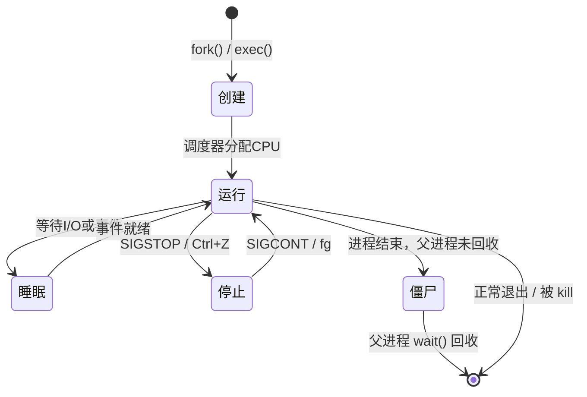
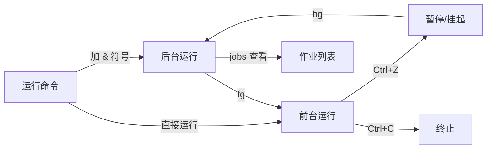
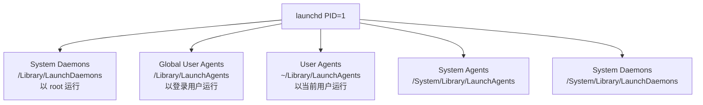

# macOS 进程管理命令详解

## 什么是进程？

在 macOS（基于 Darwin/XNU 内核）中，**进程（Process）** 是操作系统分配资源的基本单位。每个运行中的程序都对应一个或多个进程，拥有独立的内存空间、文件描述符和系统资源。

理解几个核心概念有助于后续学习：

| 概念              | 说明                                                         |
| ----------------- | ------------------------------------------------------------ |
| PID               | 进程 ID，系统唯一标识一个进程的整数                          |
| PPID              | 父进程 ID，创建该进程的进程的 PID                            |
| UID / GID         | 进程所属用户/用户组 ID，决定进程的权限范围                   |
| 优先级 (Nice)     | 进程调度优先级，范围 -20（最高）到 19（最低），普通用户只能降低优先级 |
| 前台进程          | 占用当前终端，用户可直接交互                                 |
| 后台进程          | 不占用终端，在后台静默运行                                   |
| 守护进程 (Daemon) | 系统级后台服务进程，通常由 launchd 管理                      |

---

## 进程的生命周期



---

## 查看进程：ps

`ps`（process status）是最经典的进程查看命令，输出的是**快照**，即命令执行瞬间的进程状态。

### 常用组合

| 命令                            | 说明                                                         |
| ------------------------------- | ------------------------------------------------------------ |
| `ps aux`                        | 显示所有用户的所有进程（BSD 风格，最常用）                   |
| `ps -ef`                        | 显示所有进程，含 PPID（System V 风格）                       |
| `ps aux --sort=-%cpu`           | 按 CPU 降序排列（macOS 原生 ps 不支持，用 `ps aux \| sort -k3 -rn`） |
| `ps -u username`                | 显示指定用户的进程                                           |
| `ps -p 1234`                    | 显示指定 PID 的进程                                          |
| `ps -o pid,ppid,comm,%cpu,%mem` | 自定义输出列                                                 |

### 输出字段解读

运行 `ps aux` 的典型输出：

```
USER   PID  %CPU %MEM      VSZ    RSS   TT  STAT STARTED      TIME COMMAND
alice  1234  12.3  2.1  408696  87456   s1  S    10:23AM   0:05.67 /usr/bin/python3
```

| 字段 | 含义                                    |
| ---- | --------------------------------------- |
| USER | 进程所有者                              |
| PID  | 进程 ID                                 |
| %CPU | CPU 占用百分比                          |
| %MEM | 物理内存占用百分比                      |
| VSZ  | 虚拟内存大小（KB）                      |
| RSS  | 实际物理内存占用（KB）                  |
| TT   | 关联的终端，`??` 表示无终端（守护进程） |
| STAT | 进程状态（见下表）                      |
| TIME | 累计使用 CPU 时间                       |

**STAT 状态码说明：**

| 状态码 | 含义                           |
| ------ | ------------------------------ |
| R      | 运行中（Running）              |
| S      | 可中断睡眠（等待事件，最常见） |
| D      | 不可中断睡眠（通常是 I/O）     |
| T      | 已停止                         |
| Z      | 僵尸进程                       |
| +      | 前台进程                       |
| s      | 会话领导进程                   |
| <      | 高优先级                       |
| N      | 低优先级（Nice 值 > 0）        |

---

## 动态监控：top 与 htop

### top —— 内置实时监控

`top` 提供持续刷新的进程视图，默认按 CPU 使用率排序。

```bash
top              # 启动 top
top -u           # 按 CPU 排序
top -o mem       # 按内存排序
top -n 10        # 只显示前 10 个进程
top -pid 1234    # 只监控指定 PID
top -s 2         # 每 2 秒刷新一次
```

在 `top` 运行时可交互操作：

| 按键 | 功能                        |
| ---- | --------------------------- |
| `o`  | 选择排序字段                |
| `q`  | 退出                        |
| `k`  | 向指定 PID 发送信号（kill） |
| `s`  | 修改刷新间隔                |
| `?`  | 查看帮助                    |

macOS 的 `top` 顶部区域还会显示系统整体负载、内存分类（wired/active/inactive/free）和 CPU 分类（user/sys/idle）。

### htop —— 现代化替代（推荐）

`htop` 需要额外安装，但体验远超原生 `top`：

```bash
brew install htop
htop
```

htop 的优势：
- 彩色界面，进度条直观显示 CPU/内存
- 支持鼠标点击操作
- 可直接点击列标题排序
- 支持多选进程批量操作
- 树状视图展示父子进程关系（按 `F5`）
- 搜索进程（按 `F3`）

---

## 查找进程：pgrep 与 pidof

当你知道进程名但不知道 PID 时，`pgrep` 是最高效的工具。

| 命令              | 说明                                 |
| ----------------- | ------------------------------------ |
| `pgrep Safari`    | 返回所有名称包含 Safari 的进程 PID   |
| `pgrep -l Safari` | 同时显示进程名                       |
| `pgrep -x Safari` | 精确匹配进程名（不包含子字符串）     |
| `pgrep -u alice`  | 返回 alice 用户的所有进程 PID        |
| `pgrep -a python` | 显示完整命令行（macOS 部分版本支持） |

> macOS 默认没有 `pidof`，`pgrep -x 进程名` 是等价替代。

---

## 终止进程：kill、killall、pkill🎈

### kill —— 向进程发送信号

`kill` 的本质不是"杀死"，而是**向进程发送信号**。信号是进程间通信的一种机制。

```bash
kill 1234          # 发送 SIGTERM（15）给 PID 1234，礼貌请求退出
kill -9 1234       # 发送 SIGKILL，强制立即终止，无法被忽略
kill -STOP 1234    # 暂停进程
kill -CONT 1234    # 继续被暂停的进程
kill -l            # 列出所有信号
```

**常用信号一览：**

| 信号名  | 编号 | 含义                 | 进程可捕获/忽略？ |
| ------- | ---- | -------------------- | ----------------- |
| SIGHUP  | 1    | 挂断/重新加载配置    | ✅                 |
| SIGINT  | 2    | 中断（等同 Ctrl+C）  | ✅                 |
| SIGQUIT | 3    | 退出并生成 core dump | ✅                 |
| SIGKILL | 9    | 强制终止             | ❌（内核直接执行） |
| SIGTERM | 15   | 礼貌终止请求（默认） | ✅                 |
| SIGSTOP | 17   | 暂停进程             | ❌                 |
| SIGCONT | 19   | 继续运行             | ✅                 |
| SIGUSR1 | 30   | 用户自定义信号 1     | ✅                 |
| SIGUSR2 | 31   | 用户自定义信号 2     | ✅                 |

> ⚠️ **最佳实践**：优先使用 `SIGTERM`（默认），给进程机会做清理工作（关闭文件、释放资源）。只有在进程无响应时才使用 `SIGKILL -9`。

### killall —— 按名称终止

```bash
killall Safari              # 终止所有名为 Safari 的进程
killall -9 Safari           # 强制终止
killall -u alice            # 终止 alice 用户的所有进程
killall -v Safari           # 显示操作详情（verbose）
killall -m 'python.*'       # 使用正则匹配进程名
```

### pkill —— 模式匹配终止

```bash
pkill python                # 终止所有名称含 python 的进程
pkill -9 -u alice           # 强制终止 alice 的所有进程
pkill -STOP -u alice        # 暂停 alice 的所有进程
```

---

## 按名称终止进程的方式对比

在 Linux 和 macOS 系统中，`pkill` 和 `killall` 都是用于通过**进程名称**（而非 PID）来终止进程的工具。虽然它们的目标一致，但在匹配逻辑、灵活性和可用性上存在显著差异。

------

核心区别对比

| **特性**       | **pkill**                          | **killall**                     |
| -------------- | ---------------------------------- | ------------------------------- |
| **匹配方式**   | **模式匹配**（默认部分匹配/正则）  | **精确匹配**（默认完整名称）    |
| **灵活性**     | 极高（支持用户、UID、PPID 等过滤） | 较低（主要针对进程名）          |
| **安全性**     | 较低（容易误杀同名前缀进程）       | 较高（必须全名一致）            |
| **所属软件包** | `procps` 或 `procps-ng`            | `psmisc`                        |
| **常见平台**   | Linux, macOS, Solaris, BSD         | Linux, BSD (macOS 行为略有不同) |

------

1. 匹配逻辑：模糊 vs 精确

这是两者最根本的区别。

- **pkill (Process Kill):** 它使用正则表达式匹配。如果你运行 `pkill fire`，它会杀掉所有名字中包含 "fire" 的进程（例如 `firefox`、`firewalld` 等）。
- **killall:** 它要求提供完整的进程名称。如果你运行 `killall fire`，而系统里只有 `firefox`，则不会有任何进程被终止。你必须输入 `killall firefox`。

> **注意：** 在 macOS 上，`killall` 的行为与 Linux 类似，但在某些老式 Unix 系统（如 Solaris）中，`killall` 会杀掉**所有**用户进程，使用时需格外小心。

------

2. 功能扩展与过滤

`pkill` 提供了比 `killall` 更丰富的过滤选项：

- **按用户过滤：** 仅杀掉属于特定用户的进程。

  Bash

  ```
  pkill -u cxxu python
  ```

- **反向匹配：** 杀掉除了指定模式以外的所有进程。

  Bash

  ```
  pkill -v -u cxxu bash
  ```

- **匹配完整命令行：** 使用 `-f` 参数，不仅匹配进程名，还匹配进程启动时的参数。

  Bash

  ```
  # 这会杀掉运行特定脚本的 python 进程，而不会影响其他 python 进程
  pkill -f "gui_run.py"
  ```

`killall` 的强项在于一些特定的标志位：

- **按时间过滤：** 杀掉运行超过（或少于）特定时间的进程。

  Bash

  ```
  # 杀掉运行超过 1 小时的进程
  killall -o 1h nginx
  ```

- **交互模式：** 在杀掉每个进程前进行确认（更安全）。

  Bash

  ```
  killall -i chrome
  ```

------

3. 使用建议

什么时候用 `pkill`？

- 当你**不记得完整进程名**，或者想通过前缀快速清理时。
- 当你需要根据**复杂条件**（如 UID、终端号）过滤进程时。
- 在编写脚本时，`pkill -f` 匹配完整命令行路径非常有效。

什么时候用 `killall`？

- 当你想要**绝对安全**，确保只杀掉名称完全吻合的进程时。
- 当你需要清理**过载的旧进程**（利用 `-o` 时间参数）时。
- 当你在不具备 `pkill` 的极简环境中工作时。


在使用这两个命令之前，建议先用对应的查询命令预览一下会影响到哪些进程：

- 用 `pgrep -a [名称]` 预览 `pkill` 的效果。
- 用 `pidof [名称]` 预览 `killall` 的效果。

## 前后台控制：jobs、fg、bg

这是 Shell 内置的**作业控制（Job Control）**机制。



| 命令        | 说明                                         |
| ----------- | -------------------------------------------- |
| `command &` | 直接在后台启动命令                           |
| `Ctrl + Z`  | 暂停当前前台进程，放入后台（状态为 Stopped） |
| `jobs`      | 列出当前 Shell 的所有作业                    |
| `jobs -l`   | 同时显示 PID                                 |
| `fg`        | 将最近的后台作业恢复到前台                   |
| `fg %2`     | 将作业编号 2 恢复到前台                      |
| `bg`        | 让最近暂停的作业在后台继续运行               |
| `bg %2`     | 让作业编号 2 在后台继续运行                  |

**示例场景：**

```bash
# 启动一个耗时任务
sleep 1000

# 按 Ctrl+Z 暂停，输出：[1]+  Stopped  sleep 1000

jobs -l
# 输出：[1]+  12345 Stopped  sleep 1000

bg %1        # 让它在后台继续跑
fg %1        # 再拉回前台
```

---

## 后台持久运行：nohup 与 disown

普通后台进程（`&`）在关闭终端时会收到 `SIGHUP` 信号而终止。想让进程在退出终端后继续运行，需要以下方法：

### nohup

```bash
nohup python3 server.py &
# 输出重定向到 nohup.out，进程免疫 SIGHUP
```

nohup 会将标准输出和标准错误默认写入当前目录的 `nohup.out`，建议显式重定向：

```bash
nohup python3 server.py > server.log 2>&1 &
```

### disown

`disown` 作用于已经运行的作业，将其从 Shell 的作业列表中移除：

```bash
long_running_task &      # 先放到后台
disown %1                # 从作业表中移除，关闭终端不受影响
disown -h %1             # 保留在作业表但忽略 SIGHUP（更安全）
```

> 💡 **最佳实践**：对于需要长期运行的服务，优先考虑 `tmux` 或 `screen`，它们提供会话管理功能，随时可以 attach/detach，体验远优于 `nohup`。

---

## 调整进程优先级：nice 与 renice

### nice —— 启动时设置优先级

```bash
nice -n 10 python3 heavy_task.py     # 以低优先级（nice=10）启动
nice -n -5 ./important_task          # 提高优先级（需要 sudo）
sudo nice -n -20 ./critical_task     # 最高优先级
```

### renice —— 修改运行中进程的优先级

```bash
renice 10 -p 1234          # 将 PID 1234 的 nice 值设为 10
renice -5 -p 1234          # 提高优先级（需要 sudo）
sudo renice -20 -p 1234    # 设为最高优先级
renice 5 -u alice          # 调整 alice 所有进程的优先级
```

nice 值的规则：

- 范围：**-20（最高优先级）到 19（最低优先级）**
- 普通用户只能将 nice 值**调高**（降低优先级）
- 降低 nice 值（提高优先级）需要 `sudo`
- 适合在执行 CPU 密集型任务时调高 nice 值，避免影响系统响应性

---

## 进程资源监控：lsof

`lsof`（list open files）用于查看进程打开的文件、网络连接、端口等资源。在 Unix/macOS 中"一切皆文件"，所以 `lsof` 功能极其强大。

| 命令                 | 说明                         |
| -------------------- | ---------------------------- |
| `lsof -p 1234`       | 查看 PID 1234 打开的所有文件 |
| `lsof -u alice`      | 查看 alice 用户打开的文件    |
| `lsof /path/to/file` | 查看谁在使用某个文件         |
| `lsof -i`            | 列出所有网络连接             |
| `lsof -i :8080`      | 查看占用 8080 端口的进程     |
| `lsof -i tcp`        | 只显示 TCP 连接              |
| `lsof -c Safari`     | 查看 Safari 打开的文件       |
| `lsof +D /tmp`       | 查看访问某目录下文件的进程   |

**实用场景：**

```bash
# 查找占用 8080 端口的进程并终止
lsof -ti :8080 | xargs kill -9

# 找出正在使用某文件的进程（例如无法卸载磁盘时）
lsof /Volumes/MyDisk

# 查看某进程打开了哪些网络连接
lsof -p $(pgrep -x node) -i
```

---

## macOS 专属：launchctl 管理系统服务

macOS 使用 **launchd** 作为系统的 init 进程（PID 1），替代了传统 Unix 的 SysV init。所有系统服务和用户 Agent 都由 launchd 管理，通过 `launchctl` 命令操控。

### launchd 的层级结构



### 常用 launchctl 命令

```bash
# 现代语法（macOS 10.10+）
launchctl list                              # 列出所有已加载的服务
launchctl list | grep nginx                 # 过滤查找
launchctl print system/com.example.myapp   # 查看服务详情

# 用户级服务（GUI 登录用户）
launchctl bootstrap gui/$(id -u) ~/Library/LaunchAgents/com.example.app.plist
launchctl bootout gui/$(id -u) com.example.app

# 系统级服务（需要 sudo）
sudo launchctl bootstrap system /Library/LaunchDaemons/com.example.daemon.plist
sudo launchctl bootout system com.example.daemon

# 启动/停止已加载的服务
launchctl kickstart gui/$(id -u)/com.example.app
launchctl kill SIGTERM gui/$(id -u)/com.example.app
```

> 在较新版本 macOS 中，`launchctl load/unload` 已被 `bootstrap/bootout` 取代，建议使用新语法。

---

## 进程信息深挖：sysctl 与 /proc 替代

macOS 没有 Linux 的 `/proc` 文件系统，但可以通过 `sysctl` 获取内核级进程信息：

```bash
sysctl -a                        # 列出所有内核参数
sysctl kern.maxproc              # 查看最大进程数
sysctl hw.ncpu                   # CPU 核心数
sysctl vm.loadavg                # 系统负载
```

---

## 图形化工具：活动监视器

终端命令之外，macOS 提供了图形化的 **活动监视器（Activity Monitor）**，位于 `应用程序 → 实用工具 → 活动监视器`。它等价于 Windows 的任务管理器，提供了 CPU、内存、能耗、磁盘、网络的实时图表，适合不熟悉命令行的用户。

从终端直接打开：

```bash
open -a "Activity Monitor"
```

---

## 综合实战场景

### 场景一：找到并终止占用端口的进程

```bash
lsof -ti :3000 | xargs kill -9
```

### 场景二：找出最耗 CPU 的 5 个进程

```bash
ps aux | sort -k3 -rn | head -6
```

### 场景三：监控某进程是否存活并自动重启（简单版）

```bash
while true; do
  pgrep -x myapp || (echo "myapp 挂了，重启中..." && ./myapp &)
  sleep 10
done
```

> 生产环境建议用 launchd 的 `KeepAlive` 选项代替此脚本。

### 场景四：以低优先级运行压缩任务

```bash
nice -n 19 tar -czf backup.tar.gz /large/directory &
```

### 场景五：查看进程树（父子关系）

```bash
# 安装 pstree
brew install pstree
pstree            # 显示完整进程树
pstree -p 1234    # 显示指定进程的子树
```

---

## 命令速查表🎈

| 目标                 | 推荐命令                           |
| -------------------- | ---------------------------------- |
| 查看所有进程快照     | `ps aux`                           |
| 实时监控进程         | `htop`（推荐）或 `top`             |
| 按名找 PID           | `pgrep -x 进程名`                  |
| 礼貌终止进程         | `kill PID` 或 `killall 进程名`     |
| **强制终止**         | `kill -9 PID`                      |
| 查看端口占用         | `lsof -i :端口号`                  |
| 后台运行不受终端影响 | `nohup cmd > log 2>&1 &` 或 `tmux` |
| 调低任务优先级       | `nice -n 19 cmd`                   |
| 查看进程树           | `pstree`（需安装）                 |
| 管理系统服务         | `launchctl`                        |

---

## 最佳实践总结

- **终止进程时先 SIGTERM 后 SIGKILL**，给进程机会做资源清理，避免数据损坏。
- **不要随意 `sudo kill -9` 系统进程**，可能导致系统不稳定。
- **长期后台任务优先使用 `tmux`**，比 `nohup` 更灵活、更易管理。
- **CPU 密集任务加 `nice -n 19`**，避免拖慢交互响应。
- **系统服务使用 launchd 管理**，而不是手写 shell 循环脚本，launchd 提供自动重启、日志、依赖管理等功能。
- **`lsof -i :端口` 是排查端口冲突的第一反应**，比 `netstat` 更现代且信息更丰富。