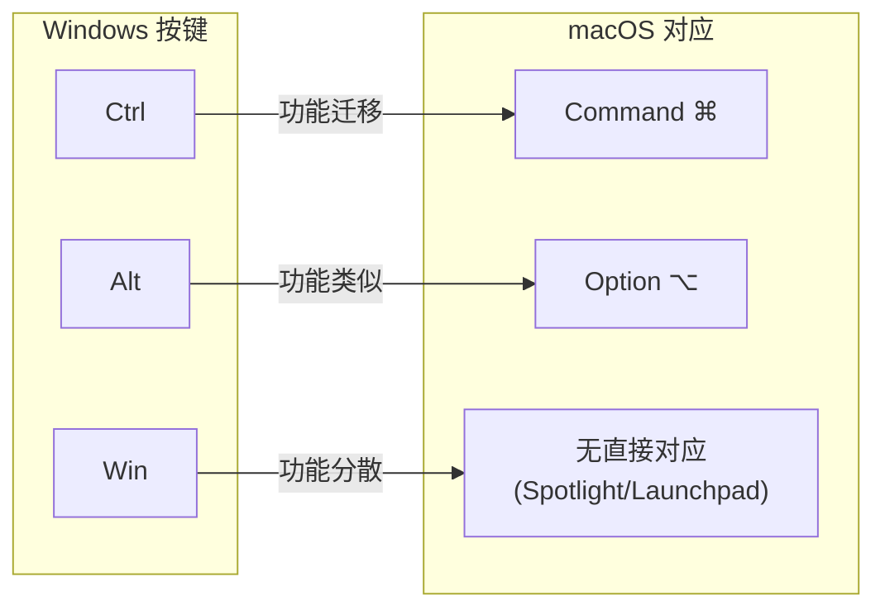
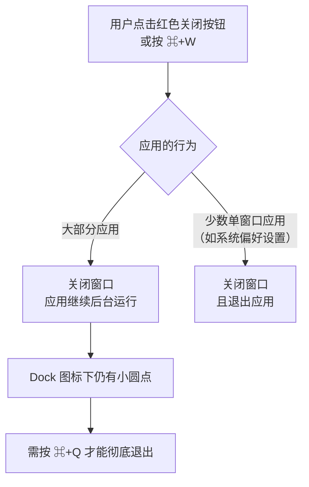
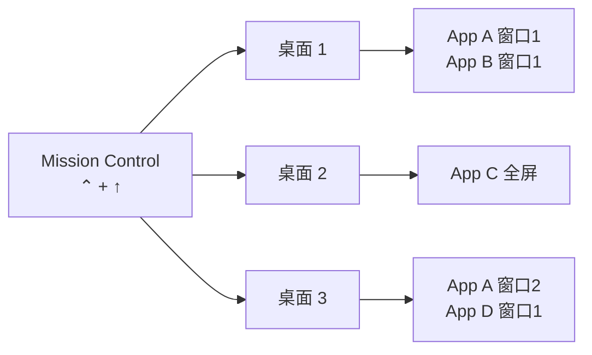

[toc]

## macos常用快捷键和手势

总体而言,macos上的快捷键组合比windows要多,并且组合键较长(往往3个按键组合);而windows上以`ctrl`键位核心(win键和alt键以及shift键作为辅助),且组合键多为2个;

windows上的菜单键用的很少;而mac上类似的键option却用的较多,这就导致组合键比较分散的问题;

常用快捷键总结:

[Mac 键盘快捷键 - 官方 Apple 支持 (中国)](https://support.apple.com/zh-cn/102650)

### macos的快捷键设计和自定义

[使用 macOS 键盘快捷键 - 官方 Apple 支持 (中国)](https://support.apple.com/zh-cn/guide/mac-help/mchlp2262/26/mac/26.4)

### spotlight(聚焦搜索) 根据程序名打开程序

如果使用触摸板手势,五个手指收拢手势,可以打开程序列表,可以输入程序名来筛选并打开程序;

使用快捷键`command+space`打开聚焦搜索栏输入程序名称,选中后(回车)打开指定程序;还支持搜索程序之外的东西,例如设置项和常用文件等(例如"键盘快捷键")

### 提示:入门说明书(tips)程序

macos内置的"提示"程序帮助新手了解macos的设计和使用方法以及技巧;

## 从windows(pc)转到macos

如果你不能确定它在 Mac 上叫什么，以下是一个 Windows 和 Mac 术语对照列表，可以帮助你找到要查找的内容。

*【注】*在 Mac 键盘上，对于使用功能键的快捷键，你还需要同时按住 Fn 键和其他按键；例如，按下 Fn-Control-F2。

[Mac 上常用的术语 - 官方 Apple 支持 (中国)](https://support.apple.com/zh-cn/guide/mac-help/cpmh0038/26/mac/26.4)

### 查看桌面

windows上使用`win+d`(点击右下角显示桌面)类似的效果:

mac上有多种做法,包括快捷键和手势:

- command+f3
- 手势:五指向外散开(反向操作是五指收拢,如果不是桌面视图的情况下直接五指收拢,则是打开打开应用程序列表搜索栏)
- 触发角 (Hot Corners,通常是右边缘靠下角,但是不是完全右下角,可能会触发打开备忘录) 

### 自定义常用快捷键

例如更改窗口最大化(填充)快捷键:

设置或者spotlight中搜索"键盘快捷键",选"窗口"->通用->"填充";

## 输入法

### 始终使用英文标点

如果经常写代码,并且习惯写中文注释,那么让输入法设置为始终使用英文标点会提高效率;

在macos上可以使用微信输入法(wetype),启用后设置为"使用英文标点符号"(注意这个设置可能不在软件内部,而是通过菜单栏上的"微信输入法"图标右键设置列表中去找这个选项!)

---

## macOS 使用指南：快捷键与操作技巧

> **内容依据**：Apple 官方支持文档、GeeksforGeeks、Apple Scoop、Digital Trends、知乎、CSDN 等来源，截至 2026 年 9 月。适用于 **macOS Sequoia 15** 及后续版本，大部分快捷键在更早版本中同样有效。

---

### 认识 Mac 键盘：修饰键（Modifier Keys）体系

macOS 快捷键体系的核心在于其**修饰键**。对于 Windows 转入的用户来说，首先要建立一套**按键对应关系**的心智模型。

macOS 快捷键使用以下符号表示修饰键：**Command（⌘）**、**Shift（⇧）**、**Option（⌥）**、**Control（⌃）** 和 **Fn**。

| Mac 按键          | 符号 | Windows 近似对应键 | 说明                                                         |
| ----------------- | ---- | ------------------ | ------------------------------------------------------------ |
| **Command（⌘）**  | ⌘    | Ctrl               | macOS 中**最核心的修饰键**，绑定绝大多数日常操作（复制、粘贴、保存等）。位于空格键两侧 |
| **Option（⌥）**   | ⌥    | Alt                | 用于替代操作与特殊字符输入                                   |
| **Control（⌃）**  | ⌃    | 无直接对应         | macOS 中常用于终端（Terminal）和部分系统功能，不等同于 Windows 的 Ctrl |
| **Shift（⇧）**    | ⇧    | Shift              | 功能基本一致                                                 |
| **Fn（Globe 🌐）** | fn   | Fn                 | 新款 Mac 键盘上同时兼作**地球仪键**，可切换输入法、调出表情符号等 |
| **Caps Lock**     | ⇪    | Caps Lock          | 功能基本一致                                                 |

**关键认知**：Windows 用户最需要适应的是——在 Windows 上用 **Ctrl** 完成的操作（如 `Ctrl+C` 复制），在 macOS 上几乎全部由 **Command（⌘）** 承担。而 macOS 的 **Control（⌃）** 键则主要用于终端环境和少量系统级操作。

> **提示**：macOS Sequoia 引入了一项新特性——修饰键可单独用于激活快捷方式（modifier-only activation），例如左 Command、左 Option 等可以独立触发 "显示桌面" 等功能。这相当于为用户额外提供了 9 个可用的快捷键触发按键。

---

### 通用系统快捷键

以下是**跨应用生效**的系统级快捷键，按使用频率分组。

#### 最高频：编辑与基础操作

这组快捷键几乎在所有应用中通用，也是 Windows 用户最先需要"转换肌肉记忆"的一组。

| macOS 快捷键 | 功能     | Windows 对应 | 备注                                                         |
| ------------ | -------- | ------------ | ------------------------------------------------------------ |
| `⌘ + C`      | **复制** | `Ctrl + C`   | 也可用于 Finder 中复制文件                                   |
| `⌘ + V`      | **粘贴** | `Ctrl + V`   | —                                                            |
| `⌘ + X`      | **剪切** | `Ctrl + X`   | 剪切选中项并复制到剪贴板；在 Finder 中剪切文件需先 `⌘+C` 再 `⌘+⌥+V`（移动粘贴） |
| `⌘ + Z`      | **撤销** | `Ctrl + Z`   | —                                                            |
| `⌘ + ⇧ + Z`  | **重做** | `Ctrl + Y`   | 注意与 Windows 的按键不同                                    |
| `⌘ + A`      | **全选** | `Ctrl + A`   | —                                                            |
| `⌘ + F`      | **查找** | `Ctrl + F`   | —                                                            |
| `⌘ + S`      | **保存** | `Ctrl + S`   | —                                                            |
| `⌘ + P`      | **打印** | `Ctrl + P`   | —                                                            |

**重点说明——Finder 中的"剪切"文件操作**：

macOS 的 Finder 不支持像 Windows 资源管理器那样直接 `⌘+X` 剪切文件。正确操作方式：

1. 选中文件，按 `⌘ + C`（复制）
2. 导航到目标位置，按 `⌘ + ⌥ + V`（**移动粘贴**，相当于 Windows 的剪切+粘贴）

这个操作逻辑的好处是：在你执行粘贴之前，原文件不会被标记为"待删除"，更安全。

---

#### 应用与窗口管理

| macOS 快捷键      | 功能                           | Windows 对应            | 备注                                                         |
| ----------------- | ------------------------------ | ----------------------- | ------------------------------------------------------------ |
| `⌘ + Tab`         | **切换应用**（按最近使用排序） | `Alt + Tab`             | 在打开的应用之间切换；按住 `⌘` 不放可用 `Tab` / `` ` `` 前后浏览 |
| `⌘ + ~`（反引号） | **同一应用内切换窗口**         | 无直接对应              | 在当前 App 的不同窗口之间来回切换，非常实用                  |
| `⌘ + W`           | **关闭当前窗口**               | `Ctrl + W` / `Alt + F4` | 注意：关闭窗口 ≠ 退出应用！                                  |
| `⌘ + Q`           | **退出应用**                   | `Alt + F4`              | 这才是真正退出程序                                           |
| `⌘ + ⌥ + W`       | 关闭当前应用的**所有窗口**     | —                       | —                                                            |
| `⌘ + H`           | **隐藏**当前应用窗口           | —                       | 隐藏当前窗口，应用仍在后台运行                               |
| `⌘ + ⌥ + H`       | 隐藏**其他所有**应用窗口       | —                       | 快速聚焦当前应用                                             |
| `⌘ + M`           | **最小化**当前窗口到 Dock      | `Win + D`（部分类似）   | —                                                            |
| `⌘ + ⌃ + F`       | 当前应用进入/退出**全屏**      | `F11`                   | `Command+Ctrl+F` 当前 App 进入全屏模式                       |

**关键理解——"关闭窗口"与"退出应用"的区别**：

Windows 用户常犯的错误之一是：关闭应用窗口后，以为应用已退出。在 macOS 中：

- `⌘ + W` 只关闭当前窗口，应用**仍在后台运行**（Dock 中图标下方会有小圆点标示）
- `⌘ + Q` 才是**彻底退出**应用程序

这是 macOS 与 Windows 最重要的行为差异之一。Windows 应用的菜单栏通常位于程序窗口的顶部边缘，而 macOS 的菜单栏是系统级别的，固定在桌面顶部。因此即使窗口全部关闭，应用的菜单仍然存在于顶部菜单栏中。

---

#### Spotlight 搜索与启动

**`⌘ + Space`**：打开 **Spotlight 搜索**，可以快速找到应用、文件和其他内容。

Spotlight 是 macOS 中**最重要的效率工具之一**，相当于 Windows 中 `Win` 键打开开始菜单搜索的增强版。它不仅可以搜索和打开 Mac 上的任何内容（设置、文件等），还能用于网页搜索以及进行数学计算和单位换算。

**常见用法**：

- 快速启动应用：按 `⌘ + Space`，输入应用名的前几个字母，按 `Return` 打开
- 快速计算：直接输入算式如 `128*1.13`，即时显示结果
- 单位换算：输入 `100 usd to cny` 或 `25 celsius to fahrenheit`
- 文件搜索：输入文件名关键词即可定位

> **对比 Windows**：Windows 10/11 可用 `Win` 键呼出搜索框，功能类似但 Spotlight 在响应速度和整合度上通常体验更佳。如果需要更强大的启动器，macOS 上有第三方工具如 **Raycast**（免费，功能极为丰富）或 **Alfred**。

---

#### 截图操作

macOS 内置的截图功能非常强大且无需安装任何第三方软件，这一点优于 Windows（Windows 需要 `Win + Shift + S` 或第三方工具）。

| macOS 快捷键                | 功能                                 | Windows 对应      |
| --------------------------- | ------------------------------------ | ----------------- |
| `⌘ + ⇧ + 3`                 | **全屏截图**                         | `PrtSc`           |
| `⌘ + ⇧ + 4`                 | **区域截图**（拖动选框）             | `Win + Shift + S` |
| `⌘ + ⇧ + 4`，然后按 `Space` | **窗口截图**（自动识别窗口，含阴影） | 无直接对应        |
| `⌘ + ⇧ + 5`                 | 打开**截图工具栏**（含录屏选项）     | —                 |

`Command+Shift+3` 全屏截图，`Command+Shift+4` 可选择部分区域截图，`Command+Shift+4+Space` 对选定 App 整个窗口进行截图。

**进阶技巧**：

- 在使用 `⌘ + ⇧ + 4` 选取区域时，按住 `Space` 可以移动已选区域
- 按住 `⌥` 可以从中心向外扩展选区
- 按 `Esc` 键可以取消正在进行的截图操作
- 所有截图操作加上 `⌃`（Control）键，截图将保存到**剪贴板**而非桌面。例如 `⌘ + ⌃ + ⇧ + 4` 是区域截图到剪贴板
- 截图默认保存在**桌面**，可通过 `⌘ + ⇧ + 5` 工具栏的"选项"修改保存路径

---

#### 系统控制

| macOS 快捷键     | 功能                         | Windows 对应          |
| ---------------- | ---------------------------- | --------------------- |
| `⌘ + ⌥ + Esc`    | 打开**强制退出**窗口         | `Ctrl + Alt + Delete` |
| `⌘ + ⌃ + Q`      | **锁定屏幕**                 | `Win + L`             |
| `⌃ + 电源键`     | 弹出**重启/睡眠/关机**对话框 | —                     |
| `⌘ + ⌃ + 电源键` | **强制重启**                 | —                     |
| `⌘ + ⇧ + Q`      | **注销**当前用户             | —                     |

`Command+Ctrl+Q` 立即锁定屏幕，`Command+Option+Esc` 调出 App 强制退出窗口，App 无响应时使用。

---

#### 文本编辑快捷键

macOS 的文本编辑快捷键继承了 **Emacs 风格的光标控制**，这组快捷键在系统级别生效，几乎所有文本输入框中都可使用。这是 macOS 相比 Windows 的一大优势。

##### 光标移动

| 快捷键  | 功能                 | Windows 对应  |
| ------- | -------------------- | ------------- |
| `⌃ + A` | 移到**行首**         | `Home`        |
| `⌃ + E` | 移到**行尾**         | `End`         |
| `⌃ + F` | 向前移动一个字符     | `→`           |
| `⌃ + B` | 向后移动一个字符     | `←`           |
| `⌃ + P` | 上移一行             | `↑`           |
| `⌃ + N` | 下移一行             | `↓`           |
| `⌥ + ←` | 向左移动**一个单词** | `Ctrl + ←`    |
| `⌥ + →` | 向右移动**一个单词** | `Ctrl + →`    |
| `⌘ + ←` | 移到**行首**         | `Home`        |
| `⌘ + →` | 移到**行尾**         | `End`         |
| `⌘ + ↑` | 移到**文档开头**     | `Ctrl + Home` |
| `⌘ + ↓` | 移到**文档末尾**     | `Ctrl + End`  |

> 上述 `⌃` 系列快捷键（`⌃+A/E/F/B/P/N`）源于 Unix/Emacs 传统，**在终端（Terminal）中同样生效**，这对开发者来说非常方便。Mac 键盘没有独立的 `Home`/`End` 键，因此掌握这些替代操作很有必要。

##### 文本选择

在上述光标移动快捷键的基础上**加入 `⇧`**，即可将移动变为选择。例如：

| 快捷键      | 功能                           |
| ----------- | ------------------------------ |
| `⇧ + ⌘ + →` | 选中从光标到**行尾**的内容     |
| `⇧ + ⌘ + ←` | 选中从光标到**行首**的内容     |
| `⇧ + ⌥ + →` | 选中从光标到**下一个单词边界** |
| `⇧ + ⌘ + ↑` | 选中从光标到**文档开头**       |
| `⇧ + ⌘ + ↓` | 选中从光标到**文档末尾**       |

##### 删除操作

| 快捷键           | 功能                                             | Windows 对应       |
| ---------------- | ------------------------------------------------ | ------------------ |
| `Delete`（退格） | 向左删除一个字符                                 | `Backspace`        |
| `fn + Delete`    | **向右删除**一个字符（Forward Delete）           | `Delete`           |
| `⌥ + Delete`     | 向左删除一个**单词**                             | `Ctrl + Backspace` |
| `⌘ + Delete`     | 删除光标到**行首**的内容                         | —                  |
| `⌃ + K`          | 删除光标到**行尾**的内容（Emacs 风格 kill-line） | —                  |

> Mac 键盘上的 `Delete` 键相当于 Windows 的 `Backspace`（退格），这是容易让 Windows 用户困惑的地方。要实现 Windows 的 `Delete`（向右删除）功能，需按 `Fn + Delete`。

---

### Finder 快捷键

**Finder** 是 macOS 的文件管理器，相当于 Windows 的文件资源管理器（File Explorer）。

#### 导航

| 快捷键             | 功能                                                |
| ------------------ | --------------------------------------------------- |
| `⌘ + ⇧ + A`        | 打开"**应用程序**"文件夹                            |
| `⌘ + ⇧ + U`        | 打开"**实用工具**"文件夹                            |
| `⌘ + ⇧ + D`        | 打开"**桌面**"文件夹                                |
| `⌘ + ⇧ + H`        | 打开"**个人**"文件夹（Home）                        |
| `⌘ + ⇧ + G`        | **前往文件夹**（输入路径直达，如 `/usr/local/bin`） |
| `⌘ + ↑`            | 进入上一级目录                                      |
| `⌘ + ↓` 或 `⌘ + O` | 打开选中的文件或文件夹                              |
| `⌘ + [`            | 后退                                                |
| `⌘ + ]`            | 前进                                                |

#### 文件操作

| 快捷键            | 功能                               | 说明                                                         |
| ----------------- | ---------------------------------- | ------------------------------------------------------------ |
| `Space`（空格键） | **快速预览**（Quick Look）         | 选中文件后按空格键即可预览，无需真正打开文件。支持图片、PDF、视频、文本等 |
| `⌘ + I`           | 查看文件**简介**（属性）           | 相当于 Windows 右键"属性"                                    |
| `⌘ + Delete`      | 将文件移至**废纸篓**               | 相当于 Windows 的 `Delete`                                   |
| `⌘ + ⇧ + Delete`  | **清倒废纸篓**                     | 相当于清空回收站                                             |
| `Return`（回车）  | **重命名**文件                     | Windows 中是 `F2`                                            |
| `⌘ + D`           | **复制**选中的文件（原地创建副本） | —                                                            |
| `⌘ + N`           | 新建 Finder 窗口                   | —                                                            |
| `⌘ + T`           | 新建 Finder **标签页**             | —                                                            |

**重命名差异提醒**：在 Finder 中，选中文件后按 `Return`（回车）键即可进入重命名状态，再按 `Return` 确认。而 Windows 用户的习惯是双击或按 `F2`。在 macOS 中双击会直接**打开**文件，这是需要重新适应的操作。

**Quick Look（快速预览）**是 macOS 独有的**杀手级功能**：选中任何文件按 `Space` 即可预览其内容，无需等待应用程序启动。支持的文件类型包括图片、PDF、视频、音频、Office 文档、Markdown 等。在浏览大量文件时，按住 `Space` 并用方向键切换文件即可快速浏览。

#### 视图切换

| 快捷键  | 功能         |
| ------- | ------------ |
| `⌘ + 1` | **图标视图** |
| `⌘ + 2` | **列表视图** |
| `⌘ + 3` | **分栏视图** |
| `⌘ + 4` | **画廊视图** |

---

### 窗口管理与多桌面

#### 窗口布局（Window Tiling）

macOS 从 **Sequoia** 开始原生支持窗口平铺（Window Tiling），在此之前这一直是 Windows 的优势功能（`Win + ←/→` 分屏）。

**原生方式**：

- 将窗口拖动到屏幕边缘或角落即可触发平铺
- 长按窗口左上角的绿色按钮可以选择平铺布局方式

**对于更丰富的窗口管理需求**，推荐使用第三方工具：

- **Rectangle**（免费、开源）：支持类似 Windows 风格的 `⌃ + ⌥ + ←/→` 等快捷键分屏
- **Magnet**（付费，Mac App Store 热门）

#### Mission Control 与多桌面

| 快捷键 / 手势          | 功能                                           | Windows 对应            |
| ---------------------- | ---------------------------------------------- | ----------------------- |
| `⌃ + ↑` 或三指上滑     | 打开 **Mission Control**（总览所有窗口和桌面） | `Win + Tab`（任务视图） |
| `⌃ + ↓`                | 显示当前应用的**所有窗口**（App Exposé）       | —                       |
| `⌃ + ←` / `⌃ + →`      | 在多个**桌面空间**之间切换                     | `Ctrl + Win + ←/→`      |
| `F11`（或 `fn + F11`） | 显示桌面                                       | `Win + D`               |

> macOS 的**多桌面（Spaces）**配合 Mission Control 是非常成熟的多任务管理方案。你可以在 Mission Control 视图中，将鼠标移到屏幕顶部右上角的 `+` 号来添加新桌面，并将不同任务组织到不同桌面中。

---

### Dock 与 Launchpad

**Dock**（程序坞）是屏幕底部（默认）的图标栏，类似于 Windows 的任务栏，但有一些关键差异。Dock 分为两个区域：左侧放置应用和系统工具的快捷方式，右侧（分隔线之后）放置文档图标和废纸篓。

| 操作            | 方法                                                         |
| --------------- | ------------------------------------------------------------ |
| 添加应用到 Dock | 将应用图标拖入 Dock，或右键正在运行的应用图标选择"在 Dock 中保留" |
| 从 Dock 移除    | 将图标从 Dock 拖出直至出现"移除"提示后松开                   |
| 打开 Launchpad  | 点击 Dock 中的 Launchpad 图标，或触控板**四指捏合**          |
| Dock 自动隐藏   | `⌘ + ⌥ + D` 切换 Dock 的显示/隐藏                            |

**Launchpad** 类似于 iOS 的主屏幕，以图标网格形式展示所有已安装的应用。按 `F4`（或 `fn + F4`）也可快速打开。

---

### 触控板手势（Trackpad Gestures）

Mac 的触控板（Force Touch Trackpad）体验是业界公认的标杆。滚动方向、轻扫手势和按钮分配可以在"系统设置"的鼠标和触控板设置中调整。

| 手势                          | 功能                           | 设置路径                                                     |
| ----------------------------- | ------------------------------ | ------------------------------------------------------------ |
| **两指上下滑动**              | 滚动页面                       | 默认"自然滚动"方向与 Windows 相反，可在 系统设置 > 触控板 中关闭 |
| **两指点按** / **右下角点按** | **右键菜单**                   | 默认需要两指点按触控板来触发右键。可以在系统设置 > 触控板 中将辅助点按改为"点按右下角" |
| **两指左右滑动**              | 前进/后退（浏览器、Finder 等） | —                                                            |
| **两指张开/捏合**             | 缩放                           | —                                                            |
| **三指上滑**                  | 打开 **Mission Control**       | —                                                            |
| **三指左右滑动**              | 切换桌面空间                   | —                                                            |
| **四指捏合**                  | 打开 **Launchpad**             | —                                                            |
| **用力按压**（Force Touch）   | **查词典** / 预览链接          | 对文字用力按可查定义，对链接用力按可预览网页                 |

> **自然滚动说明**：macOS 默认的"自然滚动"方向（两指上滑，页面下移）与 iOS 触屏逻辑一致，但与 Windows 传统鼠标滚轮方向相反。如果感到不适应，可以在 **系统设置 > 触控板 > 滚动与缩放** 中关闭"自然滚动"。

---

### 输入法与特殊字符

| 快捷键                          | 功能                                                         | Windows 对应                   |
| ------------------------------- | ------------------------------------------------------------ | ------------------------------ |
| `⌃ + Space` 或 `fn`（地球仪键） | **切换输入法**                                               | `Ctrl + Space` / `Win + Space` |
| `⌃ + ⌘ + Space`                 | 打开**字符检视器（Character Viewer）**，可插入表情符号和特殊字符 | `Win + .`（句号）              |
| `fn` 连按两次                   | 启用**听写（Dictation）**，开始语音输入，再按一次 `fn` 结束  | —                              |

> Windows 使用 `Win + .`（句号）访问表情符号面板，macOS 对应为 `Control + Command + Space`。

---

### 音量与亮度微调

`Option（⌥）+ Shift + 音量/亮度键` 可以以更小的增量调节音量或屏幕亮度。

正常按音量/亮度键每次调整 1 格（共 16 格），加上 `⌥ + ⇧` 后每次调整 1/4 格，适合精确控制。

---

### 系统设置与自定义快捷键

macOS 的"**系统设置**"（System Settings）相当于 Windows 的"控制面板"或"设置"。

你可以在 **系统设置 > 键盘 > 键盘快捷键** 中自定义许多快捷键。

**自定义应用快捷键方法**：

在系统设置 > 键盘 > 键盘快捷键 > 应用快捷键 中，点击 `+` 号，选择目标应用（或"所有应用程序"），准确输入菜单项标题（包括大小写、空格和标点符号），设置你想要的快捷键组合，然后点击"添加"。

这项功能非常强大——只要应用的菜单栏中有某个命令，你就可以为它绑定自定义快捷键，即使开发者没有为此设置默认快捷键。

---

### 开发者常用补充

如果你是开发者或经常使用**终端（Terminal）**，以下额外信息值得了解：

| 快捷键              | 功能                                | 说明                           |
| ------------------- | ----------------------------------- | ------------------------------ |
| `⌘ + ,`（逗号）     | 打开当前应用的**偏好设置/设置**     | macOS 应用的通用约定，极其常用 |
| `⌘ + Space`         | Spotlight（或 Raycast）快速打开终端 | 输入 `Terminal` 即可           |
| `⌃ + A/E/F/B/K/N/P` | 终端中 Emacs 风格光标控制           | 与前文文本编辑快捷键一致       |
| `⌃ + C`             | 终端中中断命令                      | 与 Windows 终端一致            |
| `⌃ + D`             | 终端中发送 EOF / 退出               | —                              |
| `⌃ + R`             | 终端中**反向搜索历史命令**          | —                              |
| `⌃ + L`             | 清屏（等价于 `clear`）              | —                              |

---

### Windows → macOS 快捷键速查对照表（汇总）

| 功能          | Windows                     | macOS                                 |
| ------------- | --------------------------- | ------------------------------------- |
| 复制          | `Ctrl + C`                  | `⌘ + C`                               |
| 粘贴          | `Ctrl + V`                  | `⌘ + V`                               |
| 剪切          | `Ctrl + X`                  | `⌘ + X`（文件用 `⌘+C` 再 `⌘+⌥+V`）    |
| 撤销          | `Ctrl + Z`                  | `⌘ + Z`                               |
| 重做          | `Ctrl + Y`                  | `⌘ + ⇧ + Z`                           |
| 保存          | `Ctrl + S`                  | `⌘ + S`                               |
| 全选          | `Ctrl + A`                  | `⌘ + A`                               |
| 查找          | `Ctrl + F`                  | `⌘ + F`                               |
| 打印          | `Ctrl + P`                  | `⌘ + P`                               |
| 关闭窗口      | `Alt + F4`                  | `⌘ + W`（窗口）/ `⌘ + Q`（退出应用）  |
| 切换应用      | `Alt + Tab`                 | `⌘ + Tab`                             |
| 锁定屏幕      | `Win + L`                   | `⌘ + ⌃ + Q`                           |
| 任务管理器    | `Ctrl + Alt + Del`          | `⌘ + ⌥ + Esc`（强制退出）/ 活动监视器 |
| 搜索          | `Win` 键                    | `⌘ + Space`（Spotlight）              |
| 截屏          | `PrtSc` / `Win + Shift + S` | `⌘ + ⇧ + 3/4/5`                       |
| 文件重命名    | `F2`                        | `Return`（回车）                      |
| 文件删除      | `Delete`                    | `⌘ + Delete`                          |
| 显示桌面      | `Win + D`                   | `F11` / `fn + F11`                    |
| 分屏          | `Win + ←/→`                 | 长按绿色按钮 / Rectangle 等工具       |
| 表情符号      | `Win + .`                   | `⌃ + ⌘ + Space`                       |
| 刷新页面      | `F5`                        | `⌘ + R`                               |
| 地址栏定位    | `Ctrl + L`                  | `⌘ + L`（浏览器中）                   |
| 前进删除      | `Delete`                    | `fn + Delete`                         |
| 设置/偏好设置 | 控制面板/设置               | `⌘ + ,`                               |

---

### 实用操作技巧汇总

#### 文件拖拽的妙用

- **拖动文件时按住 `⌥`**：复制文件（光标出现 `+` 号）
- **拖动文件时按住 `⌘`**：移动文件（即使跨磁盘也不会变成复制）
- **从 Finder 拖动文件到终端窗口**：自动填入文件的完整路径

#### 强制粘贴为纯文本

- `⌘ + ⌥ + ⇧ + V`：**粘贴并匹配样式**（去除格式），在复制网页内容粘贴到文档时非常实用

#### 快速查看文件路径

- 在 Finder 窗口中，按 `⌘ + ⌥ + P` 可以**显示/隐藏路径栏**
- 或者 **右键 Finder 窗口标题** 可以看到当前目录的完整层级

#### 快速访问隐藏文件

- `⌘ + ⇧ + .`（句号）：在 Finder 中**切换显示/隐藏文件**（以 `.` 开头的文件）

> 这对开发者查看 `.gitignore`、`.env`、`.zshrc` 等配置文件尤为重要。

#### 预览功能增强

- 选中文件后按 `Space` 可快速预览；按 `⌘ + Y` 效果相同
- 在预览状态下按方向键可浏览同目录下的其他文件

---

### 常见"坑"与适应建议

1. **滚动方向**：macOS 默认"自然滚动"与 Windows 相反，建议要么完全适应 macOS 的方式（与 iPhone/iPad 一致），要么在系统设置中关闭

2. **全屏模式**：进入全屏模式通常会隐藏 Dock，有些用户不太习惯。替代方案是双击应用标题栏使窗口填满可用高度而不进入全屏。可在 **系统设置 > 桌面与程序坞** 中将"连按窗口标题栏"设置为"缩放"

3. **菜单栏位置**：Windows 用户容易习惯在窗口顶部找菜单，但 macOS 的菜单始终在屏幕最顶部

4. **`⌘ + W` ≠ 退出**：前文已详述，务必记住 `⌘ + Q` 才是退出

5. **`Delete` 键是退格**：Mac 键盘的 `Delete` 等于 Windows 的 `Backspace`，向右删除需要 `fn + Delete`

6. **中文输入法下的快捷键**：部分快捷键在中文输入法激活时可能冲突（如 `⌃ + Space` 被输入法占用），可在 **系统设置 > 键盘 > 键盘快捷键 > 输入法** 中调整

---

### 推荐的效率增强工具

| 工具                   | 类型                     | 费用                   | 说明                                                         |
| ---------------------- | ------------------------ | ---------------------- | ------------------------------------------------------------ |
| **Raycast**            | 启动器（替代 Spotlight） | 免费（Pro 可选）       | 功能极为丰富：剪贴板历史、窗口管理、脚本运行、AI 集成        |
| **Rectangle**          | 窗口管理                 | 免费开源               | 提供类 Windows 风格的键盘分屏快捷键                          |
| **Karabiner-Elements** | 键盘映射                 | 免费开源               | 深度自定义键盘映射，可将 `Caps Lock` 映射为 `Esc` 或 `Hyper` 键等 |
| **Alfred**             | 启动器                   | 免费（Powerpack 付费） | 老牌启动器，工作流（Workflows）生态成熟                      |
| **Shottr** / **iShot** | 截图增强                 | 免费                   | 支持标注、OCR、长截图等                                      |
| **CheatSheet**         | 快捷键提示               | 免费                   | 长按 `⌘` 键可显示当前应用所有可用快捷键                      |

> **CheatSheet** 特别适合刚转向 macOS 的用户：在任何应用中长按 `⌘` 键约 2 秒，会弹出该应用所有菜单快捷键的浮窗，非常直观。

---

### 小结

macOS 快捷键体系的核心逻辑可以归纳为：

- **`⌘`（Command）** 承担了 Windows 上 `Ctrl` 的绝大部分职责
- **`⌥`（Option）** 常用于提供**替代行为**或**精细控制**
- **`⌃`（Control）** 主要用于 Emacs 风格文本操作和终端
- **`fn`** 用于功能键切换、输入法切换和触发系统功能

掌握本文列出的快捷键后，你将能够覆盖 **日常使用 90% 以上** 的操作场景。建议从最高频的编辑快捷键和 Spotlight 开始练习，逐步扩展到 Finder 操作、截图、窗口管理等。

> 如需进一步了解，可参阅 Apple 官方文档：[Mac keyboard shortcuts](https://support.apple.com/en-us/102650)，该页面持续更新，是最权威的快捷键参考来源。