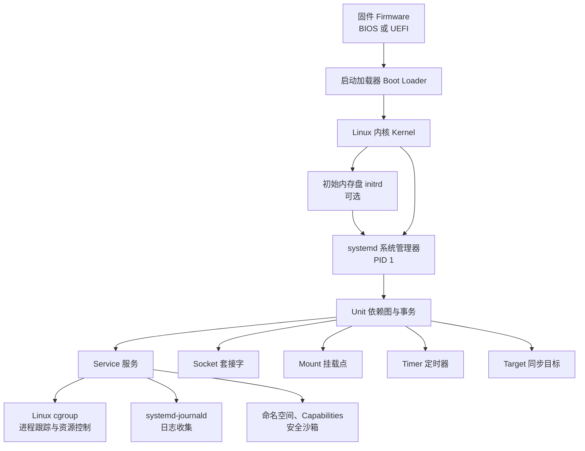
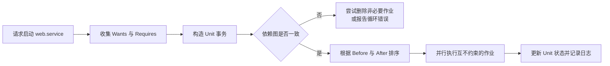
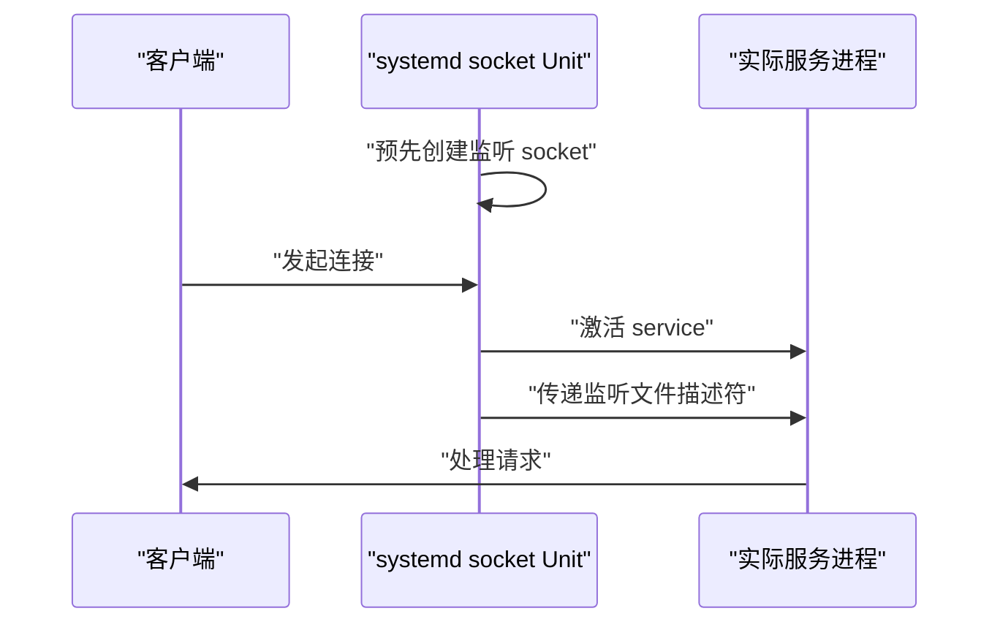
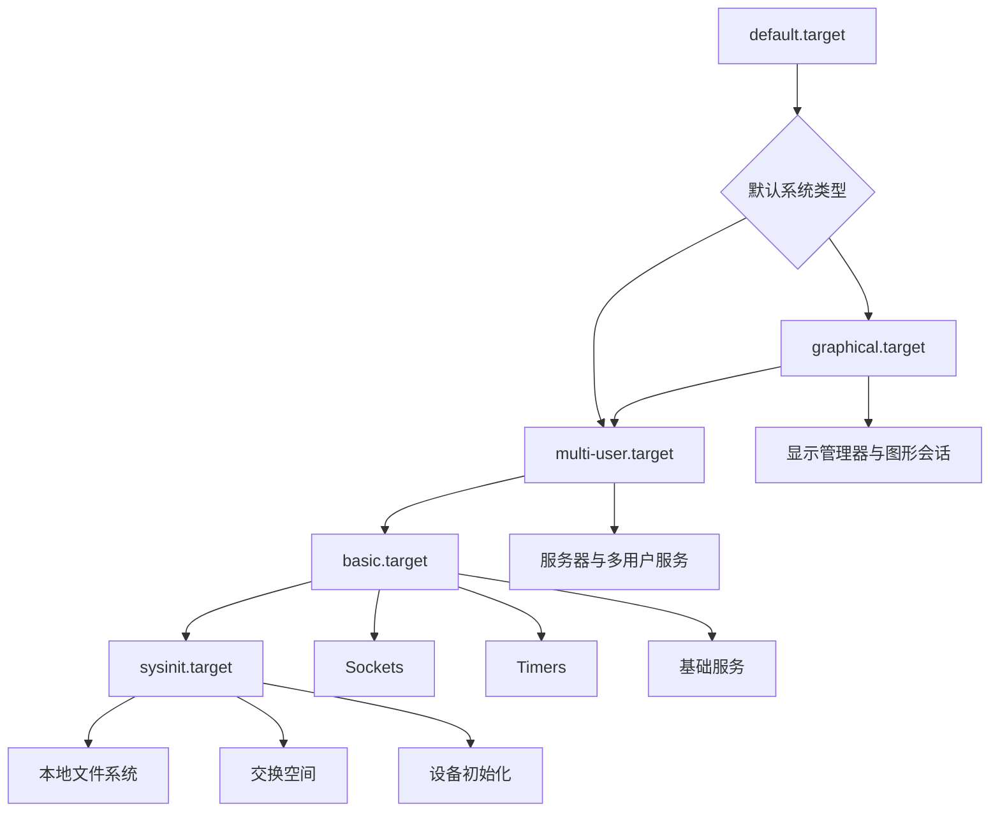

[toc]


## systemd 技术

内容以现代 Linux 发行版和上游 systemd 文档为基准；发行版通常会使用较旧版本并回移安全修复，因此实际操作应优先查阅本机 `man` 页面和 `systemd --version`。([GitHub](https://github.com/systemd/systemd/releases))

## 内容大纲

| 模块           | 核心问题                             | 学习目标                               |
| -------------- | ------------------------------------ | -------------------------------------- |
| systemd 的定位 | systemd 是否只是 init？              | 理解 systemd 是一套 Linux 系统基础组件 |
| 发展历程       | 为什么需要替代 SysV init？           | 理解其设计背景和普及过程               |
| 总体架构       | PID 1、Unit、cgroup 如何协作？       | 建立完整的系统管理模型                 |
| Unit 单元      | systemd 管理的基本对象是什么？       | 掌握 11 种 Unit 类型                   |
| 配置文件       | Unit 文件如何加载和覆盖？            | 理解目录优先级、drop-in 和模板         |
| 依赖关系       | `Requires=` 与 `After=` 有什么区别？ | 掌握依赖、顺序和事务模型               |
| 服务管理       | 如何编写可靠的 `.service`？          | 掌握服务类型、重启、超时和进程跟踪     |
| 激活机制       | 服务为什么可以按需启动？             | 理解 socket、timer、path、device 激活  |
| 系统启动       | target 如何组织启动过程？            | 理解启动依赖图和运行目标               |
| 日志系统       | journald 与传统日志有何不同？        | 掌握结构化日志查询和空间管理           |
| 用户服务       | 普通用户能否运行 systemd 服务？      | 掌握 `systemctl --user` 和 linger      |
| 资源控制       | systemd 如何限制 CPU、内存和进程数？ | 理解 cgroup、slice 和 scope            |
| 安全加固       | Unit 文件如何形成沙箱？              | 掌握权限、命名空间、能力和凭据         |
| 实战部署       | 如何部署一个生产级服务？             | 掌握编写、验证、启用和排障流程         |
| 故障诊断       | 服务失败、启动慢如何定位？           | 掌握常用诊断工具和思路                 |
| 最佳实践       | 哪些写法容易留下隐患？               | 建立可维护、可移植的管理规范           |

------

## systemd 是什么

systemd 是一套用于构建和管理 Linux 用户空间的基础组件。其中最核心的是：

- 系统与服务管理器（System and Service Manager）
- 作为系统启动后的第一个用户空间进程运行，即 **PID 1**
- 启动、停止、监督和重启其他服务
- 根据依赖关系组织系统启动
- 使用 Linux 控制组（Control Groups，cgroups）跟踪进程
- 提供日志、设备、登录会话、网络、时间同步等配套能力

因此，把 systemd 简单理解为“一个新的 init 程序”并不完整。init 只是 systemd 的核心角色之一。systemd 官方将其定义为“一套 Linux 系统基础构件”，其服务管理器支持并行启动、socket 激活、D-Bus 激活、按需启动、cgroup 进程跟踪和事务式依赖管理。([Systemd](https://systemd.io/?utm_source=chatgpt.com))

systemd 的名称通常使用全小写形式：

```text
systemd
systemctl
journalctl
systemd-journald
```

不建议写成 `SystemD` 或 `Systemd`。

### systemd 不等于所有组件都必须启用

systemd 项目包含很多可选组件，例如：

| 组件                | 主要用途                          |
| ------------------- | --------------------------------- |
| `systemd`           | 系统和服务管理器                  |
| `systemctl`         | 管理和查询 Unit                   |
| `systemd-journald`  | 收集结构化日志                    |
| `systemd-logind`    | 管理登录、会话和席位              |
| `systemd-udevd`     | 管理内核设备事件                  |
| `systemd-networkd`  | 网络配置管理                      |
| `systemd-resolved`  | DNS 解析管理                      |
| `systemd-timesyncd` | 简单的网络时间同步                |
| `systemd-tmpfiles`  | 创建和清理临时文件、目录          |
| `systemd-sysusers`  | 声明式创建系统用户和组            |
| `systemd-coredump`  | 收集进程核心转储                  |
| `systemd-oomd`      | 基于内存压力进行用户空间 OOM 处理 |
| `systemd-boot`      | UEFI 启动管理器                   |
| `systemd-nspawn`    | 轻量级容器运行工具                |
| `systemd-homed`     | 管理用户身份和家目录              |
| `systemd-creds`     | 管理服务凭据                      |
| `systemd-sysupdate` | 声明式系统更新机制                |

发行版可以选择启用、替换或不安装其中的某些组件。例如，一个系统可以使用 systemd 作为 PID 1，同时继续使用 NetworkManager、chrony 和 rsyslog，而不启用 `systemd-networkd`、`systemd-timesyncd` 或纯 journald 日志方案。

------

## systemd 的发展历程

### 传统 SysV init 的局限

早期 Linux 发行版广泛采用 SysV init。服务通常由 `/etc/init.d/` 下的 Shell 脚本控制，并通过运行级别（Runlevel）目录中的符号链接决定启动顺序。

这种模型简单直观，但随着系统复杂度增加，逐渐暴露出一些问题：

- 启动过程主要依赖人为编号，例如 `S10network`、`S80httpd`
- 服务间依赖关系表达能力有限
- 很难安全地并行启动服务
- 后台进程常通过 PID 文件进行跟踪，容易产生陈旧 PID
- Shell 脚本在不同发行版之间存在较大差异
- 服务启动成功与“服务真正准备好”经常不是同一个概念
- socket、设备、挂载点、定时任务分别由不同工具管理

### 项目诞生

Lennart Poettering 于 2010 年 4 月发表《Rethinking PID 1》，正式介绍实验性的 systemd。其设计目标包括并行化启动、socket 激活、依赖管理、服务监督以及对 Linux 特性的深入利用。早期设计也由 Kay Sievers 等开发者共同参与。([0pointer](https://0pointer.de/blog/projects/systemd.html?utm_source=chatgpt.com))

### 逐步成为主流

| 时间    | 事件                                                         |
| ------- | ------------------------------------------------------------ |
| 2010 年 | systemd 项目公开发布                                         |
| 2011 年 | Fedora 15 使用 systemd 替代 Upstart                          |
| 2014 年 | Debian 技术委员会决定在 Linux 平台采用 systemd 作为默认 init |
| 2015 年 | Debian 8 将 systemd 作为默认 init                            |
| 2015 年 | Ubuntu 15.04 正式切换到 systemd                              |
| 此后    | systemd 成为大多数主流通用 Linux 发行版的默认系统管理器      |

Fedora 15 是较早默认采用 systemd 的主要发行版；Debian 后续确认 systemd 为其唯一官方支持的默认 init，Ubuntu 则从 15.04 起正式支持并默认使用 systemd。([Fedora Project](https://fedoraproject.org/wiki/Fedora_15_Alpha_release_notes?utm_source=chatgpt.com))

### 现代发展方向

systemd 后续逐渐从服务管理扩展到：

- 基于 cgroup 的统一资源管理
- 结构化日志
- 服务沙箱和最小权限
- 临时服务与瞬态 Unit
- 系统凭据传递
- 统一内核镜像（Unified Kernel Image，UKI）
- Secure Boot 和 TPM2 测量
- 可移植服务与系统扩展
- 声明式用户、目录、挂载和更新管理

需要注意：systemd 上游版本更新较快，而企业发行版通常会长期维护某个较旧版本。编写 Unit 时不要仅根据网上最新文档判断指令是否可用，应首先执行：

```bash
systemd --version
man systemd.service
man systemd.exec
```

------

## systemd 的总体架构



系统启动后，systemd 作为 PID 1 运行。PID 1 在 Linux 中承担特殊职责，例如：

- 接收并处理孤儿进程
- 回收已经退出的子进程
- 管理系统启动和关闭
- 在系统级别维护服务状态
- 响应关机、重启和切换目标等请求

systemd 不只是逐条执行启动脚本。它首先构造一个 Unit 依赖事务（Transaction），检查依赖图是否一致、是否存在无法解决的顺序循环，然后按照顺序约束尽可能并行执行作业。([自由桌面](https://www.freedesktop.org/software/systemd/man/250/systemd.html?utm_source=chatgpt.com))

------

## 核心心智模型

学习 systemd 时，可以先记住四个核心概念。

### 一切可管理对象都抽象为 Unit

服务、套接字、挂载点、设备、定时器和资源组，都可以抽象为 Unit。

### Unit 之间形成依赖图

systemd 不是按配置文件名称或目录中的字母顺序启动服务，而是根据 Unit 之间的依赖关系计算启动事务。

### 依赖和顺序相互独立

“需要另一个服务”与“在另一个服务之后启动”是两个不同问题：

- `Requires=`、`Wants=`：是否把另一个 Unit 加入事务
- `After=`、`Before=`：两个作业同时存在时，以什么顺序执行

这是 systemd 最重要、也最容易被误解的规则。

### 进程归属于 cgroup，而不是只靠 PID 文件跟踪

systemd 通常为每个服务创建独立的 cgroup。服务创建的子进程会留在相应 cgroup 中，即使发生多次 fork，systemd 仍能识别整个服务进程组。

------

## Unit：systemd 的基本管理对象

systemd 定义了 11 种主要 Unit 类型。([自由桌面](https://www.freedesktop.org/software/systemd/man/250/systemd.html?utm_source=chatgpt.com))

| 后缀         | Unit 类型    | 作用                          |
| ------------ | ------------ | ----------------------------- |
| `.service`   | 服务单元     | 启动和监督一个或多个进程      |
| `.socket`    | 套接字单元   | 管理网络或本地 IPC 套接字     |
| `.target`    | 目标单元     | 对其他 Unit 进行分组和同步    |
| `.device`    | 设备单元     | 表示由内核发现的设备          |
| `.mount`     | 挂载单元     | 管理文件系统挂载点            |
| `.automount` | 自动挂载单元 | 访问时触发文件系统挂载        |
| `.swap`      | 交换单元     | 管理交换分区或交换文件        |
| `.timer`     | 定时器单元   | 按时间触发其他 Unit           |
| `.path`      | 路径单元     | 监视文件或目录变化并触发 Unit |
| `.slice`     | 切片单元     | 构建 cgroup 资源层次          |
| `.scope`     | 作用域单元   | 管理由 systemd 外部创建的进程 |

### Unit 的通用状态

不同 Unit 的具体含义不同，但通常会映射为以下状态：

| 状态           | 含义                       |
| -------------- | -------------------------- |
| `active`       | 已激活                     |
| `inactive`     | 未激活                     |
| `activating`   | 正在激活                   |
| `deactivating` | 正在停止                   |
| `failed`       | 激活、运行或停止过程中失败 |

对于 `.service`，`active` 通常表示服务进程正在运行；对于 `.mount`，表示挂载点已挂载；对于 `.socket`，表示套接字正在监听。

因此，`active` 并不统一等于“有一个后台进程”。

------

## Unit 文件的组成

一个典型服务 Unit 文件由以下部分组成：

```ini
[Unit]
Description=Example application service
Documentation=https://example.invalid/docs
After=network.target

[Service]
Type=exec
ExecStart=/usr/local/bin/example-server
Restart=on-failure

[Install]
WantedBy=multi-user.target
```

### `[Unit]`

描述 Unit 本身及其依赖关系。

常见指令包括：

| 指令                   | 作用                             |
| ---------------------- | -------------------------------- |
| `Description=`         | 人类可读的描述                   |
| `Documentation=`       | 文档地址或手册页                 |
| `Wants=`               | 添加较弱的需求依赖               |
| `Requires=`            | 添加较强的需求依赖               |
| `After=`               | 排在指定 Unit 启动完成之后       |
| `Before=`              | 排在指定 Unit 之前               |
| `Conflicts=`           | 不能与指定 Unit 同时处于活动状态 |
| `PartOf=`              | 跟随另一个 Unit 的停止或重启     |
| `OnFailure=`           | 当前 Unit 失败时激活其他 Unit    |
| `ConditionPathExists=` | 满足路径条件时才执行             |
| `AssertPathExists=`    | 断言路径必须存在，否则失败       |

### `[Service]`

只适用于 `.service`，定义进程如何启动和运行。

常见指令包括：

```ini
Type=exec
ExecStart=/usr/local/bin/example
ExecReload=/bin/kill -HUP $MAINPID
Restart=on-failure
User=example
WorkingDirectory=/var/lib/example
```

### `[Install]`

描述执行 `systemctl enable` 或 `disable` 时应创建或删除哪些符号链接。

常见形式：

```ini
[Install]
WantedBy=multi-user.target
```

需要特别注意：

> `[Install]` 不参与 Unit 的正常运行时依赖计算。它主要告诉 `systemctl enable` 应当如何安装启用关系。

一个没有 `[Install]` 的 Unit 可能显示为 `static`。这并不表示它不能运行，而是表示它不能通过普通 `enable` 独立启用，通常由其他 Unit 依赖或激活。

------

## Unit 文件的存放位置与优先级

系统级 Unit 通常来自以下位置：

| 目录                             | 用途                    |
| -------------------------------- | ----------------------- |
| `/usr/lib/systemd/system/`       | 软件包安装的厂商 Unit   |
| `/usr/local/lib/systemd/system/` | 本地安装软件提供的 Unit |
| `/run/systemd/system/`           | 运行期间生成的临时 Unit |
| `/etc/systemd/system/`           | 管理员的永久本地配置    |

部分发行版仍可能显示 `/lib/systemd/system/`。在采用 `/usr` 合并的系统中，`/lib` 往往是指向 `/usr/lib` 的符号链接。

基本原则是：

- 软件包维护的原始文件放在 `/usr/lib`
- 管理员自己的文件和覆盖配置放在 `/etc`
- 不要直接编辑 `/usr/lib/systemd/system/` 中的软件包文件
- `/etc` 中的同名配置通常覆盖厂商配置

systemd 会从多个目录加载配置，管理员配置具有更高优先级。软件包应将 Unit 安装到发行版确定的系统 Unit 目录，而本地修改应通过管理员配置目录完成。([自由桌面](https://www.freedesktop.org/software/systemd/man/systemd.html?utm_source=chatgpt.com))

查看一个 Unit 实际来自哪里：

```bash
systemctl show example.service -p FragmentPath
```

查看主文件和全部 drop-in：

```bash
systemctl cat example.service
```

------

## 使用 drop-in 覆盖配置

不要复制和修改整个厂商 Unit，优先使用 drop-in：

```bash
sudo systemctl edit example.service
```

该命令通常创建：

```text
/etc/systemd/system/example.service.d/override.conf
```

例如修改重启策略：

```ini
[Service]
Restart=on-failure
RestartSec=10s
```

保存后，`systemctl edit` 通常会自动执行必要的管理器重载。手工创建文件后则需要：

```bash
sudo systemctl daemon-reload
```

### 覆盖列表型配置

某些指令可以出现多次，例如 `ExecStart=`、`Environment=`。在 drop-in 中，直接增加一行不一定会替换原值。

要替换 `ExecStart=`，通常需要先清空：

```ini
[Service]
ExecStart=
ExecStart=/usr/local/bin/example --config=/etc/example/config.toml
```

第一行空赋值用于清除原来的值。

### 为什么不建议复制整个 Unit

复制完整 Unit 到 `/etc` 虽然能够覆盖厂商文件，但软件包后续新增的安全加固、依赖关系或兼容性修复不会自动进入本地副本。

drop-in 只记录差异，更适合长期维护。

------

## Unit 名称、实例和转义

### 普通名称

```text
sshd.service
nginx.service
docker.socket
backup.timer
```

多数命令可在名称无歧义时省略 `.service`：

```bash
systemctl status nginx
```

但在文档和脚本中写完整名称通常更清楚。

### 模板 Unit

模板 Unit 使用 `@`：

```text
worker@.service
```

实例可以是：

```text
worker@alpha.service
worker@beta.service
```

模板中常用的说明符（Specifier）包括：

| 说明符 | 含义                     |
| ------ | ------------------------ |
| `%n`   | 完整 Unit 名称           |
| `%N`   | 去除部分转义后的完整名称 |
| `%p`   | `@` 之前的前缀           |
| `%i`   | 转义后的实例名称         |
| `%I`   | 尽可能还原后的实例名称   |
| `%u`   | 运行服务的用户名         |
| `%U`   | 运行服务的数字 UID       |
| `%%`   | 字面量 `%`               |

示例：

```ini
[Service]
Type=exec
ExecStart=/usr/local/bin/worker --queue=%i
```

启动：

```bash
sudo systemctl start worker@orders.service
```

### 路径名称转义

挂载点 `/var/lib/data` 对应：

```text
var-lib-data.mount
```

根挂载点 `/` 对应：

```text
-.mount
```

不要手工猜测复杂路径的转义结果，应使用：

```bash
systemd-escape --path /var/lib/data
```

反向还原：

```bash
systemd-escape --unescape var-lib-data
```

------

## Unit 依赖关系

systemd 的依赖可分为三个主要维度：

- 是否把另一个 Unit 加入事务
- 两个 Unit 的启动或停止顺序
- 一个 Unit 的状态变化是否传播给另一个 Unit

### 需求依赖

| 指令         | 含义                                                         |
| ------------ | ------------------------------------------------------------ |
| `Wants=`     | 希望另一个 Unit 被启动；对方失败通常不直接导致当前 Unit 失败 |
| `Requires=`  | 需要另一个 Unit；若对方的启动作业失败，当前启动通常也会失败  |
| `Requisite=` | 对方必须已经处于活动状态，否则当前 Unit 立即失败             |
| `BindsTo=`   | 比 `Requires=` 更强，对方意外消失时当前 Unit 也会停止        |
| `Upholds=`   | 当前 Unit 活动期间，尽量维持指定 Unit 活动                   |
| `Conflicts=` | 两个 Unit 不能同时活动                                       |

### 顺序依赖

| 指令      | 含义                               |
| --------- | ---------------------------------- |
| `After=`  | 当前 Unit 的启动排在指定 Unit 之后 |
| `Before=` | 当前 Unit 的启动排在指定 Unit 之前 |

最重要的规则是：

> `After=` 不会自动启动另一个 Unit；`Wants=` 或 `Requires=` 也不会自动确定先后顺序。

需求依赖和顺序依赖是相互正交的。如果只有 `Requires=database.service` 而没有 `After=database.service`，两个服务仍可能并行启动。([自由桌面](https://www.freedesktop.org/software/systemd/man/249/systemd.html?utm_source=chatgpt.com))

常见组合：

```ini
[Unit]
Wants=database.service
After=database.service
```

或：

```ini
[Unit]
Requires=data.mount
After=data.mount
```

### `Requires=` 并不表示永久共生

假设：

```ini
Requires=database.service
After=database.service
```

这主要影响启动事务。如果数据库在两个服务都启动完成后被管理员单独停止，当前服务不一定自动停止。

要求状态更紧密绑定时，可能需要：

```ini
BindsTo=database.service
After=database.service
```

但 `BindsTo=` 很强，应谨慎使用。普通应用更适合自行处理数据库暂时不可用、重连和退避。

### 状态传播

| 指令                  | 常见用途                                         |
| --------------------- | ------------------------------------------------ |
| `PartOf=`             | 主 Unit 停止或重启时，让附属 Unit 同步停止或重启 |
| `PropagatesReloadTo=` | 把 reload 请求传播给其他 Unit                    |
| `OnFailure=`          | 失败后触发告警或恢复 Unit                        |

例如：

```ini
[Unit]
PartOf=example.service
```

当执行：

```bash
systemctl restart example.service
```

附属 Unit 也会随之重新启动。

### 条件不是依赖

例如：

```ini
ConditionPathExists=/etc/example/config.toml
```

条件不满足时，Unit 通常被跳过，而不是进入严重失败状态。

`Assert...=` 则更严格：断言不满足会导致作业失败。

------

## systemd 的事务和并行启动

当执行：

```bash
systemctl start web.service
```

systemd 大致会：

1. 加载 `web.service`
2. 收集它的依赖
3. 递归收集依赖的依赖
4. 构造启动事务
5. 检查冲突和顺序循环
6. 合并已存在的作业
7. 根据 `Before=` 和 `After=` 排序
8. 并行执行不存在顺序约束的作业



这也是为什么 systemd 不建议人为给服务增加大量不必要的 `After=`：过多顺序约束会降低并行度，并可能产生依赖环。

------

## `start`、`enable`、`mask` 等操作的区别

| 命令                              | 作用                         |
| --------------------------------- | ---------------------------- |
| `systemctl start foo`             | 立即启动                     |
| `systemctl stop foo`              | 立即停止                     |
| `systemctl restart foo`           | 停止后重新启动               |
| `systemctl reload foo`            | 请求服务重载自身配置         |
| `systemctl try-restart foo`       | 仅当当前正在运行时重启       |
| `systemctl reload-or-restart foo` | 支持 reload 则重载，否则重启 |
| `systemctl enable foo`            | 安装开机或目标依赖链接       |
| `systemctl disable foo`           | 删除由 enable 创建的链接     |
| `systemctl enable --now foo`      | 启用并立即启动               |
| `systemctl disable --now foo`     | 停止并禁用                   |
| `systemctl mask foo`              | 阻止该 Unit 被手工或依赖启动 |
| `systemctl unmask foo`            | 解除屏蔽                     |
| `systemctl preset foo`            | 按发行版预设策略启用或禁用   |
| `systemctl is-active foo`         | 查询当前是否活动             |
| `systemctl is-enabled foo`        | 查询是否启用                 |
| `systemctl reset-failed foo`      | 清除失败状态和启动速率计数   |

### `enable` 不等于 `start`

```bash
sudo systemctl enable nginx.service
```

通常只是创建符号链接，使其在未来启动事务中被某个 target 拉入，并不会立即启动服务。

需要同时启用和启动时：

```bash
sudo systemctl enable --now nginx.service
```

### `mask` 比 `disable` 更强

`disable` 只是删除开机启用关系，服务仍然可以被手工启动或被其他 Unit 依赖启动。

`mask` 通常创建一个指向 `/dev/null` 的同名链接，使 systemd 无法加载该 Unit：

```bash
sudo systemctl mask example.service
```

### `preset` 表示发行版策略

`systemctl preset` 根据发行版的 preset 文件决定默认启用状态，常被软件包安装流程使用。它不同于管理员主动执行的 `enable`。([自由桌面](https://www.freedesktop.org/software/systemd/man/systemd.preset.html?utm_source=chatgpt.com))

------

## `daemon-reload` 与服务 `reload`

这两个操作完全不同。

### `systemctl daemon-reload`

让 systemd 管理器：

- 重新读取 Unit 文件
- 重新读取 drop-in
- 重新运行 Unit generators
- 重建依赖信息

适用于修改 `.service`、`.timer`、`.socket` 等 Unit 配置之后。

```bash
sudo systemctl daemon-reload
```

它不会自动重启已经运行的服务。

### `systemctl reload example.service`

请求 `example.service` 自己重新读取应用配置。

能否 reload 取决于 Unit 是否实现了 `ExecReload=`，或者服务是否支持通知式重载。

例如：

```ini
ExecReload=/bin/kill -HUP $MAINPID
```

修改 Unit 文件后通常是：

```bash
sudo systemctl daemon-reload
sudo systemctl restart example.service
```

修改应用自身配置后可能是：

```bash
sudo systemctl reload example.service
```

------

## Service Unit 的服务类型

`Type=` 决定 systemd 如何判断服务已经启动。

| 类型      | systemd 何时认为启动完成      | 适用场景                           |
| --------- | ----------------------------- | ---------------------------------- |
| `simple`  | 创建进程后立即认为已启动      | 简单前台进程                       |
| `exec`    | `execve()` 成功执行目标程序后 | 不支持就绪通知的现代服务           |
| `notify`  | 收到服务发送的 `READY=1`      | 支持 `sd_notify()` 的服务          |
| `dbus`    | 指定的 D-Bus 名称被获取       | D-Bus 服务                         |
| `oneshot` | `ExecStart=` 命令执行完成     | 一次性任务                         |
| `forking` | 父进程退出后                  | 传统自守护进程                     |
| `idle`    | 作业队列相对空闲后再执行      | 避免控制台输出混杂，不用于依赖同步 |

### `Type=exec`

对于不支持就绪通知的普通前台应用，现代配置通常优先考虑：

```ini
Type=exec
```

与 `simple` 相比，`exec` 会等到执行目标二进制文件成功后再认为启动阶段已经推进。如果程序不存在或无法执行，启动会立即失败。

但它仍然不能证明应用已经：

- 完成数据库连接
- 监听网络端口
- 加载全部配置
- 完成数据迁移

需要准确表达“已经可以提供服务”时，应让应用支持 `Type=notify`。

### `Type=notify`

应用准备完成后，通过 `sd_notify()` 发送：

```text
READY=1
```

Unit 配置：

```ini
[Service]
Type=notify
ExecStart=/usr/local/bin/example-server
NotifyAccess=main
```

服务还可以发送：

- `STATUS=...`
- `RELOADING=1`
- `STOPPING=1`
- `WATCHDOG=1`
- `MAINPID=...`

`READY=1` 只有在 Unit 使用 `Type=notify` 时才用于确认启动完成。([自由桌面](https://www.freedesktop.org/software/systemd/man/sd_notify.html?utm_source=chatgpt.com))

### `Type=oneshot`

用于配置、迁移、初始化等一次性任务：

```ini
[Service]
Type=oneshot
ExecStart=/usr/local/libexec/prepare-database
RemainAfterExit=yes
```

`RemainAfterExit=yes` 表示命令退出后 Unit 仍显示为活动状态，代表“初始化状态已经建立”。

不需要表示持续状态时，可以省略：

```ini
[Service]
Type=oneshot
ExecStart=/usr/local/bin/run-backup
```

### `Type=forking`

传统 daemon 常自行执行双重 fork，并让父进程退出：

```ini
[Service]
Type=forking
PIDFile=/run/legacy-daemon.pid
ExecStart=/usr/sbin/legacy-daemon
```

新开发的服务不应主动 daemonize。更推荐：

- 保持前台运行
- 让 systemd 管理生命周期
- 直接写标准输出和标准错误
- 使用 `Type=exec` 或 `Type=notify`

这样可以避免 PID 文件、fork 检测和日志重定向带来的复杂性。

------

## `ExecStart=` 不是 Shell 命令行

以下写法不会按交互式 Shell 的方式解释：

```ini
ExecStart=/usr/bin/example > /var/log/example.log
```

重定向符不会自动生效。

管道也不会自动生效：

```ini
ExecStart=/usr/bin/generator | /usr/bin/consumer
```

systemd 的 `ExecStart=` 不直接支持 Shell 管道和重定向；确实需要 Shell 语法时，必须显式调用 Shell。([自由桌面](https://www.freedesktop.org/software/systemd/man/249/systemd.service.html?utm_source=chatgpt.com))

```ini
ExecStart=/bin/sh -c '/usr/bin/generator | /usr/bin/consumer'
```

不过，生产服务中应尽量避免不必要的 `/bin/sh -c`，原因包括：

- 信号可能先发送给 Shell，而非真正进程
- 引号和变量展开更加复杂
- 主进程身份不够清晰
- 容易引入命令注入
- 错误码可能被 Shell 行为改变

### 推荐写法

直接列出程序和参数：

```ini
ExecStart=/usr/local/bin/example-server --config=/etc/example/config.toml --foreground
```

### 环境变量展开

可通过：

```ini
Environment=MODE=production
EnvironmentFile=-/etc/example/environment
```

使用：

```ini
ExecStart=/usr/local/bin/example-server --mode=${MODE}
```

`EnvironmentFile=` 前面的 `-` 表示文件不存在时不把它视为致命错误。

不要假定服务拥有登录 Shell 的环境。systemd 服务通常不会自动加载：

- `/etc/profile`
- `~/.profile`
- `~/.bashrc`
- `~/.zshrc`

应显式声明所需环境。

------

## 服务进程模型和信号

### 主进程

systemd 会跟踪服务的主进程（Main PID）。

对 `Type=exec`、`simple` 和正常前台程序，主进程通常就是 `ExecStart=` 启动的进程。

查看：

```bash
systemctl show example.service -p MainPID
```

### cgroup 跟踪

服务及其子进程通常被放入同一 cgroup。停止服务时，默认 `KillMode=control-group` 会处理该 Unit cgroup 中的全部进程，而不是只杀死一个 PID。

这比仅依赖 PID 文件更加可靠。

### 停止流程

常见停止过程是：

1. 执行 `ExecStop=`，如果已定义
2. 向剩余进程发送 `KillSignal=`，默认通常为 `SIGTERM`
3. 等待 `TimeoutStopSec=`
4. 超时后发送最终终止信号，通常为 `SIGKILL`

应用应正确处理 `SIGTERM`，完成：

- 停止接收新请求
- 结束正在处理的任务
- 刷新缓冲区
- 关闭连接
- 在超时前退出

### 不要用 `ExecStop=/bin/kill ...` 替代正常监督

对于普通前台服务，systemd 已经知道主进程和 cgroup，通常无需额外编写 `ExecStop=`。

只有应用有专门管理命令时才需要：

```ini
ExecStop=/usr/local/bin/examplectl shutdown
```

------

## 服务重启与失败处理

常见配置：

```ini
[Unit]
StartLimitIntervalSec=60s
StartLimitBurst=5

[Service]
Restart=on-failure
RestartSec=5s
```

### `Restart=` 常见值

| 值            | 行为                                   |
| ------------- | -------------------------------------- |
| `no`          | 不自动重启                             |
| `on-success`  | 正常退出后重启                         |
| `on-failure`  | 非零退出、信号、超时或看门狗失败后重启 |
| `on-abnormal` | 信号、超时、看门狗等异常终止时重启     |
| `on-abort`    | 因未捕获信号终止时重启                 |
| `on-watchdog` | 看门狗超时时重启                       |
| `always`      | 几乎无论退出原因都重启                 |

对于长期运行服务，常见推荐是：

```ini
Restart=on-failure
```

不要无条件给所有服务设置 `Restart=always`。例如：

- 配置错误会导致无限重启
- 一次性任务不应持续重复执行
- 正常停止后可能不希望自动拉起

### 启动速率限制

为了避免崩溃循环消耗 CPU 和日志空间，systemd 会实施启动速率限制。

```ini
[Unit]
StartLimitIntervalSec=60s
StartLimitBurst=5
```

含义是：在 60 秒窗口内，最多允许若干次启动尝试。

修复原因后可以清除失败计数：

```bash
sudo systemctl reset-failed example.service
sudo systemctl start example.service
```

### 超时

```ini
TimeoutStartSec=30s
TimeoutStopSec=30s
```

不要为了“让服务总能启动”而盲目设置：

```ini
TimeoutStartSec=infinity
```

这可能导致系统启动或部署流程永久挂起。

### 看门狗

支持 `sd_notify()` 的服务可以使用：

```ini
Type=notify
WatchdogSec=30s
```

服务必须定期发送：

```text
WATCHDOG=1
```

看门狗用于检测进程仍存在但内部事件循环已经失去响应的情况。

------

## 一个较完整的生产级 Service 示例

假设有一个以前台方式运行的 HTTP API：

```ini
[Unit]
Description=Example API service
Documentation=man:example-api(8)
Wants=network-online.target
After=network-online.target
StartLimitIntervalSec=60s
StartLimitBurst=5

[Service]
Type=exec
ExecStart=/usr/local/bin/example-api --config=/etc/example-api/config.toml

DynamicUser=yes
StateDirectory=example-api
RuntimeDirectory=example-api
LogsDirectory=example-api
WorkingDirectory=/var/lib/example-api

Restart=on-failure
RestartSec=5s
TimeoutStartSec=30s
TimeoutStopSec=30s

UMask=0027
NoNewPrivileges=yes
PrivateTmp=yes
PrivateDevices=yes
ProtectSystem=strict
ProtectHome=yes
ProtectKernelTunables=yes
ProtectKernelModules=yes
ProtectControlGroups=yes
ProtectClock=yes
RestrictSUIDSGID=yes
LockPersonality=yes
CapabilityBoundingSet=
AmbientCapabilities=
RestrictAddressFamilies=AF_UNIX AF_INET AF_INET6

[Install]
WantedBy=multi-user.target
```

### 配置说明

```
DynamicUser=yes
```

- 运行时动态分配服务用户
- 避免长期维护静态系统账号
- 适合不需要固定数字 UID 的服务

```
StateDirectory=example-api
```

自动创建持久状态目录，通常对应：

```text
/var/lib/example-api
RuntimeDirectory=example-api
```

自动创建运行时目录，通常对应：

```text
/run/example-api
LogsDirectory=example-api
```

自动创建日志目录，通常对应：

```text
/var/log/example-api
```

如果应用直接写 stdout 和 stderr，通常不需要独立日志目录，可以删除 `LogsDirectory=`。

```
ProtectSystem=strict
```

使大部分系统文件层次对服务只读。由 `StateDirectory=`、`RuntimeDirectory=` 等声明创建的目录可以按 systemd 的规则保持可写。

```
CapabilityBoundingSet=
```

空值表示移除全部 Linux capabilities。只有确实需要特权操作时才应加入必要能力。

例如绑定 1024 以下端口可能需要：

```ini
AmbientCapabilities=CAP_NET_BIND_SERVICE
CapabilityBoundingSet=CAP_NET_BIND_SERVICE
```

不过更简单的方案往往是监听高端口，再由反向代理或 socket 激活负责特权端口。

### 关于 `network-online.target`

只有真正需要在启动阶段等待网络配置完成的客户端服务，才应拉入：

```ini
Wants=network-online.target
After=network-online.target
```

仅提供本地监听端口的服务器通常不需要等待“网络在线”。

`network-online.target` 只是启动阶段的一次同步点，不是持续的网络连通性监控器；网络后续断开时，它不会自动变为 inactive。([自由桌面](https://www.freedesktop.org/software/systemd/man/250/systemd.special.html?utm_source=chatgpt.com))

------

## Socket 激活

Socket 激活（Socket Activation）的基本思想是：

1. systemd 先创建并监听 socket
2. 客户端可以立即连接
3. 第一次连接到来时，systemd 启动真正服务
4. systemd 将已经打开的文件描述符传给服务
5. 服务开始处理排队的连接



示例 socket：

```ini
[Unit]
Description=Example API socket

[Socket]
ListenStream=127.0.0.1:9000
NoDelay=yes

[Install]
WantedBy=sockets.target
```

对应服务：

```ini
[Unit]
Description=Example API service

[Service]
Type=exec
ExecStart=/usr/local/bin/example-api --listen-systemd
```

文件名称通常对应：

```text
example-api.socket
example-api.service
```

默认情况下，同名 `.socket` 会激活同名 `.service`。

### 应用必须支持继承 socket

应用不能再盲目执行：

```text
bind 127.0.0.1:9000
```

它需要读取 systemd 传递的文件描述符，通常使用：

- `sd_listen_fds()`
- 编程语言对应的 systemd socket activation 库
- 应用框架内置支持

### Socket 激活的优势

- 服务可按需启动
- 慢启动服务不会立即拒绝连接
- 服务重启期间监听 socket 可继续由 systemd 持有
- 可统一管理特权端口
- 服务之间不必用轮询等待对方创建 socket

### 不适合的情况

- 应用不支持继承文件描述符
- 协议初始化严重依赖进程启动前状态
- 服务必须持续运行以维护外部会话
- 激活延迟不符合业务要求

------

## Timer 定时任务

Timer Unit 可以替代大量传统 cron 使用场景。

通常由两个文件组成：

```text
backup.service
backup.timer
```

### 一次性任务

`/etc/systemd/system/backup.service`：

```ini
[Unit]
Description=Create application backup

[Service]
Type=oneshot
ExecStart=/usr/local/sbin/backup-application
User=backup
```

### 定时器

`/etc/systemd/system/backup.timer`：

```ini
[Unit]
Description=Run application backup every day

[Timer]
OnCalendar=daily
Persistent=yes
RandomizedDelaySec=15m
AccuracySec=1m

[Install]
WantedBy=timers.target
```

启用：

```bash
sudo systemctl daemon-reload
sudo systemctl enable --now backup.timer
```

查看：

```bash
systemctl list-timers --all
```

查看任务日志：

```bash
journalctl -u backup.service
```

### `Persistent=yes`

如果机器在预定执行时间关机，重新开机后会补触发错过的基于日历的任务。

它不表示任务失败后自动重试。

### `RandomizedDelaySec=`

给实际执行时间增加随机延迟。大量机器执行同一任务时，可以减少：

- 软件仓库瞬时压力
- 数据库同时备份
- 网络流量尖峰
- 所谓“惊群效应”

### `AccuracySec=`

允许 systemd 在一定精度窗口内合并唤醒事件，以改善能耗。定时器的默认精度并不一定是精确到秒；需要非常精确时应明确设置，但不要无意义地把所有定时器都设为微秒级。([自由桌面](https://www.freedesktop.org/software/systemd/man/systemd.timer.html?utm_source=chatgpt.com))

### 校验日历表达式

```bash
systemd-analyze calendar 'Mon..Fri 02:00'
```

输出会显示规范化表达式和下一次触发时间。

常见表达式：

```text
hourly
daily
weekly
Mon..Fri 08:30
*-*-01 03:00
2026-12-31 23:00
```

### 单调时间定时器

除了 `OnCalendar=`，还可以使用：

```ini
OnBootSec=10m
OnUnitActiveSec=1h
```

此类定时器基于单调时钟（Monotonic Clock），不依赖墙上时间的跳变。

------

## Path 激活

Path Unit 可以监视文件系统对象，在事件发生时启动服务。

```ini
[Unit]
Description=Watch incoming directory

[Path]
PathExists=/var/lib/import/ready
Unit=import-data.service

[Install]
WantedBy=paths.target
```

对应服务：

```ini
[Service]
Type=oneshot
ExecStart=/usr/local/bin/import-data
```

常见监视指令包括：

| 指令                 | 用途                     |
| -------------------- | ------------------------ |
| `PathExists=`        | 路径存在                 |
| `PathExistsGlob=`    | 匹配路径存在             |
| `PathChanged=`       | 路径内容或元数据发生变化 |
| `PathModified=`      | 文件被写入               |
| `DirectoryNotEmpty=` | 目录非空                 |

Path Unit 更适合作为“触发机制”，而不是可靠消息队列。多个快速事件可能被合并，任务应在启动后自行扫描并处理全部待处理内容。

------

## Mount 和 Automount

systemd 可以从 `.mount` Unit 或 `/etc/fstab` 管理挂载点。

例如 `/srv/data` 对应：

```text
srv-data.mount
[Unit]
Description=Application data filesystem
Before=example.service

[Mount]
What=/dev/disk/by-uuid/1234-5678
Where=/srv/data
Type=ext4
Options=defaults,noatime

[Install]
WantedBy=local-fs.target
```

`Where=` 必须与 Unit 名称表示的路径一致。

### `/etc/fstab` 仍然有效

systemd 并没有要求所有挂载都改写成 `.mount` 文件。启动过程中，generator 会根据 `/etc/fstab` 动态生成 Mount Unit。

常用扩展选项包括：

```text
x-systemd.automount
x-systemd.device-timeout=30s
x-systemd.mount-timeout=30s
nofail
_netdev
```

### Automount

自动挂载 Unit 先建立内核 automount 点，实际访问路径时才触发挂载。

这可以：

- 延迟挂载慢速设备
- 提高启动并行度
- 减少网络挂载故障对启动的阻塞

------

## Target 与系统启动流程

Target Unit 用于：

- 对 Unit 分组
- 表示启动阶段
- 充当同步点
- 替代传统 runlevel 的主要用途

常见 target：

| Target                  | 含义                             |
| ----------------------- | -------------------------------- |
| `sysinit.target`        | 早期系统初始化                   |
| `basic.target`          | 基础用户空间环境                 |
| `multi-user.target`     | 多用户、非图形系统               |
| `graphical.target`      | 图形用户界面                     |
| `network.target`        | 基础网络栈已建立到某个弱定义阶段 |
| `network-online.target` | 启动阶段等待网络配置完成         |
| `local-fs.target`       | 本地文件系统                     |
| `remote-fs.target`      | 远程文件系统                     |
| `sockets.target`        | 系统 socket Unit                 |
| `timers.target`         | 系统 timer Unit                  |
| `rescue.target`         | 救援模式                         |
| `emergency.target`      | 最小化紧急模式                   |
| `shutdown.target`       | 关闭过程                         |
| `reboot.target`         | 重启                             |
| `poweroff.target`       | 关机                             |

### 默认启动目标

查看：

```bash
systemctl get-default
```

常见结果：

```text
multi-user.target
```

或：

```text
graphical.target
```

设置默认目标：

```bash
sudo systemctl set-default multi-user.target
```

临时切换当前状态：

```bash
sudo systemctl isolate rescue.target
```

`isolate` 会停止不属于目标依赖集合的 Unit，可能中断网络和当前会话，使用前应非常谨慎。

### 大致启动关系



真实依赖图并非严格的线性层级，很多 Unit 会并行执行。该图仅用于理解主要同步点。

### 与 SysV runlevel 的关系

systemd 保留了一些兼容别名，例如：

| SysV 概念  | 常见 systemd 对应   |
| ---------- | ------------------- |
| runlevel 0 | `poweroff.target`   |
| runlevel 1 | `rescue.target`     |
| runlevel 3 | `multi-user.target` |
| runlevel 5 | `graphical.target`  |
| runlevel 6 | `reboot.target`     |

现代配置应直接使用 target 名称，而不是依赖运行级别数字。systemd 官方也将传统 runlevel 概念视为过时兼容接口。([Systemd](https://systemd.io/FAQ/?utm_source=chatgpt.com))

------

## systemd-journald 日志系统🎈

`systemd-journald` 收集多种日志来源：

- 服务的标准输出
- 服务的标准错误
- syslog 接口
- 内核日志
- audit 相关信息
- 服务主动提交的结构化字段

日志不仅包含消息文本，还带有元数据，例如：

- 时间戳
- PID、UID、GID
- 可执行文件
- cgroup
- Unit 名称
- 启动 ID
- 主机 ID
- 日志优先级
- 内核传输来源

### 基本查询

当前系统全部日志：

```bash
journalctl
```

某个服务：

```bash
journalctl -u nginx.service
```

当前启动：

```bash
journalctl -b
```

上一次启动：

```bash
journalctl -b -1
```

实时跟踪：

```bash
journalctl -u nginx.service -f
```

指定时间：

```bash
journalctl --since '2026-07-10 08:00:00'
```

最近一小时：

```bash
journalctl --since '-1 hour'
```

按优先级：

```bash
journalctl -p warning
```

查看内核日志：

```bash
journalctl -k
```

结构化 JSON：

```bash
journalctl -u nginx.service -o json-pretty
```

### 标准输出就是日志入口

应用可以直接写：

```text
stdout
stderr
```

通常不需要自行：

- 后台化
- 打开 `/var/log/...`
- 实现日志轮转
- 用 Shell 重定向输出

服务可以设置标识：

```ini
SyslogIdentifier=example-api
```

### 持久与易失日志

journald 可以：

- 将持久日志存放在 `/var/log/journal/`
- 将易失日志存放在 `/run/log/journal/`

`/run` 中的日志会在重启后丢失。实际行为由 `journald.conf`、目录状态和发行版默认设置共同决定。([自由桌面](https://www.freedesktop.org/software/systemd/man/systemd-journald.service.html?utm_source=chatgpt.com))

查看占用：

```bash
journalctl --disk-usage
```

清理到指定容量：

```bash
sudo journalctl --vacuum-size=1G
```

只保留最近时间：

```bash
sudo journalctl --vacuum-time=14d
```

长期限制应通过 `journald.conf` 或 drop-in 设置，例如：

```ini
[Journal]
SystemMaxUse=2G
SystemKeepFree=1G
MaxRetentionSec=30day
```

推荐创建：

```text
/etc/systemd/journald.conf.d/10-storage.conf
```

修改后重启：

```bash
sudo systemctl restart systemd-journald.service
```

不要在 journald 正在运行时随意手工删除活跃 journal 文件。

------

## 用户级 systemd 服务

除系统 PID 1 外，systemd 还可以为用户运行服务管理器。

基本命令：

```bash
systemctl --user status
systemctl --user start example.service
systemctl --user enable example.service
journalctl --user -u example.service
```

用户 Unit 常见位置：

| 目录                      | 用途                       |
| ------------------------- | -------------------------- |
| `~/.config/systemd/user/` | 当前用户的 Unit            |
| `/etc/systemd/user/`      | 管理员提供给所有用户的配置 |
| `/usr/lib/systemd/user/`  | 软件包安装的用户 Unit      |

### 用户服务示例

`~/.config/systemd/user/dev-server.service`：

```ini
[Unit]
Description=Personal development server

[Service]
Type=exec
ExecStart=%h/bin/dev-server
Restart=on-failure
RestartSec=3s

[Install]
WantedBy=default.target
```

启用：

```bash
systemctl --user daemon-reload
systemctl --user enable --now dev-server.service
```

### 会话结束后继续运行

默认情况下，用户管理器的生命周期可能与用户会话相关。

允许用户退出登录后仍运行用户服务：

```bash
sudo loginctl enable-linger alice
```

关闭：

```bash
sudo loginctl disable-linger alice
```

linger 会使用户管理器在没有交互式登录会话时仍可启动和运行，应只为确实需要后台用户服务的账号启用。

### 用户服务不是系统服务的无特权副本

用户管理器通常不能直接：

- 绑定低端口
- 挂载任意文件系统
- 创建系统用户
- 修改系统网络
- 管理系统级 Unit
- 使用只有 root 拥有的 capabilities

它适合：

- 桌面应用后台组件
- 开发服务器
- 用户同步任务
- SSH agent
- 用户定时任务

------

## cgroup、Slice 和 Scope

### cgroup 的作用

Linux cgroup 用于：

- 对进程进行分组
- 统计 CPU、内存和 I/O
- 限制资源使用
- 冻结或终止进程组
- 构建层次化资源控制

systemd 为服务创建 cgroup，使进程生命周期和资源归属与 Unit 对齐。

### 默认 Slice

常见层次包括：

```text
-.slice
├─system.slice
├─user.slice
└─machine.slice
```

| Slice           | 常见内容           |
| --------------- | ------------------ |
| `system.slice`  | 系统服务           |
| `user.slice`    | 用户会话和用户服务 |
| `machine.slice` | 虚拟机和容器       |

### 自定义 Slice

```ini
[Unit]
Description=Batch processing slice

[Slice]
CPUWeight=20
MemoryHigh=8G
MemoryMax=10G
TasksMax=2000
```

服务加入：

```ini
[Service]
Slice=batch.slice
```

### 常用资源控制指令

| 指令                   | 作用                |
| ---------------------- | ------------------- |
| `CPUWeight=`           | 相对 CPU 权重       |
| `CPUQuota=`            | CPU 时间硬配额      |
| `AllowedCPUs=`         | 允许使用的 CPU 集合 |
| `MemoryLow=`           | 内存保护            |
| `MemoryHigh=`          | 内存压力和回收阈值  |
| `MemoryMax=`           | 内存硬上限          |
| `MemorySwapMax=`       | 交换空间上限        |
| `IOWeight=`            | I/O 相对权重        |
| `IOReadBandwidthMax=`  | 读取带宽限制        |
| `IOWriteBandwidthMax=` | 写入带宽限制        |
| `TasksMax=`            | 最大任务或线程数量  |

这些资源设置可用于 `.service`、`.slice`、`.scope` 等 Unit。([自由桌面](https://www.freedesktop.org/software/systemd/man/systemd.resource-control.html?utm_source=chatgpt.com))

### `MemoryHigh` 与 `MemoryMax`

通常可以把二者理解为：

- `MemoryHigh=`：软压力线，超过后加强回收和限制
- `MemoryMax=`：不可超过的最终硬上限

生产系统通常不应只设置一个过小的 `MemoryMax=`。更平滑的方式是先使用合理的 `MemoryHigh=`，再用更高的 `MemoryMax=` 作为最后防线。

### 运行时临时修改

```bash
sudo systemctl set-property example.service MemoryHigh=1G MemoryMax=1500M
```

默认会写入持久 drop-in。只想对当前运行时生效：

```bash
sudo systemctl set-property --runtime example.service MemoryMax=1500M
```

### 瞬态 Unit

使用 `systemd-run`：

```bash
sudo systemd-run \
  --unit=one-time-report \
  --property=MemoryMax=1G \
  /usr/local/bin/create-report
```

创建当前用户的临时服务：

```bash
systemd-run --user --unit=test-job /usr/bin/sleep 60
```

创建 scope：

```bash
systemd-run --scope -p MemoryMax=2G make -j4
```

`systemd-run` 可以创建瞬态 `.service` 或 `.scope` Unit。([自由桌面](https://www.freedesktop.org/software/systemd/man/systemd-run.html?utm_source=chatgpt.com))

### 查看资源

```bash
systemd-cgls
systemd-cgtop
systemctl status example.service
systemctl show example.service
```

------

## systemd 服务安全加固

systemd 可以在启动服务时配置：

- 用户和组
- Linux capabilities
- 文件系统命名空间
- 网络命名空间
- 设备访问
- 系统调用过滤
- 内核接口保护
- 临时目录隔离
- 资源限制

这些机制不能替代应用自身安全设计，但可以显著减少应用被攻破后的影响范围。

### 常用安全指令

| 指令                         | 作用                          | 注意事项                             |
| ---------------------------- | ----------------------------- | ------------------------------------ |
| `User=`                      | 以非 root 用户运行            | 服务用户需要预先存在                 |
| `DynamicUser=yes`            | 动态创建临时身份              | 不适合依赖固定 UID 的共享存储        |
| `NoNewPrivileges=yes`        | 禁止获得额外权限              | 会影响 setuid 等机制                 |
| `PrivateTmp=yes`             | 使用私有 `/tmp` 和 `/var/tmp` | 不能再与其他服务通过临时目录交换文件 |
| `PrivateDevices=yes`         | 提供精简私有 `/dev`           | 需要访问硬件设备的服务可能失败       |
| `ProtectSystem=strict`       | 系统文件层次只读              | 需声明可写目录                       |
| `ProtectHome=yes`            | 隐藏或限制家目录              | 需要读取用户目录的服务不适用         |
| `ProtectKernelTunables=yes`  | 限制修改内核参数              | 系统调优服务可能需要关闭             |
| `ProtectKernelModules=yes`   | 禁止操作内核模块              | 驱动管理服务不适用                   |
| `ProtectControlGroups=yes`   | 限制修改 cgroup               | 容器管理器可能需要访问               |
| `CapabilityBoundingSet=`     | 限定 capabilities             | 空值表示全部移除                     |
| `RestrictAddressFamilies=`   | 限制 socket 地址族            | 应按服务实际协议配置                 |
| `SystemCallFilter=`          | 允许或拒绝系统调用集合        | 配置过严会产生兼容问题               |
| `RestrictNamespaces=`        | 限制创建命名空间              | 容器、沙箱和部分浏览器需要命名空间   |
| `MemoryDenyWriteExecute=yes` | 阻止可写且可执行内存          | JIT、某些语言运行时可能不能工作      |
| `LockPersonality=yes`        | 禁止改变执行域                | 通常适用于普通服务                   |
| `RestrictSUIDSGID=yes`       | 限制创建 setuid/setgid 文件   | 安装和构建工具可能需要相关能力       |

### 安全分析工具

```bash
systemd-analyze security example.service
```

它会分析 systemd 可见的服务沙箱配置，并给出暴露等级。

较低分数通常表示使用了更多 systemd 沙箱措施，但不能简单解释为“绝对安全”。该分析不会完整评估：

- 应用代码漏洞
- D-Bus 授权策略
- 网络协议安全
- SELinux 或 AppArmor 完整策略
- 应用内部权限模型

官方文档也强调，许多单项限制需要组合使用，并且评分不能等同于漏洞判定。([自由桌面](https://www.freedesktop.org/software/systemd/man/systemd-analyze.html?utm_source=chatgpt.com))

### 推荐加固流程

不要一次加入所有限制。更稳妥的流程是：

1. 先让服务以非 root 身份正常运行
2. 加入 `NoNewPrivileges=yes`
3. 加入文件系统只读保护
4. 明确可写状态目录
5. 缩减 capabilities
6. 限制地址族
7. 测试设备、命名空间和系统调用限制
8. 执行功能、升级、备份和恢复测试
9. 使用 `systemd-analyze security` 复查

------

## 使用 systemd Credentials 管理敏感信息

不要优先把密码、令牌或私钥写入：

```ini
Environment=API_TOKEN=secret
```

环境变量存在一些问题：

- 会被子进程继承
- 不适合二进制数据
- 可能出现在调试信息或错误报告中
- 服务内部容易无意传播

systemd 提供服务凭据（Service Credentials）机制，用于传递密码、证书、密钥和身份数据。凭据会以受限文件的形式出现在服务专用目录中。([Systemd](https://systemd.io/CREDENTIALS/?utm_source=chatgpt.com))

### 基本示例

```ini
[Service]
LoadCredential=api-token:/etc/example/secret-token
ExecStart=/usr/local/bin/example-api
```

服务通过环境变量获得凭据目录：

```text
$CREDENTIALS_DIRECTORY
```

读取：

```text
$CREDENTIALS_DIRECTORY/api-token
```

应用代码不应假定具体绝对路径，而应读取 `CREDENTIALS_DIRECTORY`。

### 加密凭据

支持相应功能的 systemd 版本可以使用：

```ini
LoadCredentialEncrypted=api-token:/etc/credstore.encrypted/api-token
```

并通过 `systemd-creds` 创建或检查加密凭据。

使用前应确认本机版本：

```bash
man systemd-creds
man systemd.exec
```

### Credentials 不是万能秘密管理器

它解决的是“如何安全地把数据交给服务进程”，并不自动解决：

- 密钥轮换
- 中央审计
- 多主机分发
- 云端秘密访问控制
- 应用层权限

可以将它与 Vault、云秘密管理服务、TPM 或配置管理工具结合。

------

## 软件包安装中的 Sysusers 与 Tmpfiles

### systemd-sysusers

软件包可以声明需要的系统用户和组，而不是在安装脚本中直接执行 `useradd`。

示例：

```text
u example-api - "Example API service" /var/lib/example-api
```

通常放置在：

```text
/usr/lib/sysusers.d/example-api.conf
```

处理：

```bash
systemd-sysusers
```

### systemd-tmpfiles

用于声明创建、清理和维护：

- 运行时目录
- 缓存目录
- 临时文件
- 符号链接
- 特定权限和所有权

示例：

```text
d /var/cache/example-api 0750 example-api example-api -
```

相比安装脚本中的命令式操作，这些配置更：

- 可重复执行
- 易于审计
- 适合镜像构建
- 能在启动阶段重新建立易失目录

对于单个服务，优先考虑 Unit 中的：

```ini
RuntimeDirectory=
StateDirectory=
CacheDirectory=
LogsDirectory=
ConfigurationDirectory=
```

只有需要更复杂文件布局时再使用 tmpfiles。

------

## 服务部署完整流程

### 创建 Unit

```bash
sudo editor /etc/systemd/system/example.service
```

### 静态验证

```bash
systemd-analyze verify /etc/systemd/system/example.service
```

该命令可以发现：

- 未知指令
- 部分语法问题
- 依赖错误
- 找不到的可执行文件
- 某些顺序循环

### 重新加载管理器

```bash
sudo systemctl daemon-reload
```

### 启动并检查

```bash
sudo systemctl start example.service
systemctl status example.service
```

### 检查日志

```bash
journalctl -u example.service -b
```

### 启用开机启动

```bash
sudo systemctl enable example.service
```

也可以合并为：

```bash
sudo systemctl enable --now example.service
```

### 查看启用结果

```bash
systemctl is-enabled example.service
systemctl list-dependencies multi-user.target
```

### 验证最终配置

```bash
systemctl cat example.service
systemctl show example.service
```

重点检查：

```bash
systemctl show example.service \
  -p FragmentPath \
  -p DropInPaths \
  -p ExecStart \
  -p User \
  -p MainPID \
  -p ActiveState \
  -p SubState
```

------

## 常用管理命令速查

### 查询 Unit

```bash
systemctl list-units
systemctl list-units --all
systemctl list-unit-files
systemctl list-unit-files --state=enabled
systemctl list-units --failed
```

区别：

- `list-units`：当前已加载到管理器中的 Unit
- `list-unit-files`：磁盘上的 Unit 文件及启用状态

### 查看状态

```bash
systemctl status sshd.service
systemctl is-active sshd.service
systemctl is-failed sshd.service
systemctl show sshd.service
```

### 查看依赖

```bash
systemctl list-dependencies example.service
systemctl list-dependencies --reverse example.service
systemctl list-dependencies --after example.service
systemctl list-dependencies --before example.service
```

`list-dependencies` 主要展示当前已加载的依赖关系，不应把它误认为磁盘上所有潜在反向依赖的完整静态数据库。([自由桌面](https://www.freedesktop.org/software/systemd/man/250/systemctl.html?utm_source=chatgpt.com))

### 查看实际配置

```bash
systemctl cat example.service
systemctl show example.service -p FragmentPath -p DropInPaths
```

### 管理系统状态

```bash
systemctl reboot
systemctl poweroff
systemctl suspend
systemctl hibernate
```

脚本或应用优先调用这些高级接口，不要直接启动 `reboot.target` 或 `poweroff.target`。

------

## 启动性能分析

### 总体时间

```bash
systemd-analyze time
```

通常会分别显示：

- firmware
- loader
- kernel
- initrd
- userspace

### Unit 启动耗时

```bash
systemd-analyze blame
```

需要注意：

> `blame` 显示单个 Unit 从开始到完成所花的时间，不等于它让整个启动过程延迟了相同时间。

一个耗时 20 秒但与其他服务并行运行的 Unit，可能并不位于关键路径。

### 关键链

```bash
systemd-analyze critical-chain
```

指定 Unit：

```bash
systemd-analyze critical-chain graphical.target
```

关键链通常比 `blame` 更适合定位真正阻塞启动完成的依赖。

### 生成启动图

```bash
systemd-analyze plot > boot.svg
```

### 优化原则

- 禁用真正不需要的服务
- 避免无意义的 `network-online.target`
- 减少过度的 `After=`
- 使用 socket 或 automount 激活延迟非关键组件
- 不要仅为追求数字而破坏正确依赖
- 优先优化关键路径，而不是耗时列表中的每个 Unit

systemd 官方的启动优化建议也首先强调减少不必要的开机服务。([Systemd](https://systemd.io/OPTIMIZATIONS/?utm_source=chatgpt.com))

------

## 故障诊断方法

### 先看状态

```bash
systemctl status example.service
```

重点关注：

- `Loaded`
- `Active`
- `Main PID`
- `Result`
- `Process`
- 最近几条日志

### 再看完整日志

```bash
journalctl -u example.service -b --no-pager
```

只看错误：

```bash
journalctl -u example.service -b -p err
```

查看精确字段：

```bash
journalctl -u example.service -o verbose
```

### 查看退出结果

```bash
systemctl show example.service \
  -p Result \
  -p ExecMainCode \
  -p ExecMainStatus \
  -p NRestarts
```

### 常见失败原因

| 现象                | 可能原因                                       |
| ------------------- | ---------------------------------------------- |
| `status=203/EXEC`   | 文件不存在、无执行权限、解释器不存在或路径错误 |
| `status=217/USER`   | `User=` 不存在或身份切换失败                   |
| `start-limit-hit`   | 短时间内重启次数过多                           |
| `timeout`           | 启动或停止超过超时                             |
| `permission denied` | 文件权限、SELinux、AppArmor 或沙箱限制         |
| 服务立即退出        | 应用进入后台、配置错误或正常执行完成           |
| 环境变量缺失        | 服务没有加载登录 Shell 配置                    |
| 找不到相对路径      | `WorkingDirectory=` 或路径假设错误             |
| 端口占用            | 另一个进程或 `.socket` Unit 已监听             |
| 文件系统只读        | `ProtectSystem=` 或挂载选项限制                |
| 无法访问家目录      | `ProtectHome=` 限制                            |

### 检查可执行文件

```bash
namei -l /usr/local/bin/example
sudo -u example /usr/local/bin/example --check-config
```

### 检查最终配置

```bash
systemctl cat example.service
```

不要只看 `/usr/lib/systemd/system/example.service`，因为实际配置可能被 `/etc` 中的 drop-in 覆盖。

### 在近似环境中手工测试

对于设置了 `User=` 的服务：

```bash
sudo -u example \
  env -i \
  PATH=/usr/local/sbin:/usr/local/bin:/usr/sbin:/usr/bin \
  /usr/local/bin/example --config=/etc/example/config.toml
```

这不能完整模拟 systemd 沙箱，但能排除一部分身份和环境问题。

### 判断是否为安全限制导致

临时查看审计和内核日志：

```bash
journalctl -k -b
```

检查 Unit 的安全设置：

```bash
systemctl show example.service \
  -p ProtectSystem \
  -p ProtectHome \
  -p PrivateDevices \
  -p NoNewPrivileges \
  -p SystemCallFilter
```

不要为了快速恢复而永久删除全部安全配置。应逐项定位不兼容的限制。

------

## 启动故障与救援模式

### 查看本次启动错误

```bash
systemctl --failed
journalctl -b -p err
```

### 查看前一次启动

```bash
journalctl -b -1
```

### 救援目标

```bash
sudo systemctl isolate rescue.target
```

### 紧急目标

```bash
sudo systemctl isolate emergency.target
```

`emergency.target` 提供的环境通常比 `rescue.target` 更少，部分文件系统可能尚未挂载为可写。

### 从内核命令行进入救援环境

可以在启动加载器中临时加入：

```text
systemd.unit=rescue.target
```

或：

```text
systemd.unit=emergency.target
```

诊断系统卡住时，应先判断问题发生在：

- 固件阶段
- boot loader 阶段
- 内核或 initrd 阶段
- systemd 接管用户空间之后

只有在出现 systemd 启动状态信息后，问题才一定处于 systemd 管理的用户空间阶段。([Systemd](https://systemd.io/DEBUGGING/?utm_source=chatgpt.com))

------

## 从 SysV init 脚本迁移

传统脚本：

```bash
/etc/init.d/example start
/etc/init.d/example stop
```

现代方式：

```bash
systemctl start example.service
systemctl stop example.service
```

迁移时不要简单把整个 init 脚本塞进：

```ini
ExecStart=/etc/init.d/example start
```

这只能作为过渡兼容方案，无法充分获得：

- 准确进程跟踪
- 安全沙箱
- 启动就绪通知
- socket 激活
- 资源控制
- 声明式依赖

### 推荐迁移步骤

- 找到真正的服务二进制程序
- 确认其前台运行选项
- 移除自行 daemonize 行为
- 删除不必要的 PID 文件逻辑
- 将启动参数放入 `ExecStart=`
- 将用户身份放入 `User=`
- 将工作目录放入 `WorkingDirectory=`
- 将环境放入 `EnvironmentFile=`
- 将依赖转换为 `Wants=`、`Requires=` 和顺序关系
- 让日志写向 stdout 或 stderr
- 根据实际行为选择 `Type=exec` 或 `Type=notify`
- 添加超时、重启和安全限制

systemd 原始管理文档也建议软件项目提供原生 Unit，而不是长期依赖兼容层中的 SysV 脚本。([0pointer](https://0pointer.de/blog/projects/systemd-for-admins-3.html?utm_source=chatgpt.com))

------

## 面向应用开发者的最佳实践

### 保持前台运行

不要主动双重 fork。让 systemd 负责后台生命周期。

### 正确处理信号

至少正确处理：

- `SIGTERM`
- `SIGINT`
- 应用定义的 reload 信号

### 明确启动就绪状态

能集成 `sd_notify()` 时，使用：

```ini
Type=notify
```

并在真正准备好后发送：

```text
READY=1
```

### 写 stdout 和 stderr

让日志收集基础设施决定：

- 存储位置
- 格式
- 轮转
- 转发
- 保留期

### 使用有意义的退出码

- 正常退出返回 0
- 配置错误使用稳定非零码
- 临时外部故障与永久配置错误尽量区分
- 不要吞掉异常后返回 0

### 将状态和配置分离

推荐遵守常见目录语义：

| 数据类型   | 目录                   |
| ---------- | ---------------------- |
| 只读程序   | `/usr/bin`、`/usr/lib` |
| 管理员配置 | `/etc`                 |
| 持久状态   | `/var/lib`             |
| 缓存       | `/var/cache`           |
| 运行时文件 | `/run`                 |
| 日志       | journal 或 `/var/log`  |

### 支持优雅关闭

停止过程中：

- 先停止接收新请求
- 等待或取消正在执行的任务
- 保存必要状态
- 在 `TimeoutStopSec=` 前退出

### 不依赖交互式环境

不要依赖：

- 用户的 Shell 配置
- 当前终端
- 未声明的工作目录
- 登录时生成的环境变量
- 交互式密码输入

------

## 管理员最佳实践清单

### Unit 配置

- 把本地配置放在 `/etc/systemd/system`
- 使用 `systemctl edit` 创建 drop-in
- 不直接修改 `/usr/lib/systemd/system`
- 修改后执行 `systemd-analyze verify`
- 手工修改 Unit 后执行 `daemon-reload`
- 使用完整、清晰的 Unit 名称
- 用模板 Unit 减少重复配置

### 依赖关系

- 牢记 `Wants=` 不表示顺序
- 牢记 `After=` 不会拉起依赖
- 只声明真正必要的关系
- 不要滥用 `Requires=`
- 不要滥用 `network-online.target`
- 避免人为构造长串行启动链

### 服务进程

- 新服务以前台方式运行
- 优先使用 `Type=exec` 或 `Type=notify`
- 避免传统 `Type=forking`
- 不依赖陈旧 PID 文件
- 正确处理 `SIGTERM`
- 为启动和停止设置合理超时

### 可靠性

- 长期服务考虑 `Restart=on-failure`
- 配置合理的 `RestartSec=`
- 保留启动速率限制
- 不用无限重启掩盖配置错误
- 对有内部事件循环的服务考虑 watchdog
- 应用本身应支持外部依赖重连

### 权限与安全

- 默认以非 root 用户运行
- 逐步减少 capabilities
- 使用 `NoNewPrivileges=yes`
- 明确声明可写目录
- 使用 `systemd-analyze security`
- 逐项测试沙箱，不复制未经验证的“万能加固模板”
- 敏感信息优先使用 Credentials，而非环境变量

### 日志

- 应用优先写 stdout 和 stderr
- 用 `journalctl -u` 查询服务日志
- 配置日志容量上限
- 不把 `systemctl status` 当作完整日志工具
- 不随意删除活跃 journal 文件

### 定时任务

- 需要日志、资源控制和依赖时优先考虑 timer
- 使用 `systemd-analyze calendar` 验证表达式
- 需要补执行时使用 `Persistent=yes`
- 大规模部署考虑 `RandomizedDelaySec=`
- 把实际任务放在 `.service`，不要塞进 `.timer`

------

## 常见误区

### “服务设置了 `After=network.target`，所以网络一定可用”

错误。

`network.target` 的定义很弱，不保证：

- 网卡已经获得地址
- 默认路由存在
- DNS 可用
- 外网可达

真正需要启动阶段网络同步时，考虑 `network-online.target`，同时仍应让应用具备重试能力。

### “`enable` 以后服务已经启动”

错误。

`enable` 主要影响未来启动。使用：

```bash
systemctl enable --now example.service
```

### “`After=` 表示依赖另一个服务”

错误。

`After=` 只定义顺序。通常还需要 `Wants=` 或 `Requires=`。

### “`active (exited)` 表示服务异常退出”

不一定。

对 `Type=oneshot` 且设置 `RemainAfterExit=yes` 的 Unit，这是正常状态。

### “服务能在终端运行，就一定能被 systemd 启动”

错误。

终端运行可能依赖：

- 当前目录
- Shell 环境
- 用户权限
- TTY
- SSH agent
- 未声明的环境变量

### “直接编辑 `/usr/lib/systemd/system` 最方便”

短期方便，长期容易被软件包升级覆盖，并且难以审计本地差异。

### “安全评分越低，服务就绝对越安全”

错误。

`systemd-analyze security` 只分析 systemd 提供的部分隔离措施。

### “journald 日志一定永久保存”

错误。

它可能存储在 `/run/log/journal`，重启后消失。应检查实际配置。

### “加上 `Restart=always` 就提高了可靠性”

不完整。

持续配置错误可能变成高频重启循环。可靠性还需要：

- 合理退避
- 启动限速
- 健康检查
- 就绪通知
- 超时
- 监控和告警

------

## 推荐学习路径

### 基础阶段

先熟悉：

```bash
systemctl status
systemctl start
systemctl stop
systemctl restart
systemctl enable --now
journalctl -u
```

理解：

- Unit
- active 与 enabled 的区别
- system Unit 与 user Unit
- `daemon-reload` 与 `reload`

### 配置阶段

学习：

- `[Unit]`
- `[Service]`
- `[Install]`
- `ExecStart=`
- `Type=`
- `Restart=`
- `User=`
- drop-in

练习编写一个简单前台服务。

### 依赖阶段

重点掌握：

- `Wants=`
- `Requires=`
- `After=`
- `Before=`
- `PartOf=`
- `Conflicts=`

尝试使用：

```bash
systemctl list-dependencies
systemd-analyze verify
```

### 激活阶段

依次练习：

- `.timer`
- `.socket`
- `.path`
- `.mount`
- 模板 Unit

### 生产阶段

继续学习：

- cgroup 资源限制
- Slice
- Credentials
- 安全沙箱
- `systemd-analyze security`
- `systemd-analyze critical-chain`
- `systemd-run`
- journald 容量和转发策略

------

## 关键术语表

| 中文       | 英文                    | 含义                                 |
| ---------- | ----------------------- | ------------------------------------ |
| 初始化系统 | Init System             | 启动和维护用户空间的核心系统程序     |
| 进程标识符 | Process Identifier，PID | 内核用于标识进程的数字               |
| 单元       | Unit                    | systemd 管理对象的统一抽象           |
| 服务单元   | Service Unit            | 管理服务进程的 Unit                  |
| 目标单元   | Target Unit             | 分组和同步 Unit                      |
| 依赖关系   | Dependency              | Unit 之间的需求或状态关系            |
| 顺序关系   | Ordering Dependency     | 控制作业先后顺序的关系               |
| 作业       | Job                     | 对 Unit 执行启动、停止等操作的请求   |
| 事务       | Transaction             | 一个操作及其依赖产生的作业集合       |
| 控制组     | Control Group，cgroup   | 对进程分组和控制资源的内核机制       |
| 切片       | Slice                   | systemd 中的层次化资源分组           |
| 作用域     | Scope                   | 管理由外部创建的进程集合             |
| 套接字激活 | Socket Activation       | 连接到来时按需启动服务               |
| 路径激活   | Path Activation         | 文件系统事件触发服务                 |
| 定时器     | Timer                   | 按日历或单调时间触发 Unit            |
| 结构化日志 | Structured Logging      | 同时保存消息和可查询元数据的日志     |
| 控制能力   | Linux Capabilities      | 将 root 权限拆分后的细粒度特权       |
| 命名空间   | Namespace               | 隔离进程所见系统资源的内核机制       |
| 凭据       | Credentials             | 安全传递给服务的密码、密钥等数据     |
| 瞬态单元   | Transient Unit          | 运行时通过 API 或命令动态创建的 Unit |
| 就绪通知   | Readiness Notification  | 服务明确报告已经完成初始化           |
| 看门狗     | Watchdog                | 检测服务失去响应的机制               |

------

## 总结

systemd 的核心价值并不是把：

```bash
service nginx start
```

替换为：

```bash
systemctl start nginx
```

它真正带来的变化是：

- 用统一的 Unit 模型表示系统对象
- 用依赖图而不是脚本编号组织启动
- 用事务模型检查和执行状态变化
- 用 socket、timer、path 等机制实现按需激活
- 用 cgroup 准确跟踪进程和控制资源
- 用 journald 关联服务状态与结构化日志
- 用命名空间、capabilities 和只读文件系统形成服务沙箱
- 用声明式配置提高系统行为的可重复性和可维护性

掌握 systemd 最重要的三个原则是：

> **依赖关系不等于顺序关系。**

> **服务应以前台方式运行，并由 systemd 监督。**

> **本地修改应通过 `/etc` 和 drop-in 完成，而不是直接修改厂商 Unit。**

在此基础上，再逐步学习 timer、socket activation、cgroup、Credentials 和安全加固，就能从“会使用 systemctl”提升到“能够设计和维护可靠的 Linux 服务体系”。

需要用于课程或知识库时，可进一步把本文拆分成“基础原理、Unit 编写、生产实战、性能与排障”四个独立章节。
