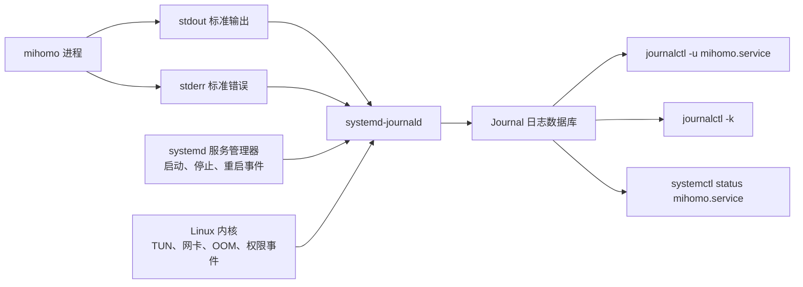
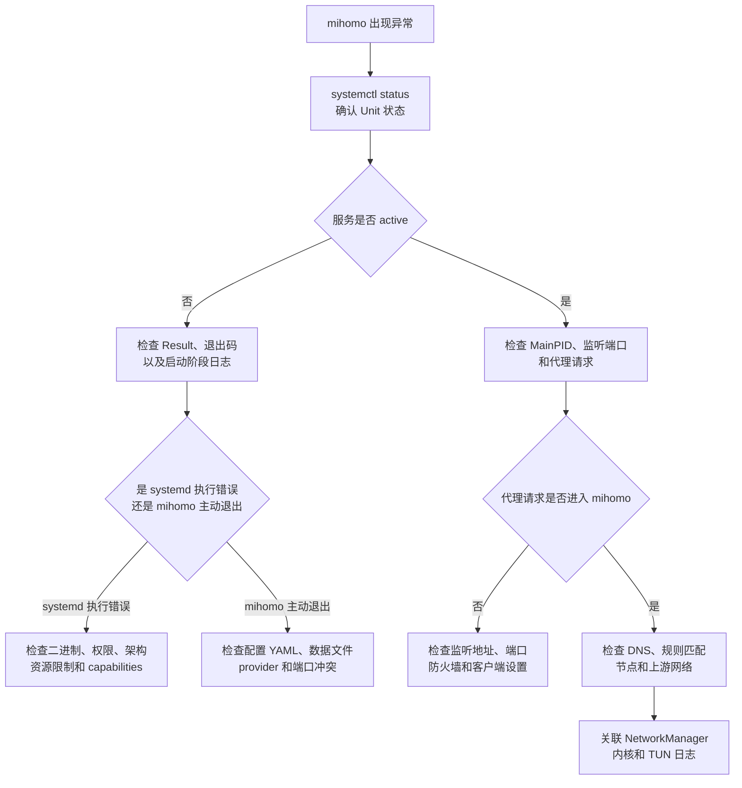

[toc]


## mihomo systemd 服务日志查看与排障指南

重点说明 **mihomo 日志如何进入 journald、常用查看命令、启动失败分析、运行异常分析、TUN/网络故障联查、日志持久化和 Unit 改进方案**。


## mihomo服务配置示例

你提供的配置与 mihomo 官方文档中的示例基本一致。官方也建议使用 `journalctl -u mihomo -o cat -e` 和 `journalctl -u mihomo -o cat -f` 查看日志。([虚空终端](https://wiki.metacubex.one/en/startup/service/))

```ini
[Unit]
Description=mihomo Daemon.
After=network.target NetworkManager.service systemd-networkd.service iwd.service

[Service]
Type=simple
LimitNPROC=500
LimitNOFILE=1000000
CapabilityBoundingSet=CAP_NET_ADMIN CAP_NET_RAW CAP_NET_BIND_SERVICE CAP_SYS_TIME CAP_SYS_PTRACE CAP_DAC_READ_SEARCH CAP_DAC_OVERRIDE
AmbientCapabilities=CAP_NET_ADMIN CAP_NET_RAW CAP_NET_BIND_SERVICE CAP_SYS_TIME CAP_SYS_PTRACE CAP_DAC_READ_SEARCH CAP_DAC_OVERRIDE
Restart=always
ExecStartPre=/usr/bin/sleep 1s
ExecStart="/usr/local/bin/mihomo" -d "/etc/mihomo"
ExecReload=/bin/kill -HUP $MAINPID

[Install]
WantedBy=multi-user.target
```

各项配置对排障的影响如下。

| 配置                             | 实际效果                               | 排障注意点                                                   |
| -------------------------------- | -------------------------------------- | ------------------------------------------------------------ |
| `Type=simple`                    | systemd 创建主进程后很快认为服务已启动 | `active` 不代表 mihomo 已加载完配置或已建立代理连接          |
| `Restart=always`                 | mihomo 退出后通常会被重新启动          | 配置错误可能造成高速重启循环，日志中出现大量重复内容         |
| `ExecStartPre=/usr/bin/sleep 1s` | 每次启动前固定等待 1 秒                | 不能证明网络已经可用，只会延迟启动                           |
| `ExecStart=... -d /etc/mihomo`   | 以 `/etc/mihomo` 作为工作配置目录      | 配置文件、Geo 数据和 provider 路径错误通常会出现在日志中     |
| `ExecReload=...HUP`              | reload 时向主进程发送 `SIGHUP`         | 命令发送成功不一定等于新配置加载成功，仍需查看应用日志       |
| `After=...`                      | 只提供**启动顺序约束**                 | 不会主动启动这些网络服务，也不保证互联网已经可访问           |
| 未配置 `User=`                   | 服务默认以 root 身份运行               | 权限问题可能来自 capability bounding set、内核或安全模块，而不只是文件权限 |
| 未配置输出目标                   | 使用管理器默认输出设置                 | 通常 stdout 和 stderr 都进入 journal                         |


## 日志是怎样产生的

本例服务配置 Unit 没有显式设置：

```ini
StandardOutput=
StandardError=
```

在 systemd 的通常默认配置下：

- 服务标准输出（stdout）连接到 journal
- 标准错误（stderr）继承标准输出，也进入 journal
- systemd 自身产生的启动、停止、重启、超时等事件也进入 journal
- 内核产生的 TUN、网络接口、OOM、网卡驱动等消息进入内核 journal

systemd 默认的 `DefaultStandardOutput=` 是 `journal`，`DefaultStandardError=` 是 `inherit`。因此，mihomo 写到控制台的日志通常会被 `systemd-journald` 自动接收。([自由桌面](https://www.freedesktop.org/software/systemd/man/250/systemd.exec.html))



mihomo 的 `log-level` 控制核心写向控制台和控制页面的日志级别，可设置为：

| 配置值    | 作用                         |
| --------- | ---------------------------- |
| `silent`  | 不输出运行日志               |
| `error`   | 只输出错误                   |
| `warning` | 输出警告和错误               |
| `info`    | 输出一般运行信息、警告和错误 |
| `debug`   | 输出尽可能多的调试信息       |

由于控制台输出会被 systemd 接入 journal，所以 `log-level` 也间接决定了 `journalctl` 能看到多少 mihomo 日志。([虚空终端](https://wiki.metacubex.one/en/config/general/))

------


------

## 启动服务后的第一轮检查

修改 Unit 后先验证语法：

```bash
sudo systemd-analyze verify /etc/systemd/system/mihomo.service
```

重新加载 Unit：

```bash
sudo systemctl daemon-reload
```

启用并启动：

```bash
sudo systemctl enable --now mihomo.service
```

立即查看状态：

```bash
systemctl status mihomo.service --no-pager -l
```

其中：

- `--no-pager`：直接输出，不进入分页器
- `-l`：不要截断过长日志行

`systemctl status` 会同时显示服务状态和最近几条 journal 日志，但它只是状态快照，不是完整日志查看工具。([自由桌面](https://www.freedesktop.org/software/systemd/man/systemctl.html?utm_source=chatgpt.com))

正常情况下可能看到类似以下内容。下面只是格式示意，具体 mihomo 日志文本取决于版本和配置：

```text
● mihomo.service - mihomo Daemon.
     Loaded: loaded (/etc/systemd/system/mihomo.service; enabled)
     Active: active (running) since Fri 2026-07-10 18:20:31 CEST
   Main PID: 2861 (mihomo)
      Tasks: 14
     Memory: 73.5M

Jul 10 18:20:30 host systemd[1]: Starting mihomo.service...
Jul 10 18:20:31 host mihomo[2861]: time="2026-07-10T18:20:31+02:00" level=info msg="Start initial configuration"
Jul 10 18:20:31 host mihomo[2861]: time="2026-07-10T18:20:31+02:00" level=info msg="Initial configuration complete"
Jul 10 18:20:31 host systemd[1]: Started mihomo.service.
```

这里有两类日志：

```text
systemd[1]:
```

表示由 **systemd 服务管理器产生**，例如：

- Starting
- Started
- Stopping
- Stopped
- Main process exited
- Scheduled restart job
- Start request repeated too quickly

```text
mihomo[2861]:
```

表示由 mihomo 进程写向 stdout 或 stderr 的应用日志。

------

## 最常使用的日志命令(journalctl)

### 查看当前启动以来的全部日志

```bash
sudo journalctl -u mihomo.service -b
```

参数含义：

- `-u mihomo.service`：只查看该 Unit
- `-b`：只查看当前系统启动周期（Boot）中的日志

建议增加精确时间和禁止分页：

```bash
sudo journalctl \
  -u mihomo.service \
  -b \
  -o short-iso-precise \
  --no-pager
```

### 查看最近 100 行

```bash
sudo journalctl -u mihomo.service -b -n 100
```

### 从日志末尾开始阅读

```bash
sudo journalctl -u mihomo.service -b -e
```

`-e` 的意思是跳转到日志末尾，不表示只显示错误。

### 实时跟踪日志

```bash
sudo journalctl \
  -u mihomo.service \
  -b \
  -f \
  -o short-iso-precise
```

效果类似 `tail -f`。打开这个终端后，可以在另一个终端产生代理流量，观察实时日志。

例如，假设 HTTP 或 mixed 代理监听在 `127.0.0.1:7890`：

```bash
curl -v \
  -x http://127.0.0.1:7890 \
  https://example.com/
```

实际端口应以本例服务配置 `config.yaml` 为准。

### 查看最近十分钟

```bash
sudo journalctl \
  -u mihomo.service \
  --since "10 minutes ago"
```

### 查看明确时间范围

```bash
sudo journalctl \
  -u mihomo.service \
  --since "2026-07-10 18:00:00" \
  --until "2026-07-10 18:10:00" \
  -o short-iso-precise
```

时间范围特别适合排查：

- 某次断网
- 某次配置 reload
- 某次代理连接失败
- 某次机器休眠或网络切换
- 某个客户端报告异常的时段

`journalctl` 支持组合 `--boot`、`--unit` 等约束，并以逻辑与的方式进一步缩小日志范围。([自由桌面](https://www.freedesktop.org/software/systemd/man/journalctl.html?utm_source=chatgpt.com))

### 查看上一次开机中的 mihomo 日志

```bash
sudo journalctl -u mihomo.service -b -1
```

查看可用的启动记录：

```bash
sudo journalctl --list-boots
```

例如：

```text
-2  7f9b...  Wed 2026-07-08 09:00:11 CEST—Wed 2026-07-08 18:40:22 CEST
-1  ba83...  Thu 2026-07-09 08:51:17 CEST—Thu 2026-07-09 22:10:04 CEST
 0  a3c1...  Fri 2026-07-10 07:42:30 CEST—Fri 2026-07-10 18:30:00 CEST
```

查看指定启动：

```bash
sudo journalctl -u mihomo.service -b -2
```

------

## 输出格式应该怎样选择

### `short-iso-precise`

推荐作为故障分析的默认格式：

```bash
sudo journalctl \
  -u mihomo.service \
  -b \
  -o short-iso-precise
```

示例：

```text
2026-07-10T18:20:31.218143+0200 host mihomo[2861]: ...
```

优点：

- 有完整日期
- 有微秒级时间
- 有时区
- 有主机名
- 有进程名称和 PID

适合和 NetworkManager、内核等其他日志进行时间关联。

### `cat`

只显示消息正文：

```bash
sudo journalctl -u mihomo.service -b -o cat
```

优点是日志干净，适合阅读 mihomo 自身输出。

缺点是会隐藏：

- systemd/journald 时间戳
- 主机名
- 进程名称
- PID
- 部分来源信息

所以：

- 日常查看原始 mihomo 输出可以使用 `-o cat`
- 正式排障不建议一开始就使用 `-o cat`

### `verbose`

查看 journal 的全部结构化字段：

```bash
sudo journalctl \
  -u mihomo.service \
  -b \
  -n 1 \
  -o verbose
```

可能看到：

```text
_BOOT_ID=...
_MACHINE_ID=...
_HOSTNAME=host
_SYSTEMD_UNIT=mihomo.service
_SYSTEMD_INVOCATION_ID=...
_PID=2861
_UID=0
_GID=0
_COMM=mihomo
_EXE=/usr/local/bin/mihomo
PRIORITY=6
MESSAGE=time="..." level=info msg="..."
```

适合判断：

- 日志到底由哪个进程产生
- 日志属于哪一次服务启动
- 日志属于哪个 Unit
- journal 识别出的优先级
- 实际执行文件路径

### `json-pretty`

需要导出给程序分析时：

```bash
sudo journalctl \
  -u mihomo.service \
  -b \
  -o json-pretty
```

用于脚本或日志平台时，一般采用紧凑 JSON：

```bash
sudo journalctl \
  -u mihomo.service \
  -b \
  -o json
```

------

## 不要混淆 mihomo 日志级别与 journal 优先级

这是本案例中非常重要的一点。

mihomo 可能输出：

```text
time="..." level=error msg="connection failed"
```

这里的 `level=error` 是 **mihomo 日志正文中的字段**。

journal 还拥有自己的结构化字段：

```text
PRIORITY=6
```

其中：

| journal 数值 | 名称      |
| ------------ | --------- |
| 0            | `emerg`   |
| 1            | `alert`   |
| 2            | `crit`    |
| 3            | `err`     |
| 4            | `warning` |
| 5            | `notice`  |
| 6            | `info`    |
| 7            | `debug`   |

普通程序把文本写到 stdout 时，systemd 通常会把这些行记录为默认的 `info` 优先级。除非程序使用 journal 原生接口、syslog，或者使用 systemd 能识别的优先级前缀，否则正文中的 `level=error` 不一定会变成 journal 的 `PRIORITY=3`。systemd 对 stdout/stderr 日志的默认 syslog 级别是 `info`。([自由桌面](https://www.freedesktop.org/software/systemd/man/250/systemd.exec.html))

因此，以下命令：

```bash
sudo journalctl -u mihomo.service -p err
```

可能漏掉正文中写着 `level=error` 的 mihomo 日志。

### 按正文搜索错误关键词

现代 journalctl 可以使用 `--grep` 或 `-g`：

```bash
sudo journalctl \
  -u mihomo.service \
  -b \
  -g '(?i)error|failed|fatal|panic|timeout|warning'
```

如果当前 systemd 版本不支持 `-g`，可以使用：

```bash
sudo journalctl \
  -u mihomo.service \
  -b \
  --no-pager |
grep -Ei 'error|failed|fatal|panic|timeout|warning'
```

搜索 mihomo 常见级别：

```bash
sudo journalctl \
  -u mihomo.service \
  -b \
  -o cat |
grep -E 'level=(error|warning)'
```

------

## 临时开启 mihomo debug 日志

找到实际配置文件。通常是：

```text
/etc/mihomo/config.yaml
```

确认当前日志级别：

```bash
grep -n '^[[:space:]]*log-level:' /etc/mihomo/config.yaml
```

临时调整为：

```yaml
log-level: debug
```

然后执行 reload：

```bash
sudo systemctl reload mihomo.service
```

立即观察：

```bash
sudo journalctl \
  -u mihomo.service \
  -f \
  -o short-iso-precise
```

如果 reload 后日志级别没有变化，可执行重启：

```bash
sudo systemctl restart mihomo.service
```

确认重启时间和日志：

```bash
systemctl status mihomo.service --no-pager -l
sudo journalctl -u mihomo.service --since "2 minutes ago"
```

排查结束后，应恢复为：

```yaml
log-level: info
```

原因包括：

- debug 日志数量可能非常大
- 可能明显增加磁盘写入
- 可能包含访问域名、目标 IP、规则名和节点信息
- 大量日志可能触发 journald 的日志速率限制

------

## 区分一次启动中的日志

配置了 `Restart=always` 后，一个系统启动周期内可能存在多次 mihomo 启动。

仅使用：

```bash
journalctl -u mihomo.service -b
```

会把这些启动的日志全部混在一起。

### 查看当前主进程

```bash
systemctl show mihomo.service \
  -p MainPID \
  -p ActiveEnterTimestamp \
  -p NRestarts
```

只输出 PID：

```bash
systemctl show \
  mihomo.service \
  -p MainPID \
  --value
```

### 按当前 PID 查看

```bash
pid="$(systemctl show mihomo.service -p MainPID --value)"

sudo journalctl _PID="$pid"
```

按 PID 查询存在局限：

- 不包含 systemd 管理器产生的启动和停止日志
- 不包含旧进程的日志
- 可能漏掉 mihomo 创建的辅助子进程
- PID 在系统运行期间可能被重复使用

因此通常优先使用 `-u mihomo.service`。

### 按 Invocation ID 查看当前这一次启动

systemd 会为每次 Unit 调用生成调用标识（Invocation ID）。

查看：

```bash
systemctl show \
  mihomo.service \
  -p InvocationID \
  --value
```

查看当前这一次启动产生的日志：

```bash
invocation_id="$(
  systemctl show mihomo.service -p InvocationID --value
)"

sudo journalctl \
  _SYSTEMD_INVOCATION_ID="$invocation_id" \
  -o short-iso-precise
```

这比按 PID 查询更适合分析：

- 本次启动加载配置的全过程
- 当前实例产生的全部日志
- 服务重启前后日志的边界

------

## 标准排障流程



### 收集服务状态字段

```bash
systemctl show mihomo.service \
  -p LoadState \
  -p ActiveState \
  -p SubState \
  -p Result \
  -p MainPID \
  -p ExecMainCode \
  -p ExecMainStatus \
  -p NRestarts \
  -p Restart
```

常见含义：

| 字段             | 说明                                       |
| ---------------- | ------------------------------------------ |
| `LoadState`      | Unit 文件是否成功加载                      |
| `ActiveState`    | 总体状态，例如 `active`、`failed`          |
| `SubState`       | 更细的状态，例如 `running`、`auto-restart` |
| `Result`         | 最近一次失败结果                           |
| `MainPID`        | 当前主进程 PID                             |
| `ExecMainCode`   | 主进程是正常退出还是被信号终止             |
| `ExecMainStatus` | 退出码或信号编号                           |
| `NRestarts`      | systemd 自动重启次数                       |
| `Restart`        | 当前重启策略                               |

------

## 案例：二进制文件无法执行

可能看到：

```text
mihomo.service: Main process exited, code=exited, status=203/EXEC
mihomo.service: Failed with result 'exit-code'.
```

`203/EXEC` 表示 systemd 在执行目标程序时失败，常见原因是文件不存在、不可访问或不能被内核执行。([自由桌面](https://www.freedesktop.org/software/systemd/man/250/systemd.exec.html))

依次检查：

```bash
ls -l /usr/local/bin/mihomo
namei -l /usr/local/bin/mihomo
file /usr/local/bin/mihomo
/usr/local/bin/mihomo -v
```

可能原因包括：

- 文件不存在
- 没有执行权限
- 上级目录没有执行权限
- 下载的是错误 CPU 架构
- 二进制损坏
- 文件实际上是压缩包
- 动态链接程序或共享库不存在
- SELinux 或 AppArmor 阻止执行

增加执行权限：

```bash
sudo chmod 0755 /usr/local/bin/mihomo
```

查看动态链接依赖，仅适用于动态链接程序：

```bash
ldd /usr/local/bin/mihomo
```

如果 `file` 显示：

```text
aarch64
```

而系统是：

```text
x86-64
```

就需要重新下载正确架构的 mihomo。

------

## 案例：配置错误造成不断重启

因为当前设置了：

```ini
Restart=always
```

如果 mihomo 读取配置后立即退出，systemd 会不断重新启动它。

可能看到：

```text
mihomo[3100]: level=fatal msg="Parse config error..."
systemd[1]: mihomo.service: Main process exited, code=exited, status=1/FAILURE
systemd[1]: mihomo.service: Failed with result 'exit-code'.
systemd[1]: mihomo.service: Scheduled restart job, restart counter is at 8.
```

先查看重启次数：

```bash
systemctl show mihomo.service -p NRestarts
```

查看最近五分钟：

```bash
sudo journalctl \
  -u mihomo.service \
  --since "5 minutes ago" \
  -o short-iso-precise
```

为了避免日志被重启循环淹没，可以先停止服务：

```bash
sudo systemctl stop mihomo.service
```

然后在前台手工运行：

```bash
sudo /usr/local/bin/mihomo -d /etc/mihomo
```

前台运行的优点：

- 错误直接显示在终端
- 不会被自动重启打断
- 容易看到最早出现的配置错误
- 可以区分 systemd 问题与 mihomo 配置问题

处理完成后按 `Ctrl+C` 退出，再启动服务：

```bash
sudo systemctl reset-failed mihomo.service
sudo systemctl start mihomo.service
```

重新检查：

```bash
systemctl status mihomo.service --no-pager -l
sudo journalctl -u mihomo.service --since "2 minutes ago"
```

### 配置错误重点检查

```bash
find /etc/mihomo -maxdepth 2 -type f -printf '%M %u:%g %p\n'
```

主要检查：

- `config.yaml` 是否存在
- YAML 缩进是否正确
- provider 文件路径是否正确
- GeoIP、GeoSite 或 MMDB 数据是否存在
- 外部 UI 目录是否存在
- 监听端口是否冲突
- 配置引用文件是否可读
- 配置中的网络接口名称是否存在

------

## 案例：服务 active，但看不到 mihomo 日志

首先检查服务是否确实在运行：

```bash
systemctl is-active mihomo.service
systemctl show mihomo.service \
  -p MainPID \
  -p ExecStart \
  -p StandardOutput \
  -p StandardError
```

确认主进程：

```bash
ps -fp "$(
  systemctl show mihomo.service -p MainPID --value
)"
```

可能原因如下。

### `log-level` 设置为 silent

检查：

```bash
grep -Rni \
  '^[[:space:]]*log-level:' \
  /etc/mihomo
```

如果是：

```yaml
log-level: silent
```

则 mihomo 不会输出常规运行日志。

### 没有产生新流量

mihomo 在空闲时不一定持续输出日志。

打开实时日志：

```bash
sudo journalctl -fu mihomo.service
```

然后通过代理执行请求：

```bash
curl -v \
  -x http://127.0.0.1:7890 \
  https://example.com/
```

### journald 自身异常

检查：

```bash
systemctl status systemd-journald.service --no-pager -l
```

检查最近日志：

```bash
sudo journalctl \
  -u systemd-journald.service \
  -b \
  -n 100
```

检查 journal 文件：

```bash
sudo journalctl --verify
```

### 当前用户没有读取权限

普通用户可能只能读取自己的日志。

直接使用：

```bash
sudo journalctl -u mihomo.service
```

如果 `sudo` 可以看到而普通用户看不到，就是 journal 权限问题，而不是 mihomo 没有产生日志。

------

## 案例：mihomo 正在运行，但代理不可用

此时不能只看 `Active: active (running)`。

`active` 只说明主进程仍存在，不保证：

- 代理端口已经监听
- DNS 能正常解析
- TUN 接口建立成功
- 规则加载成功
- 代理节点能够连接
- 网络路由已经正确设置

### 检查进程

```bash
systemctl is-active mihomo.service
systemctl show mihomo.service -p MainPID -p NRestarts
```

### 检查监听端口

```bash
sudo ss -lntup |
grep -i mihomo
```

也可以查看所有相关端口：

```bash
sudo ss -lnup |
grep -E 'mihomo|:53|:1053|:7890|:7891|:9090'
```

端口数字只是示例，实际应以配置为准。

如果 mihomo 日志声称监听成功，但 `ss` 看不到端口，应检查：

- 配置是否加载了预期文件
- 监听地址是否为 IPv4 或 IPv6
- 端口是否被其他程序占用
- mihomo 是否在日志输出后又退出
- 配置 reload 是否失败

检查端口占用：

```bash
sudo ss -lntup
sudo lsof -nP -iTCP:7890 -sTCP:LISTEN
```

### 直接测试 HTTP 代理

```bash
curl -v \
  --connect-timeout 10 \
  -x http://127.0.0.1:7890 \
  https://example.com/
```

观察实时日志：

```bash
sudo journalctl \
  -fu mihomo.service \
  -o short-iso-precise
```

根据现象判断：

| curl 现象              | 排查方向                               |
| ---------------------- | -------------------------------------- |
| `Connection refused`   | 端口未监听、地址错误或进程退出         |
| 连接超时               | 防火墙、监听地址、网络栈问题           |
| 代理握手成功但目标超时 | 节点、DNS、上游网络或路由问题          |
| 返回认证错误           | mihomo authentication 配置             |
| TLS 证书错误           | 目标站点、系统时间、中间代理或证书问题 |

### 测试 SOCKS5 代理

假设 SOCKS5 监听在 `127.0.0.1:7891`：

```bash
curl -v \
  --socks5-hostname 127.0.0.1:7891 \
  https://example.com/
```

`--socks5-hostname` 使域名通过 SOCKS5 端进行解析，有助于区分本机 DNS 和 mihomo 代理链路问题。

### 检查 DNS

检查系统 DNS：

```bash
getent ahosts example.com
```

如果 mihomo DNS 监听在本地 UDP 1053：

```bash
dig @127.0.0.1 \
  -p 1053 \
  example.com
```

同时查看日志：

```bash
sudo journalctl \
  -u mihomo.service \
  --since "1 minute ago" \
  -o short-iso-precise
```

------

## 案例：TUN 模式无法建立

TUN 问题往往同时涉及：

- mihomo 应用日志
- Linux 内核日志
- 网络接口
- 路由表
- 策略路由
- nftables 或 iptables
- Linux capabilities

### 查看 mihomo 日志

```bash
sudo journalctl \
  -u mihomo.service \
  -b \
  -g '(?i)tun|route|permission|operation not permitted|interface'
```

### 查看内核日志

```bash
sudo journalctl \
  -k \
  -b \
  -o short-iso-precise
```

按关键词过滤：

```bash
sudo journalctl \
  -k \
  -b \
  -g '(?i)tun|mihomo|netlink|nft|route|denied'
```

### 检查 TUN 设备

```bash
ls -l /dev/net/tun
ip -details link show
ip address show
```

### 检查路由和策略路由

```bash
ip rule show
ip route show table all
ip -6 rule show
ip -6 route show table all
```

### 检查 nftables

```bash
sudo nft list ruleset
```

如果系统使用 iptables：

```bash
sudo iptables-save
```

### 检查 capabilities

当前 Unit 的 capability 设置：

```bash
systemctl show mihomo.service \
  -p CapabilityBoundingSet \
  -p AmbientCapabilities
```

如果 systemd 无法设置 capabilities，可能出现：

```text
status=218/CAPABILITIES
```

`218/CAPABILITIES` 表示 systemd 在放弃或应用 ambient capabilities 的阶段失败。([自由桌面](https://www.freedesktop.org/software/systemd/man/250/systemd.exec.html))

如果 systemd 成功启动进程，但 mihomo 日志显示：

```text
operation not permitted
```

更可能是：

- 缺少具体 capability
- 内核拒绝某个网络操作
- 安全模块阻止访问
- 容器环境不允许创建 TUN
- `/dev/net/tun` 不存在或不可访问
- capability bounding set 移除了所需权限

查看 SELinux 状态：

```bash
getenforce
```

查看 AppArmor 状态：

```bash
sudo aa-status
```

检查内核审计日志：

```bash
sudo journalctl \
  -k \
  -b \
  -g '(?i)avc|apparmor|denied'
```

------

## 联合查看 mihomo 和网络管理器日志

本例服务配置 Unit 同时列出了：

```ini
After=network.target NetworkManager.service systemd-networkd.service iwd.service
```

系统通常不会同时使用 NetworkManager 和 systemd-networkd 作为主要网络管理器。先确认正在使用哪一个：

```bash
systemctl is-active NetworkManager.service
systemctl is-active systemd-networkd.service
systemctl is-active iwd.service
```

假设使用 NetworkManager，可以把两个 Unit 的日志按时间交错显示：

```bash
sudo journalctl \
  -b \
  -u mihomo.service \
  -u NetworkManager.service \
  --since "10 minutes ago" \
  -o short-iso-precise
```

使用 systemd-networkd：

```bash
sudo journalctl \
  -b \
  -u mihomo.service \
  -u systemd-networkd.service \
  --since "10 minutes ago" \
  -o short-iso-precise
```

无线网络使用 iwd 时：

```bash
sudo journalctl \
  -b \
  -u mihomo.service \
  -u iwd.service \
  --since "10 minutes ago" \
  -o short-iso-precise
```

这样可以分析以下时间关系：

```text
18:01:03 Wi-Fi 断开
18:01:04 mihomo 节点连接失败
18:01:08 Wi-Fi 重新关联
18:01:10 DHCP 获得地址
18:01:11 mihomo 重新建立连接
```

### `After=` 不表示网络已经可用

当前配置中的：

```ini
After=network.target
```

只表示当两个作业都被加入启动事务时，mihomo 的启动顺序排在其后。

它不保证：

- DHCP 已经完成
- DNS 已经可用
- 默认路由已经建立
- Wi-Fi 已经关联
- 互联网已经连通

mihomo 这类长期运行的网络程序通常应当能够处理：

- 启动时暂时没有网络
- 网络切换
- Wi-Fi 重连
- IP 地址变化
- DNS 暂时失败
- 节点临时不可达

固定等待：

```ini
ExecStartPre=/usr/bin/sleep 1s
```

并不能可靠解决这些问题。

------

## 案例：reload 后配置没有生效

打开一个终端实时观察：

```bash
sudo journalctl \
  -fu mihomo.service \
  -o short-iso-precise
```

另一个终端执行：

```bash
sudo systemctl reload mihomo.service
```

随后查看状态：

```bash
systemctl status mihomo.service --no-pager -l
```

查看 reload 前后一分钟：

```bash
sudo journalctl \
  -u mihomo.service \
  --since "1 minute ago" \
  -o short-iso-precise
```

当前配置：

```ini
ExecReload=/bin/kill -HUP $MAINPID
```

`/bin/kill` 成功返回只表示信号发送成功，不能单独证明：

- mihomo 收到了信号后成功解析配置
- provider 加载成功
- 端口重新绑定成功
- 新规则已经投入使用

最终判断必须结合 mihomo 的 reload 日志。

查看当前 `ExecReload`：

```bash
systemctl show mihomo.service -p ExecReload
```

如果 reload 失败，可以直接重启：

```bash
sudo systemctl restart mihomo.service
```

但重启会中断当前连接，应根据实际环境评估。

------

## 案例：服务崩溃或被信号终止

查看最近状态：

```bash
systemctl status mihomo.service --no-pager -l
```

查看结构化结果：

```bash
systemctl show mihomo.service \
  -p Result \
  -p ExecMainCode \
  -p ExecMainStatus \
  -p NRestarts
```

可能看到：

```text
ExecMainCode=exited
ExecMainStatus=1
Result=exit-code
```

表示进程自行返回非零退出码。

或者：

```text
ExecMainCode=killed
ExecMainStatus=9
Result=signal
```

表示进程被信号终止。

查看终止前的日志：

```bash
sudo journalctl \
  -u mihomo.service \
  -b \
  -n 300 \
  -o short-iso-precise
```

### 检查内存不足 OOM

```bash
sudo journalctl \
  -k \
  -b \
  -g '(?i)out of memory|oom|killed process'
```

查看系统服务相关 OOM 信息：

```bash
sudo journalctl \
  -b \
  -g '(?i)oom-kill|memory pressure|killed process'
```

如果日志中出现：

```text
Killed process 2861 (mihomo)
```

说明可能是内核 OOM killer 终止了进程，而不是 mihomo 主动退出。

### 检查核心转储

```bash
coredumpctl list mihomo
```

查看最近一次：

```bash
sudo coredumpctl info mihomo
```

进入调试器：

```bash
sudo coredumpctl debug mihomo
```

是否能获得核心转储取决于：

- systemd-coredump 是否启用
- `LimitCORE=`
- 内核 core pattern
- 发行版配置
- 存储空间限制

------

## 常见 systemd 专用退出码

systemd 在执行应用程序之前，还需要设置工作目录、资源限制、用户、capabilities 和命名空间。任何步骤失败，都可能产生 `200` 以上的 systemd 专用退出码。([自由桌面](https://www.freedesktop.org/software/systemd/man/250/systemd.exec.html))

| 状态                  | 名称                   | 在 mihomo 案例中的常见含义                   |
| --------------------- | ---------------------- | -------------------------------------------- |
| `200/CHDIR`           | `EXIT_CHDIR`           | `WorkingDirectory=` 不存在，当前 Unit 未设置 |
| `203/EXEC`            | `EXIT_EXEC`            | mihomo 文件不存在、不可执行或架构错误        |
| `205/LIMITS`          | `EXIT_LIMITS`          | `LimitNPROC`、`LimitNOFILE` 等设置失败       |
| `209/STDOUT`          | `EXIT_STDOUT`          | 无法建立标准输出目标                         |
| `216/GROUP`           | `EXIT_GROUP`           | 无法设置服务组                               |
| `217/USER`            | `EXIT_USER`            | `User=` 不存在或无法切换身份                 |
| `218/CAPABILITIES`    | `EXIT_CAPABILITIES`    | capability 设置失败                          |
| `219/CGROUP`          | `EXIT_CGROUP`          | 无法创建或配置服务 cgroup                    |
| `222/STDERR`          | `EXIT_STDERR`          | 无法建立标准错误目标                         |
| `225/NETWORK`         | `EXIT_NETWORK`         | 网络命名空间设置失败                         |
| `226/NAMESPACE`       | `EXIT_NAMESPACE`       | 文件系统、UTS 或 IPC 命名空间失败            |
| `228/SECCOMP`         | `EXIT_SECCOMP`         | 系统调用过滤器设置失败                       |
| `229/SELINUX_CONTEXT` | `EXIT_SELINUX_CONTEXT` | SELinux 上下文切换失败                       |

普通的：

```text
status=1/FAILURE
```

一般意味着 mihomo 已经成功执行，但由 mihomo 自己返回了退出码 1。此时应重点检查应用日志，而不是二进制执行权限。

------

## 处理高速重启循环

本例服务配置配置使用：

```ini
Restart=always
```

建议至少配置重启间隔：

```ini
RestartSec=3s
```

同时加入启动速率限制：

```ini
[Unit]
StartLimitIntervalSec=60s
StartLimitBurst=5
```

含义是：

- 60 秒时间窗口
- 最多允许一定次数启动尝试
- 超过限制后停止继续重启
- 避免配置错误造成 CPU 和日志风暴

触发限制后可能看到：

```text
mihomo.service: Start request repeated too quickly.
mihomo.service: Failed with result 'start-limit-hit'.
```

修复问题后：

```bash
sudo systemctl reset-failed mihomo.service
sudo systemctl start mihomo.service
```

对长期运行的服务，通常更推荐：

```ini
Restart=on-failure
RestartSec=3s
```

这样正常退出时不会自动启动。

如果本例服务配置明确需求是“即使 mihomo 正常退出也必须重新拉起”，则可以继续使用：

```ini
Restart=always
```

手工执行：

```bash
sudo systemctl stop mihomo.service
```

属于 systemd 主动停止服务，通常不会因为 `Restart=always` 而立刻重新启动。

------

## 日志被限速时怎么办

开启 `debug` 后可能看到：

```text
Suppressed 1250 messages from mihomo.service
```

这表示日志产生速度超过了 journald 或 Unit 的速率限制，并不代表 mihomo 只产生了当前可见的日志。

systemd 支持为单个服务设置：

```ini
LogRateLimitIntervalSec=
LogRateLimitBurst=
```

单个服务的设置会覆盖 journald 的全局限制。([自由桌面](https://www.freedesktop.org/software/systemd/man/systemd.exec.html?utm_source=chatgpt.com))

临时调试可创建 drop-in：

```bash
sudo systemctl edit mihomo.service
```

写入：

```ini
[Service]
LogRateLimitIntervalSec=30s
LogRateLimitBurst=20000
```

应用：

```bash
sudo systemctl daemon-reload
sudo systemctl restart mihomo.service
```

排障完成后应删除或降低该设置：

```bash
sudo systemctl revert mihomo.service
```

注意：`systemctl revert` 会删除该 Unit 的全部管理员覆盖配置。如果 drop-in 中还有其他重要修改，应手工编辑，而不是直接执行 revert。

查看 drop-in：

```bash
systemctl cat mihomo.service
```

不要长期开启无限制 debug 日志，否则可能：

- 占满 journal 空间
- 增加磁盘写入
- 干扰其他服务日志
- 泄露访问目标和网络拓扑
- 降低系统性能

------

## 确保日志重启后仍然存在

先查看 journal 占用：

```bash
sudo journalctl --disk-usage
```

检查日志目录：

```bash
ls -ld \
  /run/log/journal \
  /var/log/journal
```

一般而言：

- `/run/log/journal`：易失日志，重启后丢失
- `/var/log/journal`：持久日志，可跨重启查询

实际行为还取决于发行版和 `journald.conf`。

创建持久化配置：

```bash
sudo mkdir -p /etc/systemd/journald.conf.d
sudo editor /etc/systemd/journald.conf.d/10-persistent.conf
```

内容：

```ini
[Journal]
Storage=persistent
SystemMaxUse=1G
SystemKeepFree=500M
```

应用：

```bash
sudo systemctl restart systemd-journald.service
sudo journalctl --flush
```

再次检查：

```bash
sudo journalctl --list-boots
```

journal 是结构化、带索引的日志存储，除了消息文本，还保存 Unit、进程、启动 ID、调用 ID 等元数据。([自由桌面](https://www.freedesktop.org/software/systemd/man/systemd-journald.service.html?utm_source=chatgpt.com))

### 清理日志

查看空间：

```bash
sudo journalctl --disk-usage
```

只保留最近 14 天：

```bash
sudo journalctl --vacuum-time=14d
```

限制现有归档日志总量：

```bash
sudo journalctl --vacuum-size=1G
```

长期限制应通过 `journald.conf` 配置，而不是每天手工清理。

------

## 更适合排障的 mihomo Unit

下面是保留原有权限设计、同时改善日志可读性和失败行为的版本：

```ini
[Unit]
Description=mihomo Daemon.
After=network.target

StartLimitIntervalSec=60s
StartLimitBurst=5

[Service]
Type=exec

TasksMax=500
LimitNOFILE=1000000

CapabilityBoundingSet=CAP_NET_ADMIN CAP_NET_RAW CAP_NET_BIND_SERVICE CAP_SYS_TIME CAP_SYS_PTRACE CAP_DAC_READ_SEARCH CAP_DAC_OVERRIDE
AmbientCapabilities=CAP_NET_ADMIN CAP_NET_RAW CAP_NET_BIND_SERVICE CAP_SYS_TIME CAP_SYS_PTRACE CAP_DAC_READ_SEARCH CAP_DAC_OVERRIDE

ExecStart=/usr/local/bin/mihomo -d /etc/mihomo
ExecReload=/bin/kill -HUP $MAINPID

Restart=on-failure
RestartSec=3s
TimeoutStopSec=20s

StandardOutput=journal
StandardError=journal
SyslogIdentifier=mihomo

[Install]
WantedBy=multi-user.target
```

### 主要调整

#### 使用 `Type=exec`

```ini
Type=exec
```

与 `simple` 相比，`exec` 会至少等到目标二进制成功执行后，再推进服务启动状态。这样程序不存在、没有执行权限等错误更容易在启动作业中准确反映。

非常旧的 systemd 版本可能不支持 `Type=exec`，可通过以下命令确认系统版本：

```bash
systemd --version
```

#### 删除固定 sleep

删除：

```ini
ExecStartPre=/usr/bin/sleep 1s
```

它不能证明网络就绪，也不能解决网络动态变化。

#### 显式声明日志目标

```ini
StandardOutput=journal
StandardError=journal
SyslogIdentifier=mihomo
```

尽管通常已经是默认行为，显式设置可让 Unit 的意图更清晰，也避免系统级默认配置改变后的差异。

#### 使用 `TasksMax`

```ini
TasksMax=500
```

`LimitNPROC=` 是按用户身份统计的进程限制，同一用户运行的多个服务可能互相影响。systemd 官方文档通常建议使用按服务 cgroup 生效的 `TasksMax=`。([自由桌面](https://www.freedesktop.org/software/systemd/man/250/systemd.exec.html))

#### 重启增加退避

```ini
Restart=on-failure
RestartSec=3s
```

避免配置错误时无间隔重启。

### 关于 `LimitNOFILE=1000000`

这是非常高的文件描述符限制。systemd 文档提醒，某些仍使用 `select()` 的程序不能正确处理大于 1023 的文件描述符编号；现代程序一般会使用 `epoll` 等接口，但仍应根据 mihomo 的实际连接规模确定合理值。([自由桌面](https://www.freedesktop.org/software/systemd/man/250/systemd.exec.html))

查看实际限制：

```bash
pid="$(systemctl show mihomo.service -p MainPID --value)"

grep -i 'open files' "/proc/$pid/limits"
```

查看当前文件描述符数量：

```bash
sudo ls "/proc/$pid/fd" |
wc -l
```

### 关于 capability 列表

当前列表权限较广，特别是：

```text
CAP_SYS_TIME
CAP_SYS_PTRACE
CAP_DAC_READ_SEARCH
CAP_DAC_OVERRIDE
```

是否必要取决于实际功能和部署方式。推荐做法不是一次性删除，而是：

1. 记录现有正常功能。
2. 一次移除一个 capability。
3. 重启并测试 TUN、DNS、代理端口和规则更新。
4. 检查应用与内核日志。
5. 最终只保留确实需要的权限。

------

## 应用修改后的操作

编辑 Unit：

```bash
sudo editor /etc/systemd/system/mihomo.service
```

验证：

```bash
sudo systemd-analyze verify \
  /etc/systemd/system/mihomo.service
```

加载：

```bash
sudo systemctl daemon-reload
```

重启：

```bash
sudo systemctl restart mihomo.service
```

检查最终生效的配置：

```bash
systemctl cat mihomo.service
```

检查启动：

```bash
systemctl status mihomo.service --no-pager -l
```

查看本次启动日志：

```bash
invocation_id="$(
  systemctl show mihomo.service -p InvocationID --value
)"

sudo journalctl \
  _SYSTEMD_INVOCATION_ID="$invocation_id" \
  -o short-iso-precise
```

------

## 故障日志导出方案

排查偶发故障时，可以把相关数据导出到一个目录：

```bash
incident_dir="$HOME/mihomo-incident-$(date +%Y%m%d-%H%M%S)"
mkdir -p "$incident_dir"
```

导出 Unit 文件：

```bash
systemctl cat mihomo.service \
  > "$incident_dir/mihomo-unit.txt"
```

导出状态：

```bash
systemctl status \
  mihomo.service \
  --no-pager \
  -l \
  > "$incident_dir/mihomo-status.txt"
```

导出属性：

```bash
systemctl show mihomo.service \
  > "$incident_dir/mihomo-properties.txt"
```

导出最近一小时服务日志：

```bash
sudo journalctl \
  -u mihomo.service \
  --since "1 hour ago" \
  -o short-iso-precise \
  --no-pager \
  > "$incident_dir/mihomo-journal.txt"
```

导出内核日志：

```bash
sudo journalctl \
  -k \
  --since "1 hour ago" \
  -o short-iso-precise \
  --no-pager \
  > "$incident_dir/kernel-journal.txt"
```

导出网络状态：

```bash
ip address show \
  > "$incident_dir/ip-address.txt"

ip rule show \
  > "$incident_dir/ip-rule.txt"

ip route show table all \
  > "$incident_dir/ip-route.txt"

sudo ss -lntup \
  > "$incident_dir/listening-ports.txt"
```

打包：

```bash
tar -C "$(dirname "$incident_dir")" \
  -czf "${incident_dir}.tar.gz" \
  "$(basename "$incident_dir")"
```

对外发送前应检查和脱敏：

- 代理节点名称
- 服务器地址和 IP
- 访问域名
- API secret
- provider 下载地址
- 认证用户名和密码
- 订阅链接
- 本机公网或内网地址
- 配置路径中的用户名

------

## 最短排障命令集

服务无法启动：

```bash
systemctl status mihomo.service --no-pager -l

sudo journalctl \
  -u mihomo.service \
  -b \
  -n 200 \
  -o short-iso-precise

systemctl show mihomo.service \
  -p Result \
  -p ExecMainCode \
  -p ExecMainStatus \
  -p NRestarts
```

服务运行但代理不可用：

```bash
sudo journalctl \
  -fu mihomo.service \
  -o short-iso-precise
sudo ss -lntup |
grep -i mihomo
curl -v \
  -x http://127.0.0.1:7890 \
  https://example.com/
```

TUN 或路由异常：

```bash
sudo journalctl \
  -u mihomo.service \
  -k \
  -b \
  --since "10 minutes ago" \
  -o short-iso-precise
ip -details link show
ip rule show
ip route show table all
sudo nft list ruleset
```

偶发断网：

```bash
sudo journalctl \
  -b \
  -u mihomo.service \
  -u NetworkManager.service \
  --since "30 minutes ago" \
  -o short-iso-precise
```

查看上次开机：

```bash
sudo journalctl \
  -u mihomo.service \
  -b -1 \
  -o short-iso-precise
```

------

## 核心排障原则

不要只看：

```text
Active: active (running)
```

完整判断至少需要检查四层：

| 层次       | 需要确认的内容                                              |
| ---------- | ----------------------------------------------------------- |
| systemd 层 | Unit 是否正确加载，主进程是否退出，是否发生重启循环         |
| 进程层     | mihomo 主进程是否存在，资源限制和 capabilities 是否成功应用 |
| 应用层     | 配置是否加载，端口是否监听，规则、DNS 和 provider 是否正常  |
| 系统网络层 | TUN、路由、策略路由、nftables、网卡和 DNS 是否正常          |

推荐的实际顺序是：

```text
systemctl status
    -> journalctl -u
    -> systemctl show
    -> 检查监听端口
    -> 主动发起代理请求
    -> 联查内核和网络管理器日志
```

最重要的三个认识是：

> `systemctl status` 只提供状态和少量最近日志，不等于完整日志。

> mihomo 日志正文中的 `level=error`，不一定对应 journal 的错误优先级。

> 服务处于 `active` 状态，只能证明进程存在，不能证明代理链路、DNS、TUN 和上游节点正常。

将实际故障时的 `systemctl status mihomo -l` 和 `journalctl -u mihomo -b -n 200` 输出贴出后，可以按上述层次直接定位到 Unit、权限、配置、DNS、TUN 或上游网络中的具体一层。