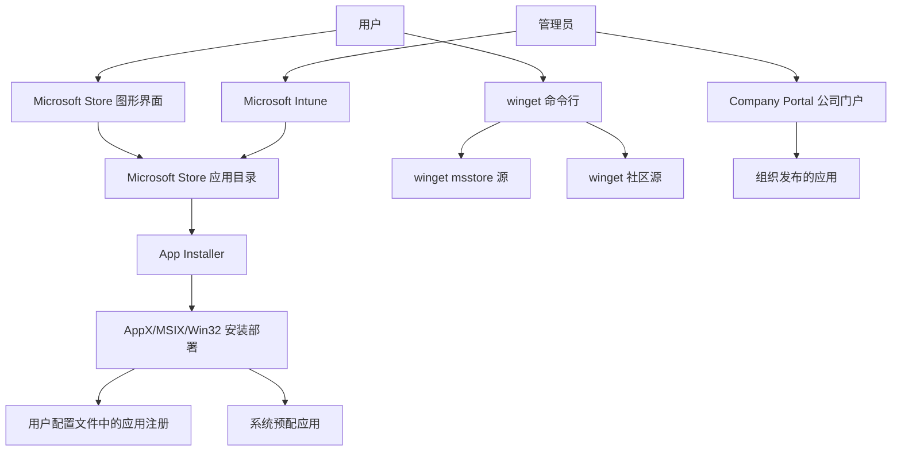
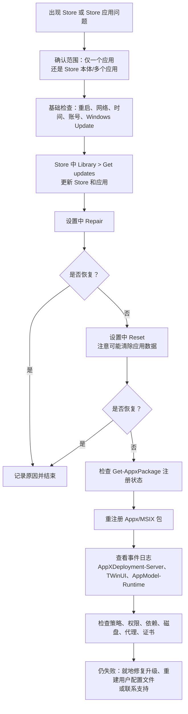
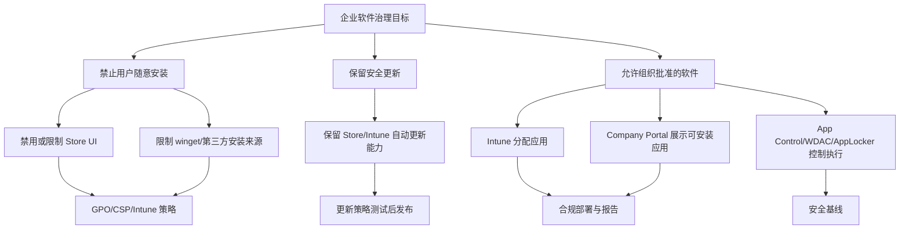

[toc]


## 适用范围与阅读定位

这里的“Windows 应用商店”通常指 **Microsoft Store**：Windows 10/Windows 11 上用于发现、安装、更新、购买和管理应用、游戏、系统组件扩展的官方分发入口。本文以 **Windows 11** 和现代 Microsoft Store 机制为主，兼顾 Windows 10。需要注意的是，微软已明确说明 Windows 10 在 **2025 年 10 月 14 日** 后不再获得免费安全更新、技术帮助和安全修复，因此新环境应优先面向 Windows 11 规划。([微软支持](https://support.microsoft.com/en-us/windows/repair-apps-and-programs-in-windows-e90eefe4-d0a2-7c1b-dd59-949a9030f317))

------

## 详细大纲

| 模块     | 学习目标                    | 你会掌握什么                                                 |
| -------- | --------------------------- | ------------------------------------------------------------ |
| 基本概念 | 认识 Microsoft Store 的定位 | Store、UWP、MSIX、Win32、App Installer、winget 的关系        |
| 系统结构 | 理解 Store 背后的工作机制   | 安装、更新、许可、用户注册、包部署、企业管理链路             |
| 应用类型 | 分清不同安装包和管理方式    | UWP、MSIX、APPX、Win32 `.exe/.msi`、系统内置应用             |
| 更新机制 | 知道应用如何保持最新        | Store 自动更新、手动更新、Intune 管理更新、winget 更新       |
| 常见故障 | 能判断问题属于哪一层        | 网络、账号、缓存、服务、策略、包损坏、权限、许可、依赖       |
| 排查方法 | 建立从轻到重的排查流程      | 重启、更新、修复、重置、清缓存、重注册、日志、PowerShell     |
| 禁用方法 | 安全地限制 Store 使用       | 个人设备、组策略、CSP、Intune、私有应用库、企业白名单        |
| 卸载方法 | 知道哪些能卸，哪些不该卸    | 普通 Store 应用、预配应用、所有用户应用、Microsoft Store 本体 |
| 最佳实践 | 面向新手和管理员落地        | 更新策略、安全边界、企业部署、回滚与备份、避免误删           |

------

## 核心结论先行

Microsoft Store 不只是一个“下载软件的商店”。在现代 Windows 中，它同时承担 **应用分发、更新、许可、系统内置应用维护、MSIX/AppX 包部署、部分 Win32 应用获取、企业应用管理入口** 等角色。微软文档显示，Microsoft Store 现在支持 UWP 应用、`.msix` 打包的桌面应用，以及通过 `.exe` 或 `.msi` 安装器发布的 Win32 应用；在 Intune 中，管理员还能浏览、部署和监控这些 Store 应用。([Microsoft Learn](https://learn.microsoft.com/en-us/intune/app-management/deployment/add-microsoft-store))

因此，**不建议把 Microsoft Store 简单理解为“可删的普通应用”**。微软面向 IT 专业人员的排障文档明确警告：移除 Microsoft Store App **不受支持**；普通 Appx 包可以用 PowerShell 移除，但 Microsoft Store 本体不应作为常规卸载对象处理。([Microsoft Learn](https://learn.microsoft.com/en-us/troubleshoot/windows-client/shell-experience/modern-inbox-store-apps-troubleshooting-guidance))

------

## Microsoft Store 是什么

Microsoft Store 是 Windows 上的官方应用分发与更新平台。它的核心价值不是“界面好不好看”，而是提供相对统一的 **来源、签名、许可、更新、卸载、企业部署** 机制。

| 维度         | 说明                                             |
| ------------ | ------------------------------------------------ |
| 面向普通用户 | 搜索、安装、更新应用和游戏                       |
| 面向系统组件 | 更新部分内置应用、运行库、App Installer 等组件   |
| 面向开发者   | 分发 UWP、MSIX、部分 Win32 应用                  |
| 面向企业     | 结合 Intune、Company Portal、winget 管理应用     |
| 面向安全     | 通过签名、来源、包管理、自动更新降低软件分发风险 |

App Installer 是 Store 生态中的重要组件。微软文档说明，App Installer 随 Windows 提供，用于安装 MSIX 和 MSIXBundle；在 Windows 桌面版本中，它会通过 Microsoft Store 更新。([Microsoft Learn](https://learn.microsoft.com/en-us/windows/msix/app-installer/install-update-app-installer)) WinGet 也与 App Installer 关系密切：微软文档说明 WinGet 在 Windows 11、现代 Windows 10 和 Windows Server 2025 中作为 App Installer 的一部分提供，能在命令行中发现、安装、升级、移除和配置应用。([Microsoft Learn](https://learn.microsoft.com/en-us/windows/package-manager/winget/))

------

## 名称演变与常见混淆

| 名称                                     | 常见含义               | 说明                                                       |
| ---------------------------------------- | ---------------------- | ---------------------------------------------------------- |
| Windows Store                            | 早期常见叫法           | Windows 8/10 时代常见，中文常称“Windows 应用商店”          |
| Microsoft Store                          | 当前正式名称           | Windows 10/11 上的现代商店名称                             |
| Microsoft Store for Business / Education | 旧企业商店模式         | 现代企业场景更多转向 Intune、Company Portal、winget 等方式 |
| Company Portal                           | 公司门户               | Windows 11 企业中常作为组织私有应用入口                    |
| winget                                   | Windows 包管理器命令行 | 可从 Microsoft Store 源和 winget 社区源等来源安装应用      |

在 Windows 11 企业环境中，微软文档强调：Microsoft Store 继续允许用户安装公开和零售应用；而 **Company Portal** 是组织和企业的私有应用库，支持更多应用类型和企业场景。([Microsoft Learn](https://learn.microsoft.com/en-us/windows/application-management/private-app-repository-mdm-company-portal-windows-11))

------

## Store、App Installer、winget、Intune 的关系



WinGet 的源机制也很关键。微软文档说明，`winget source list` 可以列出默认源，默认包括 `msstore`、`winget` 和 `winget-font`；其中 `msstore` 是 Microsoft Store 目录，`winget` 是 WinGet 社区应用仓库。([Microsoft Learn](https://learn.microsoft.com/en-us/windows/package-manager/winget/source))

------

## 应用类型与安装包模型

Microsoft Store 里的应用并不只有一种。现代 Store 同时承载多类应用，这也是排查和管理时容易混乱的原因。

| 类型             | 常见扩展名或形式                | 特点                                          | 管理要点                             |
| ---------------- | ------------------------------- | --------------------------------------------- | ------------------------------------ |
| UWP 应用         | `.appx`、`.appxbundle`、`.msix` | 沙盒化、声明式权限、按用户注册                | 常见于系统内置应用和传统 Store 应用  |
| MSIX 应用        | `.msix`、`.msixbundle`          | 现代 Windows 应用打包格式，支持干净安装和卸载 | 依赖 App Installer、签名、依赖包     |
| Win32 Store 应用 | `.exe`、`.msi`                  | Store 页面分发，但安装器可能由发布者维护      | 更新和检测逻辑可能与 UWP/MSIX 不同   |
| 系统内置应用     | Inbox apps                      | 随 Windows 提供，如照片、计算器、截图工具等   | 可能是可移除、不可移除或预配给新用户 |
| 企业应用         | Intune/Company Portal 发布      | 由组织控制可见性、安装和更新                  | 更适合公司设备和合规管理             |

微软 Intune 文档明确说明，Microsoft Store 支持 UWP、打包为 `.msix` 的桌面应用，以及打包为 `.exe` 或 `.msi` 安装器的 Win32 应用。([Microsoft Learn](https://learn.microsoft.com/en-us/intune/app-management/deployment/add-microsoft-store))

------

## Store 应用的安装与注册原理

很多新手以为“应用安装了就是所有用户都能用”，但现代 Windows 应用更细致：

| 概念             | 含义                                                  | 排障价值                               |
| ---------------- | ----------------------------------------------------- | -------------------------------------- |
| Package 包       | 应用实体文件，通常位于 `C:\Program Files\WindowsApps` | 包可能存在，但当前用户没有注册         |
| Register 注册    | 将应用注册到某个用户上下文                            | 应用打不开、开始菜单没有图标时常检查它 |
| Provisioned 预配 | 系统镜像中为新用户准备的应用                          | 删除预配包只影响以后创建的新用户       |
| Installed 已安装 | 某个用户或设备上下文已经安装                          | 与“预配”不是同一概念                   |
| Dependency 依赖  | 运行库、框架包、架构依赖                              | 依赖缺失常导致 0x80073CF3 等错误       |
| License 许可     | Store 购买、授权或可用性验证                          | 付费应用、游戏、订阅应用更常见         |

微软的排障文档指出，现代应用会作为包部署到机器上，然后需要为每个登录用户单独注册；系统会记录每台机器上每个应用以及哪些用户注册了它。([Microsoft Learn](https://learn.microsoft.com/en-us/troubleshoot/windows-client/shell-experience/modern-inbox-store-apps-troubleshooting-guidance)) 这解释了为什么同一台电脑上，一个用户能打开 Store 应用，另一个用户却打不开。

------

## Store 应用更新机制

Microsoft Store 的更新机制对安全很重要。微软支持文档说明，为确保应用和游戏获得最新更新，可以打开 Microsoft Store 并检查更新；同时微软也说明正在使应用更新自动化，以保持电脑安全，并确保应用获得最新安全补丁和功能，但用户仍可在需要时暂停更新。([微软支持](https://support.microsoft.com/en-us/accounts-billing/get-updates-for-apps-and-games-in-microsoft-store))

| 更新方式       | 适用对象              | 操作方式                                  | 适合场景             |
| -------------- | --------------------- | ----------------------------------------- | -------------------- |
| Store 自动更新 | Store 获取的应用      | 默认自动更新，可按界面能力暂停            | 普通用户最推荐       |
| Store 手动更新 | Store 应用和游戏      | Store > Library > Get updates             | 手动检查、临时修复   |
| winget 更新    | winget 可识别应用     | `winget upgrade` / `winget upgrade --all` | 命令行维护、批量升级 |
| Intune 更新    | 企业分配的 Store 应用 | 管理员策略自动维护                        | 公司设备、合规环境   |
| 应用自带更新器 | 非 Store Win32 应用   | 应用内部更新或官网下载                    | 传统桌面软件         |

在 Intune 场景下，微软文档说明管理员可以在 Intune 中浏览、部署和监控 Microsoft Store 应用；部署后，当新版本可用时，Intune 会自动保持应用更新。([Microsoft Learn](https://learn.microsoft.com/en-us/intune/app-management/deployment/add-microsoft-store)) 对 Win32 Store 应用，微软还说明如果应用被 Intune 分配，则相关 Store 更新策略不一定会阻止 Intune 对它的更新管理。([Microsoft Learn](https://learn.microsoft.com/en-us/intune/app-management/deployment/add-microsoft-store))

------

## 普通用户应该怎么使用

| 任务       | 推荐做法                                                     |
| ---------- | ------------------------------------------------------------ |
| 安装应用   | 优先使用 Microsoft Store 或软件官网；不随意下载来路不明安装包 |
| 更新应用   | 保持 Store 自动更新；必要时 Store > Library > Get updates    |
| 修复应用   | 先用设置中的 Repair，再考虑 Reset                            |
| 应用打不开 | 先检查 Windows Update、Store 更新、账号、网络，再深入排查    |
| 卸载应用   | 优先用 设置 > Apps > Installed apps                          |
| 重装应用   | Store 的 Library 中重新安装，或使用 `winget install`         |
| 游戏问题   | 区分 Microsoft Store、Xbox app、Gaming Services、账户区域和网络问题 |

微软官方的普通用户排障顺序也很接近这个思路：关闭并重新打开应用、检查 Windows 更新、确认应用兼容性、更新 Microsoft Store、修复或重置应用、重新安装应用。([微软支持](https://support.microsoft.com/en-us/accounts-billing/fix-problems-with-apps-from-microsoft-store))

------

## 管理员应该怎么使用

| 场景                 | 推荐方案                                                     |
| -------------------- | ------------------------------------------------------------ |
| 公司设备统一装软件   | Intune、Company Portal、Windows Autopilot                    |
| 禁止用户随意逛 Store | 用策略限制 Store 访问，而不是粗暴删除 Store                  |
| 保留系统应用更新能力 | 谨慎配置 Store 禁用策略，避免阻断内置应用更新                |
| 管理公开 Store 应用  | Intune 中添加 Microsoft Store app                            |
| 管理私有组织应用     | Company Portal 或 Intune 应用管理                            |
| 批量安装开发工具     | winget + 配置脚本                                            |
| 高安全环境           | Store 策略、App Control、AppLocker/WDAC、Intune 合规策略组合使用 |

微软文档说明，在 Windows 11 中 Company Portal 是组织和企业的私有应用库，支持更多应用类型和企业场景；如果设备由 Intune 管理，使用 Intune 部署 Company Portal 是更可扩展的方式。([Microsoft Learn](https://learn.microsoft.com/en-us/windows/application-management/private-app-repository-mdm-company-portal-windows-11))

------

## 常用命令速查

以下命令适合管理员或有经验的用户。新手执行前应先创建还原点，企业环境应先在测试设备验证。

| 目标                    | 命令                                                         |
| ----------------------- | ------------------------------------------------------------ |
| 查看 Store 包           | `Get-AppxPackage Microsoft.WindowsStore`                     |
| 查看所有用户的 Store 包 | `Get-AppxPackage -AllUsers Microsoft.WindowsStore`           |
| 查看某应用包            | `Get-AppxPackage *calculator*`                               |
| 查看所有用户某应用包    | `Get-AppxPackage *calculator* -AllUsers`                     |
| 重注册当前用户某应用    | `Get-AppxPackage *calculator* | Foreach {Add-AppxPackage -DisableDevelopmentMode -Register "$($_.InstallLocation)\AppXManifest.xml"}` |
| 搜索 winget 应用        | `winget search <AppName>`                                    |
| 从 Store 源安装应用     | `winget install --source msstore <AppIdOrName>`              |
| 查看 winget 源          | `winget source list`                                         |
| 更新 winget 源          | `winget source update`                                       |
| 查看可升级应用          | `winget upgrade`                                             |
| 升级全部 winget 应用    | `winget upgrade --all`                                       |

微软排障文档也给出了类似思路：先用 `Get-AppxPackage` 检查应用是否为用户注册，再用 `Add-AppxPackage` 对应用进行重注册；对于单个应用，也可以使用 `winget search` 和 `winget install` 查找与安装。([Microsoft Learn](https://learn.microsoft.com/en-us/troubleshoot/windows-client/shell-experience/modern-inbox-store-apps-troubleshooting-guidance))

------

## 常见故障分类

| 故障表现               | 可能原因                                           | 优先检查                               |
| ---------------------- | -------------------------------------------------- | -------------------------------------- |
| Store 打不开           | Store 包损坏、用户注册损坏、策略阻止、系统组件问题 | Windows Update、Repair/Reset、事件日志 |
| 下载一直 Pending       | 网络、DNS、代理、Store 缓存、下载服务、账号问题    | 网络、时间区域、Store 更新、缓存       |
| 安装失败 0x80073CF3    | 依赖缺失、架构不匹配、冲突                         | 依赖包、系统架构、已装版本             |
| 安装失败 0x80073CF4    | 磁盘空间不足                                       | 清理磁盘                               |
| 安装失败 0x80073CF9    | 包安装失败                                         | AppXDeployment-Server 日志             |
| 应用闪退               | 注册损坏、权限、依赖、许可、应用数据损坏           | Repair、Reset、重注册                  |
| 某用户正常，某用户异常 | 用户注册或用户配置文件问题                         | 当前用户 `Get-AppxPackage`             |
| 新用户自动出现某应用   | 预配包仍在系统镜像中                               | `Get-AppxProvisionedPackage`           |
| 企业设备不能安装       | Store 策略、Intune 策略、网络、证书检查            | GPO/CSP/Intune、代理、证书             |
| winget 不能用 Store 源 | 源配置、Store 访问策略、证书固定、网络检查         | `winget source list`、代理、策略       |

微软的 AppX/MSIX 排障文档列出了常见错误码。例如，0x80073CF3 通常与依赖、冲突或处理器架构有关；0x80073CF4 表示磁盘空间不足；0x80073CF9 是包安装失败，建议进一步查看 AppXDeployment-Server 事件日志。([Microsoft Learn](https://learn.microsoft.com/en-us/windows/win32/appxpkg/troubleshooting))

------

## 推荐排障流程



微软支持文档建议普通用户先关闭重开应用、检查 Windows 更新、更新 Microsoft Store、修复或重置应用、重新安装应用。([微软支持](https://support.microsoft.com/en-us/accounts-billing/fix-problems-with-apps-from-microsoft-store)) 微软面向 IT 的文档进一步建议检查应用是否为用户注册、必要时重注册、检查包是否损坏或缺失、检查是否有策略阻止，并收集事件日志。([Microsoft Learn](https://learn.microsoft.com/en-us/troubleshoot/windows-client/shell-experience/modern-inbox-store-apps-troubleshooting-guidance))

------

## 基础排查方法

### 检查 Windows 与 Store 更新

先做最轻量、风险最低的操作：

| 步骤            | 操作                                               |
| --------------- | -------------------------------------------------- |
| 检查系统更新    | Settings > Windows Update > Check for updates      |
| 检查 Store 更新 | Microsoft Store > Library > Get updates            |
| 重启            | 安装更新后重启，避免服务和包状态不一致             |
| 检查账号        | 确认 Microsoft 账号或工作学校账号登录状态正常      |
| 检查时间区域    | 时间、日期、区域错误可能影响认证和下载             |
| 检查网络        | 代理、VPN、DNS、企业防火墙可能影响 Store 和 winget |

微软支持文档明确将“确保 Windows 是最新”“更新 Microsoft Store”列为 Store 应用问题的前置修复步骤。([微软支持](https://support.microsoft.com/en-us/accounts-billing/fix-problems-with-apps-from-microsoft-store))

------

### 使用 Repair 和 Reset

Windows 11 中可以通过：

```
Settings > Apps > Installed apps > 目标应用 > Advanced options > Repair / Reset
```

| 操作                  | 影响                                 | 使用时机               |
| --------------------- | ------------------------------------ | ---------------------- |
| Repair                | 尝试修复应用，不一定清除数据         | 首选                   |
| Reset                 | 重置应用数据，可能清除登录和本地配置 | Repair 无效后再用      |
| Uninstall / Reinstall | 删除并重新安装                       | 应用本体损坏或版本异常 |

微软说明，部分应用可以在 Settings 中使用 Advanced options；如果可用，先选 Repair，如果不可用或无法解决，再选 Reset。([微软支持](https://support.microsoft.com/en-us/windows/repair-apps-and-programs-in-windows-e90eefe4-d0a2-7c1b-dd59-949a9030f317))

------

### 清理 Store 缓存

常用命令：

```powershell
wsreset.exe
```

这会打开一个重置 Store 缓存的过程，适合下载卡住、商店页面异常、缓存损坏等轻中度问题。它通常不会卸载应用，也不是系统级重装 Store。

更稳妥的实践是：执行 `wsreset.exe` 后重启电脑，再打开 Store > Library > Get updates。

------

### 检查应用是否注册

以计算器为例：

```powershell
Get-AppxPackage *calculator*
```

查看所有用户：

```powershell
Get-AppxPackage *calculator* -AllUsers
```

重注册当前用户应用：

```powershell
Get-AppxPackage *calculator* | Foreach {
    Add-AppxPackage -DisableDevelopmentMode -Register "$($_.InstallLocation)\AppXManifest.xml"
}
```

微软排障文档强调，现代应用需要为每个用户注册；即使应用包存在，当前用户注册损坏也会导致启动失败。([Microsoft Learn](https://learn.microsoft.com/en-us/troubleshoot/windows-client/shell-experience/modern-inbox-store-apps-troubleshooting-guidance))

------

### 重注册 Microsoft Store

仅在 Store 打不开、开始菜单中 Store 消失、Repair/Reset 无效时考虑：

```powershell
Get-AppxPackage -AllUsers Microsoft.WindowsStore | Foreach {
    Add-AppxPackage -DisableDevelopmentMode -Register "$($_.InstallLocation)\AppXManifest.xml"
}
```

注意：这不是“卸载后重新安装 Store”的万能修复，而是对现有包进行注册修复。微软文档提醒：Microsoft Store 本体移除不受支持。([Microsoft Learn](https://learn.microsoft.com/en-us/troubleshoot/windows-client/shell-experience/modern-inbox-store-apps-troubleshooting-guidance))

------

### 用 winget 修复或安装单个应用

搜索应用：

```powershell
winget search <AppName>
```

从 Store 源安装：

```powershell
winget install --source msstore <AppIdOrName>
```

示例结构：

```powershell
winget install --exact --silent --accept-source-agreements --accept-package-agreements <StoreAppId> --source msstore
```

微软排障文档也给出了使用 `winget search`、`winget install` 处理单个应用的方式，并示例使用 `--source msstore` 从 Store 源安装。([Microsoft Learn](https://learn.microsoft.com/en-us/troubleshoot/windows-client/shell-experience/modern-inbox-store-apps-troubleshooting-guidance))

------

## 深入排查日志

| 日志位置                                           | 用途                           |
| -------------------------------------------------- | ------------------------------ |
| Application Event Log                              | 应用层错误                     |
| System Event Log                                   | 服务、驱动、系统层错误         |
| Microsoft-Windows-AppXDeploymentServer/Operational | AppX/MSIX 安装、更新、卸载问题 |
| Microsoft-Windows-TWinUI/Operational               | 现代应用启动和 UI 激活问题     |
| Microsoft-Windows-AppModel-Runtime/Admin           | 应用模型运行时问题             |

微软 IT 排障文档明确建议在应用仍失败时检查这些事件日志，包括 AppXDeployment-Server、TWinUI 和 AppModel-Runtime。([Microsoft Learn](https://learn.microsoft.com/en-us/troubleshoot/windows-client/shell-experience/modern-inbox-store-apps-troubleshooting-guidance))

------

## 常见错误码与处理思路

| 错误码     | 含义                     | 常见处理                              |
| ---------- | ------------------------ | ------------------------------------- |
| 0x80070002 | 文件或路径找不到         | 检查包路径、缓存、下载完整性          |
| 0x8007000B | 包格式错误               | 重新下载、确认签名和包格式            |
| 0x80070057 | 参数无效                 | 检查清单文件、非法字符、部署日志      |
| 0x80073CF0 | 包无法打开               | 检查包是否签名、路径是否正确          |
| 0x80073CF1 | 包找不到                 | 确认当前用户是否安装该包              |
| 0x80073CF3 | 依赖、冲突或架构验证失败 | 安装依赖、检查 CPU 架构、移除冲突版本 |
| 0x80073CF4 | 磁盘空间不足             | 清理磁盘                              |
| 0x80073CF5 | 包下载失败               | 检查网络、代理、DNS、防火墙           |
| 0x80073CF6 | 包注册失败               | 查看 AppXDeployment-Server 日志       |
| 0x80073CF9 | 包安装失败               | 查看 AppXDeployment-Server 日志       |
| 0x80073CFA | 包移除失败               | 检查是否系统应用、是否被占用、权限    |
| 0x80073CFE | 包仓库损坏               | 严重时可能需要系统修复                |
| 0x80073CFF | 策略阻止安装             | 检查旁加载、签名、组织策略            |

这些错误码及其含义来自微软的 Windows 应用打包、部署和查询故障排查文档。([Microsoft Learn](https://learn.microsoft.com/en-us/windows/win32/appxpkg/troubleshooting))

------

## 系统服务和后台进程的理解

新手常在任务管理器中看到 `wsappx` 占用 CPU 或磁盘，于是想禁用它。更好的理解是：它通常与 Store 应用安装、更新、许可、部署有关。当 Store 正在更新应用、安装依赖、注册包或验证许可时，短时间占用资源是正常现象。

| 现象                           | 判断                                          |
| ------------------------------ | --------------------------------------------- |
| 短时间 CPU/磁盘高              | 通常正常，等待完成即可                        |
| 每次开机长时间高占用           | 检查 Store 自动更新、卡住的下载、损坏的应用包 |
| 禁用后 Store/游戏/系统应用异常 | 说明相关服务被 Store 生态依赖                 |
| 企业设备想限制安装             | 应使用策略，不建议靠禁用服务硬切断            |

最佳实践是 **不要随意禁用 Microsoft Store Install Service、AppX 部署相关服务、许可相关服务**。如果目的是禁止用户安装应用，应使用 GPO、CSP、Intune、App Control 等策略，而不是破坏系统组件。

------

## 禁用 Microsoft Store 的方法

### 先明确禁用目标

“禁用 Store”至少有四种不同目标：

| 目标                          | 推荐方式                               | 是否建议 |
| ----------------------------- | -------------------------------------- | -------- |
| 不想任务栏显示 Store          | 取消固定、开始菜单布局策略             | 推荐     |
| 不允许普通用户打开 Store      | GPO/CSP/Intune 策略                    | 推荐     |
| 不允许用户随意安装 Store 应用 | Store 访问策略 + Intune/Company Portal | 推荐     |
| 保留内置应用自动更新          | 不要粗暴卸载 Store；谨慎配置更新策略   | 推荐     |
| 完全删除 Store 本体           | 不受支持                               | 不推荐   |

微软文档说明，可以使用 CSP 或 GPO 配置对 Microsoft Store app 的访问，其中 CSP 配置仅适用于 Windows Enterprise 和 Education 版本。([Microsoft Learn](https://learn.microsoft.com/en-us/windows/configuration/store/))

------

### 通过组策略禁用

适合 Windows Pro、Enterprise、Education 中可用组策略的设备：

路径：

```text
Computer Configuration
  > Administrative Templates
  > Windows Components
  > Store
  > Turn off the Store application
```

设置为：

```text
Enabled
```

微软 ADMX CSP 文档说明，`Turn off the Store application` 对应 `RemoveWindowsStore`，启用后会拒绝访问 Store 应用；禁用或未配置则允许访问。([Microsoft Learn](https://learn.microsoft.com/en-us/windows/client-management/mdm/policy-csp-admx-windowsstore))

------

### 通过 Intune / CSP 禁用

适合企业托管设备。常见方式：

| 方法                    | 位置                                                         |
| ----------------------- | ------------------------------------------------------------ |
| Intune Settings Catalog | Administrative Templates > Windows Components > Store        |
| CSP                     | `./Device/Vendor/MSFT/Policy/Config/ADMX_WindowsStore/RemoveWindowsStore_2` |
| 用户级 CSP              | `./User/Vendor/MSFT/Policy/Config/ADMX_WindowsStore/RemoveWindowsStore_1` |

微软文档说明，Store 访问可通过 Intune、CSP 或 GPO 配置，并且 CSP 配置适用于 Windows Enterprise 和 Education。([Microsoft Learn](https://learn.microsoft.com/en-us/windows/configuration/store/))

------

### 禁用 Store 后的副作用

| 副作用                    | 说明                                        |
| ------------------------- | ------------------------------------------- |
| 用户无法打开 Store        | 这是禁用目标本身                            |
| 手动更新 Store 应用受影响 | 用户无法通过 Store UI 手动更新              |
| 应用安装入口减少          | 用户可能仍通过 winget、官网安装器等方式安装 |
| 企业部署不一定受影响      | Intune 仍可能部署 Store 来源应用            |
| 内置应用更新要谨慎        | 错误策略可能造成内置应用长期不更新          |

微软文档特别提醒：阻止访问 Microsoft Store app 后，Store 应用默认仍会自动更新；用户可能仍能用 Windows Package Manager 或其他方式安装应用；由 Intune 管理的设备即使阻止了 Store app 访问，也仍可安装来自 Microsoft Store 的应用。([Microsoft Learn](https://learn.microsoft.com/en-us/windows/configuration/store/))

------

## 企业环境的推荐控制模型



企业中最稳妥的做法通常不是“删除 Store”，而是：

| 策略层 | 做法                                                     |
| ------ | -------------------------------------------------------- |
| 展示层 | 不固定 Store、不鼓励用户自行安装                         |
| 访问层 | 用 GPO/CSP/Intune 限制 Store app                         |
| 分发层 | 用 Intune 和 Company Portal 发布批准应用                 |
| 更新层 | 保留必要的自动更新能力                                   |
| 执行层 | 用 WDAC/AppLocker/Defender for Endpoint 等限制未授权程序 |
| 审计层 | 使用 Intune、Defender、事件日志监控安装与运行情况        |

微软文档说明，在 Company Portal 中，用户可以看到组织提供的应用并安装；组织还可以添加 Microsoft Store 应用、Web 应用、Microsoft 365 应用、LOB 应用、Win32 应用和旁加载应用。([Microsoft Learn](https://learn.microsoft.com/en-us/windows/application-management/private-app-repository-mdm-company-portal-windows-11))

------

## 卸载 Store 应用的方法

### 普通图形界面卸载

适合普通用户：

```text
Settings > Apps > Installed apps > 目标应用 > Uninstall
```

这种方式最安全，适合大多数从 Store 安装的普通应用。

------

### PowerShell 卸载当前用户应用

查看应用：

```powershell
Get-AppxPackage -Name <App_name>
```

卸载当前用户：

```powershell
Remove-AppxPackage -Package '<PackageFullName>'
```

微软文档说明，`Remove-AppxPackage` 会从用户账户中移除应用包，应用包扩展名可能是 `.msix` 或 `.appx`。([Microsoft Learn](https://learn.microsoft.com/en-us/powershell/module/appx/remove-appxpackage?view=windowsserver2025-ps))

------

### PowerShell 卸载所有用户应用

管理员 PowerShell：

```powershell
Get-AppxPackage -AllUsers -Name <App_name>
```

卸载所有用户：

```powershell
Remove-AppxPackage -Package '<PackageFullName>' -AllUsers
```

微软排障文档说明，`Remove-AppxPackage` 可用于移除 Appx 包，并可添加 `-AllUsers` 对计算机上的所有用户账户移除；同时警告移除 Appx 包可能不可逆，应确认用户上下文和包名。([Microsoft Learn](https://learn.microsoft.com/en-us/troubleshoot/windows-client/shell-experience/modern-inbox-store-apps-troubleshooting-guidance))

------

### 移除预配应用

预配应用是“新用户登录时会自动获得”的应用。删除当前用户应用不等于删除预配应用。

查看预配包：

```powershell
Get-AppxProvisionedPackage -Online
```

移除预配包：

```powershell
Remove-AppxProvisionedPackage -Online -PackageName '<PackageName>'
```

微软文档说明，`Remove-AppxProvisionedPackage` 会从 Windows 映像中移除 `.appx` 包，使其不会在新用户账户创建时安装；但它不会从现有用户账户中移除应用，现有用户需使用 `Remove-AppxPackage`。([Microsoft Learn](https://learn.microsoft.com/en-us/powershell/module/dism/remove-appxprovisionedpackage?view=windowsserver2025-ps))

------

## 不建议卸载 Microsoft Store 本体

这是最重要的限制之一：

| 对象                   | 是否建议卸载 | 原因                       |
| ---------------------- | ------------ | -------------------------- |
| 普通 Store 应用        | 可以         | 使用设置或 PowerShell      |
| 预装但不需要的内置应用 | 谨慎可以     | 先确认不是系统关键应用     |
| Microsoft Store 本体   | 不建议       | 微软明确说明移除不受支持   |
| App Installer          | 不建议       | 影响 MSIX、winget 等能力   |
| 依赖框架包             | 不建议       | 可能导致多个应用无法启动   |
| 系统应用               | 通常不建议   | 可能不可移除或影响系统功能 |

微软排障文档明确写到：如果 Microsoft Store 启动有问题或之前被移除，可以尝试重新安装；但同时注明，移除 Microsoft Store 不受支持，并在 Appx 移除部分再次警告移除 Microsoft Store App 不受支持。([Microsoft Learn](https://learn.microsoft.com/en-us/troubleshoot/windows-client/shell-experience/modern-inbox-store-apps-troubleshooting-guidance))

------

## 已经卸载或损坏 Store 后怎么办

按风险从低到高处理：

| 顺序 | 方法                        | 说明                          |
| ---- | --------------------------- | ----------------------------- |
| 先   | Windows Update              | 修复系统组件和依赖            |
| 先   | `wsreset.exe`               | 清理 Store 缓存               |
| 中   | Settings 中 Repair/Reset    | 如果 Store 仍显示在应用列表中 |
| 中   | PowerShell 重注册           | 适合包还在但注册损坏          |
| 中   | winget / App Installer 修复 | 适合单个应用或安装器问题      |
| 后   | 新建本地用户测试            | 判断是否用户配置文件损坏      |
| 后   | 就地修复安装 Windows        | 保留文件和应用修复系统组件    |
| 最后 | 重置此电脑或重装            | 系统仓库严重损坏时            |

不要依赖来源不明的 `.appxbundle` 下载站来“重装 Microsoft Store”。如果确实要恢复 Store，优先使用 Windows Update、系统修复、微软官方渠道和企业管理工具。

------

## 禁用与卸载的决策表

| 需求                   | 推荐动作                           | 不推荐动作               |
| ---------------------- | ---------------------------------- | ------------------------ |
| 不想看到 Store 图标    | 取消固定、开始菜单布局策略         | 卸载 Store               |
| 家长或个人限制孩子安装 | 使用家庭安全、标准账户、Store 设置 | 删除系统组件             |
| 公司禁止员工乱装软件   | Intune/GPO/CSP + Company Portal    | 禁用系统服务             |
| 保留应用安全更新       | 允许 Store/Intune 自动更新         | 阻断所有 Store 相关通信  |
| 清理预装应用           | 移除非关键应用和预配包             | 批量删除所有 Appx 包     |
| 修复 Store 故障        | Repair/Reset、重注册、日志排查     | 下载不明 Store 安装包    |
| 极简系统镜像           | 使用官方部署工具测试裁剪           | 在线生产机随意删系统应用 |

------

## 最佳实践

### 普通用户

| 建议                                           | 原因                                |
| ---------------------------------------------- | ----------------------------------- |
| 保持 Store 自动更新                            | 获得安全补丁和兼容性修复            |
| 安装应用优先选 Store 或官网                    | 降低捆绑软件和恶意软件风险          |
| 不随意修改 `C:\Program Files\WindowsApps` 权限 | 易导致 Store 应用全局损坏           |
| 不使用一键“精简系统”脚本                       | 常误删 Store、App Installer、框架包 |
| 故障先 Repair，再 Reset                        | 降低数据丢失风险                    |
| 遇到多个应用同时坏，优先查系统更新和策略       | 多应用异常通常不是单个应用问题      |

------

### 管理员

| 建议                                    | 原因                                |
| --------------------------------------- | ----------------------------------- |
| 用策略限制访问，不用删除 Store          | 可控、可回滚、可审计                |
| 使用 Intune/Company Portal 发布批准应用 | 用户自助安装但不失控                |
| 区分 UWP、MSIX、Win32 Store 应用        | 安装上下文、检测规则和更新机制不同  |
| 不混用安装上下文                        | Intune 文档也建议不要混用安装上下文 |
| 在测试环验证 Store 策略                 | 避免影响内置应用更新                |
| 收集 AppXDeployment-Server 日志         | 能定位大部分部署问题                |
| 保留 winget 源治理                      | winget 可能绕过单纯 Store UI 限制   |
| 对高安全环境使用 WDAC/App Control       | Store 禁用不等于执行控制            |

Intune 文档明确建议不要混合应用安装上下文；还说明某些 Store 策略会影响应用部署，且 `winget.exe` 可能不受某些 Store 策略影响。([Microsoft Learn](https://learn.microsoft.com/en-us/intune/app-management/deployment/add-microsoft-store))

------

## 新手学习路线

| 阶段     | 学什么                          | 练习                            |
| -------- | ------------------------------- | ------------------------------- |
| 入门     | Store 安装、更新、卸载          | 安装一个应用，更新，再卸载      |
| 基础排障 | Repair、Reset、wsreset          | 修复一个异常 Store 应用         |
| 包概念   | Appx/MSIX、注册、预配           | 用 `Get-AppxPackage` 查看包     |
| 命令行   | winget 搜索、安装、升级         | `winget search powertoys`       |
| 管理     | GPO/Intune 限制 Store           | 在测试机配置 Store 禁用策略     |
| 深入     | 日志与错误码                    | 查看 AppXDeployment-Server 日志 |
| 企业实践 | Company Portal、Intune 应用分发 | 发布一个 Store app 到测试组     |

------

## 经典场景示例

### 场景：Store 打不开

建议流程：

```text
重启
检查 Windows Update
Store Repair
Store Reset
wsreset.exe
PowerShell 重注册 Store
查看事件日志
新建用户测试
就地修复安装
```

重点判断：

| 现象                 | 方向                            |
| -------------------- | ------------------------------- |
| 只有 Store 打不开    | Store 包或注册问题              |
| 所有现代应用都打不开 | AppX 注册、权限、策略、系统组件 |
| 只有某用户打不开     | 用户配置文件或当前用户注册      |
| 公司电脑打不开       | 先查策略和 Intune/GPO           |
| 报依赖错误           | 查框架包、架构、系统更新        |

------

### 场景：Store 下载一直 Pending

建议检查：

| 检查项     | 操作                         |
| ---------- | ---------------------------- |
| 网络       | 关闭异常代理/VPN，换网络测试 |
| 时间       | 自动设置时间和时区           |
| 账号       | 退出 Store 后重新登录        |
| 缓存       | 执行 `wsreset.exe`           |
| Store 更新 | Library > Get updates        |
| 磁盘       | 保持足够空间                 |
| 日志       | 查看 AppXDeployment-Server   |
| 企业策略   | 查 GPO/Intune 是否阻止下载   |

------

### 场景：公司想禁用 Store，但保留应用更新

推荐思路：

| 目标                   | 做法                                  |
| ---------------------- | ------------------------------------- |
| 用户不能随便打开 Store | 配置 `Turn off the Store application` |
| 公司批准的软件可安装   | 用 Intune/Company Portal 发布         |
| 内置应用保持安全更新   | 不粗暴删除 Store 和依赖               |
| 防止绕过               | 结合 winget 管理、应用控制、权限控制  |
| 可审计可回滚           | 使用策略而非手工删组件                |

微软文档指出，即使阻止访问 Microsoft Store app，Intune 管理的设备仍可以安装来自 Microsoft Store 的应用；同时用户也可能通过 winget 或其他方式安装不需要从 Store 获取的包。([Microsoft Learn](https://learn.microsoft.com/en-us/windows/configuration/store/))

------

## 常见误区

| 误区                              | 正确认识                                                     |
| --------------------------------- | ------------------------------------------------------------ |
| Store 只是广告应用，可以删        | Store 关联应用更新、许可、App Installer、系统组件            |
| 禁用 Store 服务就能管控软件       | 容易破坏系统，应使用策略和应用控制                           |
| 删除 Appx 包等于彻底卸载          | 可能只影响当前用户，不影响预配包                             |
| 删除预配包会删除所有现有用户应用  | 不会，现有用户需另行移除                                     |
| Store 禁用了就没有安装风险        | 用户仍可能通过 winget、浏览器、U 盘、脚本安装                |
| Reset 不会影响数据                | Reset 可能清除应用本地数据和登录状态                         |
| 所有 Store 应用都是 UWP           | 现代 Store 也支持 MSIX 桌面应用和 Win32 `.exe/.msi` 应用     |
| 企业应使用旧的 Store for Business | 现代 Windows 企业应用分发更应关注 Intune、Company Portal、winget |

------

## 一份安全的操作清单

| 操作前            | 检查                                                         |
| ----------------- | ------------------------------------------------------------ |
| 修改 Store 策略前 | 确认 Windows 版本、版本授权、是否 Intune 托管                |
| 卸载 Appx 前      | 记录包名、用户范围、是否 NonRemovable                        |
| 移除预配包前      | 在测试用户验证新用户体验                                     |
| 执行脚本前        | 创建还原点或系统备份                                         |
| 企业部署前        | 先对测试组发布                                               |
| 修复 Store 前     | 先尝试 Repair/Reset，不要直接重装系统                        |
| 查看错误码后      | 对照 AppXDeployment-Server 日志，不只看弹窗                  |
| 禁用 Store 后     | 验证内置应用、Company Portal、winget、Intune 安装更新是否正常 |

------

## 总结

Microsoft Store 是现代 Windows 应用生态的核心组件之一。对普通用户来说，它是更安全、统一的应用安装和更新入口；对管理员来说，它是 Windows 应用治理的一部分，应该和 Intune、Company Portal、winget、App Control、GPO/CSP 一起规划。

最重要的实践原则是：

| 原则                        | 说明                                   |
| --------------------------- | -------------------------------------- |
| 能修复就不重装              | Repair、Reset、wsreset、重注册优先     |
| 能限制就不删除              | 禁用 Store 应用访问比卸载 Store 更安全 |
| 能用策略就不用脚本硬删      | 策略可审计、可回滚、适合企业           |
| 区分用户应用和预配应用      | 两者影响范围不同                       |
| 不卸载 Microsoft Store 本体 | 微软明确说明移除 Store 不受支持        |
| 保留更新能力                | 应用更新是安全维护的一部分             |
| 先测试再推广                | 尤其是企业禁用和批量卸载策略           |