[toc]

# Windows 进程内存分析：核心概念体系

---

## 一、虚拟内存与物理内存的关系

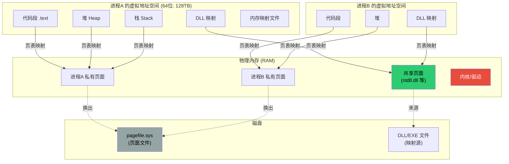

> **核心认知：进程永远不直接接触物理内存。它操作虚拟地址，由 OS 通过页表翻译成物理地址。多个进程可以共享同一块物理页面。**

---

## 二、虚拟页面的三种状态

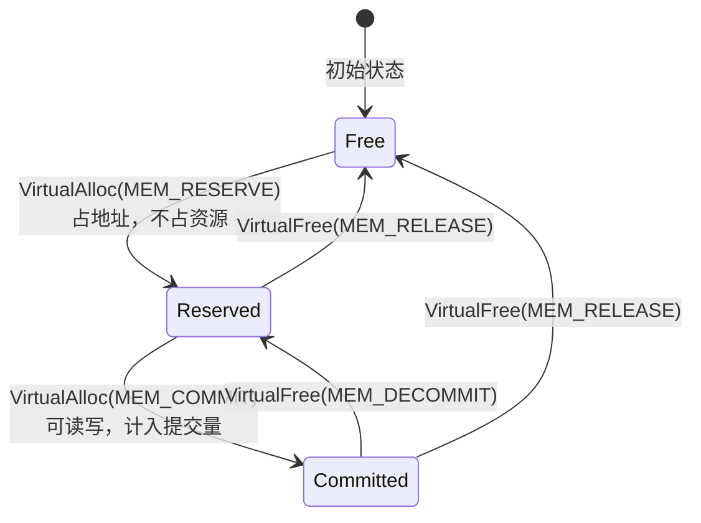

|     状态      | 占虚拟地址空间 | 计入提交量(Commit Charge) | 占物理内存 | 说明                                  |
| :-----------: | :------------: | :-----------------------: | :--------: | :------------------------------------ |
|   **Free**    |       ✗        |             ✗             |     ✗      | 未分配，可用于新分配                  |
| **Reserved**  |       ✓        |             ✗             |     ✗      | 仅预留地址范围，不实际分配            |
| **Committed** |       ✓        |             ✓             | **不一定** | 已承诺分配，但可能从未访问过 / 被换出 |

> **关键：Committed ≠ 占物理内存。** 已提交的页面首次被访问时才触发缺页异常(Page Fault)分配物理页面，或可能已被换出到 pagefile。

---

## 三、物理内存页面分类（PFN 数据库）

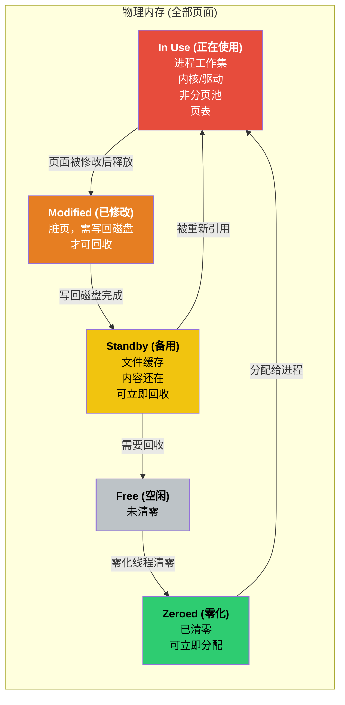

### 与任务管理器的对应关系

| 任务管理器显示 | 等于                    | 说明                       |
| :------------- | :---------------------- | :------------------------- |
| **已使用**     | In Use + Modified       | 不可立即回收的部分         |
| **可用**       | Standby + Free + Zeroed | 可供新分配的部分（含缓存） |
| **已缓存**     | Modified + Standby      | 文件缓存相关               |
| **总计**       | 以上全部（OS 可见部分） | 不含硬件保留               |

---

## 四、进程内存指标（最核心）

### 4.1 指标包含关系

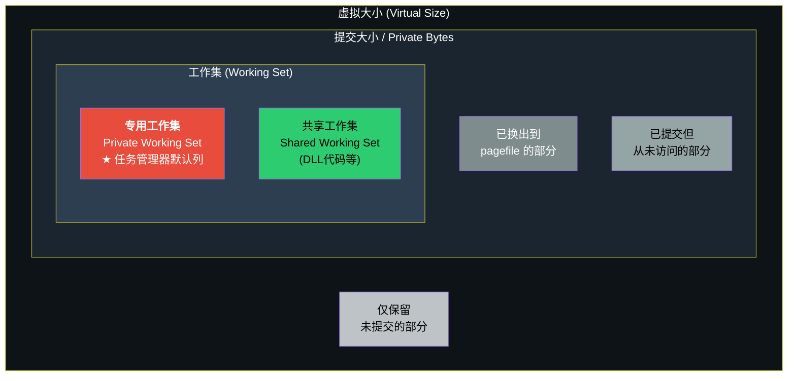

### 4.2 指标详解对照表

| 指标           | 任务管理器列名 | 性能计数器名                       | 含义                                | 典型用途                   |
| :------------- | :------------- | :--------------------------------- | :---------------------------------- | :------------------------- |
| **专用工作集** | 内存（默认）   | `Process(*)\Working Set - Private` | 此刻该进程**独占**的物理内存        | 日常排查"谁占了我的内存"   |
| **工作集**     | 工作集(内存)   | `Process(*)\Working Set`           | 此刻驻留物理内存的总量（私有+共享） | 分析物理内存压力           |
| **共享工作集** | 共享的工作集   | `Process(*)\Working Set - Shared`  | 与其他进程共享的物理内存(DLL等)     | 分析共享效率               |
| **提交大小**   | 提交大小       | `Process(*)\Private Bytes`         | 已提交的私有虚拟内存总量            | **排查内存泄漏（最关键）** |
| **虚拟大小**   | —              | `Process(*)\Virtual Bytes`         | 虚拟地址空间中非Free的总量          | 32位进程地址耗尽排查       |
| **缺页错误**   | 页面错误       | `Process(*)\Page Faults/sec`       | 每秒缺页次数（软+硬）               | 判断是否频繁换页           |

### 4.3 大小关系与典型数值

通常: 虚拟大小 >> 提交大小 ≥ 工作集 ≥ 专用工作集

| 指标           | Chrome 单标签页(举例) | 大型 Java 服务(举例) | 说明                           |
| :------------- | --------------------: | -------------------: | :----------------------------- |
| 虚拟大小       |             ~4,000 MB |           ~20,000 MB | 64位进程通常很大，参考价值最低 |
| 提交大小       |               ~300 MB |            ~8,000 MB | 含已换出和未访问部分           |
| 工作集         |               ~250 MB |            ~6,000 MB | 含共享 DLL                     |
| **专用工作集** |               ~200 MB |            ~5,800 MB | **日常看这个**                 |
| 共享工作集     |                ~50 MB |              ~200 MB | 共享 DLL 代码等                |

---

## 五、分页与缺页异常

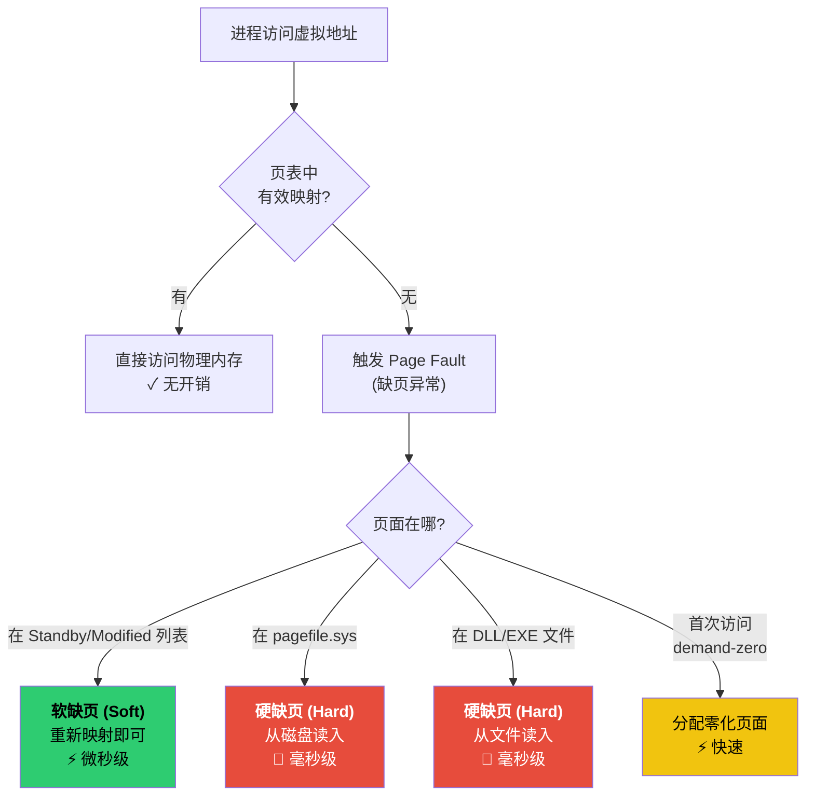

| 缺页类型 | 性能影响                 | 性能计数器                         | 大量出现意味着         |
| :------- | :----------------------- | :--------------------------------- | :--------------------- |
| 软缺页   | 微秒级，几乎无感         | `Memory\Page Faults/sec` (含软+硬) | 正常现象               |
| 硬缺页   | 毫秒级，**严重影响性能** | `Memory\Pages Input/sec` (仅硬)    | 物理内存不足，频繁换页 |

> **判断内存是否真的不够，看硬缺页率比看使用率百分比更准确。**

---

## 六、工作集修剪与写时复制

### 6.1 工作集修剪 (Working Set Trimming)

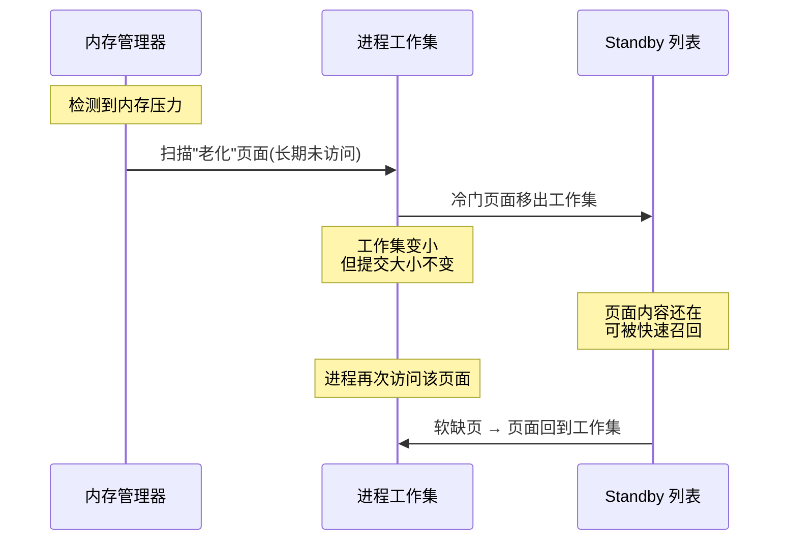

> **工作集减小 ≠ 进程释放了内存。** 只是暂时让出物理内存，数据仍然存在。这就是最小化窗口后进程"内存"看起来变小的原因。

### 6.2 写时复制 (Copy-on-Write)

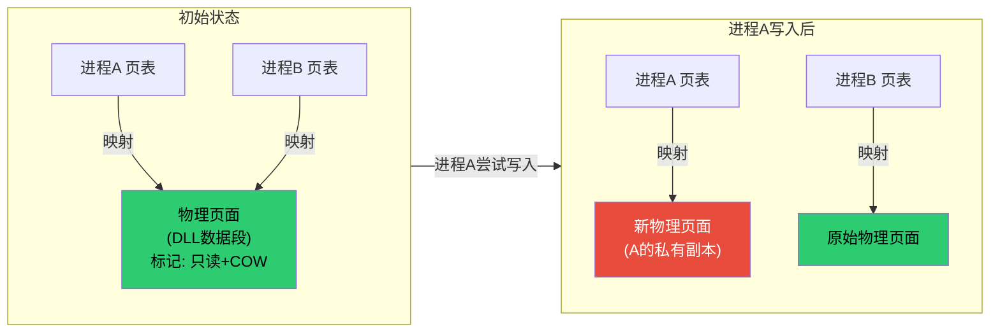

---

## 七、内核态内存消费者（不属于任何进程）

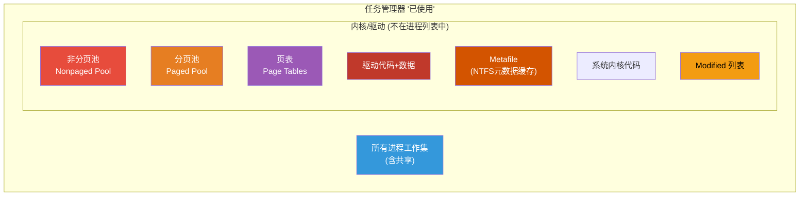

| 内核消费者   | 说明                           | 正常范围           | 异常诊断                                  |
| :----------- | :----------------------------- | :----------------- | :---------------------------------------- |
| **非分页池** | 内核常驻物理内存，绝不换出     | < 300-500 MB       | 过大 → 驱动泄漏，用 `poolmon` 按 Tag 排查 |
| **分页池**   | 内核对象、注册表缓存等，可换出 | < 500-800 MB       | 过大 → 句柄/对象泄漏                      |
| **页表**     | 每个进程的虚拟→物理地址映射表  | 每进程几MB到几十MB | 大量进程 / 大虚拟空间 → 页表总量可达数GB  |
| **Metafile** | NTFS MFT 缓存                  | 依文件数量         | 海量小文件服务器可达数GB                  |
| **驱动代码** | 内核态驱动程序映像             | ~100-300 MB        | 驱动数量异常多                            |
| **Modified** | 脏页待写回磁盘                 | < 几百MB           | 持续偏大 → 磁盘I/O瓶颈                    |

---

## 八、提交量 (Commit Charge) 全局视角

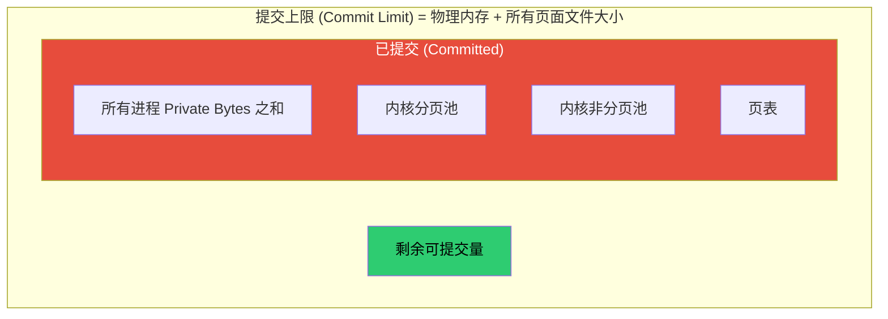

| 概念                        | 含义                       | 监控要点                 |
| :-------------------------- | :------------------------- | :----------------------- |
| **提交量 (Committed)**      | 系统承诺分配的虚拟内存总量 | 接近上限 → 新分配会失败  |
| **提交上限 (Commit Limit)** | 物理内存 + 页面文件总大小  | 可通过增大 pagefile 提高 |
| **提交比率**                | Committed / Commit Limit   | > 80% 需要关注           |

> **Commit Limit 用完比物理内存用完更致命。** 物理内存满了可以换页（变慢），Commit 满了程序直接分配失败（崩溃）。

---

## 九、内存泄漏判定方法

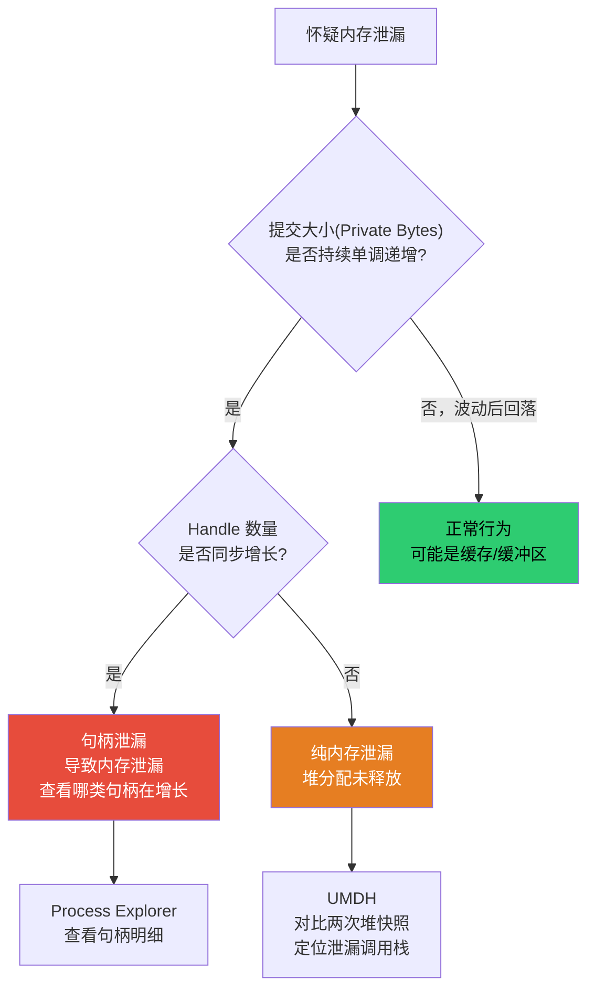

### 泄漏判定要看的指标

| 观察指标          | 正常表现           | 泄漏表现                   | 工具               |
| :---------------- | :----------------- | :------------------------- | :----------------- |
| **Private Bytes** | 有升有降，趋势平稳 | 持续上升，从不回落         | 性能监视器长期记录 |
| **Working Set**   | 波动（受修剪影响） | 参考价值次于 Private Bytes | 任务管理器         |
| **Handle Count**  | 稳定在某个范围     | 持续增长                   | Process Explorer   |
| **GDI Objects**   | 稳定               | 持续增长                   | 任务管理器(添加列) |
| **Thread Count**  | 稳定               | 持续增长                   | 任务管理器         |
| **Virtual Size**  | 稳定               | 持续增长 → 地址空间碎片化  | VMMap              |

---

## 十、分析场景速查矩阵

| 场景                     | 首先看什么                    | 然后看什么                      | 推荐工具            |
| :----------------------- | :---------------------------- | :------------------------------ | :------------------ |
| 谁在占内存               | 各进程**专用工作集**排序      | 同名进程分组求和                | 任务管理器 / 脚本v2 |
| 系统内存高但找不到大进程 | 非分页池、分页池              | RAMMap 查 Page Table / Metafile | RAMMap              |
| 怀疑内存泄漏             | **Private Bytes** 趋势        | Handle Count 趋势               | 性能监视器 + UMDH   |
| 系统卡顿                 | `Pages Input/sec` (硬缺页)    | Modified 列表大小               | 资源监视器          |
| 进程提交大但工作集小     | 大量被换出到 pagefile         | 是否内存紧张导致                | VMMap               |
| 32位进程崩溃             | Virtual Size 是否接近 2GB/3GB | 地址空间碎片化                  | VMMap               |
| 驱动/内核泄漏            | 非分页池是否异常增长          | `poolmon` 按 Tag 分析           | poolmon / WinDbg    |

---

## 十一、工具体系

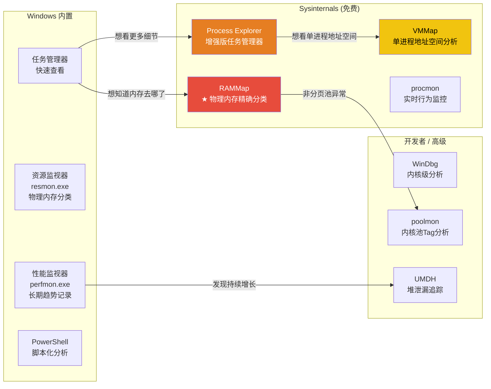

### 各工具解决什么问题

| 工具                 | 核心价值                                          | 何时用                 |
| :------------------- | :------------------------------------------------ | :--------------------- |
| **RAMMap**           | 精确解释物理内存每1MB的去向                       | "内存去哪了"的终极答案 |
| **Process Explorer** | 查看任务管理器没有的列（Private Bytes、句柄详情） | 日常替代任务管理器     |
| **VMMap**            | 可视化单进程的虚拟地址空间布局                    | 分析某个进程内存结构   |
| **性能监视器**       | 长期录制计数器数据并画图                          | 确认泄漏趋势           |
| **poolmon**          | 按分配 Tag 显示内核池使用                         | 诊断内核池泄漏         |
| **UMDH**             | 对比两个时间点的堆分配快照，定位泄漏函数          | 精确定位用户态泄漏代码 |

---

## 十二、完整内存构成对账

以 16GB 物理内存为例，将所有概念串联：

| 层级       | 项目                  |        示例值 | 来源               | 是否在进程列表可见 |
| :--------- | :-------------------- | ------------: | :----------------- | :----------------: |
| **硬件层** | 物理内存总计          |     16,384 MB | BIOS               |         —          |
|            | 硬件保留              |       -512 MB | BIOS/集显          |         ✗          |
|            | **OS 可见总量**       | **15,872 MB** |                    |         —          |
| **已使用** | 进程专用工作集之和    |      7,200 MB | 各进程             |         ✓          |
|            | 进程间共享页面(DLL等) |        800 MB | 共享               |        部分        |
|            | 非分页池              |        350 MB | 内核               |         ✗          |
|            | 分页池(驻留)          |        400 MB | 内核               |         ✗          |
|            | 页表                  |        300 MB | 内核               |         ✗          |
|            | 驱动(驻留)            |        150 MB | 内核               |         ✗          |
|            | Metafile              |        200 MB | 内核               |         ✗          |
|            | Modified 列表         |        150 MB | 内核               |         ✗          |
|            | 其他(系统代码等)      |        100 MB | 内核               |         ✗          |
|            | **已使用小计**        | **≈9,650 MB** | 任务管理器"已使用" |         —          |
| **可用**   | Standby 缓存          |      5,500 MB | 文件缓存，可回收   |         ✗          |
|            | Free + Zeroed         |        722 MB | 真空闲             |         ✗          |
|            | **可用小计**          | **≈6,222 MB** | 任务管理器"可用"   |         —          |

差值 = 已使用(9,650) - 进程专用工作集之和(7,200) = 2,450 MB
这 2,450 MB = 非分页池 + 分页池 + 页表 + 驱动 + Metafile + Modified + 共享 + ...
→ 这就是"进程加起来对不上"的原因