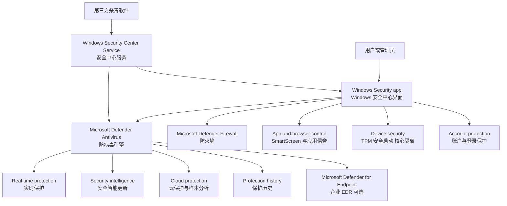
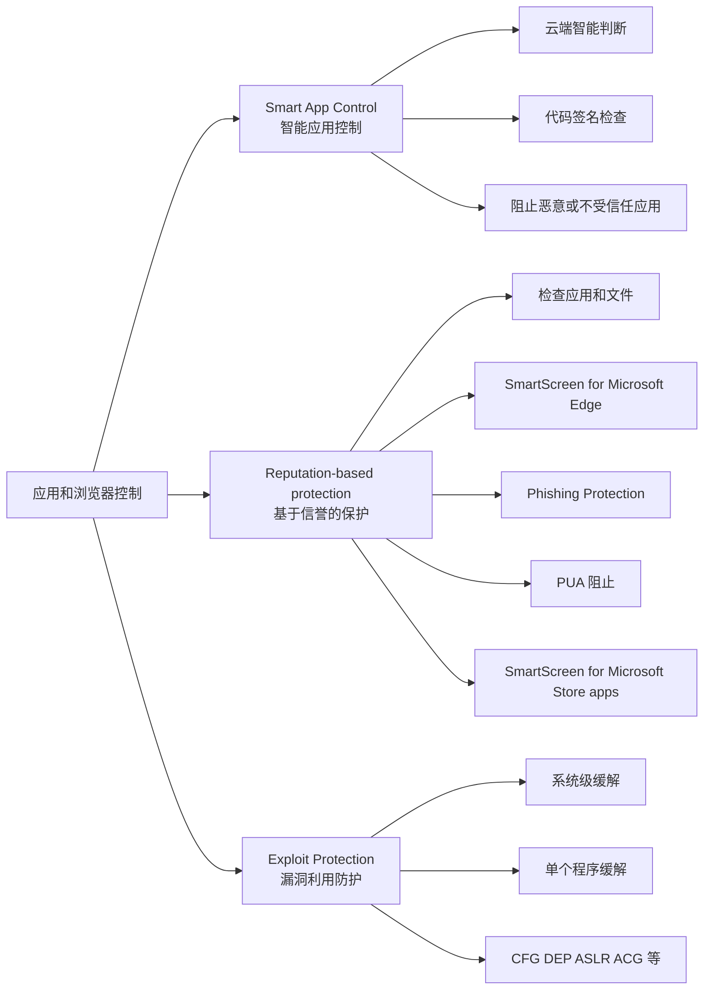
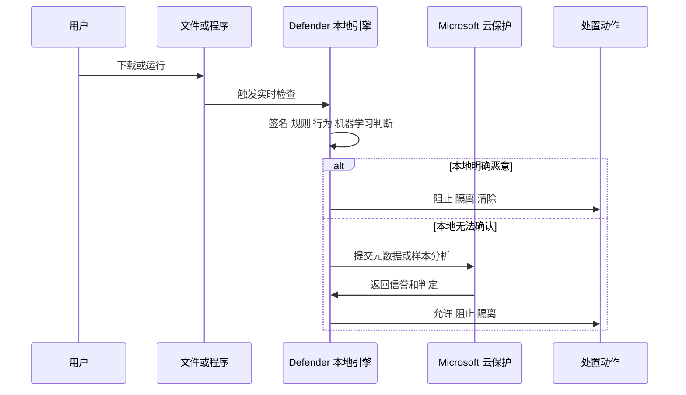
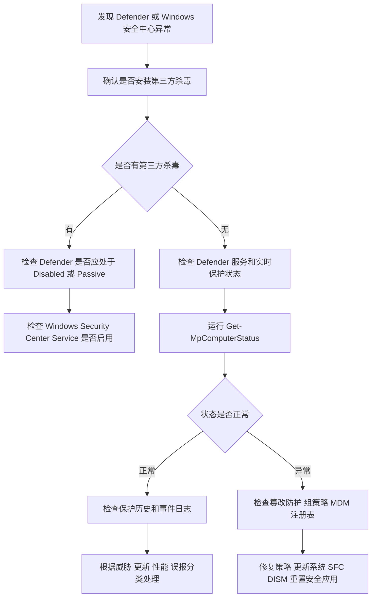

[toc]

## abstract

本文内容以 Windows 10、Windows 11、Windows Server 2016 及更新版本为主

> 截至 2026 年 6 月微软文档中的现代表述：**Windows Defender** 现在更准确地应区分为 **Microsoft Defender Antivirus**、**Windows Security app**、以及企业场景下的 **Microsoft Defender for Endpoint**。

| 名称                            | 中文常见叫法                       | 现在应如何理解                                               | 面向对象                    |
| ------------------------------- | ---------------------------------- | ------------------------------------------------------------ | --------------------------- |
| Windows Defender                | Windows Defender、Defender、防病毒 | 历史名称或口语称呼。在现代 Windows 中，核心防病毒组件通常叫 **Microsoft Defender Antivirus** | Windows 用户、管理员        |
| Microsoft Defender Antivirus    | Microsoft Defender 防病毒          | Windows 10、Windows 11 内置反恶意软件引擎，负责实时防护、扫描、隔离、签名和云保护 | 本机安全防护                |
| Windows Security app            | Windows 安全中心、Windows 安全应用 | 本地安全管理界面，显示防病毒、防火墙、设备安全、应用和浏览器控制等状态 | 普通用户和本机管理员        |
| Microsoft Defender              | Microsoft Defender 应用            | 微软跨平台消费者安全应用，和 Windows 内置防病毒不是完全同一个概念 | Microsoft 365 个人/家庭用户 |
| Microsoft Defender for Endpoint | Defender for Endpoint、MDE         | 企业级终端防护、EDR、云端管理和响应平台                      | 企业安全团队                |

微软文档明确说明：**Windows Security 是 Windows 10 1703 及更新版本的客户端界面，不等同于 Microsoft Defender for Endpoint 的云端管理门户**，并且 **Windows Security 不能卸载**。([Microsoft Learn](https://learn.microsoft.com/en-us/windows/security/operating-system-security/system-security/windows-defender-security-center/windows-defender-security-center))

| 功能                                               | 所属区域               | 主要作用                                    | 适用系统                       | 新手建议                       |
| -------------------------------------------------- | ---------------------- | ------------------------------------------- | ------------------------------ | ------------------------------ |
| Smart App Control                                  | 应用和浏览器控制       | 阻止恶意、不受信任或潜在不需要的应用运行    | Windows 11                     | 普通用户建议开启或保持评估模式 |
| Reputation-based protection                        | 应用和浏览器控制       | 基于信誉判断应用、文件、网站和下载是否安全  | Windows 10 / 11                | 建议开启                       |
| Microsoft Defender SmartScreen                     | 应用和浏览器控制、Edge | 防钓鱼、防恶意下载、防技术支持诈骗          | Windows 10 / 11                | 建议开启                       |
| Phishing protection / Enhanced Phishing Protection | 应用和浏览器控制       | 防止密码被钓鱼、复用或明文保存              | Windows 11，增强版从 22H2 开始 | 建议开启相关警告               |
| Exploit protection                                 | 应用和浏览器控制       | 缓解漏洞利用技术                            | Windows 10 / 11                | 普通用户保持默认               |
| Memory integrity / HVCI                            | 设备安全               | 防止恶意驱动劫持系统核心                    | Windows 10 / 11，依赖硬件      | 能开启则建议开启               |
| Microsoft Vulnerable Driver Blocklist              | 设备安全               | 阻止已知易受攻击驱动加载                    | Windows 10 / 11                | 建议保持开启                   |
| Local Security Authority protection                | 设备安全               | 防止凭据窃取和 LSA 进程注入                 | Windows 11 常见                | 建议开启                       |
| Passkeys                                           | 账户 / 设置            | 用 Windows Hello 替代传统密码登录网站或应用 | Windows 11                     | 支持时优先使用                 |

------

## 建议学习大纲

| 章节                              | 学习目标                                                     | 核心问题                             |
| --------------------------------- | ------------------------------------------------------------ | ------------------------------------ |
| 基本概念                          | 分清 Defender、防病毒、Windows 安全中心、MDE                 | “Windows Defender”到底指什么？       |
| 系统结构                          | 理解 UI、服务、引擎、云保护、策略之间的关系                  | 为什么界面显示和实际状态可能不一致？ |
| Windows 安全中心功能区            | 掌握各保护区域的作用                                         | 每个页面该看什么、改什么？           |
| Microsoft Defender Antivirus 原理 | 理解实时保护、云保护、行为监控、签名、机器学习               | Defender 如何判断一个文件是否危险？  |
| 状态检查                          | 学会用界面、PowerShell、事件查看器确认状态                   | Defender 到底有没有运行？            |
| 常见故障排查                      | 针对打不开、灰色、无法开启、更新失败、高 CPU、误报等问题处理 | 出问题时先查哪里？                   |
| 禁用与卸载                        | 明确哪些能临时关闭、哪些不能卸载、哪些只适用于 Server        | 怎样安全地临时关闭？怎样恢复？       |
| 最佳实践                          | 建立个人和企业场景下的安全基线                               | 哪些设置不建议关闭？                 |

------

## 系统结构与工作关系

Windows 安全中心更像是一个“安全仪表盘”，它本身不是单一的杀毒引擎。它会聚合本机多个安全提供者和 Windows 内置安全能力。



核心关系可以这样理解：

| 层级       | 代表组件                                                     | 作用                                           |
| ---------- | ------------------------------------------------------------ | ---------------------------------------------- |
| 用户界面层 | Windows Security app                                         | 查看状态、修改常用设置、启动扫描、查看保护历史 |
| 本地防护层 | Microsoft Defender Antivirus                                 | 实时扫描、恶意软件检测、隔离、脱机扫描         |
| 系统安全层 | Firewall、SmartScreen、Core isolation、TPM、Secure Boot      | 网络、应用信誉、内核隔离、硬件安全             |
| 管理策略层 | Intune、Group Policy、Configuration Manager、Defender portal | 企业集中配置、锁定策略、统一响应               |
| 云端智能层 | Defender cloud protection、Defender for Endpoint             | 云检测、样本分析、EDR、威胁响应                |

微软支持页面也把 Windows Security 描述为 Windows 内置的综合安全应用，包含 Microsoft Defender Antivirus、Windows Firewall、Smart App Control 等功能。([微软支持](https://support.microsoft.com/en-us/office/windows-security-app-overview-ae70cc96-a9cd-4443-a210-e41cb973d3a6))

------

## Windows 安全中心主要功能区

### 首页

首页是安全状态总览。正常情况下，你会看到各保护区域的状态，例如“无需操作”“建议操作”“需要注意”。

| 状态           | 含义                                    | 建议动作                             |
| -------------- | --------------------------------------- | ------------------------------------ |
| 绿色或无需操作 | 当前主要保护项正常                      | 保持更新即可                         |
| 黄色或建议操作 | 某些保护项关闭、过期或需要确认          | 点击进入对应区域处理                 |
| 红色或需要操作 | 防护关闭、检测到威胁或策略异常          | 优先处理，必要时断网排查             |
| “由组织管理”   | 相关设置被组策略、MDM、企业安全平台控制 | 个人电脑需检查是否加入组织或残留策略 |

Windows Security 的首页用于集中展示设备安全状态并快速进入各保护区域。([微软支持](https://support.microsoft.com/en-us/office/windows-security-app-overview-ae70cc96-a9cd-4443-a210-e41cb973d3a6))

------

### 病毒和威胁防护

这是和 Microsoft Defender Antivirus 最直接相关的页面。

| 功能                       | 作用                               | 新手理解                        |
| -------------------------- | ---------------------------------- | ------------------------------- |
| 快速扫描                   | 检查常见恶意软件藏匿位置           | 日常体检                        |
| 完全扫描                   | 扫描整个磁盘和所有文件             | 深度体检，耗时更长              |
| 自定义扫描                 | 指定文件夹或驱动器扫描             | 只查某个目录                    |
| Microsoft Defender Offline | 重启到恢复环境中扫描               | 针对顽固木马、Rootkit、反复感染 |
| 实时保护                   | 文件打开、下载、运行时即时检测     | 最核心的开关                    |
| 云提供的保护               | 使用云端智能判断新威胁             | 提高新型恶意软件识别率          |
| 自动提交样本               | 可疑文件提交给微软分析             | 配合云保护提高判断速度          |
| 篡改防护                   | 防止恶意程序关闭 Defender 关键设置 | 防止“杀软被杀”                  |
| 受控文件夹访问             | 防勒索软件修改受保护目录           | 防止文件被批量加密              |
| 排除项                     | 指定文件、目录、进程不扫描         | 仅用于明确可信且必要的场景      |

微软说明，Microsoft Defender Offline 会重启设备并在 Windows Recovery Environment 中执行快速扫描，扫描完成后电脑会自动重启。([微软支持](https://support.microsoft.com/en-us/windows/virus-and-threat-protection-in-the-windows-security-app-1362f4cd-d71a-b52a-0b66-c2820032b65e?utm_source=chatgpt.com))

------

### 防火墙和网络保护

这个区域管理 Microsoft Defender Firewall。

| 网络配置文件 | 典型场景                 | 建议                         |
| ------------ | ------------------------ | ---------------------------- |
| 域网络       | 加入企业域的电脑         | 按企业策略管理               |
| 专用网络     | 家庭、可信办公网络       | 可以允许必要的局域网发现     |
| 公用网络     | 咖啡店、机场、酒店 Wi-Fi | 保持更严格，尽量减少入站访问 |

防火墙通过 IP、端口、应用路径等条件允许或阻止网络连接，降低未经授权访问风险。([微软支持](https://support.microsoft.com/en-us/windows/firewall-and-network-protection-in-the-windows-security-app-ec0844f7-aebd-0583-67fe-601ecf5d774f)) 微软也明确提示：如果某个应用被阻止，通常应优先“允许应用通过防火墙”，而不是直接关闭整个防火墙。([微软支持](https://support.microsoft.com/en-us/windows/firewall-and-network-protection-in-the-windows-security-app-ec0844f7-aebd-0583-67fe-601ecf5d774f?utm_source=chatgpt.com))

------

### 应用和浏览器控制

这个区域主要处理“应用是否可信”“下载是否危险”“网页是否钓鱼”等问题。

| 功能                           | 作用                                       | 适合关注的人         |
| ------------------------------ | ------------------------------------------ | -------------------- |
| Smart App Control              | 阻止恶意或不受信任的应用                   | Windows 11 用户      |
| Reputation-based protection    | 基于信誉阻止恶意网站、下载、潜在不需要应用 | 所有用户             |
| Microsoft Defender SmartScreen | 防钓鱼、防恶意下载、防低信誉文件           | 浏览器和下载频繁用户 |
| Exploit Protection             | 缓解漏洞利用行为                           | 高级用户、管理员     |

微软说明，应用和浏览器控制会结合信誉保护和漏洞利用缓解，防止不安全应用、文件、网站和下载危害系统。([微软支持](https://support.microsoft.com/en-us/windows/app-browser-control-in-the-windows-security-app-8f68fb65-ebb4-3cfb-4bd7-ef0f376f3dc3)) Smart App Control 可与 Microsoft Defender 或第三方杀毒软件一起工作，并不替代杀毒软件。([微软支持](https://support.microsoft.com/en-us/windows/smart-app-control-frequently-asked-questions-285ea03d-fa88-4d56-882e-6698afdb7003?utm_source=chatgpt.com))

> 较新版本的Windows 安全中心里的 **应用和浏览器控制** 不只是“浏览器安全设置”，它现在更像是 Windows 的一层 **应用执行前拦截系统** 和 **信誉判断系统**。它的目标不是等恶意程序已经运行后再杀掉，而是在程序、下载、网站、密码输入、漏洞利用行为发生前尽量提前阻断。

微软当前文档把这个页面分成三大块：**Smart App Control**、**基于信誉的保护**、**Exploit Protection**。




这些功能和传统杀毒的区别

| 能力                         | 主要解决的问题                   | 判断依据                            | 典型动作           | 新手理解         |
| ---------------------------- | -------------------------------- | ----------------------------------- | ------------------ | ---------------- |
| Microsoft Defender Antivirus | 已知或可疑恶意软件               | 签名、行为、机器学习、云分析        | 扫描、隔离、清除   | 杀毒引擎         |
| SmartScreen                  | 恶意网站、恶意下载、低信誉文件   | URL、文件信誉、发布者信誉、下载历史 | 警告或阻止         | 下载和网页守门员 |
| Smart App Control            | 恶意、不受信任、潜在不需要的应用 | 云端智能预测、数字签名、应用信誉    | 阻止运行           | 应用执行前门禁   |
| Enhanced Phishing Protection | 密码被钓鱼、复用、明文保存       | 密码输入上下文、URL、进程、证书信息 | 弹窗警告、建议改密 | 密码输入保护     |
| PUA Blocking                 | 广告软件、捆绑软件、挖矿软件等   | 应用信誉和行为分类                  | 阻止下载或安装     | 防“流氓软件”     |
| Exploit Protection           | 漏洞利用、内存攻击、代码注入     | 系统和进程缓解策略                  | 限制进程行为       | 给程序加安全护栏 |
| App Control for Business     | 企业白名单、代码执行控制         | 策略、签名、路径、发布者、ISG       | 允许或阻止代码运行 | 企业级应用白名单 |

### 智能应用控制(Smart App Control)

> 如果这项功能启用,对于普通用户使用一些软件尤其是小众软件或者开发者工具会有较大影响,导致系统拒绝运行.

其中 Smart App Control 使用 AI 和云端智能预测应用是否安全；基于信誉的保护包括 SmartScreen、钓鱼防护、PUA 阻止等；Exploit Protection 则负责降低漏洞利用成功率。


------

### 设备安全

设备安全更偏底层，涉及硬件、固件和内核安全。

| 功能             | 作用                                    | 常见问题                       |
| ---------------- | --------------------------------------- | ------------------------------ |
| Secure Boot      | 启动阶段只允许可信引导组件              | BIOS/UEFI 设置错误会导致不可用 |
| TPM 安全处理器   | 支持 BitLocker、Windows Hello、密钥保护 | TPM 异常可能影响登录和加密     |
| Core isolation   | 用虚拟化隔离保护 Windows 核心进程       | 某些旧驱动不兼容               |
| Memory integrity | 阻止恶意代码注入高安全级别进程          | 常因旧驱动导致无法开启         |
| Secured-core PC  | 硬件、固件、系统联合增强安全            | 需要设备本身支持               |

微软文档说明，Device security 用于管理 Secure Boot、core isolation、处理器级保护等硬件和操作系统安全能力。([微软支持](https://support.microsoft.com/en-us/windows/device-security-in-the-windows-security-app-afa11526-de57-b1c5-599f-3a4c6a61c5e2))

------

### 账户保护

账户保护主要关注身份和登录安全。

| 功能              | 作用                         |
| ----------------- | ---------------------------- |
| Microsoft account | 检查账户登录和安全状态       |
| Windows Hello     | PIN、人脸、指纹登录          |
| Dynamic Lock      | 通过蓝牙设备离开检测自动锁屏 |
| 登录选项入口      | 快速进入 Windows 登录设置    |

这个区域对新手的价值是：它提醒你不要只依赖弱密码，而要尽量使用 PIN、Windows Hello、多因素认证等现代登录方式。

------

### 保护历史

保护历史用于查看 Windows Security 已经采取过的动作，例如隔离、阻止、清除、允许、还原。

| 记录类型 | 含义                  | 建议                       |
| -------- | --------------------- | -------------------------- |
| 已隔离   | 文件被移动到隔离区    | 不确定时不要还原           |
| 已阻止   | 行为或文件被拦截      | 查看路径和威胁名           |
| 已允许   | 用户或策略允许了某项  | 定期复查                   |
| 修复失败 | Defender 未能完成处理 | 进入脱机扫描或使用二次工具 |

微软支持文档说明，Protection History 页面用于查看 Windows Security 代表用户采取的操作。([微软支持](https://support.microsoft.com/en-us/windows/protection-history-f1e5fd95-09b4-46d1-b8c7-1059a1e09708?utm_source=chatgpt.com))

------

## Microsoft Defender Antivirus 的核心原理

### 本地检测与云检测结合

现代 Defender 不是只靠“病毒库”。它是混合检测模型：先在本机进行检测，再结合云端对新威胁做快速判断。微软文档称 Microsoft Defender Antivirus 执行 hybrid detection and protection，也就是本地设备先检测，并与云端协作处理新出现的威胁。([Microsoft Learn](https://learn.microsoft.com/en-us/defender-endpoint/adv-tech-of-mdav))



------

### 实时保护

实时保护是 Defender 的核心。它会在文件打开、下载、复制、运行时介入检查。

| 场景                 | 实时保护做什么             |
| -------------------- | -------------------------- |
| 下载 EXE、ZIP、脚本  | 检查文件信誉、签名、内容   |
| 打开 Office 文档     | 检查宏、嵌入对象、脚本行为 |
| 运行 PowerShell 脚本 | 检查脚本内容和行为         |
| 程序创建新进程       | 检查进程行为是否异常       |
| 文件批量修改         | 判断是否类似勒索软件       |

不建议长期关闭实时保护。微软支持页面说明：实时保护可以临时关闭，但会在一段时间后自动重新开启；关闭期间打开或下载的文件不会被实时扫描。([微软支持](https://support.microsoft.com/en-us/windows/virus-and-threat-protection-in-the-windows-security-app-1362f4cd-d71a-b52a-0b66-c2820032b65e?utm_source=chatgpt.com))

------

### 云提供的保护与自动样本提交

云保护用于处理“本地还没见过”的新威胁。自动样本提交则帮助云端进一步分析可疑文件。微软文档说明，文件和可执行程序可以被发送到 Microsoft Defender Antivirus 云服务进行引爆和分析，自动样本提交依赖云保护，也可作为单独设置配置。([Microsoft Learn](https://learn.microsoft.com/en-us/defender-endpoint/enable-cloud-protection-microsoft-defender-antivirus))

| 设置                        | 建议                 | 原因                     |
| --------------------------- | -------------------- | ------------------------ |
| Cloud-delivered protection  | 开启                 | 对新威胁识别更快         |
| Automatic sample submission | 开启或按组织合规配置 | 支持快速云端判定         |
| Block at first sight        | 保持开启             | 可在数秒内阻止新恶意软件 |

Block at first sight 会在 Cloud-delivered protection 和 Automatic sample submission 都开启时自动启用；微软不建议永久关闭它。([Microsoft Learn](https://learn.microsoft.com/en-us/defender-endpoint/configure-block-at-first-sight-microsoft-defender-antivirus))

------

### 篡改防护

篡改防护是很多新手忽视的关键功能。它的目的不是“检测病毒”，而是防止病毒或未授权脚本修改 Defender 的核心设置。

| 被保护的设置 | 说明                 |
| ------------ | -------------------- |
| 实时保护     | 防止被恶意关闭       |
| 行为监控     | 防止绕过行为检测     |
| 云保护       | 防止断开云端智能     |
| 安全智能更新 | 防止停止更新         |
| 自动处置     | 防止威胁检测后不处理 |
| 排除项       | 防止恶意添加排除路径 |

微软文档说明，篡改防护开启后，实时保护、行为监控、云保护、安全智能更新、自动处置等关键设置不能被更改；即使某些管理操作看起来成功，也可能实际上被篡改防护拦截。([Microsoft Learn](https://learn.microsoft.com/en-us/defender-endpoint/prevent-changes-to-security-settings-with-tamper-protection))

------

### 安全智能更新

安全智能更新也常被叫做“病毒库更新”或“定义更新”，但现代 Defender 的更新不只包括传统特征码，也包括检测规则、模型、引擎和平台组件。

| 更新类型              | 作用                     |
| --------------------- | ------------------------ |
| Security intelligence | 威胁检测内容、签名、规则 |
| Engine update         | 检测引擎能力             |
| Platform update       | Defender 平台组件        |
| Emergency update      | 重大威胁时快速下发修复   |

在 Windows Server 上，微软文档说明 Windows Update 服务必须运行，若使用 WSUS 等更新管理服务，也要批准 Microsoft Defender Antivirus Security intelligence updates。([Microsoft Learn](https://learn.microsoft.com/en-us/defender-endpoint/microsoft-defender-antivirus-on-windows-server))

------

## 常用状态检查方法

### 通过 Windows 安全中心检查

路径：

```text
开始菜单 > 搜索 Windows Security 或 Windows 安全中心
病毒和威胁防护 > 谁在保护我 > 管理提供程序
```

这里可以看到当前防病毒、防火墙、Web 保护由哪个产品提供。微软文档也建议通过 Windows Security 的“Manage providers”查看当前安全提供者。([Microsoft Learn](https://learn.microsoft.com/th-th/defender-endpoint/microsoft-defender-antivirus-windows?view=o365-worldwide&utm_source=chatgpt.com))

------

### 通过 PowerShell 检查

以管理员身份打开 PowerShell：

```powershell
Get-MpComputerStatus | Select-Object `
  AMRunningMode,
  AMServiceEnabled,
  AntivirusEnabled,
  RealTimeProtectionEnabled,
  IsTamperProtected,
  AntivirusSignatureLastUpdated,
  NISEnabled,
  IoavProtectionEnabled
```

关键字段解释：

| 字段                          | 常见值         | 含义                                  |
| ----------------------------- | -------------- | ------------------------------------- |
| AMRunningMode                 | Normal         | Defender 主动模式                     |
| AMRunningMode                 | Passive        | 被动模式，通常有第三方杀软或 MDE 场景 |
| AMRunningMode                 | EDR Block Mode | EDR 阻止模式                          |
| AntivirusEnabled              | True / False   | 防病毒功能是否启用                    |
| RealTimeProtectionEnabled     | True / False   | 实时保护是否启用                      |
| IsTamperProtected             | True / False   | 篡改防护是否启用                      |
| AntivirusSignatureLastUpdated | 日期时间       | 安全智能最后更新时间                  |

微软文档说明 `Get-MpComputerStatus` 用于获取本机反恶意软件状态，并可查看 `AMRunningMode`。([Microsoft Learn](https://learn.microsoft.com/en-us/powershell/module/defender/get-mpcomputerstatus?view=windowsserver2025-ps&utm_source=chatgpt.com))

------

### 启动扫描与更新

```powershell
# 更新安全智能
Update-MpSignature

# 快速扫描
Start-MpScan -ScanType QuickScan

# 完全扫描
Start-MpScan -ScanType FullScan

# 自定义扫描
Start-MpScan -ScanType CustomScan -ScanPath "C:\Users\Public\Downloads"

# Defender 脱机扫描，会重启电脑
Start-MpWDOScan
```

微软 Defender PowerShell 模块包含 `Update-MpSignature`、`Start-MpScan`、`Start-MpWDOScan` 等命令。([Microsoft Learn](https://learn.microsoft.com/en-us/powershell/module/defender/?view=windowsserver2025-ps&utm_source=chatgpt.com))

------

### 使用 MpCmdRun 命令行工具

`MpCmdRun.exe` 适合脚本化、自动化或高级排障。微软文档说明它可以运行扫描、管理安全智能更新和配置 Microsoft Defender Antivirus，并且需要在管理员命令提示符中运行。([Microsoft Learn](https://learn.microsoft.com/en-us/defender-endpoint/command-line-arguments-microsoft-defender-antivirus))

常见位置：

```text
C:\Program Files\Windows Defender
C:\ProgramData\Microsoft\Windows Defender\Platform\<antimalware platform version>
```

示例：

```cmd
MpCmdRun.exe -SignatureUpdate

MpCmdRun.exe -Scan -ScanType 1

MpCmdRun.exe -Scan -ScanType 2

MpCmdRun.exe -Scan -ScanType 3 -File "C:\Users\Public\Downloads"
```

| ScanType | 含义       |
| -------- | ---------- |
| 1        | 快速扫描   |
| 2        | 完全扫描   |
| 3        | 自定义扫描 |

------

## 常见故障与排查方法

### 排查总流程



------

### Windows 安全中心打不开、空白、闪退

| 可能原因                      | 现象                                 | 排查方法                 |
| ----------------------------- | ------------------------------------ | ------------------------ |
| Windows Security app 本身损坏 | 打开空白、闪退                       | 设置中修复或重置应用     |
| 系统组件损坏                  | SecurityHealthSystray 报错、DLL 错误 | 运行 DISM 和 SFC         |
| 组织策略隐藏页面              | 提示“IT 管理员限制访问”              | 检查组策略、MDM、注册表  |
| 第三方安全软件冲突            | UI 状态异常                          | 卸载或更新第三方安全软件 |
| Windows 更新不完整            | 安全组件版本混乱                     | 完成 Windows Update      |

建议顺序：

```powershell
# 以管理员身份运行
DISM /Online /Cleanup-Image /RestoreHealth
sfc /scannow
```

然后进入：

```text
设置 > 应用 > 已安装的应用 > Windows Security 或 Windows 安全中心 > 高级选项 > 修复 / 重置
```

`Reset-AppxPackage` 的作用是将 Windows 应用恢复到初始配置，应用会像刚安装一样重新初始化。([Microsoft Learn](https://learn.microsoft.com/en-us/powershell/module/appx/reset-appxpackage?view=windowsserver2025-ps&utm_source=chatgpt.com))

------

### “病毒和威胁防护”页面消失或灰色

| 可能原因                 | 说明                               |
| ------------------------ | ---------------------------------- |
| 设备加入了公司或学校管理 | 企业策略隐藏页面                   |
| 使用了组策略隐藏安全区域 | 例如隐藏 Virus & threat protection |
| 第三方杀毒注册为主防护   | Defender 可能自动关闭或被动        |
| 篡改防护阻止修改         | 设置看似无法更改                   |
| 恶意软件修改策略         | 需要脱机扫描或系统修复             |

企业管理中可以通过 Intune 或策略隐藏 Windows Security 的各个区域，例如账户保护、防火墙和网络保护、应用和浏览器控制、设备安全等。([Microsoft Learn](https://learn.microsoft.com/en-us/intune/device-configuration/endpoint-security/ref-security-experience-settings-windows?utm_source=chatgpt.com))

------

### 实时保护无法开启

| 检查项            | 命令或路径                      | 解释                               |
| ----------------- | ------------------------------- | ---------------------------------- |
| 是否有第三方杀毒  | Windows Security > 管理提供程序 | 第三方杀毒可能让 Defender 自动关闭 |
| Defender 运行模式 | `Get-MpComputerStatus`          | 查看 `AMRunningMode`               |
| 篡改防护          | `IsTamperProtected`             | 可能阻止某些修改                   |
| 组策略            | gpedit.msc                      | 企业策略可能禁用相关开关           |
| 系统完整性        | DISM / SFC                      | 修复系统组件                       |

如果装了兼容的第三方杀毒，在 Windows 10 和 Windows 11 客户端上，Defender 可能自动关闭；如果卸载第三方杀毒，Defender 会自动重新开启。([微软支持](https://support.microsoft.com/en-us/office/windows-security-app-overview-ae70cc96-a9cd-4443-a210-e41cb973d3a6))

------

### 更新失败或安全智能过期

| 可能原因                   | 处理建议                           |
| -------------------------- | ---------------------------------- |
| Windows Update 服务关闭    | 启动 Windows Update 服务           |
| WSUS 未批准 Defender 更新  | 在 WSUS 中批准安全智能更新         |
| 代理或防火墙阻断           | 检查微软更新和 Defender 云服务连接 |
| 第三方杀毒让 Defender 关闭 | 确认当前主防病毒产品               |
| 更新包损坏                 | 回滚定义后重新更新                 |

常用命令：

```powershell
Update-MpSignature
```

如果更新后出现异常，微软文档给出了回滚方式，例如：

```cmd
MpCmdRun.exe -RemoveDefinitions -All
MpCmdRun.exe -RemoveDefinitions -Engine
MpCmdRun.exe -RemoveDefinitions -DynamicSignatures
MpCmdRun.exe -RevertPlatform
```

这些命令分别用于回滚安全智能、引擎、动态签名或平台更新。([Microsoft Learn](https://learn.microsoft.com/en-us/defender-endpoint/microsoft-defender-antivirus-updates))

------

### 扫描失败、扫描卡住、扫描很慢

| 问题               | 可能原因                         | 处理方法                   |
| ------------------ | -------------------------------- | -------------------------- |
| 快速扫描失败       | 引擎或定义异常                   | 更新签名，查看事件日志     |
| 完全扫描特别慢     | 文件量巨大、压缩包多、开发目录多 | 分析性能，不盲目排除       |
| 扫描导致高 CPU     | 大量小文件、构建产物、虚拟机镜像 | 使用性能分析器定位         |
| 扫描不结束         | 损坏文件、驱动器错误             | 检查磁盘、分批扫描         |
| 服务器扫描影响业务 | 数据库、日志、虚拟化工作负载     | 按微软推荐设置角色相关排除 |

微软说明，扫描问题排查需要理解扫描如何启动、应用了哪些策略、扫描为何结束以及哪些因素影响性能。([Microsoft Learn](https://learn.microsoft.com/en-us/defender-endpoint/troubleshoot-mdav-scan-issues)) Defender 性能分析器可以帮助识别导致性能下降的文件、扩展名和进程。([Microsoft Learn](https://learn.microsoft.com/en-us/defender-endpoint/tune-performance-defender-antivirus?utm_source=chatgpt.com))

------

### MsMpEng.exe 高 CPU

`MsMpEng.exe` 是 Microsoft Defender Antivirus 的核心进程，常见于任务管理器中的“Antimalware Service Executable”。

常见原因：

| 场景             | 说明                                       | 建议                             |
| ---------------- | ------------------------------------------ | -------------------------------- |
| 正在执行完全扫描 | CPU 和磁盘占用上升                         | 等待完成或调整计划扫描时间       |
| 大量开发文件     | node_modules、bin、obj、虚拟环境、依赖缓存 | 用性能分析器确认后再设置精确排除 |
| 虚拟机或容器镜像 | 大文件频繁读写                             | 对固定镜像目录谨慎排除           |
| 日志目录高频写入 | 实时扫描反复触发                           | 评估进程排除或路径排除           |
| 恶意软件活动     | 大量文件创建、修改、执行                   | 先断网并运行脱机扫描             |

排除项不要随便加。微软明确建议，一般不需要为 Defender 定义排除项；如需排除，应谨慎设计以降低风险。([Microsoft Learn](https://learn.microsoft.com/en-us/defender-endpoint/configure-exclusions-microsoft-defender-antivirus?utm_source=chatgpt.com)) 微软还特别提醒，不要排除用户 Temp、系统 Temp 等常被恶意软件使用的位置。([Microsoft Learn](https://learn.microsoft.com/en-us/defender-endpoint/mdav-scan-best-practices))

------

### 误报处理

| 场景                | 不建议               | 建议                                   |
| ------------------- | -------------------- | -------------------------------------- |
| 自己写的程序被拦截  | 直接关闭 Defender    | 检查签名、打包方式、提交误报           |
| 某个工具被 PUA 拦截 | 全局关闭 PUA 保护    | 判断是否确实包含广告、捆绑、挖矿、远控 |
| 破解工具被报毒      | 加入排除             | 不建议信任破解工具                     |
| hosts 文件被报毒    | 永久排除整个系统目录 | 检查是否被恶意重定向                   |

新手最容易犯的错误是：为了运行某个不明程序，把 Defender 和防火墙全部关掉。更安全的方法是只针对明确可信、来源可靠、哈希可验证的文件做临时处理。

------

## 事件日志与诊断

事件查看器路径：

```text
事件查看器 >
Applications and Services Logs >
Microsoft >
Windows >
Windows Defender >
Operational
```

微软文档也建议通过这个路径查看 Microsoft Defender Antivirus 事件和错误代码。([Microsoft Learn](https://learn.microsoft.com/en-us/defender-endpoint/troubleshoot-microsoft-defender-antivirus))

常见排查思路：

| 信息     | 用途                                     |
| -------- | ---------------------------------------- |
| 事件 ID  | 确认是检测、隔离、更新、扫描还是配置问题 |
| 威胁名称 | 判断威胁类型                             |
| 文件路径 | 判断是否为下载目录、临时目录、系统目录   |
| 操作结果 | 查看是否清除、隔离、失败                 |
| 错误代码 | 定位更新失败、扫描失败或权限问题         |

------

## 禁用、关闭与卸载方法

这一部分要特别谨慎：**除非是短时间排障、兼容性测试、企业迁移或已安装可靠替代防护，否则不建议关闭 Defender 或防火墙。**

### 能不能卸载 Windows 安全中心？

Windows 客户端上，**Windows Security app 不能卸载**。微软文档明确写明 Windows Security 不能卸载，只能进行一些管理动作，例如隐藏界面区域、禁用界面入口或配置通知等。([Microsoft Learn](https://learn.microsoft.com/en-us/windows/security/operating-system-security/system-security/windows-defender-security-center/windows-defender-security-center))

| 对象                         | Windows 10 / 11 客户端     | Windows Server                 |
| ---------------------------- | -------------------------- | ------------------------------ |
| Windows Security app         | 不能卸载                   | Server 上体验和客户端不同      |
| Microsoft Defender Antivirus | 通常不能像普通应用一样卸载 | 可在特定 Server 版本上卸载功能 |
| 实时保护                     | 可临时关闭                 | 可通过策略或命令管理           |
| 防火墙                       | 可关闭但不建议             | 可通过策略集中管理             |
| 通知                         | 可隐藏或减少               | 可通过组策略或 MDM 管理        |

------

### 个人电脑临时关闭实时保护

适用场景：

| 适合                             | 不适合                         |
| -------------------------------- | ------------------------------ |
| 安装可信软件时短暂排障           | 为运行破解、外挂、来历不明程序 |
| 排查误报                         | 长期裸奔                       |
| 观察某个工具是否被 Defender 阻止 | 绕过公司安全策略               |

图形界面路径：

```text
Windows Security >
Virus & threat protection >
Virus & threat protection settings >
Manage settings >
Real-time protection > Off
```

注意：如果篡改防护开启，可能需要先关闭篡改防护才能关闭实时保护。微软支持文档说明，实时保护只能临时关闭，并会在一段时间后自动重新开启；如果只是排除单个文件或文件夹，添加排除项比关闭整个防病毒更安全。([微软支持](https://support.microsoft.com/en-us/windows/virus-and-threat-protection-in-the-windows-security-app-1362f4cd-d71a-b52a-0b66-c2820032b65e?utm_source=chatgpt.com))

PowerShell 方法：

```powershell
Set-MpPreference -DisableRealtimeMonitoring $true
```

恢复：

```powershell
Set-MpPreference -DisableRealtimeMonitoring $false
Update-MpSignature
Start-MpScan -ScanType QuickScan
```

如果篡改防护开启，上述命令可能显示执行成功但实际被阻止。微软文档说明，篡改防护开启时，被保护设置的更改可能看似成功但实际上被阻止。([Microsoft Learn](https://learn.microsoft.com/en-us/defender-endpoint/prevent-changes-to-security-settings-with-tamper-protection))

------

### 通过安装第三方杀毒让 Defender 自动让位

这是 Windows 客户端上更合理的“长期替代”方式。

| 场景                                                         | Defender 状态                                                |
| ------------------------------------------------------------ | ------------------------------------------------------------ |
| Windows 10 / 11，没有 Defender for Endpoint，使用 Defender 作为主杀毒 | Active mode                                                  |
| Windows 10 / 11，没有 Defender for Endpoint，安装兼容第三方杀毒 | 通常自动 Disabled；Windows 11 Smart App Control 开启时可能显示 Passive |
| 已接入 Defender for Endpoint，同时有第三方杀毒               | 通常可处于 Passive mode                                      |
| 卸载第三方杀毒                                               | Defender 通常自动重新启用                                    |

微软兼容性文档说明，Windows 10 / 11 安装非微软杀毒后，Microsoft Defender Antivirus 可自动进入 Disabled 状态；在某些 Windows 11 Smart App Control 场景下可能看到 Passive 状态。([Microsoft Learn](https://learn.microsoft.com/en-us/defender-endpoint/microsoft-defender-antivirus-compatibility))

不要禁用 `Windows Security Center Service`。微软明确警告：如果 Windows 客户端的 Windows Security Center Service 被禁用，Defender 可能无法检测第三方杀毒安装，并保持 Active，导致两个杀毒产品冲突、影响性能且不受支持。([Microsoft Learn](https://learn.microsoft.com/en-us/defender-endpoint/microsoft-defender-antivirus-compatibility))

------

### 企业环境禁用或被动模式

企业环境不要用个人电脑上的“手动关开关”方式，而应使用：

| 管理方式                  | 适用场景                    |
| ------------------------- | --------------------------- |
| Microsoft Intune          | 云管理 Windows 设备         |
| Group Policy              | 域环境、传统企业内网        |
| Configuration Manager     | 传统终端管理                |
| Microsoft Defender portal | Defender for Endpoint / XDR |
| PowerShell                | 小规模、本机或脚本化管理    |
| MDM Policy CSP            | 移动设备管理策略            |

需要注意两个现代变化：

| 旧做法                                  | 现代状态                                                     |
| --------------------------------------- | ------------------------------------------------------------ |
| 设置 `DisableAntiSpyware` 关闭 Defender | Windows 10 1903 及更新版本受篡改防护影响，该设置影响已很有限 |
| 用组策略强行关闭 Defender               | 在接入 Defender for Endpoint 的服务器上，可能不再完全关闭，而是进入被动模式 |
| 长期完全禁用 Defender                   | 不推荐；有第三方杀毒时优先考虑被动模式                       |

微软文档说明，`DisableAntiSpyware` 的影响主要局限于 Windows 10 1903 之前版本；在 Windows 10 1903 及更新版本中，该设置受到篡改防护保护。([Microsoft Learn](https://learn.microsoft.com/en-us/windows-hardware/customize/desktop/unattend/security-malware-windows-defender-disableantispyware))

------

### Windows Server 上卸载 Microsoft Defender Antivirus

Windows Server 与 Windows 客户端不同。微软文档说明，在 Windows Server 上，如果运行非微软杀毒产品，可以用管理员 PowerShell 卸载 Microsoft Defender Antivirus：

```powershell
# Windows Server 2019 及更新版本
Uninstall-WindowsFeature Windows-Defender

# Windows Server 2016
Uninstall-WindowsFeature Windows-Defender
Uninstall-WindowsFeature Windows-Defender-Gui
```

卸载后需要重启服务器。([Microsoft Learn](https://learn.microsoft.com/en-us/defender-endpoint/microsoft-defender-antivirus-compatibility))

恢复安装示例：

```powershell
# 常见方式
Install-WindowsFeature Windows-Defender
```

如果功能文件已被移除，微软文档给出的 Server 2016 修复方式包括使用 DISM 重新启用相关功能：

```cmd
Dism /Online /Enable-Feature /FeatureName:Windows-Defender-Features
Dism /Online /Enable-Feature /FeatureName:Windows-Defender
Dism /Online /Enable-Feature /FeatureName:Windows-Defender-Gui
```

微软文档说明，如果 Defender 功能被卸载或移除，可以重新安装该功能。([Microsoft Learn](https://learn.microsoft.com/en-us/defender-endpoint/enable-update-mdav-to-latest-ws))

------

## 排除项的正确使用

### 排除项类型

| 类型             | 示例                | 影响                       |
| ---------------- | ------------------- | -------------------------- |
| 文件排除         | `C:\Tools\tool.exe` | 不扫描指定文件             |
| 文件夹排除       | `D:\BuildCache`     | 不扫描该目录               |
| 文件扩展名排除   | `.log`、`.vhdx`     | 不扫描该类文件             |
| 进程排除         | `build.exe`         | 对该进程打开的文件减少扫描 |
| 进程打开文件排除 | 某进程访问的文件    | 高级场景，需谨慎           |

### 不建议排除的位置

| 路径或类型     | 原因                         |
| -------------- | ---------------------------- |
| 用户 Temp 目录 | 恶意软件常用                 |
| Windows Temp   | 恶意软件常用                 |
| 下载目录       | 新文件风险最高               |
| 整个 C 盘      | 基本等同关闭防护             |
| 浏览器缓存     | 钓鱼和恶意下载常出现         |
| 邮件附件目录   | 高风险入口                   |
| 脚本目录       | 攻击常用 PowerShell、JS、VBS |

微软的扫描最佳实践也提醒：排除项应谨慎设计，不要排除用户 Temp、系统 Temp 等恶意软件常用位置。([Microsoft Learn](https://learn.microsoft.com/en-us/defender-endpoint/mdav-scan-best-practices))

------

## 新手常见误区

| 误区                                       | 为什么错                              | 正确做法                                  |
| ------------------------------------------ | ------------------------------------- | ----------------------------------------- |
| “Defender 占 CPU，所以关掉最好”            | 高 CPU 可能是正在扫描或某目录频繁变化 | 用性能分析器定位，再做精确排除            |
| “安装第三方杀毒后要手动删 Defender”        | Windows 会通过安全中心协调主防护      | 保持 Windows Security Center Service 启用 |
| “Windows 安全中心就是杀毒软件本体”         | 它主要是 UI 和状态中心                | 区分 UI、服务、引擎、策略                 |
| “篡改防护打不开就是系统坏了”               | 可能是企业策略管理                    | 先检查是否加入组织或 MDM                  |
| “误报就把整个目录排除”                     | 可能放大攻击面                        | 只排除最小必要对象                        |
| “防火墙影响软件就关掉防火墙”               | 会放大入站攻击面                      | 只允许特定应用或端口                      |
| “DisableAntiSpyware 还能一键禁用 Defender” | 现代 Windows 中该方式已不可靠         | 使用受支持的策略或替代防护方案            |

------

## 推荐安全基线

### 个人电脑

| 项目              | 建议                            |
| ----------------- | ------------------------------- |
| 实时保护          | 开启                            |
| 云提供的保护      | 开启                            |
| 自动样本提交      | 开启，隐私敏感场景按需配置      |
| 篡改防护          | 开启                            |
| 防火墙            | 所有网络配置文件开启            |
| SmartScreen       | 开启                            |
| PUA 阻止          | 建议开启                        |
| Smart App Control | Windows 11 支持时建议开启或评估 |
| 受控文件夹访问    | 有重要本地文件时建议启用并测试  |
| Windows Update    | 自动更新                        |
| 排除项            | 最小化，定期复查                |
| 脱机扫描          | 怀疑顽固感染时使用              |

------

### 开发者电脑

| 场景                      | 建议                                           |
| ------------------------- | ---------------------------------------------- |
| 大型代码仓库              | 不要先排除整个仓库，先用性能分析器定位         |
| Node、Java、.NET 构建缓存 | 仅对稳定、可再生成、低风险缓存做精确排除       |
| Docker / VM 镜像          | 可考虑对特定镜像目录做排除，但不要排除下载目录 |
| 自研工具被误报            | 给可执行文件签名、提交误报、保留构建日志       |
| 脚本调试                  | 不要关闭脚本扫描；必要时使用临时、最小化排除   |

------

### 企业终端

| 项目           | 建议                                                         |
| -------------- | ------------------------------------------------------------ |
| 统一管理       | Intune、Group Policy、Configuration Manager 或 Defender portal |
| 防病毒模式     | 明确 Active、Passive、Disabled 的策略                        |
| 第三方杀毒共存 | 避免两个产品都处于主动实时扫描                               |
| 篡改防护       | 默认开启，通过管理平台例外控制                               |
| 事件收集       | 收集 Defender Operational 日志                               |
| EDR            | 使用 Defender for Endpoint 或等效 EDR                        |
| 例外管理       | 建立审批、过期、复查机制                                     |
| 更新           | 确保安全智能、平台、引擎更新                                 |
| 服务器         | 按角色配置排除，避免盲目关闭                                 |
| 应急响应       | 保留脱机扫描、隔离、回滚、重装流程                           |

------

## 经典排障案例

### 案例：安装软件时提示被 Defender 阻止

处理顺序：

| 步骤           | 动作                                 |
| -------------- | ------------------------------------ |
| 查看来源       | 是否来自官网、企业软件中心、可信仓库 |
| 检查签名       | 文件是否有有效数字签名               |
| 查看保护历史   | 看威胁名、路径、处理动作             |
| 上传多引擎检测 | 判断是否广泛报毒                     |
| 联系厂商       | 获取说明或新版安装包                 |
| 必要时临时允许 | 只允许该文件，不关闭全局保护         |
| 安装后恢复     | 删除临时排除，重新开启保护           |

------

### 案例：Windows 安全中心显示“由组织管理”

处理顺序：

| 步骤               | 动作                                               |
| ------------------ | -------------------------------------------------- |
| 检查账户           | 是否登录公司或学校账户                             |
| 检查设备管理       | 设置 > 账户 > 访问工作或学校                       |
| 检查组策略         | `gpedit.msc` 查看 Windows Security / Defender 策略 |
| 检查 MDM           | 是否被 Intune 或其他 MDM 管理                      |
| 检查第三方优化工具 | 某些工具会写入策略                                 |
| 恢复策略           | 设为 Not configured，重启                          |
| 仍异常             | DISM、SFC、重置 Windows Security                   |

------

### 案例：Defender 更新失败

处理顺序：

```powershell
Get-MpComputerStatus | Select-Object AntivirusSignatureLastUpdated, AMRunningMode
Update-MpSignature
```

然后检查：

| 检查项              | 说明                           |
| ------------------- | ------------------------------ |
| Windows Update 服务 | 必须能运行                     |
| 网络代理            | 是否阻止微软更新               |
| WSUS                | 是否批准 Defender 安全智能更新 |
| 第三方杀毒          | 是否让 Defender 关闭           |
| 系统时间            | 时间错误可能导致证书和更新失败 |

------

### 案例：怀疑电脑中毒但 Defender 没清干净

建议流程：

| 步骤               | 动作                            |
| ------------------ | ------------------------------- |
| 断开网络           | 防止继续通信或横向移动          |
| 更新安全智能       | `Update-MpSignature`            |
| 快速扫描           | 初步发现常见位置                |
| 完全扫描           | 深度扫描磁盘                    |
| 脱机扫描           | 使用 Microsoft Defender Offline |
| 检查启动项         | 任务计划程序、服务、启动文件夹  |
| 检查保护历史和日志 | 确认处理是否成功                |
| 重要账户改密       | 尤其是浏览器保存过密码时        |
| 严重感染           | 备份数据后重装系统更可靠        |

------

## 最后总结

Windows Defender 这个名字在现代 Windows 中容易产生混淆。更准确的理解是：

| 你看到的东西                    | 实际含义                      |
| ------------------------------- | ----------------------------- |
| Windows 安全中心                | 本地安全状态与设置界面        |
| Microsoft Defender Antivirus    | 内置防病毒和反恶意软件引擎    |
| Defender for Endpoint           | 企业终端安全、EDR、云管理平台 |
| SmartScreen / Smart App Control | 应用、下载、网页信誉保护      |
| Firewall                        | 网络访问控制                  |
| Tamper Protection               | 防止安全设置被恶意篡改        |

对新手来说，最重要的实践原则是：

| 原则                       | 说明                                           |
| -------------------------- | ---------------------------------------------- |
| 不长期关闭实时保护         | 这是最核心的防线                               |
| 不随便添加排除项           | 排除项越大，攻击面越大                         |
| 不关闭防火墙来解决应用问题 | 应改为允许特定应用或端口                       |
| 不迷信第三方杀毒           | 关键是是否正确注册、更新、配置                 |
| 出问题先看状态和日志       | Windows Security、PowerShell、事件查看器三件套 |
| Server 和客户端区别对待    | Server 可以卸载 Defender 功能，客户端通常不能  |
| 企业环境用集中管理         | 不要靠用户手动开关安全设置                     |