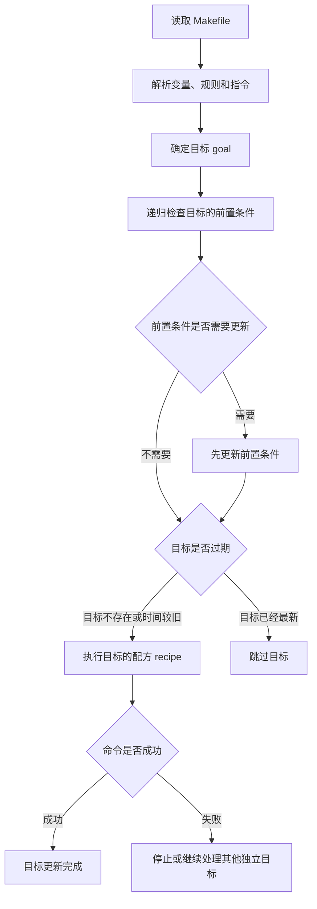
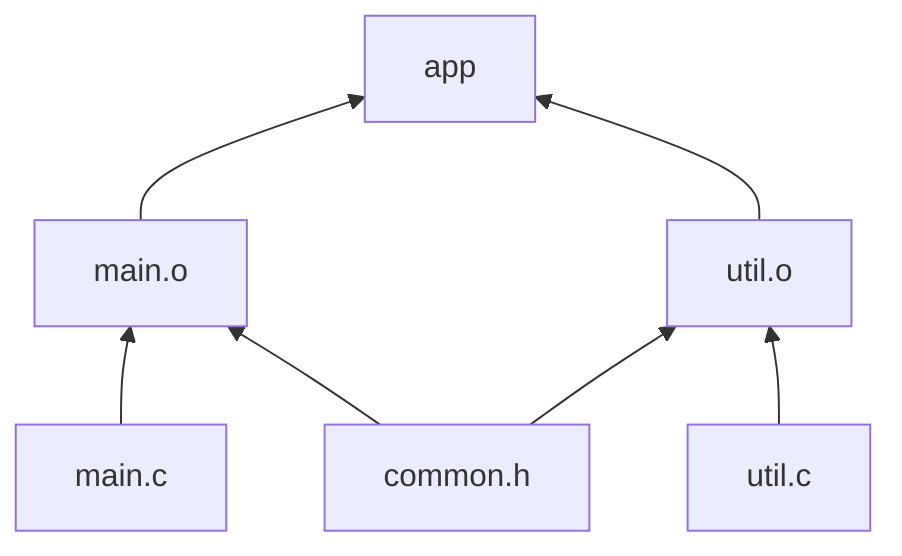

[toc]


## `make` 命令与 GNU Make 系统

下面是一份以 **GNU Make 4.4.1** 为主要基线、兼顾 POSIX `make` 可移植性概念的系统教程。GNU 官方手册将当前手册标注为 GNU Make 4.4.1；GNU 官方发布目录也提供对应版本的软件包。([GNU](https://www.gnu.org/software/make/manual/make.html?utm_source=chatgpt.com))

`make` 是一种**基于依赖关系判断任务是否需要执行的自动化工具**。它最经典的用途是编译 C/C++ 项目，但它本质上并不理解 C、C++、Java 或**任何特定语言**；它只负责：

- 读取构建规则；
- 建立目标之间的依赖关系；
- 判断目标是否已经是最新状态；
- 按正确顺序执行 Shell 命令；
- 尽可能跳过不必要的工作；
- 在依赖关系允许时并行执行任务。

GNU 对 `make` 的官方定义是：根据名为 makefile 的规则文件，**控制可执行文件**及其他**非源文件**的生成。POSIX 也定义了标准化的 `make` 工具，用于更新由其他文件派生出来的文件。([GNU](https://www.gnu.org/software/make/?utm_source=chatgpt.com))

------

## 学习路线

建议按下面的顺序掌握：

| 阶段     | 重点                                          |
| -------- | --------------------------------------------- |
| 入门     | 目标、前置条件、配方、默认目标                |
| 基础     | 时间戳判断、变量、自动变量、伪目标            |
| 实用     | 模式规则、头文件依赖、构建目录                |
| 工程化   | 并行构建、错误处理、调试、配置管理            |
| 进阶     | 静态模式规则、二次展开、多输出规则、递归 Make |
| 可移植性 | GNU Make 扩展、POSIX Make、Shell 差异         |

------

## `make` 的核心思想

### 它不是普通的脚本执行器

下面这种理解并不准确：

> Makefile 是一个按照从上到下顺序执行的 Shell 脚本。

正确的理解是：

> Makefile 描述了一张目标依赖图，`make` 根据用户请求的目标，从依赖图中选择需要更新的节点，并按依赖顺序执行相应配方。

例如：

```make
app: main.o util.o
	cc main.o util.o -o app

main.o: main.c
	cc -c main.c -o main.o

util.o: util.c
	cc -c util.c -o util.o
```

这里表达的不是“先运行第一条，再运行第二条”，而是：

- `app` 依赖 `main.o` 和 `util.o`；
- `main.o` 依赖 `main.c`；
- `util.o` 依赖 `util.c`；
- 生成 `app` 之前，必须先保证两个目标文件都是最新的。

### 工作机制示意图



------

## 最基本的规则结构

GNU Make 的普通规则形式如下：

```make
目标: 前置条件
	配方
```

对应英文术语为：

| 中文     | 英文         | 含义                                   |
| -------- | ------------ | -------------------------------------- |
| 目标     | Target       | 希望生成或更新的文件，也可以是动作名称 |
| 前置条件 | Prerequisite | 目标所依赖的文件或其他目标             |
| 配方     | Recipe       | 更新目标时执行的 Shell 命令            |
| 规则     | Rule         | 目标、前置条件和配方构成的完整定义     |
| 构建目标 | Goal         | 用户本次要求 `make` 更新的目标         |

GNU Make 的规则同时回答两个问题：

1. **什么时候需要更新目标？**
2. **需要更新时应该执行什么命令？**

普通文件目标在以下情况会被认为已经过期：

- 目标文件不存在；
- 某个普通前置条件的修改时间比目标更新。

配方行默认必须以制表符 Tab 开头，而不是普通空格。GNU Make 也允许通过 `.RECIPEPREFIX` 修改配方前缀，但常规 Makefile 通常仍使用 Tab。([GNU](https://www.gnu.org/software/make/manual/html_node/Rule-Syntax.html))

### 一个最小示例

```make
hello: hello.c
	cc hello.c -o hello
```

执行：

```bash
make hello
```

第一次运行时，`hello` 不存在，因此会执行：

```bash
cc hello.c -o hello
```

再次运行时，如果 `hello.c` 没有变化，通常会看到：

```text
make: 'hello' is up to date.
```

修改 `hello.c` 后再次执行，源文件时间戳比可执行文件新，`make` 会重新编译。

------

## Makefile 的名称

GNU Make 默认按照以下顺序查找文件：

1. `GNUmakefile`
2. `makefile`
3. `Makefile`

一般推荐使用：

```text
Makefile
```

它醒目、常见，而且能够被 GNU Make 及许多其他 `make` 实现识别。`GNUmakefile` 更适合明确只支持 GNU Make 扩展的项目。也可以通过 `-f` 指定其他文件名。([GNU](https://www.gnu.org/software/make/manual/html_node/Makefile-Names.html?utm_source=chatgpt.com))

例如：

```bash
make -f build.mk
```

------

## `make` 命令的基本形式

```text
make [选项] [目标...] [变量赋值...]
```

例如：

```bash
make
make all
make clean
make app
make app test
make CC=clang
make MODE=release
make -j8
make -C src
```

### 默认目标

没有显式指定目标时，GNU Make 通常选择 Makefile 中第一个普通规则的第一个目标作为默认目标。

因此常见写法是把 `all` 放在前面：

```make
.PHONY: all

all: app
```

也可以显式设置：

```make
.DEFAULT_GOAL := all
```

规则在文件中的排列顺序通常不决定执行顺序，但会影响默认目标的选择。真正的执行顺序由依赖关系决定。([GNU](https://www.gnu.org/software/make/manual/make.html?utm_source=chatgpt.com))

------

## 常用命令行选项

| 命令                              | 用途                                   |
| --------------------------------- | -------------------------------------- |
| `make`                            | 更新默认目标                           |
| `make target`                     | 更新指定目标                           |
| `make -f file`                    | 使用指定 Makefile                      |
| `make -C dir`                     | 进入指定目录后运行                     |
| `make -j8`                        | 最多同时运行 8 个任务                  |
| `make -n`                         | 打印将执行的命令，通常不实际执行       |
| `make -B`                         | 将目标视为过期，强制重建               |
| `make -k`                         | 出错后继续处理其他独立目标             |
| `make -q`                         | 不构建，仅通过退出状态判断是否需要更新 |
| `make -s`                         | 静默执行，不打印配方                   |
| `make --trace`                    | 显示规则执行和重建原因                 |
| `make --debug=why`                | 解释目标为什么需要重建                 |
| `make -p`                         | 打印规则和变量数据库                   |
| `make -r`                         | 禁用内置隐式规则                       |
| `make -R`                         | 禁用内置变量                           |
| `make --warn-undefined-variables` | 使用未定义变量时发出警告               |
| `make -Otarget -j8`               | 并行构建，并按目标整理输出             |
| `make --shuffle=random`           | 打乱可并行目标顺序，检测隐藏依赖       |

GNU Make 的 `-q` 有三个重要退出状态：

| 状态码 | 含义                   |
| ------ | ---------------------- |
| `0`    | 目标已经是最新状态     |
| `1`    | 至少有一个目标需要更新 |
| `2`    | 出现错误               |

`--trace` 是跟踪规则选择的简洁方式；当前 GNU Make 还提供 `--debug=why` 等更细粒度的调试类型。([GNU](https://www.gnu.org/software/make/manual/html_node/Options-Summary.html?utm_source=chatgpt.com))

### `-n` 的特殊情况

`make -n` 通常只打印命令，但包含 `$(MAKE)` 的递归 Make 配方行会受到特殊处理，可能仍然执行。GNU Make 这样设计是为了让递归构建能够继续向下展示完整操作。([GNU](https://www.gnu.org/software/make/manual/html_node/MAKE-Variable.html?utm_source=chatgpt.com))

------

## Makefile 中包含什么

GNU Make 将 Makefile 的主要内容分为五类：

- 显式规则（Explicit Rule）；
- 隐式规则（Implicit Rule）；
- 变量定义（Variable Definition）；
- 指令（Directive）；
- 注释（Comment）。([GNU](https://www.gnu.org/software/make/manual/html_node/Makefile-Contents.html?utm_source=chatgpt.com))

示例：

```make
# 变量定义
CC := cc

# 条件指令
ifeq ($(DEBUG),1)
CFLAGS += -g
endif

# 包含指令
-include dependencies.mk

# 显式规则
app: main.o
	$(CC) main.o -o app

# 模式形式的隐式规则
%.o: %.c
	$(CC) -c $< -o $@
```

------

## 依赖图与更新时间判断

考虑：

```make
app: main.o util.o
	cc main.o util.o -o app

main.o: main.c common.h
	cc -c main.c -o main.o

util.o: util.c common.h
	cc -c util.c -o util.o
```

依赖图为：



不同修改产生的结果：

| 修改内容        | 需要重建                  |
| --------------- | ------------------------- |
| 什么都没改      | 不执行编译                |
| 修改 `main.c`   | `main.o`、`app`           |
| 修改 `util.c`   | `util.o`、`app`           |
| 修改 `common.h` | `main.o`、`util.o`、`app` |
| 删除 `app`      | 只重新链接 `app`          |
| 删除 `main.o`   | `main.o`、`app`           |

这就是增量构建（Incremental Build）的基本原理。

------

## 普通前置条件与仅顺序前置条件

GNU Make 支持两类前置条件：

- 普通前置条件（Normal Prerequisite）；
- 仅顺序前置条件（Order-only Prerequisite）。

语法：

```make
目标: 普通前置条件 | 仅顺序前置条件
```

普通前置条件同时表达：

- 执行顺序关系；
- 重新构建关系。

仅顺序前置条件只表达：

- 必须先完成；
- 其时间戳变化不应导致目标重建。

典型用途是构建输出目录：

```make
BUILD_DIR := build

build/main.o: src/main.c | $(BUILD_DIR)
	cc -c src/main.c -o build/main.o

$(BUILD_DIR):
	mkdir -p $@
```

如果把目录写成普通前置条件：

```make
build/main.o: src/main.c build
```

那么每当目录因为新增、删除或重命名文件而更新时间戳时，目标文件都可能被不必要地重建。

使用 `|` 后，`build` 必须先存在，但目录时间戳变化不会令 `build/main.o` 过期。([GNU](https://www.gnu.org/software/make/manual/html_node/Prerequisite-Types.html))

------

## 配方与 Shell 的边界

Makefile 同时包含两种语言：

1. Make 语言；
2. Shell 语言。

必须明确当前表达式由谁解析。

### Make 变量与 Shell 变量

```make
NAME := make-value

show:
	@echo "$(NAME)"
	@echo "$$HOME"
```

这里：

- `$(NAME)` 由 `make` 展开；
- `$$HOME` 先由 `make` 转换成 `$HOME`，再由 Shell 展开；
- 在配方中写 `$HOME` 通常会被 Make 当成 `$H` 加普通文本 `OME`。

因此，在配方中把美元符号交给 Shell 时，通常需要写两个：

```make
show:
	@for file in *.c; do \
		echo "$$file"; \
	done
```

### 每一行默认使用独立 Shell

默认情况下，每一条配方行通常由新的子 Shell 执行。([GNU](https://www.gnu.org/s/make/manual/html_node/Execution.html?utm_source=chatgpt.com))

下面的写法通常不能达到预期：

```make
bad:
	cd src
	pwd
```

第二行不会继承第一行的工作目录。

应写成：

```make
good:
	cd src && pwd
```

或者：

```make
good:
	cd src; \
	pwd
```

更推荐使用 `&&`，因为 `cd` 失败时能够阻止后续命令在错误目录下执行：

```make
good:
	cd src && \
	compiler input.c
```

### `.ONESHELL`

声明：

```make
.ONESHELL:
```

后，每个目标的多行配方会作为一个整体交给单个 Shell：

```make
.ONESHELL:

demo:
	cd src
	pwd
	run-command
```

但需要注意：在 `.ONESHELL` 模式下，中间命令失败可能不会自动被 `make` 发现，因为 Make 最终主要看到整个 Shell 的退出状态。GNU Make 手册建议根据需要强化 Shell 的错误处理。([GNU](https://www.gnu.org/software/make/manual/html_node/One-Shell.html))

POSIX Shell 示例：

```make
.ONESHELL:
SHELL := /bin/sh
.SHELLFLAGS := -eu -c
```

使用 Bash 特性的项目可以写：

```make
.ONESHELL:
SHELL := /bin/bash
.SHELLFLAGS := -eu -o pipefail -c
```

使用 Bash 会降低 Makefile 在默认不带 Bash 的系统上的可移植性，应当是明确的工程选择。

------

## 配方前缀字符

配方命令前可以使用特殊前缀。

### `@`：不显示命令本身

```make
hello:
	@echo "hello"
```

输出：

```text
hello
```

而不会先打印：

```text
echo "hello"
```

建议只对展示性输出使用 `@`，不要把所有构建命令全部隐藏，否则发生错误时难以调试。

### `-`：忽略错误

```make
clean:
	-rm -f app
```

即使命令失败，`make` 也继续执行。GNU Make 会丢弃行首的 `-`，然后把剩余内容交给 Shell。([GNU](https://www.gnu.org/s/make/manual/html_node/Errors.html))

不过更推荐让命令本身具有幂等性：

```make
clean:
	rm -f app
```

因为 `rm -f` 在文件不存在时本来就成功，不必额外忽略所有错误。

### `+`：即使处于某些模拟模式也执行

`+` 主要用于递归 Make 或必须执行的特殊命令：

```make
subsystem:
	+$(MAKE) -C subsystem
```

直接使用 `$(MAKE)` 时，GNU Make 已经能识别递归调用，通常不必手动增加 `+`。

------

## 变量基础

变量引用通常使用：

```make
$(VARIABLE)
```

或：

```make
${VARIABLE}
```

推荐统一使用圆括号形式：

```make
$(CC)
$(CFLAGS)
$(OBJECTS)
```

### 常见赋值操作符

| 操作符 | 类型         | 适用场景                   |
| ------ | ------------ | -------------------------- |
| `=`    | 递归展开变量 | 值需要在使用时再展开       |
| `:=`   | 简单展开变量 | 值在定义时立即计算，最常用 |
| `::=`  | 简单展开变量 | 与 `:=` 类似               |
| `:::=` | 立即展开变量 | 高级场景，通常不需要       |
| `?=`   | 条件赋值     | 仅在变量尚未定义时赋值     |
| `+=`   | 追加         | 向现有变量添加内容         |
| `!=`   | Shell 赋值   | 执行 Shell 命令并保存输出  |

GNU Make 当前手册明确支持上述赋值形式。([GNU](https://www.gnu.org/s/make/manual/html_node/Setting.html))

### `=` 与 `:=` 的区别

递归展开：

```make
A = $(B)
B = first
B = second

show:
	@echo "$(A)"
```

结果为：

```text
second
```

因为 `A` 在被使用时才展开 `$(B)`。

简单展开：

```make
B = first
A := $(B)
B = second
```

此时 `A` 为：

```text
first
```

#### 推荐原则

普通静态列表、路径计算和函数结果优先使用 `:=`：

```make
SOURCES := $(wildcard src/*.c)
OBJECTS := $(SOURCES:src/%.c=build/%.o)
```

需要延迟引用时再使用 `=`：

```make
message = compiler is $(CC)
```

### 条件赋值

```make
CC ?= cc
```

表示仅当 `CC` 未定义时才设置。

不过 GNU Make 自带若干预定义变量，例如 `CC`。因此在实际工程中也经常直接写：

```make
CC := cc
```

命令行仍可以通过以下方式覆盖普通 Makefile 赋值：

```bash
make CC=clang
```

### 追加变量

```make
CFLAGS := -O2
CFLAGS += -Wall -Wextra
```

结果相当于：

```make
CFLAGS := -O2 -Wall -Wextra
```

### Shell 赋值

```make
GIT_REV != git rev-parse --short HEAD
```

或：

```make
GIT_REV := $(shell git rev-parse --short HEAD)
```

这类命令通常在 Makefile 读取阶段执行，而不是在目标构建阶段执行。

不要大量使用 `$(shell ...)`：

- 每次执行都可能启动额外进程；
- 会增加解析时间；
- 可能让构建依赖环境状态；
- 不会自动进入正常的文件依赖图。

------

## 编译变量的惯例

C/C++ Makefile 中常用的变量有明确分工：

| 变量       | 用途           | 示例                          |
| ---------- | -------------- | ----------------------------- |
| `CC`       | C 编译器       | `cc`、`gcc`、`clang`          |
| `CXX`      | C++ 编译器     | `c++`、`g++`、`clang++`       |
| `CPPFLAGS` | 预处理器参数   | `-Iinclude -DDEBUG`           |
| `CFLAGS`   | C 编译参数     | `-O2 -Wall`                   |
| `CXXFLAGS` | C++ 编译参数   | `-std=c++20 -O2`              |
| `LDFLAGS`  | 链接器选项     | `-Lvendor/lib`                |
| `LDLIBS`   | 链接库         | `-lm -lpthread`               |
| `AR`       | 静态库归档工具 | `ar`                          |
| `ARFLAGS`  | 归档参数       | `rcs`                         |
| `RM`       | 删除命令       | GNU Make 通常预定义为 `rm -f` |

推荐把选项放到正确的变量中：

```make
CPPFLAGS += -Iinclude
CFLAGS += -O2 -Wall -Wextra
LDFLAGS += -Lthird_party/lib
LDLIBS += -lexample
```

链接时通常将库放在对象文件之后：

```make
app: $(OBJECTS)
	$(CC) $(LDFLAGS) $(OBJECTS) $(LDLIBS) -o $@
```

这对于按从左到右解析静态库符号的链接器尤其重要。

------

## 自动变量

自动变量（Automatic Variable）由 GNU Make 根据当前规则自动设置，只在规则的配方上下文中有效。([GNU](https://www.gnu.org/s/make/manual/html_node/Automatic-Variables.html))

| 自动变量 | 含义                               |
| -------- | ---------------------------------- |
| `$@`     | 当前目标名称                       |
| `$<`     | 第一个前置条件                     |
| `$^`     | 所有普通前置条件，去除重复项       |
| `$+`     | 所有普通前置条件，保留重复项和顺序 |
| `$?`     | 比目标更新的普通前置条件           |
| `$       | `                                  |
| `$*`     | 模式规则匹配得到的主干 Stem        |
| `$%`     | 归档成员目标中的成员名称           |

示例：

```make
app: main.o util.o
	$(CC) $^ -o $@
```

展开后类似：

```bash
cc main.o util.o -o app
```

模式规则：

```make
build/%.o: src/%.c
	$(CC) -c $< -o $@
```

例如构建 `build/main.o` 时：

| 自动变量 | 值             |
| -------- | -------------- |
| `$@`     | `build/main.o` |
| `$<`     | `src/main.c`   |
| `$*`     | `main`         |

### `$^` 与 `$+`

```make
program: a.o libx.a b.o libx.a
```

在配方中：

- `$^` 通常得到 `a.o libx.a b.o`；
- `$+` 得到 `a.o libx.a b.o libx.a`。

当链接顺序和重复库有意义时，使用 `$+`。

### 自动变量不能直接用于普通前置条件列表

下面通常不能工作：

```make
bad: $@.config
```

因为自动变量在普通前置条件的初始展开阶段没有相应值。

需要这种能力时，可以使用 GNU Make 的二次展开功能：

```make
.SECONDEXPANSION:

program: $$@.config
	@echo "using $<"
```

二次展开会在目标上下文中再次展开前置条件，并允许使用经过转义的自动变量。([GNU](https://www.gnu.org/s/make/manual/html_node/Secondary-Expansion.html))

------

## 显式规则

显式规则直接写出目标名称：

```make
app: main.o util.o
	$(CC) main.o util.o -o app
```

它适用于：

- 最终可执行文件；
- 特定生成文件；
- 打包文件；
- 文档；
- 配置文件；
- 具有特殊处理逻辑的单独目标。

目标可以有多个规则：

```make
app: main.o
app: util.o
app:
	$(CC) $^ -o $@
```

GNU Make 会合并这些规则中的前置条件，但一个普通目标通常只能有一个最终有效配方。([GNU](https://www.gnu.org/software/make/manual/html_node/Multiple-Rules.html?utm_source=chatgpt.com))

为了可读性，通常建议把一个目标的主要信息放在一起，除非拆分依赖确实更清晰。

------

## 模式规则

模式规则（Pattern Rule）通过 `%` 描述一类文件之间的转换关系：

```make
%.o: %.c
	$(CC) $(CPPFLAGS) $(CFLAGS) -c $< -o $@
```

`%` 匹配非空的文件名片段，该片段称为主干（Stem）。

例如：

```text
main.o ← main.c
util.o ← util.c
network.o ← network.c
```

只需要一条规则：

```make
%.o: %.c
	$(CC) -c $< -o $@
```

GNU Make 使用模式规则定义或覆盖隐式规则。([GNU](https://www.gnu.org/software/make/manual/html_node/Pattern-Rules.html))

### 带目录的模式规则

```make
build/%.o: src/%.c
	$(CC) $(CPPFLAGS) $(CFLAGS) -c $< -o $@
```

它可以处理：

```text
src/main.c → build/main.o
src/util.c → build/util.o
```

### 不要把 `%` 当作正则表达式

`%` 不是正则表达式中的任意字符序列语法系统，它只是 Make 模式规则中的单个通配主干。

例如：

```make
build/%.o: src/%.c
```

目标和前置条件中的 `%` 代表同一个主干。

------

## 静态模式规则

静态模式规则（Static Pattern Rule）只对明确列出的目标应用模式：

```make
OBJECTS := build/main.o build/util.o

$(OBJECTS): build/%.o: src/%.c
	$(CC) -c $< -o $@
```

它的结构是：

```make
目标列表: 目标模式: 前置条件模式
	配方
```

适用于：

- 只有部分目标遵循某个转换规则；
- 不希望定义全局隐式规则；
- 不同目标集合需要不同编译参数。

例如：

```make
FAST_OBJECTS := build/hash.o build/codec.o
SAFE_OBJECTS := build/parser.o build/config.o

$(FAST_OBJECTS): CFLAGS += -O3
$(SAFE_OBJECTS): CFLAGS += -fstack-protector-strong

$(FAST_OBJECTS) $(SAFE_OBJECTS): build/%.o: src/%.c
	$(CC) $(CPPFLAGS) $(CFLAGS) -c $< -o $@
```

这里还使用了目标专属变量（Target-specific Variable）。

------

## 内置隐式规则

GNU Make 内置了许多隐式规则和变量。例如，在某些情况下，仅写：

```make
app: main.o util.o
```

GNU Make 可能自动推导出：

- 如何从 `.c` 生成 `.o`；
- 如何从 `.o` 链接可执行文件。

GNU Make 官方手册提供了内置隐式规则目录。([GNU](https://www.gnu.org/software/make/manual/html_node/Catalogue-of-Rules.html?utm_source=chatgpt.com))

不过在严肃项目中，建议：

- 明确写出关键模式规则；
- 显式设置编译选项；
- 不要过度依赖环境中可能变化的内置行为。

调试隐式规则时可以使用：

```bash
make --debug=implicit
```

禁用内置规则：

```bash
make -r
```

同时禁用内置规则和变量：

```bash
make -rR
```

也可以在 Makefile 中写：

```make
MAKEFLAGS += -rR
```

但使用前应确认没有依赖内置变量，例如 `RM`、`CC`。

------

## 伪目标

伪目标（Phony Target）表示一个动作，而不是实际文件：

```make
.PHONY: clean

clean:
	rm -f app main.o util.o
```

如果不声明 `.PHONY`，而目录中恰好存在一个名为 `clean` 的文件，`make clean` 可能认为该目标已经存在并且无需执行。

声明后：

```make
.PHONY: all clean test install
```

这些名称始终被当作需要执行的动作目标。

GNU Make 对 `.PHONY` 目标还会跳过隐式规则搜索，因此声明伪目标不仅能避免文件名冲突，也能减少不必要的规则搜索。([GNU](https://www.gnu.org/s/make/manual/html_node/Phony-Targets.html?utm_source=chatgpt.com))

### 不要让真实文件依赖伪目标

错误设计：

```make
.PHONY: prepare

output.bin: prepare input.dat
	generator input.dat -o output.bin
```

因为 `prepare` 永远被视为过期，所以 `output.bin` 每次都会重新生成。

如果 `prepare` 表示一个真实的准备结果，应让它创建一个真实文件，例如戳文件（Stamp File）：

```make
build/.prepared:
	prepare-environment
	touch $@

output.bin: input.dat build/.prepared
	generator input.dat -o $@
```

------

## 空目标和戳文件

有些任务需要记录“某个动作上次完成的时间”，但没有自然输出文件。

可以创建一个空文件：

```make
database.stamp: schema.sql
	update-database schema.sql
	touch $@
```

以后：

- `schema.sql` 没变化时不执行；
- `schema.sql` 更新后重新执行；
- 成功后刷新 `database.stamp` 时间戳。

戳文件比伪目标更适合表示：

> 这个动作只应在输入变化后重新执行。

------

## 多目标规则

### 独立目标

普通冒号表示多个目标相互独立：

```make
small.out large.out: input.txt
	generate --mode=$(basename $@) input.txt -o $@
```

概念上相当于为每个目标分别定义规则。

### 分组目标

当一次命令会同时生成多个文件时，应使用分组目标（Grouped Targets）：

```make
report.html report.json &: report.src
	generate-report \
		--html report.html \
		--json report.json \
		report.src
```

`&:` 表示配方的一次运行会共同生成全部目标。

这与普通多目标规则不同：

```make
report.html report.json: report.src
```

普通 `:` 会把两个目标视为独立目标，可能导致生成命令运行多次，或者在并行构建时产生竞争。

GNU Make 当前手册明确区分了独立目标 `:` 和分组目标 `&:`。([GNU](https://www.gnu.org/s/make/manual/html_node/Multiple-Targets.html))

------

## 常用函数

Make 函数的调用形式通常是：

```make
$(function arguments)
```

### 文件匹配

```make
SOURCES := $(wildcard src/*.c)
```

`wildcard` 返回匹配的现有文件。

### 文本替换

```make
OBJECTS := $(patsubst src/%.c,build/%.o,$(SOURCES))
```

也可以使用替换引用：

```make
OBJECTS := $(SOURCES:src/%.c=build/%.o)
```

### 添加前缀和后缀

```make
NAMES := main util network

SOURCES := $(addprefix src/,$(addsuffix .c,$(NAMES)))
```

结果：

```text
src/main.c src/util.c src/network.c
```

### 目录和文件名处理

```make
PATH_VALUE := src/module/main.c

DIR_VALUE := $(dir $(PATH_VALUE))
FILE_VALUE := $(notdir $(PATH_VALUE))
BASE_VALUE := $(basename $(PATH_VALUE))
SUFFIX_VALUE := $(suffix $(PATH_VALUE))
```

### 筛选

```make
FILES := main.c util.c notes.txt image.png

C_SOURCES := $(filter %.c,$(FILES))
NON_C := $(filter-out %.c,$(FILES))
```

### 排序并去重

```make
UNIQUE := $(sort beta alpha beta gamma)
```

结果：

```text
alpha beta gamma
```

注意：`sort` 不只是排序，也会删除重复项。

### 条件选择

```make
MODE ?= debug

OPT_FLAGS := $(if $(filter release,$(MODE)),-O3,-O0 -g)
```

对于复杂条件，通常使用 `ifeq` 比嵌套 `if` 函数更清晰。

------

## 条件指令

GNU Make 条件指令在读取 Makefile 时决定哪些文本参与解析。

```make
MODE ?= debug

ifeq ($(MODE),debug)
CFLAGS += -O0 -g
else ifeq ($(MODE),release)
CFLAGS += -O3 -DNDEBUG
else
$(error unsupported MODE: $(MODE))
endif
```

运行：

```bash
make MODE=debug
make MODE=release
```

常用条件：

```make
ifeq ($(A),$(B))
endif

ifneq ($(A),$(B))
endif

ifdef VARIABLE
endif

ifndef VARIABLE
endif
```

### 注意空白

推荐对用户输入先规范化：

```make
MODE := $(strip $(MODE))
```

否则意外空格可能导致条件判断失败。

------

## `include` 与拆分 Makefile

可以把公共配置或自动生成依赖拆分到其他文件：

```make
include config.mk
include rules/common.mk
```

如果文件不存在时不应报错：

```make
-include local.mk
```

或：

```make
sinclude local.mk
```

`include` 会暂停读取当前 Makefile，读取指定文件后再继续。文件名中的变量和函数也会被展开。`-include` 在文件缺失或不能生成时不报告致命错误。([GNU](https://www.gnu.org/software/make/manual/html_node/Include.html))

常见用途：

```text
Makefile
config.mk
rules/
  compiler.mk
  packaging.mk
build/
  main.d
  util.d
```

### 本地配置文件

```make
-include local.mk
```

`local.mk` 可以包含开发者本地设置：

```make
CC := clang
CFLAGS += -fsanitize=address
```

通常将它加入版本控制忽略文件，避免每位开发者的本地设置互相冲突。

------

## C/C++ 头文件自动依赖

仅写：

```make
build/main.o: src/main.c
```

是不够的。

如果 `main.c` 包含：

```c
#include "common.h"
```

那么修改 `common.h` 后，`main.o` 也必须重新编译。

手工维护所有头文件依赖容易遗漏。GNU Make 官方手册建议由编译器自动生成依赖文件；现代 GCC 和兼容编译器通常可使用 `-MMD`、`-MP` 等参数。([GNU](https://www.gnu.org/s/make/manual/html_node/Automatic-Prerequisites.html))

推荐规则：

```make
CFLAGS += -MMD -MP

build/%.o: src/%.c | build
	$(CC) $(CPPFLAGS) $(CFLAGS) -c $< -o $@
```

编译时会生成类似：

```text
build/main.o
build/main.d
```

然后包含所有 `.d` 文件：

```make
DEPS := $(OBJECTS:.o=.d)

-include $(DEPS)
```

参数作用：

| 参数         | 作用                                       |
| ------------ | ------------------------------------------ |
| `-MMD`       | 生成用户头文件依赖，不列出系统头文件       |
| `-MP`        | 为头文件生成空规则，减少删除头文件后的报错 |
| `-MF file`   | 指定依赖文件路径                           |
| `-MT target` | 指定依赖规则中的目标                       |
| `-MQ target` | 指定目标并转义 Make 特殊字符               |

------

## 一个完整的现代 C 项目示例

目录结构：

```text
project/
├── Makefile
├── include/
│   └── util.h
└── src/
    ├── main.c
    └── util.c
```

Makefile：

```make
.DELETE_ON_ERROR:
.DEFAULT_GOAL := all

CC := cc

CPPFLAGS += -Iinclude
CFLAGS += -O2 -g
CFLAGS += -Wall -Wextra -Wpedantic
CFLAGS += -MMD -MP

LDFLAGS :=
LDLIBS :=

SRC_DIR := src
BUILD_DIR := build

TARGET := $(BUILD_DIR)/app

SOURCES := $(wildcard $(SRC_DIR)/*.c)
OBJECTS := $(patsubst $(SRC_DIR)/%.c,$(BUILD_DIR)/%.o,$(SOURCES))
DEPS := $(OBJECTS:.o=.d)

.PHONY: all clean test rebuild

all: $(TARGET)

$(TARGET): $(OBJECTS)
	$(CC) $(LDFLAGS) $(OBJECTS) $(LDLIBS) -o $@

$(BUILD_DIR)/%.o: $(SRC_DIR)/%.c | $(BUILD_DIR)
	$(CC) $(CPPFLAGS) $(CFLAGS) -c $< -o $@

$(BUILD_DIR):
	mkdir -p $@

test: $(TARGET)
	$(TARGET) --self-test

clean:
	$(RM) -r $(BUILD_DIR)

rebuild:
	$(MAKE) clean
	$(MAKE) all

-include $(DEPS)
```

### 这份 Makefile 的行为

执行：

```bash
make
```

会：

1. 选择默认目标 `all`；
2. 发现 `all` 依赖 `build/app`；
3. 发现程序依赖所有对象文件；
4. 必要时创建 `build`；
5. 编译发生变化的源文件；
6. 链接程序；
7. 加载 `.d` 文件中的头文件依赖。

执行：

```bash
make -j8
```

不同 `.c` 文件的编译可以并行执行。

执行：

```bash
make CC=clang
```

会在本次调用中使用 Clang。

执行：

```bash
make CFLAGS="-O0 -g3 -Wall"
```

会使用命令行提供的编译选项。

### 为什么使用 `.DELETE_ON_ERROR`

如果配方在写入目标文件后失败，可能留下不完整但时间戳较新的目标。下次运行时，Make 可能错误地认为这个损坏文件已经是最新状态。

声明：

```make
.DELETE_ON_ERROR:
```

后，GNU Make 会在生成目标的配方失败时删除相应目标。GNU Make 手册称这通常正是期望的行为。([GNU](https://www.gnu.org/s/make/manual/html_node/Errors.html))

------

## 并行构建

GNU Make 默认一次执行一个配方。使用 `-j` 可以并行执行相互独立的配方：

```bash
make -j8
```

表示最多使用 8 个任务槽（Job Slot）。

没有数字的：

```bash
make -j
```

表示不为任务槽设置固定上限，可能启动大量进程，应谨慎使用。([GNU](https://www.gnu.org/s/make/manual/html_node/Parallel.html))

### 并行构建的前提

并行构建正确与否，取决于依赖图是否完整。

错误示例：

```make
package: app
	create-package

app:
	generate-header
	compile-program
```

如果其他目标也需要生成的头文件，但依赖中没有写出来，并行模式下就可能随机失败。

正确做法是把中间结果显式建模：

```make
generated/config.h: config/schema.json
	generate-config $< -o $@

build/main.o: src/main.c generated/config.h
	$(CC) -c $< -o $@

app: build/main.o
	$(CC) $^ -o $@
```

### 不要用配方顺序代替依赖关系

不可靠：

```make
all:
	generate
	compile
	link
```

更好的设计：

```make
all: app

generated.file: source.spec
	generate source.spec -o generated.file

object.o: source.c generated.file
	compile source.c -o object.o

app: object.o
	link object.o -o app
```

后者：

- 能增量构建；
- 能并行；
- 能准确跳过无需执行的步骤；
- 能清晰解释失败位置。

### 并行输出同步

并行构建时，不同任务的输出可能交错。GNU Make 提供：

```bash
make -j8 -Otarget
```

或：

```bash
make -j8 --output-sync=target
```

同步粒度包括：

| 模式      | 行为                     |
| --------- | ------------------------ |
| `none`    | 不同步，输出可能交错     |
| `line`    | 按配方行整理输出         |
| `target`  | 按目标整理完整配方输出   |
| `recurse` | 按递归 Make 调用整理输出 |

仅指定 `-O` 时，默认使用 `target` 模式。([GNU](https://www.gnu.org/software/make/manual/html_node/Parallel-Output.html?utm_source=chatgpt.com))

### 使用 `--shuffle` 检测隐藏依赖

如果构建只能在某种“偶然顺序”下成功，说明依赖图可能不完整。

可以多次运行：

```bash
make clean
make -j8 --shuffle=random
```

GNU Make 会打乱允许并行目标的执行顺序，从而提高隐藏依赖和竞争条件暴露的概率。该选项属于当前 GNU Make 的命令行功能。([GNU](https://www.gnu.org/software/make/manual/html_node/Options-Summary.html?utm_source=chatgpt.com))

------

## 递归 Make

递归 Make 是指一个 Makefile 调用另一个目录中的 Makefile：

```make
subsystem:
	$(MAKE) -C subsystem
```

不要写：

```make
subsystem:
	make -C subsystem
```

应始终使用：

```make
$(MAKE)
```

因为它能够：

- 使用与顶层相同的 Make 程序；
- 传递相关命令行选项；
- 正确协调并行任务槽；
- 正确处理 `-n`、`-t`、`-q` 等特殊模式。([GNU](https://www.gnu.org/s/make/manual/html_node/Recursion.html))

### 多目录示例

```make
SUBDIRS := library application tests

.PHONY: all clean $(SUBDIRS)

all: library application tests

application tests: library

$(SUBDIRS):
	$(MAKE) -C $@

clean:
	@for dir in $(SUBDIRS); do \
		$(MAKE) -C "$$dir" clean || exit $$?; \
	done
```

这里明确写出：

```make
application tests: library
```

表示应用和测试需要在库之后构建。

### 是否应使用递归 Make

工程建议：

- 独立子项目可以使用递归 Make；
- 小型和中型单仓库项目，优先考虑单一完整依赖图；
- 递归层级过深会让跨目录依赖和并行调度更难分析；
- 不要把目录存在关系误当作真实的构建依赖。

------

## 目录搜索

GNU Make 支持 `VPATH` 和 `vpath`，用于查找不在当前目录中的前置条件。([GNU](https://www.gnu.org/s/make/manual/html_node/General-Search.html?utm_source=chatgpt.com))

全局路径：

```make
VPATH := src include
```

按模式设置：

```make
vpath %.c src
vpath %.h include
```

然后可以写：

```make
main.o: main.c util.h
	$(CC) -c $< -o $@
```

不过现代项目通常更推荐在目标和前置条件中明确写出目录：

```make
build/main.o: src/main.c include/util.h
```

显式路径更容易：

- 调试；
- 阅读；
- 与 IDE 和其他工具集成；
- 避免同名文件产生歧义。

------

## 特殊目标

GNU Make 提供许多以点开头的特殊目标。

| 特殊目标           | 作用                                  |
| ------------------ | ------------------------------------- |
| `.PHONY`           | 声明动作目标                          |
| `.DEFAULT_GOAL`    | 指定默认目标                          |
| `.DELETE_ON_ERROR` | 配方失败时删除不完整目标              |
| `.ONESHELL`        | 每个目标使用一个 Shell 执行全部配方行 |
| `.NOTPARALLEL`     | 禁止或限制并行                        |
| `.SECONDEXPANSION` | 启用前置条件二次展开                  |
| `.PRECIOUS`        | 中断或失败时保留指定目标              |
| `.SECONDARY`       | 防止中间文件被自动删除                |
| `.SILENT`          | 对指定目标隐藏配方输出                |
| `.IGNORE`          | 对指定目标忽略配方错误                |
| `.SUFFIXES`        | 管理旧式后缀规则                      |
| `.DEFAULT`         | 为没有其他规则的目标提供默认配方      |

GNU Make 手册集中定义了这些特殊目标，并说明 `.NOTPARALLEL`、`.ONESHELL` 等目标对执行方式的影响。([GNU](https://www.gnu.org/s/make/manual/html_node/Special-Targets.html?utm_source=chatgpt.com))

### 推荐的基础设置

许多项目可以考虑：

```make
.DELETE_ON_ERROR:
.DEFAULT_GOAL := all
```

不建议全局使用：

```make
.SILENT:
.IGNORE:
```

因为它们容易隐藏命令和真实错误。

------

## 目标专属变量

可以只为某个目标及其依赖设置变量：

```make
debug: CFLAGS += -O0 -g3
debug: app

release: CFLAGS += -O3 -DNDEBUG
release: app
```

不过这里存在一个重要问题：`debug` 和 `release` 最终生成同一个 `app` 和同一组对象文件。

如果先执行：

```bash
make debug
```

再执行：

```bash
make release
```

Make 默认不会因为编译命令变化而自动重建对象文件。

更可靠的设计是为不同配置使用不同目录：

```make
MODE ?= debug
BUILD_DIR := build/$(MODE)
```

例如：

```text
build/debug/main.o
build/release/main.o
```

这样不同配置不会互相污染。

------

## Make 默认不追踪命令变化

`make` 的基础判断依据主要是目标和前置条件文件的存在状态与时间戳，而不是“上次运行了什么命令”。

例如：

```make
CFLAGS := -O0
```

改成：

```make
CFLAGS := -O3
```

已有对象文件的时间戳没有变化，因此 Make 不一定重新编译。

常见解决方案：

- 切换编译配置时执行完整重建；
- 使用独立构建目录；
- 把生成的配置文件作为前置条件；
- 创建包含配置内容或哈希的戳文件；
- 使用更高层构建系统生成 Makefile。

对于初学项目，最推荐：

```text
build/debug/
build/release/
```

而不是让不同配置共享同一套 `.o` 文件。

------

## 错误处理

### Shell 退出状态

配方执行后，GNU Make 检查 Shell 退出状态：

- `0` 表示成功；
- 非 `0` 通常表示失败。

发生未忽略错误时：

- 当前目标构建失败；
- 依赖该目标的其他目标不能继续；
- 默认情况下 Make 停止；
- 使用 `-k` 时继续尝试其他独立目标。([GNU](https://www.gnu.org/s/make/manual/html_node/Errors.html))

### 不要随意隐藏失败

不推荐：

```make
build:
	-command-that-must-succeed
```

推荐：

```make
build:
	command-that-must-succeed
```

只有当失败确实是允许结果时才使用 `-`。

### 使用临时文件保证原子性

如果生成大型文件，推荐先生成临时文件，成功后再重命名：

```make
data.bin: source.dat
	generator $< -o $@.tmp
	mv $@.tmp $@
```

更严格地处理清理：

```make
data.bin: source.dat
	@set -e; \
	tmp="$@.tmp"; \
	trap 'rm -f "$$tmp"' EXIT HUP INT TERM; \
	generator "$<" -o "$$tmp"; \
	mv "$$tmp" "$@"; \
	trap - EXIT
```

这样可以减少失败后留下半成品目标的概率。

------

## 常见错误与排查

### `missing separator`

典型错误：

```text
Makefile:12: *** missing separator. Stop.
```

最常见原因是配方前使用了空格，而不是 Tab：

```make
target:
    echo "wrong"
```

正确：

```make
target:
	echo "correct"
```

检查编辑器是否把 Tab 自动转换为空格。

### `No rule to make target`

例如：

```text
No rule to make target 'config.h', needed by 'main.o'
```

含义通常是：

- 前置条件文件不存在；
- 没有规则能够生成它；
- 路径写错；
- 文件名大小写不一致；
- 自动依赖文件引用了已经删除的文件。

使用 GCC 的 `-MP` 可以缓解删除头文件后旧 `.d` 文件造成的一类错误。([GNU Compiler Collection](https://gcc.gnu.org/onlinedocs/gcc/Preprocessor-Options.html?utm_source=chatgpt.com))

### 目标总是重新构建

可能原因：

- 配方没有真正创建 `$@`；
- 目标被声明为 `.PHONY`；
- 某个普通前置条件总是更新；
- 目标时间戳早于前置条件；
- 依赖了目录时间戳；
- 系统时钟不同步；
- 生成程序保留了旧时间戳。

检查：

```bash
make --debug=why target
```

或：

```bash
make --trace target
```

### 修改头文件后没有重新编译

原因通常是没有生成或包含头文件依赖。

检查：

```make
CFLAGS += -MMD -MP
DEPS := $(OBJECTS:.o=.d)
-include $(DEPS)
```

### Shell 变量为空

错误：

```make
show:
	value=hello; echo "$value"
```

Make 可能把 `$v` 当作 Make 变量。

正确：

```make
show:
	value=hello; echo "$$value"
```

### `cd` 没有影响下一行

错误：

```make
run:
	cd tools
	./program
```

正确：

```make
run:
	cd tools && ./program
```

### 并行模式下偶尔失败

如果：

```bash
make
```

稳定成功，而：

```bash
make -j8
```

偶尔失败，通常意味着：

- 缺少依赖边；
- 两个任务写同一临时文件；
- 多个任务写同一输出；
- 使用固定名称的临时目录；
- 递归 Make 没有使用 `$(MAKE)`；
- 一个规则产生多个输出却没有使用分组目标。

### `make clean all -j8` 出现随机问题

命令：

```bash
make clean all -j8
```

把 `clean` 和 `all` 作为两个独立目标交给 Make。

如果它们之间没有依赖关系，Make 可以让它们并行运行，从而出现：

- 一边编译；
- 一边删除构建结果。

应分开执行：

```bash
make clean
make -j8 all
```

或者使用一个明确串行的递归目标：

```make
.PHONY: rebuild

rebuild:
	$(MAKE) clean
	$(MAKE) all
```

运行：

```bash
make -j8 rebuild
```

两个递归调用仍按配方行的先后顺序执行。

------

## 可移植性

### GNU Make 与其他 Make 实现

不同系统可能提供：

- GNU Make；
- BSD Make；
- System V Make；
- POSIX Make；
- Microsoft NMake；
- 其他兼容或部分兼容实现。

GNU Make 扩展非常丰富，例如：

- `%` 模式规则；
- `.PHONY`；
- `$(wildcard ...)`；
- `$(call ...)`；
- `$(eval ...)`；
- 仅顺序前置条件；
- 二次展开；
- 分组目标；
- 大量字符串和文件名函数。

如果项目明确要求 GNU Make，应在文档中写明：

```text
Requires GNU Make 4.4 or newer.
```

也可以在 Makefile 中检查：

```make
ifeq ($(origin MAKE_VERSION),undefined)
$(error GNU Make is required)
endif
```

不过 `MAKE_VERSION` 的存在并不能严格证明所有期望功能都受支持，真正严格的项目应检查所需版本或特性。

### 查看版本

```bash
make --version
```

在部分 BSD 系统上，系统默认的 `make` 可能不是 GNU Make，GNU Make 的命令名可能是：

```bash
gmake
```

### Shell 可移植性

GNU Make 在类 Unix 环境中通常使用 `/bin/sh` 执行配方。官方手册也指出，除非 Makefile 另行设置，配方通常由 `/bin/sh` 解释。([GNU](https://www.gnu.org/s/make/manual/html_node/Recipes.html?utm_source=chatgpt.com))

如果追求可移植性，避免默认使用：

- Bash 数组；
- `[[ ... ]]`；
- Bash 进程替换；
- `source`；
- `shopt`；
- `set -o pipefail`。

POSIX Shell 对应写法通常使用：

```sh
[ -f "$file" ]
```

而不是：

```bash
[[ -f "$file" ]]
```

确实需要 Bash 时，应明确声明：

```make
SHELL := /bin/bash
```

------

## Makefile 最佳实践

### 把输出建模为真实目标

不推荐：

```make
generate:
	generator input
```

如果命令生成 `output.dat`，推荐：

```make
output.dat: input.dat
	generator $< -o $@
```

这样 Make 才能进行增量判断。

### 明确写出全部真实依赖

不要依赖“它通常会先运行”。

凡是任务 B 需要任务 A 的输出，就应在依赖图中写出来：

```make
B: A
```

### 动作目标声明为 `.PHONY`

```make
.PHONY: all clean test install lint format
```

但不要把真实文件声明为 `.PHONY`。

### 使用仅顺序依赖创建目录

```make
$(OBJECTS): | $(BUILD_DIR)
```

避免目录时间戳导致大量无意义重建。

### 配方使用自动变量

推荐：

```make
build/%.o: src/%.c
	$(CC) $(CPPFLAGS) $(CFLAGS) -c $< -o $@
```

不推荐：

```make
build/%.o: src/%.c
	$(CC) $(CPPFLAGS) $(CFLAGS) -c src/$*.c -o build/$*.o
```

自动变量更准确，也更容易适应路径变化。

### 保留用户覆盖能力

推荐：

```make
CC := cc
CFLAGS := -O2
```

用户仍可执行：

```bash
make CC=clang CFLAGS="-O0 -g"
```

谨慎使用：

```make
override CFLAGS += ...
```

因为它会强制修改命令行传入值。

### 不要滥用 Shell

能用 Make 函数完成的静态文件名处理，优先使用 Make 函数：

```make
SOURCES := $(wildcard src/*.c)
OBJECTS := $(patsubst src/%.c,build/%.o,$(SOURCES))
```

不要为了得到简单文件列表启动多个 Shell 进程。

### 不要滥用 Make 元编程

GNU Make 支持：

```make
$(call ...)
$(foreach ...)
$(eval ...)
```

这些能力很强，但过度使用会使 Makefile 难以理解。

推荐顺序：

1. 普通规则；
2. 模式规则；
3. 静态模式规则；
4. 简单函数；
5. 最后才考虑 `eval` 生成规则。

### 让并行构建成为默认测试方式

持续集成中至少测试：

```bash
make clean
make -j8
```

并定期测试：

```bash
make clean
make -j8 --shuffle=random
```

这能够更早发现隐藏依赖和共享临时文件问题。

### 不隐藏关键命令

可以对友好提示使用 `@`：

```make
app: $(OBJECTS)
	@printf '%s\n' "Linking $@"
	$(CC) $(OBJECTS) -o $@
```

但不要全局 `.SILENT`，否则失败日志缺少关键上下文。

### 清理目标只删除已知输出

推荐：

```make
clean:
	$(RM) $(OBJECTS) $(DEPS) $(TARGET)
```

或者删除专用构建目录：

```make
clean:
	$(RM) -r $(BUILD_DIR)
```

避免在变量可能为空时执行危险的宽泛删除命令。

------

## 调试方法

### 查看将要执行的命令

```bash
make -n target
```

### 查看目标为什么重建

```bash
make --debug=why target
```

### 跟踪规则执行

```bash
make --trace target
```

### 查看隐式规则搜索

```bash
make --debug=implicit target
```

### 查看所有变量和规则

```bash
make -p
```

只查看数据库，尽量不执行目标：

```bash
make -qp
```

查看内置规则和变量：

```bash
make -p -f /dev/null
```

### 在 Makefile 中打印变量

```make
$(info SOURCES=$(SOURCES))
$(info OBJECTS=$(OBJECTS))
```

警告但继续：

```make
$(warning MODE is not specified)
```

立即失败：

```make
$(error unsupported platform: $(PLATFORM))
```

### 创建诊断目标

```make
.PHONY: print-%

print-%:
	@printf '%s=%s\n' '$*' '$($*)'
```

使用：

```bash
make print-CC
make print-CFLAGS
make print-OBJECTS
```

需要注意，这种动态变量查看方式是 GNU Make 风格的便利技巧，并非所有 Make 实现都支持相同语义。

------

## 进阶：使用 `define` 和 `call`

### 多行变量

```make
define run-test
	@printf '%s\n' "Running $(1)"
	@./$(1)
endef
```

调用：

```make
test-unit:
	$(call run-test,build/unit-test)
```

在 `call` 中：

| 变量   | 含义             |
| ------ | ---------------- |
| `$(0)` | 被调用变量的名称 |
| `$(1)` | 第一个参数       |
| `$(2)` | 第二个参数       |

### 使用 `eval` 生成规则

```make
PROGRAMS := client server

client_SOURCES := client.c network.c
server_SOURCES := server.c network.c

define PROGRAM_template
$(1): $$($(1)_SOURCES:.c=.o)
	$$(CC) $$(LDFLAGS) $$^ $$(LDLIBS) -o $$@
endef

$(foreach program,$(PROGRAMS),\
	$(eval $(call PROGRAM_template,$(program))))
```

`eval` 会先展开参数，然后把结果作为新的 Makefile 内容再次解析，因此经常需要双重美元符号：

```make
$$@
$$^
$$(CC)
```

只有在重复规则很多、普通模式规则无法清晰表达时才建议使用这种方式。

------

## 进阶：二次展开

普通情况下，前置条件在读取 Makefile 时展开。

启用：

```make
.SECONDEXPANSION:
```

可以延迟部分前置条件到目标更新阶段展开：

```make
main_OBJECTS := main.o util.o
test_OBJECTS := test.o util.o

.SECONDEXPANSION:

main test: $$($$@_OBJECTS)
	$(CC) $^ -o $@
```

对于 `main`：

```make
$$($$@_OBJECTS)
```

二次展开后相当于：

```make
$(main_OBJECTS)
```

对于 `test` 则相当于：

```make
$(test_OBJECTS)
```

GNU Make 的二次展开发生在目标上下文中，因此可以使用适用的自动变量，但具体规则类型存在细节差异。([GNU](https://www.gnu.org/s/make/manual/html_node/Secondary-Expansion.html))

这项功能适合：

- 同类目标拥有不同依赖集合；
- 依赖名称由目标名称推导；
- 希望减少重复规则。

不适合初学 Makefile 的基础设计；能用显式规则清晰表达时，显式规则通常更易维护。

------

## Make 适合与不适合的任务

### 很适合

- C/C++ 增量编译；
- 文档生成；
- 代码生成；
- 静态网站构建；
- 测试、检查和打包入口；
- 数据文件之间的转换；
- 由文件依赖驱动的工作流；
- 为常用开发命令提供统一入口。

### 不太适合

- 主要依赖数据库或远程服务状态的工作流；
- 高度动态的分布式任务编排；
- 复杂的长期运行流程；
- 需要强类型配置模型的大型跨平台工程；
- 需要可靠追踪命令内容、环境和工具链哈希的构建；
- 大量非文件状态驱动的业务流程。

Make 最擅长的问题形式是：

```text
当输入文件比输出文件更新时，运行某个确定的转换命令。
```

------

## 常用目标命名

| 目标        | 常见含义               |
| ----------- | ---------------------- |
| `all`       | 构建主要产物           |
| `clean`     | 删除生成文件           |
| `distclean` | 删除生成文件及配置结果 |
| `test`      | 运行测试               |
| `check`     | 执行验证或测试         |
| `install`   | 安装产物               |
| `uninstall` | 卸载产物               |
| `lint`      | 静态检查               |
| `format`    | 格式化代码             |
| `docs`      | 生成文档               |
| `package`   | 生成发布包             |
| `release`   | 构建发布版本           |
| `help`      | 显示可用目标           |

帮助目标示例：

```make
.PHONY: help

help:
	@printf '%s\n' \
		'make              Build the application' \
		'make test         Run tests' \
		'make clean        Remove generated files' \
		'make MODE=release Build release configuration'
```

------

## 推荐的学习练习

### 练习：单文件程序

实现：

```text
hello.c → hello
```

要求：

- `make` 构建；
- 第二次运行不重新编译；
- 修改源文件后重新编译；
- `make clean` 清理。

### 练习：多文件程序

实现：

```text
main.c
util.c
util.h
```

要求：

- 分别生成 `.o`；
- 只重编译发生变化的源文件；
- 修改 `util.h` 后正确重编译相关文件。

### 练习：独立构建目录

实现：

```text
src/*.c → build/*.o → build/app
```

要求：

- 使用模式规则；
- 使用仅顺序依赖创建 `build`；
- 使用自动变量。

### 练习：自动头文件依赖

要求：

- 使用 `-MMD -MP`；
- 自动生成 `.d`；
- 使用 `-include`；
- 删除头文件后能得到合理错误或正确恢复。

### 练习：并行构建

要求：

- `make -j8` 正确；
- 使用 `-Otarget` 整理日志；
- 使用 `--shuffle=random` 检查隐藏依赖。

### 练习：多配置构建

实现：

```text
build/debug/
build/release/
```

要求：

- `make MODE=debug`；
- `make MODE=release`；
- 两种配置互不污染。

------

## 快速参考

### 最小结构

```make
.PHONY: all clean

all: app

app: main.o util.o
	$(CC) $^ -o $@

%.o: %.c
	$(CC) $(CPPFLAGS) $(CFLAGS) -c $< -o $@

clean:
	$(RM) app main.o util.o
```

### 推荐工程骨架

```make
.DELETE_ON_ERROR:
.DEFAULT_GOAL := all

CC := cc
CPPFLAGS += -Iinclude
CFLAGS += -O2 -Wall -Wextra -MMD -MP

BUILD_DIR := build
TARGET := $(BUILD_DIR)/app

SOURCES := $(wildcard src/*.c)
OBJECTS := $(patsubst src/%.c,$(BUILD_DIR)/%.o,$(SOURCES))
DEPS := $(OBJECTS:.o=.d)

.PHONY: all clean

all: $(TARGET)

$(TARGET): $(OBJECTS)
	$(CC) $(LDFLAGS) $^ $(LDLIBS) -o $@

$(BUILD_DIR)/%.o: src/%.c | $(BUILD_DIR)
	$(CC) $(CPPFLAGS) $(CFLAGS) -c $< -o $@

$(BUILD_DIR):
	mkdir -p $@

clean:
	$(RM) -r $(BUILD_DIR)

-include $(DEPS)
```

### 最重要的原则

- Makefile 描述依赖关系，不是普通顺序脚本。
- 规则应尽量生成其声明的目标 `$@`。
- 真实依赖必须完整写入依赖图。
- 动作目标应声明为 `.PHONY`。
- 输出目录应使用仅顺序前置条件。
- 配方中的 Shell 美元符号通常写成 `$$`。
- 每条配方行默认使用独立 Shell。
- 使用 `$@`、`$<`、`$^` 等自动变量。
- C/C++ 项目应自动生成头文件依赖。
- 应确保 `make -j` 能正确工作。
- 递归构建必须调用 `$(MAKE)`。
- 不同构建配置最好使用不同输出目录。
- 配方失败时考虑启用 `.DELETE_ON_ERROR`。
- 使用 `--trace`、`--debug=why` 和 `-p` 调试。
- 不要用 `make clean all -j` 代替两个顺序命令。
- 能用简单规则表达时，不要过早使用 `eval` 元编程。

## 总结

`make` 的真正价值不在于缩短命令，而在于把工程任务建模成一张可靠的依赖图。

一个高质量 Makefile 应当具备以下特点：

- 依赖关系完整；
- 增量构建准确；
- 并行构建安全；
- 配方失败可被正确检测；
- 中间产物和最终产物清晰；
- 用户能够覆盖工具链和参数；
- 不依赖偶然执行顺序；
- 调试信息充分；
- GNU Make 扩展的使用是有意识的；
- Make 语法与 Shell 语法边界明确。

掌握这些原则后，`make` 不只是一个编译命令，而是一套通用、透明且高度可组合的文件依赖自动化模型。

可继续将这份教程整理成“GNU Make 速查手册”或“循序渐进的配套练习与答案”。