[toc]

## 大纲

| 模块                 | 你需要建立的心智模型                                         | 关键术语                                       |
| -------------------- | ------------------------------------------------------------ | ---------------------------------------------- |
| 大模型到底是什么     | 它是一个基于大量数据训练出来的“条件生成器”，根据上下文预测下一个 token | LLM、Token、Next-token Prediction              |
| 输入如何被模型理解   | 文本先被切成 token，再转成向量，进入神经网络                 | Tokenization、Embedding                        |
| Transformer 如何工作 | 模型通过注意力机制判断“当前 token 应该重点参考哪些上下文”    | Transformer、Self-Attention、Attention Head    |
| 训练阶段发生什么     | 先通过海量文本学语言规律，再通过人类偏好或规则调成更会帮人的助手 | Pretraining、SFT、RLHF、Post-training          |
| 推理阶段发生什么     | 模型不是一次性写完整答案，而是逐 token 生成                  | Inference、Logits、Sampling、Temperature       |
| 上下文和记忆的区别   | 上下文是本次请求带进去的工作区，记忆或知识库是外部系统能力   | Context Window、Memory、RAG                    |
| 为什么会幻觉         | 模型会生成“看起来合理”的内容，但不一定真实                   | Hallucination、Grounding、Uncertainty          |
| RAG 和工具调用       | 用外部资料、搜索、数据库、函数来补足模型本身知识             | RAG、Tool Calling、Function Calling            |
| 缓存和成本           | 缓存通常复用重复 prompt 前缀的计算结果，不是复用答案         | KV Cache、Prompt Cache、Context Cache          |
| 如何正确使用         | 把任务、上下文、约束、输出格式讲清楚，并建立评估和验证流程   | Prompt Engineering、Context Engineering、Evals |

------

## 先用一句话建立直觉

**大语言模型（Large Language Model, LLM）本质上是一个“根据已有上下文，预测接下来最可能出现什么 token”的模型。**

它看起来像在“理解、推理、写作、翻译、编程”，但底层机制更接近：

> 给定前面的内容，计算下一个 token 的概率分布，然后选择一个 token，继续重复这个过程。

现代 GPT 类模型通常建立在 Transformer 架构上。Transformer 最初由 2017 年的论文《Attention Is All You Need》提出，其核心创新是用注意力机制（Attention Mechanism）处理序列，而不是依赖传统循环网络或卷积结构；后来的 GPT-4 技术报告也描述 GPT-4 是 Transformer-based，并通过预测文档中的下一个 token 进行预训练。([arXiv](https://arxiv.org/abs/1706.03762?utm_source=chatgpt.com))

------

## 大模型的一次完整工作流程

当你输入一句话时，模型并不是直接“读中文句子”。它会经历以下过程：

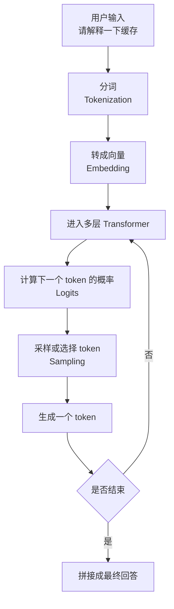

这个流程里最重要的是：**模型每次只是在生成下一个 token，但由于它把大量上下文、语言规律、代码模式、事实关联和指令偏好都压缩进参数中，所以表现得像是在完成复杂任务。**

------

## Token 是什么

Token 是模型处理文本的基本单位，可以粗略理解为“文本切片”。一个 token 可能是一个英文词的一部分、一个中文词、一个标点、一个空格模式，甚至是一段代码符号。OpenAI 的帮助文档也强调，token 不是简单等同于字符或单词；不同语言和不同模型的 tokenizer 都可能产生不同切分方式。([OpenAI Help Center](https://help.openai.com/en/articles/4936856-what-are-tokens-and-how-to-count-them?utm_source=chatgpt.com))

| 输入内容        | 人类视角        | 模型视角                   |
| --------------- | --------------- | -------------------------- |
| 你好            | 一个词或两个字  | 可能是一个或多个 token     |
| transformer     | 一个英文词      | 可能被切成一个或多个 token |
| `function_call` | 一个代码/字段名 | 可能被切成多个 token       |
| 一段 PDF        | 文档            | 大量 token                 |

Token 重要的原因有三个：

| 原因           | 说明                                   |
| -------------- | -------------------------------------- |
| 影响费用       | API 通常按输入 token 和输出 token 计费 |
| 影响上下文长度 | 模型最多只能一次处理固定数量的 token   |
| 影响速度       | 输入越长，模型读取和生成通常越慢       |

新手最容易误解的是：**“我只问了一句话”不代表输入 token 很少**。如果系统同时带入了历史对话、工具结果、知识库片段、系统提示词，这些也都会成为输入 token。

------

## Embedding 是什么

Embedding 可以理解为“把文本变成一串数字坐标”。模型不能直接处理自然语言字符，它需要把 token 转换成向量（Vector）。OpenAI 的 embedding 文档把 embedding 描述为浮点数向量，并说明向量之间的距离可以表示文本相关性：距离越近，语义上通常越相关。([OpenAI开发者](https://developers.openai.com/api/docs/guides/embeddings?utm_source=chatgpt.com))

| 概念       | 直觉解释                       |
| ---------- | ------------------------------ |
| Token      | 文本切片                       |
| Embedding  | token 或文本片段的数字表示     |
| Vector     | 一串数字坐标                   |
| Similarity | 两段文本在向量空间中的接近程度 |

可以把 embedding 想象成一个巨大的语义地图：

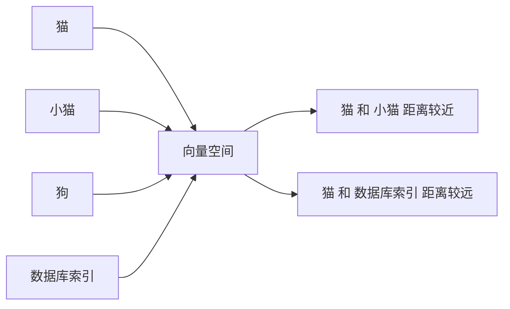

在 RAG、语义搜索、推荐系统、相似问题匹配中，embedding 非常常见。

------

## Transformer 的核心：注意力机制

Transformer 里最关键的思想是 **注意力机制（Attention Mechanism）**，尤其是 **自注意力（Self-Attention）**。

它解决的问题是：

> 当前这个 token 在理解时，应该重点参考上下文里的哪些 token？

比如句子：

> 苹果发布了新手机，它的摄像头更强了。

模型在理解“它”时，需要知道“它”大概率指“新手机”，不是“苹果公司”这个组织，也不是水果。注意力机制就是用来动态分配这种“参考权重”的。

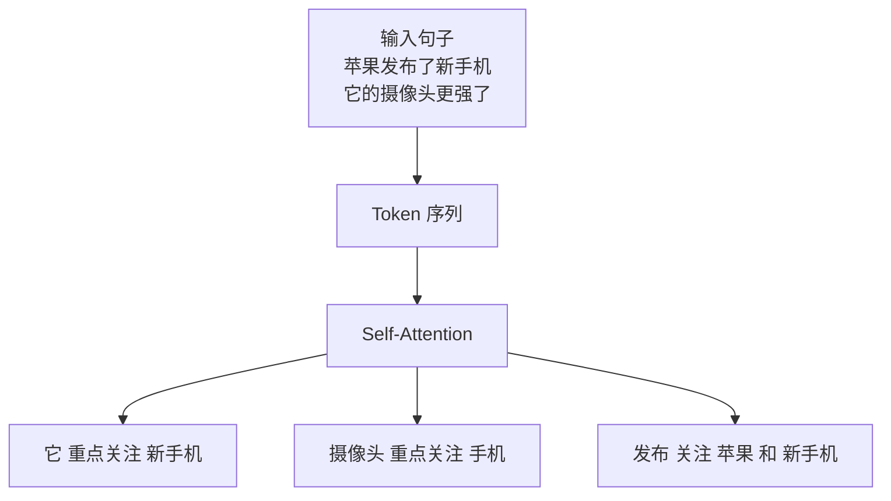

注意力不是“真正的意识注意力”，而是一种数学机制。它会为 token 之间计算相关性分数，让模型知道在生成或理解某个位置时，应该更多参考哪些位置。Transformer 原论文提出的架构完全基于 attention mechanism，并去掉了当时常见的循环结构和卷积结构。([arXiv](https://arxiv.org/abs/1706.03762?utm_source=chatgpt.com))

------

## Transformer Block 里面通常有什么

一个现代 Transformer 模型由很多层 Transformer Block 堆叠而成。每一层都会对输入表示进行加工。

| 组件       | 英文术语                   | 作用                          |
| ---------- | -------------------------- | ----------------------------- |
| 自注意力   | Self-Attention             | 判断 token 之间该互相关注多少 |
| 多头注意力 | Multi-Head Attention       | 用多个“视角”同时看上下文      |
| 前馈网络   | Feed-Forward Network, FFN  | 对每个位置的信息做非线性变换  |
| 残差连接   | Residual Connection        | 保留原信息，避免深层训练困难  |
| 归一化     | Layer Normalization        | 稳定训练和推理                |
| 位置编码   | Positional Encoding / RoPE | 告诉模型 token 的顺序位置     |

示意图如下：

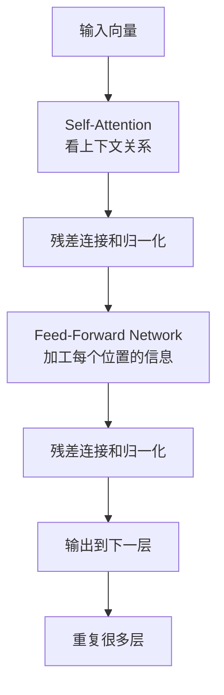

可以把每层想象成一次“理解加工”。浅层可能更多处理局部词形和短语模式，深层可能组合出更抽象的语义、格式、任务和推理模式。这个解释是直觉化的，真实内部表征更复杂，不能简单等同于人类概念。

------

## Next-token Prediction：为什么“预测下一个词”能产生智能表现

大模型训练时常见目标是 **下一个 token 预测（Next-token Prediction）**：

> 给模型一段文本，让它预测下一个 token 是什么。

例如：

| 上下文                       | 目标 token |
| ---------------------------- | ---------- |
| 北京是中国的                 | 首都       |
| `def add(a, b): return a`    | `+`        |
| 请把下面句子翻译成英文：你好 | Hello      |

这看起来很简单，但当训练数据规模极大、模型规模足够大时，“预测下一个 token”会迫使模型学习许多隐含能力：

| 为了预测好下一个 token | 模型需要学到                     |
| ---------------------- | -------------------------------- |
| 语法                   | 什么表达自然                     |
| 常识                   | 世界上哪些事情通常成立           |
| 风格                   | 正式、幽默、学术、客服语气       |
| 代码模式               | 函数、变量、库调用               |
| 推理痕迹               | 数学题、证明、因果解释的文本模式 |
| 指令结构               | 用户想要什么输出                 |

GPT-3 论文《Language Models are Few-Shot Learners》展示了模型规模扩大后，模型在少样本（Few-shot）任务上的能力会显著增强；GPT-4 技术报告也明确描述其预训练目标是预测文档中的下一个 token。([arXiv](https://arxiv.org/abs/2005.14165?utm_source=chatgpt.com))

不过要注意：**预测 token 不等于真正理解世界**。模型的能力来自模式学习、压缩、泛化和上下文推断，但它没有人类那种直接感知世界的经验。因此它可能非常会写，却也可能在事实上出错。

------

## 训练阶段：模型能力是怎样来的

现代大模型通常经历几个阶段。

| 阶段     | 英文术语                       | 目标                                   |
| -------- | ------------------------------ | -------------------------------------- |
| 预训练   | Pretraining                    | 从海量数据中学习语言、知识、代码和模式 |
| 监督微调 | Supervised Fine-Tuning, SFT    | 学会按照指令回答                       |
| 偏好对齐 | Preference Optimization / RLHF | 更符合人类偏好，更有帮助、更安全       |
| 工具训练 | Tool-use Training              | 学会何时调用搜索、代码、数据库等工具   |
| 安全调优 | Safety Tuning                  | 降低有害、违法、误导性输出             |

整体流程可以这样看：

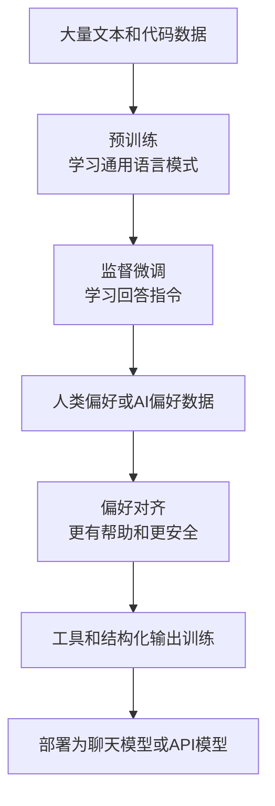

RLHF（Reinforcement Learning from Human Feedback，人类反馈强化学习）是一个重要的后训练方法。InstructGPT 论文指出，单纯把语言模型变大并不必然让它更好地遵循用户意图；通过人类示范、输出排序和人类反馈训练，模型在有用性、真实性和毒性降低方面都有改善，但仍会犯错。([arXiv](https://arxiv.org/abs/2203.02155?utm_source=chatgpt.com))

------

## 参数、训练数据和上下文的区别

新手常把这三者混在一起。

| 概念       | 英文术语       | 类比                             | 是否在一次对话中改变 |
| ---------- | -------------- | -------------------------------- | -------------------- |
| 参数       | Parameters     | 模型长期学到的“内部权重”         | 通常不变             |
| 训练数据   | Training Data  | 模型曾经学习过的材料来源         | 部署后不可直接访问   |
| 上下文     | Context        | 当前这次请求放进模型工作区的内容 | 每次请求都会变       |
| 外部知识库 | Knowledge Base | 应用额外接入的文档或数据库       | 由系统维护           |
| 记忆       | Memory         | 长期保存的用户偏好或历史摘要     | 取决于产品实现       |

一个非常重要的结论：

> 模型不是在回答时实时翻训练数据原文。它是用训练后形成的参数，加上当前上下文，生成回答。

所以它可能知道很多公开知识，但不一定知道最新信息、私有文档、你公司内部数据，除非这些内容被放进上下文，或者通过工具/RAG 接入。

------

## 推理阶段：模型如何生成回答

**推理（Inference）** 是模型部署后处理用户请求的阶段。它和训练不同：训练会更新参数，推理通常不更新参数。

推理时，模型会做下面的事情：

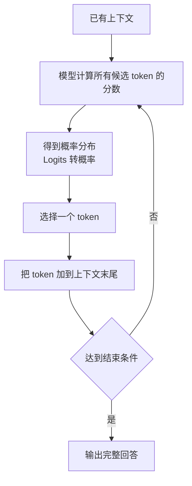

| 术语                     | 解释                                    |
| ------------------------ | --------------------------------------- |
| Logits                   | 模型对每个候选 token 的原始分数         |
| Probability Distribution | 把 logits 转换成概率分布                |
| Sampling                 | 从概率分布中选择 token                  |
| Greedy Decoding          | 每次选概率最高的 token                  |
| Temperature              | 控制随机性，越高越发散，越低越稳定      |
| Top-p / Nucleus Sampling | 只从累计概率最高的一小部分 token 中采样 |
| Max Tokens               | 限制最多生成多少 token                  |

实践建议：

| 任务                         | 推荐倾向                           |
| ---------------------------- | ---------------------------------- |
| 事实问答、代码修复、数据抽取 | 低 temperature，更稳定             |
| 文案、创意、头脑风暴         | 中等或较高 temperature             |
| JSON、表格、严格格式         | 低 temperature + 结构化输出        |
| 长报告                       | 限制结构，分段生成，避免一次性失控 |

------

## 上下文窗口：模型的工作记忆

**上下文窗口（Context Window）** 是模型一次请求最多能看到的 token 数量。它包括：

| 输入来源               | 是否占上下文 |
| ---------------------- | ------------ |
| 系统提示词             | 是           |
| 用户问题               | 是           |
| 历史对话               | 是           |
| 检索到的文档片段       | 是           |
| 工具返回结果           | 是           |
| 图片或文件解析后的内容 | 通常是       |
| 模型即将生成的输出     | 也会占预算   |

上下文窗口越大，模型能一次读的东西越多，但不代表应该把所有内容都塞进去。长上下文会带来三个问题：

| 问题       | 表现                             |
| ---------- | -------------------------------- |
| 成本增加   | 输入 token 更多                  |
| 延迟增加   | 模型读取更慢                     |
| 注意力稀释 | 关键信息可能淹没在大量无关内容中 |

现代应用越来越强调 **上下文工程（Context Engineering）**：不是简单写 prompt，而是设计“哪些内容应该进入上下文、以什么顺序进入、何时摘要、何时检索、何时丢弃”。

------

## 模型为什么会“幻觉”

**幻觉（Hallucination）** 指模型生成了看起来流畅、合理、甚至自信，但事实错误或缺乏依据的内容。

幻觉不是单一原因造成的，常见来源包括：

| 来源       | 说明                                               |
| ---------- | -------------------------------------------------- |
| 训练目标   | 预训练鼓励生成合理续写，而不是天然保证事实正确     |
| 数据缺口   | 训练数据中没有、过时或互相矛盾                     |
| 上下文不足 | 用户没有给足信息，模型仍尝试回答                   |
| 评估激励   | 很多测试奖励“猜一个答案”，而不是承认不知道         |
| 工具缺失   | 没有搜索、数据库或计算器时，模型只能靠内部模式生成 |
| 用户诱导   | 问法暗含错误前提，模型可能顺着前提回答             |

OpenAI 2025 年关于 hallucination 的研究指出，语言模型有时会像学生考试一样在不确定时猜测；论文认为，幻觉会持续存在的一个重要原因是训练和评估流程往往奖励猜测，而不是奖励承认不确定。([arXiv](https://arxiv.org/abs/2509.04664?utm_source=chatgpt.com))

降低幻觉的实用方法：

| 方法               | 适用场景                           |
| ------------------ | ---------------------------------- |
| 允许模型说“不确定” | 事实问答、医疗、法律、金融         |
| 要求引用来源       | 研究、新闻、政策、公司知识库       |
| 接入 RAG           | 私有文档、内部知识、长文档问答     |
| 接入工具           | 数学计算、查数据库、查库存、查时间 |
| 使用结构化输出     | 数据抽取、表单生成、API 调用       |
| 做自动评估         | 生产系统上线前和模型升级时         |

------

## RAG：让模型基于外部资料回答

**RAG（Retrieval-Augmented Generation，检索增强生成）** 是现代 LLM 应用里最重要的架构之一。RAG 的核心思路是：

> 先从外部知识库检索相关资料，再把资料放进模型上下文，让模型基于资料回答。

RAG 不是让模型“记住”资料，而是每次回答前临时把相关资料喂给模型。RAG 论文提出了把预训练模型的参数化记忆和外部非参数化记忆结合起来的方法，用于知识密集型生成任务。([arXiv](https://arxiv.org/abs/2005.11401?utm_source=chatgpt.com))

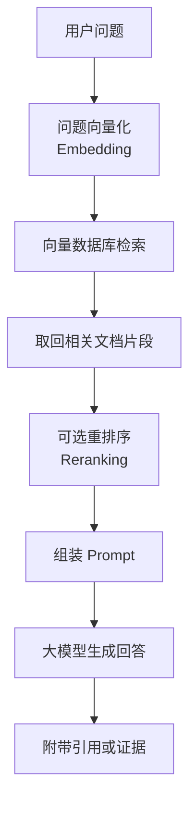

RAG 的常见组件：

| 组件       | 英文术语          | 作用                       |
| ---------- | ----------------- | -------------------------- |
| 文档切分   | Chunking          | 把长文档切成适合检索的小块 |
| 向量化     | Embedding         | 把文档块变成向量           |
| 向量库     | Vector Database   | 存储和检索向量             |
| 相似度搜索 | Similarity Search | 找语义相关内容             |
| 重排序     | Reranking         | 对候选文档重新排序         |
| 生成       | Generation        | 基于检索结果回答           |
| 引用       | Citation          | 让用户能验证来源           |

RAG 的最佳实践：

| 问题       | 建议                                    |
| ---------- | --------------------------------------- |
| 文档太长   | 先切分，避免全文塞进上下文              |
| 检索不准   | 优化 chunk 大小、标题、元数据、reranker |
| 回答编造   | 要求“只基于资料回答”，无依据就说不知道  |
| 引用错位   | 保留 chunk ID、页码、段落号             |
| 多文档冲突 | 要求模型列出冲突点，不要强行合并        |
| 权限问题   | 检索前做权限过滤，不要检索后再遮盖      |

------

## Tool Calling：模型如何使用外部工具

**工具调用（Tool Calling / Function Calling）** 是让模型调用外部系统的能力。模型本身不会真的访问数据库、下单、发邮件、查天气，除非应用把这些能力封装成工具，并允许模型按 schema 调用。

OpenAI 的 function calling 文档把它描述为让模型连接外部系统、访问训练数据之外的数据和动作的一种方式；结构化输出（Structured Outputs）则可通过 function calling 或 JSON schema 让模型输出符合指定结构的数据。([OpenAI开发者](https://developers.openai.com/api/docs/guides/function-calling?utm_source=chatgpt.com))

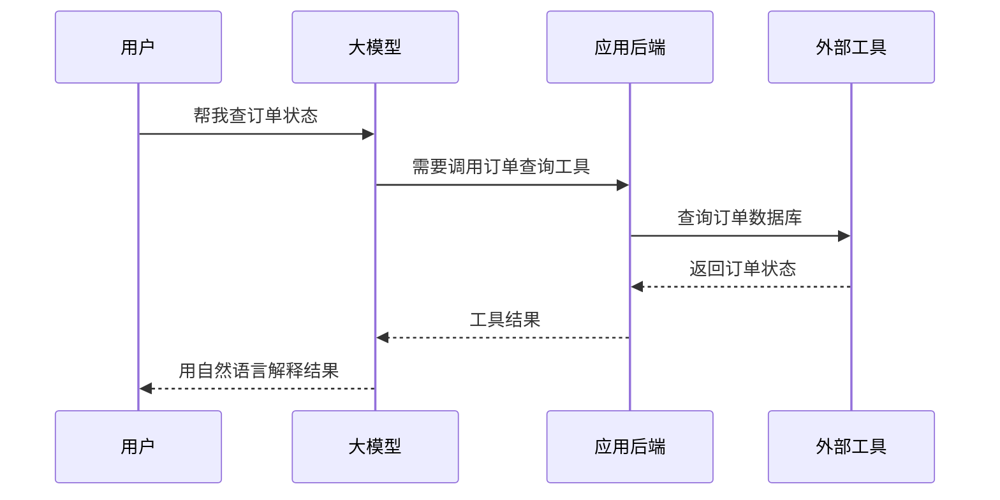

工具调用适合：

| 场景           | 工具                       |
| -------------- | -------------------------- |
| 查实时信息     | 搜索、新闻、天气、汇率     |
| 查私有数据     | 数据库、CRM、订单系统      |
| 精确计算       | 计算器、代码执行器         |
| 执行动作       | 发邮件、创建日程、提交工单 |
| 结构化业务流程 | 表单校验、审批、路由       |

关键风险是：**模型只是决定“要不要调用”和“传什么参数”，真正执行动作的是你的系统**。所以生产系统要做权限控制、参数校验、审计日志和人工确认。

------

## Prompt Engineering 和 Context Engineering

**Prompt Engineering（提示词工程）** 是写好指令。
**Context Engineering（上下文工程）** 是设计整个上下文的组织方式。

后者更现代，也更重要。因为真实应用中，模型看到的不只是用户问题，还包括系统规则、用户资料、历史对话、检索文档、工具返回、格式要求等。

一个实用 prompt 结构：

| 位置     | 内容                   | 原则                 |
| -------- | ---------------------- | -------------------- |
| 系统层   | 角色、边界、安全规则   | 稳定、简洁、优先级高 |
| 开发者层 | 产品行为、输出规范     | 结构化、可复用       |
| 任务层   | 本次任务目标           | 明确                 |
| 上下文层 | 文档、数据、背景       | 只放相关内容         |
| 输出层   | 格式、长度、语言、表格 | 可检查               |
| 约束层   | 不确定时怎么办         | 防幻觉               |

示意图：

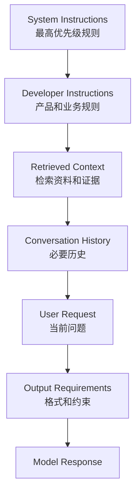

高质量提示词通常包含：

| 元素     | 示例                           |
| -------- | ------------------------------ |
| 任务     | “请总结这份合同的付款条款”     |
| 背景     | “我是非法律专业的产品经理”     |
| 资料     | “只基于下面提供的合同原文”     |
| 输出格式 | “用表格列出条款、风险、建议”   |
| 约束     | “找不到依据就写未在原文中找到” |
| 评价标准 | “重点关注金额、日期、违约责任” |

不推荐的问法：

| 问法               | 问题               |
| ------------------ | ------------------ |
| “帮我看看这个”     | 任务不清           |
| “写好一点”         | 风格标准不清       |
| “分析一下”         | 分析维度不清       |
| “基于你知道的回答” | 容易引发过时或幻觉 |

推荐的问法：

> 请基于下面材料，面向非技术管理者，用表格总结这套系统的三个主要风险、对应影响、建议措施。不要使用材料中没有的信息；如果信息不足，请明确写“材料未说明”。

------

## Few-shot、Zero-shot 和示例的作用

| 方法       | 英文术语                   | 含义                           |
| ---------- | -------------------------- | ------------------------------ |
| 零样本     | Zero-shot                  | 只给任务说明，不给示例         |
| 少样本     | Few-shot                   | 给几个输入输出示例             |
| 多样本     | Multi-shot                 | 给更多示例，让格式和风格更稳定 |
| 思维链提示 | Chain-of-Thought Prompting | 引导模型分步骤分析             |
| 自一致性   | Self-Consistency           | 多次生成，选择更一致的答案     |

Few-shot 的价值不是“让模型临时训练”，而是通过上下文告诉模型：

| 示例告诉模型     | 作用             |
| ---------------- | ---------------- |
| 输入长什么样     | 降低理解偏差     |
| 输出长什么样     | 稳定格式         |
| 判断标准是什么   | 稳定分类边界     |
| 边界情况怎么处理 | 降低异常输入错误 |

对于新手，最实用的技巧是：**与其抽象描述你想要的风格，不如给一个好例子。**

------

## 结构化输出：让结果更可靠

如果你要把模型接到业务系统里，尽量不要让它只输出自然语言。可以让它输出 JSON、表格、字段对象，或通过结构化输出能力保证 schema。

| 任务     | 自然语言输出的问题 | 结构化输出的优势           |
| -------- | ------------------ | -------------------------- |
| 简历解析 | 格式不稳定         | 字段固定                   |
| 工单分类 | 难以自动路由       | 可直接进入系统             |
| 发票识别 | 容易漏字段         | 可校验                     |
| 合规审核 | 结论和理由混杂     | 可分离结论、证据、风险等级 |

OpenAI 文档说明，Structured Outputs 可通过 function calling 或 JSON schema 使用，适合需要模型输出匹配指定结构的场景。([OpenAI开发者](https://developers.openai.com/api/docs/guides/structured-outputs?utm_source=chatgpt.com))

一个常见结构：

| 字段           | 含义       |
| -------------- | ---------- |
| `category`     | 分类       |
| `confidence`   | 置信度     |
| `evidence`     | 支持依据   |
| `missing_info` | 缺失信息   |
| `next_action`  | 下一步动作 |

最佳实践是：**结构化输出不只规定字段，还要规定字段含义、枚举值、失败时如何返回。**

------

## 缓存：KV Cache、Prompt Cache、Context Cache 的区别

你前面问到缓存，这里放进整体机制中理解。

| 缓存类型      | 英文术语        | 主要对象                            | 谁使用     | 作用                   |
| ------------- | --------------- | ----------------------------------- | ---------- | ---------------------- |
| KV Cache      | Key-Value Cache | 当前生成过程中的 attention 中间状态 | 推理引擎   | 加速逐 token 生成      |
| Prompt Cache  | Prompt Caching  | 重复 prompt 前缀的计算结果          | API 平台   | 降低重复输入成本和延迟 |
| Context Cache | Context Caching | 显式保存的大段上下文                | 应用或平台 | 复用长文档、长系统提示 |

OpenAI 的 prompt caching 文档说明，当请求包含最近处理过的相同前缀时，系统可以复用先前工作，从而降低延迟和输入 token 成本；文档也提到 prompt caching 自动工作，适合重复系统提示、工具定义、消息和常见说明。([OpenAI开发者](https://developers.openai.com/api/docs/guides/prompt-caching?utm_source=chatgpt.com))

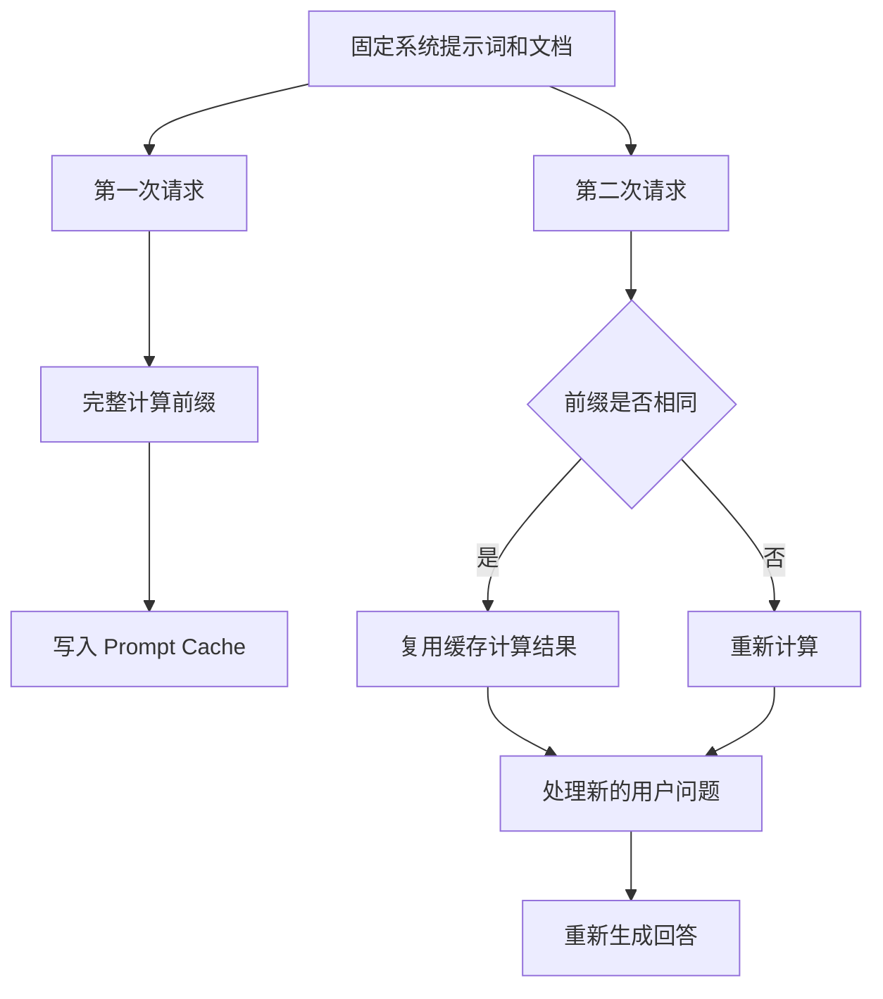

关键理解：

> 缓存通常不是“缓存上一次回答”，而是“缓存模型已经处理过某段 prompt 前缀后的中间计算状态”。

所以即使命中缓存，模型仍会基于新的用户问题重新生成答案。

------

## 成本模型：为什么要关心输入、输出和工具

大模型成本通常由几部分组成：

| 成本项         | 说明                                     |
| -------------- | ---------------------------------------- |
| 输入 token     | 系统提示、历史、用户问题、文档、工具结果 |
| 输出 token     | 模型生成的回答                           |
| 缓存输入 token | 命中缓存的重复输入，通常更便宜           |
| 工具调用       | 搜索、代码执行、数据库查询等可能额外收费 |
| 向量检索       | embedding、向量库、rerank 成本           |
| 延迟成本       | 用户等待、系统吞吐、GPU 时间             |

你可以用一个简单公式理解：

| 总成本组成 | 直觉                         |
| ---------- | ---------------------------- |
| 输入成本   | 模型读了多少                 |
| 输出成本   | 模型写了多少                 |
| 工具成本   | 模型调用了多少外部能力       |
| 存储成本   | 缓存、向量库、日志保存了多少 |
| 工程成本   | 评估、监控、错误处理、人审   |

实用建议：

| 场景           | 降本方法                     |
| -------------- | ---------------------------- |
| 长系统提示重复 | 放前面，利用 prompt cache    |
| 文档问答       | RAG 检索片段，不塞全文       |
| 长对话         | 摘要历史，保留关键信息       |
| 简单任务       | 用更小模型或规则系统         |
| 输出很长       | 明确长度和格式               |
| 工具太多       | 限制工具调用次数，加入路由器 |

------

## 大模型的“推理”该如何理解

大模型确实能解决很多推理任务，但它的推理和人类推理不同。更准确的说法是：

> 模型在大量文本、代码、数学解题过程、逻辑论证和反馈数据中学到了许多可泛化的推理模式，并在推理时用上下文激活这些模式。

常见增强方式：

| 方法         | 英文术语                 | 作用                             |
| ------------ | ------------------------ | -------------------------------- |
| 分步推理     | Step-by-step Reasoning   | 降低复杂任务遗漏                 |
| 计划再执行   | Plan-and-Execute         | 适合多步骤任务                   |
| 自我检查     | Self-Verification        | 让模型检查答案                   |
| 多样本投票   | Self-Consistency         | 对数学/逻辑题有帮助              |
| 工具辅助推理 | Tool-Augmented Reasoning | 用计算器、代码、搜索补足模型缺陷 |
| 测试时计算   | Test-time Compute        | 在回答前投入更多计算步骤         |

实践上，不建议要求模型暴露很长的“内心独白”。更好的方式是要求：

| 不推荐             | 推荐                                 |
| ------------------ | ------------------------------------ |
| “展示你全部思维链” | “给出简洁推理步骤和关键依据”         |
| “一步一步想很久”   | “先列假设，再给结论，再说明不确定点” |
| “一定要给答案”     | “不确定时说明缺失信息”               |

------

## 多模态模型：不只是文本

许多现代模型已经从纯文本扩展到多模态（Multimodal），能够处理图像、文本，有些系统还支持音频、视频或文件。GPT-4 技术报告就描述了 GPT-4 可以接受图像和文本输入，并产生文本输出。([arXiv](https://arxiv.org/abs/2303.08774?utm_source=chatgpt.com))

| 模态 | 典型任务                     |
| ---- | ---------------------------- |
| 文本 | 问答、写作、翻译、总结       |
| 图像 | 看图解释、图表理解、OCR 辅助 |
| 音频 | 语音转写、语音对话           |
| 视频 | 场景理解、片段总结           |
| 文件 | PDF 总结、表格分析、合同审查 |

但多模态并不意味着万能。图像中的小字、复杂表格、模糊截图、长视频中的细节都可能出错。关键任务仍需要验证。

------

## Agent：从聊天模型到任务执行系统

**Agent（智能体）** 通常指能围绕目标进行多步操作的系统。它会规划、调用工具、观察结果、调整计划，直到完成任务。

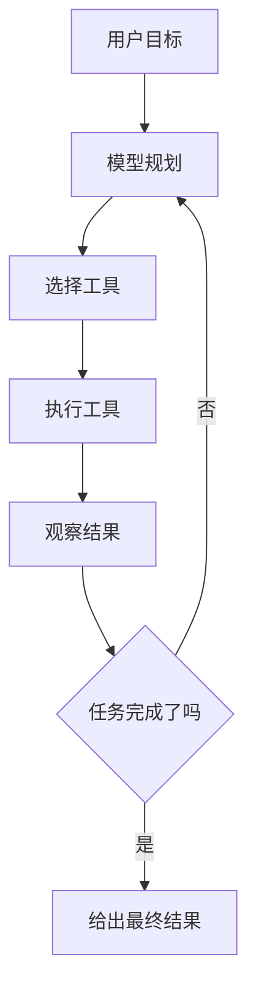

Agent 常见组件：

| 组件        | 作用           |
| ----------- | -------------- |
| Planner     | 分解任务       |
| Tool Router | 选择工具       |
| Memory      | 保存长期状态   |
| RAG         | 检索知识       |
| Executor    | 执行动作       |
| Guardrails  | 权限和安全边界 |
| Evaluator   | 检查结果质量   |

Agent 的风险也更高，因为它可能执行真实动作。最佳实践是：

| 风险               | 控制措施                       |
| ------------------ | ------------------------------ |
| 错误调用工具       | 参数校验                       |
| 删除或发送敏感内容 | 人工确认                       |
| 无限循环           | 最大步骤数                     |
| 工具结果误读       | 结构化工具返回                 |
| 权限越界           | 按用户权限检索和执行           |
| 成本失控           | 限制 token、工具次数和运行时间 |

------

## 评估：不要只靠感觉判断模型好不好

上线 LLM 应用时，最容易犯的错误是：试几个例子觉得不错，就上线。

更可靠的方法是建立 **评估集（Evaluation Set / Evals）**。OpenAI 的 evals 文档也强调，评估用于测试模型输出是否满足指定的风格和内容标准，尤其在升级模型或改 prompt 时很重要。([OpenAI开发者](https://developers.openai.com/api/docs/guides/evals?utm_source=chatgpt.com))

| 评估类型     | 适用任务                  |
| ------------ | ------------------------- |
| 精确匹配     | 分类、抽取、选择题        |
| 规则校验     | JSON、字段完整性、格式    |
| 人工评分     | 写作、客服、复杂分析      |
| LLM-as-Judge | 大规模初筛，但要校准      |
| 引用检查     | RAG 问答                  |
| 回归测试     | prompt 或模型升级前后对比 |
| 红队测试     | 安全、越权、注入攻击      |

一套实用 eval 表：

| 字段     | 示例                       |
| -------- | -------------------------- |
| 输入     | 用户真实问题               |
| 期望输出 | 标准答案或评分标准         |
| 必须包含 | 关键事实                   |
| 禁止包含 | 编造内容                   |
| 评分标准 | 正确性、完整性、格式、引用 |
| 严重等级 | 错误会不会影响业务         |

------

## 常见误解纠正

| 误解                         | 更准确的理解                                     |
| ---------------------------- | ------------------------------------------------ |
| 大模型像数据库一样查答案     | 它主要是基于参数和上下文生成，事实需要验证       |
| 模型越大越一定越好           | 大模型通常更强，但成本、延迟、任务匹配也重要     |
| 上下文越长越好               | 长上下文可能增加成本、延迟和干扰                 |
| RAG 一定能消除幻觉           | RAG 能降低幻觉，但检索错、引用错仍会出问题       |
| Prompt 写好就万事大吉        | 真实系统还需要检索、工具、评估、监控、安全       |
| 让模型一步步思考就一定准确   | 分步能帮助复杂任务，但仍需验证和工具             |
| 缓存会复用答案               | 多数 prompt cache 复用的是输入前缀计算，不是答案 |
| Fine-tuning 可以注入所有知识 | 微调更适合风格、格式、任务习惯；知识更新常用 RAG |

------

## 新手学习路线

| 阶段     | 学什么                                        | 目标               |
| -------- | --------------------------------------------- | ------------------ |
| 入门     | token、上下文、输入输出计费                   | 知道模型在处理什么 |
| 基础机制 | Transformer、attention、next-token prediction | 建立底层直觉       |
| 使用技巧 | prompt、few-shot、结构化输出                  | 能稳定完成常见任务 |
| 应用架构 | RAG、tool calling、agent                      | 能设计真实系统     |
| 可靠性   | hallucination、evals、监控                    | 能判断输出是否可信 |
| 成本优化 | caching、模型路由、摘要、检索                 | 能控制成本和延迟   |
| 安全治理 | 权限、注入攻击、人工确认                      | 能避免高风险错误   |

推荐学习顺序：

| 顺序                   | 内容                     | 为什么 |
| ---------------------- | ------------------------ | ------ |
| 先学 token 和上下文    | 这是成本和效果的基础     |        |
| 再学 prompt 和输出格式 | 立刻能提升使用效果       |        |
| 接着学 RAG             | 解决“模型不知道我的资料” |        |
| 然后学工具调用         | 解决“模型不能执行动作”   |        |
| 最后学 evals 和监控    | 解决“怎么稳定上线”       |        |

------

## 实用最佳实践清单

| 目标         | 做法                                       |
| ------------ | ------------------------------------------ |
| 提高准确性   | 提供来源、限制回答范围、允许不确定         |
| 降低幻觉     | RAG、工具验证、引用、事实检查              |
| 稳定格式     | 使用 JSON schema 或表格模板                |
| 降低成本     | 缓存固定前缀、减少无关上下文、限制输出长度 |
| 提升速度     | 缩短输入、使用小模型、缓存、并行工具       |
| 处理长文档   | 切分、检索、摘要、分层总结                 |
| 处理复杂任务 | 先规划，再执行，再检查                     |
| 生产上线     | 建 evals、日志、人工兜底、权限控制         |
| 模型升级     | 用回归测试对比旧模型                       |
| 用户体验     | 明确告诉用户依据、不确定点和下一步         |

------

## 一个完整的现代 LLM 应用架构

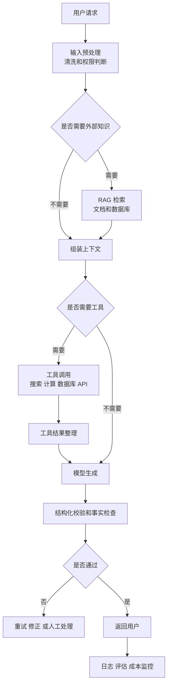

这张图可以帮助你理解：**真正可用的大模型应用，不只是一个 prompt，而是一套围绕模型的系统工程。**

------

## 最核心的心智模型

把大模型理解为下面这个组合，会比较准确：

| 维度     | 心智模型                                           |
| -------- | -------------------------------------------------- |
| 底层机制 | 基于 Transformer 的 next-token generator           |
| 能力来源 | 海量预训练 + 后训练对齐 + 上下文学习               |
| 工作方式 | 读取上下文，逐 token 生成                          |
| 优势     | 语言、代码、总结、改写、推理辅助、格式转换         |
| 短板     | 幻觉、过时、不可验证、对上下文敏感                 |
| 补强方式 | RAG、工具调用、结构化输出、评估、缓存              |
| 工程重点 | 不是“问得玄妙”，而是“上下文组织得好，验证机制可靠” |

一句话总结：

> 大模型不是一个全知数据库，而是一个强大的上下文生成引擎。要把它用好，需要理解 token、上下文、Transformer、训练、推理、RAG、工具、缓存和评估这些概念，并用工程方法约束它、增强它、验证它。