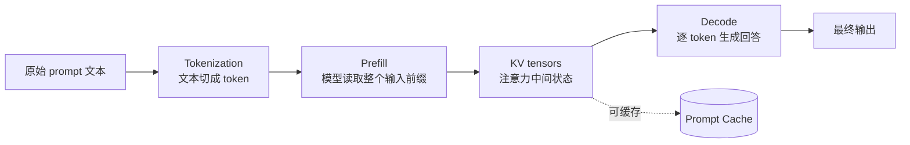
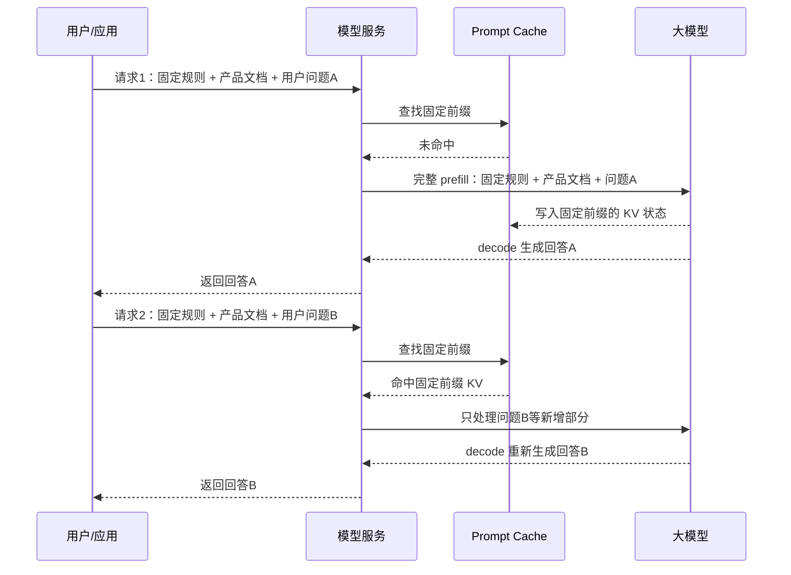
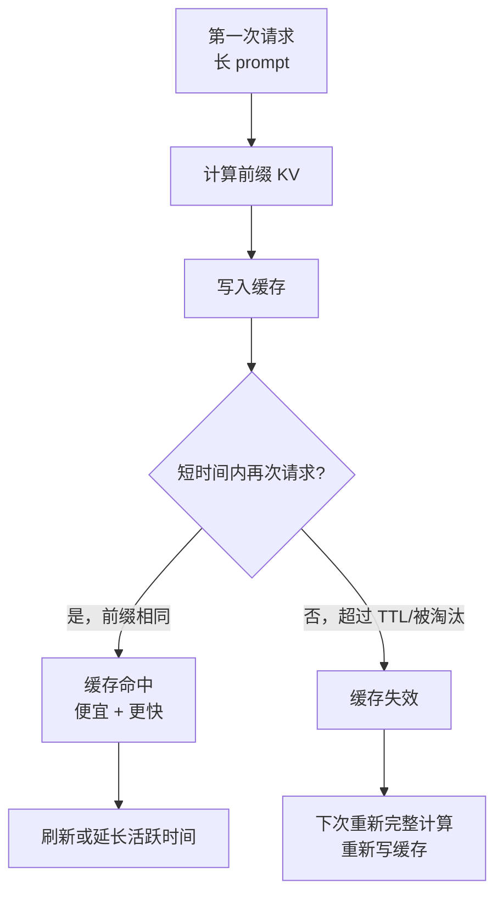
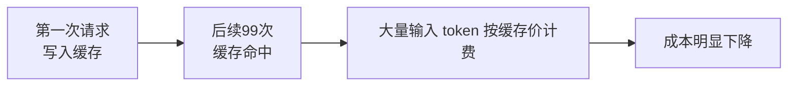
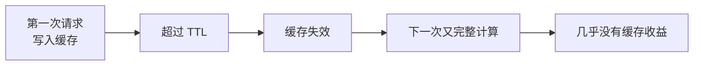
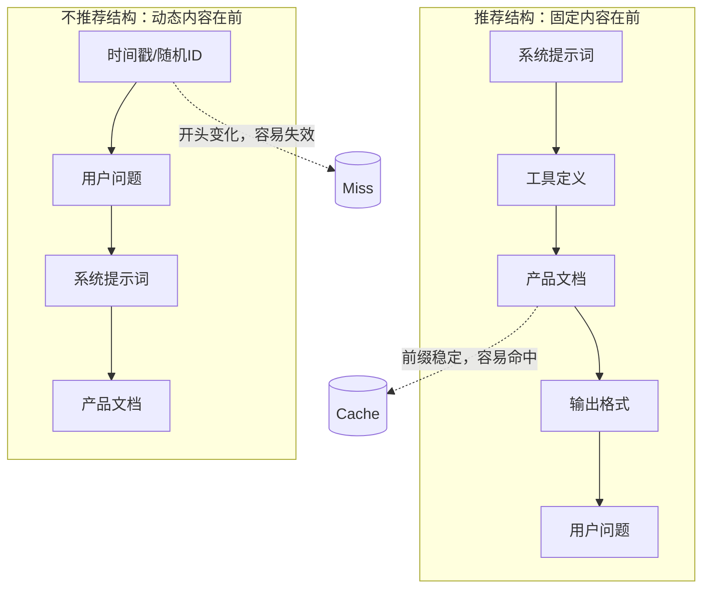
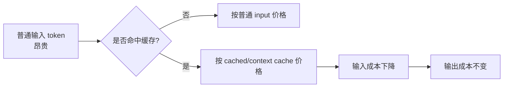

[toc]

## token计费

你可以把 **token 计费**理解成：大模型不是按“问了一次”收费，而是按“读了多少 + 写了多少 + 用了什么工具”收费。

## 1. Token 是什么？

Token 是模型处理文本的最小计量单位，不完全等于“字”或“词”。英文里常见经验值是 **1 token ≈ 4 个英文字符，100 token ≈ 75 个英文词**；但中文、代码、标点、表格、JSON 都会不一样，精确数量要用对应模型的 tokenizer 计算。([OpenAI Help Center](https://help.openai.com/en/articles/4936856-what-are-tokens-and-how-to-count-them?utm_source=chatgpt.com))

一个请求大致分成：

> **总费用 = 输入 token 费用 + 输出 token 费用 + 可选工具/缓存/检索费用**

其中：

| 部分       | 计入内容                                                     | 容易忽略的点                                       |
| ---------- | ------------------------------------------------------------ | -------------------------------------------------- |
| 输入 token | 你的问题、系统提示词、历史对话、上传/检索到的文档、工具返回结果 | 长对话会越来越贵，因为历史上下文可能被反复送进模型 |
| 输出 token | 模型生成的回答                                               | 输出通常比输入贵                                   |
| 缓存输入   | 重复的长提示词、固定文档、系统提示                           | 有些平台对缓存 token 给折扣                        |
| 工具调用   | 搜索、代码执行、文件检索、联网等                             | 可能既收“调用费”，又收“工具返回内容 token”         |

OpenAI 的价格页明确说明，token 会按所选模型的输入和输出价格计费，并且内置工具产生的 token 也会按模型费率计费；它还列出 Web Search 等工具可能有单独调用费。([OpenAI开发者](https://developers.openai.com/api/docs/pricing))

## 2. 一个最小例子：问答一次多少钱？

假设你用某模型，价格是：

| 类型 | 价格                |
| ---- | ------------------- |
| 输入 | $0.75 / 100万 token |
| 输出 | $4.50 / 100万 token |

这是 OpenAI 当前价格页里 `gpt-5.4-mini` 标准短上下文的一个示例档位：输入 $0.75、缓存输入 $0.075、输出 $4.50 / 100万 token。([OpenAI开发者](https://developers.openai.com/api/docs/pricing))

假设一次请求：

| 项目                           | token 数         |
| ------------------------------ | ---------------- |
| 你的问题 + 系统提示 + 少量历史 | 1,000 输入 token |
| 模型回答                       | 500 输出 token   |

费用：

```text
输入费用 = 1,000 / 1,000,000 × $0.75 = $0.00075
输出费用 = 500 / 1,000,000 × $4.50 = $0.00225
总费用 ≈ $0.003
```

也就是 **一次普通短问答大约 0.3 美分**。注意：这只是这个模型和这个 token 数下的例子，不是所有模型的价格。

## 3. 为什么“输出短”也可能贵？

因为模型真正消耗最多的，常常不是最后那段回答，而是它需要读入的上下文。

比如你让模型总结一份 20 页 PDF：

| 项目                | token 数          |
| ------------------- | ----------------- |
| PDF 文本 + 你的要求 | 30,000 输入 token |
| 摘要输出            | 1,000 输出 token  |

按上面同一个价格：

```text
输入费用 = 30,000 / 1,000,000 × $0.75 = $0.0225
输出费用 = 1,000 / 1,000,000 × $4.50 = $0.0045
总费用 ≈ $0.027
```

看起来模型只回了 1,000 token，但它读了 30,000 token，所以主要成本来自输入。

## 4. 长对话为什么会越聊越贵？

很多 API 调用本质上是“无记忆”的：为了让模型知道上下文，应用通常会把历史对话一起发过去。

举个简化例子：

| 轮次     | 本轮新问题 | 需要带上的历史 | 输入 token |
| -------- | ---------- | -------------- | ---------- |
| 第 1 轮  | 500        | 0              | 500        |
| 第 2 轮  | 500        | 1,000          | 1,500      |
| 第 3 轮  | 500        | 2,000          | 2,500      |
| 第 10 轮 | 500        | 9,000          | 9,500      |

所以你以为“我只是问了一个短问题”，但系统可能实际发给模型的是：**系统提示词 + 最近 10 轮历史 + 用户资料 + 检索结果 + 你的新问题**。

这也是为什么生产系统会做：

- 历史摘要，而不是全量历史；
- 只检索最相关文档片段；
- 固定系统提示词走缓存；
- 简单任务用小模型，复杂任务才用大模型。

## 5. 批量场景：客服机器人一天多少钱？

假设一个客服机器人每天处理 10,000 次请求，平均每次：

| 项目                             | token |
| -------------------------------- | ----- |
| 输入：用户问题 + 历史 + 检索片段 | 1,200 |
| 输出：客服回复                   | 300   |

每天总 token：

```text
输入 = 10,000 × 1,200 = 12,000,000 token
输出 = 10,000 × 300 = 3,000,000 token
```

按 `gpt-5.4-mini` 示例价：

```text
输入费用 = 12M × $0.75 / 1M = $9.00
输出费用 = 3M × $4.50 / 1M = $13.50
每日总费用 ≈ $22.50
每月按 30 天 ≈ $675
```

这说明：**单次请求很便宜，但规模上来后，token 管理会直接影响成本。**

## 6. 不同模型差距很大

比如 Google Gemini 2.5 Flash-Lite 标准档显示文本/图片/视频输入 $0.10 / 100万 token，输出 $0.40 / 100万 token；Gemini 2.5 Flash 标准档则是输入 $0.30，输出 $2.50 / 100万 token，并且输出价格包含 thinking tokens。([Google AI for Developers](https://ai.google.dev/gemini-api/docs/pricing))

同样一个客服例子，使用 Flash-Lite 档：

```text
输入费用 = 12M × $0.10 / 1M = $1.20
输出费用 = 3M × $0.40 / 1M = $1.20
每日总费用 ≈ $2.40
```

所以选型时不能只看“哪个模型最强”，还要看：

> 这个任务是否真的需要强模型？
> 输入是不是太长？
> 输出是不是太啰嗦？
> 是否可以缓存？
> 是否可以先用小模型筛选，再用大模型处理复杂样本？

## 7. “上下文窗口大”不等于“便宜”

有些模型支持很长上下文，比如 Gemini 2.5 Flash 支持 1M token 上下文窗口。([Google AI for Developers](https://ai.google.dev/gemini-api/docs/pricing)) 这意味着它“能读很多”，但不代表“读很多免费”。

如果你每次都塞入 500,000 token 文档，即使用 $0.30 / 100万 token 的输入价：

```text
单次输入费用 = 500,000 / 1,000,000 × $0.30 = $0.15
```

如果一天 10,000 次：

```text
$0.15 × 10,000 = $1,500 / 天
```

所以大上下文适合“必要时使用”，不是每次都把所有资料塞进去。

## 8. 记住这 5 条就够了

第一，**token ≠ 字数**，但可以粗略估算。

第二，**输入和输出分开计费**，输出通常更贵。

第三，**长上下文、历史对话、文档检索**是成本大头。

第四，**工具调用可能额外收费**，比如搜索既可能有调用费，也可能把搜索内容作为输入 token 计费。OpenAI 的价格页就列出 Web Search 每 1,000 次调用收费，并且搜索内容 token 可能按模型费率计费。([OpenAI开发者](https://developers.openai.com/api/docs/pricing))

第五，做产品时不要只算“单次多少钱”，要算：

```text
月成本 = 日请求量 × 平均输入 token × 输入单价
       + 日请求量 × 平均输出 token × 输出单价
       + 工具/缓存/存储等额外费用
```

一个实用判断：
**聊天类产品怕“历史越来越长”；文档类产品怕“全文都塞进去”；Agent 类产品怕“反复调用工具和读文件”。**

## 缓存

缓存可以理解为：**模型/平台发现你多次发送了相同的前半段 prompt，就不再每次从头处理这部分，而是复用之前算好的中间结果；这部分 token 按更低价格计费，速度也更快。**

注意：这里说的缓存通常不是“把上一次回答原样返回”，而是**缓存输入 prompt 的前缀**，输出仍然会重新生成。OpenAI 文档也明确说，Prompt Caching 不会影响最终生成结果，缓存的是 prompt 处理过程，而不是回答本身。([OpenAI开发者](https://developers.openai.com/api/docs/guides/prompt-caching))

## 1. 哪些内容适合被缓存？

适合缓存的是**重复出现、放在 prompt 前面、很少变化**的内容，例如：

| 内容                      | 是否适合缓存 | 原因                         |
| ------------------------- | ------------ | ---------------------------- |
| 系统提示词                | 很适合       | 每次请求都一样               |
| 公司客服规范              | 很适合       | 长且重复                     |
| 产品说明文档              | 适合         | 多个用户都基于同一份文档提问 |
| Few-shot 示例             | 适合         | 固定示例常被重复发送         |
| 工具 schema / JSON schema | 适合         | 结构化输出和工具定义常重复   |
| 用户当前问题              | 不适合       | 每次都变                     |
| 搜索结果                  | 通常不适合   | 经常变化                     |
| 时间、地点、订单状态      | 不适合       | 动态内容                     |

核心原则是：

> **固定内容放前面，变化内容放后面。**

OpenAI 官方文档说明，缓存命中需要 prompt 的**前缀精确匹配**；为了获得缓存收益，应把静态内容如说明、示例放在开头，把用户特定内容放在末尾。([OpenAI开发者](https://developers.openai.com/api/docs/guides/prompt-caching))

## 2. 缓存对费用的影响

以 OpenAI 当前价格页里的 `gpt-5.4-mini` 标准短上下文为例：

| 类型           | 价格 / 100万 token |
| -------------- | ------------------ |
| 普通输入 token | $0.75              |
| 缓存输入 token | $0.075             |
| 输出 token     | $4.50              |

也就是说，缓存输入价格是普通输入价格的 **10%**，相当于**缓存命中的输入 token 便宜 90%**。([OpenAI开发者](https://developers.openai.com/api/docs/pricing))

### 例子：客服机器人重复使用 10,000 token 的公司知识库

假设每次请求都包含：

| 部分                      | token  |
| ------------------------- | ------ |
| 固定客服规范 + 产品知识库 | 10,000 |
| 用户本次问题              | 500    |
| 模型输出                  | 500    |

每天 1,000 次请求。

**没有缓存时：**

```text
输入 token = (10,000 + 500) × 1,000 = 10,500,000
输入费用 = 10.5M × $0.75 / 1M = $7.875

输出 token = 500 × 1,000 = 500,000
输出费用 = 0.5M × $4.50 / 1M = $2.25

总费用 ≈ $10.125
```

**有缓存时，假设 10,000 token 固定前缀全部命中缓存：**

```text
固定缓存输入 = 10,000 × 1,000 = 10,000,000
缓存输入费用 = 10M × $0.075 / 1M = $0.75

动态普通输入 = 500 × 1,000 = 500,000
普通输入费用 = 0.5M × $0.75 / 1M = $0.375

输出费用不变 = $2.25

总费用 ≈ $3.375
```

结果：

```text
无缓存：约 $10.125 / 天
有缓存：约 $3.375 / 天
节省：约 66.7%
```

为什么不是节省 90%？因为**输出 token 没有变便宜**，动态输入也没有被缓存。缓存只降低“被命中的输入前缀”的费用。

## 3. 缓存越有用的场景

缓存特别适合这些业务：

| 场景          | 为什么省钱                                   |
| ------------- | -------------------------------------------- |
| 客服机器人    | 每次都带同一套客服政策、产品资料             |
| 代码助手      | 每次都带同一套项目结构、规范、工具定义       |
| 文档问答      | 很多用户问同一份合同、手册、论文             |
| Agent 工作流  | 多轮任务里系统提示、工具列表、上下文反复出现 |
| 批量分类/抽取 | 同一个长规则，对很多条数据重复执行           |

不太适合这些场景：

| 场景                                | 原因                     |
| ----------------------------------- | ------------------------ |
| 每次 prompt 都完全不同              | 命中率低                 |
| 固定内容很短                        | 达不到缓存门槛或节省很小 |
| 把时间戳、随机 ID 放在开头          | 会破坏前缀匹配           |
| 每次都重新拼接不同顺序的工具/schema | 前缀不一致，命中率下降   |
| 检索结果总是放在最前面              | 动态内容破坏缓存前缀     |

OpenAI 的缓存要求 prompt 至少 1024 tokens 才可用；低于这个长度也会显示 `cached_tokens` 字段，但值会是 0。([OpenAI开发者](https://developers.openai.com/api/docs/guides/prompt-caching))

## 4. “缓存命中率”才是关键指标

你可以把成本拆成：

```text
总输入费用 =
缓存命中的 token × 缓存输入价格
+ 未命中的 token × 普通输入价格
```

举个同样的 10,000 token 固定前缀例子，1,000 次请求：

| 缓存命中率 | 固定前缀输入费用 |
| ---------- | ---------------- |
| 0%         | $7.50            |
| 50%        | $4.125           |
| 80%        | $2.10            |
| 90%        | $1.425           |
| 100%       | $0.75            |

所以优化缓存，重点不是“有没有缓存功能”，而是：

> **你的固定前缀到底有多少比例真的被命中了。**

## 5. OpenAI、Anthropic、Gemini 的缓存计费思路不同

### OpenAI：自动 prompt caching

OpenAI 的 Prompt Caching 自动启用，不需要额外代码；官方说明它可以降低最高 80% 延迟、最高 90% 输入 token 成本，并且没有额外缓存使用费。([OpenAI开发者](https://developers.openai.com/api/docs/guides/prompt-caching))

它更像是：

```text
第一次：普通输入价
后续命中：缓存输入价
输出：仍按输出价
```

### Anthropic Claude：写入缓存和读取缓存分开计费

Anthropic 的方式更显式：第一次把内容写入缓存会收费，后续命中读取缓存更便宜。官方文档说明，5 分钟缓存写入是基础输入价的 1.25 倍，1 小时缓存写入是 2 倍，缓存读取是基础输入价的 0.1 倍。([Claude Platform Docs](https://docs.anthropic.com/en/docs/build-with-claude/prompt-caching?utm_source=chatgpt.com))

所以它的逻辑是：

```text
第一次写缓存：更贵一点
后续读缓存：便宜很多
```

Anthropic 价格文档还说明，5 分钟缓存通常在一次 cache read 后就划算，1 小时缓存通常在两次 cache read 后划算。([Claude Platform](https://platform.claude.com/docs/en/about-claude/pricing?utm_source=chatgpt.com))

### Gemini：缓存 token 价格 + 存储价格

Google Gemini 的 pricing 页面把 Context caching 单独列出来：例如 Gemini 2.5 Flash-Lite 的文本/图片/视频输入是 $0.10 / 100万 token，Context caching price 是 $0.01 / 100万 token，另有 $1.00 / 100万 token 每小时的 storage price。([Google AI for Developers](https://ai.google.dev/gemini-api/docs/pricing))

所以 Gemini 的缓存要多考虑一个问题：

> 缓存内容会保留多久？
> 如果保留很久但很少复用，存储费可能吃掉节省。

## 6. 一个“缓存是否划算”的直觉公式

假设你有一段固定上下文：

```text
固定上下文 = 50,000 token
普通输入价 = $1 / 1M token
缓存读取价 = $0.1 / 1M token
```

每次不用缓存：

```text
50,000 / 1,000,000 × $1 = $0.05
```

每次命中缓存：

```text
50,000 / 1,000,000 × $0.1 = $0.005
```

每次节省：

```text
$0.05 - $0.005 = $0.045
```

如果一天复用 1,000 次：

```text
$0.045 × 1,000 = $45 / 天
```

如果一个月 30 天：

```text
$45 × 30 = $1,350 / 月
```

这就是为什么大规模客服、文档问答、代码 Agent 里，缓存可能是最重要的降本手段之一。

## 7. 怎么设计 prompt，才能更容易命中缓存？

推荐顺序：

```text
[系统角色/总体规则]          固定
[输出格式/schema]            固定
[工具定义/tools]             固定
[业务规则/产品文档]           固定
[少量固定示例]               固定
[用户信息/当前问题/检索结果]   动态
```

不推荐：

```text
[当前时间戳]
[用户问题]
[随机 request_id]
[业务规则/产品文档]
[输出格式]
```

因为前几个 token 一变，后面再长也可能命中不了前缀缓存。

## 8. 你需要关注的 4 个指标

在真实项目里，建议记录：

| 指标             | 含义                                       |
| ---------------- | ------------------------------------------ |
| `input_tokens`   | 总输入 token                               |
| `cached_tokens`  | 其中多少命中缓存                           |
| `cache_hit_rate` | `cached_tokens / input_tokens`             |
| `output_tokens`  | 输出 token，通常不能通过 prompt cache 降价 |

OpenAI 文档中也展示了 `usage.prompt_tokens_details.cached_tokens` 字段，可以用它来观察缓存命中情况。([OpenAI开发者](https://developers.openai.com/api/docs/guides/prompt-caching))

## 9. 最实用的结论

缓存对费用的影响可以一句话概括：

> **重复的大段输入越多，缓存越省钱；输出越多、动态内容越多，缓存节省比例越低。**

如果你做的是普通聊天，缓存收益可能一般。
如果你做的是“每次都带长规则、长文档、工具定义”的应用，缓存可能让输入部分成本下降接近一个数量级。

可以把缓存理解成：**把一段重复 prompt 的“前缀计算结果”临时保存起来**，下次遇到同样前缀时，不再从头做这部分计算。

## FAQ

1. 缓存存在哪里、存多久、怎么失效？
2. 为什么说缓存的是 prompt 处理过程，而不是 prompt 文本或回答？

------

## 1. 先区分三种“缓存”

| 类型                     | 你是否管理 | 典型形态                 | 费用影响                                  |
| ------------------------ | ---------- | ------------------------ | ----------------------------------------- |
| 自动 / 隐式 prompt cache | 否         | 平台自动识别重复前缀     | 命中后输入 token 更便宜、更快             |
| 显式 cache breakpoint    | 部分管理   | 你标记“缓存到这里为止”   | 可控性更强，常见于 Claude                 |
| 显式 context cache 对象  | 是         | 你创建缓存对象，设置 TTL | 可能有 token-hour 存储费，Gemini 比较典型 |

OpenAI 的 Prompt Caching 是自动启用的：只要 prompt 足够长，平台会尝试对相同前缀命中缓存；官方说明缓存命中依赖**精确前缀匹配**，所以静态内容应放前面，动态内容放后面。([OpenAI开发者](https://developers.openai.com/api/docs/guides/prompt-caching))

------

## 2. 缓存“存储”的到底是什么？

大模型处理 prompt 时，不是直接“读一句话然后回答”。

> 它会先把 prompt 变成 token，再经过模型的多层 attention 计算，产生一批**中间状态**。缓存通常保存的就是这些中间状态，常叫 **KV cache / key-value tensors**。

OpenAI 文档明确说，extended prompt caching 会把 **key/value tensors** 卸载到 GPU-local storage；这些 key/value tensors 是模型 attention 层在 prefill 阶段产生的中间表示，原始 prompt 文本只保留在内存中。([OpenAI开发者](https://developers.openai.com/api/docs/guides/prompt-caching))

可以这样理解：



所以缓存的不是：

```text
“用户问了什么”
“模型上次回答了什么”
“一段完整的对话记忆”
```

更准确地说，缓存的是：

```text
“模型已经读过这段 prompt 前缀后得到的中间计算状态”
```

------

## 3. 什么叫“缓存的是 prompt 处理过程”？

一次模型调用可以粗略分成两个阶段：

| 阶段    | 做什么                          | 是否受 prompt cache 影响 |
| ------- | ------------------------------- | ------------------------ |
| Prefill | 读取输入 prompt，建立上下文状态 | 是，重复前缀可跳过       |
| Decode  | 逐个生成输出 token              | 基本不省，输出仍重新生成 |

示意图：



关键点是：**第二次请求并不是直接复用回答 A**。它只是复用了“固定规则 + 产品文档”这部分已经被模型读过后的中间状态，然后基于新的用户问题 B 重新生成回答。

OpenAI 文档也说明，Prompt Caching 不影响输出 token 的生成或最终响应；实际回答仍会重新计算，缓存只用于 prompt 侧。([OpenAI开发者](https://developers.openai.com/api/docs/guides/prompt-caching))

------

## 4. 缓存为什么有时效？

因为 KV cache 很占资源，尤其是长 prompt。平台不可能永久保存所有用户的所有 prompt 计算结果。

缓存会受这些因素影响：

| 因素                         | 影响                             |
| ---------------------------- | -------------------------------- |
| TTL / lifetime               | 超过有效期后被清理               |
| GPU 内存压力                 | 资源紧张时更早淘汰               |
| 是否持续访问                 | 经常命中的缓存可能被刷新或更稳定 |
| prompt 是否精确匹配          | 前缀变了就可能命不中             |
| 模型、工具、图片参数是否一致 | 不一致可能导致重新缓存           |
| 组织 / workspace 隔离        | 不同组织通常不能共享缓存         |

OpenAI 的 in-memory prompt cache 通常在 **5 到 10 分钟无活动**后仍保持活跃，最长可到 **1 小时**；extended retention 最长可到 **24 小时**。([OpenAI开发者](https://developers.openai.com/api/docs/guides/prompt-caching))

Anthropic 的 Claude prompt caching 默认是 **5 分钟 lifetime**，每次命中会免费刷新；如果 5 分钟太短，也可以选择 **1 小时 TTL**，但写入成本更高。([Claude Platform Docs](https://docs.anthropic.com/en/docs/build-with-claude/prompt-caching))

------

## 5. 时效可以理解成“保温杯”

缓存不是永久仓库，更像一个保温杯：



因此，缓存收益最大的场景是：

```text
同一段长前缀，在 TTL 内被多次复用。
```

如果你的请求间隔很长，比如每 2 小时才来一次，而缓存只保留 5 分钟，那基本很难命中。

------

## 6. “存储费用”怎么理解？

不同厂商对缓存存储的计费方式不同。

### OpenAI：通常没有单独的缓存存储费

OpenAI 文档说明 Prompt Caching 自动工作，没有额外缓存使用费；它的主要费用影响体现在：命中的输入 token 按 cached input 的价格计费，而不是普通 input 价格。并且 prompt cache pricing 对 in-memory 和 extended retention 是一样的。([OpenAI开发者](https://developers.openai.com/api/docs/guides/prompt-caching))

你可以理解为：

```text
没有单独向你收“缓存存储费”
但 cached token 和普通 input token 价格不同
```

### Anthropic：更像“写入费 + 读取费”

Claude 的 prompt caching 会区分：

| 项目          | 含义                     |
| ------------- | ------------------------ |
| cache write   | 第一次把某段前缀写入缓存 |
| cache read    | 后续命中并读取缓存       |
| regular input | 没有命中的普通输入       |

Anthropic 文档给出的倍率是：5 分钟 cache write 为基础输入价的 1.25 倍，1 小时 cache write 为 2 倍，cache read 为 0.1 倍。([Claude Platform Docs](https://docs.anthropic.com/en/docs/build-with-claude/prompt-caching))

也就是说，Claude 里缓存更像：

```text
第一次写入：略贵
后续读取：很便宜
```

### Gemini：可能有 token-hour 存储费

Gemini 的 context caching 价格页列出了 **context caching price**，同时还列出 **storage price**，例如 Gemini 2.5 Flash-Lite 的上下文缓存价格为 $0.01 / 100万 token，另有 $1.00 / 100万 token 每小时的 storage price。([Google AI for Developers](https://ai.google.dev/gemini-api/docs/pricing))

这种模式下，你要额外理解一个单位：

```text
token-hour = 缓存 token 数 × 保存小时数
```

例如缓存 100 万 token，保存 3 小时，存储单价是 $1 / 100万 token / 小时：

```text
存储费 = 1 × 3 × $1 = $3
```

如果缓存 10 万 token，保存 3 小时：

```text
存储费 = 0.1 × 3 × $1 = $0.30
```

所以显式 context cache 不是“缓存越久越好”，而是要看复用次数能不能覆盖存储成本。

------

## 7. 缓存有效期和费用的关系

假设有一段 100,000 token 的产品文档，每次请求都要用。

### 情况 A：5 分钟内有 100 次请求

缓存很划算：



### 情况 B：每 2 小时才有 1 次请求

缓存可能不划算，或者根本命不中：



### 情况 C：显式缓存保存很久，但很少用

这种尤其要小心：

```text
节省的输入 token 费用 < 缓存存储费
```

这时缓存反而可能增加成本。

------

## 8. 为什么“前缀”这么重要？

因为 prompt cache 通常匹配的是**从开头开始的一段连续内容**。如果你把动态内容放在最前面，后面再长也可能无法命中。

不推荐：

```text
[当前时间: 2026-07-02 10:03:41]
[用户ID: 89217]
[用户问题]
[固定系统提示词]
[固定产品文档]
[固定输出格式]
```

推荐：

```text
[固定系统提示词]
[固定工具定义]
[固定输出格式]
[固定产品文档]
[固定示例]
[当前用户信息]
[当前问题]
[当前检索结果]
```

对应示意图：



OpenAI 和 Gemini 的文档都建议把大的、公共的、重复内容放在 prompt 开头，以增加缓存命中机会。([OpenAI开发者](https://developers.openai.com/api/docs/guides/prompt-caching))

------

## 9. 一个完整的成本直觉

假设每次请求包含：

| 部分         | token   |
| ------------ | ------- |
| 固定产品文档 | 100,000 |
| 当前用户问题 | 1,000   |
| 输出         | 1,000   |

如果没有缓存，每次都要处理：

```text
101,000 input token + 1,000 output token
```

如果固定产品文档命中缓存，每次大致变成：

```text
100,000 cached input token
+ 1,000 regular input token
+ 1,000 output token
```

费用下降来自这里：



所以缓存的节省比例取决于：

```text
固定前缀 token 占比 × 缓存命中率 × cached token 折扣
```

如果固定前缀很大、复用很频繁，缓存能显著降本。
如果输出很长、动态输入很多、请求间隔超过 TTL，缓存节省就会变小。

------

## 10. 生产实践建议

最实用的设计原则是：

```text
长且稳定的内容：放前面，争取缓存
短且变化的内容：放后面，避免破坏前缀
很少复用的内容：不要强行长期缓存
高频复用的内容：考虑预热缓存
```

对于日志监控，至少记录：

| 指标                                    | 作用                                 |
| --------------------------------------- | ------------------------------------ |
| input tokens                            | 总输入量                             |
| cached input tokens / cache read tokens | 命中了多少                           |
| cache creation tokens                   | 新写入了多少                         |
| output tokens                           | 输出成本                             |
| cache hit rate                          | 缓存命中率                           |
| TTL / retention policy                  | 缓存保留策略                         |
| 请求间隔分布                            | 判断 5 分钟、1 小时、24 小时是否合适 |

一句话总结：

> **缓存不是记住答案，而是记住“模型已经读过这段 prompt 前缀后的中间计算状态”。它省的是重复阅读长前缀的成本，不省重新生成回答的成本。**