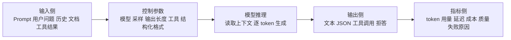
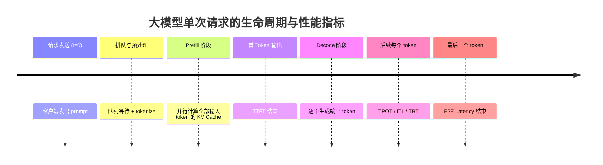
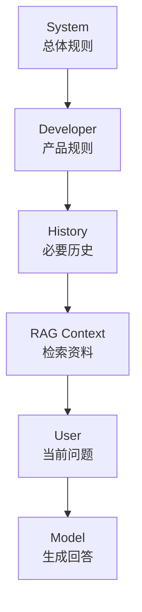
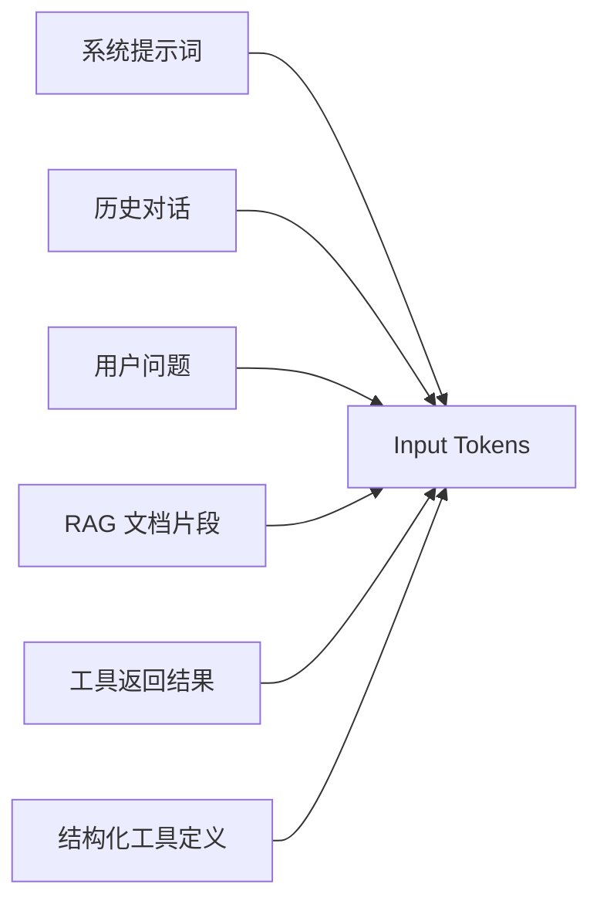
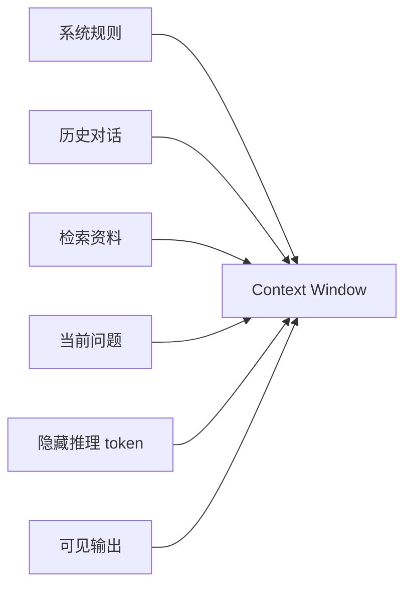
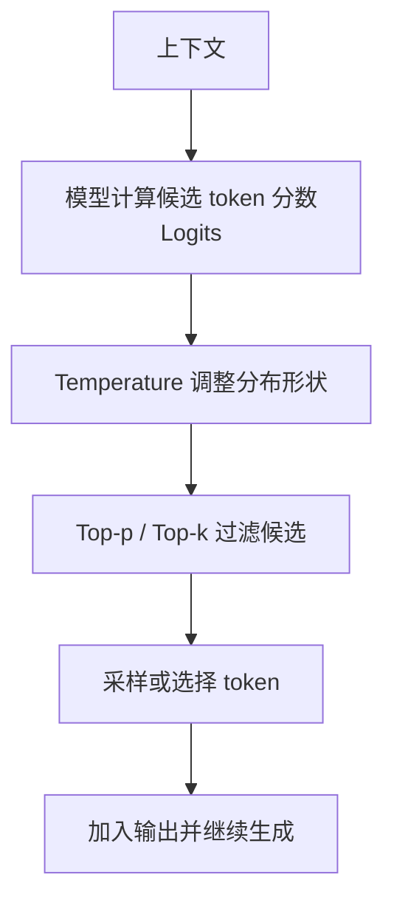
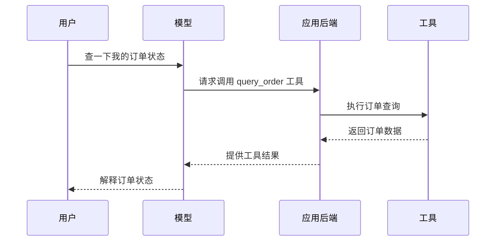
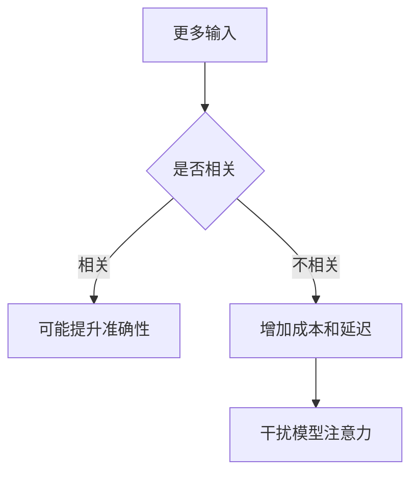

[toc]

## 总览：一次大模型调用包含什么

可以把一次大模型调用理解成下面这条链路：



你关心的“输入输出上的参数和指标”，可以分成三类：

| 类别     | 关注点           | 典型问题                                                  |
| -------- | ---------------- | --------------------------------------------------------- |
| 输入参数 | 模型看到了什么   | 上下文有多长？哪些内容会被计费？历史对话是否传入？        |
| 输出参数 | 模型怎么生成     | 回答多长？创意程度多高？是否必须 JSON？是否允许调用工具？ |
| 运行指标 | 本次调用表现如何 | 花了多少 token？多慢？多少钱？是否命中缓存？为什么停止？  |

OpenAI 的 Responses API、Anthropic Claude Messages API、Gemini Generate Content API 都围绕类似概念设计：输入内容、模型选择、生成控制、工具/结构化输出、以及 usage 统计。具体字段名会因厂商不同而变化，例如 OpenAI 常见 `input_tokens` / `output_tokens`，Anthropic 响应里也有 `usage.input_tokens` 和 `usage.output_tokens`，Gemini 则使用自己的 generation config 字段体系。([Claude Platform](https://platform.claude.com/docs/en/build-with-claude/working-with-messages))

大模型输入输出的性能指标可按**延迟、吞吐、容量、成本**四大类划分，其中延迟类（TTFT、TPOT、ITL、E2E Latency）刻画单次请求的响应体验，吞吐类（单请求 TPS、系统 Throughput、RPM/TPM、Goodput）反映并发处理能力，容量类（最大上下文长度、KV Cache 显存、并发数）决定资源上限，成本类（输入/输出单价）衡量经济性。
### 一次请求的时间轴：理解各延迟指标的位置
所有延迟类指标都挂载在"Prefill → Decode"两阶段之上，看清它们在时间轴上的位置，定义就不会混淆。

- **Prefill（预填充）**：一次性并行处理整段 prompt，计算量大、GPU 利用率高，瓶颈在算力（FLOPS），其耗时直接决定 TTFT。
- **Decode（解码）**：基于已有 KV Cache 逐个生成 token，计算量小但频繁访存，瓶颈在显存带宽而非算力，决定了后续输出速度。
### 核心性能指标定义对照
| 指标                | 全称                                      | 定义与计算                                                   | 影响因素                                                     | 典型量级                                              | 优化手段                                                     |
| ------------------- | ----------------------------------------- | ------------------------------------------------------------ | ------------------------------------------------------------ | ----------------------------------------------------- | ------------------------------------------------------------ |
| **TTFT**            | Time To First Token                       | 从请求发出到第一个 token 返回的时间，等于排队+预处理+Prefill 耗时 | Prompt 长度、模型规模、并发排队、缓存命中率、System Prompt 稳定性 | 小模型 50–200ms；中模型 200–800ms；大模型 800ms–3s    | Prompt 压缩、Prefix Caching、量化、Chunked Prefill、KV Cache 卸载 |
| **TPOT**            | Time Per Output Token                     | Decode 阶段平均每个输出 token 的耗时（不含首 token）：(E2E − TTFT)/(输出 token 数 − 1) | 模型架构（Dense/MoE）、KV Cache 大小、batch size、显存带宽   | 流畅 <50ms/token，明显卡顿 >100ms/token               | FlashAttention、连续批处理、GQA/MLA、投机解码                |
| **ITL / TBT**       | Inter-Token Latency / Time Between Tokens | 相邻两次 token 返回之间的实时间隔，反映"打字"是否抖动        | 调度抖动、batch 内长短请求混叠、网络回传                     | 接近 TPOT 为佳                                        | 连续批处理、请求长度预测调度                                 |
| **E2E Latency**     | End-to-End Latency                        | 从请求发出到最后一个 token 返回的总时间 ≈ TTFT + TPOT × (输出 token 数 − 1) | TTFT 与 TPOT 的叠加，输出越长占比越偏向 TPOT                 | —                                                     | 同时优化 Prefill 与 Decode                                   |
| **单请求 TPS**      | Tokens Per Second                         | 单个请求每秒生成 token 数 = 输出 token 数 / E2E              | 等于 TPOT 的倒数                                             | 7B 模型 50–130 tokens/s                               | 同 TPOT 优化方向                                             |
| **系统 Throughput** | Throughput                                | 单位时间系统处理的 token 总量或请求总数（tokens/s 或 req/s），衡量 GPU 利用率与单位算力成本 | batch size、连续批处理、显存利用率、并发数                   | —                                                     | PagedAttention、连续批处理、张量并行                         |
| **Goodput**         | Goodput                                   | 单位时间内**满足 SLO**（如 TTFT < 阈值、TPOT < 阈值）的请求数，反映"有效吞吐" | 调度策略、队列拥塞、输出长度预测准确性                       | —                                                     | 自适应调度、动态 batch                                       |
| **RPM / TPM**       | Requests / Tokens Per Minute              | 每分钟请求数 / 每分钟 token 数，限流监控核心                 | 实例限流配额、突发流量                                       | —                                                     | 弹性扩缩容、配额管理                                         |
| **最大上下文长度**  | Max Context Length                        | 单次请求能处理的输入+输出 token 上限                         | KV Cache 显存、注意力机制（全注意力/SWA/MLA）                | 4K–128K，部分达百万级                                 | GQA/MLA、稀疏注意力、KV Cache 量化与卸载                     |
| **KV Cache 显存**   | KV Cache Memory                           | 存储 K/V 向量的显存，随上下文长度和并发线性增长；FP16 下每 token ≈ 2×层数×隐藏维度×2 bytes | 序列长度、层数、隐藏维度、精度、batch size                   | GPT-3 175B 在 batch 64、4K 上下文下 KV Cache 达 1.2TB | PagedAttention、GQA、KV 量化、分布式内存池（PolarKVCache）   |
| **并发数**          | Concurrency                               | 系统同时处理的请求数，受显存（KV Cache）约束                 | 单卡显存、KV Cache 大小、batch 调度                          | —                                                     | KV Cache 优化以容纳更多并发                                  |
| **成本**            | Cost per 1K tokens                        | 输入 token 单价 / 输出 token 单价，通常输入便宜、输出贵      | 厂商定价、上下文长度档位、缓存折扣                           | —                                                     | Prompt 缓存折扣、Prompt 压缩                                 |
## 关键概念辨析与底层机理

### Prefill 与 Decode 的不对称性
这两阶段的瓶颈完全不同，导致优化手段也分叉：Prefill 是**计算密集型**（大矩阵乘，GPU 打得满），所以 prompt 越长 TTFT 线性上升；Decode 是**访存密集型**（每步只算 1 个 token，但要反复读权重和 KV Cache，算力往往闲置），所以单请求 TPS 主要被显存带宽卡住，加 GPU 不一定提速。这也是为什么 TPOT 优化的核心是 KV Cache 与批处理，而非堆算力。
### TTFT 为何在交互场景优先级最高
大模型是自回归生成，输出本身就是逐步产生的，因此只要首字快，用户就不会感到"等待"——即使总生成需要 10 秒，前几百毫秒出第一个字，体验就是流畅的。所以对话类产品 TTFT 目标通常压在 200–500ms 以内，优先级往往高于 E2E 总延迟。
### KV Cache：贯穿容量与并发的核心变量
KV Cache 是以空间换时间避免重复计算历史 token 的 K/V，但它会随上下文长度和并发数线性膨胀，甚至超过模型权重本身（如 GPT-3 在大 batch 下 KV Cache 可达权重的 3.45 倍）。它同时影响三类指标：
- 影响 **TTFT**：长 prompt 的 KV Cache 计算慢；
- 影响 **TPOT/吞吐**：Decode 阶段频繁读写 KV Cache，访存带宽成瓶颈；
- 影响 **并发数/上下文长度**：显存被 KV Cache 占满后无法接新请求或支持长上下文。
因此 KV Cache 优化是性能调优的最大杠杆：PagedAttention 把显存利用率从 40% 拉到 90%，GQA/MLA 从架构上缩小 KV 体积，KV 量化和分布式内存卸载（如阿里云 PolarKVCache 将 KV Cache 扩展到 TB 级分布式内存，TTFT 最高降 26.8 倍、吞吐提升 62%）则进一步突破单卡显存墙。
### Throughput 与 Latency 的此消彼长
吞吐量与延迟通常是 trade-off 关系：增大 batch size 能提升系统吞吐，但会让单请求排队变久、TTFT 上升。实时对话场景应优先保延迟，批处理场景可牺牲延迟换吞吐。Goodput 正是为了刻画"在 SLO 约束下的有效吞吐"而提出的，避免只看原始 tokens/s 的误判。

### 不同应用场景的指标侧重

| 场景                      | 核心关注指标                        | 容忍度                 |
| ------------------------- | ----------------------------------- | ---------------------- |
| 实时对话 / 客服           | TTFT（<500ms）、TPOT（<50ms）       | E2E 可较长             |
| 代码补全                  | TTFT（<100ms）                      | 极敏感，影响打字流畅度 |
| 长文档摘要 / 长上下文问答 | 最大上下文长度、KV Cache 显存、TTFT | 可容忍较高 TTFT        |
| 批量离线生成              | 系统 Throughput、Goodput、成本      | 延迟可放宽             |
| API 限流监控              | RPM/TPM、错误率、TTFT P95           | 关注峰值与 429         |
------

## 学习大纲

| 模块            | 核心问题                           | 关键术语                                                |
| --------------- | ---------------------------------- | ------------------------------------------------------- |
| 输入结构        | 模型到底读到了什么                 | Prompt、Messages、Roles、Context Window                 |
| 输入 token 指标 | 输入为什么影响费用和效果           | Input Tokens、Prompt Tokens、Cached Tokens              |
| 输出生成参数    | 如何控制回答长度、稳定性和创造性   | Max Tokens、Temperature、Top-p、Top-k                   |
| 停止与失败原因  | 为什么模型突然停了或没回答完       | Finish Reason、Stop Reason、Incomplete                  |
| 结构化输出      | 如何让模型返回可被系统消费的数据   | JSON Mode、Structured Outputs、Schema                   |
| 工具调用        | 如何让模型查数据库、搜索、执行函数 | Tool Calling、Function Calling、Tool Choice             |
| 推理模型参数    | 如何控制模型“想得多不多”           | Reasoning Effort、Thinking Budget、Reasoning Tokens     |
| 运行指标        | 如何监控成本、速度、稳定性         | Latency、TTFT、TPS、Rate Limit                          |
| 质量指标        | 如何判断回答好不好                 | Accuracy、F1、Hallucination Rate、Citation Faithfulness |
| 调参方法        | 不同任务怎么配置参数               | Deterministic、Creative、RAG、Agent                     |

------

## 输入侧：模型看到了什么

大模型不是只看“用户刚刚输入的一句话”。一次请求可能包含很多内容：

| 输入组成       | 英文术语                            | 是否占 token                 | 说明                                     |
| -------------- | ----------------------------------- | ---------------------------- | ---------------------------------------- |
| 系统规则       | System Instructions / System Prompt | 是                           | 定义助手身份、边界、安全规则、风格       |
| 开发者规则     | Developer Instructions              | 是                           | 产品层行为规则，例如输出格式、业务约束   |
| 用户问题       | User Message                        | 是                           | 本次用户真正提出的问题                   |
| 历史对话       | Conversation History                | 是                           | 为了连续对话，系统可能把历史消息一起送入 |
| 检索资料       | Retrieved Context                   | 是                           | RAG 从文档库中找回的片段                 |
| 工具结果       | Tool Results                        | 是                           | 搜索、数据库、函数调用返回的内容         |
| 图片/音频/文件 | Multimodal Inputs                   | 通常会折算                   | 不同厂商按不同方式折算 token 或计费单元  |
| 输出预算       | Output Budget                       | 不属于输入，但占总上下文空间 | 输出和推理 token 也需要上下文空间        |

OpenAI 文档说明，模型可以从 prompt 生成文本、代码、数学表达式、结构化 JSON 等内容；Gemini API 文档也说明内容生成可支持文本、图像、音频、代码、工具等多种输入和能力。([OpenAI开发者](https://developers.openai.com/api/docs/guides/text))

### 输入消息结构

现代 API 往往不是只传一个字符串，而是传一组消息。

| 角色        | 英文术语  | 常见用途                           |
| ----------- | --------- | ---------------------------------- |
| `system`    | System    | 最高层规则，例如“你是一个客服助手” |
| `developer` | Developer | 应用开发者设定的业务规则           |
| `user`      | User      | 用户输入                           |
| `assistant` | Assistant | 历史回答或模型中间输出             |
| `tool`      | Tool      | 工具调用返回结果                   |
| `function`  | Function  | 旧式或特定厂商的函数结果表示       |

示意图：



输入侧最重要的原则是：**模型只能基于本次上下文和自身参数生成回答**。如果资料没有进入上下文，也没有通过工具检索到，模型就只能靠训练中学到的模式回答，容易过时或幻觉。

------

## 输入参数总表

下面是新手最常遇到的输入参数和概念。字段名是常见叫法，不同平台会有差异。

| 参数或概念                        | 英文术语                     | 作用                           | 新手注意点                             |
| --------------------------------- | ---------------------------- | ------------------------------ | -------------------------------------- |
| `model`                           | Model                        | 指定使用哪个模型               | 影响能力、速度、价格、上下文长度       |
| `input` / `messages`              | Input / Messages             | 传入用户问题、历史、上下文     | 不只是当前问题，历史和检索内容也算输入 |
| `instructions` / `system`         | Instructions / System Prompt | 设定模型行为规则               | 固定规则建议放前面，利于缓存           |
| `tools`                           | Tools                        | 声明模型可用的工具             | 工具定义本身也占 token                 |
| `tool_choice`                     | Tool Choice                  | 控制是否自动调用工具           | 高风险动作不要完全自动执行             |
| `response_format` / `text.format` | Response Format              | 要求输出 JSON 或指定 schema    | 适合业务系统消费                       |
| `metadata`                        | Metadata                     | 给请求加业务标签               | 通常不影响模型输出，用于追踪和分析     |
| `store`                           | Store                        | 是否保存响应状态或用于后续引用 | 与隐私、合规、状态管理有关             |
| `user`                            | User Identifier              | 标识终端用户                   | 常用于风控、审计、滥用检测             |
| file/image/audio parts            | Multimodal Content Parts     | 传入非文本内容                 | 成本和限制依模型而异                   |

------

## 输入 token 指标

### input tokens / prompt tokens

**输入 token（Input Tokens / Prompt Tokens）** 是模型在本次调用中读取的 token 数量。

它通常包括：



输入 token 直接影响：

| 影响       | 说明                               |
| ---------- | ---------------------------------- |
| 费用       | 输入 token 通常按量计费            |
| 延迟       | 输入越长，模型读取越慢             |
| 上下文空间 | 输入越多，留给输出和推理的空间越少 |
| 效果       | 无关输入太多会干扰模型             |
| 缓存收益   | 重复前缀越大，越可能从缓存中获益   |

Anthropic 的基础响应示例里，`usage` 字段会返回 `input_tokens` 和 `output_tokens`；OpenAI 的 reasoning 文档也提到 response 的 usage 对象会展示输出 token 细节。([Claude Platform](https://platform.claude.com/docs/en/build-with-claude/working-with-messages))

### cached tokens

**缓存 token（Cached Tokens / Cached Input Tokens）** 是命中 prompt cache 的输入 token。它们仍然是输入 token，但因为重复前缀被缓存，通常更快、更便宜。

OpenAI 文档说明，Prompt Caching 会把请求路由到最近处理过相同 prompt 的服务器，从而比从头处理更便宜、更快，并称可降低延迟和输入 token 成本；该功能自动工作，无需代码改动。([OpenAI开发者](https://developers.openai.com/api/docs/guides/prompt-caching))

| 指标                    | 含义                               |
| ----------------------- | ---------------------------------- |
| `input_tokens`          | 本次总输入                         |
| `cached_tokens`         | 总输入中命中缓存的部分             |
| `cache_hit_rate`        | `cached_tokens / input_tokens`     |
| `uncached_input_tokens` | 没有命中缓存、按普通输入处理的部分 |

### context window

**上下文窗口（Context Window）** 是模型一次请求最多能容纳的 token 总量。它不是只给输入用，也要给输出、工具结果和推理 token 留空间。



常见误区：

| 误区                 | 正确理解                               |
| -------------------- | -------------------------------------- |
| 上下文越大越好       | 上下文大只是能放更多，不代表都该放进去 |
| 只要没超过窗口就安全 | 无关内容太多会稀释注意力               |
| 历史对话免费         | 历史如果被传入，也会计入输入 token     |
| RAG 检索越多越好     | 检索片段要少而准                       |

------

## 输出侧：模型生成什么

输出不只是“文本”。现代大模型输出可能包括：

| 输出类型     | 英文术语                  | 用途                        |
| ------------ | ------------------------- | --------------------------- |
| 普通文本     | Text Output               | 聊天、解释、总结、写作      |
| 结构化 JSON  | Structured Output / JSON  | 分类、抽取、业务字段        |
| 工具调用请求 | Tool Call / Function Call | 让系统执行函数、查库、搜索  |
| 推理摘要     | Reasoning Summary         | 对 reasoning 模型的过程摘要 |
| 拒答         | Refusal                   | 安全策略触发                |
| 多候选输出   | Candidate Outputs         | 一次生成多个候选            |
| 流式片段     | Streaming Chunks          | 边生成边返回，提高体验      |

输出侧有两个问题最重要：

| 问题         | 对应参数                           |
| ------------ | ---------------------------------- |
| 回答能多长   | `max_tokens` / `max_output_tokens` |
| 回答有多随机 | `temperature`、`top_p`、`top_k`    |

------

## 输出长度控制

### max tokens / max output tokens

**最大输出 token（Max Tokens / Max Output Tokens）** 限制模型最多生成多少 token。Anthropic 的文档示例中 `max_tokens` 是必需参数；OpenAI reasoning 文档说明可以用 `max_output_tokens` 限制模型生成的总 token，包括推理 token、可见输出 token 和不可见格式 token。([Claude Platform](https://platform.claude.com/docs/en/build-with-claude/working-with-messages))

| 设置方式 | 效果                         |
| -------- | ---------------------------- |
| 太小     | 回答可能被截断               |
| 适中     | 成本可控，输出完整           |
| 太大     | 成本和延迟增加，模型可能啰嗦 |

要特别注意 reasoning 模型：**隐藏推理 token 也可能占用输出预算**。OpenAI 文档明确说明，reasoning tokens 虽然 API 不可见，但仍占上下文窗口，并按输出 token 计费；如果达到 `max_output_tokens` 或上下文限制，可能在没有可见输出前就出现 incomplete。([OpenAI开发者](https://developers.openai.com/api/docs/guides/reasoning))

实践建议：

| 任务               | 建议                                     |
| ------------------ | ---------------------------------------- |
| 分类               | 20 到 200 token 通常足够                 |
| 短答               | 200 到 800 token                         |
| 摘要               | 根据文档长度设定，通常 500 到 2000 token |
| 报告               | 分章节生成，不要一次性给极大上限         |
| reasoning 复杂任务 | 给推理和答案预留充足 token               |

------

## 采样参数：控制稳定性和创造性

模型在每一步都会得到一组候选 token 及其概率。采样参数决定“从这些候选里怎么选”。



### temperature

**温度（Temperature）** 控制随机性。Google Cloud 的 Gemini 参数文档说明，temperature 在生成回复期间用于采样，较低温度更适合开放性或创造性较低的提示，较高温度可以带来更多样或更有创造性的结果；temperature 为 0 时通常选择概率最高的 token，但结果仍可能有少量变化。([Google Cloud Documentation](https://docs.cloud.google.com/vertex-ai/generative-ai/docs/multimodal/content-generation-parameters?hl=zh-cn))

| temperature | 直觉                     | 适合任务                   |
| ----------- | ------------------------ | -------------------------- |
| 0 到 0.2    | 稳定、保守、可重复性较高 | JSON、抽取、分类、代码修复 |
| 0.3 到 0.7  | 平衡                     | 问答、总结、技术解释       |
| 0.8 到 1.2  | 更发散、更有创意         | 文案、头脑风暴、故事       |
| 更高        | 可能非常发散             | 一般不建议生产默认使用     |

注意：低 temperature 不等于绝对确定。并行推理、底层实现、模型版本、工具调用、流式处理等都可能带来小差异。

### top-p

**Top-p（Nucleus Sampling，核采样）** 表示只从累计概率达到 p 的候选 token 集合中采样。

| top-p | 直觉                       |
| ----- | -------------------------- |
| 0.1   | 只考虑最可能的一小撮 token |
| 0.8   | 保留较宽但仍受控的候选范围 |
| 1.0   | 不做 nucleus 截断          |

经验上，不建议新手同时大幅调整 `temperature` 和 `top_p`。通常先调 `temperature`，除非你很清楚自己要控制候选分布。

### top-k

**Top-k** 表示每一步只从概率最高的 k 个 token 中选。它在 Gemini、部分开源模型和部分平台中常见；OpenAI 的主流文本接口不一定暴露这个参数。

| top-k  | 直觉                 |
| ------ | -------------------- |
| 1      | 类似总是选最高概率   |
| 20     | 从前 20 个候选中采样 |
| 40     | 更宽一些             |
| 不设置 | 让平台使用默认策略   |

### 采样参数调参建议

| 场景          | temperature | top-p      | 备注               |
| ------------- | ----------- | ---------- | ------------------ |
| 数据抽取      | 0 到 0.2    | 默认       | 配合结构化输出     |
| 合同/政策问答 | 0 到 0.3    | 默认       | 要求引用来源       |
| 技术解释      | 0.3 到 0.7  | 默认       | 兼顾可读性         |
| 代码生成      | 0 到 0.4    | 默认       | 复杂代码建议加测试 |
| 创意文案      | 0.7 到 1.0  | 默认或略降 | 可生成多个候选     |
| 头脑风暴      | 0.8 到 1.2  | 默认       | 再让模型筛选       |

------

## 重复控制参数

有些平台提供控制重复和偏好的参数。

| 参数                 | 英文术语           | 作用                      | 使用建议                   |
| -------------------- | ------------------ | ------------------------- | -------------------------- |
| `frequency_penalty`  | Frequency Penalty  | 惩罚已经频繁出现的 token  | 适合减少啰嗦和重复         |
| `presence_penalty`   | Presence Penalty   | 只要出现过就给予惩罚      | 适合鼓励引入新主题         |
| `repetition_penalty` | Repetition Penalty | 开源模型常见的重复惩罚    | 过高会导致语言怪异         |
| `logit_bias`         | Logit Bias         | 提高或降低某些 token 概率 | 适合强约束词汇，但容易误用 |

实践上，重复问题优先通过 prompt 解决，例如“不要重复前文”“每点只写一句”。只有在重复仍明显时，再调 penalty。

------

## 停止参数和停止原因

### stop / stop sequences

**停止序列（Stop Sequence）** 是告诉模型遇到某些字符串就停止生成。

| 用法                   | 示例                    |
| ---------------------- | ----------------------- |
| 防止模型继续生成下一段 | 遇到 `"\nUser:"` 停止   |
| 分隔多条样本           | 遇到 `"###"` 停止       |
| 控制模板输出           | 遇到 `"</answer>"` 停止 |

Gemini 文档把停止参数描述为用于定义生成过程停止条件，从而控制输出长度和内容。([Google Cloud Documentation](https://docs.cloud.google.com/vertex-ai/generative-ai/docs/multimodal/content-generation-parameters?hl=zh-cn))

### finish reason / stop reason

响应里通常会有一个停止原因字段，不同平台叫法不同：`finish_reason`、`stop_reason`、`incomplete_details` 等。

| 停止原因                     | 可能含义         | 应对                     |
| ---------------------------- | ---------------- | ------------------------ |
| `stop` / `end_turn`          | 正常结束         | 无需处理                 |
| `length` / `max_tokens`      | 达到最大输出限制 | 提高上限或要求更短       |
| `stop_sequence`              | 命中停止序列     | 检查是否符合预期         |
| `tool_calls`                 | 模型请求调用工具 | 执行工具后继续对话       |
| `content_filter` / `refusal` | 安全策略触发     | 向用户解释限制           |
| `incomplete`                 | 未完整生成       | 查看原因，重试或调整参数 |
| `error`                      | 服务或请求错误   | 重试、降级或报警         |

Anthropic 的响应示例里包含 `stop_reason: "end_turn"` 和 `stop_sequence`；OpenAI reasoning 文档也说明如果输出达到上下文窗口或 `max_output_tokens`，响应可能为 `incomplete` 并带有原因。([Claude Platform](https://platform.claude.com/docs/en/build-with-claude/working-with-messages))

------

## 结构化输出参数

当你要把大模型接入系统时，最重要的输出参数往往不是 temperature，而是 **结构化输出（Structured Outputs）**。

OpenAI 文档区分了两类场景：如果要连接工具、函数、数据或系统，应使用 function calling；如果希望模型直接按指定结构回复用户，则更适合使用 structured `response_format` 或 `text.format`。([OpenAI开发者](https://developers.openai.com/api/docs/guides/structured-outputs))

| 参数或能力        | 英文术语                 | 作用                         |
| ----------------- | ------------------------ | ---------------------------- |
| `response_format` | Response Format          | 要求输出 JSON 或 schema      |
| JSON mode         | JSON Mode                | 要求模型输出合法 JSON        |
| JSON Schema       | JSON Schema              | 定义字段、类型、枚举、必填项 |
| strict mode       | Strict Structured Output | 更严格遵守 schema            |
| function schema   | Function Schema          | 定义工具调用参数结构         |

适合结构化输出的任务：

| 任务     | 推荐输出                                   |
| -------- | ------------------------------------------ |
| 工单分类 | `{category, priority, reason}`             |
| 简历解析 | `{name, skills, years, education}`         |
| 发票抽取 | `{vendor, amount, tax, date}`              |
| 风险审核 | `{risk_level, evidence, suggested_action}` |
| RAG 问答 | `{answer, citations, missing_info}`        |

结构化输出最佳实践：

| 建议                       | 原因                      |
| -------------------------- | ------------------------- |
| 字段越少越稳定             | schema 太复杂会增加失败率 |
| 使用枚举                   | 减少自由发挥              |
| 明确空值策略               | 例如找不到就返回 `null`   |
| 把证据字段单独列出         | 便于验证                  |
| 对输出做 schema validation | 不要直接信任模型输出      |
| 失败后自动重试一次         | 格式错误常可修复          |

------

## 工具调用参数

**工具调用（Tool Calling / Function Calling）** 是让模型决定是否调用外部函数，例如查订单、查数据库、搜索网页、执行代码。

| 参数                | 英文术语            | 作用                           |
| ------------------- | ------------------- | ------------------------------ |
| `tools`             | Tools               | 声明可用工具列表               |
| `tool_choice`       | Tool Choice         | 自动、强制、禁止或指定某个工具 |
| function name       | Function Name       | 工具名称                       |
| parameters schema   | Parameters Schema   | 工具参数结构                   |
| parallel tool calls | Parallel Tool Calls | 是否允许并行调用多个工具       |
| tool result         | Tool Result         | 工具执行后的返回内容           |

典型流程：



工具调用最重要的实践：

| 风险             | 建议                             |
| ---------------- | -------------------------------- |
| 模型传错参数     | 后端做参数校验                   |
| 模型调用危险动作 | 发邮件、删除、付款等需要人工确认 |
| 工具返回太长     | 摘要或只返回必要字段             |
| 工具失败         | 给模型结构化错误码               |
| 权限越界         | 检索和执行前做权限过滤           |
| 成本失控         | 限制最大工具调用次数             |

------

## reasoning 参数和隐藏 token

现代 reasoning 模型通常增加了“推理控制”参数。不同厂商叫法不同，常见有：

| 参数               | 英文术语          | 作用                                 |
| ------------------ | ----------------- | ------------------------------------ |
| `reasoning.effort` | Reasoning Effort  | 控制模型在复杂任务上投入多少内部推理 |
| thinking budget    | Thinking Budget   | 给模型分配思考 token 预算            |
| reasoning summary  | Reasoning Summary | 返回简要推理摘要，而非原始隐藏推理   |
| reasoning tokens   | Reasoning Tokens  | 模型内部思考消耗的 token             |

OpenAI reasoning 文档说明，`reasoning.effort` 用于引导模型执行任务时“思考多少”，较低 effort 倾向速度更快、token 更少，较高 effort 倾向更完整地思考并提高复杂任务质量；文档还说明隐藏 reasoning tokens 不通过 API 可见，但会占上下文窗口并按输出 token 计费。([OpenAI开发者](https://developers.openai.com/api/docs/guides/reasoning))

实践建议：

| 任务                   | reasoning effort           |
| ---------------------- | -------------------------- |
| 简单改写、分类、摘要   | 低或最小                   |
| 普通问答、轻量代码     | 低到中                     |
| 数学、复杂代码、规划   | 中到高                     |
| 多工具 agent、复杂决策 | 高，但要控制预算           |
| 高并发低成本场景       | 尽量低，必要时路由到强模型 |

重要提醒：**reasoning token 是成本黑箱的一部分**。你看不到完整内部推理，但会为其 token 消耗付费，所以需要监控 `output_tokens_details.reasoning_tokens` 或相应字段。

------

## 流式输出参数

**流式输出（Streaming）** 是指模型一边生成一边返回，而不是等完整答案生成完再返回。

| 指标          | 英文术语                  | 说明                                |
| ------------- | ------------------------- | ----------------------------------- |
| 首 token 延迟 | Time To First Token, TTFT | 从请求发出到收到第一个 token 的时间 |
| 总延迟        | End-to-End Latency        | 从请求到完整响应结束                |
| 生成速度      | Tokens Per Second, TPS    | 每秒输出 token 数                   |
| 用户感知延迟  | Perceived Latency         | 用户感觉等待多久                    |

流式输出不一定降低总耗时，但能显著改善用户体验，因为用户更早看到内容。

适合流式：

| 适合     | 不适合                  |
| -------- | ----------------------- |
| 长回答   | 需要一次性校验完整 JSON |
| 聊天 UI  | 后端批处理              |
| 报告生成 | 严格事务型工具执行      |
| 代码解释 | 短分类任务              |

------

## 响应 usage 指标

一次调用结束后，通常会返回 usage 统计。不同厂商字段名不同，但概念类似。

| 指标                                  | 英文术语                   | 含义                                 |
| ------------------------------------- | -------------------------- | ------------------------------------ |
| `input_tokens` / `prompt_tokens`      | Input / Prompt Tokens      | 输入 token 数                        |
| `output_tokens` / `completion_tokens` | Output / Completion Tokens | 输出 token 数                        |
| `total_tokens`                        | Total Tokens               | 输入加输出，有些平台还包括隐藏 token |
| `cached_tokens`                       | Cached Tokens              | 命中缓存的输入 token                 |
| `reasoning_tokens`                    | Reasoning Tokens           | 隐藏推理 token                       |
| `audio_tokens`                        | Audio Tokens               | 音频输入或输出折算 token             |
| `tool_tokens`                         | Tool Tokens                | 工具定义或工具结果带来的 token       |
| `image_tokens`                        | Image Tokens               | 图像输入折算 token，具体规则依平台   |

一个简化成本公式：

```text
总费用 =
普通输入 token × 输入单价
+ 缓存输入 token × 缓存输入单价
+ 输出 token × 输出单价
+ 工具调用费用
+ 存储或检索费用
```

其中 reasoning tokens 通常归入输出侧计费。OpenAI reasoning 文档明确说明隐藏 reasoning tokens 会被计入输出 token 成本，并建议用 `max_output_tokens` 控制包含推理 token 在内的总生成量。([OpenAI开发者](https://developers.openai.com/api/docs/guides/reasoning))

------

## 延迟和吞吐指标

如果你做应用，不能只看回答质量，还要看服务指标。

| 指标          | 英文术语                 | 含义               | 常见用途        |
| ------------- | ------------------------ | ------------------ | --------------- |
| 平均延迟      | Average Latency          | 平均响应时间       | 粗略观察        |
| P50 延迟      | P50 Latency              | 一半请求低于该时间 | 常规体验        |
| P95 延迟      | P95 Latency              | 95% 请求低于该时间 | 生产 SLA 更重要 |
| P99 延迟      | P99 Latency              | 极端慢请求         | 排查尾延迟      |
| 首 token 延迟 | TTFT                     | 多快开始输出       | 聊天体验        |
| 每秒 token    | Tokens per Second        | 输出速度           | 长文本体验      |
| 请求吞吐      | Requests per Minute, RPM | 每分钟请求数       | 限流和容量      |
| token 吞吐    | Tokens per Minute, TPM   | 每分钟 token 数    | 成本和限流      |
| 错误率        | Error Rate               | 失败请求比例       | 稳定性          |
| 重试率        | Retry Rate               | 自动重试比例       | 后端健康度      |

OpenAI API 参考建议生产环境记录请求 ID，并说明响应头中可能包含处理时间、请求 ID 和 rate limit 信息，例如 requests 和 tokens 的限制、剩余量、重置时间等。([OpenAI开发者](https://developers.openai.com/api/reference/overview/))

------

## 质量指标

输入输出参数只是控制“怎么生成”，但你最终要判断“生成得好不好”。常见质量指标如下。

| 指标       | 英文术语             | 适用任务       | 说明                       |
| ---------- | -------------------- | -------------- | -------------------------- |
| 准确率     | Accuracy             | 分类、选择题   | 正确样本比例               |
| 精确率     | Precision            | 检索、分类     | 模型说是正例时有多少是真的 |
| 召回率     | Recall               | 检索、抽取     | 真实正例中找回多少         |
| F1         | F1 Score             | 类别不均衡任务 | precision 和 recall 的折中 |
| 精确匹配   | Exact Match          | 问答、抽取     | 输出是否完全匹配标准答案   |
| pass@k     | Pass at k            | 代码、数学     | k 个候选中是否有一个通过   |
| 幻觉率     | Hallucination Rate   | RAG、问答      | 无依据或错误事实比例       |
| 引用准确率 | Citation Accuracy    | RAG            | 引用是否真正支持回答       |
| 格式有效率 | Schema Validity Rate | JSON 输出      | 是否通过 schema 校验       |
| 工具成功率 | Tool Success Rate    | Agent          | 工具调用是否正确完成       |
| 拒答准确率 | Refusal Accuracy     | 安全场景       | 该拒时拒，不该拒时不拒     |
| 用户满意度 | CSAT                 | 产品体验       | 用户主观评分               |

对于新手，最实用的是先建立这几个：

| 任务类型  | 最小可用指标                                |
| --------- | ------------------------------------------- |
| FAQ 问答  | 正确率、幻觉率、引用准确率                  |
| 文档问答  | 答案是否有依据、引用是否正确                |
| 分类      | accuracy、F1、混淆矩阵                      |
| 数据抽取  | 字段级 precision / recall                   |
| JSON 输出 | schema valid rate                           |
| Agent     | tool success rate、平均步骤数、失败原因分布 |
| 客服      | 一次解决率、人工转接率、用户满意度          |

------

## 参数之间的关系

### 输入越长，不一定效果越好



最佳实践：**少而准的上下文，通常优于大而杂的上下文。**

### 输出越长，成本和风险越高

| 输出越长带来的影响 | 说明                             |
| ------------------ | -------------------------------- |
| 成本增加           | 输出 token 往往比输入 token 更贵 |
| 延迟增加           | 逐 token 生成需要时间            |
| 幻觉机会增加       | 说得越多，出错机会越多           |
| 用户阅读负担增加   | 长回答不一定更有价值             |

### temperature 越高，不等于越聪明

| temperature 变化 | 影响                             |
| ---------------- | -------------------------------- |
| 降低             | 更稳定、更保守                   |
| 提高             | 更多样、更有创意                 |
| 过高             | 可能跑题、格式不稳、事实错误增加 |

### reasoning effort 越高，不一定总是更好

| 任务         | 高 reasoning 的结果        |
| ------------ | -------------------------- |
| 复杂数学     | 可能明显提升               |
| 多步骤代码   | 可能提升                   |
| 简单分类     | 浪费成本和延迟             |
| 固定格式抽取 | 可能不如低温结构化输出稳定 |

------

## 常见任务的推荐配置

| 任务       | 输入组织                   | 输出参数                            | 质量控制             |
| ---------- | -------------------------- | ----------------------------------- | -------------------- |
| 简单问答   | 用户问题 + 少量上下文      | 低到中 temperature，适中 max tokens | 不确定时说明         |
| 文档问答   | RAG 检索片段 + 引用 ID     | 低 temperature，要求引用            | 检查引用是否支持答案 |
| 数据抽取   | 原文 + 字段 schema         | 低 temperature，结构化输出          | schema validation    |
| 分类       | 输入文本 + 类别定义 + 示例 | 低 temperature，短输出              | 混淆矩阵             |
| 创意写作   | 风格说明 + 示例            | 中高 temperature，多候选            | 人工选择             |
| 代码生成   | 需求 + 约束 + 测试         | 低中 temperature                    | 运行测试             |
| Agent 任务 | 目标 + 工具 + 状态         | 限制工具次数和 max tokens           | 审计日志和人工确认   |
| 复杂推理   | 清晰问题 + 必要数据        | reasoning effort 中高               | 最终答案校验         |

------

## 典型配置模板

### 稳定抽取型

| 参数                | 建议                        |
| ------------------- | --------------------------- |
| `temperature`       | 0 到 0.2                    |
| `top_p`             | 默认                        |
| `max_output_tokens` | 严格限制                    |
| `response_format`   | JSON Schema                 |
| `reasoning.effort`  | 低或最小                    |
| `stop`              | 通常不需要                  |
| 监控                | schema 有效率、字段级准确率 |

适合：发票识别、简历解析、合同字段抽取、工单分类。

### 知识问答型

| 参数                | 建议                           |
| ------------------- | ------------------------------ |
| 输入                | 用户问题 + 相关文档片段        |
| `temperature`       | 0 到 0.4                       |
| `max_output_tokens` | 中等                           |
| 输出                | 答案 + 引用 + 不确定点         |
| 工具                | RAG / Web Search / 数据库      |
| 监控                | 幻觉率、引用准确率、检索命中率 |

适合：企业知识库、客服 FAQ、政策问答、文档助手。

### 创意生成型

| 参数                | 建议                       |
| ------------------- | -------------------------- |
| `temperature`       | 0.7 到 1.0                 |
| `top_p`             | 默认或略调                 |
| `max_output_tokens` | 根据篇幅设定               |
| `n` / candidates    | 可生成多个候选             |
| 监控                | 用户选择率、编辑率、满意度 |

适合：广告文案、标题、故事、品牌语气探索。

### 复杂推理型

| 参数                | 建议                           |
| ------------------- | ------------------------------ |
| `reasoning.effort`  | 中到高                         |
| `max_output_tokens` | 为隐藏推理和可见输出预留空间   |
| `temperature`       | 低到中                         |
| 工具                | 计算器、代码执行、搜索         |
| 输出                | 结论、关键依据、校验结果       |
| 监控                | 正确率、推理 token、延迟、成本 |

适合：复杂代码、数学、规划、故障排查、多步骤 agent。

------

## 生产环境应该记录哪些指标

下面这张表非常实用。无论你用哪家模型，都建议尽量记录。

| 维度 | 指标                                                 | 为什么重要                     |
| ---- | ---------------------------------------------------- | ------------------------------ |
| 请求 | request_id、user_id、model、版本                     | 排查问题和回归分析             |
| 输入 | input_tokens、cached_tokens、context_length          | 成本和上下文健康度             |
| 输出 | output_tokens、reasoning_tokens、finish_reason       | 判断是否截断、是否隐藏消耗过高 |
| 延迟 | TTFT、total_latency、tokens_per_second               | 用户体验和容量规划             |
| 成本 | estimated_cost、tool_cost、cache_savings             | 预算控制                       |
| 工具 | tool_call_count、tool_success_rate、tool_error       | Agent 稳定性                   |
| RAG  | retrieved_chunks、retrieval_score、citation_accuracy | 问答可靠性                     |
| 格式 | schema_valid、parse_error_rate                       | 系统集成稳定性                 |
| 安全 | refusal_rate、moderation_flags                       | 风险控制                       |
| 质量 | human_rating、eval_score、regression_result          | 模型和 prompt 迭代             |

------

## 常见误区

| 误区                         | 更准确的理解                                |
| ---------------------------- | ------------------------------------------- |
| `max_tokens` 越大越好        | 只是允许输出更长，也会增加成本和延迟        |
| temperature 设 0 就完全确定  | 通常更稳定，但不保证绝对一致                |
| top-p 和 temperature 都要调  | 新手通常先调 temperature，top-p 保持默认    |
| 输入资料越多越准确           | 相关资料越多才有帮助，无关资料会干扰        |
| 结构化输出就不会错           | 它提升格式稳定性，不保证事实正确            |
| 工具调用由模型执行           | 模型只提出调用，真正执行的是你的后端        |
| usage 只看 total tokens 就够 | 要拆 input、output、cached、reasoning、tool |
| reasoning 越高越好           | 简单任务会浪费成本，复杂任务才值得          |
| 流式输出会降低成本           | 流式主要改善体验，不一定省 token            |
| RAG 可以完全消除幻觉         | 检索错、引用错、上下文冲突仍会导致错误      |

------

## 调参优先级

调参时不要一上来乱改所有参数。推荐顺序是：

| 优先级 | 要调整的东西                      | 原因                         |
| ------ | --------------------------------- | ---------------------------- |
| 最高   | 输入是否清楚、上下文是否相关      | 垃圾输入会导致垃圾输出       |
| 高     | 输出格式是否明确                  | 格式约束比采样参数更重要     |
| 高     | `max_output_tokens` 是否合理      | 防止截断和成本失控           |
| 中     | `temperature`                     | 控制稳定性和创造性           |
| 中     | 是否需要工具或 RAG                | 解决模型不知道或不能做的问题 |
| 中     | reasoning effort                  | 只对复杂推理任务重点调整     |
| 低     | top-p、top-k、penalty、logit_bias | 进阶优化，容易误调           |

一个实用判断：

> 如果答案内容不对，先改上下文和资料；
> 如果格式不稳，先用结构化输出；
> 如果太随机，降低 temperature；
> 如果回答被截断，提高 max tokens 或要求更短；
> 如果成本太高，减少输入、限制输出、利用缓存和小模型路由。

------

## 最小心智模型

最后用一张表把核心概念压缩一下：

| 你看到的现象 | 背后的参数或指标                                     |
| ------------ | ---------------------------------------------------- |
| 回答太长     | `max_output_tokens` 太大，prompt 没限制篇幅          |
| 回答没写完   | `max_output_tokens` 太小或上下文空间不足             |
| 回答太随机   | `temperature` 太高                                   |
| 回答太死板   | `temperature` 太低或约束太强                         |
| JSON 经常坏  | 没用结构化输出或 schema 太复杂                       |
| 成本突然升高 | 输入历史变长、RAG 片段过多、reasoning tokens 增加    |
| 速度变慢     | 输入太长、输出太长、工具调用慢、模型太大             |
| 事实错误     | 缺少可靠上下文、RAG 检索错、没有引用校验             |
| 工具乱调用   | tool schema 不清楚、tool_choice 太开放、缺少后端校验 |
| 多轮越聊越贵 | 历史消息被反复传入上下文                             |

一句话总结：

> 大模型输入输出的参数，本质是在控制“模型看到什么、怎么生成、何时停止、输出什么格式”；相关指标则是在衡量“它读了多少、写了多少、花了多久、花了多少钱、结果是否可靠”。