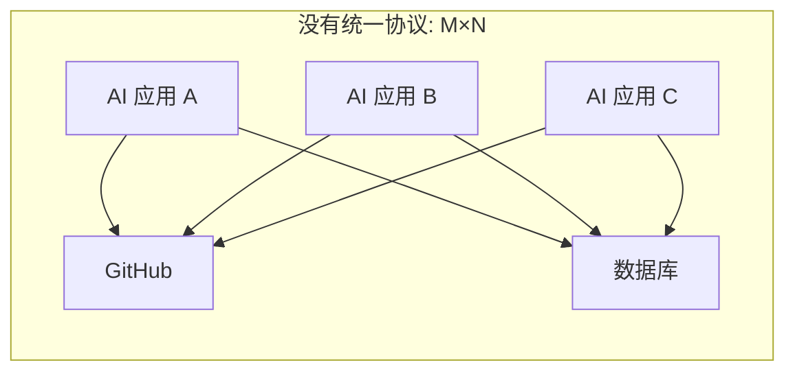
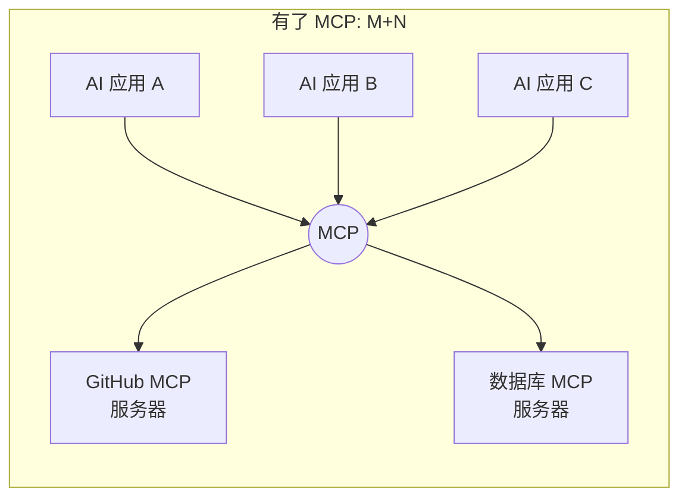
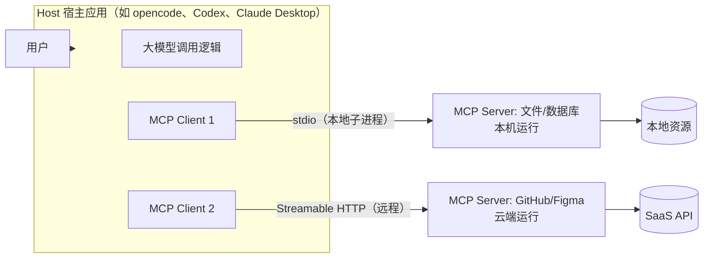
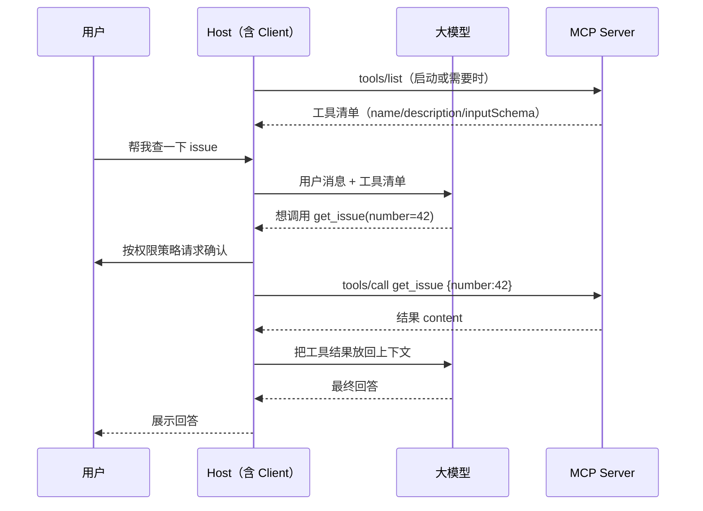
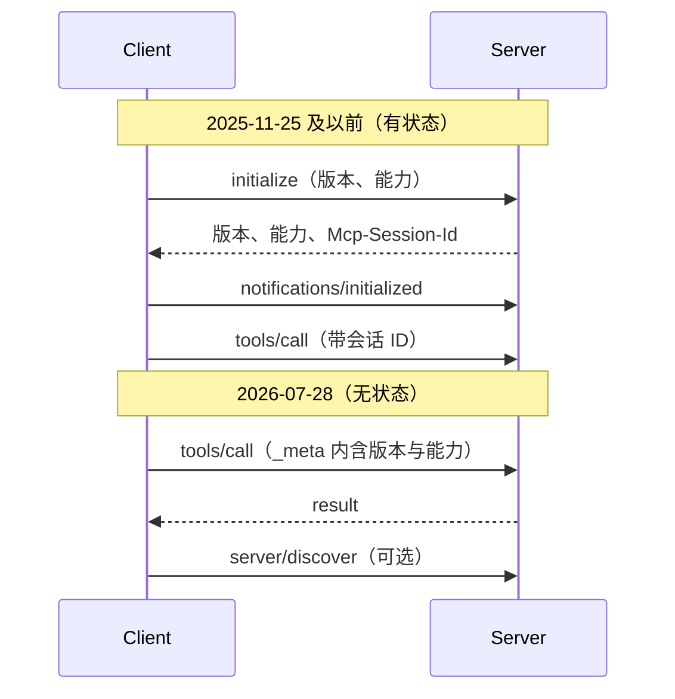
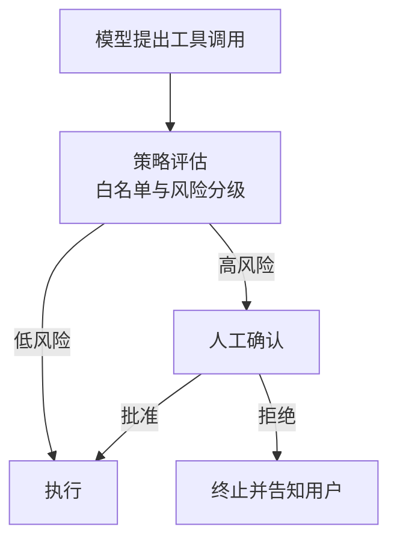
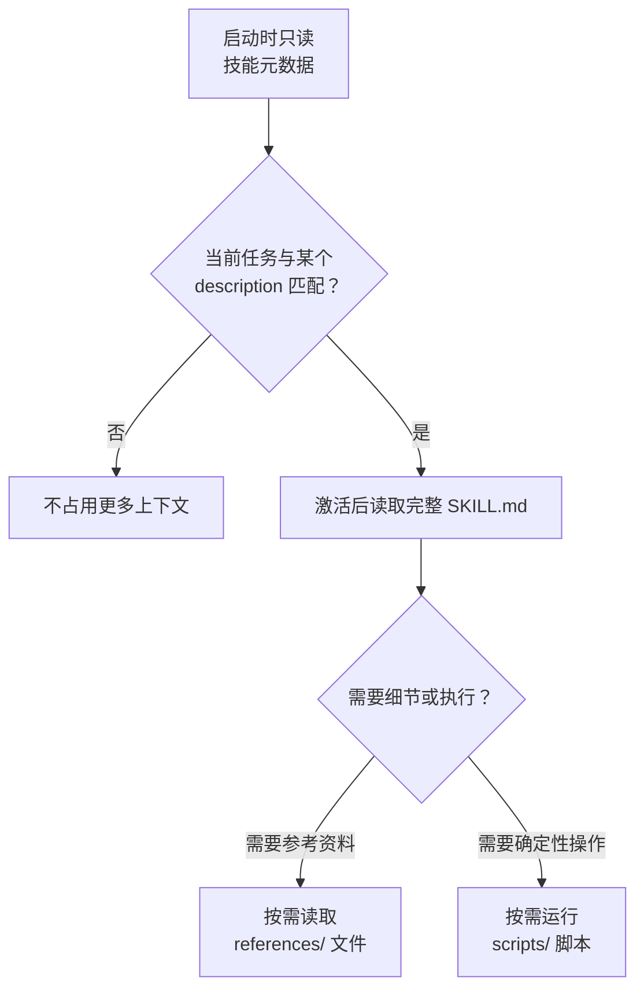
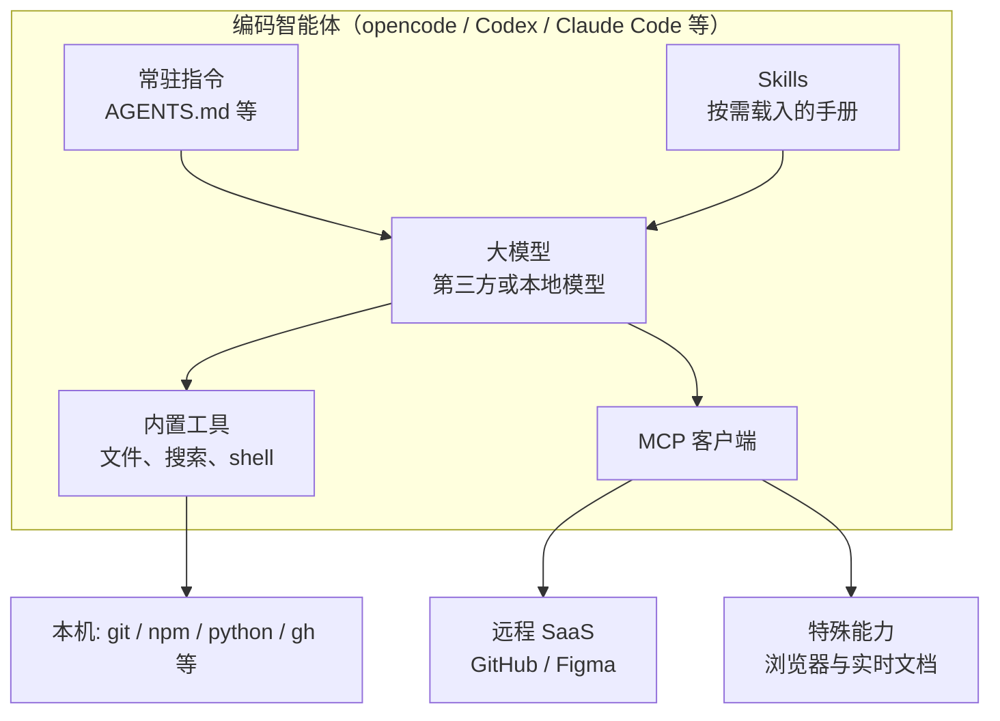
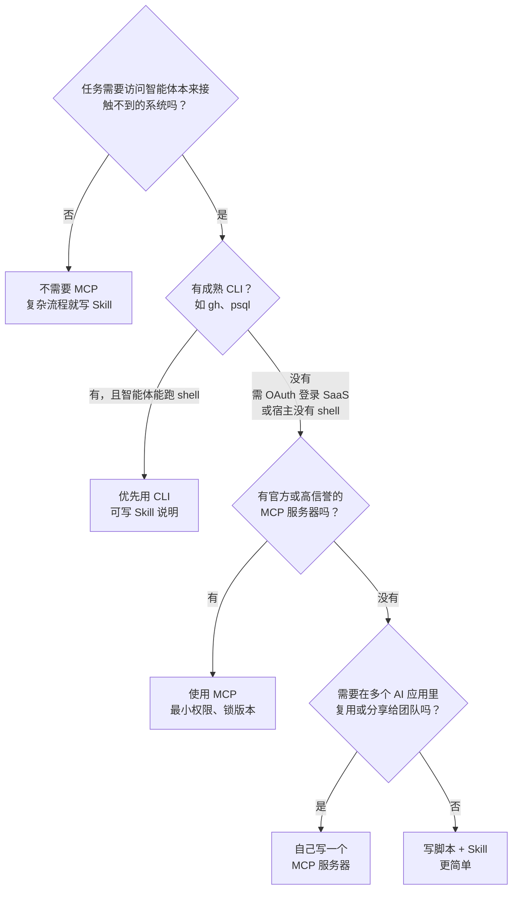
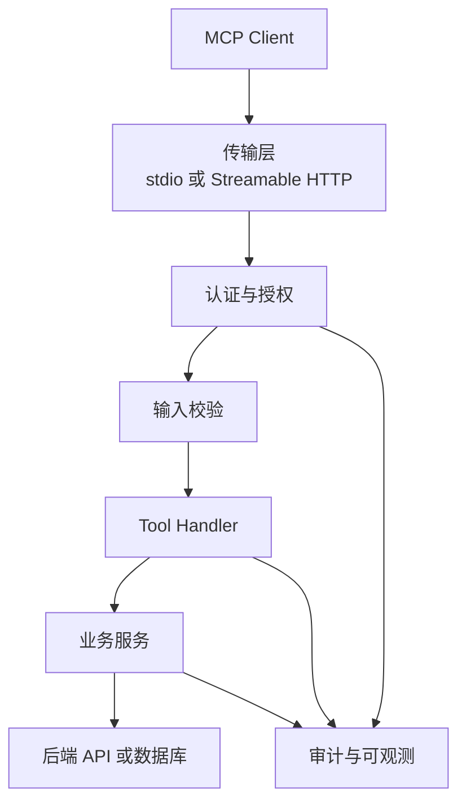

[toc]

## 速览结论

- **MCP（Model Context Protocol，模型上下文协议）是一种连接协议**。它把“AI 应用怎样**发现和调用**外部工具或数据”标准化。一个工具做成 **MCP 服务器**(传统的典型服务器是**HTTP服务器**,而MCP是LLM AI时代的产物)，就能被多个 AI 应用直接使用。
- **MCP 不是 AI 调用工具的唯一方式**。应用直接调 API（Application Programming Interface，应用程序接口）、Function Calling、OpenAPI 驱动、Agent 框架内置工具、插件、Computer Use 都能完成类似任务；MCP 的独特价值是**跨应用、跨模型厂商的连接标准化**。
- **模型本身不直接连接外部系统**。模型只“提议”调用哪个工具、传什么参数，真正执行的是宿主应用。宿主的权限确认、白名单与沙箱，是最关键的安全防线。
- **Skill（Agent Skills，技能包）是一种知识与流程的打包格式**。它用 `SKILL.md` 加可选的脚本与参考资料，教会智能体“某类事情该怎么做”，并且只在需要时载入上下文。
- 一句话区分：**MCP 给智能体“手”，负责连接外部能力；Skill 给智能体“操作手册”，负责做事的方法**。两者互补，不互相替代。
- **对 opencode、Codex 这类能执行 shell 的编码智能体，MCP 不是必需品**。它们自带读写文件、运行命令的能力，本机已有的 `git`、`gh`、`psql` 通常就够用。只有接入**没有好用 CLI（Command Line Interface，命令行界面）的外部系统**（SaaS、浏览器、设计稿、需要 OAuth 的服务），或**在多个 AI 应用之间复用同一集成**时，MCP 的价值才明显。部分agent harness(例如pi-agent在0.x时期不提供mcp支持)
- **MCP 最常被提到的三类问题是**：工具定义占用上下文、安全风险（工具投毒、提示注入、供应链）、规范变化快。2026-07-28 版把协议核心改为**无状态**，是 MCP 发布以来最大的一次修订。
- **阅读提醒**：MCP 用日期作版本号，2026-07-28 为当前版本。网上大量 2024—2025 教程仍在讲 `initialize` 握手与 `Mcp-Session-Id`，这些内容只适用于旧版协议。**先确认教程对应的协议版本，再决定是否照做**。

> 无论是mcp还是skill, 大模型看到的都是"提示词"的形式,只是这些提示词遵循一定的标准或规范,ai理解起来更准确,尤其是经过相关训练的情况下; 这些特殊类型的提示词在ai agent中提供给大模型,提供和获取方式不像平时对话那样直接由用户发送给ai.

## MCP 要解决什么问题

### 问题的来源：“M×N 集成”

大语言模型本身只会“读文本、写文本”。要让它查数据库、读 GitHub issue、操作浏览器，就得有人写“胶水代码”：把外部能力描述给模型，再执行模型发出的调用请求。在 MCP 出现之前，**每个 AI 应用都要为每个外部系统单独写一套集成**。例如 Cursor 写一套 GitHub 集成，Claude Desktop 再写一套，自研 Agent 又写一套。M 个应用对接 N 个系统，就需要 M×N 份集成。没有统一协议时，适配关系是乘法：



有了 MCP 后，应用与外部系统围绕同一协议实现(MCP充当中间角色协调客户端和服务端能力的适配问题)，适配关系变成加法：

> 大家都遵守同一套规范,是问题(适配)简化的基础. 如果某个应用或服务不遵守,那么这个方案就失灵了.
>
> 举个简单的例子,计算机厂商A,B各自推出了自家的外围设备接口(例如适配传输接口)a,b;而外围配件厂商m,n为了自己的设备能兼容a,b就得分别都做一遍适配,提供两种接口(a,b); 如果A,B经过协商,愿意采用同一种公共接口C,这样厂商m,n就都只要适配C即可.



**图解**：前一张图里，每个应用都要分别实现每个集成；后一张图里，**应用**只需实现一次“MCP 客户端”，**外部系统**只需实现一次“MCP 服务器”，集成数量从乘法变成加法。

常见的比喻是“**AI 世界的 USB-C**”。这与 LSP（Language Server Protocol，语言服务器协议）统一“编辑器 × 编程语言”的思路一致，MCP 规范也明确说明其设计受 LSP 启发（[MCP 规范](https://modelcontextprotocol.io/specification/2026-07-28)）。这也让上层模型可以替换，而底层能力接口保持相对稳定，从而降低对单一模型厂商的锁定。

MCP 具体标准化了六件事：

| 标准化内容 | 没有 MCP 时的痛点 | MCP 的做法 |
|---|---|---|
| **能力发现** | 模型不知道有什么工具，要人工把 Schema 写进**提示词** | 客户端用 `tools/list`、`resources/list`、`prompts/list` 动态获取 |
| **调用格式** | 每家应用的函数调用格式不同 | 统一用 JSON-RPC（Remote Procedure Call，远程过程调用）的 `tools/call`，参数用 JSON Schema 描述 |
| **传输方式** | 本地脚本、远程 API 各搞一套 | `stdio`（Standard Input/Standard Output，标准输入输出；本地）与 Streamable HTTP（远程）两种标准传输 |
| **鉴权** | 各自实现 API Key、Cookie | 远程服务器按 OAuth（Open Authorization，开放授权）2.1 作为资源服务器（2025-03-26 起） |
| **双向交互** | 工具无法反向请求模型或用户 | Sampling 让服务器请求宿主调用模型；Elicitation 让服务器向用户追问 |
| **长任务** | 连接挂起、假进度条 | 2025-11-25 版引入 Tasks，先返回任务句柄，稍后取结果 |

### 为什么名字里有 Context

MCP 里的 Context 不简单等同于模型的上下文窗口（Context Window）。上下文窗口指模型一次推理能看到的信息范围，例如用户问题、对话历史、System Prompt、工具定义、文档内容；MCP 关心的是这些信息与能力**从哪里来、应用怎样以标准方式获得**。

例如排查“项目启动失败”，真正有用的上下文可能包括源码、`package.json`、Git diff、CI 日志、Issue、README、环境配置与依赖版本。没有这些，再强的模型也只能猜。MCP 的价值之一，就是让 AI 应用**以标准方式获取这类信息**。

### 发展简史

- **2024 年 11 月 25 日**，Anthropic 开源并发布 MCP。之后 OpenAI、Google DeepMind 等主要 AI 厂商相继采纳（[Wikipedia: Model Context Protocol](https://en.wikipedia.org/wiki/Model_Context_Protocol)）。
- **2025 年 3 月**，微软 Copilot Studio 与 OpenAI 相继宣布支持 MCP（据[版本时间线](https://hidekazu-konishi.com/entry/mcp_specification_version_timeline.html)整理），推动其从 Anthropic 生态走向跨厂商。
- **2025 年 12 月 9 日**，Anthropic 把 MCP 捐给 Linux 基金会旗下新成立的 **Agentic AI Foundation（AAIF，智能体 AI 基金会）**，MCP 成为创始项目。AAIF 由 Anthropic、Block、OpenAI 共同发起，AWS、Google、Microsoft、Cloudflare、Bloomberg 等支持（据 MCP 官方博客 2025-12-09，本轮未联网复核）。有资料提到 Agent Skills 标准也由 AAIF 管理（[agentman.ai 生态报告](https://agentman.ai/blog/agent-skills-ecosystem-report-2026)）。
- **2025 年 9 月**，官方 MCP Registry 上线（据公开整理，见“待确认事项”），用于服务器发现，目前仍标为 Preview。**2026 年**，MCP Apps 作为官方扩展出现，允许服务器在对话中返回可交互界面（首次发布时间有两说，见“待确认事项”）。
- **2025-11-25** 版规范正好在 MCP 公开一周年时发布，新增异步 Tasks、更好的 OAuth 支持和扩展机制（[GitHub Release](https://github.com/modelcontextprotocol/modelcontextprotocol/releases/tag/2025-11-25)，[WorkOS 解读](https://workos.com/blog/mcp-2025-11-25-spec-update)）。
- **2026-07-28** 版是 MCP 的第五个规范版本，核心改动是**协议核心无状态化**（[官方博客 RC 公告](https://blog.modelcontextprotocol.io/posts/2026-07-28-release-candidate/)，[Joost.blog](https://joost.blog/mcp-goes-stateless/)）。

### MCP 与其他工具调用方式的层次关系

理解 MCP 最容易犯的错，是把它和 Function Calling 当成二选一。两者处在不同层：

| 层 | 谁在做事 | 负责什么 | 典型产物 |
|---|---|---|---|
| **模型层** | LLM（Large Language Model，大语言模型） | 理解目标、决定是否需要工具、选择工具 | “我要调用 `search_issues`” |
| **工具调用层** | Function Calling / Tool Calling | 把模型的选择表达成结构化调用 | 工具名加参数 JSON |
| **宿主层** | Host | 权限判断、人工确认、执行编排、上下文回填 | 批准、拒绝、转发调用 |
| **连接层** | MCP | 发现、描述、连接外部能力 | `tools/list`、`tools/call` |
| **适配层** | MCP Server | 把具体系统包装成标准工具 | `get_issue`、`query_sql` |
| **真实系统层** | REST API / SDK（Software Development Kit，开发工具包）/ 数据库 / 文件系统 | 真正读写数据、执行动作 | 业务结果 |

纯文本的“模型直接调工具”并不存在。完整链路是：

1. 用户告诉模型目标。
2. 模型决定需要什么工具。
3. Host 决定是否真的执行。
4. MCP 负责连接外部工具。
5. MCP Server 最终调用真实 API、数据库或文件系统。

常见的工具调用方式可以放在一张表里比较：

| 方式 | 核心机制 | 典型场景 | 与 MCP 的关系 |
|---|---|---|---|
| **应用直接调用 API** | 程序自己决定何时调用 | 传统 AI 应用、固定业务流程 | 不需要 MCP |
| **Function Calling / Tool Calling** | 模型从预定义函数中选择 | 单应用内几十个固定工具 | 下层机制，常与 MCP 并用 |
| **MCP** | 宿主通过标准协议发现并调用**外部能力** | 多工具、多系统、跨 AI 平台 | 本文主题 |
| **OpenAPI 直接驱动** | 程序读取 OpenAPI 描述并转成工具 | 已有大量 REST API 的系统 | MCP Server 内部常调用 REST |
| **Agent 框架内置 Tool** | 框架注册工具并管理循环 | LangChain 等 Agent 开发 | 框架可同时支持 MCP |
| **插件 / Connector** | 平台自定义外部连接机制 | SaaS AI 产品 | 与 MCP 目标重叠，但不可互操作 |
| **Computer Use / GUI（Graphical User Interface，图形用户界面）操作** | 像人一样点击、输入、读屏 | 没有 API 的软件 | 与 MCP 并列的兜底方案 |

**辨析**：MCP 出现之前，LLM 早就能做 Tool Calling。MCP 的创新不是“AI 终于能调函数”，而是**把连接方式标准化**。就像 HTTP 的价值不是“第一次让计算机传数据”，而是让不同系统遵循同一协议通信。

**A2A 与 ACP 的定位**：A2A（Agent2Agent Protocol）解决“Agent 与另一个 Agent 协作”，与 MCP 是互补关系，官方也明确把两者描述为互补协议（[A2A Protocol](https://a2a-protocol.org/v1.0.0/)）。IBM 的 ACP（Agent Communication Protocol）已并入 A2A（[IBM Research](https://research.ibm.com/projects/agent-communication-protocol)）。因此 2026 年讨论生态时，合理框架是 **MCP + A2A**，而不是“MCP vs ACP vs A2A”三足鼎立。

### MCP 不是什么

理解 MCP 最容易踩的坑，是把它想得过于万能：

| MCP 不是什么 | 原因 |
|---|---|
| **不是 LLM** | 不负责语言理解与推理 |
| **不是 Agent Framework** | 不负责规划、循环、记忆、Agent 编排 |
| **不是 RAG**（Retrieval-Augmented Generation，检索增强生成） | Resources 可以为 RAG 提供数据，但 MCP 不负责检索算法 |
| **不是数据库** | 只规定怎样访问能力，不存储业务数据 |
| **不是 API Gateway** | 不替代完整的网关治理 |
| **不是权限系统** | 定义了授权机制，但最终访问控制仍由后端实现 |
| **不是安全沙箱** | 工具可以执行危险操作，MCP 不会自动把它变安全 |
| **不是 A2A** | MCP 主要连接 Agent 与工具数据，不解决独立 Agent 之间的协作 |

更准确地说，MCP 是一份**接口契约**：它规定能力如何被发现、描述和调用，但不规定模型怎样思考，也不规定业务怎样实现。因此它的定位是：**MCP 是 AI 集成协议，而不是完整的 Agent Runtime。**

## MCP 的核心概念与架构

### 三个角色：Host、Client、Server



| 角色 | 中文 | 职责 | 例子 |
|---|---|---|---|
| **Host** | 宿主 | 面向用户的 AI 应用，负责调用大模型、管理权限与确认操作、汇总上下文、建立服务器之间的安全边界 | opencode、Codex CLI、Claude Desktop、VS Code |
| **Client** | 客户端 | 宿主内部的连接器，**与 Server 一一对应**，负责协议协商、消息收发、授权与传输 | 宿主为每个配置好的服务器各建一个 Client |
| **Server** | 服务器 | 以标准格式暴露工具、资源、提示词的程序 | GitHub MCP、Playwright MCP，或自己写的 hello 服务器 |

**辨析**：这里的“Server”**不一定是网络服务器**。最常见的**本地 MCP 服务器**其实是一个**由宿主启动的子进程**，通过标准输入输出（stdin/stdout）通信。

**安全边界**：规范强调，一个 MCP Server 原则上不应自动获得**整个对话**，也不应看到**其他** MCP Server 的全部数据。完整上下文由 Host 管理，Host 按需把**最少必要信息**发给特定 Server。这不是可选建议，而是 MCP 架构的核心设计。

### 服务器提供的三类原语

| 原语 | 中文 | 谁决定使用 | 用途 | 例子 |
|---|---|---|---|---|
| **Tools** | 工具 | **模型**自主决定调用 | 执行动作或查询 | `create_issue`、`query_sql`、`browser_click` |
| **Resources** | 资源 | **应用或用户**选择附加 | 提供只读数据 | 文件内容、数据库表结构 |
| **Prompts** | 提示模板 | **用户**主动触发 | 预设的工作流提示词 | 在某些客户端中以斜杠命令出现，如 `/review-pr` |

现实中**九成以上的用法都是 Tools**。很多客户端对 Resources 和 Prompts 支持不完整，初学者先掌握 **Tools** 就够。

可以用一个问题快速判断该用哪种原语：

| 需求 | 原语 |
|---|---|
| “帮我做……” | Tool |
| “帮我读……” | Resource |
| “给我一个标准操作流程……” | Prompt |

**Resources 为什么不是 Tool**：Resource 表达的是“这是一份可以作为上下文使用的数据”，通常由宿主展示成文件选择器、资源树或自动上下文；Tool 表达的是“执行一个动作”，由模型决定何时调用。数据库场景最典型：表结构是 Resource，查询订单是 Tool。

> 客户端以前还有几项能力：Roots（告诉服务器可访问哪些目录）、Sampling（服务器反过来请求客户端的模型生成内容）、Elicitation（服务器向用户追问信息）。**在 2026-07-28 规范中，Roots、Sampling、Logging 已被标为弃用**，至少保留 12 个月过渡期（[Equixly](https://equixly.com/blog/2026/08/05/stateless-mcp/)）；
>
> Elicitation 改由“多轮往返请求”（MRTR，`InputRequiredResult`）实现（[azukiazusa.dev](https://azukiazusa.dev/en/blog/mcp-stateless/)）。

Elicitation 的典型场景：用户说“帮我订餐厅”，工具拿到了日期，但缺少人数。服务器不应猜 `party_size = 2`，而是返回 `InputRequiredResult`，客户端问用户“几位”，拿到答案后重新提交请求。密码、API Key、支付凭据等敏感信息不应通过普通表单收集，应走 URL 模式等更安全的外部流程。

### 传输层

| 传输方式 | 场景 | 状态 |
|---|---|---|
| **stdio** | 本地子进程，每行一条 JSON 消息 | 主流，**初学者首选** |
| **Streamable HTTP** | 远程服务器，单一 HTTP 端点 | 远程场景的主流 |
| HTTP+SSE（Server-Sent Events，服务器发送事件；旧版） | 早期的远程方案 | **已弃用**（[Equixly](https://equixly.com/blog/2026/08/05/stateless-mcp/)） |

**stdio 的硬性约束**：stdout 是协议通道，服务器进程**只能把协议消息写到 stdout**。任何调试打印（`print`、`console.log`）混进去都会破坏 JSON-RPC 流，表现为“连不上”或“解析失败”。**日志必须写 stderr**，这是写第一个 Server 时最常见的坑。

### 消息格式：JSON-RPC 2.0

MCP 的消息格式基于 **JSON-RPC 2.0**。以“调用工具”为例：

```json
{"jsonrpc":"2.0","id":3,"method":"tools/call","params":{"name":"say_hello","arguments":{"name":"张三"}}}
```

| 字段 | 含义 |
|---|---|
| `jsonrpc` | 固定为 `"2.0"`，表示 JSON-RPC 版本 |
| `id` | 请求编号，响应中会带回同一个 `id` 以便配对。**没有 `id` 的消息是“通知”，不需要回复** |
| `method` | 要调用的方法，如 `tools/list`（列出工具）、`tools/call`（调用工具） |
| `params.name` | 要调用的工具名 |
| `params.arguments` | 工具参数，必须符合该工具 `inputSchema` 声明的结构 |
| `result` / `error` | 响应中二选一：成功返回 `result`，失败返回 `error`（含 `code` 与 `message`） |

在 2026-07-28 版中，协议版本、客户端身份与能力信息随每个请求放在 `_meta` 中，不再依赖初始化握手。

工具定义（`tools/list` 返回的每一项）的关键字段：

| 字段 | 含义 | 辨析 |
|---|---|---|
| `name` | 工具的唯一名称 | 模型按这个名字发起调用 |
| `description` | 给**模型**看的自然语言说明 | **它会直接进入模型上下文**，既决定模型会不会用这个工具，也是“工具投毒”的入口 |
| `inputSchema` | 参数的 JSON Schema | 2026-07-28 版完整支持 JSON Schema 2020-12（[官方博客](https://blog.modelcontextprotocol.io/posts/2026-07-28-release-candidate/)） |
| `outputSchema`、`annotations` | 可选：结构化输出的结构；行为提示（如只读、破坏性） | `annotations` 只是“提示”，**不能当作安全保证** |

### 一次完整的工具调用



**图解**：模型本身从不直接连接 MCP 服务器。模型只是“提议”调用某个工具，**真正执行调用的是宿主(Host)**。所以宿主的权限确认、白名单和沙箱，是安全防线里最关键的一环。

### 规范版本演进

| 版本 | 要点 | 来源 |
|---|---|---|
| 2024-11-05 | 首版：Client-Server 模型、JSON-RPC 2.0、Tools/Resources/Prompts 三原语、stdio 与 HTTP+SSE | 据训练知识 |
| 2025-03-26 | Streamable HTTP 取代 HTTP+SSE；OAuth 2.1 授权；工具注解；音频内容；参数补全；JSON-RPC 批处理 | 据官方变更日志与训练知识 |
| 2025-06-18 | 结构化工具输出、Elicitation、资源链接；MCP Server 定位为 OAuth 资源服务器；移除 JSON-RPC 批处理；强制 `MCP-Protocol-Version` 头；新增安全最佳实践页 | 据官方变更日志与训练知识 |
| **2025-11-25** | OIDC（OpenID Connect）Discovery、工具与资源图标元数据、标准化枚举与 URL 模式征询、增量与提权 scope 授权、工具命名指南、Sampling 支持工具调用、OAuth 客户端 ID 元数据文档、实验性 Tasks、JSON Schema 2020-12 为默认方言、SDK 分级制度 | [WorkOS](https://workos.com/blog/mcp-2025-11-25-spec-update) |
| **2026-07-28（当前）** | 无状态核心：**去掉 `initialize` 握手和 `Mcp-Session-Id`**，版本与能力信息随每个请求放在 `_meta`；新增 `server/discover`；新增 `Mcp-Method`、`Mcp-Name` 路由头；Tasks 改为扩展；扩展体系纳入 MCP Apps（服务器渲染的界面）；弃用 DCR（Dynamic Client Registration，动态客户端注册），改用 CIMD（Client ID Metadata Documents，客户端 ID 元数据文档）；移除流恢复 | [官方博客](https://blog.modelcontextprotocol.io/posts/2026-07-28-release-candidate/)、[WorkOS](https://workos.com/blog/mcp-stateless-spec-2026-07-28)、[Equixly](https://equixly.com/blog/2026/08/05/stateless-mcp/) |

扩展机制的典型成员包括 Tasks（长任务）、MCP Apps（对话内交互 UI）与 Skills over MCP（结构化 Agent 指令的发现与传递）；核心协议不试图把所有能力都塞进规范正文。

新旧模式的差别可以压缩成一张表：

| 方面 | 2025-11-25 及以前 | 2026-07-28 |
|---|---|---|
| 模式 | Stateful | Stateless |
| 初始化 | `initialize` 握手 | 无强制握手 |
| 会话 | `Mcp-Session-Id` | 核心协议无会话 |
| 能力 | 初始化时交换 | 每个请求携带 |
| 版本 | 初始化协商 | 请求自描述 |
| 服务发现 | 非核心模式 | `server/discover` |
| 横向扩容 | 可能需要粘性会话 | 普通 HTTP 扩容更容易 |
| 流恢复 | 支持 | 移除 |

官方把 2026-07-28 及以后称为 **Modern** 协议时代，把 2025-11-25 及更早称为 **Legacy**（[MCP 规范：版本管理](https://modelcontextprotocol.io/specification/2026-07-28/basic/versioning)）。



**为什么改成无状态**：早期 MCP 主要用于“IDE + stdio + 本地服务器”，有状态很自然。后来**大量服务器变成云端远程服务**，一旦协议层存在会话，负载均衡后面的多台 Pod 就可能要求请求回到原来那一台，否则服务器不知道之前的状态。获取状态的代价会给水平扩容、Serverless、API 网关、CDN 和故障切换带来额外负担。改成无状态后，远程 MCP 的运维方式更接近普通 HTTP API。

**无状态不等于应用不能有状态**。假设一个数据分析工具第一次返回 `analysis_id = "abc123"`，下一次调用 `continue_analysis("abc123")`，这完全允许。区别只是：**状态应显式存在于应用层，而不是隐藏在协议连接会话里**。

关于 2026-07-28 版，有三个容易误读的地方：

- **服务器必须实现 `server/discover`，客户端可以不调用**。客户端可以跳过发现步骤，直接发起 `tools/call`（[WorkOS](https://workos.com/blog/mcp-stateless-spec-2026-07-28)）。
- **流恢复被移除后，不会有任何报错提示你**。响应流一旦中断，正在进行的请求就丢失了，客户端必须用新的请求 ID 重新发起。
- **弃用不等于删除**。Roots、Sampling、Logging、DCR、HTTP+SSE 已进入弃用流程，最早要到 2027-07-28 之后的规范版本才有资格正式移除（[MCP 弃用页](https://modelcontextprotocol.io/specification/2026-07-28/deprecated)）。迁移建议是：需要 LLM 的服务器直接集成模型厂商 API；日志改用 stderr 加 OpenTelemetry。

## MCP 自身面临的问题

### 上下文膨胀

每接入一个服务器，它的**全部工具定义**（名字、描述、Schema）通常都会被放进模型上下文。接入 5 到 10 个服务器、上百个工具后，任务还没开始，上下文窗口就被占掉一大块。工具一多，**模型也更容易选错工具、填错参数，重试又进一步膨胀**。

公开讨论中常被引用的量级如下。这些数字来自不同口径的二手转述，只用于判断量级，不宜当作精确基准：

| 来源 | 观测 | 口径 |
|---|---|---|
| Claude Code GitHub issue #11364（2025-11，经 mcp.directory 转述） | 7 个 MCP 服务器的工具定义约 **67,300 tokens**，占 200k 上下文的 **33.7%**；仅 GitHub MCP 的 27 个工具约 18k tokens | 单次实测 |
| Quandri 工程团队（2026-05，经 aitoolly 转述） | 接入 Linear、Notion、Slack、Postgres 四个常见服务器，工具定义占掉 **10% 以上** | 团队分析 |
| Jethro Seghers（2026） | 单个服务器约 6,700 tokens 的 JSON Schema；接入日历、邮件、文件存储后轻易超过 15,000 tokens | 个人测量 |
| Albato 引用 Lunar.dev/MindStudio | 单个工具定义 100 到 500 tokens；5 个服务器各 30 个工具可消耗 30,000 到 60,000 tokens | 推算 |

后果不只是“费钱”，还包括**混淆**：工具太多、语义相近、命名含糊，模型选错工具后重试，上下文进一步膨胀。

业界的应对方式：

| 方案 | 思路 | 代表 |
|---|---|---|
| **工具搜索与延迟加载** | 启动时只给模型“搜索工具”的能力，按需加载具体定义 | Claude Code 的 Tool Search，报道称减少 85% 以上的膨胀 |
| **代码执行模式** | 把 MCP 工具当作代码 API，让模型写代码调用，中间结果不经过模型上下文 | Cloudflare 的 Code Mode（2025-09）；Anthropic 工程博客“Code execution with MCP”（2025-11）；arXiv 2602.15945 对两种设计的对比 |
| **服务器端渐进披露** | 服务器只暴露少数入口工具，细节工具按需发现 | 2026 年官方路线图推动的 Progressive Discovery |
| **工具设计规范** | 合并相似工具、精简描述、用注解标明只读或破坏性 | AWS 博客、官方 2025-11-25 工具命名指南 |
| **Skills 的渐进式披露** | 从格式设计上让知识平时不占上下文 | 见下文 Agent Skills 一节 |

**“代码执行 + MCP”模式**值得单独说明：让智能体把 MCP 工具当作代码 API，写脚本批量调用，只读取需要的定义，中间结果不进入模型上下文。Anthropic 在 2025 年 11 月的文章中提出这一思路，并给出 token 大幅下降的例子（具体数字请以原文为准）。

### 安全：最需要认真对待的问题

MCP 把提示层面的影响变成了真实的执行。主要威胁如下：

| 威胁 | 机制 | 主要防护 |
|---|---|---|
| **工具投毒**（Tool Poisoning） | 在工具 `description` 或参数描述中藏入针对模型的指令。模型会完全信任这些元数据，而用户很少看到它们 | 启用前审查工具定义，并监控之后的变化 |
| **间接提示注入**（Indirect Prompt Injection） | 工具返回的网页、邮件、issue、Slack 消息里夹带指令 | 把工具结果当作不可信输入；高风险操作需要人工确认 |
| **“致命三要素”**（Lethal Trifecta） | 同一个会话同时具备：能访问私有数据、会接触不可信内容、能对外发送数据 | **拆开三要素**，或在中间设置人工审批 |
| **Rug Pull**（先好后坏的更新） | 服务器首次审核时是良性的，之后悄悄更新工具定义 | 固定版本号；不要每次拉最新版 |
| **工具抢注**（Tool Squatting） | 用相似名称冒充官方服务器 | 只从官方或高信誉来源安装；核对发布者 |
| **工具遮蔽**（Tool Shadowing） | 一个恶意服务器的工具描述影响模型对另一个服务器工具的调用 | 服务器隔离、工具命名空间、审查描述 |
| **配置文件即代码执行** | MCP 服务器本质是可执行文件，仓库里带一个精心构造的 MCP 配置就可能实现远程代码执行 | 克隆陌生仓库后先审查 `.mcp.json`、`.cursor/mcp.json`、`.vscode/mcp.json` |
| **凭据处理不当** | API Key 明文写在配置里，服务器权限过大 | 密钥走环境变量；最小权限；配置不入库 |
| **远程服务器无鉴权** | 部分远程服务器无需凭据即可完成握手 | 接入前确认鉴权方式；不要把私有数据交给匿名端点 |
| **供应链攻击** | 假冒的 npm 包、恶意服务器、第三方依赖被污染 | 固定版本、只用可信来源、最小权限凭据 |
| **服务器或客户端实现漏洞** | 参数直接拼进 shell、SQL 或 URL；协议实现存在缺陷 | 服务端严格校验参数；及时升级；按普通软件做依赖治理 |

各项依据与真实案例：

- Simon Willison 在 2025 年 6 月提出“致命三要素”。MCP 让这种组合很容易被无意中凑齐，因为用户一分钟内就能给同一个助手接上邮件、文件和浏览器服务器。
- 在 MCPTox 基准测试中，**工具投毒在主流智能体上的成功率超过 60%，部分模型高达 72%**（[itecsonline 引述 MCPTox/arXiv](https://itecsonline.com/post/mcp-tool-poisoning-enterprise-ai-agent-security-2026)）。
- 2026 年 4 月，研究者通过在 GitHub PR 标题中注入指令，劫持了 Claude Code、Gemini CLI 和 GitHub Copilot，并窃取了 Actions secrets（[Aptible](https://www.aptible.com/mcp-security/mcp-prompt-injection)）。
- Check Point 披露的 **MCPoison**（Common Vulnerabilities and Exposures 编号 CVE-2025-54136，2025-08-05）：仓库中精心构造的 MCP 配置文件可导致远程代码执行。
- `mcp-remote` 的 CVE-2025-6514（CVSS 9.6，命令注入）与 Cursor 的 CVE-2025-54135（CurXecute）说明问题不只在服务器，也在客户端与适配层（据安全统计整理，未复核原始公告）。
- AIM 研究演示：一条 Slack 消息经已授权的 Slack MCP 服务器被 Cursor 处理，注入内容改写了 `~/.cursor/mcp.json` 新增恶意服务器；由于 Cursor 当时对新条目自动执行，下次交互即触发（据 Cloud Security Alliance 研究笔记）。
- Trend Micro 发现 492 个 MCP 服务器零认证暴露在公网；LocalCan 在 2026 年 10 月抽样 500 个远程服务器，约一半无需凭据即可完成握手（均据二手转述，原报告未复核）。
- 除“攻击成功率”外，服务器侧的普遍性也有统计：对 1,899 个服务器的研究约 5.5% 存在工具投毒；对 1,808 个服务器的扫描中 66% 有安全发现（据 Practical DevSecOps 2026 统计转述）。这些数字口径不同，仅作风险量级参考。
- HackerOne 报告的提示注入增长 540%（同一来源），统计口径与其他数字不同。

一个典型的投毒例子：一个名为 `add` 的“加法”工具，描述里藏着一段指令，要求模型先读取用户的 MCP 配置和 SSH 私钥，作为参数传出去，并对用户解释说“计算需要”（[Cohorte 安全清单](https://cohorte.co/blog/mcp-security-tool-poisoning-checklist)）。**所以“随手装一个陌生的 MCP 服务器”，风险上等同于“随手运行一个陌生脚本”。**

需要区分的是：PR 标题注入的入口是智能体读到的数据本身，不一定经过 MCP。**提示注入是所有智能体都面临的问题，MCP 只是让能力组合变得更容易，从而放大了风险。**

### 把“建议”变成“强制”

Tool 可以声明 `readOnlyHint`、`destructiveHint`、`idempotentHint`、`openWorldHint` 等注解。这里有一个极容易犯的错误：**服务器说 `readOnlyHint=true`，不等于它一定安全**。如果服务器本身不可信，它完全可以声称只读、实际执行删除。规范明确要求，对来自不可信服务器的注解必须视为不可信信息（[MCP 工具规范](https://modelcontextprotocol.io/specification/2026-07-28/server/tools)）。

因此注解是**风险提示**，不是**安全强制**。真正可靠的边界是：

| 层次 | 例子 | 能否作为安全边界 |
|---|---|---|
| 提示与描述 | System Prompt、工具 `description`、注解 | **否**，只能影响模型行为 |
| 模型自觉 | “永远不要执行 DELETE” | **否** |
| 宿主策略 | 工具白名单、参数校验、风险分级、人工确认 | 是 |
| 后端强制 | 数据库只读角色、OAuth Scope、OS 权限、网络策略、沙箱 | 是 |
| 可追溯 | 审计日志、调用记录、速率限制 | 是，用于发现与止损 |

推荐的执行链路不是“模型想做就立即执行”，而是：



**图解**：策略层决定“能不能做”，人工确认决定“这次做不做”，两者都不能省略。模型只负责提议，不拥有最终执行权。

远程 MCP 还有一条常被忽略的规则：**服务器不得把自己收到的 Access Token 原样转发给下游 API**。否则会形成令牌透传（Token Passthrough）与混淆代理（Confused Deputy）问题：Token 的受众不是下游服务，却被拿去访问下游。正确做法是为下游 API 获取独立凭据。当前 HTTP 授权体系建立在 OAuth 2.1、Protected Resource Metadata、Resource Indicators、PKCE（Proof Key for Code Exchange，授权码交换的防截获机制）、OAuth Client ID Metadata Documents、OIDC（OpenID Connect）Discovery 等标准之上（[MCP 授权规范](https://modelcontextprotocol.io/specification/2026-07-28/basic/authorization)）。

### 其他问题

- **授权复杂**：远程 MCP 的 OAuth 流程从 DCR 演进到 CIMD，实现方负担不小。2026 版向标准 OAuth 与 OpenID Connect 部署靠拢（[官方博客](https://blog.modelcontextprotocol.io/posts/2026-07-28-release-candidate/)）。
- **规范变化快**：20 个月内发布了 5 个版本，2026 版甚至删掉了会话和流恢复（[WorkOS](https://workos.com/blog/mcp-stateless-spec-2026-07-28)）。SDK 和客户端的支持程度参差不齐，教程很容易过时。
- **服务器质量参差不齐**：很多社区服务器只是把 REST API 简单包一层，工具设计粗糙、描述冗长、缺乏维护。2026-07-25 对官方注册表的一次测量显示，58,230 条版本记录去重后是 **18,387 个服务器**，其中 **60.7% 只发布过一次就再没更新**（据 circadian-agent.com 转述）。数量不等于质量。
- **运维琐碎**：stdio 服务器是宿主的子进程，宿主异常退出可能留下孤儿进程；`npx`/`uvx` 每次启动可能检查版本，国内网络下首次拉取容易超时。
- **“MCP 还是 CLI”之争**：对于能跑 shell 的编码智能体，社区里常有人认为直接让模型用 `gh`、`kubectl` 这类成熟命令行工具更省 token、更可靠。这个说法有道理，但只适用于“本机有 shell、有成熟 CLI”的场景。反过来说，CLI 牺牲了结构化、类型校验与安全边界；而“延迟加载工具定义”与“改用 CLI”其实在**解决同一个问题**——别把模型用不到的信息提前塞进上下文。更合理的结论是：**需要结构化、鉴权、跨应用复用时用 MCP；一次性的、本地的、开发者自用的任务用 CLI 或脚本更轻。**

官方路线图还暴露出几个尚未解决的问题：

| 问题 | 现状 | 方向 |
|---|---|---|
| **Agent Identity（智能体身份）** | OAuth 的经典假设是“用户 + 浏览器 + 批准”，但 Agent 可能无人值守，还会派生 Sub-agent | Agent Identity、Workload Identity Federation、Delegation、Token Exchange、DPoP、企业托管授权 |
| **工具结果契约（Tool Result Contract）** | 一个结果可以同时含 `content`、`structuredContent`、`resources`，服务器不知道客户端最终把哪个交给模型 | 统一 Tool Result Contract |
| **Server Discovery** | 官方 Registry 仍为 Preview；缺发布者身份、信誉、验证与安全审计 | Registry、Server Card、`.well-known` 发现机制 |
| **长任务与事件** | 简单 request/response 不足以支撑“启动、等待、审批、继续、再询问”的 Agent 工作流 | Tasks、`subscriptions/listen`、Progress、Webhooks、Channels、服务器发起事件 |
| **大规模工具发现** | 服务器暴露上百个工具时，Token 成本与选择质量同时下降 | Progressive Discovery，先暴露小入口再逐步展开 |

官方 2026 年 8 月路线图把这些工作归纳为五个方向：

| 方向 | 本质问题 |
|---|---|
| **Agentic Messaging**（智能体消息） | 请求/响应不足以支撑长期运行的 Agent 工作流 |
| **HTTP Transport**（HTTP 传输） | 如何进一步统一本地与远程接入 |
| **Agent Identity**（智能体身份） | Agent 与 Sub-agent（子 Agent）到底是谁、代表谁、能委托什么权限 |
| **Improved Primitives**（原语改进） | Tool Result 契约与工具发现如何继续优化 |
| **SDK DX**（SDK 开发体验） | 各语言实现如何真正保持一致 |

其中两个分水岭是 **Agent Identity** 与 **Progressive Tool Discovery**（渐进式工具发现）：前者决定 MCP 能否进入大规模无人值守的企业 Agent，后者决定 MCP 能否从十个工具扩展到上万能力而不塞爆上下文。

## 现实应用与生态状况

> 本节带来源链接的是原始文档中已标注的信息；其余为整理性概括。**具体产品支持情况请以各官方文档为准**。

### 生态规模

| 来源 | 时间 | 数字 | 口径 |
|---|---|---|---|
| Anthropic 自述 | 2025-12 | 10,000+ 活跃公开服务器 | 自报 |
| 官方注册表 API（经 Digital Applied 拉取） | 2026-05-24 | 9,652 条最新服务器记录 | 注册表 |
| GitHub `mcp-server` topic | 2026-05-24 | 15,926 个仓库 | GitHub |
| circadian-agent.com | 2026-07-25 | 18,387 个去重服务器；60.7% 只发布过一次 | 注册表去重 |
| LocalCan | 2026-10 | 43,012 个活跃服务器、150,595 个发布版本；当月新发布服务器中 78% 带远程 URL（2025-12 仅 27%） | 注册表普查 |

### 客户端与服务器

| 层面 | 现状 |
|---|---|
| **规范与治理** | 规范按日期命名版本，当前为 2026-07-28；由 AAIF/Linux 基金会中立治理；有正式的弃用政策 |
| **客户端（Host）** | Claude Desktop/Code、ChatGPT（连接器/Apps）、OpenAI Codex、Gemini CLI、VS Code/GitHub Copilot、Cursor、opencode、Cline、Goose、JetBrains AI、Zed、Cherry Studio 等主流工具均支持 |
| **服务器** | 官方参考实现（filesystem、fetch、git、everything 等），加上厂商官方服务器：GitHub、Playwright、Chrome DevTools、Figma、Sentry、Notion、Context7（实时文档）、Stripe、Cloudflare、Atlassian 等 |
| **注册表与发现** | 官方 MCP Registry（`registry.modelcontextprotocol.io`，仍为 Preview），以及 Smithery、mcp.so、Glama、PulseMCP、Composio、Arcade 等第三方目录 |
| **企业与安全** | MCP 网关、权限代理、扫描工具（如 Snyk Agent Scan，见 [arXiv 2509.06572](https://arxiv.org/pdf/2509.06572)）成为新兴品类 |

常见宿主的具体支持情况：

| 宿主 | 类型 | MCP 支持 | 典型配置位置 |
|---|---|---|---|
| **Claude Code / Claude Desktop** | Anthropic 官方 | 完整，含 Resources、Prompts、远程 OAuth | `claude mcp add`；项目级 `.mcp.json`；桌面版 `claude_desktop_config.json` |
| **Codex CLI / IDE 扩展** | OpenAI 官方 | stdio 与 Streamable HTTP | `~/.codex/config.toml` 的 `[mcp_servers.<name>]`；`codex mcp add` |
| **opencode** | 开源终端智能体，模型无关 | local（stdio）与 remote（HTTP） | `opencode.json` 的 `mcp.servers`（V2；V1 为扁平 `mcp`），项目级或 `~/.config/opencode/` |
| **Cursor / Windsurf / VS Code Copilot** | IDE（Integrated Development Environment，集成开发环境） | 支持 | `.cursor/mcp.json`、`.vscode/mcp.json` 等 |
| **Gemini CLI** | Google 官方 | 支持 | `settings.json` 的 `mcpServers` |
| **ChatGPT** | OpenAI | 远程 MCP（连接器/开发者模式） | 产品内配置 |
| **国内平台** | 平台 | 托管服务器市场，提供一键部署与远程 URL | 平台控制台 |

**对 opencode 用户的特别说明**：opencode 之所以“开箱即用”，是因为它**内置了一组工具**（读写文件、执行 shell、搜索代码、编辑等）。这些内置工具**不是 MCP**。MCP 在 opencode 里是“额外插槽”，用于接入内置工具覆盖不到的外部系统。不要误以为“没配 MCP 就用不了 opencode”。

### 国内生态与网络环境

国内网络环境下，首次运行 `npx -y <包名>` 或 `uvx <包名>` 往往需要访问 npm/PyPI：

- **npm 镜像**：`npm config set registry https://registry.npmmirror.com`。
- **Python/uv 镜像**：设置 `UV_DEFAULT_INDEX=https://pypi.tuna.tsinghua.edu.cn/simple`；旧版变量名为 `UV_INDEX_URL`。
- **代理**：Linux/macOS 执行 `export HTTPS_PROXY=http://127.0.0.1:7890`；Windows PowerShell 执行 `$env:HTTPS_PROXY="http://127.0.0.1:7890"`。stdio 服务器作为子进程**通常会继承宿主环境变量**，但并非所有宿主都如此；更稳妥的做法是在 MCP 配置的 `environment`/`env` 字段里单独设置。
- **Windows 差异**：宿主用 stdio 启动 `npx` 时常需写成 `cmd /c npx ...`，因为 `npx` 是 `.cmd` 脚本。路径用正斜杠或双反斜杠；中文路径与中文输出建议 `chcp 65001` 并设置 `PYTHONIOENCODING=utf-8`。
- **GitHub 源码下载慢**：可用镜像加速站包裹原链接（如 `https://gh-proxy.com/`），使用前自行核实可用性与安全性。
- **国内模型**：Qwen、DeepSeek、GLM、Kimi 等均支持函数调用，接入 opencode 后可作为 MCP 宿主的“大脑”；但不同模型的工具选择准确率差异明显，接入太多工具时弱模型更容易混淆。

总体来看：**MCP 已经成为“工具连接”这一层的事实标准**，争论焦点从“要不要用”变成了“怎样用得安全、高效”。

## Agent Skills 简介与对比

### Skill 是什么

**Agent Skill 是一个文件夹**：里面有一个必需的 `SKILL.md`，以及可选的 `scripts/`、`references/`、`assets/` 子目录。`SKILL.md` 的 YAML 头部只有 `name` 和 `description` 两个必填字段（[Atlan](https://atlan.com/know/ai-agent/ai-agent-skills/what-are-agent-skills/)）。Anthropic 在 **2025 年 10 月**推出 Skills，**2025 年 12 月 18 日**把它作为开放标准发布在 **agentskills.io**（[NiteAgent](https://niteagent.com/blog/agent-skills-skillmd-authoring-portability-security/)）。截至 2026 年 8 月，agentskills.io 列出的支持产品已有 46 个，包括 Claude Code、ChatGPT/Codex、Cursor、GitHub Copilot、VS Code、Gemini CLI、OpenHands、Goose、Amp（[skillsboard](https://www.skillsboard.sh/agent-skills)）。

`SKILL.md` 头部字段：

| 字段 | 必填 | 约束和含义 |
|---|---|---|
| `name` | 是 | 1 到 64 个字符，只能用小写字母、数字和连字符；**必须与所在目录名一致** |
| `description` | 是 | 1 到 1024 个字符，**写清“做什么”和“什么时候用”**，并包含有助于匹配任务的关键词 |
| `license` | 否 | 许可证 |
| `compatibility` | 否 | 运行环境要求，不超过 500 个字符 |
| `metadata` | 否 | 自定义元数据 |
| `allowed-tools` | 否（实验性） | 预先批准可用的工具，各客户端支持程度不一 |

约束来源：[redreamality 综述](https://redreamality.com/blog/agent-skills-2026-survey-lifecycle-map/)、[skillsboard](https://www.skillsboard.sh/agent-skills)。**规范不规定 Skill 文件夹放在磁盘的哪个位置，也不规定调用语法**，所以不同智能体的目录约定各不相同，甚至同一宿主的不同文档也会写成 `skills` 或 `skill`（见“待确认事项”）。部分宿主支持用 `$技能名` 显式调用，具体语法以宿主文档为准。

### 核心机制：渐进式披露



**图解**：Skill 的大部分内容**平时完全不占上下文**，只有匹配到任务时才逐层载入（数字依据：[redreamality](https://redreamality.com/blog/agent-skills-2026-survey-lifecycle-map/)）。同一篇综述引用的研究显示，当 Skill 库达到 100 个时，一次性全部载入每次都会导致上下文溢出；而在 50 个 Skill、Qwen3-14B 的条件下，渐进式披露节省了 **81.7%** 的 token，代价是模型调用次数和延迟略有增加。

### MCP、Skill 和其他扩展方式对比

| 维度 | **MCP** | **Skill** | `AGENTS.md` 等项目说明文件 | 直接用 CLI 或脚本 |
|---|---|---|---|---|
| 本质 | 运行时**通信协议** | **知识和流程包**（Markdown 加脚本） | 常驻的项目约定 | 智能体用 shell 调用现成命令 |
| 回答的问题 | “能连接什么” | “该怎么做” | “这个项目的规矩是什么” | “用现成工具完成任务” |
| 上下文成本 | 工具定义常驻，**可能较高** | 平时很低，按需载入 | 常驻，应保持简短 | 只有命令和输出 |
| 运行形态 | 独立进程或远程服务 | 文件，由智能体读取和执行 | 文件 | 本机进程 |
| 鉴权 | 协议内置 OAuth（远程） | 无，依赖智能体已有的权限 | 无 | 依赖 CLI 自身的登录 |
| 适用的宿主 | **任何**支持 MCP 的应用，包括没有 shell 的聊天应用 | 需要智能体能读文件；需要运行脚本时还要有执行环境 | 编码智能体 | 有 shell 的智能体 |
| 编写门槛 | 需要写程序 | **会写 Markdown 就行** | 会写 Markdown 就行 | 无 |
| 跨宿主复用 | 协议级，任何 MCP 客户端可用 | 开放标准，多家宿主已支持 | 通常限于编码智能体 | 依赖本机环境 |
| 谁来触发 | 模型根据工具描述决定调用 | 模型根据 `description` 决定加载 | 每次会话自动加载 | 模型自行决定运行 |
| 执行方 | MCP 服务器进程 | 智能体用已有工具执行 | 不执行 | 智能体执行 |
| 主要风险 | 工具投毒、凭据泄露 | 第三方 Skill 中藏有恶意指令或脚本 | 低 | 危险命令 |

**辨析**：Skill 并不是“更轻的 MCP”。**Skill 自己不提供新的连接能力**，它里面的脚本需要借助智能体已有的执行能力才能运行。反过来，**MCP 不教模型做事流程**，它只是告诉模型“有哪些工具，参数是什么”。第三方 Skill 同样有安全问题：使用者要决定是否让它以智能体的全部权限运行（[NiteAgent](https://niteagent.com/blog/agent-skills-skillmd-authoring-portability-security/)）。

三者的分工可以记成：

- **`AGENTS.md`**：项目级常驻规则，每次会话全量加载，适合放简短、必须遵守的全局约定。
- **Skills**：按需加载的专项流程，适合放较长的、只在特定任务用到的知识。
- **MCP**：外部能力接入，不存放“知识”。

三者的关系还有两条实用结论：

- **Skill 可以教智能体如何使用 MCP 工具**。例如规定“先用数据库 MCP 的 `describe_table` 看结构，再写只读 SQL，结果超过 100 行要汇总而不是全贴”。
- **Skill 可以替代一部分 MCP**。当目标系统有成熟 CLI（`gh`、`aws`、`kubectl`）时，一个技能告诉智能体“怎么用这个 CLI”，往往比包装一个 MCP 服务器更轻；但 MCP 仍能做到 Skill 做不到的事：跨宿主共享的鉴权连接、浏览器会话等有状态资源、远程多用户服务。

**MCP 的实例**：假设你有一个内部的 Jira MCP Server。你通过 OAuth 2.0 完成一次授权后，这个 MCP Server 持有了访问 Jira 的令牌。此时，你的 Claude Desktop、Cursor 编辑器以及一个在服务器上运行的自动化 Agent，只要配置了同一个远程 MCP Server 的 URL（HTTP 传输），它们调用的就是**同一个已鉴权的后端服务**。鉴权发生在 MCP Server 与 Jira 之间，而不是每个客户端各自处理。MCP 规范将授权机制定义在 HTTP 传输上，正是为了让远程共享连接成为可能。相比之下，Skill 无法建立这种共享的、带鉴权的连接池。

### 在智能体中的位置和关系



**图解**：opencode 和 Codex 这类智能体之所以“开箱即用”，是因为**它们已经内置了文件和 shell 工具**，本机能做的事基本都能做。**MCP 是向外延伸的接口**，Skill 是**按需载入的经验**，`AGENTS.md` 是**常驻的项目约定**。三者常常一起使用：Skill 的脚本借助内置 shell 执行，Skill 也可以写明“在这一步调用某个 MCP 工具”。

## 初学者如何看待 MCP

### 心态定位

- **不用 MCP 也完全可以用好智能体**。先把模型接入、`AGENTS.md`、权限模式这些基础用熟。
- **MCP 是按需添加的“插件接口”**，不是“装得越多越强”。每多一个服务器，就多一份上下文消耗和安全风险。
- **Skill 往往是比 MCP 更好的入门扩展方式**：写 Markdown 就能把工作经验固化下来，风险也更容易看清。
- **先问“这件事用 bash 能不能干”**。能干就不要上 MCP；不能干，再判断缺的是能力还是方法。

### 什么时候该用、什么时候无所谓



**图解**：判断的关键是“**智能体缺的是能力还是方法**”。缺能力（连不上某个系统）考虑 MCP；缺方法（不知道怎么做）用 Skill。另外，本机有成熟 CLI 时，CLI 通常更省事。

具体到常见场景，可以直接查表：

| 场景 | 推荐做法 | 理由 |
|---|---|---|
| 读写本地项目文件、跑测试、git 操作 | **用宿主内置工具，不需要 MCP** | opencode/Codex 已内置，权限模型更成熟 |
| 调用有成熟 CLI 的服务（`gh`、`kubectl`、`aws`、`docker`） | **优先 CLI**，由模型写命令，必要时配 Skill | 更省 token、更透明，模型本来就会用 |
| 浏览器自动化（看页面、点按钮、截图） | **用 MCP**（Playwright MCP / Chrome DevTools MCP） | 没有合理的 CLI 替代，且需要会话状态 |
| 查最新框架文档，避免模型幻觉 | **用 MCP**（如 Context7） | 实时数据，模型知识会过期 |
| 操作 SaaS（Jira、Notion、飞书、Figma、Slack） | **用 MCP**，优先官方远程服务器 | OAuth 与 API 细节由服务器封装 |
| 查询数据库 | **可用 MCP**（只读服务器），也可用 CLI 客户端 | 需要权限隔离时 MCP 更安全 |
| 希望智能体按团队规范做事 | **用 Skill 或 `AGENTS.md`** | 这是“知识”不是“连接” |
| 多个智能体协作、跨组织调用 | **看 A2A**，不是 MCP | MCP 是 agent-to-tool |
| 一次性的小集成，只有自己用 | **写脚本/CLI**，让模型调用 | MCP 的协议开销不值得 |
| 要把自家服务提供给所有 AI 客户端 | **写 MCP Server** | 一次实现，到处可用，这是 MCP 的核心价值 |

### 适合人群和任务

| 人群 | 建议 | 值得尝试的 MCP 场景 |
|---|---|---|
| 只用聊天类 AI 应用的普通用户（Claude Desktop、Cherry Studio 等） | **MCP 价值最大**，因为这类应用本身没有 shell | 文件系统、地图或搜索、笔记软件 |
| 用 opencode、Codex 的个人开发者 | 先用好内置能力；**装 1 到 3 个高价值服务器就够了** | **实时文档**（Context7，减少模型使用过时 API）、**浏览器自动化和调试**（Playwright MCP、Chrome DevTools MCP）、设计稿（Figma） |
| 团队或企业开发者 | 用 MCP 统一接入内部系统，配合网关做审计 | 内部知识库、工单、只读数据库、监控告警 |
| 非程序员知识工作者 | 用桌面客户端接入 Notion、日历、飞书等托管服务器 | “对话即操作”的轻量自动化 |
| 安全或合规人员 | 关注 MCP 网关、审计、工具白名单 | 企业落地的瓶颈通常在这里 |
| 工具或平台提供方 | 发布官方 MCP 服务器，让产品能被各种智能体调用 | 把自家 API 包装成 MCP |

**不太值得为此用 MCP 的任务**：本地读写代码、跑测试、`git` 操作（智能体内置能力就能完成），或者一次性的小脚本任务。

### 六类典型场景

| 场景 | 典型组合 | 关键点 |
|---|---|---|
| **文件整理助手** | Filesystem MCP | 只开放 `~/Downloads` 这类沙箱目录，重点是权限边界，不是“能移动文件” |
| **编程助手** | Filesystem、Git、GitHub、CI MCP | 代码开发是上下文密集型工作流；Agent 不必把所有系统硬编码进自己的逻辑 |
| **数据分析助手** | Database MCP：Resource 暴露表结构，Tool 执行只读查询 | 数据库角色必须只读；不能只靠 Prompt 禁止 DELETE |
| **企业知识助手** | CRM、文档、工单、日历 MCP | 跨源聚合才体现上下文集成（Context Integration）的价值 |
| **旅行规划** | 日历、差旅政策、航班、酒店 MCP | 每个 Server 只做一件事，由 Host 组合，体现可组合性（Composability） |
| **SaaS 提供方** | 把自家 REST API 包装成 MCP Server | 从“给人 UI、给程序 API”走向“给 Agent 语义接口” |

### 推荐学习顺序

1. **先掌握心智模型**：Host、Client、Server 三个角色，Tools、Resources、Prompts 三类原语。先不要背 JSON-RPC 字段。
2. **写一个只读 Tool**：例如 `get_weather(city)`，理解 `tools/list` 与 `tools/call`。
3. **加一个 Resource**：例如 `config://application`，理解 `resources/list` 与 `resources/read`。
4. **用 Inspector 测试**：不接 AI 宿主，先确认服务器本身正确。
5. **做一个 Filesystem Demo**：只开放 `/tmp/mcp-demo` 这类沙箱目录，体会权限边界。
6. **接一个真实 API**：把内部 REST API 包成工具，理解错误处理与鉴权。
7. **升级到 Remote MCP**：改用 Streamable HTTP，理解无状态、`server/discover`、部署与多用户。
8. **再学授权与长任务**：OAuth、PKCE、Scope、Audience，以及 MRTR 与 Tasks。
9. **最后研究安全**：提示注入、恶意工具描述、错误参数、重复执行、越权访问、Token 泄露、超时、超大工具目录。

## 自己写 MCP Server 的设计要点

写一个能跑的 Server 不难，难的是把工具设计得让模型会用、让宿主好管控。

### 工具要小而语义明确

不推荐 `github_request(method, path, body)`。虽然“万能”，但模型需要理解 GitHub 整个 REST API。更好的设计是 `get_issue`、`create_issue`、`add_issue_comment`、`search_pull_requests`。

原则是：**给模型提供语义能力，而不是给模型提供一个万能 HTTP 客户端。**

### 读写尽量分离

不要设计 `manage_file(action, path, content)`，更推荐 `read_file`、`create_file`、`update_file`、`delete_file`。这样宿主才能建立更明确的审批策略：

| 工具 | 风险 |
|---|---|
| `read_file` | 低 |
| `create_file` | 中 |
| `update_file` | 中 |
| `delete_file` | 高 |

### Input Schema 要严格

不要只写 `{"type": "object"}` 然后让服务器自己猜。应尽量表达 `required`、`enum`、`minimum`、`maximum`、`format`、`additionalProperties` 与明确的描述。例如：

```json
{
  "type": "object",
  "properties": {
    "priority": {
      "type": "string",
      "enum": ["low", "medium", "high"]
    }
  },
  "required": ["priority"],
  "additionalProperties": false
}
```

Schema 越明确，模型需要猜的空间越小。

### 优先返回结构化内容

如果结果本来就是结构化数据，不要只返回 `Alice is 28 years old.`，更适合返回：

```json
{
  "name": "Alice",
  "age": 28
}
```

再配合 `outputSchema`，可以让客户端校验、Agent 后续调用、UI 渲染、工作流编排都更稳定。当前规范明确支持 Tool 的 `outputSchema` 与 `structuredContent`（[MCP 工具规范](https://modelcontextprotocol.io/specification/2026-07-28/server/tools)）。Tool Result 也不只能返回文本，还可以包含 Image、Audio、Resource Link、Embedded Resource 等。

### 不要一次暴露几百个工具

假设一个 AWS MCP Server 直接把所有 API 转成 2,000 个工具，实际很可能不可用：Token 成本上升、延迟增加、选择准确率下降、Prompt 缓存变差。这也是官方路线图推动 Progressive Discovery 的原因（[MCP Roadmap](https://blog.modelcontextprotocol.io/posts/mcp-roadmap/)）。

### 工具描述是接口契约，不是营销文案

差的描述：`Powerful tool for managing customers.`

好的描述：`Retrieve one customer by customer ID. This operation is read-only and does not modify customer data.`

描述应让模型知道：什么时候用、什么时候不该用、参数是什么、是否修改数据、返回什么。**描述也是在给模型下指令，所以不要在其中写命令式话术，也不要提及其他工具或文件**；描述应当“说明”而不是“指挥”，否则就成了工具投毒的模式。

### 权限必须在服务端强制

绝不能认为“模型没有调用 `delete_customer` 就是安全的”。真正的授权必须发生在 Server 或后端，而不是依赖 Prompt、工具描述或模型自觉。最典型的对比例子：

- 只在 System Prompt 里写“永远不要执行 DELETE”，**不可靠**。
- 数据库账号本身没有 DELETE 权限，即使模型发出 DELETE 也会被数据库拒绝，**可靠**。

前者是 **Instruction**，后者是 **Enforcement**，两者不是一个安全等级。

### 危险操作保留人工确认

推荐的分级是：

| 操作 | 策略 |
|---|---|
| 读取类 | 可自动执行 |
| 写入类 | 按策略判断，必要时确认 |
| 删除、付款、发布、部署 | **必须明确确认** |

当前工具规范也建议宿主向用户展示工具调用，并对敏感操作提供拒绝或确认机制（[MCP 工具规范](https://modelcontextprotocol.io/specification/2026-07-28/server/tools)）。

### 最小权限与不转发 Token

只给工具真正需要的权限。例如一个 `search_email` 服务器只需要读权限，就不要同时授予写、删、发、管理权限。远程场景应遵循最小权限原则，规范也设计了增量授权与提权（step-up）模式（[MCP 授权规范](https://modelcontextprotocol.io/specification/2026-07-28/basic/authorization)）。

同时，**不要做 Token Passthrough**：MCP 服务器同时是下游 API 的客户端时，应获取面向下游 API 的独立 Token，而不是把客户端给自己的 Token 原样转发，否则容易产生受众混淆、Token 泄露与混淆代理问题。

### 工程保护清单

生产环境至少考虑以下机制，不能因为“用了 MCP”就省略：

| 机制 | 目的 |
|---|---|
| Timeout | 防止请求挂死 |
| Retry Policy | 应对瞬时故障 |
| Rate Limit | 防滥用 |
| Idempotency | 防重复下单、重复付款 |
| Audit Log | 记录谁在何时调用了哪个工具、参数概要、结果 |
| Input Validation | 防恶意参数 |
| Output Sanitization | 防危险内容传播 |
| Network Policy | 限制外联 |
| Secret Isolation | 防凭据泄露 |
| Sandbox | 限制执行权限 |
| Observability | 排查 Agent 行为 |

一个成熟 Server 的内部结构通常是“协议层薄、业务层厚”：



**图解**：MCP 只是最外层的协议适配。认证、校验、业务逻辑、审计仍然要按普通后端服务来做；把这些责任推给协议或模型，都会留下漏洞。

## 最佳实践清单

**必须**：

- **只安装来自官方或高信誉来源的服务器**，并**固定版本号**（例如 `@x.y.z`，而不是 `@latest`）。
- **给凭据最小权限**：GitHub token 只开必要的权限范围，数据库用只读账号。
- **保持宿主的人工确认机制**，不要对写入类、对外发送类工具一律放行。
- **stdio 服务器的日志只能写到 stderr**：stdout 专门用来传协议消息，混入任何打印都会破坏通信。
- **密钥走环境变量**，不要明文写进配置文件，更不要把含密钥的配置提交到 git。
- **把安装 MCP 服务器等同于安装一个拥有你全部权限的可执行程序**，来源不明就不装。

**应该或推荐**：

- 启用前看一遍工具清单和描述（可以用 MCP Inspector）。
- **按项目启用**服务器，必要时用工具白名单；闲置服务器设 `enabled: false`。
- 避免在同一个会话中凑齐“致命三要素”。
- 复杂流程写成 Skill；Skill 里可以注明“在哪一步调用哪个 MCP 工具”。
- 远程服务器使用 Streamable HTTP 加 OAuth，不要再用 HTTP+SSE。
- 在宿主配置里为单个服务器设置代理与环境变量，而不是全局改系统代理。
- 先用 Inspector 验证服务器，再接智能体，便于区分“服务器坏了”还是“模型没选对工具”。

**可以**：

- 自己写小型 MCP 服务器，把团队常用的内部 API 暴露给多个 AI 应用。
- 按“代码执行 + MCP”的思路，让智能体写脚本批量调用工具，节省 token。
- 为内部系统先写只读服务器，再逐步开放写操作。
- 在企业环境引入 MCP 网关做审计、白名单和统一认证。

**避免**：

- 一次装十几个服务器“以备不时之需”。
- 在配置文件里明文写入 token 并提交到 git 仓库。
- 直接运行来路不明的 MCP 服务器或第三方 Skill，等同于运行陌生脚本。
- 在写服务器时，在工具 `description` 里写命令式的、针对模型的指令，或者提到其他工具和文件。
- 为已有成熟 CLI 的工具再包一层 MCP（`git`、`gh`、`kubectl` 等），通常得不偿失。
- 盲目信任工具返回的网页、Issue、文档内容，这是间接提示注入的主要入口。
- 把 MCP 当成“让模型变聪明”的手段；它只是管道。

## MCP 的 Hello World

MCP 的 Hello World 可以分三个层次：**会用一个现成服务器**、**会写一个最小服务器**、**看懂底层协议**。下面从易到难依次介绍。

### 第零步：环境和网络准备

- **Node.js**（很多服务器通过 `npx` 分发）和 **uv**（Python 生态的包管理与运行工具）。
- 国内网络环境，二选一：
  - **镜像**：`npm config set registry https://registry.npmmirror.com`；uv 可以设置 `UV_DEFAULT_INDEX=https://mirrors.aliyun.com/pypi/simple/`。
  - **代理**（以 mihomo 默认混合端口 7890 为例）：Linux/macOS 执行 `export HTTPS_PROXY=http://127.0.0.1:7890`；Windows PowerShell 执行 `$env:HTTPS_PROXY="http://127.0.0.1:7890"`。
- 本地 MCP 服务器作为子进程，**通常会继承宿主的环境变量**。稳妥做法是在启动 opencode 或 Codex 的同一个终端里设置代理，或者在 MCP 配置的环境变量字段里单独设置。

### 层次一：用 Inspector 观察一个现成服务器

官方调试工具 **MCP Inspector** 会打开一个网页界面，可以列出工具、手动调用工具（参数以官方 README 为准）：

```bash
# 启动 Inspector 并连接官方演示服务器 "everything"（包含各类示例原语）
npx @modelcontextprotocol/inspector npx -y @modelcontextprotocol/server-everything
```

在界面中依次点击连接、Tools 页的 List Tools，选一个工具（如 `echo`）调用一次。这就是“会用 MCP”的 Hello World。

**排障黄金法则**：如果 Inspector 里能调用、宿主里不能，问题在宿主配置；如果 Inspector 里也不能，问题在服务器。先做这一步，能省掉大量猜测。

### 层次二：用官方 Python SDK 写一个服务器

以下基于官方 Python SDK `mcp` 1.x 的 FastMCP 接口。**SDK 可能已经为 2026-07-28 规范发布新的大版本**，如果 API 有出入，请以 `modelcontextprotocol/python-sdk` 的 README 为准。

```bash
uv init hello-mcp
cd hello-mcp
uv add "mcp[cli]"
```

`server.py`：

```python
from mcp.server.fastmcp import FastMCP

# 服务器名称会显示在客户端的服务器列表中
mcp = FastMCP("hello")


@mcp.tool()
def say_hello(name: str) -> str:
    """向指定的人打招呼。"""
    return f"Hello, {name}!"


if __name__ == "__main__":
    mcp.run()  # 默认使用 stdio 传输
```

| 要点 | 解释 |
|---|---|
| `FastMCP("hello")` | 创建服务器实例，`"hello"` 是服务器名 |
| `@mcp.tool()` | 把普通函数注册为 MCP 工具 |
| 函数名 `say_hello` | 自动成为工具的 `name` |
| 文档字符串 | 自动成为工具的 `description`，**这是模型决定是否调用的依据** |
| 类型注解 `name: str` | 自动生成 `inputSchema` |
| `mcp.run()` | 启动服务器，默认通过 stdin/stdout 通信 |

调试运行：执行 `uv run mcp dev server.py`，会启动 Inspector 并连接到这个服务器。

团队以 Node 为主时，可改用官方 TypeScript SDK v2：用 `McpServer` 注册工具、`serveStdio` 启动、Zod 定义参数，然后用 `npx @modelcontextprotocol/inspector npx tsx src/index.ts` 调试。SDK v2 是面向 2026-07-28 规范的稳定版本，具体 API 以官方文档为准。

### 层次三：零依赖的协议实现

下面的服务器**只用 Python 标准库**，完整实现了 stdio 传输下的握手、工具列表和工具调用。协议版本为 2025-11-25，**属于 Legacy 生命周期，仅用于教学**，目的是让你看清 MCP 在通信线路上到底传什么。

```python
#!/usr/bin/env python3
"""零依赖的 MCP stdio 服务器（教学用，协议版本 2025-11-25）。"""
import json
import sys

PROTOCOL_VERSION = "2025-11-25"

TOOLS = [{
    "name": "say_hello",
    "description": "向指定的人打招呼。",
    "inputSchema": {
        "type": "object",
        "properties": {"name": {"type": "string", "description": "对方的名字"}},
        "required": ["name"],
    },
}]


def handle(msg):
    method = msg.get("method")
    params = msg.get("params") or {}
    if method == "initialize":
        return {
            "protocolVersion": PROTOCOL_VERSION,
            "capabilities": {"tools": {}},
            "serverInfo": {"name": "hello-raw", "version": "0.1.0"},
        }
    if method == "ping":
        return {}
    if method == "tools/list":
        return {"tools": TOOLS}
    if method == "tools/call" and params.get("name") == "say_hello":
        who = params.get("arguments", {}).get("name", "world")
        return {"content": [{"type": "text", "text": f"Hello, {who}!"}],
                "isError": False}
    raise LookupError(method)


def main():
    # 统一 UTF-8 与 LF，避免 Windows 下 GBK 编码/CRLF 干扰协议流
    sys.stdin.reconfigure(encoding="utf-8")
    sys.stdout.reconfigure(encoding="utf-8", newline="\n")
    for line in sys.stdin:  # stdio 传输: 每行一条 JSON-RPC 消息
        line = line.strip()
        if not line:
            continue
        msg = json.loads(line)
        if "id" not in msg:  # 通知（如 notifications/initialized）无需回复
            continue
        try:
            reply = {"jsonrpc": "2.0", "id": msg["id"], "result": handle(msg)}
        except LookupError as exc:
            reply = {"jsonrpc": "2.0", "id": msg["id"],
                     "error": {"code": -32601, "message": f"Method not found: {exc}"}}
        sys.stdout.write(json.dumps(reply, ensure_ascii=False) + "\n")
        sys.stdout.flush()
        print(f"[log] handled {msg.get('method')}", file=sys.stderr)  # 日志只能写 stderr


if __name__ == "__main__":
    main()
```

手动扮演客户端进行测试（适用于 Linux/macOS/Git Bash）：

```bash
printf '%s\n' \
'{"jsonrpc":"2.0","id":1,"method":"initialize","params":{"protocolVersion":"2025-11-25","capabilities":{},"clientInfo":{"name":"manual","version":"0"}}}' \
'{"jsonrpc":"2.0","method":"notifications/initialized"}' \
'{"jsonrpc":"2.0","id":2,"method":"tools/list"}' \
'{"jsonrpc":"2.0","id":3,"method":"tools/call","params":{"name":"say_hello","arguments":{"name":"张三"}}}' \
| python3 hello_raw.py
```

沙箱中的实际输出（stdout）：

```jsonl
{"jsonrpc": "2.0", "id": 1, "result": {"protocolVersion": "2025-11-25", "capabilities": {"tools": {}}, "serverInfo": {"name": "hello-raw", "version": "0.1.0"}}}
{"jsonrpc": "2.0", "id": 2, "result": {"tools": [{"name": "say_hello", "description": "向指定的人打招呼。", "inputSchema": {"type": "object", "properties": {"name": {"type": "string", "description": "对方的名字"}}, "required": ["name"]}}]}}
{"jsonrpc": "2.0", "id": 3, "result": {"content": [{"type": "text", "text": "Hello, 张三!"}], "isError": false}}
```

stderr 中依次输出了 `[log] handled initialize`、`[log] handled tools/list`、`[log] handled tools/call`。调用一个不存在的方法会返回错误码 `-32601`，这一点也已实测。

逐条说明：

- 第 1 行是**握手**：客户端告诉服务器协议版本和自己的身份，服务器回复它支持的版本，并声明自己提供 `tools` 能力。
- 第 2 行是**通知**，没有 `id`，所以服务器不回复。
- 第 3 行**列出工具**：返回的正是模型会“看到”的工具描述。
- 第 4 行**调用工具**：结果放在 `content` 数组中，`isError` 表示是否为业务层面的错误。

**和 2026-07-28 版的差异**：在新版规范下，第 1、2 行的握手被取消，版本和能力信息改为放在每个请求的 `_meta` 中，服务器还**必须实现** `server/discover`。这个教学版本没有实现 `server/discover`，所以**它只适合学习和对接仍支持旧版协议的客户端**。生产环境请使用官方 SDK。

### 接入 opencode 和 Codex

以下配置格式基于公开文档与训练知识整理，**请对照两者的官方文档核实**。`command` 中的路径请写**绝对路径**。

opencode（项目根目录下的 `opencode.json`，或全局配置 `~/.config/opencode/opencode.json`）。以下按 opencode V2 的原生形状 `mcp.servers` 给出：

```json
{
  "$schema": "https://opencode.ai/config.json",
  "mcp": {
    "servers": {
      "hello": {
        "type": "local",
        "command": ["uv", "run", "--directory", "/home/me/hello-mcp", "server.py"],
        "enabled": true
      },
      "context7": {
        "type": "remote",
        "url": "https://mcp.context7.com/mcp",
        "enabled": true
      },
      "github": {
        "type": "remote",
        "url": "https://api.githubcopilot.com/mcp/",
        "headers": {
          "Authorization": "Bearer {env:GITHUB_TOKEN}"
        }
      }
    }
  }
}
```

也可以用命令行添加与授权（不同版本参数可能略有差异，以 `opencode mcp --help` 为准）：

```bash
opencode mcp add everything -- npx -y @modelcontextprotocol/server-everything
opencode mcp auth github
```

| 字段 | 含义 |
|---|---|
| `mcp.servers` 下的键（如 `hello`） | 服务器的本地别名，工具名通常会带上这个前缀 |
| `type` | `local` 表示由 opencode 启动子进程（stdio）；`remote` 表示连接远程 HTTP 端点 |
| `command` | 启动命令，**用数组写法**，第一项是程序，后面是参数 |
| `cwd` | 本地服务器的启动目录 |
| `environment` | 传给子进程的环境变量；宿主的终端代理不一定会被继承，需要时在这里显式给 |
| `url` | 远程服务器地址 |
| `headers` | 远程请求附加头，常用于 Bearer Token |
| `oauth` | 远程服务器的 OAuth 配置；授权后可用 `opencode mcp auth <name>` 完成登录 |
| `{env:VAR}` | 引用环境变量，避免把密钥写进配置文件 |
| `enabled` | 是否启用，**按项目开关服务器的主要手段** |

**版本差异**：opencode V2 的原生形状是 `mcp.servers`；V1 是 `mcp.<name>` 扁平映射。V2 通常仍能读取 V1 形状，但在同一份配置里混用两种形状是常见故障点。先运行 `opencode --version` 确认版本，再按对应版本文档写。

Codex（`~/.codex/config.toml`，也可以用 `codex mcp add hello -- uv run --directory /home/me/hello-mcp server.py` 添加）：

```toml
[mcp_servers.hello]
command = "uv"
args = ["run", "--directory", "/home/me/hello-mcp", "server.py"]

[mcp_servers.context7]
command = "npx"
args = ["-y", "@upstash/context7-mcp"]
env_vars = ["LOCAL_TOKEN"]

[mcp_servers.context7.env]
HTTPS_PROXY = "http://127.0.0.1:7890"
```

| 字段 | 含义 |
|---|---|
| `[mcp_servers.<别名>]` | 一个服务器的配置段，`<别名>` 的作用同上 |
| `command` / `args` | 本地服务器的程序和参数列表（和 opencode 把它们合在一个数组里不同） |
| `env` | 显式传入的环境变量键值对 |
| `env_vars` | 从当前 shell 环境**透传**的变量名列表，不写值，更安全 |
| `url` | 远程服务器地址；鉴权 token 应通过环境变量提供 |

接入后，在智能体中输入“用 hello 工具跟张三打个招呼”，看到它调用 `say_hello` 并返回 `Hello, 张三!`，就完成了 Hello World。

**Windows 注意事项**：

- 在 TOML 中写 Windows 路径，建议用单引号字面量字符串，例如 `'C:\Users\me\hello-mcp'`，可以避免反斜杠转义问题。JSON 中则需要写成 `C:\\Users\\me`。
- 一些客户端在 Windows 上直接启动 `npx` 会失败，可以改成 `cmd /c npx ...` 的形式。
- 自己写的服务器建议**显式设置 stdout 为 UTF-8 和 LF**（上面的零依赖实现已经这样做），防止中文乱码和换行符干扰协议流。
- 路径含中文时，优先使用绝对路径并确保终端为 UTF-8。

### Skill 的 Hello World

在项目中创建 `.agents/skills/hello-greeter/SKILL.md`。**目录位置因智能体而异**：opencode 的常见路径是项目的 `.opencode/skills/` 与全局 `~/.config/opencode/skills/`，也有资料写作 `.opencode/skill/`，并兼容 `.claude/skills/`、`.agents/skills/`；Codex 有 `.agents/skills/`、`.codex/skills/` 与 `~/.codex/skills/` 几种说法。实际以宿主文档为准（见“待确认事项”）。

```markdown
---
name: hello-greeter
description: 当用户要求向某人问候、打招呼或生成欢迎语时使用。先调用 hello 服务器的 say_hello 工具，再补充一句中文欢迎语。
---

# 问候流程

1. 从用户请求中提取对方姓名；没有提供时先询问。
2. 调用 `say_hello` 工具，参数为该姓名。
3. 在工具结果后追加一句中文欢迎语，语气友好、不超过 30 字。
```

注意：`name` 必须与目录名 `hello-greeter` 一致。启动智能体后说“跟李四打个招呼”，智能体会先根据 `description` 匹配到这个 Skill，再载入正文，**按照手册调用 MCP 工具**。这个小例子同时用到了 MCP 和 Skill：**Skill 规定流程，MCP 提供执行动作的工具**。

## 综合示例：依赖升级助手

设想这样一个场景：团队前端项目要从某个 UI 库的旧版本升级到新版本。模型的训练数据里很可能只有旧 API，直接让它改代码，容易用错或者用到已废弃的接口。

| 组件 | 角色 | 内容 |
|---|---|---|
| `AGENTS.md` | 常驻约定 | “使用 pnpm；提交前必须运行 `pnpm test`；禁止修改 `legacy/` 目录” |
| **Context7 MCP** | 外部能力（“手”） | 查询该库**当前版本**的官方文档和迁移指南 |
| **`dep-upgrade` Skill** | 流程（“手册”） | 规定升级步骤，并附带一个检查脚本 |
| 内置 shell | 本机执行 | 运行 `pnpm`、`git`、测试 |

`.agents/skills/dep-upgrade/SKILL.md`：

```markdown
---
name: dep-upgrade
description: 升级 npm 依赖的主版本（major）时使用，尤其是涉及破坏性变更的 UI 库或框架升级。
---

# 主版本升级流程

1. 运行 `scripts/find-usages.sh <包名>`，列出所有引用位置。
2. 通过 context7 工具查询目标版本的迁移指南（migration guide），只采信官方文档。
3. 按迁移指南逐个修改引用处；每改完一类 API 运行一次 `pnpm test`。
4. 汇总改动，写入 `UPGRADE_NOTES.md`，列出未能自动迁移的点。
```

`.agents/skills/dep-upgrade/scripts/find-usages.sh`：

```bash
#!/usr/bin/env bash
# 用法: find-usages.sh <package-name>
# 列出 src/ 下所有导入指定包的文件与行号
set -euo pipefail
pkg="${1:?用法: find-usages.sh <package-name>}"
grep -rnE "from ['\"]${pkg}(/[^'\"]*)?['\"]" src/ || echo "未找到对 ${pkg} 的引用"
```

运行过程如下：

- 用户说“把 xxx 升级到 v5”，智能体通过 `description` 匹配到 `dep-upgrade` Skill，载入它的正文。
- 智能体用内置 shell 运行 `find-usages.sh`，确定改动范围（Skill 里的脚本借助内置能力执行）。
- 通过 Context7 MCP 拉取 v5 的迁移文档，弥补模型知识过时的问题（这正是 MCP 擅长的“外部实时能力”）。
- 修改代码时遵守 `AGENTS.md` 的约定，修改后跑测试，最后输出升级说明。

**失败与边界处理**：

- Context7 不可用，或只返回非官方来源的文档时，停止升级并报告缺口，不凭模型记忆继续改。
- 迁移指南与现有测试冲突时，把冲突点并列记录，请用户裁决，不擅自选择。
- 每一类 API 改完必须跑测试；测试失败不得进入下一类。
- 不自动合并、不自动发布；最终改动由人审查。

这个分工的好处是：**流程可以复用**（Skill 能提交进仓库共享给团队），**能力按需启用**（只为这类任务开启 Context7），**约定始终生效**（`AGENTS.md`）。从安全角度看，Context7 只做只读查询，不具备对外发送私有数据的能力，因此没有凑齐“致命三要素”。

另一个同样能说明分工的短例是“发布系统”：

| 层 | 组件 | 职责 |
|---|---|---|
| MCP | `release-mcp` 服务器 | 暴露 `list_pending_releases`（只读）与 `trigger_release`（有副作用、不可逆）；远程部署并要求 Token |
| Skill | `release-procedure` | 先用 `git tag` 确认版本，再核对待发布列表，必须向用户复述服务名与版本并得到确认后才可触发，发布后跑冒烟测试 |
| Host | opencode 权限配置 | 对 `trigger_release` 每次要求人工确认；Token 通过环境变量注入 |

一句话：**MCP 负责“能发布”，Skill 负责“按规矩发布”，Host 负责“发布前问我”。**

## 一页速查：易混概念

| 技术或概念 | 一句话理解 |
|---|---|
| **Function Calling** | 模型怎样表达“我要调用这个函数、传这些参数” |
| **MCP** | AI 应用怎样标准化地连接外部工具、数据与能力 |
| **REST API** | 程序怎样与外部服务通信 |
| **OpenAPI** | HTTP API 怎样描述自己的端点与数据结构 |
| **A2A** | Agent 怎样与另一个 Agent 协作 |
| **ACP** | IBM 提出的 Agent 通信协议，已并入 A2A |
| **Agent Framework** | Agent 怎样规划、循环、记忆与运行 |
| **Computer Use** | AI 怎样像人一样操作浏览器或桌面 GUI |
| **OAuth** | 谁可以访问什么，以及授权如何传递 |
| **JSON-RPC** | MCP 使用的消息格式，规定请求、响应与通知的结构 |

几条最容易记混的边界：

- **MCP 不替代 REST**。它是在 REST/OpenAPI 之上增加一层面向 Agent 的语义接口。
- **MCP 不替代 Function Calling**。模型仍通过宿主提供的函数调用机制选择工具，MCP 负责工具从哪里来、怎么执行。
- **MCP 不保证安全**。它不解决提示注入、工具投毒、模型误判；安全要靠宿主策略、后端权限、网络与沙箱。
- **MCP 不教流程**。流程知识放 Skill 或 `AGENTS.md`。
- **MCP 不负责 Agent 之间的协作**。那属于 A2A。

## 结语与延伸阅读

学习路径可以压缩成一句话：**先用好智能体的内置能力和 `AGENTS.md`，再编写自己的 Skill，然后精选 1 到 3 个 MCP 服务器，最后动手写一个 MCP 服务器并学习远程 MCP 的鉴权与安全。**

MCP 真正的产业意义，不是“让模型多了一个调函数的渠道”，而是试图把“AI 接入外部世界”从每家产品都要重复开发的私有能力，变成开放、可组合、可移植的基础协议层。它把 AI 系统从“会回答问题”推进到“能访问真实数据、操作真实系统、执行真实动作”；于是下一阶段真正困难的问题不再只是“如何连接”，而是**如何在海量能力、跨 Agent、跨组织、长期运行且存在不可信输入的情况下，仍然保证身份、权限、安全、发现、可观测性和可靠性**。

权威入口与延伸阅读：

- [MCP 官方博客：2026-07-28 RC](https://blog.modelcontextprotocol.io/posts/2026-07-28-release-candidate/)
- [MCP 规范仓库发布页](https://github.com/modelcontextprotocol/modelcontextprotocol/releases)
- [MCP 2026-07-28 规范](https://modelcontextprotocol.io/specification/2026-07-28)
- [MCP 弃用页](https://modelcontextprotocol.io/specification/2026-07-28/deprecated)
- [MCP Roadmap](https://blog.modelcontextprotocol.io/posts/mcp-roadmap/)
- [MCP Registry 说明](https://modelcontextprotocol.io/registry/about)
- [Agent Skills 开放标准](https://agentskills.io)
- [Scalar：MCP 服务器安全指南](https://scalar.com/learn/mcp/mcp-server-security)
- [A2A Protocol](https://a2a-protocol.org/latest/)

## 待确认事项

以下内容来自原始文档的转述或二手来源，本轮未联网复核，使用前建议对照官方文档：

- **AAIF 捐赠细节**：2025-12-09 的日期、创始成员与支持厂商名单来自 MCP 官方博客的转述，未直接核对原文。
- **Registry 与扩展时间线**：Registry 2025-09 上线、MCP Apps 首次发布时间来自整理稿，未核对官方公告。
- **MCP Apps 的首次发布时间**：一份资料称 2026-01 作为首个官方扩展发布，另一份资料称 2026-07-28 版推出，两说未统一。
- **第三方研究数据**：Tool Search 减少 85%、arXiv 2602.15945、Code Mode 的 token 降幅等来自二手转述，建议核对原文。
- **宿主支持矩阵**：Claude、ChatGPT、Codex、opencode 等宿主的配置位置与支持范围来自训练知识与公开文档整理，可能随版本变化。
- **A2A 状态**：1.0 版本与 Linux 基金会治理来自 A2A 站点，未逐项核对。
- **Skills 支持规模**：截至 2026 年 8 月的 46 个支持产品（另有资料称 26+，统计口径不同）、`SKILL.md` 字段约束与各宿主目录（`skills` 还是 `skill`、Codex 用 `.agents/skills`、`.codex/skills` 还是 `~/.codex/skills`）需要以 agentskills.io 与各宿主文档为准。
- **OpenCode 配置形状**：V2 原生为 `mcp.servers`，V1 为扁平 `mcp.<name>`；本机为 `opencode v2.1.4`，但不同版本的兼容策略不同，实际以 `opencode --version` 与对应文档为准。
- **生态规模数字**：10,000+、9,652、15,926、18,387、43,012 等来自不同统计口径，只能用于判断量级与趋势。
- **安全案例与统计**：MCPTox 的 60%/72% 成功率、2026-04 的 PR 标题注入、CVE-2025-54136、CVE-2025-6514、CVE-2025-54135、LocalCan 抽样、Trend Micro 的 492 个零认证服务器、5.5%/66%/540% 等数字，以及 AIM 的 Cursor 案例，均来自安全厂商或媒体转述，建议核对原始报告。
- **2026-07-28 规范细节**：`server/discover` 的实现要求、MRTR 的 `InputRequiredResult`、路由头、弃用清单等来自官方博客与第三方解读，最终以规范正文为准。
- **SDK API**：Python FastMCP 1.x 与 TypeScript SDK v2 的接口可能随规范大版本变化，代码示例以官方 README 为准。
- **Anthropic“代码执行 + MCP”的 token 降幅**：原始文章给出的具体数字未复核，正文只保留定性结论。
- **国内生态**：ModelScope MCP 广场的上线时间、各云厂商与国产客户端的支持情况来自训练知识，未逐项核实。
