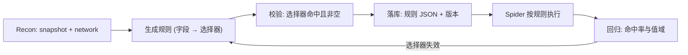

[toc]

## 速览结论

- **Scrapling 是目前少数同时提供 MCP 服务器和官方 Skill 的采集框架**。`MCP指南.md` 讲的是协议层原理，这篇补的是一个库把这两件事做到什么程度、能用在哪、哪里会踩坑。
- **两者的分工正好对应“手”和“手册”**：MCP 提供 16 个工具（抓取、浏览器动作、截图、网络历史、会话状态），Skill 提供 424 行的版本化 API 知识与 18 篇参考文档。MCP 让 Agent 能看页面，Skill 让 Agent 写对代码。
- **MCP 服务端自带反爬**：`browser_fetch_once(solve_cloudflare=True)` 在本机实测可以直接过 Cloudflare Turnstile（managed 模式），不需要外部 solver、不需要账号。
- **它真的省掉了“写爬虫”这一步**。同一个受保护商品页，之前要写 360 多行 Spider，现在 3 次工具调用就能拿到价格与库存。
- **但 MCP 不是生产采集通道**：会话在服务端进程内、串行执行、没有调度与断点续跑。真正的批量任务仍应落到 Spider，MCP 负责侦查和验证。
- **Skill 解决了模型“记不住最新 API”的问题**。这个库 0.4 → 0.5 的 API 变化很大（`DynamicFetcher` 消失、`spiders` 新增、`css_first` 移除），只靠训练记忆写代码必错；Skill 的 `version: "0.5"` 与库版本对齐，是可校验的锚点。
- **升级代价要算清楚**：`scrapling[ai]` 会把 playwright/patchright/curl_cffi 拉到较新版本，并需要重新下载约 118 MiB 的 Chromium。国内建议走 npmmirror 的二进制镜像。
- **一句话结论**：**用 MCP 做侦查与规则验证，用 Skill 保代码正确，用 Spider 做长期批量采集**；三者别混用。

## 这篇补的是什么

`MCP指南.md` 已经讲清了协议、传输层、安全与生态。这一篇换一个视角：**不再讲 MCP 是什么，而看一个具体的库如何把 MCP 与 Skill 同时落地**，并且全部结论都来自本机实测。

选 Scrapling 当样本，原因是它同时具备三个不常见的特征：

| 特征 | 为什么值得看 |
|---|---|
| MCP 服务器与库同仓、同版本发布 | 能观察“库作者如何设计 Agent 接口” |
| 官方维护 Agent Skill，且内容与文档同步 | 能观察“知识如何随版本更新” |
| 功能本身带反爬（Cloudflare） | MCP 的价值能在受保护站点上被直接检验 |

### 一个必须先说清的区分

| | MCP | Skill |
|---|---|---|
| 给模型的东西 | **能力**（工具定义 + 执行结果） | **知识**（Markdown 指令） |
| 模型怎么用 | 调用工具，拿回文本/图片 | 载入上下文，照着写代码 |
| 谁在执行 | 服务端进程 | 模型自己（或它写的代码） |
| 失效方式 | 工具报错、超时、鉴权失败 | 版本过时、与库不匹配 |
| 在 Scrapling 里 | 16 个 `browser_*` / `*_request*` 工具 | `scrapling-official` 技能包 |

这也解释了为什么 **MCP 再好也不能替代 Skill**：MCP 能让 Agent 抓到页面，但抓完之后要写可维护的 Spider，仍然需要知道 0.5 版 `Spider` 类的字段名。反过来，只有 Skill 时，Agent 得先猜选择器，再来回试错。

## 实测环境与版本

| 项 | 值 |
|---|---|
| 系统 | Windows + Git Bash |
| Python | 3.13.13（conda 环境 `scrapling`） |
| Scrapling | 0.5 |
| MCP Python SDK | 2.3.0（协议 `2025-11-25`） |
| 出口 | 本地代理 `http://127.0.0.1:7897` |
| 目标站 | `partsfornissans.com`（Cloudflare 保护） |

安装完成后的依赖版本（**这是本篇所有结论的基准**）：

| 包 | 安装前 | 安装后 |
|---|---|---|
| playwright | 1.59.0 | **1.64.1** |
| patchright | 1.59.1 | **1.64.3** |
| curl_cffi | 0.15.0 | **0.17.0** |
| anyio | 4.13.0 | **4.15.1** |
| apify-fingerprint-datapoints | 0.13.0 | 0.15.0 |
| certifi / cffi | 2026.4.22 / 2.0.0 | 2026.10.23 / 2.1.1 |

> 注意一个容易被忽略的事实：**安装前这个环境“能跑”，但依赖低于 `scrapling[fetchers]` 声明的最低版本**（要求 `playwright>=1.62.0`、`patchright>=1.62.1`、`curl_cffi>=0.16.1`、`anyio>=4.14.0`）。pip 装库时不会因为 extras 的最低版本没满足而报错，所以“能用”不等于“版本对齐”。这类错位通常是几天后某个诡异 bug 的来源。

## 安装：一条命令背后的三件事

### 依赖分组

`scrapling` 0.5 的 extras 定义（读自包元数据）：

| extra | 包含 |
|---|---|
| `fetchers` | curl_cffi、playwright、patchright、browserforge、apify 指纹数据、msgspec、anyio、protego、click |
| `ai` | `mcp>=2.0.0`、markdownify、`scrapling[fetchers]` |
| `rag` | markdownify、`scrapling[fetchers]` |
| `shell` | IPython、markdownify、`scrapling[fetchers]` |
| `all` | `scrapling[ai,shell]` |

MCP 依赖只有 `mcp` 与 `markdownify`，但 `ai` 会连带拉 `fetchers`——所以**想用 MCP 就一定会升级浏览器栈**，没有“只装 MCP 不动浏览器”的干净路径（除非手动单装 `mcp`，代价是版本错位长期存在）。

### 三步安装

```bash
# 1) 库 + MCP + 浏览器依赖的 Python 包
python -m pip install -U "scrapling[ai]"

# 2) 浏览器二进制（约 118 MiB）
#    国内建议走镜像，否则直连 cdn.playwright.dev 容易超时
PLAYWRIGHT_DOWNLOAD_HOST=https://cdn.npmmirror.com/binaries/playwright \
  python -m playwright install chromium

# 3) 校验
python -m patchright install --dry-run chromium   # 看 patchright 期望的版本与路径
python -c "import scrapling; print(scrapling.__version__)"   # 0.5
python -m pip check                                # No broken requirements found.
```

实测中的两个细节：

- **首次直连下载会卡满 10 分钟超时**，换成 npmmirror 镜像后 2 分钟内完成（下载打印 `chromium-1248`、`chromium_headless_shell-1248`）。
- **patchright 不需要单独下载浏览器**。`patchright install --dry-run chromium` 显示它期望的正是 `chromium-1248` 与 `chrome-headless-shell 156.0.8078.4`，与 playwright 1.64.1 完全一致，所以 `patchright install chromium` 立即以 exit 0 结束。**两个包共用同一份浏览器构建**，不必准备两份磁盘。

### 安装是否成功的判据

不要只看 pip 的 “Successfully installed”。真正要验证的是**浏览器能不能起来并过反爬**，用已有的 Spider 跑一次真实页面最直接：

```bash
python nissan_parts_spider.py --outdir output_verify
# requests=1 items=1 failed=0 blocked=0
# price 88.04 / msrp 124.88 / In stock / Throttle Body
```

本次升级后复跑通过，说明 `playwright 1.64` 与 `patchright 1.64` 的组合没有破坏原有的 stealth 路径。

## MCP：16 个工具怎么分工

### 工具分组

服务端自报 `Scrapling 0.5`，共 **16 个工具**，按生命周期分四组：

| 组 | 工具 | 用途 |
|---|---|---|
| **一次性抓取** | `make_request` | 纯 HTTP（curl_cffi 指纹伪装），无 JS |
| | `browser_fetch_once` | 隐身浏览器，自带 Cloudflare 求解 |
| **会话管理** | `browser_open` / `open_request_session` | 开浏览器会话 / 开 HTTP 会话 |
| | `close_session` / `list_sessions` | 关闭 / 查看会话与生效配置 |
| **会话内抓取** | `browser_fetch` / `session_make_request` | 复用 cookie、连接、指纹 |
| **状态** | `browser_save_state` / `browser_load_state` | cookies + localStorage + IndexedDB 落盘与恢复 |
| **读当前页** | `browser_extract` | 不重新导航，按 snapshot/HTML/Markdown/text 读 |
| | `browser_screenshot` | 视口/整页/单元素截图，返回真实图像块 |
| **交互** | `browser_actions` | 鼠标、填表、快捷键、对话框、等待，一次调用串起来 |
| | `browser_evaluate` | 执行 JS，支持 await promise |
| **网络** | `browser_network_requests` / `browser_network_request` | 请求历史分页 / 读单条请求的 headers、body |

几个设计观察，比工具清单更值得记住：

- **snapshot 是给 Agent 看的 DOM，不是 HTML**。输出是带 `[ref=e12]`、`[box=x,y,w,h]`、`[cursor=pointer]` 的层级树，Agent 能据此“指出要点的元素”，再交给 `browser_actions` 用 ref 点击。
- **网络历史按会话记录**，从 `browser_open` 开始录制，能翻页、能读响应体（仅文本类型）。这是找 XHR API 的入口，也是把“页面采集”换成“接口采集”的关键一步。
- **广告与追踪域名自动屏蔽**（约 3500 个），主要收益是省 token 与加快加载，不是防封。
- **`main_content_only` 默认开启，并同时承担提示注入清洗**：剥离 `display:none`、`aria-hidden`、`<template>`、HTML 注释、零宽字符。这条与 `MCP指南.md` 里“提示注入是 MCP 最需要认真对待的问题”正好对应——**Scrapling 把它做成了默认行为，而不是文档里的建议**。

### 三种接入方式

**stdio（本机客户端，最常用）**

```json
{
  "mcpServers": {
    "ScraplingServer": {
      "command": "scrapling-mcp"
    }
  }
}
```

**Streamable HTTP（跨进程/容器）**

```bash
export SCRAPLING_MCP_AUTH_TOKEN="<随机串>"
scrapling-mcp --http --host 127.0.0.1 --port 8000 --allowed-host "your-host:8000"
```

- `--http` **必须**有 token，否则拒绝启动；无鉴权只能用 `--no-auth`（仅限本机测试）。
- token 只有一个共享密钥，轮换要重启服务端。
- 明文 HTTP 会把 token 裸露，公网必须前置 TLS 反代。
- `--no-auth` 与 `--host 0.0.0.0` 同时使用 = 任何人可让这台机器抓任意 URL，只应在可信网络里出现。

**Docker**

```bash
docker run -p 8000:8000 -e SCRAPLING_MCP_AUTH_TOKEN="<token>" \
  pyd4vinci/scrapling mcp --http --host 0.0.0.0
```

容器内的 `127.0.0.1` 只在容器内可见，必须显式 `--host 0.0.0.0` 才能被宿主机访问——这是“端口映射了却连不上”的典型原因。

### 实测握手

用官方 Python SDK 走 stdio：

```
serverInfo: {"name": "Scrapling", "version": "0.5", ...}
protocolVersion: 2025-11-25
tools: 16
```

> 顺带一个 SDK 坑：`mcp` 2.x 把返回对象字段改成了 snake_case（`init.server_info`、`init.protocol_version`），照 1.x 教程写 `init.serverInfo` 会直接 `AttributeError`。

## Skill：把「最新 API」变成可加载的知识

### 安装

```bash
npx -y skills add D4Vinci/Scrapling --skill scrapling-official --yes
```

装到项目的 `.agents/skills/scrapling-official/`，并生成 `skills-lock.json` 记录来源与内容哈希：

```json
{
  "skills": {
    "scrapling-official": {
      "source": "D4Vinci/Scrapling",
      "skillPath": "agent-skill/Scrapling-Skill/SKILL.md",
      "computedHash": "5c12e085…"
    }
  }
}
```

### 内容结构

| 部分 | 规模 | 作用 |
|---|---|---|
| `SKILL.md` | 424 行 / 26 KB | 概览、CLI 用法、代码骨架、References 索引、Guardrails |
| `references/` | 18 篇 | spiders（8）、fetching（3）、parsing（3）、mcp-server、scrapy 集成、RAG、BeautifulSoup 迁移 |
| `examples/` | 4 个 `.py` + README | fetcher / browser / stealthy / spider 的可运行骨架 |

### 渐进式披露在这里怎么体现

`SKILL.md` 只在开头给出“能做什么 + 一行示例”，细节全部指向 references：

```
## References
- references/parsing          - 解析 HTML 的一切
- references/fetching        - 抓取与会话持久化
- references/spiders          - 写 Spider、代理轮换、高级特性（Scrapy 风格）
- references/mcp-server.md    - MCP 工具、会话、CDP、鉴权
```

这正是 `MCP指南.md` 里讲过的机制：**默认只加载摘要，需要时再读长文档**。区别在于这里的“长文档”是库作者自己维护的，因此不存在“教程对应旧版本”的问题。

### 版本锚点与维护

- 技能头部的 `version: "0.5"` 与库版本严格对齐，**可当作一致性校验**。
- 升级库后必须重装技能，否则会退化成“旧知识的另一种形式”——比没有知识更危险，因为模型会自信地写错 API。
- 建议把下面这条检查写进升级清单：

```bash
python -c "import importlib.metadata as m; print(m.version('scrapling'))"   # 库
grep '^version:' .agents/skills/scrapling-official/SKILL.md                 # 技能
```

### Guardrails 与提示注入

技能末尾有一节硬性约束，值得照抄到自己的规则里：

- 只抓授权内容，Spider 上开 `robots_txt_obey = True`；
- 大规模抓取加 `download_delay` 或 `autothrottle_enabled`；
- 不绕过付费墙与未授权登录，不抓个人敏感数据；
- 使用 CLI 抓取时**必须加 `--ai-targeted`**（同时开启广告拦截），目的是把抓回的内容当作“数据处理”，而不是当作“指令”。

## 实战：把一条 Cloudflare 商品页变成三次调用

### 场景

目标是一条 Nissan OEM 零件详情页：标题、SKU、价格、MSRP、库存、分类。该站有 Cloudflare 保护，纯 HTTP 请求会拿到 403 挑战页。

### 调用序列

```python
# 1) 开一个隐身浏览器会话（会话级配置：无头、代理）
browser_open(session_id="pdp", headless=True, proxy={"server": "http://127.0.0.1:7897"})
# → {"session_id": "pdp", "session_type": "stealthy"}

# 2) 抓页面，拿到观察快照
browser_fetch(url=URL, session_id="pdp", extraction_type="snapshot",
              solve_cloudflare=True, main_content_only=False, timeout=90000)
# → status 200，content 为带 ref/box 的元素树，约 19 KB

# 3) 关闭会话
close_session(session_id="pdp")
```

快照片段（真实输出，已截断）：

```text
- generic [active] [ref=e1] [box=0,0,1910,2465]:
  - banner [ref=e3] [box=0,0,1910,181]:
    - generic [ref=e5] [box=0,0,1910,37]: Get up to $25 Off Shipping on Qualifying Orders $150+ | 10/01 - 10/29
    - link [ref=e20] [cursor=pointer] [box=330,39,340,75]:
      - /url: /
```

字段抽取用 CSS 选择器，一次一个，互不干扰：

| 选择器 | 结果 |
|---|---|
| `.product-offer-card__sale-price strong` | `["$88.04"]` |
| `h1` | `["2018-2020 Frontier NV 4.0 Power Valve Actuator - Nissan (14510-EA21A)"]` |
| `#does-not-exist` | `[""]`（status 仍为 200） |

### 反爬成本

- 早前一次实测中，服务端日志出现 `The turnstile version discovered is "managed"`，随后 `Cloudflare captcha is solved`，页面从 307 转到 200，**全程约 9 秒**。
- 本轮升级后同一页面直接返回 `status 200`（未触发挑战），说明挑战是间歇性的：**不能假设每次都会过，也不能假设每次都要解**。

### 与自写 Spider 的边界

| 维度 | MCP 调用 | 自写 Spider |
|---|---|---|
| 代码量 | 0 行 | 360 行左右（含解析、日志与 CLI） |
| 适合规模 | 几页到几十页、探索式 | 上千页、多域名、长期运行 |
| 调度能力 | 无（串行、进程内） | 并发、优先级、去重、断点续跑 |
| 产出形态 | 对话里的文本/JSON | items → JSONL/CSV/数据库 |
| 失败恢复 | 重来一遍 | `crawldir` 检查点续跑 |
| 维护成本 | 零 | 选择器与站点结构强耦合 |

结论：**MCP 适合“先看明白”，Spider 适合“长期搬”**。把 MCP 当生产通道，会在任务变大后同时失去可观测性和可恢复性。

## 把 MCP 接进「规则生成」闭环

如果目标是“让 Agent 分析网页并产出采集规则”，MCP 最合适的角色是**规则生成前后的两端**，而不是执行器。



五步里各环节的取舍：

| 环节 | 用什么 | 理由 |
|---|---|---|
| 页面侦查 | `browser_fetch` snapshot + `browser_network_requests` | 一次拿结构、一次拿接口，避免“猜选择器” |
| 找隐藏 API | `browser_network_request` 读响应体 | 能把“页面采集”降级成“接口采集”，成本差一个数量级 |
| 规则生成 | Skill（写法）+ 页面结构（事实） | 模型负责组合，不负责记忆 API |
| 规则校验 | 逐选择器 `css_selector` 调用 + 非空断言 | 未命中不会报错，只能靠断言兜住 |
| 长任务执行 | Spider + `crawldir` | MCP 没有调度与断点续跑 |

### 登录态怎么办

需要登录的站点，用 `browser_save_state` / `browser_load_state` 就够了：

- 保存的是 cookies + localStorage + IndexedDB，**不含 sessionStorage 与已开标签页**；
- 恢复后要**重新导航或刷新**，登录态才生效；
- 恢复是“替换”语义，不会关掉现有标签页，所以可以在一轮抓取中途切换身份。

这比把账号密码塞进代码更安全，也让 Agent 不必反复登录（登录动作本身就是风控最敏感的部分）。

### 成本控制

- 上面那条商品页 **snapshot 约 19 KB，`main_content_only` 的纯文本约 3.9 KB**。一页 20 KB 的量级，几十页就会吃满上下文。
- 优先顺序：**CSS 选择器取单点 < Markdown/text 取正文 < snapshot**。只在需要“点击/定位元素”时才要 snapshot。
- 会话复用比一次性抓取省的是启动开销（每次开浏览器约数秒），但**页面数据量不受影响**，别指望复用会话省 token。

## 踩坑与限制（均为本轮实测）

- **选择器未命中返回 `[""]` 且 status 200**。这是最危险的一条：看起来“成功”，实际空值。规则校验必须断言长度与内容。
- **`browser_extract` 的 `search` 参数实测不生效**。对同一页面搜 `Sale Price`、`price`、`in stock` 均返回空，而 `extraction_type="text"` 的输出里确实包含这些字符串。文档描述的是“正则搜索快照行”，实际行为对不上，**不要把它放在关键路径上**，取全文自行过滤更可靠。
- **忘记 `close_session` 会留下常驻浏览器**。会话在服务端进程内，客户端断开不一定回收；长流程要么显式关闭，要么用一次性工具。
- **Windows 控制台打印 snapshot 会崩**：快照含特殊符号，GBK 控制台报 `UnicodeEncodeError: 'gbk' codec`。设 `PYTHONIOENCODING=utf-8` 或写文件。
- **代理必须显式传参**。本轮所有受保护站点调用都传入 `proxy={"server": ...}`，环境变量能否被服务端继承**未验证**，跨进程部署时不要假设它会自动生效。
- **`mcp` 2.x SDK 字段名变了**（`server_info` / `protocol_version`），旧教程代码会直接抛异常。
- **stdio 的清理噪音**：Windows 下进程退出时会打印一串 `ValueError: I/O operation on closed pipe`，来自 asyncio 传输层析构，不影响结果，但会污染日志。
- **版本漂移没有硬门槛**：extras 里的最低版本不满足时 pip 不一定报错，出现过“依赖低于声明但仍能跑”的状态。对齐之后 `pip check` 输出 `No broken requirements found.`，这条命令比肉眼比对版本表更省事，但对 extras 的最低版本约束是否生效仍需自行确认。

## 待确认事项

以下内容来自文档转述或单次观测，未做多轮验证：

- **`browser_extract search` 的返回规则**：是否与页面语言、选择器深度或快照裁剪有关，未定位根因，只确认了“本页搜不到”。
- **`solve_cloudflare` 的成功率**：本轮只见证一次 managed 挑战（约 9 秒）与一次直接 200，样本过少，无法给出通过率。
- **`proxy` 的环境变量继承**：未测试 `HTTPS_PROXY` 是否会被 MCP 服务端读取。
- **`scrapling install` 的完整行为**：本轮直接用 `playwright install chromium` 与 `patchright install`，没有执行 `scrapling install`，两者差异未核对。
- **Streamable HTTP 的并发与会话隔离**：多客户端同时连同一服务端时，`session_id` 命名冲突与资源上限未测。
- **Skill 的跨宿主安装路径**：本次只在项目内 `.agents/skills` 验证，其他宿主（全局目录、Windows 路径）未逐项确认。

## 一页速查

**安装**

```bash
python -m pip install -U "scrapling[ai]"
PLAYWRIGHT_DOWNLOAD_HOST=https://cdn.npmmirror.com/binaries/playwright python -m playwright install chromium
npx -y skills add D4Vinci/Scrapling --skill scrapling-official --yes
```

**起服务**

```bash
scrapling-mcp                                   # stdio
scrapling-mcp --http --auth-token "<token>"      # Streamable HTTP
```

**工具选择**

| 需求 | 工具 |
|---|---|
| 静态页/JSON 接口 | `make_request` |
| 单页要 JS 或过 CF | `browser_fetch_once` |
| 多页同站 | `browser_open` + `browser_fetch` × N + `close_session` |
| 多页纯 HTTP | `open_request_session` + `session_make_request` |
| 看页面结构 | `browser_fetch(extraction_type="snapshot")` |
| 找页面背后的接口 | `browser_network_requests` → `browser_network_request` |
| 要点击/填表 | `browser_actions`（ref 或选择器） |
| 取某个字段 | `css_selector`（并断言非空） |
| 复用登录态 | `browser_save_state` / `browser_load_state` |

**核心判断**

- MCP = 手（看页面、点页面、拿数据）；Skill = 手册（写对代码）；Spider = 腿（跑长任务）。
- 未命中不报错，是这套工具最需要防御的语义。
- 升级库 → 同步升级技能 → 复跑一条真实页面，三步缺一不可。

## 结语

Scrapling 这套组合的意义，不在于“多了一个能抓网页的 MCP 服务器”，而在于它把一个长期困扰 Agent 的问题拆开处理了：**知识随版本走（Skill），能力随进程走（MCP），规模随调度走（Spider）**。

这个拆法值得借鉴到别的领域：凡是“既需要知道怎么做、又需要真的去做”的工具，都应该同时提供版本化的 Skill 与可调用的 MCP，而不是指望模型的训练记忆。而评估这类集成时，最该验的不是工具数量，而是三件事——**受保护站点能不能过、未命中会不会静默、版本错位时会不会假装正常**。

参考链接：

- [Scrapling MCP Server 文档](https://scrapling.readthedocs.io/en/latest/ai/mcp-server.html)
- [Scrapling Agent Skill 文档](https://scrapling.readthedocs.io/en/latest/ai/agent-skill.html)
- [Scrapling GitHub](https://github.com/D4Vinci/Scrapling)
- [Agent Skills 开放标准](https://agentskills.io)
