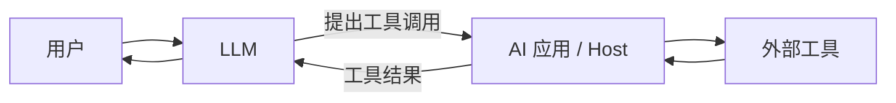
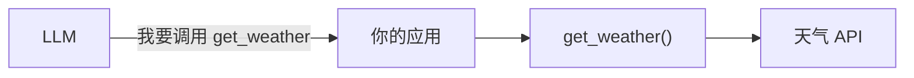
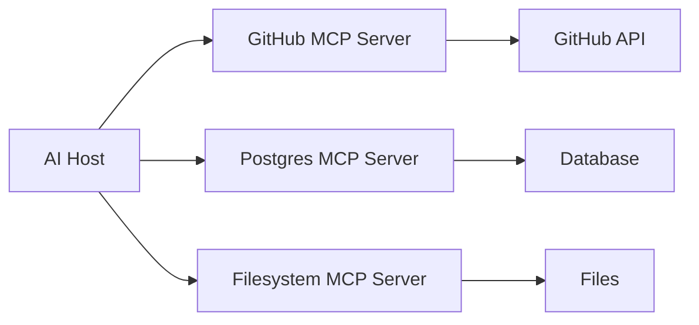
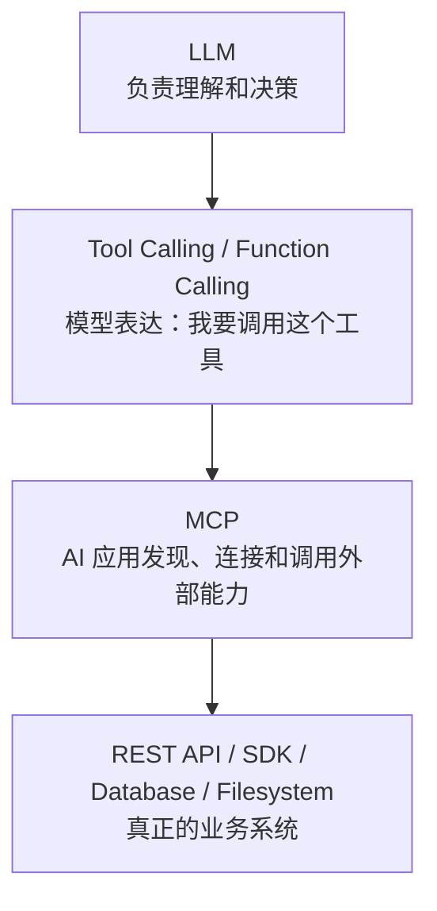
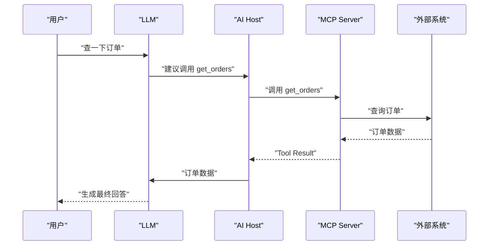
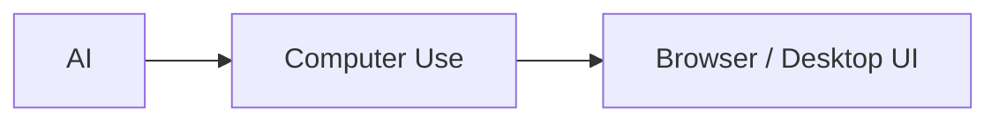
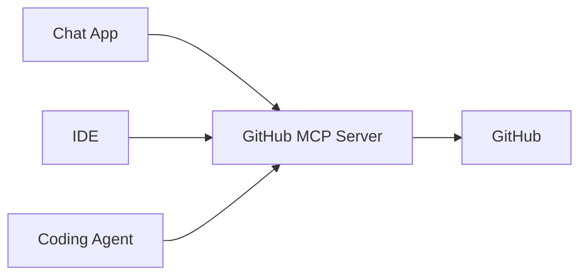
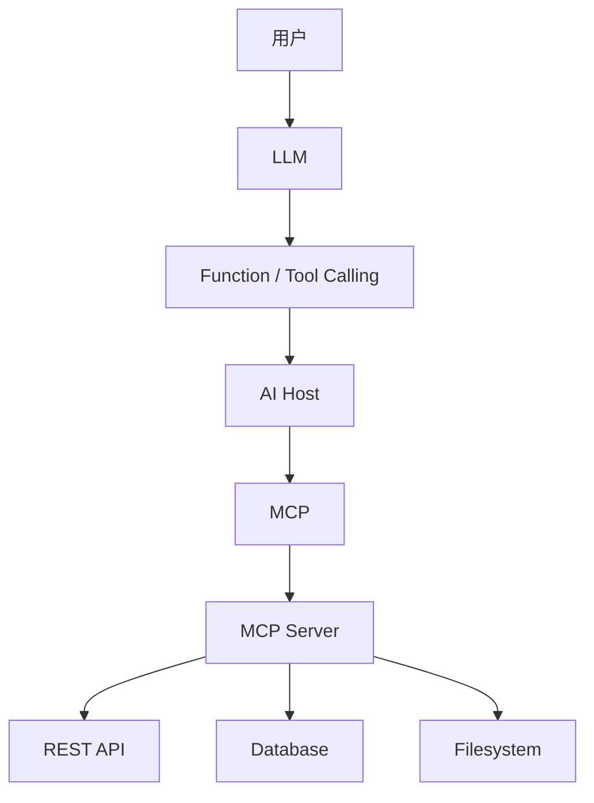

[toc]


可以这么理解，但要稍微修正一下：

> **MCP 是 AI 应用连接和调用外部工具的一种标准化方式，但不是 AI 调用工具的唯一方式。**

而且严格来说，通常不是“模型自己直接调用外部工具”，而是：

> **模型决定想调用什么，AI 应用负责真正执行。**

可以把过程理解成：



例如你说：

> 帮我查询北京天气。

模型可能产生这样的意图：

```text
调用 get_weather(city="北京")
```

但真正访问天气 API 的，通常是外部程序，而不是模型本体。

------

## AI 调用工具确实有多种方式

最常见的几类可以这样看：

| 方式                            | 核心思想                              | 典型场景                   |
| ------------------------------- | ------------------------------------- | -------------------------- |
| 应用直接调用 API                | 程序自己决定什么时候调用              | 传统 AI 应用               |
| Function Calling / Tool Calling | 模型选择一个预先定义好的函数          | 最常见的 Agent 工具调用    |
| MCP                             | AI 应用通过标准协议发现并调用外部能力 | 多工具、多系统、跨 AI 平台 |
| Agent Framework Tool            | LangChain 等框架自己定义 Tool 抽象    | Agent 开发                 |
| 插件 / Connector                | 某个平台定义自己的外部连接机制        | SaaS AI 产品               |
| Computer Use / GUI 操作         | AI 操作浏览器、鼠标、键盘             | 没有 API 的软件            |

其中最容易混淆的是：

**Function Calling 和 MCP。**

------

## Function Calling 是什么

假设你的程序本身有两个函数：

```python
def get_weather(city):
    ...

def send_email(to, content):
    ...
```

然后告诉模型：

> 你可以使用 `get_weather` 和 `send_email`。

用户问：

> 上海天气怎么样？

模型可能返回：

```text
get_weather(city="上海")
```

你的应用程序再真正执行这个函数。

流程是：



这就是：

**Function Calling / Tool Calling**

它主要解决：

> **模型如何表达“我要调用哪个函数，以及传什么参数”。**

------

## MCP 又是什么

MCP 再往外抽象了一层。

假设你的 AI 应用想连接：

- GitHub；
- PostgreSQL；
- 文件系统；
- Jira；
- 企业知识库。

如果全部自己写：

```text
GitHubAdapter
PostgresAdapter
FilesystemAdapter
JiraAdapter
```

每个 AI 产品都需要重新实现。

MCP 的想法是：



于是 **AI Host** 可以先问 MCP Server：

> 你有哪些工具？

Server 回答：

```text
search_issues
create_issue
get_pull_request
comment_issue
```

然后 Host 把这些工具告诉模型。

模型再决定：

> 我要调用 `search_issues`。

所以非常关键的一点是：

> **MCP 和 Function Calling 经常不是竞争关系，而是上下层关系。**

------

## 可以把它们分成三层来看

这是理解整个问题最重要的心智模型：



例如：

> “帮我查一下 GitHub 上项目的 Bug。”

可能实际经历：

### 模型层

LLM 判断：

> 我需要搜索 Issue。

### Tool Calling 层

产生：

```text
search_issues(query="bug")
```

### MCP 层

Host 通过 GitHub MCP Server 调用：

```text
tools/call -> search_issues
```

### 外部系统层

GitHub MCP Server 最终调用：

```text
GitHub REST API
```

然后结果原路返回。

------

## 所以到底是谁调用谁

可以记住下面这个关系：

> **用户告诉模型目标。**

> **模型决定需要什么工具。**

> **Host 控制是否真的执行。**

> **MCP 可以负责连接外部工具。**

> **MCP Server 最终调用真实 API / 数据库 / 文件系统。**

完整一点就是：



注意其中一个很重要的安全细节：

**LLM 通常只是提出调用请求，不应该天然拥有最终执行权限。**

例如：

```text
read_file
```

可能直接执行。

但：

```text
delete_database
send_payment
deploy_production
```

最好还经过：

```text
Policy / 用户确认
```

------

## 除了 MCP，还有哪些工具调用模式

可以进一步分成几种。

### 应用程序自己决定调用工具

最传统：

```python
if user_asks_weather:
    weather = get_weather()
```

模型甚至不负责选择工具。

优点：

- 可控；
- 简单；
- 稳定。

缺点：

- 灵活性较差。

------

### Function Calling

模型从你预先给定的 Tool 中选择。

例如：

```text
get_weather
search_product
create_order
```

这是目前非常常见的方式。

适合：

> 一个应用内部只有几十个比较固定的工具。

------

### MCP

工具不一定直接写死在应用里，而是由外部 MCP Server 提供。

Host 可以动态发现：

```text
这个 Server 提供什么 Tools？
有什么 Resources？
有什么 Prompts？
```

适合：

> 很多外部系统、多个 AI Host、需要复用 Connector 的场景。

------

### REST / OpenAPI 直接驱动

有些 Agent 系统直接让程序读取 OpenAPI 描述：

```text
GET /customers
POST /orders
DELETE /orders/{id}
```

再转换成模型 Tool。

可以理解成：

```text
OpenAPI
   ->
Tool Definitions
   ->
LLM
```

这也是一种方式。

MCP Server 后面本身也经常就是 REST API。

------

### Agent Framework 自己的 Tool

例如各种 Agent Framework 可能定义：

```python
@tool
def search_database(...):
    ...
```

本质还是 Tool Calling，只不过框架帮你处理：

- Tool 注册；
- Schema；
- Agent Loop；
- 重试；
- Memory；
- 工作流。

这种框架也可以同时支持 MCP。

------

### Computer Use

还有一种完全不同的方法：

> 不调用 API，而是像人一样操作 GUI。

例如：

```text
打开 Chrome
点击搜索框
输入关键词
点击提交
读取网页
```

大概是：



这种方案的优点是：

> 软件没有 API 也能操作。

缺点也很明显：

- 慢；
- GUI 变化容易导致失败；
- 安全风险高；
- 稳定性通常不如 API。

因此通常优先级是：

> **有可靠 API / Tool，就优先 Tool。没有接口时，再考虑 GUI Automation。**

------

## MCP 最大的特点不是“能调用 Tool”

这一点尤其值得注意。

因为：

> **在 MCP 出现之前，LLM 早就能 Tool Calling。**

所以 MCP 真正创新的地方不是：

> “AI 终于能调函数了。”

而是：

> **把 AI 和外部能力之间的连接方式标准化。**

就像：

HTTP 的价值不是“第一次让计算机传数据”，而是：

> 不同系统可以遵循相同协议通信。

MCP 类似。

------

## 一个非常直观的对比

### 没有 MCP

假设三个 AI 产品：

```text
Chat App
IDE
Coding Agent
```

都要支持 GitHub。

可能分别实现：

```text
Chat App -> GitHub Adapter

IDE -> GitHub Adapter

Coding Agent -> GitHub Adapter
```

### 使用 MCP

可以变成：



GitHub 的 Agent 接口可以被多个兼容 Host 复用。(MCP Server的位置像是一个"代理",向ai应用提供ai不太熟悉的信息,让ai获取更加可靠的信息,例如可用的工具及其用法,这样ai可以调用一些其未训练过的工具.)

这才是 MCP 最大的意义之一。

------

## 最后用一句话分别记住

| 技术             | 最简单的理解                              |
| ---------------- | ----------------------------------------- |
| Function Calling | **模型怎么说“我要调用这个函数”**          |
| MCP              | **AI 应用怎么标准化连接外部 Tool / Data** |
| REST API         | **程序怎么和外部服务通信**                |
| OpenAPI          | **REST API 怎么描述自己**                 |
| Agent Framework  | **Agent 怎么规划、循环和运行**            |
| Computer Use     | **AI 怎么像人一样操作 GUI**               |

最简化地说：

> **AI 调工具有很多方式，MCP 是其中非常重要的一种“连接标准”；Function Calling 则更接近模型层面的“工具选择与参数生成机制”。**

如果只记一个架构图，记这个就够了：



这样以后看到 **Tool Calling、Function Calling、MCP、OpenAPI、Agent Framework**，就不容易把它们混成同一个概念了。