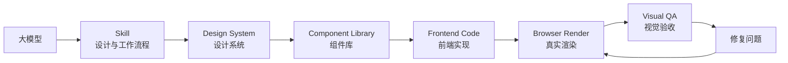
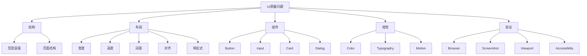
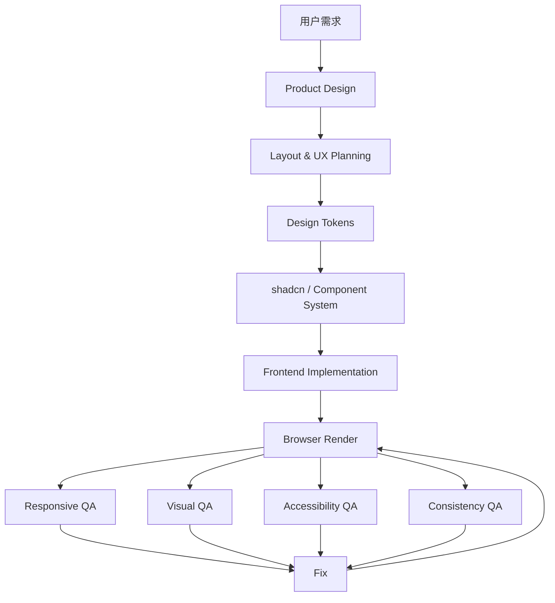

[toc]


我发现的部分ai设计前端的几个问题：

- 空间利用不合理
- 留白过大或内容挤压
- 元素遮挡
- 窗口缩放后布局崩坏(响应式设计做不到位)
- 桌面端和移动端只是简单“堆叠”
- 按钮、输入框、卡片尺寸不统一
- 间距、圆角、字号、阴影没有体系
- 配色、字体、动画和视觉风格

成熟的思路已经从“让模型写得更好看”转向：

> **设计决策 Skill + Design System（设计系统）+ Component Skill（组件知识）+ Browser/Visual QA（浏览器视觉验收）**


# 先给结论

如果你的核心诉求排序是：

> **布局合理性 ＞ 响应式 ＞ 空间利用 ＞ 组件一致性 ＞ UX ＞ 配色 ＞ 高级视觉风格**

那么我最推荐的组合不是“装一个超级 UI Skill”，而是：

### 如果你主要使用 GPT / Codex

**第一选择：OpenAI Product Design**

再搭配：

**shadcn/ui Skill**

以及：

**Web Application Testing / Design QA**

最终形成：

> **Product Design → Layout/System → shadcn → Browser Render → Design QA → 修复**

这是目前最符合你需求的路线。

### 如果你使用 Claude Code

推荐：

> **Anthropic `frontend-design` + shadcn/ui Skill + webapp-testing**

如果还希望获得非常强的设计知识库，再考虑：

> **UI/UX Pro Max**

### 如果你想要“专门解决你说的布局问题”

实际上我反而建议最后自己做一个：

> **Frontend Layout & Responsive QA Skill**

它不要负责“让页面变漂亮”，而是专门负责：

- 检查空间
- 检查布局
- 检查溢出
- 检查遮挡
- 检查响应式
- 检查组件一致性
- 检查设计 Token
- 检查不同 viewport
- 检查长文本
- 检查异常内容

**这很可能比继续堆更多审美型 Skill 更有效。**

------

# Skill 到底解决什么问题？

先把一个很容易混淆的概念讲清楚。

**Skill（技能）不是 UI 框架，也不是组件库。**

现在比较主流的 Agent Skills 标准，本质上是一个包含 `SKILL.md` 的目录，可以进一步附带脚本、参考资料、模板等，让 Agent 在特定任务中加载一套专业工作流程。([Agent Skills](https://agentskills.io/home?utm_source=chatgpt.com))

可以把整个体系理解成：



这几个东西分别负责不同问题：

| 东西                     | 主要解决的问题                              |
| ------------------------ | ------------------------------------------- |
| **Skill**                | 告诉模型“应该怎么思考、怎么做”              |
| **Design System**        | 告诉模型“整个产品应该遵守什么规范”          |
| **Component Library**    | 告诉模型“按钮、表单、Dialog 等具体怎么实现” |
| **CSS / Tailwind**       | 提供实际布局和样式能力                      |
| **Browser / Playwright** | 让模型看到真实渲染结果                      |
| **Visual QA**            | 判断“写出来的东西到底好不好”                |
| **Design Tokens**        | 保证颜色、字号、间距、圆角等统一            |

因此：

> **Skill 不能凭空提高模型的 CSS 引擎能力，但可以显著改变模型解决 UI 问题的工作方法。**

这也是为什么你会看到：

> “代码完全能运行，但 UI 很丑。”

甚至：

> “桌面端很好看，窗口缩小以后直接炸掉。”

------

# 为什么 GPT / Claude 这类模型很容易生成“能用但不好看”的 UI？

这其实是一个非常值得理解的问题。

## 模型默认倾向于“高概率 UI”

没有设计约束的时候，模型非常容易收敛到：

- 居中布局
- 大 Hero
- 大圆角 Card
- 灰色背景
- 紫色/蓝色渐变
- Inter / Geist
- `max-w-7xl`
- `grid-cols-3`
- 大量 Card
- 大量 `gap-6`
- 按钮统一 `rounded-lg`
- 所有东西都塞进 Card

这不是某一个模型“笨”。

而是因为这种设计在训练数据中出现概率非常高。

Anthropic 对自己的 `frontend-design` Skill 也明确解释过类似问题：没有额外设计指导时，模型容易收敛到非常常见的视觉选择。([Claude](https://claude.com/blog/improving-frontend-design-through-skills?utm_source=chatgpt.com))

所以单纯告诉 GPT：

> “做得现代一点。”

效果其实很有限。

因为：

> **“现代”不是一个可执行的设计规则。**

而：

> “页面主体最大宽度 1200px；主内容区域 8/4 分栏；侧栏在容器宽度小于 900px 时移动到下方；按钮高度统一为 36/40/44 三档；所有卡片使用同一 spacing scale；组件不得出现横向溢出……”

这才是模型真正能执行的东西。

------

# 当前值得关注的主流 UI / Frontend Skills

我把目前比较有代表性的方案分成七类：

| Skill                                | 类型                 | 最强能力                             | 对你最重要的程度 |
| ------------------------------------ | -------------------- | ------------------------------------ | ---------------- |
| **OpenAI Product Design**            | 产品设计 + QA        | 设计流程、视觉参考、审查、响应式验证 | ★★★★★            |
| **Microsoft frontend-design-review** | Review / QA          | 设计系统审查、UX、响应式、无障碍     | ★★★★★            |
| **webapp-testing**                   | 浏览器测试           | 截图、真实浏览器、交互、响应式       | ★★★★★            |
| **shadcn/ui Skill**                  | 组件 / Design System | 组件一致性、API、规范                | ★★★★★            |
| **UI/UX Pro Max**                    | UI/UX 知识库         | Design System、样式、UX、配色、字体  | ★★★★☆            |
| **Anthropic frontend-design**        | 视觉设计             | 审美、布局方向、避免 AI Slop         | ★★★★☆            |
| **Design Engineer Skill**            | 高级视觉工程         | 光学对齐、阴影、动效、微交互         | ★★★☆☆            |


------

# OpenAI Product Design：最推荐给 GPT / Codex 用户

OpenAI 官方目前已经提供了 **Product Design**。

[OpenAI Product Design 官方介绍](https://openai.com/business/plugins/product-design/?utm_source=chatgpt.com)

它不是简单的“美化 Skill”。

它实际上更接近一个：

> **AI Product Designer + UX workflow + Visual QA workflow**

官方定位是把产品想法转化为：

- 产品概念
- 用户流程
- Prototype
- UX critique
- Design artifacts
- URL → Code
- Image → Code
- Design QA

等。([OpenAI](https://openai.com/business/plugins/product-design/?utm_source=chatgpt.com))

而它最重要的地方恰恰是：

### 它开始强调“先看，再写，再验证”

目前 Product Design 插件包含 10 个 Skill，包括：

- `get-context`
- `ideate`
- `image-to-code`
- `url-to-code`
- `audit`
- `design-qa`
- `research`
- `share`
- `user-context`
- `index`

([Agent Plugins Marketplace](https://pluginsmp.com/plugins/product-design?utm_source=chatgpt.com))

其中最值得你关注的是：

### `design-qa`

它要求把：

> **设计目标 → 实际渲染结果**

进行比较。

OpenAI 的官方 Skill 甚至要求在原型交付之前进行浏览器渲染、截图、交互检查和 Design QA；如果无法完成视觉验证，就不能把结果当成已经验证过的成品。([GitHub](https://github.com/openai/role-specific-plugins/blob/main/plugins/product-design/skills/image-to-code/SKILL.md?utm_source=chatgpt.com))

这正好击中了你最讨厌的问题。

------

## 它为什么特别适合你？

因为你说的：

> “窗口宽度改变以后挤压、遮挡、布局崩坏”

本质上不是审美问题。

而是：

> **Implementation Quality（实现质量）问题。**

例如：

```text
Desktop
┌─────────────────────────────────────────┐
│ Sidebar │        Main Content           │
│         │                               │
│         │  Card   Card   Card           │
└─────────────────────────────────────────┘

Tablet
┌─────────────────────────────┐
│ Sidebar │ Main Content      │
└─────────────────────────────┘

Mobile
┌───────────────────┐
│ Navigation        │
├───────────────────┤
│ Main Content      │
│                   │
│ Card              │
│ Card              │
└───────────────────┘
```

很多模型实际上只是：

> ```
> lg:flex-row md:flex-col
> ```

然后认为响应式完成了。

真正优秀的响应式设计应该考虑：

- 内容最小宽度
- 文本长度
- Button label
- Icon
- Sidebar
- Table
- Dialog
- Navigation
- Form
- Card
- Grid
- 图片比例
- Header
- Footer
- 不同容器中的组件尺寸

而 Product Design 的方向已经明显开始往这种**验证型工作流**靠近。

------

# Anthropic `frontend-design`：最强的“不要做出 AI 味”

Anthropic 官方 `frontend-design` 是目前最有代表性的视觉设计 Skill 之一。

[Anthropic frontend-design Skill](https://github.com/anthropics/skills/tree/main/skills/frontend-design?utm_source=chatgpt.com)

它的核心目标不是：

> “保证 CSS 正确。”

而是：

> **让模型真正进行设计决策，而不是套模板。**

官方 Skill 强调：

- 明确产品目的
- 明确用户
- 明确视觉方向
- Typography
- Color
- Composition
- Motion
- Distinctiveness
- 避免 generic AI aesthetics

([GitHub](https://github.com/anthropics/claude-plugins-official/blob/main/plugins/frontend-design/skills/frontend-design/SKILL.md?utm_source=chatgpt.com))

它特别适合解决：

> “虽然布局没坏，但看起来就是 AI 做的。”

------

## 它最强的地方

例如你让模型：

> 做一个 AI Dashboard。

普通模型很可能：

```text
标题
↓
3 个统计 Card
↓
Chart Card
↓
Table Card
↓
Activity Card
```

`frontend-design` 会逼模型首先考虑：

> 这个 Dashboard 到底应该是什么视觉语言？

例如：

- Swiss / Editorial
- Industrial
- Minimal
- Brutalist
- Luxury
- Retro-futuristic
- Organic
- Dark / Technical

然后让：

> Typography + Layout + Color + Motion

形成统一的视觉方向。

------

## 但它有一个明显缺点

**它不是你最需要的 Layout QA Skill。**

它更擅长：

> “这个页面应该长什么样？”

而不是：

> “这个页面在 712px 宽度下为什么爆掉了？”

因此：

### 对你的需求

**它适合排在第二层，而不是第一层。**

------

# UI/UX Pro Max：目前最完整的“设计知识库型 Skill”

这是社区里非常值得关注的一套方案。

[UI/UX Pro Max GitHub 仓库](https://github.com/nextlevelbuilder/ui-ux-pro-max-skill?utm_source=chatgpt.com)

目前版本已经形成比较完整的设计知识库体系。

它覆盖：

- UI styles
- Color palettes
- Font pairings
- UX guidelines
- Product types
- Chart types
- Design system
- Accessibility
- Motion
- Responsive design
- 多种技术栈

当前仓库描述甚至已经扩展到：

> 84 styles、192 color palettes、74 font pairings、98 UX guidelines、104 icon entries、16 GSAP motion presets、25 chart types、22 stacks。

([GitHub](https://github.com/nextlevelbuilder/ui-ux-pro-max-skill/blob/main/skill.json?utm_source=chatgpt.com))

------

## 它最强的地方

它非常适合解决：

> “我不知道这个产品应该采用什么设计体系。”

例如：

> “做一个科研数据分析平台。”

它可以帮助模型考虑：

- 产品类型
- 用户类型
- 行业
- UI 风格
- 配色
- Typography
- Dashboard Pattern
- Chart
- UX
- Accessibility

而不是单纯：

> “给我写一个漂亮的 Dashboard。”

------

## 它的缺点

最大的缺点就是：

> **信息太多。**

它非常强，但不是所有项目都需要：

> 84 styles + 192 palettes + 74 font pairings……

而且你的核心问题其实不是：

> “我不知道应该选什么颜色。”

而是：

> “为什么这个按钮和旁边的按钮尺寸不一样？”

以及：

> “为什么窗口缩小 100px 后整个页面挤成一团？”

因此：

### UI/UX Pro Max 更适合：

**设计决策 / Design System Generator**

而不是：

**最终视觉验收。**

------

# shadcn/ui Skill：解决“全站不一致”的神器

这个对你其实非常重要。

[shadcn/ui Skills 官方文档](https://ui.shadcn.com/docs/skills?utm_source=chatgpt.com)

shadcn/ui 本身是一个组件和 Design System 生态，而现在已经有官方 Skill。

它让 AI 理解：

- 当前项目用了什么组件
- 当前项目使用什么 preset
- Button 怎么用
- Dialog 怎么用
- Form 怎么用
- Table 怎么用
- 组件有哪些 variant
- 哪些组件应该复用
- 哪些样式应该通过 Design Token 控制

官方 Skill 明确强调：

> **Use existing components first.**

以及：

> **Compose, don't reinvent.**

同时强调使用 semantic colors、variants 和项目已有的组件体系。([GitHub](https://github.com/shadcn-ui/ui/blob/main/skills/shadcn/SKILL.md?utm_source=chatgpt.com))

------

## 为什么它对你特别重要？

因为你说：

> “按钮风格和大小。”

这个问题实际上属于：

### Design System Consistency

假设模型生成：

```text
按钮 A：height 40
按钮 B：height 36
按钮 C：height 44
按钮 D：padding 12px 18px
按钮 E：padding 8px 16px
```

从代码角度：

> 全都合法。

从产品设计角度：

> 完全不应该。

有了 Design System：

```text
Button
├── size=sm
├── size=md
└── size=lg

variant
├── primary
├── secondary
├── outline
└── ghost
```

模型就不应该每次重新发明一个按钮。

这正是 shadcn Skill 的优势。

------

# Microsoft `frontend-design-review`：非常适合当“审稿人”

Microsoft 的 `frontend-design-review` Skill，我认为被低估了。

[Microsoft frontend-design-review Skill](https://github.com/microsoft/skills/tree/main/.github/skills/frontend-design-review?utm_source=chatgpt.com)

它最有价值的地方不是生成 UI。

而是：

> **审 UI。**

它目前明确支持：

- Design Review
- PR Review
- Accessibility Audit
- Design System Compliance
- Responsive Design Check
- Component Review
- Theme Testing

([GitHub](https://github.com/microsoft/skills/blob/main/.github/skills/frontend-design-review/SKILL.md?utm_source=chatgpt.com))

------

## 它和 Anthropic frontend-design 的区别

非常简单：

|               | Anthropic frontend-design | Microsoft frontend-design-review |
| ------------- | ------------------------- | -------------------------------- |
| 核心定位      | 设计师                    | 设计审查者                       |
| 新页面生成    | ★★★★★                     | ★★★★                             |
| 审查现有页面  | ★★★                       | ★★★★★                            |
| Design System | ★★★                       | ★★★★★                            |
| Responsive    | ★★★                       | ★★★★☆                            |
| Accessibility | ★★★                       | ★★★★★                            |
| 视觉风格      | ★★★★★                     | ★★★★                             |
| 适合 QA       | ★★☆                       | ★★★★★                            |

它尤其强调：

> **Frictionless → Quality Craft → Trustworthy**

三个质量维度。([GitHub](https://github.com/microsoft/skills/blob/main/.github/skills/frontend-design-review/SKILL.md?utm_source=chatgpt.com))

而且它有非常实用的检查规则：

- Design Token
- Figma spacing
- Typography
- Variants
- Keyboard
- Focus
- Light/Dark
- Responsive
- Accessibility

([GitHub](https://github.com/microsoft/skills/blob/main/.github/skills/frontend-design-review/references/review-type-modifiers.md?utm_source=chatgpt.com))

------

# `webapp-testing`：解决“模型根本没看过自己的页面”

这是另一个非常关键的 Skill。

[Anthropic webapp-testing Skill](https://github.com/anthropics/skills/tree/main/skills/webapp-testing?utm_source=chatgpt.com)

它基于 Playwright，可以：

- 启动 Web App
- 浏览页面
- 获取 DOM
- 截图
- 操作按钮
- 测试表单
- 捕获 Console
- 检查真实浏览器行为

([GitHub](https://github.com/anthropics/skills/blob/main/skills/webapp-testing/SKILL.md?utm_source=chatgpt.com))

------

## 为什么这个 Skill 对 UI 特别重要？

因为：

> **HTML/CSS 正确 ≠ UI 正确。**

比如模型写：

```css
display: flex;
gap: 24px;
```

完全合法。

但是实际：

```text
┌───────────────────────────────┐
│ Title     Search       Button │
│                               │
│                               │
│        content                │
│                               │
└───────────────────────────────┘
```

缩小以后：

```text
┌────────────────────┐
│ Title Search Button│ ← 挤爆
│                    │
│ content            │
└────────────────────┘
```

只有真正打开浏览器，把 viewport 改成：

- 1440
- 1280
- 1024
- 768
- 640
- 390
- 375

模型才真正知道：

> “哦，原来这里有问题。”

------

# Design Engineer Skill：解决“最后 10% 的高级感”

这类 Skill 和前面的定位不一样。

例如社区的 Design Engineer Skill：

[Design Engineer Skill](https://github.com/dannyjpwilliams/design-engineer-skill?utm_source=chatgpt.com)

它主要关注：

- Optical Alignment
- Shadows
- Motion
- Spring Physics
- Perceptual Color
- Micro-interactions
- Gradients
- Gestures

([GitHub](https://github.com/dannyjpwilliams/design-engineer-skill?utm_source=chatgpt.com))

它解决的是：

> “为什么这个 UI 已经不错了，但还是没有高级产品的感觉？”

------

## 但不建议你第一时间用

因为你的问题是：

> **Layout 60 分 → Color 90 分**

而不是：

> Layout 90 分 → Motion 95 分。

所以现在给你上 Design Engineer Skill，有点像：

> 地基还没修好，先研究窗帘材质。

------

# Web Artifacts Builder：不要把它当成 UI Skill

Anthropic 的 `web-artifacts-builder` 也很有名。

[Anthropic web-artifacts-builder Skill](https://github.com/anthropics/skills/tree/main/skills/web-artifacts-builder?utm_source=chatgpt.com)

它主要解决：

> **复杂 Web Artifact 的工程化构建。**

它的典型技术栈是：

> React + TypeScript + Vite + Tailwind + shadcn/ui

并且能够把复杂前端打包成可分享的 HTML artifact。([GitHub](https://github.com/anthropics/skills/blob/main/skills/web-artifacts-builder/SKILL.md?plain=1&utm_source=chatgpt.com))

所以它更像：

> **Frontend Build Skill**

而不是：

> **UI Design Skill**

因此不要因为名字里有 `artifacts` 就认为它会自动让 UI 更漂亮。

------

# 七个方案放在一起比较

| Skill                         | Layout | Responsive | Consistency | UX    | Visual Style | QA    | 工程实现 |
| ----------------------------- | ------ | ---------- | ----------- | ----- | ------------ | ----- | -------- |
| **OpenAI Product Design**     | ★★★★★  | ★★★★★      | ★★★★☆       | ★★★★★ | ★★★★☆        | ★★★★★ | ★★★★☆    |
| **Anthropic frontend-design** | ★★★★☆  | ★★★☆☆      | ★★★☆☆       | ★★★★☆ | ★★★★★        | ★★☆☆☆ | ★★★★☆    |
| **UI/UX Pro Max**             | ★★★★☆  | ★★★★☆      | ★★★★☆       | ★★★★★ | ★★★★★        | ★★★★☆ | ★★★★☆    |
| **shadcn/ui Skill**           | ★★★★☆  | ★★★★☆      | ★★★★★       | ★★★★☆ | ★★★☆☆        | ★★★☆☆ | ★★★★★    |
| **Microsoft design-review**   | ★★★★★  | ★★★★★      | ★★★★★       | ★★★★★ | ★★★★☆        | ★★★★★ | ★★★★☆    |
| **webapp-testing**            | ★★★★☆  | ★★★★★      | ★★★☆☆       | ★★★★☆ | ★★☆☆☆        | ★★★★★ | ★★★★★    |
| **Design Engineer**           | ★★★☆☆  | ★★★☆☆      | ★★★★☆       | ★★★★☆ | ★★★★★        | ★★★☆☆ | ★★★★☆    |
| **web-artifacts-builder**     | ★★★★☆  | ★★★★☆      | ★★★★☆       | ★★★☆☆ | ★★★☆☆        | ★★☆☆☆ | ★★★★★    |

这里的星级不是官方 benchmark，而是按照**你描述的需求维度**进行的实用型评价。

------

# 对你来说最重要的不是“审美 Skill”，而是 Layout Skill

这是我最想强调的一点。

你现在遇到的问题，可以拆成：



你目前最应该解决的是：

> **B + C + D + F**

而很多所谓的“AI UI Skill”主要集中在：

> **E**

所以你装一堆审美 Skill，很可能仍然解决不了你的问题。

------

# 现代前端真正应该怎样处理“空间利用”

这也是为什么我建议你的 Skill 必须明确加入现代 CSS Layout 原则。

------

## 不要让模型只会 Media Query

传统 AI 很喜欢：

```text
<768px → mobile
768-1024 → tablet
>1024 → desktop
```

然后疯狂：

```css
@media (...)
```

现代组件设计应该越来越重视：

### Container Query（容器查询）

它不是问：

> “整个浏览器多宽？”

而是问：

> “我这个组件实际拥有多少空间？”

这是非常重要的区别。

例如一个 Card：

```text
Desktop 主区域
┌───────────────────────────────┐
│                               │
│       Product Card            │
│                               │
└───────────────────────────────┘
```

放进 Sidebar：

```text
┌──────────────┐
│ Product Card │
│              │
└──────────────┘
```

组件自己根据容器空间调整布局，而不是依赖整个 viewport。

Container Queries 已经是现代浏览器的成熟能力，Tailwind 也已经提供对应的 container query variants。([web.dev](https://web.dev/blog/cq-stable?authuser=2&hl=en&utm_source=chatgpt.com))

------

# Skill 应该强制模型使用现代 CSS Layout

例如：

### CSS Grid

用于：

- 页面整体布局
- Dashboard
- 多列内容
- 复杂对齐

### Flexbox

用于：

- 横向工具栏
- Button Group
- Header
- Icon + Text
- 简单排列

### Container Query

用于：

- 可复用 Card
- Sidebar
- Widget
- Dashboard module

### `minmax()`

解决：

> “列宽不能太小，但是也不能浪费空间。”

`minmax()` 本身就是现代 CSS Grid 的核心能力之一。([MDN Web Docs](https://developer.mozilla.org/zh-CN/docs/Web/CSS/Reference/Values/minmax?utm_source=chatgpt.com))

### `clamp()`

用于：

- 字号
- 间距
- 标题
- 容器尺寸

让尺寸随空间流动，而不是疯狂设置 breakpoint。`clamp()` 已经是广泛支持的现代 CSS 能力。([MDN Web Docs](https://developer.mozilla.org/en-US/docs/Web/CSS/Reference/Values/clamp?utm_source=chatgpt.com))

### `subgrid`

解决：

> 嵌套组件之间无法对齐。

现在 `subgrid` 已经是广泛可用的浏览器能力。([MDN Web Docs](https://developer.mozilla.org/en-US/docs/Web/CSS/Guides/Grid_layout/Subgrid?utm_source=chatgpt.com))

------

# 一个非常容易被 AI 忽略的问题：`min-width: 0`

这其实就是你说的：

> “元素挤压 / 遮挡 / 横向溢出”

的经典来源之一。

Flex / Grid 子元素默认存在 intrinsic minimum size（内容最小尺寸）问题。

MDN 明确指出，Flex/Grid 项目可能不会自动缩小到内容框以下；必要时需要显式设置 `min-width: 0`。([MDN Web Docs](https://developer.mozilla.org/en-US/docs/Web/CSS/Reference/Properties/min-width?utm_source=chatgpt.com))

因此一个真正优秀的 Frontend QA Skill 应该自动检查：

> Flex/Grid children 是否需要 `min-width: 0`？

而不是单纯告诉模型：

> “Make it responsive.”

这就是为什么我认为：

**专门的 Layout QA Skill 对你特别有价值。**

------

# 组件一致性应该怎么解决？

不能靠：

> “请保持一致。”

而应该建立：

## Design Tokens

例如：

```text
Spacing
├── xs
├── sm
├── md
├── lg
└── xl

Radius
├── sm
├── md
└── lg

Button
├── sm
├── md
└── lg

Typography
├── display
├── heading
├── body
└── caption
```

现代 Design Token 已经有正式的跨工具标准方向，DTCG（Design Tokens Community Group）在 2025 年发布了首个稳定版本规范。([W3C](https://www.w3.org/community/design-tokens/?utm_source=chatgpt.com))

所以不要让模型到处写：

```text
margin: 17px
padding: 13px
border-radius: 11px
height: 42px
```

而应该：

```text
space-1
space-2
space-3
radius-sm
radius-md
button-md
```

这样才能解决你说的：

> “为什么这个页面的按钮是 40px，另一个按钮是 42px？”

------

# 最推荐你的 Skill 架构

如果让我专门按照你的需求设计，我会采用：



这比：

```text
frontend-design
+
ui-ux-pro-max
+
design-engineer
+
magic-ui
+
各种漂亮组件
```

更合理。

------

# 如果只能选择 1 个

### GPT / Codex 用户

**OpenAI Product Design**

优先级：

> **★★★★★**

因为它已经把：

> context → design → prototype → audit → design QA

串起来了。([OpenAI](https://openai.com/business/plugins/product-design/?utm_source=chatgpt.com))

------

# 如果只能选择 2 个

我会选择：

> **Product Design + shadcn/ui**

一个负责：

> **怎么设计**

另一个负责：

> **怎么保持组件一致**

------

# 如果可以选择 3 个

我最推荐：

> **Product Design + shadcn/ui + webapp-testing**

形成：

```text
Product Design
     ↓
设计
     ↓
shadcn
     ↓
统一组件
     ↓
webapp-testing
     ↓
真实浏览器
     ↓
截图 / Responsive
     ↓
修复
```

这已经比单独使用一个“UI 美化 Skill”强很多。

------

# 如果你使用 Claude Code

则建议：

> **frontend-design + shadcn/ui + webapp-testing**

Anthropic 官方的 `frontend-design` 负责视觉方向；shadcn 负责组件体系；webapp-testing 负责真实浏览器验证。([GitHub](https://github.com/anthropics/claude-code/blob/main/plugins/frontend-design/skills/frontend-design/SKILL.md?plain=1&utm_source=chatgpt.com))

如果还需要：

> 产品类型 → 风格 → 色彩 → 字体 → UX

再增加：

> **UI/UX Pro Max**

------

# 如果你最在意“布局”，甚至可以自己做一个 Skill

我实际上认为这是**最值得你做的事情**。

不要叫：

> ```
> beautiful-ui
> ```

也不要叫：

> ```
> modern-frontend
> ```

而应该非常具体：

> **`frontend-layout-qa`**

或者：

> **`responsive-ui-engineer`**

它的任务不是设计。

而是：

> **审查模型生成的 UI 是否在真实浏览器环境中具有稳定、合理、可预测的空间布局。**

------

# 我会给这个 Skill 加哪些硬规则？

## Layout

- 禁止无理由的固定宽度
- 禁止无理由 `height`
- 避免依赖绝对定位完成主要布局
- 优先 Grid / Flex
- 对 Flex/Grid 子元素检查 `min-width: 0`
- 对长文本检查溢出
- 检查 `minmax()`
- 合理使用 `clamp()`
- 合理使用 container queries
- 页面内容有明确 max-width
- 不允许大量无意义留白
- 不允许所有内容强制居中
- 不允许所有组件统一巨大 padding

------

## Responsive

至少检查：

- 375px
- 640px
- 768px
- 1024px
- 1280px
- 1440px

但不要把这些数字当成“唯一正确 breakpoint”。

真正应该遵循：

> **content-driven breakpoint（内容驱动断点）**

而不是：

> device-driven breakpoint（设备驱动断点）。

------

## Overflow

自动检查：

- 横向滚动条
- 文本溢出
- Button 溢出
- Table 溢出
- Header 溢出
- Icon + Text 挤压
- Sidebar 挤压
- Dialog 超出 viewport
- 图片变形
- `position: absolute` 遮挡
- `z-index` 错误
- Fixed element 覆盖内容

------

## Consistency

建立：

- Button sizes
- Input sizes
- Card padding
- Border radius
- Typography scale
- Spacing scale
- Icon size
- Shadow scale
- Color tokens

然后检查：

> **页面中是否存在违反 Design System 的“孤立值”。**

------

## Content Stress Test

这一点尤其重要。

不要只测试：

> ```
> Hello World
> ```

而应该测试：

> “这是一个非常非常非常长的按钮文字……”

以及：

> “这是一个可能包含几十个字符的标题……”

以及：

> 一段超长正文

以及：

> 很长的用户名

以及：

> 很长的 URL

因为很多 AI UI：

> **Demo 内容下完美，真实内容下崩溃。**

------

# 最后再做视觉设计

这是我非常建议你的顺序：

```text
需求
 ↓
信息架构
 ↓
Layout
 ↓
Responsive
 ↓
Component System
 ↓
Design Tokens
 ↓
Accessibility
 ↓
Visual QA
 ↓
Typography
 ↓
Color
 ↓
Motion
 ↓
Micro-interaction
```

而很多模型的默认顺序恰恰是：

```text
紫色渐变
 ↓
圆角
 ↓
阴影
 ↓
漂亮字体
 ↓
Card
 ↓
把内容塞进去
```

这就是为什么：

> **“看起来现代” ≠ “真正现代的前端”。**

现代 UI 的核心已经越来越偏向：

> **系统化、约束、组件化、响应式、可访问、可验证。**

而不是简单的：

> “玻璃拟态 + 渐变 + 大圆角”。

------

# 我的最终推荐梯队

如果按照你个人提出的需求来排序，我会这样排：

| 推荐级别 | Skill                                | 最适合解决什么                        |
| -------- | ------------------------------------ | ------------------------------------- |
| **S+**   | **OpenAI Product Design**            | 从设计到浏览器验证的完整工作流        |
| **S+**   | **shadcn/ui Skill**                  | 组件和设计系统一致性                  |
| **S**    | **Microsoft frontend-design-review** | 系统化 UI 审查、响应式、Accessibility |
| **S**    | **webapp-testing**                   | 真实浏览器、截图、响应式验证          |
| **A+**   | **Anthropic frontend-design**        | 视觉方向、避免 AI 味                  |
| **A**    | **UI/UX Pro Max**                    | 大型 UI/UX 知识库和 Design System     |
| **B+**   | **Design Engineer**                  | 高级视觉细节、动效、光学调整          |
| **B**    | **web-artifacts-builder**            | 复杂 Web Artifact 工程化构建          |

官方/项目入口：

- [OpenAI Product Design](https://openai.com/business/plugins/product-design/?utm_source=chatgpt.com)
- [Anthropic frontend-design](https://github.com/anthropics/skills/tree/main/skills/frontend-design?utm_source=chatgpt.com)
- [UI/UX Pro Max](https://github.com/nextlevelbuilder/ui-ux-pro-max-skill?utm_source=chatgpt.com)
- [shadcn/ui Skills](https://ui.shadcn.com/docs/skills?utm_source=chatgpt.com)
- [Microsoft frontend-design-review](https://github.com/microsoft/skills/tree/main/.github/skills/frontend-design-review?utm_source=chatgpt.com)
- [Anthropic webapp-testing](https://github.com/anthropics/skills/tree/main/skills/webapp-testing?utm_source=chatgpt.com)
- [Design Engineer Skill](https://github.com/dannyjpwilliams/design-engineer-skill?utm_source=chatgpt.com)
- [Anthropic web-artifacts-builder](https://github.com/anthropics/skills/tree/main/skills/web-artifacts-builder?utm_source=chatgpt.com)

------

## 最关键的一句话

**如果你的痛点主要是“布局不好”，不要继续寻找“更会审美的 Skill”；你需要的是“会规划布局 + 会建立设计系统 + 会打开浏览器检查 + 会根据截图返工”的 Skill。**

因此，对你这个具体需求，我会把最终架构定为：

> **Product Design（设计决策）
>
> - shadcn Skill（组件一致性）
> - Frontend Design Review（设计审查）
> - Webapp Testing（真实浏览器验证）
> - 一个专门的 `Frontend Layout & Responsive QA` Skill（针对你的痛点）**

其中最后这个自定义 Skill，反而是**最有可能把 GPT 从“能写 UI”提升到“比较像一个真正前端设计工程师”**的部分。

而且这套思路和现在 Agent Skills 的发展方向是吻合的：Skill 本身只是可复用的流程知识，真正强大的系统是把它和浏览器、组件库、设计 Token、视觉参考以及 QA 工具组合起来。([Agent Skills](https://agentskills.io/home?utm_source=chatgpt.com))