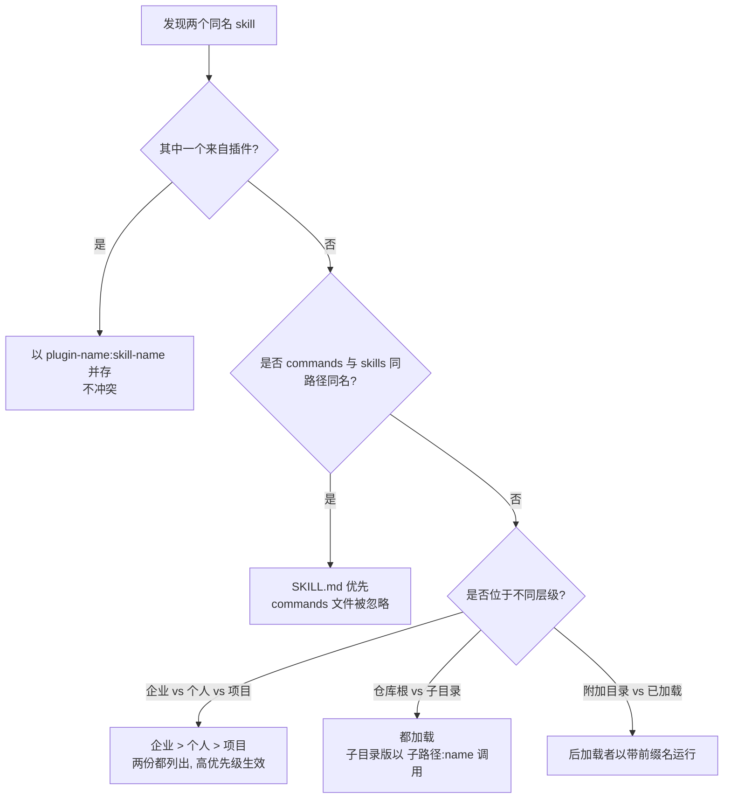

[toc]


## 先弄清楚SKILL.md解决什么问题

**Agent Skills**是Anthropic在2025年10月随Claude Code引入、同年12月作为开放标准(agentskills.io)发布的一种"按需加载的能力包"格式。一个skill就是一个目录,里面**至少有一个`SKILL.md`**,可选地带脚本、参考文档与模板。它要解决的核心矛盾是:**系统提示写得越全,上下文越贵、越容易互相干扰**;写得越少,agent又不知道团队的规矩。

解决思路是**渐进式披露(progressive disclosure)**,按[agentskills.io规范](https://agentskills.io/specification)和[客户端实现指南](https://agentskills.io/client-implementation/adding-skills-support),agent分三层读取skill:

- **第一层:元数据目录(catalog)**。会话启动时,agent只读取每个skill的`name`与`description`,每个约50到100 token,无论有多少skill都会常驻系统提示。
- **第二层:指令正文**。只有当agent判断某个skill与当前任务相关(或用户手动调用)时,才把`SKILL.md`正文读入上下文,建议小于5000 token。
- **第三层:引用资源**。正文里链接的`references/*.md`按需读取;`scripts/*`则直接执行,脚本内容不进入上下文。

这决定了本文两个重点的本质:**`description`是agent选择skill时唯一能看到的信号**,写得含糊等于不存在;而所有skill的元数据**共享同一块常驻上下文**,数量一多就会互相"抢"任务——这就是多skill冲突的根源。arXiv上的[*The Regression Tax*](https://arxiv.org/pdf/2607.22520)一文也印证了这一机制:触发描述在每一步都留在系统提示中,而正文仅在被调用时加载,并且skill并非只会帮忙,设计不当会拖累agent表现。

## 目录与文件规范

规范要求的最小结构只有一个文件,推荐结构如下(以项目级skill为例):

- `.claude/skills/<skill-name>/SKILL.md`:必需,frontmatter加正文。
- `.claude/skills/<skill-name>/references/`:可选,放长文档、规则矩阵、模板,**从SKILL.md正文直接链接**。
- `.claude/skills/<skill-name>/scripts/`:可选,放可执行脚本,agent运行它们而不是阅读它们。
- `.claude/skills/<skill-name>/assets/`:可选,放输出所需的静态素材(样式文件、图标等)。

几条硬规则与强烈建议:

- **目录名必须与`name`字段完全一致**(规范硬性要求,校验器会报错)。
- **不要在skill目录放`README.md`、`CHANGELOG.md`、`INSTALLATION_GUIDE.md`**这类给人看的文件——它们会被agent当作可读资源误读,浪费上下文;社区整理的[Agent Skills Best Practices](https://github.com/devskale/skale-skills/blob/main/docs/agent-skills-best-practices.md)将其列为明确的反模式。
- **正文控制在500行以内**,超过就拆到`references/`,并且**引用只拆一层**:Anthropic的最佳实践指出agent对"文件引用的文件"可能只略读,所以每份参考文件都应从SKILL.md直接链出([Real Python的实践文章](https://realpython.com/claude-code-skills/)亦转述了这两条)。
- 跨客户端共享时注意**目录位置差异**:Claude Code使用`.claude/skills/`(项目)和`~/.claude/skills/`(个人);开放标准与Codex等客户端使用`.agents/skills/`和`~/.agents/skills/`(见[scriptbyai的规范整理](https://www.scriptbyai.com/agent-skills-specification/))。两边可用符号链接共享同一份源。

## Frontmatter字段逐项解释

frontmatter是文件开头两条`---`之间的YAML映射。字段分两类:**开放标准定义的字段**(所有兼容客户端都应识别)与**Claude Code扩展字段**(其他客户端可能忽略或报"未知字段"警告)。按[agentpatterns.ai的字段参考](https://agentpatterns.ai/tool-engineering/skill-frontmatter-reference/)与规范页,标准只定义了`name`、`description`、`license`、`compatibility`、`metadata`、`allowed-tools`六个键。

| 字段                       | 来源               | 必需            | 含义与约束                                                   |
| -------------------------- | ------------------ | --------------- | ------------------------------------------------------------ |
| `name`                     | 标准               | 是              | skill标识,也是斜杠命令名。最多64字符,仅小写字母、数字、连字符;不能以连字符开头或结尾,不能有连续连字符;必须等于目录名。Anthropic平台文档另规定**不得含保留词`anthropic`、`claude`** |
| `description`              | 标准               | 是              | 最多1024字符。**说明做什么、何时使用**,是agent选择skill的唯一依据 |
| `license`                  | 标准               | 否              | 许可证名或指向目录内许可证文件                               |
| `compatibility`            | 标准               | 否              | 运行环境要求的自由文本(需要哪些系统包、网络等),供人与agent参考 |
| `metadata`                 | 标准               | 否              | 任意键值对,放作者、版本等,不参与触发                         |
| `allowed-tools`            | 标准(标记为实验性) | 否              | 空格分隔的预授权工具列表,支持程度因客户端而异;Claude Code完整实现并支持`Bash(cmd *)`这种细粒度模式 |
| `disable-model-invocation` | Claude Code        | 否(默认`false`) | 为`true`时**模型不能自动触发**,只能用户以`/name`手动调用;且其描述不占常驻上下文 |
| `user-invocable`           | Claude Code        | 否(默认`true`)  | 为`false`时**从斜杠菜单隐藏**,只能由模型自动加载,适合"背景知识"型skill |
| `context`                  | Claude Code        | 否              | 设为`fork`则在独立子agent、全新上下文中执行,结果回传主对话   |
| `agent`                    | Claude Code        | 否              | 配合`context: fork`指定子agent类型,如`Explore`、`Plan`、`general-purpose`或`.claude/agents/`里的自定义agent |
| `model`、`effort`          | Claude Code        | 否              | 覆盖该skill执行时使用的模型与推理强度                        |
| `argument-hint`            | Claude Code        | 否              | 斜杠菜单里显示的参数提示;正文用`$ARGUMENTS`接收参数          |
| `hooks`                    | Claude Code        | 否              | 在skill生命周期挂钩子命令                                    |

两个容易混淆的点:

- `disable-model-invocation: true`与`user-invocable: false`是**两根独立的开关,分别管"模型能否触发"和"用户能否触发"**。两者同时设置会让skill无法到达,agentpatterns.ai的参考明确提示了这一点。
- `allowed-tools`在Claude Code中是"免去逐次授权",**不是安全边界**;[generativeprogrammer的解读](https://generativeprogrammer.com/p/skill-authoring-patterns-from-anthropics)指出真正的限制来自权限规则。此外agentpatterns.ai引用Claude Code 2.1.19更新日志称,声明了`allowed-tools`或`hooks`的skill**首次使用前需用户批准**(此条仅该来源提及,未核实原始changelog)。

## 元描述之一:`name`怎么起

`name`的技术约束前面已列,这里说写法:

- **必须**用"对象-动作"或"领域-动作"的组合,如`migration-review`、`release-deploy`、`pdf-processing`,让用户在斜杠菜单一眼能猜出用途。
- **避免**泛名如`helper`、`utils`、`tools`;避免品牌/厂商前缀(`claude-`、`anthropic-`被官方保留;社区整理还提到Claude Code保留了`anthropic-skills`与`synced`两个名字,此为[luongnv89的教程](https://github.com/luongnv89/claude-howto/blob/main/03-skills/README.md)单一来源)。
- 由于个人级与项目级同名skill会按优先级覆盖(下文详述),**团队共享的skill建议带项目或领域前缀**,如`acme-migration-review`,降低与同事个人skill撞名的概率。
- 规范与参考校验器接受Unicode字母数字,但**不要用中文目录名**:Windows与各客户端对非ASCII路径的处理不一致,斜杠命令也难输入。

## 元描述之二:`description`怎么写

这是全文最重要的一节。[Anthropic官方最佳实践](https://platform.claude.com/docs/en/agents-and-tools/agent-skills/best-practices)把它定义为"让skill发现成为可能"的字段,并指出agent要从可能上百个skill中据此选择。

### 必须遵守的四条

- **必须同时写"做什么"和"何时用"**。规范给的反例是`Helps with PDFs.`,正例是`Extracts text and tables from PDF files, fills PDF forms, and merges multiple PDFs.`;官方的反例还有`Helps with documents`。
- **必须用第三人称**。官方理由是description会被注入系统提示,视角不一致会造成发现问题;`I can help you...`和`You can use this to...`都是反例,应写成`Processes Excel files and generates reports`。
- **必须包含用户会自然说出的关键词**:文件类型、框架名、命令名、动词("review"、"deploy"、"migrate")、以及项目黑话。
- **必须控制在1024字符内**。注意Claude Code在skill列表中会把description(加可选的`when_to_use`文本)**截断到1536字符**——该数字仅generativeprogrammer一处提及,未在官方文档核实,但1024的规范上限本身已足够约束。

### 推荐做法

- **写得"主动"一些**。Anthropic的`skill-creator`观察到模型有**触发不足(under-trigger)**的倾向,因此建议描述写得稍"pushy",例如"Make sure to use this skill whenever the user mentions dashboards, data visualization, or internal metrics, even if they do not explicitly ask for a dashboard"。
- **加排除子句**。在多skill环境里,`Do not use for ...`、`never trigger for ...`是划清边界的最有效手段,具体见冲突一节。
- **按模板组织**。一个稳定的四段式写法:

  能力陈述(第三人称动词开头,列出输入类型与产出) + 触发条件(`Use when the user asks to ...`,并列举关键词) + 排除条件(`Do not use for ...`) + 可选的前置条件(需要什么工具或凭据)。

- **中英混排的触发词**。国内团队的用户多用中文提问,而description本身用英文可获得最稳的解析与跨客户端兼容。建议**能力陈述用英文,触发关键词中英并列**,例如`mentions "migration", "数据库迁移", "ALTER TABLE"`。这是基于触发机制的推理性建议,本轮未检索到官方关于多语言描述的指导。

### 一个关键事实:简单任务不会触发skill

[anthropics/skills仓库中的`skill-creator`](https://github.com/anthropics/skills/blob/main/skills/skill-creator/SKILL.md)明确写道:模型只在**自己不能轻松完成**的任务上才去咨询skill;像"read this PDF"这种一步就能完成的请求,即使描述完全匹配也可能不触发,而复杂、多步、专业化的请求则会可靠触发。两个推论:

- 不要把一句话就能说清的偏好做成skill(放进`CLAUDE.md`/`AGENTS.md`更合适);
- 测试description时**不要用一步式请求当测试用例**,否则会误判为"描述写坏了"。

### 好坏对照

| 写法                                                         | 问题或优点                                               |
| ------------------------------------------------------------ | -------------------------------------------------------- |
| `Code review tool`                                           | 无触发条件、无关键词、无边界;与任何"review"类skill都冲突 |
| `I can help you review your code`                            | 第一人称;仍无边界                                        |
| `Reviews pull requests for correctness, security, and maintainability and produces a prioritized findings list. Use when the user asks to review a PR, diff, or branch, or mentions "code review". Do not use for schema migration files, which are handled by migration-review.` | 有能力、有触发词、有排除条款并点名了相邻skill            |

## 正文(指令)编写规范

正文是skill被选中后读入的内容。几条实践:

- **用祈使句和可执行步骤**,每一步给出具体命令、文件路径与判定标准,避免"注意质量"这种空话;可以在开头用一句人设(`You are a senior reviewer focused on correctness over style`)设定判断尺度,这是参考skill里的常见写法。
- **区分"必须/应该/可以/禁止"**,把不可逾越的红线(`Never modify the migration files`)单独成句。
- **不要解释"X是什么"**。agent已经知道PostgreSQL是什么,正文写的应该是**你们团队怎么做**;webfuse的[速查表](https://www.webfuse.com/agent-skills-cheat-sheet)把"what is X filler"列为应删内容。
- **把确定性工作交给脚本**。能用脚本做的(解析、校验、生成报表)就写进`scripts/`,正文只说"运行`scripts/xxx.py`并解读输出"。脚本**优先用Python而非bash**,否则Windows用户无法运行(见跨平台一节)。
- **长文件加目录**,方便agent用grep定位,而非通读。
- **先写测试再写指令**:Anthropic的做法是先定义几条应当成功的任务,再写skill,然后比对有无skill两种运行的差异(`skill-creator`内置了这套评测与基准脚本,会生成`benchmark.md`,含通过率、耗时与token对比)。

## 多skill并存:两类冲突及其规避

多个skill同时安装时会发生两类性质完全不同的冲突,**必须分开处理**:

- **硬冲突(名称冲突)**:两个skill的`name`相同,由加载器按确定性规则裁决,与description无关。
- **软冲突(触发竞争)**:名称不同,但description描述的职责重叠,由模型在选择阶段"投票",结果不确定——选错、两个都不选、或者各选一半。

### 硬冲突:名称与优先级规则(以Claude Code为准)

以下规则由[Claude Academy课程](https://academy.claude.com/courses/introduction-to-agent-skills/creating-your-first-skill)、luongnv89教程以及Claude Code维护者在[issue #20309](https://github.com/anthropics/claude-code/issues/20309)中的答复三方相互印证:

| 情形                                                         | 裁决结果                                                     |
| ------------------------------------------------------------ | ------------------------------------------------------------ |
| 企业级、个人级(`~/.claude/skills/`)、项目级(`.claude/skills/`)同名 | **企业 > 个人 > 项目**,高优先级的那份生效。两份都会出现在`/skills`列表并标记来源,但`/name`运行的是优先级高的 |
| 插件内skill与其他skill同名                                   | 插件skill使用`plugin-name:skill-name`命名空间,**不会冲突**,两者并存;前缀可在`plugin.json`的`name`字段修改 |
| 通过附加目录加载的skill与已有skill同名                       | 以带前缀的名字运行(单一来源)                                 |
| 仓库根与子目录(如`apps/web/.claude/skills/`)同名             | 两者都加载,`/deploy`运行根目录那份,`/apps/web:deploy`运行嵌套那份(单一来源) |
| `.claude/commands/review.md`与`.claude/skills/review/SKILL.md`同名 | skill优先                                                    |
| 本地`--plugin-dir`插件与已安装的同名市场插件                 | 本会话内本地副本优先([Claude Code插件文档](https://code.claude.com/docs/en/plugins)) |

一个常被误解的点:**"项目级覆盖个人级"目前不成立**。issue #20309里有用户希望项目skill覆盖同名的个人skill,维护者在2.1.235版本上确认文档行为就是个人优先,并建议"给项目版本起不同的名字,或删除/重命名个人副本"。因此:

- **团队skill应使用带前缀的独特名字**,不要指望仓库里的skill能压过同事的个人skill。
- 个人目录里**不要放与团队skill通用名相同的实验品**(如个人`deploy`会悄悄顶掉每个项目的`deploy`)。
- 需要跨项目复用且又要避免撞名时,**打包成插件**,利用命名空间天然隔离。

下图把上述裁决过程画成一张判定图(含多分支,文本表格难以表达加载顺序):



### 软冲突:触发竞争的规避策略

软冲突没有加载器帮你裁决,只能靠设计。以下策略按效果排序:

- **职责单一、边界互斥**。每个skill只负责一种任务;两个skill若在"输入类型"或"动作"上有交集,就在description里显式划界。最直接的方法是**互相点名**:A写`Do not use for schema migration files, which are handled by migration-review`,B写`Do not use for application code review`。
- **触发词不重叠**。把每个skill的触发关键词列成一张表,逐行检查有无共用词;luongnv89教程给"Skills conflict"问题的处方正是"在description里使用不同的触发词"。常见的重叠源是泛动词(`review`、`analyze`、`check`)和泛对象(`file`、`document`、`code`),要用更具体的词替换。
- **按"谁来触发"分流**。利用Claude Code的两根开关,把skill分成三类,让不同类之间根本不参与同一场竞争:

| 配置                             | 用户可`/name` | 模型可自动触发 | 描述占常驻上下文 | 适用                                           |
| -------------------------------- | ------------- | -------------- | ---------------- | ---------------------------------------------- |
| 默认                             | 是            | 是             | 是               | 一般工作流                                     |
| `disable-model-invocation: true` | 是            | 否             | 否               | 部署、提交、发消息、删数据等**有副作用**的操作 |
| `user-invocable: false`          | 否            | 是             | 是               | 编码规范、API约定等**背景知识**                |

  这张表汇总自agentpatterns.ai与[vanja.io的指南](https://vanja.io/claude-code-skills-guide/)。社区多篇文章([codewithmukesh](https://codewithmukesh.com/blog/skills-claude-code/)、[batsov](https://batsov.com/articles/2026/03/11/essential-claude-code-skills-and-commands/)、[allahabadi.dev](https://allahabadi.dev/blogs/ai/claude-code-skills-frontmatter-complete-guide/))不约而同给出同一条经验:**凡有副作用的skill一律`disable-model-invocation: true`**。这不仅是安全考虑,也是减少竞争——这类skill的描述不再进入常驻目录,模型选择时的候选集变小。

- **用`context: fork`隔离长流程**。调研、批量扫描等会产生大量中间输出的skill放到子agent里跑,只回传结论,避免中间内容污染主对话、诱发其他skill被误触发。
- **控制总量,合并同类**。常驻目录是线性增长的,几十个skill就是几千token的持续开销,且选择准确率随候选数下降。同一领域的多个小skill(如`lint-python`、`lint-js`)可合并为一个带分支的skill,把语言差异放到`references/`里。*The Regression Tax*的实验显示同一组信号可被不同生成器做成3到23个skill不等,数量并不等于效果。
- **路由(hub)skill模式**。当某领域确实需要多个子skill时,做一个description很宽、正文只负责判断并指向具体子skill的入口skill;子skill设`user-invocable: false`或把触发词写得极窄。这是从插件命名空间与嵌套skill机制延伸出来的设计,属于社区实践而非官方规范。
- **用触发评测做回归**。`skill-creator`推荐为每个skill生成约20条评测请求,其中8到10条应触发、其余不应触发,并给出了比对脚本。多skill环境下,**应触发集里混入相邻skill的典型请求**,确保新加或改写一个skill的description后,邻居不会被抢走任务。

## 综合示例:一个仓库里的四个互不打架的skill

下面是一个真实感的团队仓库配置,四个skill分别代表上表的四种角色:只读审查、带副作用的部署、背景知识、隔离调研。重点看**description如何互相划界**,以及字段如何与角色匹配。

`.claude/skills/migration-review/SKILL.md`(只读审查,默认双向可触发,收紧工具):

```markdown
---
name: migration-review
description: Reviews PostgreSQL schema migration files (Prisma, Alembic, Flyway, raw SQL) for lock risk, backfill safety, and rollback feasibility, and produces a go/no-go checklist. Use when the user asks to review, audit, or check a migration, mentions "migration", "ALTER TABLE", "schema change", or opens a PR that touches a migrations directory. Do not use for application code review or for running migrations.
allowed-tools: Read Grep Glob
---

# Migration Review

## Workflow
1. Locate changed migration files: `git diff --name-only origin/main -- '**/migrations/**'`.
2. For each file, classify every statement with `references/lock-matrix.md`.
3. Flag any statement that takes `ACCESS EXCLUSIVE` on a table over 1M rows.
4. Output the checklist in `references/report-template.md`. Never modify the migration files.
```

`.claude/skills/release-deploy/SKILL.md`(有副作用,仅用户可触发,参数化):

```markdown
---
name: release-deploy
description: Deploys the current branch to the staging or production environment via scripts/deploy.py after running tests and building. Use only when the user explicitly asks to deploy, ship, or release; never trigger for questions about how deployment works.
disable-model-invocation: true
argument-hint: "[staging|production]"
allowed-tools: Bash(python3 scripts/deploy.py *) Bash(npm test) Bash(npm run build)
---

# Release Deploy

Target environment: `$ARGUMENTS` (default `staging`).

1. Run `npm test`; stop on failure.
2. Run `npm run build`.
3. Run `python3 scripts/deploy.py --env $ARGUMENTS`.
4. Report the health-check URL printed by the script. Do not retry on failure; ask the user.
```

`.claude/skills/api-conventions/SKILL.md`(背景知识,仅模型可触发):

```markdown
---
name: api-conventions
description: Applies this repository's REST API conventions (URL naming, error envelope, pagination, versioning headers) whenever the user adds or modifies an HTTP endpoint, controller, route, or OpenAPI document. Use even if the user does not mention conventions explicitly.
user-invocable: false
---

# API Conventions

- Paths are kebab-case plural nouns: `/v1/order-items`, never `/v1/getOrderItems`.
- Errors use the envelope in `references/error-envelope.md`.
- List endpoints must support `cursor` and `limit` (max 200).
```

`.claude/skills/competitor-research/SKILL.md`(长流程,子agent隔离):

```markdown
---
name: competitor-research
description: Produces a structured competitor comparison (features, pricing tiers, licensing, hosting model) by searching the web and reading product pages. Use when the user asks to compare products, find alternatives, or research competitors or the market landscape. Do not use for reviewing this repository's own code.
context: fork
agent: general-purpose
allowed-tools: WebSearch WebFetch Read Write
---

# Competitor Research

1. Clarify the target product and at most five competitors.
2. For each competitor, open the official pricing and docs pages; record the date.
3. Write the comparison table to `docs/research/<topic>.md` using `references/table-template.md`.
4. Return only the file path and a three-line summary to the parent conversation.
```

这四个skill的划界逻辑:

- `migration-review`与`api-conventions`都会在"改代码"时被考虑,但前者的触发对象限定为**迁移文件**并明确排除应用代码审查,后者限定为**HTTP端点/路由/OpenAPI**;触发词集合没有交集。
- `release-deploy`关闭了模型触发,所以用户问"我们的部署流程是怎样的"时,模型不会误跑部署;它的描述也不占常驻上下文。
- `competitor-research`与`migration-review`都含"review/compare"语义,因此它显式写了`Do not use for reviewing this repository's own code`。
- `api-conventions`的描述使用了"pushy"写法(`Use even if the user does not mention conventions explicitly`),对应官方观察到的触发不足问题。

### 配套校验脚本(已实跑)

以下脚本按规范检查`name`/`description`约束、目录匹配、两根开关互斥、CRLF、正文行数,并对未知字段给出警告。依赖`PyYAML`。因为沙箱文件无法直接下载,代码完整列出:

```python
#!/usr/bin/env python3
"""Validate SKILL.md frontmatter against the Agent Skills spec rules
(name <=64, lowercase a-z0-9-, no leading/trailing/double hyphen, matches dir;
description <=1024) plus a few Claude Code sanity checks."""
import re, sys, pathlib, yaml

STD = {"name", "description", "license", "allowed-tools", "metadata", "compatibility"}
CC_EXT = {"disable-model-invocation", "user-invocable", "context", "agent",
          "model", "effort", "argument-hint", "hooks"}
NAME_RE = re.compile(r"^[a-z0-9]+(-[a-z0-9]+)*$")

def check(path: pathlib.Path):
    errs, warns = [], []
    text = path.read_text(encoding="utf-8")
    if "\r\n" in text:
        warns.append("CRLF line endings found; prefer LF")
    m = re.match(r"^---\r?\n(.*?)\r?\n---\r?\n(.*)$", text, re.S)
    if not m:
        return ["frontmatter not found or not closed with ---"], warns, 0
    fm = yaml.safe_load(m.group(1))
    if not isinstance(fm, dict):
        return ["frontmatter must be a YAML mapping"], warns, 0
    name, desc = fm.get("name"), fm.get("description")
    if not name: errs.append("missing name")
    else:
        if len(name) > 64: errs.append(f"name > 64 chars ({len(name)})")
        if not NAME_RE.match(name): errs.append(f"name '{name}' violates [a-z0-9-] rules")
        if name != path.parent.name: errs.append(f"dir '{path.parent.name}' != name '{name}'")
        if re.search(r"anthropic|claude", name): errs.append("name contains reserved word")
    if not desc: errs.append("missing description")
    else:
        if len(desc) > 1024: errs.append(f"description > 1024 chars ({len(desc)})")
        if re.search(r"\b(I|you)\b", desc): warns.append("description not in third person?")
        if not re.search(r"\b(use when|when the user|use only when|whenever)\b", desc, re.I):
            warns.append("description has no explicit 'when to use' trigger")
    for k in fm:
        if k not in STD | CC_EXT: warns.append(f"unknown field '{k}' (not in spec or Claude Code extensions)")
    if fm.get("disable-model-invocation") and fm.get("user-invocable") is False:
        errs.append("both disable-model-invocation:true and user-invocable:false -> unreachable")
    body_lines = m.group(2).count("\n") + 1
    if body_lines > 500: warns.append(f"body has {body_lines} lines (> 500)")
    return errs, warns, len(desc or "")

root = pathlib.Path(sys.argv[1] if len(sys.argv) > 1 else ".")
bad = 0
for p in sorted(root.rglob("SKILL.md")):
    errs, warns, dlen = check(p)
    status = "FAIL" if errs else "OK"
    bad += bool(errs)
    print(f"[{status}] {p.relative_to(root)}  desc_len={dlen}")
    for e in errs: print("   ERROR:", e)
    for w in warns: print("   WARN :", w)
sys.exit(1 if bad else 0)
```

实跑结果:四个示例skill全部`OK`(description长度分别为262、308、403、247字符),退出码0;故意放入一个`Bad_Name/`目录、`name: Bad--name`、两根开关同时关闭的坏样本后,脚本正确报出三条错误和一条"缺少触发条件"的警告,退出码1。官方对应的工具是开放标准的`skills-ref validate ./my-skill`,以及Claude Code内的`claude plugin validate .claude/skills`、`/skills`、`/reload-skills`与`claude --debug`(查看frontmatter解析错误),这些本轮无法在沙箱中运行。

## 跨平台、网络与国内环境的注意事项

- **换行符**。frontmatter依赖`---`分隔行,Windows上若Git把`SKILL.md`转成CRLF,部分解析器会失败。在仓库`.gitattributes`里加一行`*.md text eol=lf`、`*.py text eol=lf`,统一用LF。上面的校验脚本会对CRLF发出警告。
- **脚本语言**。`scripts/`里的bash脚本在Windows原生环境不可用;**用Python写脚本**,并在`compatibility`字段写明解释器版本。`allowed-tools`里的`Bash(...)`模式在Windows上对应的是Claude Code内置shell,行为以官方文档为准。
- **路径与非ASCII字符**。skill目录名、脚本文件名只用ASCII;正文里的中文内容保存为UTF-8无BOM。
- **安装与分发**。`npx skills add <github-url> --skill <name>`这类安装方式需要直连GitHub与npm;国内无代理时可把仓库URL改为`gh-proxy`类镜像包裹的地址后用`git clone`取回再手动放入`.claude/skills/`(镜像站可用性随时变化,请以[gh-proxy项目issue](https://github.com/hunshcn/gh-proxy/issues/116)中的最新列表为准),或配置`HTTPS_PROXY`(Windows PowerShell用`$env:HTTPS_PROXY = "http://127.0.0.1:7890"`,类Unix用`export HTTPS_PROXY=http://127.0.0.1:7890`)。
- **国内客户端**。Trae、Qoder、通义灵码等是否兼容`.agents/skills/`本轮未查证,不做断言。

## 上线前自检清单

- 目录名与`name`一致,`name`符合字符与长度规则,不含保留词。
- `description`第三人称,包含能力、触发关键词、排除条款,长度在1024内。
- 正文不超过500行,引用文件只拆一层且全部从正文直接链出;无README等给人看的文件。
- 有副作用的skill设置`disable-model-invocation: true`;纯背景知识设置`user-invocable: false`;两者绝不同时为"关"。
- 与同目录及个人目录下的其他skill比对触发词,无重叠;需要时互相点名排除。
- 团队skill名带前缀,避免被个人同名skill覆盖;跨项目复用的打包成插件。
- 用8到10条应触发、约10条不应触发的请求做触发评测,且不用一步式请求当样本。
- 换行LF、脚本Python、路径ASCII。

