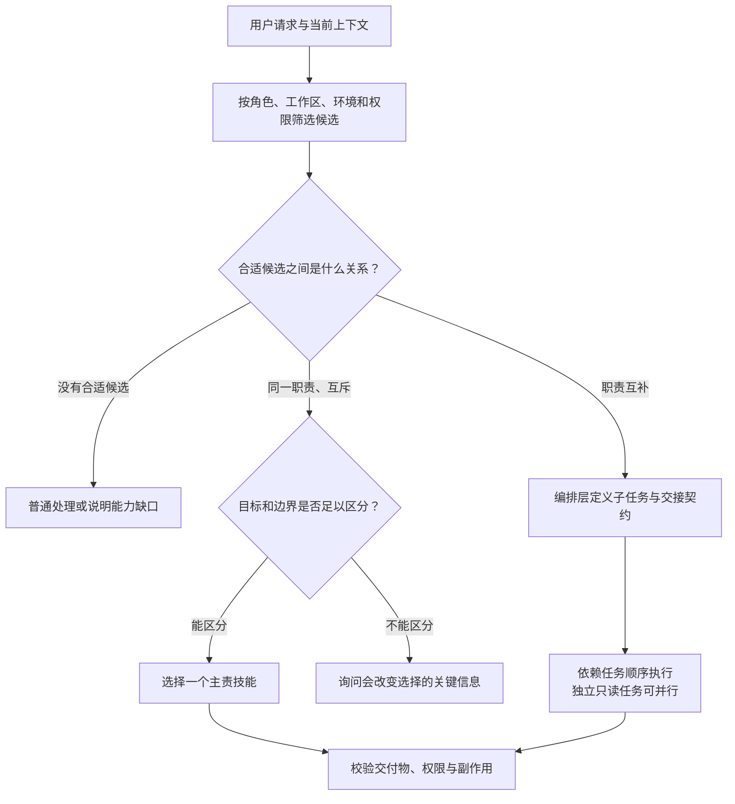

[toc]


## 核心结论

- **使用规范文件名`SKILL.md`，不要依赖大小写不敏感的文件系统。**
- **`description`回答“做什么、什么时候用、与相邻技能如何区分”；正文回答“具体怎么做、如何验收、失败怎么办”。**
- **影响首次选择的关键边界必须进入`description`，不能只藏在正文里。**
- **同名冲突与语义竞争是两回事。**改名能解决标识冲突，不能自动解决职责重叠。
- **多个Skill可以协作，不应该为了“避免竞争”而强制所有任务只能使用一个Skill。**正确目标是：同一职责有明确主责，互补职责有清楚的交接关系。
- **不存在由开放规范统一定义的`priority`、`always_use`或“优先于其他Skill”机制。**不要把自定义字段或强硬措辞当作确定性调度器。
- **描述是软约束，不是权限边界。**生产部署、删除、发送消息等动作，需要显式调用、实际权限与必要审批共同控制。
- **必须在完整技能集合中做回归测试。**单独安装时表现正常，不代表与其他技能共存时仍然正确。

这些结论分别对应开放格式的渐进式加载机制、OpenAI的技能描述与评测指导，以及各宿主的调用控制机制。参见、和。

## 先分清：规范要求、平台能力和工程约定

这三层混在一起，是很多教程产生误导的原因。

| 层次             | 解决什么问题                          | 典型内容                                    | 应如何理解                           |
| ---------------- | ------------------------------------- | ------------------------------------------- | ------------------------------------ |
| **开放格式规范** | Skill包如何组织、基本字段如何表示     | `SKILL.md`、`name`、`description`、资源目录 | 跨平台的共同基础                     |
| **宿主实现**     | 如何发现、展示、加载、授权和调用Skill | 手动调用开关、同名处理、目录扫描、权限配置  | 必须逐平台、逐版本核对               |
| **团队工程约定** | 如何分工、维护、评测和发布技能集合    | 命名空间、职责矩阵、主责技能、回归样例      | 需要自行设计，不能假装是标准内置能力 |

**能被某个宿主加载，不等于符合开放规范；符合开放规范，也不等于在所有宿主中具有相同的调用和权限行为。**

例如，当前Claude Code对一些字段有自己的容错与扩展规则；OpenCode则明确说明未知Frontmatter字段会被忽略。这些都是宿主行为，不应反向解释为通用标准。参见和。

### Skill适合放什么，不适合放什么

| 内容性质                                 | 推荐承载位置                     |
| ---------------------------------------- | -------------------------------- |
| 所有任务始终适用的安全规则、项目约束     | 宿主正式支持的全局或项目规则机制 |
| 特定任务才需要的流程、领域经验和操作约定 | **Skill**                        |
| 必须确定性完成的计算、转换、校验         | 脚本、程序或工具                 |
| 访问外部系统、执行受控动作               | 工具、API或MCP等连接机制         |
| 多步骤任务的调度、依赖管理与审批         | 工作流或编排层，可结合Skill      |

**Skill主要承载程序性知识，不应被当成万能配置文件，也不应代替实际工具能力。**官方对Skills、MCP、自定义指令与子Agent的区分，可参见及。

## `SKILL.md`的格式与元数据规范

### 基本文件组织

一个Skill最少只需要一个`SKILL.md`。其他文件按需增加，不要为了目录“看起来完整”而创建空目录。

| 路径          | 用途                 | 编写建议                             |
| ------------- | -------------------- | ------------------------------------ |
| `SKILL.md`    | 元数据与主执行说明   | 保留任务入口、关键决策和验收要求     |
| `references/` | 详细参考材料         | 按主题拆分，并说明何时读取           |
| `scripts/`    | 可执行工具与校验逻辑 | 明确依赖、参数、输出与失败行为       |
| `assets/`     | 模板、图片、静态资源 | 不要混入与任务无关的大量资源         |
| `agents/`     | 某些产品的附加配置   | **不应假定所有宿主都会解释其中内容** |

开放规范采用“元数据先发现、正文在激活后加载、其他资源按需读取”的组织方式。因此，主文件应更像**任务说明与导航入口**，而不是完整知识库。参见与。

### Frontmatter字段

Frontmatter是文件开头由两行`---`包围的YAML元数据。

| 字段              | 开放格式中的要求                     | 含义与注意事项                                               |
| ----------------- | ------------------------------------ | ------------------------------------------------------------ |
| **`name`**        | 必填，最长64字符，需与所属目录名一致 | 技能标识。为跨平台，推荐使用小写ASCII字母、数字和单个连字符；不以连字符开头或结尾，不使用连续连字符 |
| **`description`** | 必填，非空，最长1024字符             | 描述能力与使用时机，是发现和选择的重要依据                   |
| `license`         | 可选                                 | 许可证名称或随包许可证说明，**不是工具权限**                 |
| `compatibility`   | 可选，最长500字符                    | 环境需求，例如产品、系统依赖、网络条件；不能据此假设宿主一定会自动检查或阻止运行 |
| `metadata`        | 可选，字符串键到字符串值的映射       | 存储维护者、版本等附加信息；**不意味着宿主会把这些信息用于路由** |
| `allowed-tools`   | 可选、实验性                         | 预批准工具的表示方式；具体支持与语义依赖宿主，不能视为通用沙箱 |

这些字段及长度限制可对照、与。其中可选字段的实际执行效果，仍以各宿主实现为准。

这里有一个值得注意的兼容性细节：**当前参考校验器支持Unicode名称，而OpenCode文档给出的名称正则是ASCII形式。**因此，“为了跨平台采用ASCII名称”是保守的工程建议，不应被表述为“所有实现都禁止中文名称”。参见与。

### YAML层面的注意事项

推荐统一采用以下习惯：

- **Frontmatter从文件第一行开始**，开头之前不放说明文字、标题或空白装饰。
- 使用空格缩进，不使用Tab。
- `description`可以使用`>-`折叠块，便于源文件换行维护，但解析后仍是一个字符串。
- 含有容易干扰YAML解析的内容时，使用引号或块字符串；尤其留意冒号后空格、注释符号和多行文本。
- `metadata.version`等值使用字符串，例如`"1.0.0"`，不要让维护工具依赖隐式类型推断。
- 自定义属性优先放进`metadata`，但这只是存储位置，**不是“添加后自动生效”的扩展接口**。
- 不要把完整命令、长示例、Markdown列表或执行步骤塞进`description`。

`>-`中的`>`表示折叠式块字符串，`-`表示移除末尾换行；更复杂的空行和缩进还有细节，因此最终应检查解析后的实际值，而不仅是看源文件排版。参见。

## 元描述：重点是`description`，不是`metadata`

### 先避免三个概念混淆

| 概念              | 主要用途                     | 常见误解                                   |
| ----------------- | ---------------------------- | ------------------------------------------ |
| **`description`** | 向Agent说明何时考虑这个Skill | 把它写成宣传文案或能力口号                 |
| **`metadata`**    | 存储额外的结构化信息         | 以为增加`tags`、`priority`等键就会影响选择 |
| 产品特有的UI描述  | 给用户在界面中浏览、选择     | 以为UI短描述能替代`SKILL.md`中的路由描述   |

例如，OpenAI的`agents/openai.yaml`中，`interface.short_description`是面向用户的UI短说明；它不应被误认为就是`SKILL.md`中的`description`。参见。

### 为什么边界必须进入描述

典型的渐进式加载关系如下：

| 阶段               | Agent通常先看到什么                          | 你应把什么放在这里                             |
| ------------------ | -------------------------------------------- | ---------------------------------------------- |
| **发现与候选选择** | 技能名称、描述，以及某些宿主附带的路径等信息 | 能力、适用目标、关键触发条件、最重要的排除边界 |
| **激活后**         | 完整`SKILL.md`正文                           | 输入要求、执行流程、决策规则、输出与验收       |
| **执行过程中**     | 按需读取的参考材料与资源                     | 详细协议、长案例、模板和工具                   |

这意味着：

> **如果“不适用于纯排版任务”只写在正文里，Agent可能要先选错并加载这个Skill，才知道不该选它。**

开放规范与OpenAI官方文档都描述了这种先暴露名称和描述、再加载正文的机制。它们是相互独立的格式说明与产品实现说明，而不是同一页面的转载。

### 推荐的描述结构

我建议采用下面这套结构。**这是工程写法，不是标准规定的语法。**

| 组成部分       | 要回答的问题                           | 示例含义                           |
| -------------- | -------------------------------------- | ---------------------------------- |
| **对象与目标** | 针对什么对象，完成什么任务？           | 对技术主张进行外部证据核验         |
| **交付物**     | 使用后得到什么？                       | 带来源的结论、分歧和缺口           |
| **触发条件**   | 用户出现什么目标或上下文时应该考虑它？ | 要求核实规格、查找证据、验证时效性 |
| **关键边界**   | 与最相近的技能如何区分？               | 不负责完整报告成稿，不处理纯润色   |
| 必要的能力限定 | 哪些条件会改变选择？                   | 仅处理已有文本、仅适用于指定系统等 |

不需要机械地把五项都写成五句话。**首句最好就能让Agent把它与最近邻技能区分开。**

Anthropic的官方最佳实践要求描述同时覆盖“做什么”和“何时使用”，并推荐第三人称表达。中文通常直接写“处理……”“生成……”“用于……”即可，不必写成“我是一个……助手”。参见。

### 一个反例与改写

不推荐的描述：

```yaml
description: 通用研究、写作、分析与排版助手。任何与技术文档有关的任务都必须优先使用本技能。
```

问题在于：

- **职责过宽**，同时覆盖研究、写作、分析和排版。
- “任何”“必须优先”没有提供可判别的业务条件。
- 它会与大量技能争夺同一请求。
- 即使提高了触发率，也可能只是提高了**错误触发率**。

改写为一个独立取证技能的描述：

```yaml
description: >-
  为独立的技术事实核验收集外部证据，输出带来源的结论、分歧和缺口。
  适用于“核实某项规格”“查找支持与反对证据”等取证任务，或报告流程中的取证子任务；
  不负责完整报告成稿，纯润色、翻译、摘要和排版时不使用。
```

它的改进不是“关键词更多”，而是明确了：

- **任务目标**：事实核验。
- **交付物**：证据性结论，而非完整成稿。
- **触发情境**：独立取证或取证子任务。
- **竞争边界**：不抢润色、翻译、摘要和排版任务。

这里还隐含一个前提：执行环境确实提供了所需的检索能力。**描述不能承诺环境并不存在的能力。**

### 描述编写的具体建议

**必须做到：**

- 能力声明与实际正文、脚本和工具条件一致。
- 关键适用边界在描述中可见。
- 不冒充系统指令，不自封最高优先级。
- 不把“可能相关”写成“必须使用”。

**推荐做到：**

- **先写正向范围，再补少量关键排除项。**
- 使用用户自然会表达的任务语言，而不只是内部术语。
- 对容易混淆的业务动作写清楚差别，例如“新建项目”与“修改现有项目”。
- 中文用户为主时，可以使用中文描述，并保留必要的英文产品名、文件扩展名或术语。
- 把最重要的区分条件前置，不要先铺垫背景和宣传性措辞。
- 从真实误选样例中修订描述，而不是凭空扩充同义词。

**避免这样做：**

- 堆砌“全面、专业、强大、生产级、智能”等无法帮助选择的词。
- 罗列一大串关联领域，企图覆盖更多请求。
- 用多个Skill分别宣称“凡是涉及文档都应使用我”。
- 把长工作流压缩进一个超长描述。
- 认为加入否定句后就形成了确定性过滤器。

当前Claude Code与Codex的官方文档都涉及技能目录的上下文预算及描述裁剪问题，所以**“规范允许的长度”不等于“适合写满的长度”**。参见和。

### “写得更积极”与“避免抢任务”并不矛盾

Anthropic当前的官方`skill-creator`提到，模型存在漏用技能的倾向，因此建议描述可以更积极一些；官方构建指南同时又建议通过负向触发条件降低过度触发。

合理的综合理解是：

> **在自己的职责范围内表达明确，而不是扩大职责范围。**

例如，可以把“可能帮助分析某些技术资料”改成“用于核实技术规格并形成可追溯证据摘要”；不应改成“所有技术相关请求都必须加载”。

这两类建议分别见与。这是同一厂商的不同指导材料，不把它们计为两个独立厂商的实验结论。

## 多Skill共存：先判断到底是哪种冲突

### 冲突分类与处理手段

下面是建议采用的工程分类。

| 问题类型             | 典型表现                                       | 优先处理方法                              |
| -------------------- | ---------------------------------------------- | ----------------------------------------- |
| **同名冲突**         | 两个目录或包注册出同一个技能标识               | 唯一命名、清理重复安装、检查宿主覆盖规则  |
| **语义竞争**         | 不同名称，但描述都覆盖同一目标                 | 重划职责、补充最近邻边界、增加对照测试    |
| **执行指令冲突**     | 一个要求最终只输出JSON，另一个要求全文Markdown | 约束作用域，明确谁拥有最终交付格式        |
| **副作用冲突**       | 两个技能都修改同一个文件、配置或外部对象       | 单一写入责任、串行执行、幂等与事务性设计  |
| **编排循环**         | A要求调用B，B又要求先调用A                     | 使用有向依赖，禁止无条件相互委派          |
| **可见性与预算问题** | 技能已安装，但模型没看到完整描述               | 检查实际暴露的技能目录，而不是只改描述    |
| **权限边界混淆**     | 以为禁用自动调用就等于禁止部署或删除           | 在工具、API和运行环境中实施真正的权限限制 |

**不要用同一种办法处理所有问题。**例如，“给名称加组织前缀”适合解决标识冲突，但不会让两个同样宽泛的描述停止竞争。

### 先建立职责矩阵，再写描述

以下用一组真实常见的“技术资料与报告”技能举例。它们可能处理同一份Markdown文档，但业务目标不同。

| Skill               | 主责                             | 明确不承担的职责                     |
| ------------------- | -------------------------------- | ------------------------------------ |
| `evidence-research` | 外部检索、事实核验、证据摘要     | 完整报告成稿、纯润色、纯排版         |
| `document-rewrite`  | 基于既有内容改善表达、结构和语气 | 外部查证、擅自新增事实、纯语法排版   |
| `markdown-layout`   | 规范Markdown结构与语法           | 事实核验、实质性改写、生成新内容     |
| `report-workflow`   | 编排取证、成稿与交付检查         | 抢占单一查证、单一润色或单一排版请求 |

这里最重要的区分轴是**用户目标**，不是文件类型。

“输入是Markdown”不能决定应该使用哪个技能；“用户要求核实事实”与“用户只要求修复表格渲染”才是有价值的区分。

对应的描述可按以下方向编写：

| Skill               | 描述应强调的核心内容                                         |
| ------------------- | ------------------------------------------------------------ |
| `evidence-research` | **独立取证或取证子任务**；交付结论、来源与缺口，不负责完整成稿 |
| `document-rewrite`  | **基于用户已提供内容重写**；保持事实和引用关联，不自行补充外部主张 |
| `markdown-layout`   | **纯格式处理**；只调整结构与语法，不改变事实判断和内容含义   |
| `report-workflow`   | **端到端报告目标**；协调取证与成稿，仅在确实需要整合流程时承接 |

**不要一开始就为每个组合创建编排技能。**如果前三个技能直接组合已经清晰，就不需要第四个；只有某种组合频繁出现、有稳定验收标准时，才值得封装。

### 对互斥任务择一，对互补任务组合

这是避免“竞争治理过度”的关键。

- **互斥**：两个技能都试图承担同一职责，例如两个通用技术调研技能。应明确默认选择、差异条件，必要时合并。
- **互补**：一个负责取证，一个负责排版。可以组合，但应限定各自负责的步骤与对象。
- **包含关系**：一个大技能包含另一个小技能的全部内容。通常应抽出共享资源，或明确编排者与子任务的关系。
- **替代实现**：两个技能完成同一目标，但依赖不同工具或平台。应按环境、权限、成本或用户指定进行选择。

**推荐约定“一项职责一个主责者”，而不是“一次请求只能一个Skill”。**

例如，完整报告任务可以这样分工：

| 阶段     | 主责                 | 交接内容                                     |
| -------- | -------------------- | -------------------------------------------- |
| 取证     | `evidence-research`  | 结论、来源、分歧、未确认项                   |
| 成稿     | 编排层或专门写作步骤 | 基于已确认材料形成报告，不把未确认项写成事实 |
| 排版     | `markdown-layout`    | 调整格式，保持结论与来源关联不变             |
| 最终验收 | 编排层               | 检查内容、引用、格式与任务要求是否一致       |

这里的“交接内容”是你设计的执行契约，不是开放格式内置的对象协议。

### 约束作用域，避免“全局污染”

不推荐在子技能正文中写：

- “之后所有回答都必须使用JSON。”
- “无论用户问什么，都采用本技能的格式。”
- “忽略其他Skill的规则。”
- “完成任务前必须读取所有相关Skill。”

推荐改为：

- **“本技能返回给编排者的结果采用约定结构。”**
- **“仅对用户指定文档应用本节排版规则。”**
- **“不改变其他子任务的事实判断与权限边界。”**
- **“仅在满足某个条件时读取某份参考资料。”**

换句话说，尽量把规则绑定到**对象、步骤和交付物**，不要绑定到整个会话的所有后续行为。

### 不要靠“优先级宣言”调度

下面这些都不能作为通用解决方案：

- 在正文宣称“本技能优先级最高”。
- 增加未被宿主识别的`priority: 9999`。
- 在`metadata`中增加`always_use: "true"`。
- 用更强烈的措辞压过其他技能。

一个特别有说明力的例子是：**Qwen Code当前文档确实提供`priority`，但它只影响`/skills`列表排序，不决定模型自动选择优先级。**这是一条该项目官方文档的单源规格说明，不是跨平台共识。参见。

### 使用宿主机制减少候选，而不只是优化措辞

以下内容已逐实体核对，但仍属于各宿主官方文档或仓库的**单方规格说明，未实测**。

| 宿主            | 可用的控制方式                                               | 同名或兼容性注意事项                                         |
| --------------- | ------------------------------------------------------------ | ------------------------------------------------------------ |
| **Claude Code** | `disable-model-invocation: true`禁止模型自行调用；`user-invocable: false`限制用户直接调用 | 企业、个人、项目之间有特定同名优先关系；插件技能另有命名空间，不能假定“项目永远覆盖个人” |
| **Codex**       | 在`agents/openai.yaml`中设置`policy.allow_implicit_invocation: false`，保留显式调用 | 官方文档说明同名技能不会合并，可能同时出现在选择界面         |
| **OpenCode**    | 使用`permission.skill`配置`allow`、`ask`、`deny`，并可按Agent配置 | 未知Frontmatter字段会被忽略；不应把其他产品的调用控制字段直接搬过去 |
| **Qwen Code**   | 提供用户/模型调用开关，以及`paths`文件路径门控               | 同名加载有自己的优先顺序；`priority`不是自动路由优先级       |

对应一手来源：、、、、。

两个容易混淆的地方需要特别强调：

- **Claude Code的`user-invocable: false`不是关闭自动调用。**
- **禁用Skill的隐式调用，不等于禁止Agent通过其他可用工具执行同类动作。**

对需要人工控制时机的技能，应优先使用宿主正式支持的显式调用机制。例如，Codex的附加配置可以包含：

```yaml
policy:
  allow_implicit_invocation: false
```

这里：

- `policy`是产品特有的调用策略配置分组。
- `allow_implicit_invocation`控制是否默认向模型提供该技能以供隐式使用。
- `false`不等于删除技能，仍可显式调用。

它应该放在该产品支持的`agents/openai.yaml`中，**不是通用`SKILL.md`字段**。修改现有文件时，应保留原有其他配置。

### 建议的仲裁结构

按你的要求，先登记示意图候选并检查：

| 候选             | 意图与对应内容                             | 图类型     | 三关结果                                               |
| ---------------- | ------------------------------------------ | ---------- | ------------------------------------------------------ |
| 渐进式加载过程   | 说明元数据、正文、资源的加载顺序           | 流程图     | 基本线性，前文表格已足够，**不画**                     |
| 多技能仲裁与协作 | 区分无候选、互斥候选、互补候选及不确定分支 | 分支流程图 | 有分支；能呈现择一与组合的结构差别；规模可控，**保留** |

下面是**建议采用的工程仲裁逻辑，不代表所有Agent已经内置**：



图中的核心不是“尽可能多加载技能”，而是：

- **没有合适技能时，允许不用Skill。**
- **互斥候选不能靠全部加载来逃避选择。**
- **互补候选可以组合，但必须管理依赖、交接与副作用。**

### 技能库变大后，描述优化不是唯一手段

当候选库明显膨胀时，推荐按以下顺序处理：

1. **删除重复、失效和过度宽泛的技能。**
2. 按工作区、角色、业务域和环境减少默认可见候选。
3. 对高风险、低频或工具性技能采用显式调用。
4. 对剩余近邻技能补充区分条件并建立对照测试。
5. 确有大规模检索需求时，再引入专门的候选检索与重排层。

研究方面，讨论了高度重叠的大型技能库，并研究利用完整技能文本进行上游检索与重排。**这是特定大规模场景下的研究证据，不说明小型目录必须引入专用模型，也不说明所有宿主默认会在选择前读取正文。**

## 正文最佳实践：写成可执行、可验收的契约

以下是推荐的正文结构，不是必须照抄的固定章节名。

| 部分               | 应包含什么                                     |
| ------------------ | ---------------------------------------------- |
| **职责与边界**     | 本技能负责的对象、步骤和交付物，以及不负责什么 |
| **输入与前置条件** | 必需信息、可用工具、环境要求；缺失时如何处理   |
| **执行过程**       | 可操作的步骤与必要分支，而不是空泛口号         |
| **决策规则**       | 何时选择不同方案，哪些情况必须询问或停止       |
| **输出契约**       | 输出包含哪些信息，是否修改文件，如何向上游交接 |
| **验收标准**       | 如何客观判断任务完成                           |
| **失败与恢复**     | 依赖缺失、权限不足、部分失败、重试和回滚边界   |
| **参考资料入口**   | 哪个条件下读取哪份文件                         |

### 正文的几项重要原则

**只补充模型真正缺少的知识。**不必解释通用概念的百科背景，重点写团队特定规则、容易出错的步骤和验收要求。

**按风险决定约束强度。**

- 创意性任务可以保留较大自由度。
- 常规流程可以给出推荐模式与参数。
- 脆弱、不可逆或一致性要求高的操作，应交给受控脚本与明确前置检查。

**优先写“做什么、怎么判断完成”，不要只写“认真、全面、专业”。**

**不要为了减少行数而制造难读的超长段落。**开放规范建议主文件控制在500行以内，并给出正文小于5000 tokens的建议；这些是组织与上下文管理建议，不是达到某个行数就自动正确的保证。相关依据见与。

### 参考资料必须说明读取条件

不推荐：

> 先读取`references/`下的所有文件，再开始任务。

推荐：

- 遇到接口错误时，读取错误处理参考。
- 需要修改现有文件时，读取修改与兼容性规则。
- 只有需要生成某类交付物时，才读取对应模板。

**分文件只是存储上的拆分；只有按条件加载，才真正实现渐进式披露。**

另外，尽量从`SKILL.md`直接指向需要的参考材料，避免多层引用链让Agent反复寻找。

## 一个可直接改造的完整示例

下面以`markdown-layout/SKILL.md`为例。它是一个**纯格式技能**，刻意避免与事实核验和实质性改写竞争。

示例为原创设计，已做人工结构检查，**未运行YAML解析器，也未在宿主中验证触发行为**。

```markdown
---
name: markdown-layout
description: >-
  规范已有内容的Markdown结构与语法，修复标题、列表、表格、代码围栏和链接格式。
  适用于“统一Markdown排版”“修复表格或代码块渲染”等纯格式任务；
  不进行外部事实核验、实质性改写或新增内容。
metadata:
  owner: "example-team"
  version: "1.0.0"
---

## 职责与边界

仅处理用户指定文档或输出片段的Markdown结构与语法。

保留事实判断、数字、专有名词、链接目标和代码语义。
不执行外部检索，不补充新事实，不改变其他子任务的业务结论。

如果请求实质上需要事实核验或内容重写，说明边界，
由主Agent决定是否交给其他适用流程；不要假装已经完成核验。

## 输入与前置条件

需要取得待处理内容，并确认处理范围。

优先采用用户或项目已经明确指定的排版规则。
如果范围或目标渲染环境存在会影响结果的歧义，先询问关键问题。

如果无法读取目标文件或没有修改权限，说明限制，不声称已经修改。

## 执行步骤

1. 检查标题层级、列表嵌套、表格结构、代码围栏和链接语法。
2. 以最小必要改动修复格式，不进行未被要求的内容重组。
3. 对照原文检查数字、链接目标、引用关联和代码语义是否保持一致。
4. 根据用户要求返回修改后的内容、差异或简短变更说明。

## 协作规则

在报告工作流中，只承担格式处理步骤。
不要重新决定研究结论，也不要覆盖上游已经确定的引用对应关系。

除非用户另有授权，不修改指定范围之外的文件。

## 验收标准

- 标题层级与列表嵌套一致。
- 表格单元格边界和代码围栏配对正确。
- 链接目标、数字和代码语义未被意外改变。
- 没有引入未经授权的新事实或新文件。
- 明确说明实际完成的检查，以及没有完成的检查。

## 失败处理

无法可靠修复的内容保留原意，并指出具体位置与原因。
遇到需要改变内容含义才能解决的问题，停止自动修改并请求确认。
```

其中：

- `owner`和`version`是本例用于维护管理的**自定义元数据**。
- `"example-team"`需要替换为实际维护团队。
- `"1.0.0"`是示例版本字符串，不会自动建立版本锁定、升级或回滚机制。
- 该技能不需要脚本与参考资料，所以没有额外创建目录。

这个例子的关键价值在于：**描述负责避免第一次误选，正文负责避免加载后的越界。**

## 评测：既测试“会不会选”，也测试“选了有没有用”

### 不要把静态校验当作完整测试

建议分成四层：

| 层次               | 核心问题                             | 示例检查                                  |
| ------------------ | ------------------------------------ | ----------------------------------------- |
| **静态结构检查**   | 文件与字段是否合法？                 | Frontmatter可解析、名称匹配目录、长度合规 |
| **路由检查**       | 应该用时是否用，不该用时是否误用？   | 显式、隐式、上下文、近邻负例              |
| **执行检查**       | 加载后是否按约定完成任务？           | 输出正确、必要步骤完成、没有越权修改      |
| **组合与回归检查** | 与其他技能共存、版本变更后是否退化？ | 完整目录测试、交接测试、重复运行          |

OpenAI的明确区分显式、隐式、上下文调用和负向对照；Anthropic的也强调应触发与不应触发样例，尤其是容易混淆的近邻负例。两者可以交叉支持“不能只测试成功触发”这一结论。

### 多技能测试应使用“最小对照请求”

下面延续前面的技能集合。此表是建议的评测设计，不是任何宿主内置的测试协议。

| 测试请求                                         | 预期行为                   | 重点检查                   |
| ------------------------------------------------ | -------------------------- | -------------------------- |
| “核实这份说明中‘离线可用’的说法，并给来源。”     | 使用`evidence-research`    | 不擅自扩展为完整报告流程   |
| “润色这份报告，事实和引用不要变。”               | 使用`document-rewrite`     | 不把纯改写变成外部调研     |
| “只修复这份Markdown的表格与代码块渲染。”         | 使用`markdown-layout`      | 不重写内容、不重新核验事实 |
| “查证资料，写成完整评估报告，并整理为Markdown。” | 编排取证、成稿和排版       | 子任务边界与交接是否正确   |
| “解释什么是Markdown表格。”                       | 普通回答通常即可           | 不强制加载重型工作流       |
| “把报告弄好一点。”                               | 先识别关键歧义             | 不同时加载多个互斥技能     |
| “不要联网，只基于提供的文本重写。”               | 改写流程，不执行检索       | 是否遵守明确限制           |
| 显式调用排版技能，却要求外部事实核验             | 说明能力边界并调整流程     | 显式调用不应导致虚假完成   |
| 环境缺少必要工具或权限                           | 如实说明，按契约停止或降级 | 不假装执行成功             |

**近邻负例比明显无关的负例更重要。**给PDF技能用“写一个斐波那契函数”作负例很容易通过，却不能证明它不会抢占OCR、摘要、表单填写或文档排版任务。

### 推荐记录的指标

| 指标               | 含义                                     |
| ------------------ | ---------------------------------------- |
| **触发召回率**     | 应该使用该技能的测试中，实际使用的比例   |
| **触发精确率**     | 实际使用该技能的测试中，使用合理的比例   |
| **近邻误触发率**   | 相似但不属于该技能的任务中，误用的比例   |
| **互斥冲突率**     | 本应择一的职责中，错误叠加互斥技能的比例 |
| **任务完成率**     | 最终交付物满足验收条件的比例             |
| **越界或副作用率** | 未授权修改、额外调用、错误发送等发生比例 |
| 成本与效率         | 不必要的加载、工具调用、时延与上下文消耗 |

计算比例时，如果分母为零，应记录为“不适用”或“无样本”，不要填成完美成绩。

特别注意：**多个Skill同时被使用不一定是错误，因此不能简单把“加载数大于一”定义成冲突。**

### 推荐的评测过程

- 先定义成功标准，再扩写技能正文。
- 对比“无该技能”和“有该技能”的结果，确认它确实带来价值。
- 既测试单技能，也测试完整安装集合。
- 使用真实任务表达，而不是全部照抄描述中的关键词。
- 反复运行易受随机性影响的用例，不以一次结果定论。
- 将用于调优的样例与最终验证样例分开，避免描述只适应固定题目。
- 记录Agent实际看到的技能目录、实际加载行为与最终产物。
- **不要把回答中提到了Skill名称，当作已经正确加载或执行的证据。**

OpenAI建议通过运行轨迹和产物做检查；Anthropic的最佳实践也建议建立无技能基线并迭代评测。

### 可参考的工具

| 工具或机制                    | 适合做什么                                  | 边界                                             |
| ----------------------------- | ------------------------------------------- | ------------------------------------------------ |
| **`skills-ref`**              | 参考性的格式与命名校验                      | 官方README明确标注为演示用途，不是生产级验证服务 |
| **Anthropic `skill-creator`** | 技能迭代、触发描述评测与结果比较            | 部分能力依赖Claude CLI或相应运行环境             |
| **NVIDIA SkillEvaluator**     | 静态质量检查、重叠分析、有/无技能的运行比较 | 仓库标注支持级别为实验性；评测也不等于安全认证   |
| 宿主运行日志与自建测试        | 验证真实加载、执行、副作用和组合行为        | 通常需要自己定义检查与验收规则                   |

一手入口：、、。本轮只核对了文档与源码说明，**没有安装或运行这些工具**。

例如，按参考工具完成相应安装后，可以运行`skills-ref validate ./markdown-layout`；但“通过校验”只说明相应静态检查通过，不能证明描述没有竞争、任务可以正确完成或技能安全。

## 安全、跨平台与维护注意事项

### 把Skill当作软件与操作指令审查

应审查的内容不只是脚本，还包括：

- **描述是否越权扩大适用范围。**
- 正文是否要求忽略其他约束。
- 是否读取不相关文件或敏感信息。
- 是否执行未说明的网络请求。
- 是否安装不必要依赖或修改全局环境。
- 外部参考内容是否可能把数据伪装成指令。
- 是否有未经授权的上传、发送、部署和删除行为。

Anthropic官方安全说明建议审查Skill内全部资源，并把不可信Skill视作潜在的软件供应链风险。独立研究进一步展示了自然语言元数据可能影响发现、选择与治理的风险；后者是特定实验条件下的预印本研究，不应把其结果直接推广为所有宿主的发生率。

### 权限声明不是沙箱

**必须核实权限字段的真实语义。**

例如，Claude Code当前文档明确说明，`allowed-tools`用于预授权，而不是只保留这些工具、禁止其他工具。Qwen Code当前文档则说明它读取的是`allowedTools`，并忽略其他Agent使用的`allowed-tools`。

所以，不应因为字段名称看起来相近，就宣称权限配置可以直接跨平台复用。这两项是各自官方文档的单源能力说明，未进行运行测试。参见与。

对于硬性安全要求，推荐放到实际执行层：

- API鉴权与服务端授权。
- 文件系统与进程权限。
- 沙箱和网络访问控制。
- 必要的审批、确认与审计。
- 可确定执行的检查程序。

### 脚本型Skill的工程要求

以下是建议采用的最低工程标准：

| 项目       | 建议                                                         |
| ---------- | ------------------------------------------------------------ |
| **路径**   | 明确技能根目录与工作目录的区别，不假定当前目录就是技能目录   |
| 参数       | 带空格、中文或特殊字符的路径需要正确引用，不把用户文本直接拼成Shell命令 |
| 依赖       | 明确所需工具与版本范围，并在执行前检查                       |
| 网络       | 说明必须联网还是可离线；网络失败时报告缺口，不无限重试       |
| 输出       | 尽量使用可验证的结构或明确的产物路径                         |
| 副作用     | 限定写入范围，不默默修改全局配置                             |
| 可重复执行 | 说明重复执行会覆盖、追加、跳过还是产生新对象                 |
| 恢复       | 高风险修改前提供预览、备份或可恢复方案                       |
| 校验       | 根据语言使用相应语法检查、lint和测试，例如Shell脚本的ShellCheck与shfmt |

这些检查应在真实环境中执行；**没有执行，就不能把“语法看起来正确”报告成“测试通过”。**

### 中文、编码和Windows需要单独测试

推荐使用**UTF-8、稳定的换行约定和ASCII目录标识**，同时实际测试中文正文、中文路径、空格路径及Windows运行方式。

这不是纯理论问题：

- `skills-ref`仓库在**2026年8月25日**出现Windows默认编码导致非ASCII文件读取失败的报告；本轮查看的参考源码仍存在未显式指定编码的`read_text()`路径。这是源码核对与单个问题报告，不代表所有Python环境都会失败。参见及。
- Zed曾有“按UTF-8字节而不是Unicode字符计算描述长度”的问题，但该问题已在**2026年9月7日**被标记完成。因此它只能作为需要测试字符计数的历史案例，**不能据此宣称当前Zed仍不支持中文描述**。参见。

### 多平台发布时，减少复制漂移

推荐采用：

- 一份共享的能力说明与参考资源。
- 按目标宿主生成或维护少量平台配置。
- 每个平台独立做静态与运行验证。
- 记录实际部署的技能版本、来源与宿主版本。
- 避免同一个宿主从多个路径重复发现同一技能。

**不要为了“一份文件通吃”而把所有产品的扩展字段堆到同一个Frontmatter。**有的宿主会忽略，有的验证或打包流程会拒绝；这类差异已经在当前官方文档中明确存在。

## 推荐的落地顺序与检查清单

### 落地顺序

1. **盘点实际可见的技能目录**，先清理重复安装与同名问题。
2. **建立职责矩阵**，为每项职责确定主责者。
3. **先写边界和测试请求，再写描述。**
4. 编写最小可用正文，明确输入、输出、验收和失败处理。
5. 将详细资料按条件拆分，必要时把确定性操作放入脚本。
6. 使用宿主机制控制低频、高风险或强工具性的技能入口。
7. **在完整技能集合中评测并迭代**，而不是只验证单技能成功案例。

### 提交或发布前检查

- [ ] 文件名是`SKILL.md`，目录与名称符合目标平台要求。
- [ ] Frontmatter可以被目标解析器正确解析。
- [ ] `description`说明了**做什么、何时用、如何区别最近邻技能**。
- [ ] 重要的不适用边界没有只藏在正文中。
- [ ] 能力声明与实际工具、依赖和权限一致。
- [ ] 正文包含输入、执行、输出、验收与失败处理。
- [ ] 子技能的规则限定了对象和步骤，不污染整个会话。
- [ ] 参考资料有明确读取条件。
- [ ] 没有依赖未被宿主识别的优先级或权限字段。
- [ ] 互斥技能有选择规则，互补技能有交接契约。
- [ ] 有近邻负例、无Skill场景和完整目录回归测试。
- [ ] 高风险操作有实际权限与审批保障。
- [ ] 中文、路径、换行和目标操作系统经过验证。
- [ ] 发布记录明确哪些检查已执行、哪些未执行。

**最值得优先实施的组合是：职责矩阵、短而有边界的描述、作用域明确的正文、宿主级候选控制，以及完整目录中的近邻回归测试。**它比继续强化“必须调用我”的措辞更可靠，也更容易维护。

