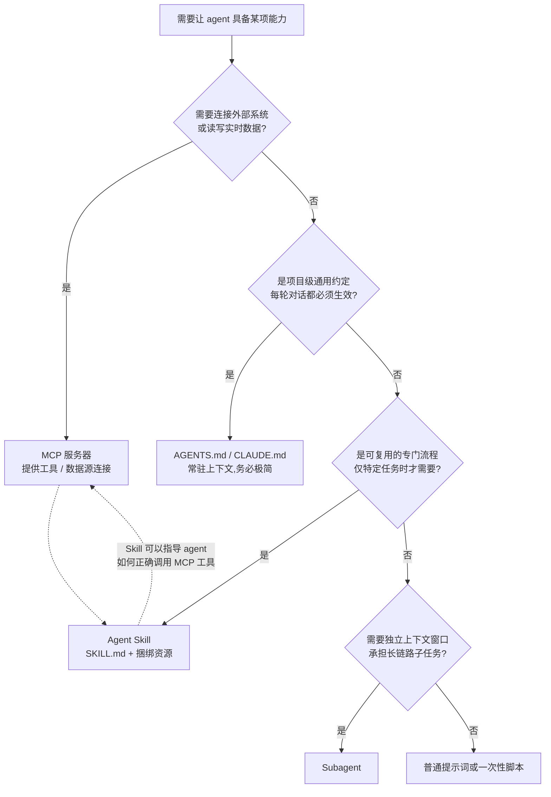
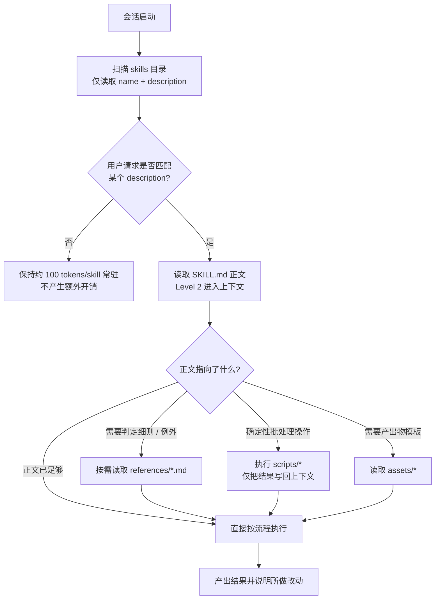

[toc]


## 先看结论

- **Skill 的本质是"按需加载的专业知识包"**:一个目录 + 一个 `SKILL.md`,靠 **YAML frontmatter 的 `name` 与 `description` 两个必填字段**被发现,靠正文被执行。
- **写 `SKILL.md` 的 80% 功力花在 `description` 上**:它决定 agent 在上百个 skill 中**选不选中你**;正文再好,选不中等于零。
- **按"渐进式披露"(Progressive Disclosure)分层写**:元数据常驻(约 100 tokens)→ 正文触发时加载(建议 **5k tokens / 500 行**以内)→ 细则与脚本按需读取。
- **确定性操作写成脚本,不要写成"让模型照着做"的散文**:脚本输出结果回上下文,比模型逐行手工操作更省 token、更可靠。
- **必须做 CI 静态校验**:`name` 合法性、引用文件存在性、正文行数、编码与换行——这些错误 100% 可机器拦截。
- **跨平台与中文环境是中文团队的高频坑**:UTF-8 无 BOM、LF 换行、相对路径、正则 `\b` 对 CJK 失效。

---

## Skill 是什么,解决什么问题

Agent 的上下文窗口是稀缺资源。把"如何写公司财报""如何填 PDF 表单""如何做中文排版审校"这类专业流程全部塞进系统提示词,会出现三个问题:**常驻成本高、互相干扰、无法复用与版本化**。

Agent Skills 的解法是把流程**外置到文件系统**,只让元数据常驻。官方文档描述的机制是:当请求匹配到某个 Skill 的 description 时,Claude 使用 bash 从文件系统读取 `SKILL.md`,把指令载入上下文;若正文引用了其他文件(如 `FORMS.md`、`REFERENCE.md`),再用额外的读取操作把它们取进来([Agent Skills 概览](https://platform.claude.com/docs/en/agents-and-tools/agent-skills/overview))。

规范本身是**开放标准**:官方仓库 `anthropics/skills` 中的 `spec/agent-skills-spec.md` 只是一个指针,**权威规范托管在 agentskills.io**,仓库自身提供参考实现与 `template/` 模板([DeepWiki 对 anthropics/skills 的结构梳理](https://deepwiki.com/anthropics/skills/6.1-agent-skills-specification))。这意味着同一份 `SKILL.md` 具备跨工具可移植性:第三方框架如 [AgentScope](https://doc.agentscope.io/tutorial/task_agent_skill.html) 与 [PraisonAI](https://docs.praison.ai/docs/features/skills) 均已声明支持该格式,后者还声称兼容 `.claude/skills/`、`.github/skills/` 等目录约定(**第三方声明,未经官方页核实**)。

### 什么时候该写 Skill,什么时候不该

能力承载方式有多种,选错会让 `SKILL.md` 变成四不像。下图是选型决策(**本图承载分支判断,无法用线性列表表达**):



**关键辨析:Skill 与 MCP 不是竞争关系。** MCP 解决"**能不能连上**"(连接能力),Skill 解决"**连上之后怎么做对**"(程序性知识)。有第三方专门撰文对比了 Agent Skill、MCP 服务器、`AGENTS.md`、Subagent 与 Hook 的分工边界([Agent Skills Explained: SKILL.md vs MCP](https://www.alekseialeinikov.com/en/blog/topics/ai/agent-skills-explained-skill-md-vs-mcp)),该文指出的"<cite>约 100 tokens 常驻直到被需要</cite>"与官方描述一致。

---

## 规范正本:目录结构与 frontmatter

### 目录结构

一个 skill 最小形态就是**一个目录 + 一个 `SKILL.md`**。[agentskills.io 规范](https://agentskills.io/specification)给出的结构为:

- `skill-name/` —— 目录名建议与 `name` 字段**完全一致**
  - `SKILL.md` —— **必需**,元数据 + 指令
  - `scripts/` —— 可选,可执行代码
  - `references/` —— 可选,按需读取的细则文档
  - `assets/` —— 可选,模板、样式、字体等非文本资产(命名为业界通行惯例,**具体目录名非强制**)

### frontmatter 字段表

`SKILL.md` **必须**由 YAML frontmatter 开头,紧随 Markdown 正文。下表字段依据 agentskills.io 规范摘要整理:

| 字段            | 必填   | 类型   | 作用与写法要点                                               |
| --------------- | ------ | ------ | ------------------------------------------------------------ |
| `name`          | **是** | 字符串 | skill 的唯一标识符。**只用小写字母、数字、连字符**(kebab-case);**不得包含保留词 `anthropic`、`claude`**;建议与目录名一致。长度上限 **64 字符 (未核实)** |
| `description`   | **是** | 字符串 | **同时写清"做什么"与"何时用"**,是 skill 被选中的唯一依据。长度上限 **1024 字符 (未核实)** |
| `license`       | 否     | 字符串 | 声明该 skill 适用的许可证(如 `Apache-2.0`),分发时建议写      |
| `allowed-tools` | 否     | 字符串 | **空格分隔**的预授权工具列表,用于收窄该 skill 可用的工具面。不同实现的分隔符与工具名可能有差异,**跨平台分发前需按目标实现核验** |
| `compatibility` | 否     | 映射   | 声明特定环境要求。规范明确指出"**大多数 skill 不需要此字段**",写了反而降低可移植性 |
| `metadata`      | 否     | 映射   | 存放规范未定义的自定义属性;规范提示**各 agent 实现对该字段的支持程度不一** |

**字段辨析与常见误解:**

- **`name` vs 目录名**:规范允许不同,但不一致会让人工检索与排错困难,**应该强制一致**并在 CI 中校验。
- **`description` vs 正文**:官方最佳实践明确二者分工——description 必须提供足够细节让 Claude 判断何时选中这个 Skill,而 `SKILL.md` 的其余部分负责实现细节([Skill authoring best practices](https://platform.claude.com/docs/en/agents-and-tools/agent-skills/best-practices))。**不要把实现步骤写进 description,也不要指望正文帮你争取触发机会。**
- **`version`、`depends_on` 等字段**:我在检索中见到有第三方文章(如 [DEV Community 的一篇解读](https://dev.to/miaoshuyo/understanding-anthropic-agent-skills-from-skillmd-to-real-file-generation-31ck))描述 `SKILL.md` 含 `version`、`depends_on` 等字段。**这些字段未出现在 agentskills.io 的必填/可选字段说明中**,属于第三方扩展或该文的推测,**不要当作标准写法**;确需版本信息请放进 `metadata` 并自行约定。
- **同一来源里的数字别轻信**:我还见到某篇指南称该标准已被"16+ 工具采纳、仓库 85000+ stars、被 OpenAI/Google/Microsoft 采纳"([Anthropic Skills 指南](https://faycalazib.com/blog/anthropic-skills-complete-guide))。**这些数字只有单一来源、我未能二次核验,本文不作为事实采信**,仅记录为待核线索。

### 最小可用骨架

```markdown
---
name: invoice-extract
description: 从 PDF 发票中提取开票方、金额、税号与开票日期并汇总为 CSV。当用户提到发票、报销单、扫描件入账或需要批量抽取 PDF 中的结构化字段时使用。
license: Apache-2.0
allowed-tools: Read Bash Glob
---

# PDF 发票字段提取

## 何时适用
...

## 工作流程
1. ...
```

---

## 渐进式披露:三层加载模型

这是整份规范最核心的设计理念,也是**决定你如何切分内容**的唯一依据。

| 层级               | 加载时机                           | 体量约束                                    | 内容                                       |
| ------------------ | ---------------------------------- | ------------------------------------------- | ------------------------------------------ |
| **Level 1 元数据** | 会话启动时,**所有 skill 全部加载** | 每个 skill **约 100 tokens**                | frontmatter 的 `name` 与 `description`     |
| **Level 2 指令**   | skill 被触发时                     | 建议 **5k tokens 以内**,正文 **500 行以内** | `SKILL.md` 正文:流程、规则、边界           |
| **Level 3 资源**   | 正文引用到时才读/执行              | 无硬上限,但单文件要可独立消化               | `references/*.md`、`scripts/*`、`assets/*` |

Level 1 与 Level 2 的量化约束来自官方文档([概览](https://platform.claude.com/docs/en/agents-and-tools/agent-skills/overview));"**正文保持在 500 行以内以获得最佳表现**"是官方最佳实践页反复强调的硬指标([best practices](https://platform.claude.com/docs/en/agents-and-tools/agent-skills/best-practices));规范页同样提示:**agent 一旦激活 skill 就会加载整个 `SKILL.md`,过长的内容应拆分到被引用的文件中**([规范](https://agentskills.io/specification))。



**由此导出的切分原则:**

- **必须**把"每次都要用"的内容放正文,把"偶尔才查"的内容放 `references/`。
- **必须**让正文像**目录页**:官方的比喻是 `SKILL.md` 充当概览,像新人手册的目录一样指向详细材料。
- **应该**让每个 `references/` 文件**自包含**:agent 可能只读其中一个,不要互相"接龙"式依赖。
- **避免**把完整 API 文档、长表格、历史变更日志塞进正文——这是最常见的 token 浪费来源。
- **避免**层层嵌套引用(正文 → A.md → B.md → C.md),每跳一次都增加读取失败与遗漏的概率,**引用深度建议不超过 2 层**。

---

## `description` 写作:触发工程

把 `description` 当成**检索关键词 + 路由规则**来写,而不是营销文案。

### 必须包含的两段式结构

**`description` = 能力声明(做什么) + 触发条件(何时用)。**

| 评价 | 示例                                                         | 问题                                                     |
| ---- | ------------------------------------------------------------ | -------------------------------------------------------- |
| 差   | `处理 PDF 文件`                                              | 没有触发条件;与任何 PDF 相关 skill 冲突;模型无法判断边界 |
| 差   | `这个技能可以帮助你高效地完成各种文档任务,非常强大`          | 全是形容词,零信息量                                      |
| 合格 | `从 PDF 中提取文本与表格、填写表单域、合并与拆分页面。当用户提到 PDF、扫描件、表单填写或需要从 PDF 抽取数据时使用。` | 能力具体,触发词明确                                      |
| 更好 | 在上一行基础上追加 `不适用于图片 OCR(请用 ocr-image skill)。` | **显式划界**,减少与邻近 skill 的误触发                   |

### 写作规则清单

- **必须**用**第三人称陈述句**描述 skill 本身(`从 X 提取 Y…`),**避免**写成 `你是一个专业的…` 这类人格设定——人格设定属于正文或系统提示词,放在 description 里会污染路由判断。
- **必须**把**用户真实会说的词**写进去,包括**中英文双语触发词**与同义词。中文用户会说"审校""校对""体例检查",英文场景会说 "lint"、"proofread",**都写上**,这是中文团队最容易漏的一点。
- **应该**在存在多个相邻 skill 时写明**排除条件**("不处理 X,X 请用 Y")。
- **应该**控制在 **2~4 句**,信息密度高于长度。
- **可以**把典型文件类型、命令、产品名作为触发锚点(`.xlsx`、`docker compose`、`飞书多维表格`)。
- **避免**使用时间敏感措辞("最新版""2025 年起"),这类表述会随时间变成错误信息,且对触发毫无帮助。
- **避免**与团队内其他 skill 的 description 高度重叠;重叠时**应该**合并为一个 skill,或用排除条款切开。

---

## 正文写作:从散文到可执行流程

### 推荐的正文骨架

```markdown
# <人类可读的标题>

## 适用范围
（一句话说明覆盖什么、明确不覆盖什么）

## 前置条件
（需要的工具、环境变量、输入形态;缺失时如何提示用户）

## 工作流程
1. 第一步……
2. 运行 `python3 scripts/xxx.py <参数>`（确定性步骤外包给脚本）
3. 若出现 A 情况 → ……；若出现 B 情况 → 参见 `references/edge-cases.md`
4. 产出：按 `assets/report-template.md` 生成报告

## 约束与红线
- 绝不修改……
- 单次处理上限……

## 常见失败与处理
| 现象 | 原因 | 处理 |
```

### 自由度分级:决定你写散文还是写代码

根据任务的确定性程度选择表达形式,这是写正文时最该先想清楚的事:

| 任务确定性                   | 表达形式                        | 适用场景                       | 示例                                                 |
| ---------------------------- | ------------------------------- | ------------------------------ | ---------------------------------------------------- |
| **高**(每次操作完全一致)     | **直接给脚本**,正文只写调用方式 | 格式转换、批量重命名、字段抽取 | `python3 scripts/lint_zh_doc.py docs/ --format json` |
| **中**(流程固定、判断需语境) | **编号流程 + 判定分支**         | 代码评审、文档审校、工单分类   | "若告警数 > 50,先输出聚类摘要请用户确认再修改"       |
| **低**(高度依赖具体情境)     | **给原则、给范例、给反例**      | 文案风格、架构权衡             | "优先保证可回滚性;下列三种写法各自的取舍为……"        |

**对应的硬性建议:**

- **必须**把高确定性步骤写成脚本。让模型逐行"目测"替换标点,既烧 token 又不可复现。
- **必须**在正文中给出**脚本的精确调用方式与关键参数含义**,否则 agent 会自行猜测参数。
- **应该**用**祈使句 + 编号**,而不是"你可以考虑……"这类模糊措辞;模糊措辞会被模型当作可选项跳过。
- **应该**明确**冲突仲裁规则**("本 skill 的约束优先于仓库 `AGENTS.md` 中的通用风格")。
- **可以**在正文中内嵌 3~5 行的最小示例,超过这个长度就移到 `references/examples.md`。
- **避免**在正文中写入**易变信息**:版本号、价格、URL 以外的在线状态、"目前只支持 X"。易变信息**应该**集中到一个 `references/` 文件,便于单点维护。
- **避免**写"注意安全""请小心"这类无法执行的空话,改写成可检查的红线("禁止对 `.git/` 下的文件做写操作")。

---

## 捆绑资源:`scripts` / `references` / `assets`

| 目录          | 内容性质                     | 进入上下文的方式                  | 写作要点                                                     |
| ------------- | ---------------------------- | --------------------------------- | ------------------------------------------------------------ |
| `scripts/`    | 可执行代码                   | **通常不进上下文**,只有执行结果进 | 必须有 shebang 与 `--help`;退出码要有语义;输出支持机器可读格式 |
| `references/` | 规则细则、API 速查、边界案例 | agent 读取后**全文进上下文**      | 单文件控制在可消化范围;加小标题便于定位;表格优于长段落       |
| `assets/`     | 模板、样板文件、字体、样式   | 一般被脚本或产出物消费            | 用占位符而非示意文字;注明编码与换行要求                      |

**引用写法规则:**

- **必须使用相对路径**(`references/style-rules.md`),**绝不使用绝对路径**——skill 会被安装到不同位置。
- **应该**在引用处说明**读取条件**("仅当需要判断某条告警是否误报时再读取"),否则 agent 倾向于一次性把所有引用文件全读进来,渐进式披露当场失效。
- **应该**让脚本**自解释**:`--help` 完整、参数名直观,减少正文中的重复说明。
- **避免**在 `scripts/` 中引入需要联网安装的重依赖;**国内与离线环境会直接失败**,优先用标准库。

---

## 综合示例:`zh-doc-lint`(已在沙箱实跑验证)

下面这个例子把前文所有要点串成一个真实可用的 skill:**中文技术文档体例检查**。它覆盖了渐进式披露分层、确定性步骤脚本化、`allowed-tools` 收窄、跨平台编码/换行处理、以及中文正则的真实陷阱。

**我实际执行并通过的验证:** `python3 -m py_compile` 语法检查通过;对构造的问题文档跑出 4 类告警;`--fix` 输出符合预期且代码块/行内代码/URL 未被误改;CRLF 文件修复后换行风格被保留(用 `file` 与 `cat -A` 确认)。

### 目录结构

- `zh-doc-lint/`
  - `SKILL.md`
  - `scripts/lint_zh_doc.py`
  - `references/style-rules.md`
  - `assets/report-template.md`

### `SKILL.md`

```markdown
---
name: zh-doc-lint
description: 检查并修复中文技术文档的体例问题（中英文混排空格、全半角标点、术语与大小写一致性、Markdown 结构）。当用户要求"审校/校对/lint 中文文档、统一排版风格、提交前检查 README 或 docs 目录"时使用。
license: Apache-2.0
allowed-tools: Read Grep Glob Bash
---

# 中文技术文档体例检查

## 适用范围

对 `.md` / `.mdx` 文件做体例检查并输出可执行的修改建议。不负责事实校对与翻译。

## 工作流程

1. 确认检查范围：用户给定路径；未给定时检查仓库内 `README.md` 与 `docs/**/*.md`。
2. 运行检查脚本（确定性步骤，不要用模型逐行"目测"）：
   `python3 scripts/lint_zh_doc.py <路径...> --format json`
3. 读取脚本输出的问题列表，按规则 ID 聚类。
4. 规则含义与例外情况见 `references/style-rules.md`，仅在需要判断某条告警是否误报时再读取该文件。
5. 自动修复：对支持自动修复的规则（`SPACE_CJK_LATIN`、`FULLWIDTH_PUNCT`）运行
   `python3 scripts/lint_zh_doc.py <路径...> --fix`；其余规则给出建议，由用户确认。
6. 按 `assets/report-template.md` 生成审校报告。

## 约束

- 代码块、行内代码、URL、YAML frontmatter 内的内容一律不改写。
- 文件一律以 UTF-8 无 BOM 读写，保留原换行风格（LF/CRLF）。
- 单次修改不超过 20 个文件；超出时先输出清单请用户确认。
```

**这份正文为什么合格:** 范围与非范围各一句;**把逐行判断交给脚本**而不是模型;**明确告诉 agent 何时才读 `references/`**;红线可机器检查;正文仅 20 余行,远低于 500 行上限。

### `references/style-rules.md`(节选)

```markdown
| 规则 ID | 含义 | 可自动修复 | 常见例外 |
| --- | --- | --- | --- |
| `SPACE_CJK_LATIN` | 中文与西文/数字之间缺少空格 | 是 | 商标写法、已约定俗成的专名 |
| `FULLWIDTH_PUNCT` | 中文句子中误用半角标点 | 是 | 代码、命令行、版本号 |
| `TERM_CASE` | 术语大小写不一致（如 Github / GitHub） | 否 | 引用原文标题时保留原样 |
| `HEADING_NUM` | 标题带手工编号 | 否 | 规范条款类文档 |
```

### `scripts/lint_zh_doc.py`

```python
#!/usr/bin/env python3
"""中文技术文档体例检查器（供 zh-doc-lint skill 调用）。

用法:
    python3 lint_zh_doc.py <path>... [--format text|json] [--fix]

退出码: 0 无问题; 1 发现问题; 2 用法或 IO 错误。
"""
from __future__ import annotations

import argparse
import json
import re
import sys
from pathlib import Path

CJK = r"\u4e00-\u9fff\u3040-\u30ff"
RE_CJK_LATIN = re.compile(rf"(?<=[{CJK}])([A-Za-z0-9])")
RE_LATIN_CJK = re.compile(rf"([A-Za-z0-9])(?=[{CJK}])")
RE_HALF_PUNCT = re.compile(rf"(?<=[{CJK}])([,;:!?])(?=\s|$|[{CJK}])")
RE_HEADING_NUM = re.compile(r"^#{1,6}\s+\d+(\.\d+)*[\.、]?\s+")
RE_INLINE_CODE = re.compile(r"`[^`]*`")
RE_URL = re.compile(r"https?://\S+")

HALF2FULL = {",": "，", ";": "；", ":": "：", "!": "！", "?": "？"}
TERMS = {"github": "GitHub", "javascript": "JavaScript", "linux": "Linux",
         "markdown": "Markdown", "python": "Python"}


def mask(line: str) -> str:
    """把行内代码与 URL 替换成等长占位符，避免在其中误报。"""
    line = RE_INLINE_CODE.sub(lambda m: "\x00" * len(m.group(0)), line)
    return RE_URL.sub(lambda m: "\x00" * len(m.group(0)), line)


def iter_body(text: str):
    """产出 (行号, 原始行, 是否可检查)，跳过 frontmatter 与围栏代码块。"""
    lines = text.split("\n")
    in_fence = False
    in_front = False
    for i, line in enumerate(lines, 1):
        if i == 1 and line.strip() == "---":
            in_front = True
            yield i, line, False
            continue
        if in_front:
            if line.strip() == "---":
                in_front = False
            yield i, line, False
            continue
        if line.lstrip().startswith("```"):
            in_fence = not in_fence
            yield i, line, False
            continue
        yield i, line, not in_fence


def check_line(lineno: int, line: str) -> list[dict]:
    issues: list[dict] = []
    probe = mask(line)
    if RE_CJK_LATIN.search(probe) or RE_LATIN_CJK.search(probe):
        issues.append({"line": lineno, "rule": "SPACE_CJK_LATIN",
                       "message": "中西文之间缺少空格", "fixable": True})
    if RE_HALF_PUNCT.search(probe):
        issues.append({"line": lineno, "rule": "FULLWIDTH_PUNCT",
                       "message": "中文语境中使用了半角标点", "fixable": True})
    if RE_HEADING_NUM.match(line):
        issues.append({"line": lineno, "rule": "HEADING_NUM",
                       "message": "标题包含手工编号", "fixable": False})
    for low, good in TERMS.items():
        # 注意: 不能用 \b，中文字符也属于 \w，"github上" 不会产生词边界
        for m in re.finditer(rf"(?<![A-Za-z]){low}(?![A-Za-z])", probe, flags=re.IGNORECASE):
            if m.group(0) != good:
                issues.append({"line": lineno, "rule": "TERM_CASE",
                               "message": f"术语写法建议改为 {good}", "fixable": False})
    return issues


def fix_line(line: str) -> str:
    """只修复可确定性修复的两类问题，且不触碰行内代码与 URL。"""
    spans = [m.span() for m in RE_INLINE_CODE.finditer(line)]
    spans += [m.span() for m in RE_URL.finditer(line)]

    def protected(idx: int) -> bool:
        return any(s <= idx < e for s, e in spans)

    out = []
    for idx, ch in enumerate(line):
        if protected(idx):
            out.append(ch)
            continue
        prev = line[idx - 1] if idx else ""
        if ch in HALF2FULL and re.match(rf"[{CJK}]", prev or " "):
            out.append(HALF2FULL[ch])
            continue
        if re.match(r"[A-Za-z0-9]", ch) and re.match(rf"[{CJK}]", prev or " "):
            out.append(" " + ch)
            continue
        if re.match(rf"[{CJK}]", ch) and re.match(r"[A-Za-z0-9]", prev or " "):
            out.append(" " + ch)
            continue
        out.append(ch)
    return "".join(out)


def process(path: Path, do_fix: bool) -> list[dict]:
    raw = path.read_bytes()
    if raw.startswith(b"\xef\xbb\xbf"):
        raw = raw[3:]
    newline = "\r\n" if b"\r\n" in raw else "\n"
    text = raw.decode("utf-8").replace("\r\n", "\n")

    issues, fixed = [], []
    for lineno, line, checkable in iter_body(text):
        if checkable:
            found = check_line(lineno, line)
            for it in found:
                it["file"] = str(path)
            issues.extend(found)
            fixed.append(fix_line(line) if do_fix and any(i["fixable"] for i in found) else line)
        else:
            fixed.append(line)

    if do_fix:
        path.write_bytes(newline.join(fixed).encode("utf-8"))
    return issues


def main(argv: list[str]) -> int:
    ap = argparse.ArgumentParser(description="中文技术文档体例检查")
    ap.add_argument("paths", nargs="+", help="文件或目录")
    ap.add_argument("--format", choices=["text", "json"], default="text")
    ap.add_argument("--fix", action="store_true", help="仅自动修复可确定性修复的规则")
    args = ap.parse_args(argv)

    targets: list[Path] = []
    for p in map(Path, args.paths):
        if p.is_dir():
            targets.extend(sorted(p.rglob("*.md")))
        elif p.is_file():
            targets.append(p)
        else:
            print(f"路径不存在: {p}", file=sys.stderr)
            return 2

    all_issues: list[dict] = []
    for t in targets:
        all_issues.extend(process(t, args.fix))

    if args.format == "json":
        print(json.dumps({"file_count": len(targets), "issues": all_issues},
                         ensure_ascii=False, indent=2))
    else:
        for it in all_issues:
            print(f"{it['file']}:{it['line']}: [{it['rule']}] {it['message']}")
        print(f"检查 {len(targets)} 个文件，发现 {len(all_issues)} 处问题。")
    return 1 if all_issues else 0


if __name__ == "__main__":
    sys.exit(main(sys.argv[1:]))
```

**实跑结果(沙箱真实输出):**

对一份含问题的测试文档,脚本报出:

- 第 1 行 `[HEADING_NUM] 标题包含手工编号`
- 第 3 行 `[SPACE_CJK_LATIN] 中西文之间缺少空格`
- 第 3 行 `[FULLWIDTH_PUNCT] 中文语境中使用了半角标点`
- 第 3 行 `[TERM_CASE] 术语写法建议改为 GitHub`

`--fix` 后,`使用Python3运行脚本,注意github上的依赖.` 变为 `使用 Python3 运行脚本，注意 github 上的依赖.`;**代码块内的 `echo "中文and英文"`、行内代码 `` `pip install requests` `` 与 URL 均未被改动**;CRLF 文件修复后仍为 CRLF。

**这个例子暴露的真实陷阱(第一版代码就踩了):** 术语检查最初写成 `\bgithub\b`,对 `github上的依赖` **完全不触发**——因为 Python 正则中**中文字符也属于 `\w`**,`b` 与 `上` 之间不存在词边界。改用 `(?<![A-Za-z])github(?![A-Za-z])` 后才正确报出。**凡是处理中文的脚本,都要用非 ASCII 样例做验证,不能只拿英文样例测。**

---

## 工程化:校验、分发与评估

### CI 静态校验器(已在沙箱实跑)

`SKILL.md` 的多数低级错误可以 100% 被机器拦截,**应该**在 pre-commit 或 CI 中强制执行:

```python
#!/usr/bin/env python3
"""Agent Skill 目录静态校验器（可直接放进 CI）。

用法:
    python3 validate_skill.py <skill_dir>...

退出码: 0 全部通过（可能有 warning）; 1 存在 error; 2 用法错误。
"""
from __future__ import annotations

import re
import sys
from pathlib import Path

import yaml

NAME_RE = re.compile(r"^[a-z0-9]+(-[a-z0-9]+)*$")
NAME_MAX = 64            # 未逐字核实的上限，按团队口径可调
DESC_MAX = 1024
BODY_MAX_LINES = 500
RESERVED = ("anthropic", "claude")
KNOWN_KEYS = {"name", "description", "license", "allowed-tools",
              "compatibility", "metadata", "version"}
WHEN_HINTS = ("when", "use when", "当", "用于", "适用")
LINK_RE = re.compile(r"\[[^\]]*\]\(([^)]+)\)")
PATH_RE = re.compile(r"`((?:scripts|references|assets)/[^`]+)`")


def split_front_matter(text: str):
    if not text.startswith("---"):
        return None, text
    end = text.find("\n---", 3)
    if end == -1:
        return None, text
    return text[3:end].strip("\n"), text[end + 4:]


def check(skill_dir: Path) -> tuple[list[str], list[str]]:
    errors: list[str] = []
    warnings: list[str] = []
    md = skill_dir / "SKILL.md"
    if not md.is_file():
        return [f"{skill_dir}: 缺少 SKILL.md"], warnings

    raw = md.read_bytes()
    if raw.startswith(b"\xef\xbb\xbf"):
        errors.append("SKILL.md 带 UTF-8 BOM，应保存为无 BOM")
    if b"\r\n" in raw:
        warnings.append("SKILL.md 使用 CRLF 换行，跨平台协作建议统一为 LF")
    try:
        text = raw.decode("utf-8")
    except UnicodeDecodeError:
        return [f"{skill_dir}/SKILL.md 不是合法 UTF-8"], warnings

    head, body = split_front_matter(text)
    if head is None:
        return [f"{skill_dir}/SKILL.md 缺少 YAML frontmatter"], warnings
    try:
        meta = yaml.safe_load(head) or {}
    except yaml.YAMLError as exc:
        return [f"{skill_dir}/SKILL.md frontmatter 不是合法 YAML: {exc}"], warnings
    if not isinstance(meta, dict):
        return [f"{skill_dir}/SKILL.md frontmatter 必须是映射"], warnings

    name, desc = meta.get("name"), meta.get("description")
    if not name:
        errors.append("缺少必填字段 name")
    else:
        if not NAME_RE.match(str(name)):
            errors.append(f"name 非法: {name!r}（只允许小写字母、数字、连字符）")
        if len(str(name)) > NAME_MAX:
            errors.append(f"name 超过 {NAME_MAX} 字符")
        if any(w in str(name).lower() for w in RESERVED):
            errors.append(f"name 含保留词 {RESERVED}")
        if str(name) != skill_dir.name:
            warnings.append(f"name({name}) 与目录名({skill_dir.name}) 不一致")
    if not desc:
        errors.append("缺少必填字段 description")
    else:
        if len(str(desc)) > DESC_MAX:
            errors.append(f"description 超过 {DESC_MAX} 字符")
        if not any(h in str(desc).lower() for h in WHEN_HINTS):
            warnings.append("description 似乎未写明“何时使用”，可能影响触发准确率")

    for k in meta:
        if k not in KNOWN_KEYS:
            warnings.append(f"未知 frontmatter 字段: {k}")

    body_lines = body.strip("\n").split("\n")
    if len(body_lines) > BODY_MAX_LINES:
        errors.append(f"SKILL.md 正文 {len(body_lines)} 行，超过建议上限 {BODY_MAX_LINES}")

    refs = set(LINK_RE.findall(body)) | set(PATH_RE.findall(body))
    for ref in refs:
        if ref.startswith(("http://", "https://", "#")):
            continue
        if ref.startswith("/"):
            warnings.append(f"引用使用绝对路径，不可移植: {ref}")
            continue
        target = ref.split()[0].split("#")[0]
        if not (skill_dir / target).exists():
            errors.append(f"SKILL.md 引用的文件不存在: {target}")

    for script in (skill_dir / "scripts").glob("*"):
        if script.suffix in {".py", ".sh"} and not script.read_bytes().startswith(b"#!"):
            warnings.append(f"{script.name} 缺少 shebang")
    return errors, warnings


def main(argv: list[str]) -> int:
    if not argv:
        print(__doc__)
        return 2
    failed = False
    for d in map(Path, argv):
        errs, warns = check(d)
        print(f"[{'FAIL' if errs else 'PASS'}] {d}")
        for e in errs:
            print(f"  error  : {e}")
        for w in warns:
            print(f"  warning: {w}")
        failed |= bool(errs)
    return 1 if failed else 0


if __name__ == "__main__":
    sys.exit(main(sys.argv[1:]))
```

**实跑输出(对前述正例与一个故意写坏的反例):**

- `[PASS] zh-doc-lint`
- `[FAIL] bad-skill`,报出 `name 非法: 'Claude_PDF Helper'`、`name 含保留词`、`缺少必填字段 description`、`SKILL.md 引用的文件不存在: references/missing.md`,外加目录名不一致与未知字段 `foo` 两条 warning,退出码 `1`。

**注意:** 校验器中的 `NAME_MAX = 64` 与 `DESC_MAX = 1024` 来自我的训练知识 **(未核实)**,请按 agentskills.io 规范正文校准后再上线;`BODY_MAX_LINES = 500` 与保留词规则则有官方文档摘要支撑。

### 安装位置与作用域

以下路径约定来自第三方实现文档与我的训练知识,**未经官方页正文核实**:

| 作用域   | 典型路径                                   | 适用场景                       |
| -------- | ------------------------------------------ | ------------------------------ |
| 项目级   | `.claude/skills/<name>/SKILL.md`           | 随仓库版本化,团队共享;**首选** |
| 用户级   | `~/.claude/skills/<name>/SKILL.md`         | 个人习惯类 skill,不进仓库      |
| 其他实现 | `.github/skills/`、`./.praison/skills/` 等 | 跨工具移植时按目标实现文档确认 |

PraisonAI 文档同时提供了 `skills list`、`skills validate`、`skills create` 这类命令行子命令([PraisonAI Skills 文档](https://docs.praison.ai/docs/features/skills)),可作为**第三方实现**的参考;Claude 侧的 API 上传与插件市场分发机制**本轮未能核实,不展开**。

### 测试与评估

- **必须**在**干净会话**中测试触发:只说用户的自然语言(含中文),看 skill 是否被选中。**不要**在测试时手动点名 skill,那无法验证 `description`。
- **应该**建立**最小评估集**:5~10 条应触发的请求 + 3~5 条**不应触发**的近似请求(防误触发),每次修改 `description` 后回归跑一遍。
- **应该**在真实仓库数据上跑一次完整流程,确认脚本的边界处理(空文件、超大文件、非 UTF-8 文件)。
- **可以**用 `skill-creator` 这类官方提供的脚手架 skill 起步 **(未核实其当前形态)**,但**不要**把生成的样板直接发布,样板的 `description` 几乎总是太泛。

---

## 跨平台与中文环境的坑

| 坑               | 表现                                                         | 处置                                                         |
| ---------------- | ------------------------------------------------------------ | ------------------------------------------------------------ |
| **换行风格**     | Windows 编辑后 `SKILL.md` 变 CRLF,脚本在 `*nix` 上 `\r` 被当内容 | 仓库加 `.gitattributes`:`* text=auto eol=lf`;脚本读写时显式处理 `\r\n` |
| **BOM**          | `SKILL.md` 带 BOM 导致 frontmatter 的首行 `---` 不被识别     | 保存为 **UTF-8 无 BOM**;CI 中拦截(见上文校验器)              |
| **路径分隔符**   | 正文写 `references\style.md` 在 Linux 失效                   | 一律用 `/`,脚本内用 `pathlib.Path`                           |
| **脚本可执行位** | Windows 检出的文件丢失 `+x`,`./scripts/x.sh` 报权限错误      | 正文中**显式写成 `python3 scripts/x.py`**,不依赖可执行位     |
| **正则词边界**   | `\bgithub\b` 对 `github上` 不触发(CJK 属于 `\w`)             | 改用显式前后断言 `(?<![A-Za-z])…(?![A-Za-z])`                |
| **控制台编码**   | Windows `cmd` 默认 GBK,脚本打印中文乱码                      | 脚本输出用 `--format json` + 文件落盘;必要时 `PYTHONIOENCODING=utf-8` |
| **全角字符对齐** | 终端表格用中文时列宽错乱                                     | 输出结构化数据交给 agent 渲染,不要在脚本里手工对齐           |
| **大小写敏感**   | macOS 默认大小写不敏感,`Skill.md` 在 Linux 上找不到          | 文件名**必须**严格写作 `SKILL.md`                            |

**网络环境提示:** 官方 skills 仓库与规范站点位于境外,国内直连拉取可能不稳定。常见做法是用镜像/代理前缀包裹 GitHub 链接(如 `gh-proxy` 一类服务),或在本地代理(如 mihomo)下操作;`*nix` 侧通过 `http_proxy`/`https_proxy` 环境变量或 `git config --global http.proxy` 配置,Windows 侧 PowerShell 用 `$env:HTTPS_PROXY`(注意该变量名在正文中需以内联代码书写,避免被误解析)。**这些加速服务的当前可用性我本轮无法联网核实,请自行验证后再写进团队文档。** 更稳妥的做法是:**让 skill 的脚本只依赖标准库**,从源头避免运行时联网安装。

---

## 安全与权限

- **必须**把第三方 skill 视为**可执行代码 + 可注入指令**:安装前通读 `SKILL.md` 与 `scripts/`,重点看是否有外发网络请求、读取 `~/.ssh`、`.env` 等行为。
- **必须**用 `allowed-tools` 收窄工具面:只读型 skill 不要授予写入或 Bash 权限。
- **绝不**在 `SKILL.md` 或捆绑文件中写入**密钥、令牌、内网地址**;这些内容会随 skill 分发并进入上下文。
- **应该**警惕**间接提示注入**:如果 `references/` 的内容来自抓取的外部网页,其中可能包含恶意指令;对外部来源的资料**应该**人工审核后入库。
- **应该**在正文中写明**破坏性操作的确认点**("删除文件前必须列出清单并等待用户确认")。
- **可以**在团队内建立 skill 的 **CODEOWNERS 与评审流程**,与普通代码同等对待。

---

## 反模式清单

| 反模式                   | 为什么有害                         | 正确做法                                         |
| ------------------------ | ---------------------------------- | ------------------------------------------------ |
| 把 skill 写成"万能助手"  | description 泛化,触发不准,正文臃肿 | **一个 skill 一个职责**,职责边界写进 description |
| 正文塞满完整 API 文档    | 每次触发都烧掉数千 token           | 移入 `references/`,正文只放索引                  |
| 让模型逐行执行确定性操作 | 慢、贵、不可复现                   | 写成脚本,正文只写调用方式                        |
| description 写成营销语   | 模型无法据此路由                   | 能力 + 触发条件两段式                            |
| 正文写"最新版本已支持 X" | 时效信息很快失真                   | 去掉时间限定,或集中到单一可维护文件              |
| 引用绝对路径             | 换机器即失效                       | 一律相对路径                                     |
| 层层嵌套引用             | 读取链条长,易遗漏                  | 引用深度 ≤ 2 层,文件自包含                       |
| 不写失败处理             | agent 遇错自由发挥                 | 列出常见失败现象与处置                           |
| 发布前不做干净会话测试   | 永远不知道触发率有多差             | 建最小评估集回归                                 |

---

## 交付前检查清单

**结构与格式**

- `SKILL.md` 文件名大小写正确,UTF-8 无 BOM,LF 换行
- frontmatter 是合法 YAML,`name` 与 `description` 齐备
- `name` 为 kebab-case、无保留词、与目录名一致
- 正文 **500 行以内**,整体控制在 **5k tokens 以内**

**内容质量**

- `description` 含"做什么 + 何时用",带中英文触发词,必要时含排除条款
- 流程为编号祈使句,分支条件明确,含失败处理
- 确定性步骤已脚本化,正文给出精确调用命令
- 引用全部为相对路径且文件存在,并写明读取条件
- 无密钥、无时效性易变信息、无绝对路径

**验证**

- 校验器通过(无 error)
- 脚本 `py_compile` / 语法检查通过,并在**含非 ASCII 的样例**上实跑过
- 干净会话中用自然语言成功触发,且近似请求**不会**误触发

---

