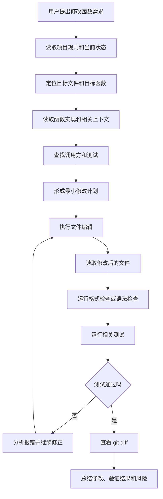
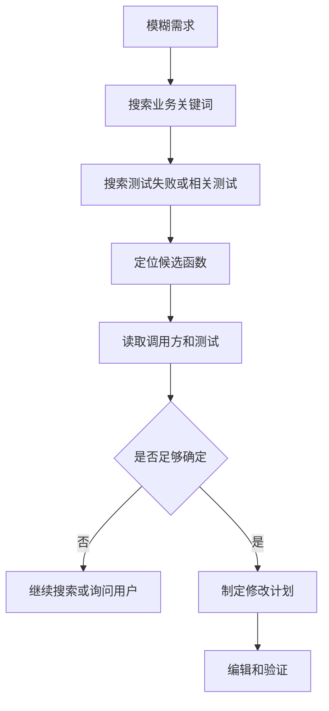

[toc]


下面以“修改一个 Python 脚本文件中的某个函数实现”为例，完整拆解 coding agent 的工作流程。这里的“工具名”是通用化写法，不同产品会有差异：Claude Code 官方工具包括 `Glob`、`Grep`、`Read`、`Edit`、`Bash`、`LSP` 等；OpenCode 也内置 `bash`、`edit`、`write`、`read`、`grep`、`glob`、`lsp`、`apply_patch` 等工具。([Claude](https://code.claude.com/docs/en/tools-reference))

------

## 示例任务

假设用户说：

> 请修改 `scripts/pricing.py` 里的 `calculate_discount()` 函数。
> 当前逻辑对会员折扣计算不正确：普通用户没有折扣，会员 10% 折扣，VIP 20% 折扣；最终价格不能低于 0。
> 修改后请运行相关测试。

假设原始文件大致是：

```python
# scripts/pricing.py

def calculate_discount(price: float, user_type: str) -> float:
    if user_type == "member":
        return price * 0.95
    if user_type == "vip":
        return price * 0.85
    return price
```

目标是改成：

```python
def calculate_discount(price: float, user_type: str) -> float:
    if user_type == "member":
        return max(price * 0.9, 0)
    if user_type == "vip":
        return max(price * 0.8, 0)
    return max(price, 0)
```

但一个真正的 coding agent 不应该一上来就直接改。它会经过一系列“观察、定位、编辑、验证、修正”的步骤。

------

## 整体流程图



这个循环的本质是：**模型决定下一步做什么，宿主程序执行工具调用，然后把结果返回给模型，模型再继续决策**。一篇 2026 年关于 Claude Code 架构的分析也把这类 agent 的核心描述为一个简单循环：调用模型、运行工具、重复执行；真正复杂的部分在权限、上下文管理、扩展机制和执行安全周边系统。([arXiv](https://arxiv.org/abs/2604.14228))

------

## 会话初始化

在真正改文件之前，agent 通常先了解当前工作区。

### 目标

确认：

- 当前目录是不是项目根目录
- Git 工作区是否干净
- 项目用什么包管理器
- Python 版本和测试框架是什么
- 是否存在项目级规则文件
- 是否有禁止修改的文件或目录

### 可能调用的工具

| 工具             | 作用                   | 可能的调用                                               |
| ---------------- | ---------------------- | -------------------------------------------------------- |
| `Bash` / `Shell` | 查看当前目录、Git 状态 | `pwd`、`git status --short`                              |
| `Glob`           | 找规则文件和配置文件   | `AGENTS.md`、`CLAUDE.md`、`pyproject.toml`、`pytest.ini` |
| `Read`           | 读取规则和配置         | 读取 `AGENTS.md`、`pyproject.toml`                       |
| `Grep`           | 搜索测试命令或项目说明 | 搜索 `pytest`、`ruff`、`mypy`                            |

OpenCode 的 `read` 工具用于读取代码库文件，并支持读取大文件的特定行范围；`glob` 用于按路径模式找文件；`grep` 用于正则搜索文件内容。([OpenCode](https://opencode.ai/docs/tools/))

### 可能的工具调用序列

```text
Bash: pwd
Bash: git status --short
Glob: AGENTS.md
Glob: CLAUDE.md
Glob: pyproject.toml
Glob: pytest.ini
Read: pyproject.toml
Read: AGENTS.md
```

### agent 此时会建立的上下文

例如它可能得出：

| 信息         | 结论                               |
| ------------ | ---------------------------------- |
| 项目语言     | Python                             |
| 测试框架     | pytest                             |
| 格式工具     | ruff                               |
| 类型检查     | mypy                               |
| 用户目标文件 | `scripts/pricing.py`               |
| 目标函数     | `calculate_discount`               |
| 工作区状态   | 有无未提交修改                     |
| 项目规则     | 是否禁止改某些文件，是否要求补测试 |

如果 `git status --short` 显示已经有用户未提交修改，agent 应该更谨慎，避免覆盖用户改动。

------

## 定位目标文件和函数

用户已经给了文件名和函数名时，定位很直接；如果用户只说“修改折扣函数”，agent 就需要搜索。

### 目标

找到：

- 目标文件
- 目标函数定义
- 函数调用方
- 相关测试
- 相关业务规则

### 可能调用的工具

| 工具   | 用途                                     |
| ------ | ---------------------------------------- |
| `Glob` | 找 Python 文件，例如 `**/*.py`           |
| `Grep` | 搜索 `def calculate_discount`            |
| `Read` | 读取目标文件上下文                       |
| `LSP`  | 查找定义、引用、符号信息                 |
| `Bash` | 用 `rg`、`find`、`python` 等命令辅助搜索 |

Claude Code 文档中，`Glob` 用于按文件名模式查找文件，`Grep` 用于按内容搜索，且 `Grep` 基于 ripgrep，并支持按 glob 或语言类型限定范围；`LSP` 则可以提供跳转定义、查找引用、类型信息、文件符号、调用层级等代码智能。([Claude](https://code.claude.com/docs/en/tools-reference))

### 可能的工具调用

```text
Read: scripts/pricing.py

Grep:
  pattern: "def calculate_discount"
  glob: "**/*.py"

Grep:
  pattern: "calculate_discount"
  glob: "**/*.py"

Glob:
  pattern: "**/test*.py"

Grep:
  pattern: "discount|pricing|calculate_discount"
  glob: "**/*test*.py"
```

如果启用了 LSP，可能还会调用：

```text
LSP:
  operation: documentSymbol
  file: scripts/pricing.py

LSP:
  operation: findReferences
  symbol: calculate_discount
```

OpenCode 的 LSP 工具支持 `goToDefinition`、`findReferences`、`hover`、`documentSymbol`、`workspaceSymbol`、调用层级等操作，但它标注为 experimental，需要对应配置或环境变量启用。([OpenCode](https://opencode.ai/docs/tools/))

------

## 读取目标函数的上下文

定位到函数后，agent 不应该只读函数本身，还要读附近代码。

### 为什么要读上下文

因为函数实现可能依赖：

- 文件顶部的常量
- 类型别名
- dataclass
- 其他 helper 函数
- 异常处理约定
- 日志约定
- 返回值约定
- 测试假设

### 示例读取

```text
Read:
  file: scripts/pricing.py
  offset: 1
  limit: 160
```

如果文件很大，agent 可能先用 `Grep` 找函数行号，再读取函数附近范围：

```text
Grep:
  pattern: "def calculate_discount"
  glob: "scripts/pricing.py"
  output_mode: content

Read:
  file: scripts/pricing.py
  offset: 40
  limit: 80
```

Claude Code 的 `Grep` 支持返回匹配文件、匹配行内容或匹配计数，也可以通过 glob 或语言类型限制搜索范围。([Claude](https://code.claude.com/docs/en/tools-reference))

------

## 查找测试和调用方

修改函数之前，agent 通常会找测试。

### 目标

确认这个函数的预期行为来自哪里：

- 现有测试
- README
- issue 描述
- 调用方约定
- 类型注解
- 文档字符串
- 用户描述

### 可能搜索

```text
Grep:
  pattern: "calculate_discount"
  glob: "**/*.py"

Grep:
  pattern: "member"
  glob: "**/*test*.py"

Grep:
  pattern: "vip"
  glob: "**/*test*.py"

Grep:
  pattern: "pricing"
  glob: "**/*test*.py"
```

如果找到测试文件：

```text
Read:
  file: tests/test_pricing.py
```

如果没找到测试，agent 可能会：

- 只修改实现，不新增测试
- 建议新增测试
- 直接新增测试，前提是用户允许
- 搜索项目测试风格后再新增测试

------

## 建立行为模型

这一步是“思考”，不是工具调用，但非常关键。

agent 会从上下文中抽取行为规则：

| 输入                            | 期望输出                            |
| ------------------------------- | ----------------------------------- |
| `price=100, user_type="guest"`  | `100`                               |
| `price=100, user_type="member"` | `90`                                |
| `price=100, user_type="vip"`    | `80`                                |
| `price=-5, user_type="guest"`   | `0`                                 |
| `price=-5, user_type="member"`  | `0`                                 |
| 未知用户类型                    | 按普通用户处理，返回不低于 0 的原价 |

然后它会比较当前实现：

| 当前实现                   | 问题                          |
| -------------------------- | ----------------------------- |
| member 使用 5% 折扣        | 应该是 10%                    |
| vip 使用 15% 折扣          | 应该是 20%                    |
| 没有防止负数价格           | 最终价格可能低于 0            |
| 未知用户类型直接返回 price | 如果 price 为负，也会返回负数 |

------

## 制定最小修改计划

优秀的 coding agent 会优先做 **minimal, high-confidence changes**，也就是范围小、信心高、容易 review 的修改。

### 计划示例

| 步骤         | 内容                                                         |
| ------------ | ------------------------------------------------------------ |
| 修改目标     | 只改 `calculate_discount()`                                  |
| 修改策略     | 调整折扣比例，并用 `max(..., 0)` 保证最终价格不低于 0        |
| 测试策略     | 运行 `pytest tests/test_pricing.py`，必要时运行全部 `pytest` |
| 风险         | 如果项目约定负价格应抛异常，则 `max(..., 0)` 可能不是最佳行为，需要依据需求确认 |
| 是否新增测试 | 如果现有测试不足，新增覆盖 member、vip、unknown、negative price 的测试 |

### 可能调用的工具

```text
TodoWrite:
  - inspect pricing function
  - update implementation
  - run pricing tests
  - review diff
```

OpenCode 的 `todowrite` 工具用于在复杂任务中维护 todo 列表，帮助模型组织多步骤操作。([OpenCode](https://opencode.ai/docs/tools/))

------

## 执行文件编辑

这是最核心部分。

coding agent 修改代码通常不是“直接把文件写坏”，而是通过专门的编辑工具执行。OpenCode 文档明确说 `edit` 工具使用精确字符串替换修改现有文件，`apply_patch` 用于应用补丁，`write` 可以创建或覆盖文件；其中 `edit`、`write`、`apply_patch` 都受 `edit` 权限控制。([OpenCode](https://opencode.ai/docs/tools/))

### 编辑方式对比

| 方式            | 工具           | 适合场景                 | 风险                     |
| --------------- | -------------- | ------------------------ | ------------------------ |
| 精确替换        | `Edit`         | 小范围函数修改           | 旧文本必须完全匹配       |
| 补丁            | `ApplyPatch`   | 多行修改、多个文件       | patch 上下文不匹配会失败 |
| 整文件写入      | `Write`        | 新建文件、小文件重写     | 容易覆盖无关内容         |
| AST 编辑        | 结构化编辑工具 | 重命名、语法级修改       | 工具支持有限             |
| LSP code action | `LSP`          | import、rename、诊断修复 | 依赖语言服务器           |

### 精确替换示例

agent 可能调用：

```text
Edit:
  file: scripts/pricing.py
  old_text:
    def calculate_discount(price: float, user_type: str) -> float:
        if user_type == "member":
            return price * 0.95
        if user_type == "vip":
            return price * 0.85
        return price

  new_text:
    def calculate_discount(price: float, user_type: str) -> float:
        if user_type == "member":
            return max(price * 0.9, 0)
        if user_type == "vip":
            return max(price * 0.8, 0)
        return max(price, 0)
```

这种方式的优点是：只有当 `old_text` 在文件中准确存在时才会替换。如果文件已经被别人改过，或者空格、注释、实现不同，工具可能会失败，agent 需要重新读取文件再调整。

### patch 示例

如果要同时改实现和测试，agent 可能使用 patch：

```text
ApplyPatch:
  *** Begin Patch
  *** Update File: scripts/pricing.py
  @@
   def calculate_discount(price: float, user_type: str) -> float:
       if user_type == "member":
  -        return price * 0.95
  +        return max(price * 0.9, 0)
       if user_type == "vip":
  -        return price * 0.85
  -    return price
  +        return max(price * 0.8, 0)
  +    return max(price, 0)
  *** End Patch
```

OpenCode 的 `apply_patch` 使用 patch 文本，其中路径嵌入在 patch 标记行中，并且路径相对于项目根目录。([OpenCode](https://opencode.ai/docs/tools/))

------

## 修改测试

如果已有测试不完整，agent 可能补测试。

### 查找测试风格

```text
Glob:
  pattern: "tests/**/*.py"

Read:
  file: tests/test_pricing.py
```

### 新增测试可能使用 `Edit` 或 `ApplyPatch`

```text
ApplyPatch:
  *** Begin Patch
  *** Update File: tests/test_pricing.py
  @@
  +def test_calculate_discount_for_member():
  +    assert calculate_discount(100, "member") == 90
  +
  +
  +def test_calculate_discount_for_vip():
  +    assert calculate_discount(100, "vip") == 80
  +
  +
  +def test_calculate_discount_never_returns_negative_price:
  +    assert calculate_discount(-10, "member") == 0
  +    assert calculate_discount(-10, "vip") == 0
  +    assert calculate_discount(-10, "guest") == 0
  *** End Patch
```

不过这里有一个重要判断：**是否应该把负价格 clamp 到 0，还是应该抛出 `ValueError`？**

如果用户明确说“最终价格不能低于 0”，那 `max(..., 0)` 是合理的。如果用户没说，agent 应该谨慎，可能先查业务规则或现有测试，而不是自作主张。

------

## 读取修改后的文件

编辑工具返回成功后，agent 通常还会重新读取目标文件。

### 目的

确认：

- 修改确实写入
- 缩进没有坏
- 函数没有被错误替换多次
- 没有误删上下文
- import 没有缺失
- 测试看起来符合项目风格

### 可能调用

```text
Read:
  file: scripts/pricing.py
  offset: 1
  limit: 120

Read:
  file: tests/test_pricing.py
  offset: 1
  limit: 200
```

这是非常重要的一步。很多新手以为“工具调用成功”就等于“代码正确”，但实际还要验证文件内容和运行结果。

------

## 运行快速语法检查

在 Python 项目里，agent 可能先跑轻量检查。

### 常见命令

| 命令                                      | 作用             |
| ----------------------------------------- | ---------------- |
| `python -m py_compile scripts/pricing.py` | 检查 Python 语法 |
| `python -m compileall scripts`            | 批量检查语法     |
| `ruff check scripts/pricing.py`           | lint             |
| `ruff format --check scripts/pricing.py`  | 格式检查         |
| `mypy scripts/pricing.py`                 | 类型检查         |
| `pytest tests/test_pricing.py`            | 运行相关测试     |

### 可能调用

```text
Bash:
  python -m py_compile scripts/pricing.py
```

如果项目有 `pyproject.toml`，agent 可能根据里面的配置决定用 `pytest`、`ruff`、`mypy`。它也可能先读取：

```text
Read:
  file: pyproject.toml
```

------

## 运行相关测试

agent 不一定一上来跑全量测试。通常优先跑目标测试，成功后再考虑全量测试。

### 可能测试顺序

| 顺序           | 命令                           | 原因               |
| -------------- | ------------------------------ | ------------------ |
| 先跑目标测试   | `pytest tests/test_pricing.py` | 快速验证修改       |
| 再跑相关目录   | `pytest tests`                 | 检查更多影响       |
| 再跑 lint      | `ruff check .`                 | 检查风格和潜在错误 |
| 再跑类型检查   | `mypy .`                       | 检查类型影响       |
| 最后跑全量测试 | `pytest`                       | 如果项目规模允许   |

### 可能调用

```text
Bash:
  pytest tests/test_pricing.py

Bash:
  ruff check scripts/pricing.py tests/test_pricing.py

Bash:
  mypy scripts/pricing.py
```

OpenCode 的 `bash` 工具用于在项目环境中执行 shell 命令；Claude Code 也有 `Bash` 工具，并且许多 agent 会把测试、构建、lint 都通过 shell 执行。([OpenCode](https://opencode.ai/docs/tools/))

------

## 如果测试失败，agent 如何修正

假设测试失败：

```text
AssertionError: assert 89.999999999 == 90
```

agent 会观察到这是浮点精度问题。

### 可能步骤

| 步骤         | 工具            | 行为               |
| ------------ | --------------- | ------------------ |
| 读取失败输出 | `Bash` 返回结果 | 分析 traceback     |
| 读取测试     | `Read`          | 看断言写法         |
| 判断修复点   | 思考            | 是改实现还是改测试 |
| 修改测试     | `Edit`          | 用 `pytest.approx` |
| 重新运行测试 | `Bash`          | 验证修复           |

### 可能编辑

```python
def test_calculate_discount_for_member():
    assert calculate_discount(100, "member") == pytest.approx(90)
```

如果失败是因为函数没有被正确 import，agent 可能会查看测试文件 import：

```text
Read:
  file: tests/test_pricing.py
```

如果失败是因为项目用 `Decimal` 而不是 `float`，agent 可能要回到实现层面，读取更多调用方，避免引入类型不一致。

------

## 使用 LSP 辅助修复

如果 LSP 可用，agent 可以在编辑后拿到更细的诊断。

### 可能的 LSP 操作

| 操作              | 用途                           |
| ----------------- | ------------------------------ |
| `documentSymbol`  | 确认文件内有哪些函数和类       |
| `findReferences`  | 找调用方                       |
| `hover`           | 查看类型信息                   |
| `goToDefinition`  | 跳到定义                       |
| `workspaceSymbol` | 全局查符号                     |
| `diagnostics`     | 获取类型错误、未定义变量等问题 |

Claude Code 的 LSP 工具可以在每次文件编辑后自动报告类型错误和警告，也可以被直接调用做导航；OpenCode 的 LSP 工具也支持定义、引用、hover、文件符号和调用层级等操作。([Claude](https://code.claude.com/docs/en/tools-reference))

### 示例

```text
LSP:
  operation: diagnostics
  file: scripts/pricing.py

LSP:
  operation: findReferences
  symbol: calculate_discount
```

如果 LSP 返回：

```text
error: Argument of type "Decimal" cannot be assigned to parameter "price" of type "float"
```

agent 可能会重新评估：这个函数是不是应该接收 `Decimal`？是否应该保持现有类型？是否已有项目约定？

------

## 查看 diff

测试通过后，agent 通常会查看实际改动。

### 可能调用

```text
Bash:
  git diff -- scripts/pricing.py tests/test_pricing.py
```

### 目的

确认：

- 只改了目标文件
- 没有格式化整个项目
- 没有误改无关代码
- 测试改动合理
- diff 容易 review

Codex app 官方文档强调它有内置 Git 功能、worktree 支持，并支持 review、stage、commit、push 等围绕变更审查和交付的流程。([OpenAI开发者](https://developers.openai.com/codex/app))

------

## 最终回复

完成后，agent 应该给用户一个清晰交付，而不是只说“好了”。

### 推荐交付格式

```text
已完成修改。

修改文件：
- scripts/pricing.py
  - 将 member 折扣从 5% 改为 10%
  - 将 vip 折扣从 15% 改为 20%
  - 使用 max(..., 0) 保证最终价格不低于 0

- tests/test_pricing.py
  - 新增 member、vip、负价格场景测试

验证：
- python -m py_compile scripts/pricing.py：通过
- pytest tests/test_pricing.py：通过
- ruff check scripts/pricing.py tests/test_pricing.py：通过

注意：
- 当前实现对未知 user_type 按普通用户处理。
- 如果业务希望未知类型抛异常，需要进一步调整。
```

------

## 具体工具调用时间线

下面把完整流程整理成更接近真实 agent 执行轨迹的形式。

| 阶段        | 目的               | 可能调用的工具                | 示例                                 |
| ----------- | ------------------ | ----------------------------- | ------------------------------------ |
| 初始化      | 确认项目状态       | `Bash`                        | `git status --short`                 |
| 读取规则    | 获取项目约定       | `Glob`、`Read`                | 找并读 `AGENTS.md`、`pyproject.toml` |
| 定位文件    | 找目标 Python 文件 | `Glob`                        | `scripts/**/*.py`                    |
| 定位函数    | 找函数定义         | `Grep`、`LSP`                 | 搜索 `def calculate_discount`        |
| 读取实现    | 理解当前代码       | `Read`                        | 读 `scripts/pricing.py`              |
| 查调用方    | 理解影响范围       | `Grep`、`LSP`                 | 搜索 `calculate_discount` 引用       |
| 查测试      | 找验证入口         | `Glob`、`Grep`、`Read`        | 读 `tests/test_pricing.py`           |
| 规划        | 形成最小修改方案   | `TodoWrite` 或内部计划        | 列出修改、测试、风险                 |
| 编辑实现    | 修改函数           | `Edit` 或 `ApplyPatch`        | 精确替换函数体                       |
| 编辑测试    | 补充测试           | `Edit`、`ApplyPatch`、`Write` | 新增测试用例                         |
| 读取结果    | 检查写入是否正确   | `Read`                        | 重新读改过的文件                     |
| 语法检查    | 快速发现语法错误   | `Bash`                        | `python -m py_compile`               |
| 运行测试    | 验证行为           | `Bash`                        | `pytest tests/test_pricing.py`       |
| 类型和 lint | 检查质量           | `Bash`、`LSP`                 | `ruff check`、`mypy`                 |
| 修正失败    | 根据报错迭代       | `Read`、`Edit`、`Bash`        | 分析 traceback 后再 patch            |
| 查看 diff   | 审查实际改动       | `Bash`                        | `git diff`                           |
| 汇报        | 交付结果           | 文本回复                      | 修改摘要、测试结果、风险             |

------

## 更细的“模型视角”流程

从模型内部决策角度看，它大致在做这些判断。

### 用户意图解析

它会抽取：

| 字段     | 示例                                  |
| -------- | ------------------------------------- |
| 操作类型 | 修改已有函数                          |
| 目标文件 | `scripts/pricing.py`                  |
| 目标函数 | `calculate_discount`                  |
| 业务规则 | member 10%，vip 20%，最终价格不低于 0 |
| 验证要求 | 运行相关测试                          |
| 修改范围 | 优先只改函数和测试                    |

### 环境约束解析

它会检查：

| 约束             | 来源                               |
| ---------------- | ---------------------------------- |
| 是否允许编辑     | 权限系统                           |
| 是否允许运行命令 | 权限系统                           |
| 是否需要用户审批 | approval policy                    |
| 是否允许网络访问 | sandbox 或配置                     |
| 是否有项目规则   | `AGENTS.md`、`CLAUDE.md`、配置文件 |
| 是否有未提交改动 | `git status`                       |

### 修改策略选择

它会选择最适合的编辑方式：

| 情况             | 推荐编辑方式            |
| ---------------- | ----------------------- |
| 只改一个函数体   | `Edit` 精确替换         |
| 同时改实现和测试 | `ApplyPatch`            |
| 新建测试文件     | `Write` 或 `ApplyPatch` |
| 大规模重构       | 多次小 patch            |
| import 缺失      | LSP 或小范围 Edit       |
| 自动格式化       | `Bash: ruff format`     |

------

## 为什么 agent 能“准确”改某个函数

准确性不是单点能力，而是多层机制叠加。


关键点是：

| 机制              | 如何提高准确性                 |
| ----------------- | ------------------------------ |
| 真实文件读取      | 避免凭空编代码                 |
| grep / glob       | 找到正确文件和测试             |
| LSP               | 理解符号、引用、类型           |
| 精确替换          | 旧文本不匹配就失败，避免乱改   |
| patch 上下文      | 修改位置带上下文，降低错位风险 |
| 测试              | 验证行为是否符合预期           |
| lint / type check | 验证风格、类型、语法           |
| git diff          | 审查最终真实改动               |
| 小步迭代          | 每次只改一点，失败容易定位     |
| 权限系统          | 限制误删、误跑危险命令         |

OpenCode 文档中 `edit` 明确是通过精确字符串替换修改文件，`apply_patch` 用于应用补丁；这类机制比“让模型重新输出整个文件”更安全、更容易审查。([OpenCode](https://opencode.ai/docs/tools/))

------

## 一个更真实的失败与修正案例

假设 agent 修改后运行：

```text
pytest tests/test_pricing.py
```

失败：

```text
NameError: name 'pytest' is not defined
```

agent 会推理：

- 我新增了 `pytest.approx`
- 但测试文件没有 `import pytest`
- 应该补充 import
- 只改测试文件顶部

可能调用：

```text
Read:
  file: tests/test_pricing.py
  offset: 1
  limit: 40

Edit:
  file: tests/test_pricing.py
  old_text:
    from scripts.pricing import calculate_discount

  new_text:
    import pytest

    from scripts.pricing import calculate_discount

Bash:
  pytest tests/test_pricing.py
```

如果又失败：

```text
ModuleNotFoundError: No module named 'scripts'
```

agent 可能会：

- 读取其他测试文件，看 import 风格
- 发现项目用相对路径或 package 名
- 修改 import 或测试运行命令

可能调用：

```text
Glob:
  pattern: "tests/**/*.py"

Read:
  file: tests/test_orders.py

Grep:
  pattern: "from .*pricing|import .*pricing"
  glob: "tests/**/*.py"
```

这说明 agent 的编辑不是“一次性写完”，而是 **基于工具反馈持续修正**。

------

## 如果目标函数很长，agent 会怎么处理

如果 `calculate_discount()` 很长，agent 不应该把整个文件塞进上下文再重写。

更合理的流程：

| 步骤             | 做法                           |
| ---------------- | ------------------------------ |
| 先定位函数行号   | `Grep: def calculate_discount` |
| 读取函数附近     | `Read` 指定 offset 和 limit    |
| 读取 helper 函数 | 搜索函数内部调用的 helper      |
| 读取测试         | 找行为约束                     |
| 修改局部         | 只替换相关分支                 |
| 运行测试         | 验证没有破坏其他分支           |
| 查看 diff        | 确认没有重写整个函数           |

如果函数非常复杂，agent 可能先输出：

> 这个函数同时处理折扣、优惠券、税费和会员等级。为了降低风险，我会只修改会员等级折扣分支，不重构其他逻辑。

这就是“最小改动原则”。

------

## 如果用户没有给文件名，agent 会怎么做

用户可能只说：

> 会员折扣算错了，帮我修一下。

此时流程变成：



可能调用：

```text
Grep:
  pattern: "discount|member|vip|pricing"
  glob: "**/*.py"

Grep:
  pattern: "discount|member|vip"
  glob: "**/*test*.py"

Glob:
  pattern: "**/*pricing*.py"

LSP:
  operation: workspaceSymbol
  query: discount
```

如果搜索结果很多，agent 可能先读测试，因为测试通常更接近预期行为。

------

## 如果项目没有测试，agent 会怎么做

没有测试时，agent 的可靠性会下降。

它可能会：

| 选择                   | 说明               |
| ---------------------- | ------------------ |
| 新增最小测试           | 最推荐             |
| 用临时 Python 命令验证 | 快速但不如正式测试 |
| 只做语法检查           | 最低限度           |
| 提醒用户缺少测试       | 说明风险           |

例如：

```text
Bash:
  python - <<'PY'
  from scripts.pricing import calculate_discount
  assert calculate_discount(100, "member") == 90
  assert calculate_discount(100, "vip") == 80
  assert calculate_discount(-10, "guest") == 0
  print("ok")
  PY
```

这种临时验证可以帮助确认函数行为，但最好还是补正式测试。

------

## 如果函数有副作用，流程会更谨慎

比如目标函数不是纯函数，而是会：

- 写数据库
- 调用外部 API
- 读写文件
- 发送邮件
- 修改缓存
- 访问生产服务

agent 就不应该随便运行它。

### 更谨慎的流程

| 风险         | agent 应对                           |
| ------------ | ------------------------------------ |
| 写数据库     | 不直接运行集成测试，先找 mock 测试   |
| 调外部 API   | 禁止真实网络请求                     |
| 删除文件     | 需要用户审批                         |
| 发送邮件     | 使用 mock 或 dry-run                 |
| 修改生产配置 | 不自动执行                           |
| 依赖 `.env`  | 不读取 secrets，要求用户提供安全替代 |

在现代 coding agent 中，权限、审批和沙箱就是为了控制这类风险。Codex CLI 是一个本地运行的 coding agent；Codex app 也支持项目线程、Git、worktree 等开发工作流能力。([GitHub](https://github.com/openai/codex))

------

## 对新手最重要的实践建议

### 给明确目标

差：

```text
帮我优化 pricing.py
```

好：

```text
请修改 scripts/pricing.py 中的 calculate_discount 函数：
- 普通用户无折扣
- member 10% 折扣
- vip 20% 折扣
- 返回值不能小于 0
修改后运行 tests/test_pricing.py
```

### 限定修改范围

```text
只修改 scripts/pricing.py 和必要测试，不要重构其他文件。
```

### 要求先计划

```text
先说明你准备改哪些文件和为什么，再修改。
```

### 要求验证

```text
修改后请运行：
- python -m py_compile scripts/pricing.py
- pytest tests/test_pricing.py
- git diff -- scripts/pricing.py tests/test_pricing.py
```

### 要求最终交付

```text
最终请列出：
- 修改文件
- 修改内容
- 测试命令和结果
- 仍然存在的风险
```

------

## 一个推荐的完整 prompt

```text
请修改 scripts/pricing.py 中的 calculate_discount(price: float, user_type: str) -> float。

业务规则：
- 普通用户无折扣
- member 享受 10% 折扣
- vip 享受 20% 折扣
- 最终价格不能低于 0
- 未知 user_type 按普通用户处理

工作要求：
- 先读取相关文件和测试，不要凭空修改
- 只修改必要文件
- 优先使用最小 diff
- 如果现有测试不足，请补充测试
- 修改后运行相关 pytest
- 最后展示修改摘要、测试结果和潜在风险
```

------

## 简化总结

以“修改 Python 文件里的某个函数”为例，coding agent 的完整工作流通常是：

| 阶段       | 核心动作                           |
| ---------- | ---------------------------------- |
| 理解任务   | 解析文件、函数、业务规则、验证要求 |
| 读取环境   | 看 Git 状态、项目规则、配置文件    |
| 定位代码   | 用 glob、grep、LSP 找目标函数      |
| 读取上下文 | 读取函数、调用方、测试、文档       |
| 制定计划   | 选择最小修改策略                   |
| 编辑文件   | 用 edit、apply_patch 或 write 修改 |
| 验证写入   | 重新 read 文件                     |
| 运行检查   | py_compile、pytest、ruff、mypy     |
| 失败重试   | 根据 traceback 和诊断继续修正      |
| 审查 diff  | 用 git diff 检查真实改动           |
| 交付总结   | 说明改了什么、如何验证、风险是什么 |

最关键的一句话是：

**coding agent 准确编辑函数，靠的不是“模型凭空写对”，而是“读取真实代码、精确定位、局部补丁、工具执行、测试反馈、diff 审查”的闭环。**