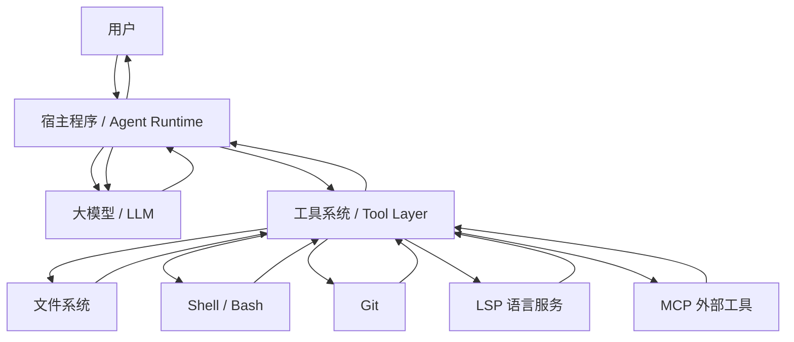
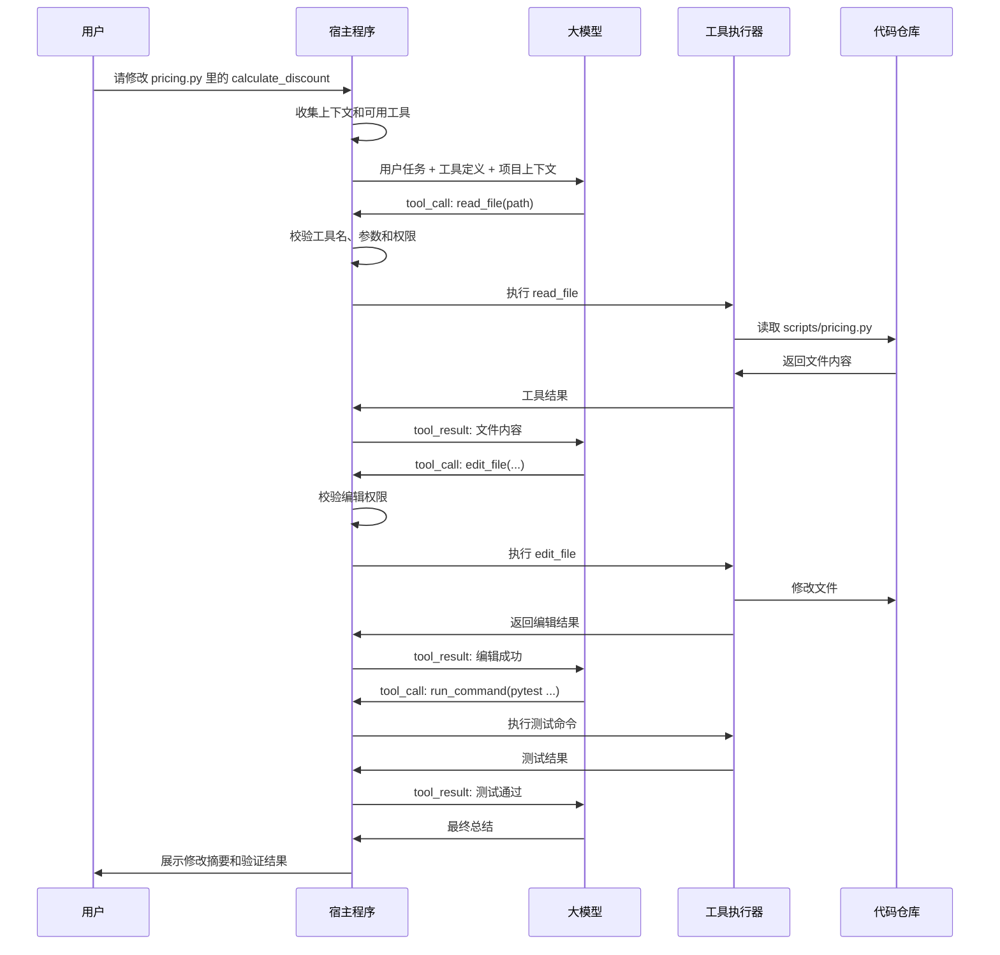
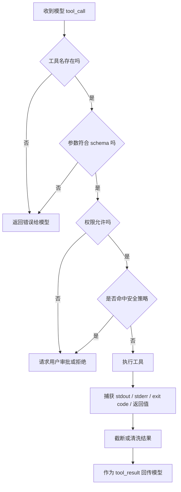
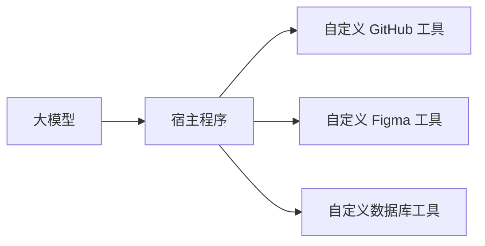
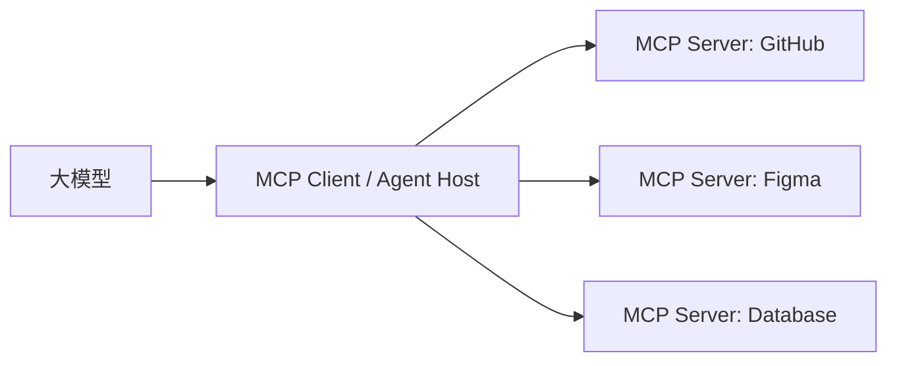
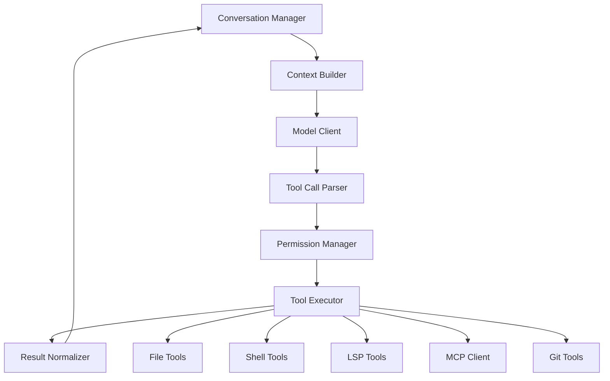

[toc]


## abstract

在coding agent中,**大模型并不会真的自己读文件、改文件、运行命令。**

在 coding agent 里，真正拥有文件系统、终端、Git、LSP、MCP 访问能力的是 **宿主程序（host program / agent runtime）**。大模型只是根据上下文生成一种结构化的“工具调用请求（tool call）”，宿主程序负责：

- 把可用工具描述给模型；
- 接收模型返回的工具调用；
- 校验参数、检查权限；
- 实际执行工具；
- 把执行结果再喂回模型；
- 让模型决定下一步继续调用工具还是最终回答。

OpenAI 官方文档把 **function calling / tool calling** 描述为让模型连接外部系统的机制，其中工具由应用提供，模型生成结构化调用；Anthropic 文档也说明 Claude 会根据用户请求和工具描述返回结构化调用，由应用或服务端执行工具。([OpenAI开发者](https://developers.openai.com/api/docs/guides/function-calling?utm_source=chatgpt.com))

------

## 整体通信结构

可以把 coding agent 理解成四层：



这里的关键是：

| 角色     | 负责什么                                              |
| -------- | ----------------------------------------------------- |
| 用户     | 提供目标，例如“修改这个函数”                          |
| 宿主程序 | 组织上下文、管理工具、检查权限、执行工具、回传结果    |
| 大模型   | 理解任务、决定是否调用工具、生成工具参数、解释结果    |
| 工具系统 | 提供具体能力，例如读文件、编辑文件、运行测试          |
| 外部环境 | 真实代码仓库、终端、Git、语言服务器、数据库、浏览器等 |

所以，大模型和宿主程序的交流，本质上是：

1. 宿主程序向模型发送“上下文 + 工具说明”，
2. 模型返回“自然语言或工具调用请求”，宿主程序执行工具后再把“工具结果”返回给模型。

------

## 工具调用不是模型直接执行

很多新手容易误解为：

> 模型调用了 `read_file()`，所以模型读到了文件。

更准确地说是：

> 模型生成了一个**结构化请求**：“请调用名为 `read_file` 的工具，参数是 `path=scripts/pricing.py`。”
> 宿主程序看到这个请求后，自己去读取文件，再把文件内容返回给模型。

这点非常重要，因为它解释了为什么 coding agent 需要：

- 工具定义；
- 参数 schema；
- 权限系统；
- 沙箱；
- 审批策略；
- 工具执行器；
- 结果回传格式。

------

## 一次工具调用的完整生命周期



------

## 宿主程序如何把工具“告诉”模型

宿主程序会在请求模型时附带一组 **工具定义（tool definitions）**。

工具定义一般包含：

| 字段        | 作用                                         |
| ----------- | -------------------------------------------- |
| 工具名称    | 例如 `read_file`、`edit_file`、`run_command` |
| 工具描述    | 告诉模型什么时候应该用这个工具               |
| 参数 schema | 告诉模型参数名、类型、必填项、约束           |
| 返回格式    | 工具执行后会返回什么                         |
| 权限说明    | 有些系统会额外说明工具风险或使用限制         |

OpenAI function calling 使用 JSON Schema 描述工具参数；Anthropic tool use 也要求开发者提供工具名称、描述和输入 schema，让模型根据工具说明决定何时调用。([OpenAI开发者](https://developers.openai.com/api/docs/guides/function-calling?utm_source=chatgpt.com))

一个简化的工具定义可能长这样：

```json
{
  "name": "read_file",
  "description": "Read a file from the current workspace.",
  "input_schema": {
    "type": "object",
    "properties": {
      "path": {
        "type": "string",
        "description": "Path to the file relative to the workspace root."
      }
    },
    "required": ["path"]
  }
}
```

再比如编辑工具：

```json
{
  "name": "edit_file",
  "description": "Replace an exact text span in an existing file.",
  "input_schema": {
    "type": "object",
    "properties": {
      "path": {
        "type": "string"
      },
      "old_text": {
        "type": "string"
      },
      "new_text": {
        "type": "string"
      }
    },
    "required": ["path", "old_text", "new_text"]
  }
}
```

运行命令工具：

```json
{
  "name": "run_command",
  "description": "Run a shell command inside the project workspace.",
  "input_schema": {
    "type": "object",
    "properties": {
      "command": {
        "type": "string"
      },
      "timeout_seconds": {
        "type": "integer"
      }
    },
    "required": ["command"]
  }
}
```

------

## 模型如何“请求调用工具”

模型收到工具定义后，并不是直接输出普通文本：

```text
我将读取 scripts/pricing.py。
```

而是输出一个结构化对象，大意类似：

```json
{
  "tool_call": {
    "id": "call_001",
    "name": "read_file",
    "arguments": {
      "path": "scripts/pricing.py"
    }
  }
}
```

不同模型供应商的实际字段名不完全相同。例如 Anthropic 文档中，Claude 会返回结构化的 tool use 内容块，然后应用把执行结果作为 tool result 继续传回；OpenAI function calling 也会让模型生成结构化工具调用，由应用执行并回传结果。([OpenAI开发者](https://developers.openai.com/api/docs/guides/function-calling?utm_source=chatgpt.com))

重点不是字段名，而是通信模式：

```text
模型输出：我要调用哪个工具，以及参数是什么。
宿主执行：检查后真正调用这个工具。
宿主回传：把工具执行结果作为新上下文发给模型。
模型继续：根据结果决定下一步。
```

------

## 宿主程序收到工具调用后做什么

宿主程序不会盲目执行模型的请求。通常会经过这些步骤：



这个过程通常包括：

| 检查                | 示例                                     |
| ------------------- | ---------------------------------------- |
| 工具名是否合法      | 模型不能调用不存在的 `delete_everything` |
| 参数是否符合 schema | `path` 必须是字符串                      |
| 路径是否允许        | 不能读取工作区外文件                     |
| 命令是否危险        | `rm -rf /`、生产部署命令需要阻止         |
| 是否需要用户批准    | 安装依赖、访问网络、写文件可能要审批     |
| 是否超时            | 测试命令不能无限运行                     |
| 输出是否过长        | 大量日志需要截断或摘要                   |
| 是否包含敏感信息    | secrets、token、私钥需要处理             |

------

## 工具结果如何返回给模型

宿主程序执行工具后，会把结果以一种特殊消息形式返回给模型。

例如读取文件后：

```json
{
  "tool_result": {
    "tool_call_id": "call_001",
    "content": "def calculate_discount(price: float, user_type: str) -> float:\n    ..."
  }
}
```

运行命令后：

```json
{
  "tool_result": {
    "tool_call_id": "call_004",
    "content": {
      "exit_code": 0,
      "stdout": "3 passed in 0.42s",
      "stderr": ""
    }
  }
}
```

模型收到结果后，就像读到一段新上下文一样，会继续推理：

- 文件内容里有什么函数；
- 应该如何修改；
- 测试是否通过；
- 如果失败，错误原因是什么；
- 是否需要继续调用工具；
- 是否可以最终回复用户。

------

## coding agent 中常见的工具类型

以修改代码为例，宿主程序通常会暴露这些工具给模型。

| 工具类型 | 常见名称                                     | 模型什么时候用                       |
| -------- | -------------------------------------------- | ------------------------------------ |
| 文件读取 | `read_file`、`Read`                          | 读取目标文件、配置、测试             |
| 文件搜索 | `grep`、`search`、`ripgrep`                  | 搜索函数名、错误信息、调用方         |
| 文件匹配 | `glob`                                       | 查找符合路径模式的文件               |
| 文件编辑 | `edit_file`、`Edit`                          | 精确替换已有代码                     |
| 补丁应用 | `apply_patch`                                | 应用 diff / patch                    |
| 文件写入 | `write_file`、`Write`                        | 新建文件或重写小文件                 |
| 命令执行 | `bash`、`run_command`                        | 运行测试、lint、类型检查             |
| Git      | `git_diff`、`git_status`，或通过 `bash` 调用 | 查看改动、工作区状态                 |
| LSP      | `find_references`、`diagnostics`             | 查定义、引用、类型错误               |
| 任务管理 | `todo_write`                                 | 管理复杂任务步骤                     |
| 外部工具 | MCP tools                                    | 访问文档、数据库、浏览器、issue 系统 |

MCP 的作用就是把外部工具和上下文以标准协议方式暴露给 LLM 应用。MCP 规范将其描述为连接 LLM 应用与外部数据源和工具的开放协议；MCP 工具机制一般包含工具发现和工具调用，即客户端可以列出工具，也可以调用工具并获取结果。([Model Context Protocol](https://modelcontextprotocol.io/specification/2025-03-26?utm_source=chatgpt.com))

------

## 以“修改 Python 函数”为例的真实通信过程

假设用户说：

```text
请修改 scripts/pricing.py 里的 calculate_discount 函数。
member 打 9 折，vip 打 8 折，最终价格不能低于 0。
修改后运行测试。
```

### 宿主程序第一次请求模型

宿主程序会把这些内容发给模型：

> 系统规则：
> 你是一个 coding agent。你可以读取、编辑工作区内文件，可以运行安全命令。
> 不要访问工作区外路径。写文件前尽量先读取文件。
>
> 用户任务：
> 请修改 scripts/pricing.py 里的 calculate_discount 函数。
> member 打 9 折，vip 打 8 折，最终价格不能低于 0。
> 修改后运行测试。
>
> 可用工具：
> - read_file(path)
> - grep(pattern, glob)
> - edit_file(path, old_text, new_text)
> - run_command(command, timeout_seconds)
> - git_diff(paths)

### 模型返回第一个工具调用

模型可能返回：

```json
{
  "tool_call": {
    "id": "call_001",
    "name": "read_file",
    "arguments": {
      "path": "scripts/pricing.py"
    }
  }
}
```

### 宿主程序执行读取

宿主程序检查：

| 检查项               | 结果 |
| -------------------- | ---- |
| `read_file` 是否存在 | 存在 |
| `path` 是否是字符串  | 是   |
| 路径是否在工作区内   | 是   |
| 是否允许读取         | 是   |

然后它读取文件，得到：

```python
def calculate_discount(price: float, user_type: str) -> float:
    if user_type == "member":
        return price * 0.95
    if user_type == "vip":
        return price * 0.85
    return price
```

### 宿主程序回传工具结果

```json
{
  "tool_result": {
    "tool_call_id": "call_001",
    "content": "def calculate_discount(price: float, user_type: str) -> float:\n    if user_type == \"member\":\n        return price * 0.95\n    if user_type == \"vip\":\n        return price * 0.85\n    return price\n"
  }
}
```

### 模型请求编辑文件

模型现在知道了真实代码，于是返回：

```json
{
  "tool_call": {
    "id": "call_002",
    "name": "edit_file",
    "arguments": {
      "path": "scripts/pricing.py",
      "old_text": "def calculate_discount(price: float, user_type: str) -> float:\n    if user_type == \"member\":\n        return price * 0.95\n    if user_type == \"vip\":\n        return price * 0.85\n    return price\n",
      "new_text": "def calculate_discount(price: float, user_type: str) -> float:\n    if user_type == \"member\":\n        return max(price * 0.9, 0)\n    if user_type == \"vip\":\n        return max(price * 0.8, 0)\n    return max(price, 0)\n"
    }
  }
}
```

### 宿主程序执行编辑

宿主程序会检查：

| 检查项           | 说明                                    |
| ---------------- | --------------------------------------- |
| 工具是否存在     | `edit_file` 是否已注册                  |
| 参数是否完整     | `path`、`old_text`、`new_text` 是否都有 |
| 是否允许写文件   | 当前权限是否允许编辑                    |
| 路径是否合法     | 是否在 workspace 内                     |
| 旧文本是否匹配   | 文件里是否存在完整 `old_text`           |
| 是否需要用户审批 | 根据配置决定                            |

如果全部通过，宿主程序才真正写入文件。

### 宿主程序返回编辑结果

```json
{
  "tool_result": {
    "tool_call_id": "call_002",
    "content": "Edit applied successfully."
  }
}
```

### 模型请求运行测试

```json
{
  "tool_call": {
    "id": "call_003",
    "name": "run_command",
    "arguments": {
      "command": "pytest tests/test_pricing.py",
      "timeout_seconds": 120
    }
  }
}
```

### 宿主程序执行命令

宿主程序可能先做安全判断：

| 检查项         | 示例              |
| -------------- | ----------------- |
| 是否是允许命令 | `pytest` 通常允许 |
| 是否访问网络   | 没有              |
| 是否删除文件   | 没有              |
| 是否超时       | 设置 120 秒       |
| 是否需要审批   | 根据配置决定      |

然后执行命令，返回：

```json
{
  "tool_result": {
    "tool_call_id": "call_003",
    "content": {
      "exit_code": 0,
      "stdout": "5 passed in 0.31s",
      "stderr": ""
    }
  }
}
```

### 模型请求查看 diff

```json
{
  "tool_call": {
    "id": "call_004",
    "name": "run_command",
    "arguments": {
      "command": "git diff -- scripts/pricing.py tests/test_pricing.py",
      "timeout_seconds": 30
    }
  }
}
```

### 最终模型回复用户

模型根据工具结果生成自然语言：

```text
已完成修改。

修改内容：
- member 折扣从 5% 改为 10%
- vip 折扣从 15% 改为 20%
- 使用 max(..., 0) 保证最终价格不低于 0

验证：
- pytest tests/test_pricing.py 通过，5 passed

风险：
- 未知 user_type 当前按普通用户处理。
```

------

## 宿主程序和模型之间传的不是“代码执行权”，而是“消息”

很多人问“大模型怎么调用工具”，其实可以理解为：

> 大模型不调用工具；大模型生成一条“想调用工具”的消息。
> 宿主程序读懂这条消息，并决定是否真的执行。

更准确的分工如下：

| 动作                   | 谁做     |
| ---------------------- | -------- |
| 判断下一步该读哪个文件 | 大模型   |
| 实际读取文件           | 宿主程序 |
| 判断应该如何修改代码   | 大模型   |
| 实际写入文件           | 宿主程序 |
| 判断该跑哪个测试       | 大模型   |
| 实际运行测试           | 宿主程序 |
| 捕获 stdout / stderr   | 宿主程序 |
| 根据测试失败分析原因   | 大模型   |
| 决定是否继续修复       | 大模型   |
| 阻止危险命令           | 宿主程序 |
| 请求用户确认           | 宿主程序 |

所以 agent 的本质是 **LLM 负责决策，host 负责执行**。

------

## 工具调用为什么要用 schema

如果没有 schema，模型可能输出各种不稳定文本：

```text
帮我读一下 pricing 文件吧。
```

宿主程序很难可靠解析。

有 schema 后，模型必须生成结构化参数：

```json
{
  "name": "read_file",
  "arguments": {
    "path": "scripts/pricing.py"
  }
}
```

schema 的好处是：

| 好处       | 说明                           |
| ---------- | ------------------------------ |
| 可验证     | 宿主程序能检查参数类型         |
| 可约束     | 只能传允许字段                 |
| 可重试     | 参数错误时可以把错误反馈给模型 |
| 可审计     | 记录模型调用了什么工具         |
| 可权限控制 | 根据工具名和参数判断是否允许   |
| 可跨模型   | 不同模型可用同一组工具定义     |
| 可组合     | 多个工具能组成复杂 workflow    |

------

## 工具调用失败时如何处理

工具调用可能失败，宿主程序会把错误也作为工具结果返回给模型。

### 文件不存在

模型请求：

```json
{
  "name": "read_file",
  "arguments": {
    "path": "script/pricing.py"
  }
}
```

宿主返回：

```json
{
  "error": "File not found: script/pricing.py"
}
```

模型可能继续调用：

```json
{
  "name": "glob",
  "arguments": {
    "pattern": "**/pricing.py"
  }
}
```

### 精确替换失败

模型请求编辑：

```json
{
  "name": "edit_file",
  "arguments": {
    "path": "scripts/pricing.py",
    "old_text": "...旧实现...",
    "new_text": "...新实现..."
  }
}
```

宿主返回：

```json
{
  "error": "old_text not found in file"
}
```

模型接下来通常会：

- 重新读取文件；
- 发现代码已经变化；
- 生成新的 `old_text`；
- 或改用 patch；
- 或缩小替换范围。

### 命令失败

宿主返回：

```json
{
  "exit_code": 1,
  "stdout": "",
  "stderr": "AssertionError: assert 89.999999 == 90"
}
```

模型会分析：

- 是业务逻辑错；
- 还是测试断言不适合浮点数；
- 是否需要 `pytest.approx`；
- 是否应该改实现为 `Decimal`；
- 是否需要读取更多上下文。

------

## 多轮工具调用的 agent loop

宿主程序通常会维护一个循环：

```python
messages = [
    system_message,
    user_message,
]

while True:
    response = call_model(
        messages=messages,
        tools=tool_definitions,
    )

    if response.contains_tool_call():
        for tool_call in response.tool_calls:
            result = execute_tool_safely(tool_call)
            messages.append(response.as_message())
            messages.append(tool_result_message(tool_call.id, result))
        continue

    return response.final_text
```

真实系统会更复杂，因为还要处理：

- streaming；
- 多工具并行；
- 审批中断；
- 上下文压缩；
- 输出截断；
- 工具超时；
- 权限升级；
- 错误恢复；
- 用户中途打断；
- 子 agent；
- MCP server；
- 工作区隔离。

但最小核心就是这个循环。

------

## streaming 模式下如何通信

在现代 agent 里，模型输出可能是流式的。

模型可能先流式输出一些普通文本：

```text
我会先读取目标文件并检查相关测试。
```

然后开始流式生成工具调用：

```json
{
  "name": "read_file",
  "arguments": {
    "path": "scripts/pricing.py"
  }
}
```

宿主程序在工具调用参数完整后执行工具，再把结果发回模型。

流式的好处是：

| 好处               | 说明               |
| ------------------ | ------------------ |
| 用户能看到过程     | 比如“正在读取文件” |
| 可提前发现工具调用 | 宿主可以准备执行   |
| 长输出体验更好     | 不必等模型完整生成 |
| 适合交互式 agent   | 用户可以中途打断   |

------

## 并行工具调用

有些模型可以一次返回多个工具调用，例如：

```json
[
  {
    "id": "call_001",
    "name": "read_file",
    "arguments": {
      "path": "scripts/pricing.py"
    }
  },
  {
    "id": "call_002",
    "name": "read_file",
    "arguments": {
      "path": "tests/test_pricing.py"
    }
  }
]
```

宿主程序可以并行执行，然后分别返回结果：

```json
[
  {
    "tool_call_id": "call_001",
    "content": "..."
  },
  {
    "tool_call_id": "call_002",
    "content": "..."
  }
]
```

但不是所有工具都适合并行。比如：

| 适合并行           | 不适合并行               |
| ------------------ | ------------------------ |
| 同时读取多个文件   | 同时编辑同一个文件       |
| 同时搜索不同关键词 | 编辑后马上基于旧内容编辑 |
| 同时查多个文档     | 同时运行互相影响的命令   |

coding agent 的宿主程序通常需要避免并发写入冲突。

------

## 工具调用中的权限控制

工具调用系统最危险的地方是：模型可能请求执行高风险动作。

例如：

```json
{
  "name": "run_command",
  "arguments": {
    "command": "rm -rf ."
  }
}
```

宿主程序必须阻止或请求确认。

常见权限策略：

| 权限项           | 示例                             |
| ---------------- | -------------------------------- |
| 只读             | 允许 `read_file`、`grep`、`glob` |
| 工作区写入       | 允许编辑项目目录内文件           |
| 禁止工作区外访问 | 不允许读写 `/home/user/.ssh`     |
| 命令白名单       | 允许 `pytest`、`ruff`、`mypy`    |
| 命令黑名单       | 禁止 `rm -rf`、`curl             |
| 网络审批         | 访问网络前询问用户               |
| 敏感文件保护     | 阻止读取 `.env`、密钥、证书      |
| 超时限制         | 防止命令无限运行                 |
| 输出清洗         | 避免 secrets 被放进上下文        |

这也是为什么宿主程序比模型本身更像“安全边界”。

------

## MCP 在这套通信里处于什么位置

MCP 可以理解为 **宿主程序与外部工具服务之间的标准协议**。

不使用 MCP 时：



使用 MCP 后：



MCP 通常涉及三类角色：

| 角色       | 作用                                     |
| ---------- | ---------------------------------------- |
| MCP Host   | 例如 IDE、agent app、coding assistant    |
| MCP Client | 宿主程序内部连接某个 MCP server 的客户端 |
| MCP Server | 暴露工具、资源、提示模板的外部服务       |

MCP 规范把它定义为 LLM 应用与外部数据源和工具之间的开放协议；MCP 的工具机制允许客户端发现工具并调用工具，服务器执行后返回结果。([Model Context Protocol](https://modelcontextprotocol.io/specification/2025-03-26?utm_source=chatgpt.com))

### MCP 与模型 tool calling 的关系

这两个概念不要混淆：

| 层次                   | 作用                                |
| ---------------------- | ----------------------------------- |
| 模型 tool calling      | 模型向宿主程序请求“调用某工具”      |
| MCP                    | 宿主程序与外部工具服务器之间通信    |
| 真实 API / 文件 / 命令 | MCP server 或本地工具最终执行的东西 |

也就是说：

```text
模型 → 宿主程序：请调用 github.create_issue
宿主程序 → MCP Server：tools/call github.create_issue
MCP Server → GitHub API：创建 issue
GitHub API → MCP Server：返回结果
MCP Server → 宿主程序：工具结果
宿主程序 → 模型：tool_result
```

模型通常并不直接“说 MCP 协议”。它只看到宿主程序暴露出来的工具定义。宿主程序背后可以用 MCP，也可以用普通函数、HTTP API、shell 命令、插件系统。

------

## coding agent 宿主程序内部通常有哪些模块

一个简化的 coding agent runtime 可能这样设计：



| 模块                 | 作用                                       |
| -------------------- | ------------------------------------------ |
| Conversation Manager | 维护对话历史、工具调用历史                 |
| Context Builder      | 选择哪些规则、文件片段、命令结果放进上下文 |
| Model Client         | 调用 OpenAI、Anthropic、本地模型等         |
| Tool Call Parser     | 解析模型返回的工具调用                     |
| Permission Manager   | 判断工具调用是否允许                       |
| Tool Executor        | 实际执行 read、edit、bash、grep            |
| Result Normalizer    | 把结果转成模型可读格式                     |
| Context Compressor   | 上下文太长时压缩历史                       |
| Error Handler        | 工具失败时返回结构化错误                   |
| Audit Logger         | 记录工具调用和修改                         |
| Approval UI          | 向用户请求确认                             |

------

## 为什么工具描述会显著影响效果

模型选择工具时，主要依据：

- 工具名称；
- 工具描述；
- 参数描述；
- 系统提示；
- 当前任务；
- 历史工具结果。

如果工具描述写得差，模型可能不会正确使用。

### 差的工具描述

```json
{
  "name": "edit",
  "description": "Edit something."
}
```

问题：

- 不知道能编辑什么；
- 不知道是否创建文件；
- 不知道参数格式；
- 不知道是否要求精确匹配；
- 不知道失败条件。

### 好的工具描述

```json
{
  "name": "edit_file",
  "description": "Replace an exact text span in an existing workspace file. Use this for small, targeted edits. The old_text must match the current file content exactly. Do not use this to create new files.",
  "input_schema": {
    "type": "object",
    "properties": {
      "path": {
        "type": "string",
        "description": "Workspace-relative file path."
      },
      "old_text": {
        "type": "string",
        "description": "Exact text currently present in the file."
      },
      "new_text": {
        "type": "string",
        "description": "Replacement text."
      }
    },
    "required": ["path", "old_text", "new_text"]
  }
}
```

这样模型更容易知道：

- 什么时候用；
- 怎么传参；
- 不该用它做什么；
- 如果精确匹配失败该怎么办。

------

## 大模型如何决定“现在该调用哪个工具”

模型不是通过传统 if-else 决策树选择工具，而是根据 prompt、上下文和工具描述生成最可能的下一步。

例如任务是：

```text
修改 calculate_discount 函数。
```

模型看到可用工具：

- `read_file`
- `grep`
- `edit_file`
- `run_command`

它会推理：

| 当前状态       | 合理工具                    |
| -------------- | --------------------------- |
| 还没看过文件   | `read_file`                 |
| 不知道函数在哪 | `grep`                      |
| 已经看到旧代码 | `edit_file`                 |
| 修改后要验证   | `run_command`               |
| 测试失败       | `read_file` 或 `edit_file`  |
| 完成后审查     | `git diff` 或 `run_command` |

这就是 agent loop。

------

## 工具调用与普通文本回答可以混合

模型一次响应可能包含：

- 给用户看的说明；
- 一个或多个工具调用；
- 或最终回答。

例如：

```text
我会先读取目标文件确认当前实现。
```

随后附带工具调用：

```json
{
  "name": "read_file",
  "arguments": {
    "path": "scripts/pricing.py"
  }
}
```

宿主程序一般会把普通文本显示给用户，把工具调用交给执行器。

------

## 工具调用中的上下文污染问题

每次工具结果都会加入上下文，但上下文窗口有限。

如果工具返回太多内容，例如：

```text
pytest 输出 20,000 行日志
```

宿主程序通常会处理：

| 处理方式 | 说明                            |
| -------- | ------------------------------- |
| 截断     | 只保留前后关键部分              |
| 摘要     | 总结失败测试和 traceback        |
| 过滤     | 去掉无关 warning                |
| 分页     | 让模型按需读取更多              |
| 引用化   | 存储完整结果，给模型一个结果 ID |
| 压缩历史 | 把旧对话总结成短摘要            |

否则模型会被无关日志淹没，后续判断变差。

------

## 精确编辑为什么需要宿主程序配合

假设模型要改函数，最安全的方式不是让它输出：

```text
请把文件改好。
```

而是让它输出：

```json
{
  "path": "scripts/pricing.py",
  "old_text": "return price * 0.95",
  "new_text": "return max(price * 0.9, 0)"
}
```

宿主程序执行时可以严格检查：

| 检查                | 作用              |
| ------------------- | ----------------- |
| `old_text` 是否存在 | 避免改错文件      |
| 是否只出现一次      | 避免替换多个位置  |
| 是否在允许路径内    | 避免越权          |
| 写入后文件是否有效  | 可继续 py_compile |
| diff 是否符合预期   | 可供 review       |

如果模型直接输出完整文件，宿主程序很难知道哪些地方是有意修改，哪些是模型遗漏或幻觉。

------

## apply_patch 与 edit_file 的差异

| 工具          | 通信方式                | 适合场景             |
| ------------- | ----------------------- | -------------------- |
| `edit_file`   | `old_text` + `new_text` | 小范围精确替换       |
| `apply_patch` | 统一 diff / patch       | 多处修改、多个文件   |
| `write_file`  | 完整文件内容            | 新建文件、小文件重写 |
| `run_command` | shell 命令字符串        | 测试、lint、构建     |
| `LSP`         | 结构化语言操作          | 查定义、引用、诊断   |

比如 `edit_file`：

```json
{
  "name": "edit_file",
  "arguments": {
    "path": "scripts/pricing.py",
    "old_text": "return price * 0.95",
    "new_text": "return max(price * 0.9, 0)"
  }
}
```

而 `apply_patch`：

```json
{
  "name": "apply_patch",
  "arguments": {
    "patch": "*** Begin Patch\n*** Update File: scripts/pricing.py\n@@\n-        return price * 0.95\n+        return max(price * 0.9, 0)\n*** End Patch"
  }
}
```

宿主程序负责把 patch 应用到真实文件。

------

## 与 LSP 的交流方式

LSP 即 **Language Server Protocol**，常用于编辑器的代码智能能力，比如查定义、找引用、诊断错误。

在 agent 中，宿主程序可以把 LSP 能力封装成工具：

```json
{
  "name": "lsp_find_references",
  "arguments": {
    "path": "scripts/pricing.py",
    "line": 10,
    "character": 4
  }
}
```

宿主程序收到后：

```text
宿主程序 → LSP server：textDocument/references
LSP server → 宿主程序：返回引用位置
宿主程序 → 模型：这些文件引用了该函数
```

模型并不直接跟 LSP server 说话，而是通过宿主程序封装后的工具。

------

## 与 Shell 的交流方式

Shell 工具通常是最强也最危险的工具。

模型返回：

```json
{
  "name": "run_command",
  "arguments": {
    "command": "pytest tests/test_pricing.py",
    "timeout_seconds": 120
  }
}
```

宿主程序执行：

```text
subprocess.run(
    command,
    cwd=workspace,
    timeout=120,
    capture_output=True
)
```

然后返回：

```json
{
  "exit_code": 1,
  "stdout": "...",
  "stderr": "AssertionError ..."
}
```

对 coding agent 来说，Shell 的结果是非常重要的反馈信号：

| 输出              | 模型如何使用        |
| ----------------- | ------------------- |
| exit code 0       | 通常说明命令成功    |
| exit code 非 0    | 需要分析错误        |
| stdout            | 测试结果、构建日志  |
| stderr            | traceback、编译错误 |
| timeout           | 命令太慢或卡住      |
| permission denied | 权限不足或路径错误  |

------

## 宿主程序如何防止模型伪造工具结果

理论上，模型可能在普通文本里“声称”它运行了测试：

```text
测试已通过。
```

但这不可信。

可靠的宿主程序会区分：

| 内容类型               | 是否可信             |
| ---------------------- | -------------------- |
| 模型自然语言声称       | 不可信，只是生成文本 |
| 宿主程序执行的工具结果 | 较可信               |
| CI 系统结果            | 更可信               |
| 人类 review            | 必要兜底             |

因此，一个好的 coding agent UI 会明确显示：

- 哪些命令真的执行了；
- exit code 是什么；
- stdout / stderr 是什么；
- 修改了哪些文件；
- git diff 是什么。

------

## 工具调用和权限审批的交互

有些调用可以自动执行：

```json
{
  "name": "read_file",
  "arguments": {
    "path": "scripts/pricing.py"
  }
}
```

有些调用需要审批：

```json
{
  "name": "run_command",
  "arguments": {
    "command": "pip install some-package"
  }
}
```

宿主程序可能暂停 agent loop，显示：

```text
模型请求执行：
pip install some-package

原因：
运行项目测试需要安装缺失依赖。

是否允许？
```

用户批准后，宿主程序才执行，并把结果返回模型。

------

## 宿主程序如何实现一个最小 coding agent

一个极简实现大致需要：

```python
import json
import subprocess
from pathlib import Path

WORKSPACE = Path.cwd()

def read_file(path: str) -> str:
    full_path = (WORKSPACE / path).resolve()
    if not str(full_path).startswith(str(WORKSPACE.resolve())):
        raise PermissionError("Path outside workspace")
    return full_path.read_text()

def edit_file(path: str, old_text: str, new_text: str) -> str:
    full_path = (WORKSPACE / path).resolve()
    if not str(full_path).startswith(str(WORKSPACE.resolve())):
        raise PermissionError("Path outside workspace")

    content = full_path.read_text()
    if old_text not in content:
        raise ValueError("old_text not found")

    if content.count(old_text) != 1:
        raise ValueError("old_text appears more than once")

    full_path.write_text(content.replace(old_text, new_text))
    return "Edit applied successfully"

def run_command(command: str, timeout_seconds: int = 120) -> dict:
    result = subprocess.run(
        command,
        shell=True,
        cwd=WORKSPACE,
        text=True,
        capture_output=True,
        timeout=timeout_seconds,
    )
    return {
        "exit_code": result.returncode,
        "stdout": result.stdout[-8000:],
        "stderr": result.stderr[-8000:],
    }

TOOLS = {
    "read_file": read_file,
    "edit_file": edit_file,
    "run_command": run_command,
}

def execute_tool_call(tool_call: dict):
    name = tool_call["name"]
    arguments = tool_call["arguments"]

    if name not in TOOLS:
        raise ValueError(f"Unknown tool: {name}")

    return TOOLS[name](**arguments)
```

真实 coding agent 会比这复杂很多，但核心机制就是：

```text
模型生成 tool_call。
宿主程序解析 tool_call。
宿主程序调用本地函数。
宿主程序把结果返回模型。
```

------

## 常见误区

| 误区                 | 正确认识                             |
| -------------------- | ------------------------------------ |
| 模型自己打开文件     | 模型请求宿主程序打开文件             |
| 模型自己执行命令     | 宿主程序执行命令                     |
| 模型自己修改磁盘     | 宿主程序根据工具调用修改磁盘         |
| tool calling 是魔法  | 本质是结构化消息协议                 |
| 有工具就安全         | 必须有权限、沙箱、审批、审计         |
| 模型说测试通过就可信 | 只有真实工具结果或 CI 结果才可信     |
| MCP 等于模型工具调用 | MCP 是宿主和外部工具服务之间的协议层 |
| 工具越多越好         | 工具太多会增加选择错误和上下文成本   |

------

## 一个简洁但准确的心智模型

可以把整个过程想成：

```text
大模型：我想读这个文件。
宿主程序：检查权限后读取文件，把内容给模型。

大模型：我想把这段旧代码替换成新代码。
宿主程序：检查路径、权限、old_text 是否匹配，然后写文件。

大模型：我想运行 pytest。
宿主程序：检查命令是否允许，然后执行，把 stdout、stderr、exit code 给模型。

大模型：根据结果继续修复或总结。
```

最终一句话总结：

**大模型与 coding agent 宿主程序的交流，本质是“结构化消息 + 工具 schema + 宿主执行 + 结果回传”的循环；大模型负责决定和生成调用，宿主程序负责校验、执行和安全控制。**