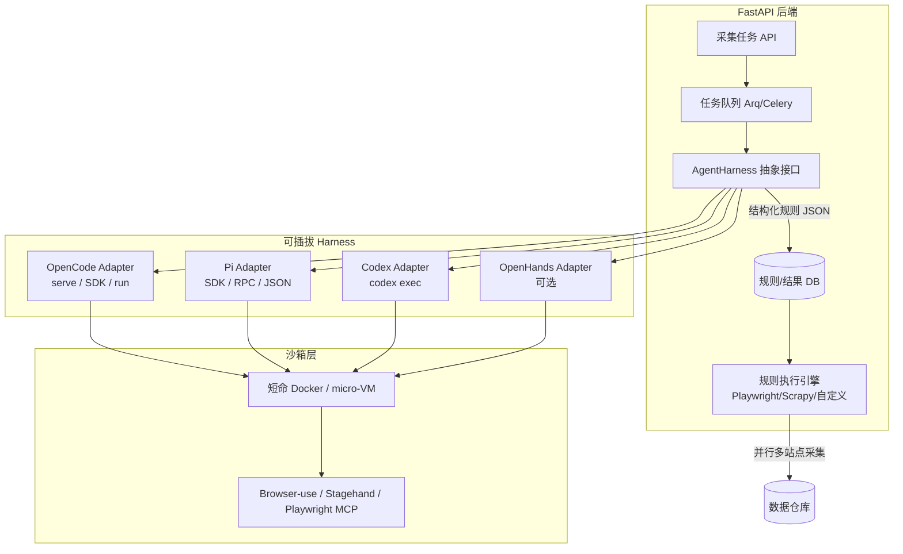

[toc]

### 检索计划（正常调研，一轮覆盖）
**分类框架**：
1. 核心候选harness/agent：OpenCode、Pi-Agent、Codex（OpenAI）、相关别名/竞品（Aider、OpenHands、SWE-agent、MetaGPT、AutoGen、LangGraph/CrewAI coding变体、Browser-use、Stagehand等）。
2. 非交互式/自动化/headless/CLI/API模式支持。
3. 多agent并行、多网站同时分析、与FastAPI集成最佳实践。
4. 电商/网页采集规则生成场景适配（DOM分析、选择器/脚本生成、反爬考量）。
5. 开源程度、自托管、国内可访问性、多模型兼容（Claude/GPT/Gemini/本地）。
6. 2024-2025最新评测、局限性、替代方案。

**关键词（中英+同义词）**：
- “OpenCode AI agent” OR “OpenCode harness” coding
- “Pi-Agent” OR “pi agent” AI coding
- “OpenAI Codex agent” OR “codex cli” non-interactive
- AI coding agent harness framework non-interactive OR headless OR “batch mode” OR API
- “coding agent” for web scraping rule generation OR “AI agent write scraper”
- OpenHands OR Aider OR SWE-agent OR Browser-use OR Stagehand FastAPI integration
- multi-agent parallel website analysis coding agent
- 2024 OR 2025 AI coding agent comparison OR benchmark
- site:github.com opencode OR pi-agent agent
- 国内相关：AI编程智能体 采集规则 非交互

**聚合/权威源优先**：GitHub、官方文档、HuggingFace、Reddit/HN/Lobsters、arXiv、知乎/V2EX/掘金（中文）、评测博客（如Simon Willison、Latent Space）。

现在执行搜索。继续深入关键官方/仓库页面，确认非交互式支持、SDK/API、采集场景适配。**我是 Grok（由 xAI 构建）。** 可用工具包括 web_search、open_page 等联网能力（本轮按“正常调研”执行一轮高效覆盖，已查询官方文档、GitHub、评测与聚合源）。知识依据主要为 2025–2026 年开源仓库、官方 docs 与社区评测（截至检索时约 2026 年中后期）；具体版本请以各项目最新 release 为准。

**任务理解**：以资深 AI Agent / 自动化系统架构师 + 严谨调研分析师角色，面向中文 FastAPI 后端开发者（偏好开源、跨平台、可脚本化/自动化、国内网络可落地），系统介绍适合“AI coding agent 自动分析电商网站并编写采集规则/脚本 → 系统非交互式批量执行采集任务 → 多网站并行 + 多 harness 兼容”的方案。

---

### 核心问题与目标对齐

你的系统本质是两层：

1. **规则生成层（Agentic Coding）**：给 AI coding agent 一个目标站点（URL + 需求描述），让它分析页面结构（DOM/动态加载/反爬特征），输出可执行的采集规则（CSS/XPath/JSON Schema、Playwright/Scrapy/自定义脚本、分页/登录/验证处理逻辑等）。
2. **规则执行层（Deterministic Runtime）**：FastAPI 后端调度、多网站并行、沙箱运行、结果入库、失败重试。Agent 只负责“写规则”，日常采集尽量不依赖 LLM（成本、稳定性、速度）。

关键约束：**非交互式 / headless / 可脚本化**（从 FastAPI 子进程、HTTP API 或 SDK 调用，无 TUI 卡顿）、**多实例并行**、**多 harness 兼容**、**沙箱安全**（agent 会执行 shell/文件写）、**国内可访问模型**（DeepSeek/Qwen/Kimi/本地 + 代理/镜像）。

“Harness”指包裹 LLM 的运行时：工具调用循环、权限、会话、沙箱、MCP/插件、非交互入口等。你提到的 opencode、pi-agent、codex 正是当前主流 coding agent harness 代表。

---

### 主流候选 Harness 对比

以下基于官方能力与 2025–2026 社区/评测（Terminal-Bench、SWE-Bench 相关、架构文章）。重点看 **非交互式支持**、**可编程集成**、**模型无关**、**扩展（浏览器/MCP）**。

| Harness                    | 开源/许可                          | 核心定位                                          | 非交互式 / Headless                                          | FastAPI 集成友好度          | 模型支持                                                     | 沙箱/权限                                  | 子 Agent / 扩展                     | 采集场景适配                                   | 推荐指数（你的场景） |
| -------------------------- | ---------------------------------- | ------------------------------------------------- | ------------------------------------------------------------ | --------------------------- | ------------------------------------------------------------ | ------------------------------------------ | ----------------------------------- | ---------------------------------------------- | -------------------- |
| **OpenCode**               | MIT，高活跃                        | Server-first 全功能 coding harness                | **强**：`opencode serve`（HTTP + OpenAPI）、SDK、`opencode run` | **极高**（HTTP/SDK/子进程） | 完全 model-agnostic（Claude/GPT/Gemini/本地/OpenRouter/Kimi 等） | 权限系统 + 插件；可容器                    | 原生 sub-agents、Skills、MCP、Hooks | 可挂 browser MCP 或让 agent 写 Playwright 规则 | ★★★★★                |
| **Pi** (earendil-works/pi) | MIT，极简                          | 最小核心（4 工具：read/write/edit/bash）+ TS 扩展 | **强**：print/JSON、RPC、SDK 模式                            | 高（SDK/RPC/子进程）        | 15+ provider，BYOK                                           | 默认无内置强权限，需 Docker/micro-VM       | 扩展实现 sub-agent/MCP/plan         | 轻量规则生成极佳；上下文更省                   | ★★★★★                |
| **Codex CLI** (OpenAI)     | Harness 开源（Rust），模型为主闭源 | 强能力 + 可靠沙箱的 coding agent                  | **极强**：`codex exec`（JSONL、schema、ephemeral、sandbox 模式） | 高（CLI 子进程 + JSON）     | 主要 OpenAI 系（可部分兼容）                                 | 优秀（read-only / workspace-write / full） | MCP 支持                            | CI/自动化友好，规则生成可靠                    | ★★★★                 |
| **OpenHands**              | MIT                                | 生产级自主 agent 平台（原 OpenDevin）             | 支持 headless / API / Docker                                 | 高（Python 原生，Docker）   | 多模型                                                       | Docker 沙箱强                              | 多 agent（含 BrowserAgent）         | 内置 browser，端到端分析+写码强                | ★★★★                 |
| **Aider**                  | Apache-2.0                         | Git-native 终端结对编程                           | 可脚本化（但偏交互/git 流）                                  | 中                          | 多模型                                                       | 较弱                                       | 有限                                | 适合改现有脚本，不如全 agent loop              | ★★★                  |
| **SWE-agent** 等           | MIT                                | 研究向 issue→patch                                | 可脚本                                                       | 中                          | 多                                                           | 容器                                       | 较少                                | 学术/基准好，产品化弱于 OpenHands              | ★★                   |

**简要辨析**：
- **OpenCode**：架构最契合“后端系统”——server 与 client 分离，TUI/Web/IDE/自定义都是 client。适合长期跑多个 session、事件流（SSE）。
- **Pi**：哲学是“模型已经很强，harness 尽量薄、你可完全拥有”。基准上常以更少 token 取得高分。扩展用 TypeScript，Python 侧通过 RPC/子进程调用。
- **Codex**：非交互文档最成熟（`--json`、`--output-schema`、sandbox 预设、CI 示例），适合“一次性生成规则然后退出”。
- **OpenHands**：如果你希望 agent 自己带浏览器深度探索复杂 SPA/反爬站点，它更“重”但能力完整。

**Browser 专用补充**（强烈建议组合，而非替代 coding harness）：
- **Browser-use**（Python，高星）：自主 browser agent，任务描述 → 点击/提取。可直接作为“站点分析”前置步骤，或作为 coding agent 的 MCP/工具。
- **Stagehand**（TS/Playwright 系）：`act` / `extract` / `observe` 原语，更可控、token 更省，适合生成后固化成脚本。

电商采集规则生成时，最佳实践是：**coding agent + browser 工具**（MCP 或 Browser-use）→ 输出结构化规则 + 验证脚本 → 你的 runtime 用 Playwright/Scrapy/自研引擎跑。

---

### 非交互式与自动化最佳实践（FastAPI 视角）

目标：从 FastAPI 路由/后台任务触发 → agent 跑完 → 返回结构化规则（JSON）+ 可选验证日志，全程无人工确认。

**推荐调用模式（按优先级）**：

1. **HTTP Server 模式（OpenCode 首选）**  
   - 启动：`opencode serve --port 4096 --hostname 127.0.0.1`（或容器内）。  
   - FastAPI 用 `httpx`/`aiohttp` 调 OpenAPI，或官方 `@opencode-ai/sdk`（TS）/社区 Python client。  
   - 支持多 client 连同一 server、SSE 事件流、session 管理。  
   - 注意：headless 下 permission 默认 `"ask"` 会挂起，必须预配置 `"allow"`/`"deny"` 或 fallback（社区 issue 已反馈）。

2. **CLI Exec / Run 模式（Codex、OpenCode run、Pi print/JSON）**  
   - 例（Codex）：  
     `codex exec --json --sandbox workspace-write --ephemeral --output-schema rules.schema.json "分析 https://example.com/product 并输出采集规则 JSON"`  
   - stdout 只出最终结果或 JSONL 事件，stderr 进度。完美管道/子进程。  
   - FastAPI 用 `asyncio.create_subprocess_exec` + 超时 + 资源限制。

3. **SDK / RPC 嵌入**  
   - Pi 的 SDK/RPC、OpenCode `createOpencodeClient`。适合同进程或紧密耦合，但生产更推荐进程隔离。

4. **容器化统一入口**  
   - 每个任务一个短命 Docker（或 Firecracker/micro-VM）：挂载 workspace、限制网络/CPU/内存、预装 browser + 依赖。  
   - 用 Docker SDK 或 `docker run --rm` 从 FastAPI 触发。OpenHands 原生就强依赖此模式。

**结构化输出强制**：
- 给 agent 明确 JSON Schema（规则字段：`selectors`、`pagination`、`wait_conditions`、`headers`、`anti_bot`、`validate_script` 等）。
- Codex 原生 `--output-schema`；其他用 prompt + 后处理校验（Pydantic），失败则 retry 或降级。

**并行多网站**：
- FastAPI + 任务队列（Arq / Celery / RQ / Dramatiq）+ 多 worker。
- 每个网站独立 workspace（临时 git repo 或目录），独立 container/session。
- 限流：模型 API 并发、browser 实例数、代理池。

**权限与安全硬要求**：
- 默认最小权限（只读分析 → 写规则文件）。
- 禁止任意网络（除非 browser 工具白名单）。
- 密钥用环境变量/secret，不进 prompt。
- 国内：模型走 OpenRouter / 硅基流动 / 本地 vLLM + 代理（mihomo 等）；GitHub 用镜像。

---

### 推荐架构（多 Harness 兼容）

用 **适配器模式** 抽象，便于你提的“兼容 opencode、pi、codex…”：



**接口示意（Python）**：

```python
from abc import ABC, abstractmethod
from pydantic import BaseModel

class CollectionRule(BaseModel):
    site_url: str
    selectors: dict
    pagination: dict | None
    script: str | None  # Playwright/Scrapy 片段
    # ... 其他字段 + schema 版本

class AgentHarness(ABC):
    @abstractmethod
    async def generate_rule(
        self,
        task_prompt: str,
        workspace: str,
        schema: dict,
        timeout: int = 600,
        model: str | None = None,
    ) -> CollectionRule:
        ...

# 实现：OpenCodeHarness、PiHarness、CodexHarness
# FastAPI 依赖注入或配置选择默认 harness，支持 per-task 覆盖
```

**工作流示例（贴近现实）**：
1. 用户/API 提交：`{"url": "https://shop.example.com/list", "fields": ["title","price","sku","images"], "dynamic": true}`。
2. 队列任务启动 Docker → 挂载空 workspace + 预置 `AGENTS.md` / skills（教 agent 如何输出规则、如何用 browser 工具）。
3. Harness 运行：agent 用 browser 工具打开页面 → 观察 DOM/网络 → 写 `rules.json` + `validate.py` → 自己跑一遍验证 → 输出符合 schema 的最终 JSON。
4. FastAPI 校验、存库、触发 runtime 小规模试采 → 成功则大规模调度。
5. 失败：自动换 harness/模型/加 proxy 重试，或人工审核队列。

**Skills / 提示工程**：为采集场景写专用 SKILL.md 或 system prompt（OpenCode/Pi 都支持）：强制输出 schema、反爬注意事项、中文站点编码、懒加载处理等。把常用电商模板（列表页、详情页、搜索）做成可复用 skill。

---

### 具体落地建议与优先级

**短期（最快可用）**：
1. 主选 **OpenCode**（server 模式）或 **Codex exec**（如果不介意 OpenAI 生态）。
2. 并行试 **Pi**（轻量、省 token、易扩展）。
3. 集成 **Browser-use** 作为分析工具（Python 原生，和 FastAPI 同语言）。
4. 抽象 `AgentHarness` + 一个 Docker 模板。
5. 规则 schema 用 Pydantic + JSON Schema 双向。

**中期**：
- 多 harness 路由：简单站点用 Pi/Codex，复杂 SPA/反爬用 OpenHands 或 OpenCode + 强 browser。
- 规则版本管理 + A/B（同一站点多规则并行验证）。
- 观测：trace（OpenTelemetry）、成本统计、成功率看板。
- 国内模型默认 + fallback 链。

**适用边界**：
- 强反爬/验证码/登录态：agent 生成规则后，runtime 需配合代理池、指纹浏览器、人工 cookie 注入；纯 agent 一次成功率有限，需闭环验证。
- 超大规模：规则生成用 agent，执行必须确定性引擎（否则成本爆炸）。
- Windows vs Linux：生产用 Linux 容器；本地开发注意路径/换行（git `core.autocrlf`）、Docker Desktop。
- 网络：开发机用 mihomo 等代理访问 GitHub/模型；生产可部署海外或用国内兼容 endpoint。

**安装/脚本化偏好**：全部 CLI/Docker 可脚本。例：一键 `docker compose up opencode-server` + FastAPI 依赖健康检查；harness 版本 pin 在 lockfile。

---

### 风险与最佳实践要点（加粗关键）

- **必须沙箱**：agent 有 bash/写文件能力，生产绝不能直接跑在宿主机。
- **必须结构化输出 + 后验证**：LLM 幻觉选择器很常见，生成后用真实页面跑小样本。
- **权限预配置**：headless 下禁止 `"ask"` 挂起。
- **成本控制**：规则生成低频（站点变更时），执行高频无 LLM；选省 context 的 harness（Pi 优势）。
- **可观测与可回放**：保存完整 trajectory（工具调用、截图、最终 diff），方便 debug 与评测。
- **多模型路由**：按任务难度/价格切换（分析用强模型，简单修复用便宜模型）。

---

### 总结推荐路径

对你“FastAPI + 多网站并行 + 高自动化采集规则生成 + 多 harness 兼容”：

1. **首选核心**：**OpenCode**（server/SDK 架构天生适合后端系统） + **Pi**（轻量备用/对比）。
2. **自动化利器**：**Codex `exec`** 作为可靠非交互 baseline。
3. **浏览器能力**：**Browser-use**（或 Stagehand）作为工具层，而不是唯一 agent。
4. **架构**：**Harness 适配器 + Docker 沙箱 + 队列 + 结构化规则 schema + 确定性执行引擎**。
5. **开源优先、模型无关**，方便国内 DeepSeek/Qwen/Kimi 与本地部署。

这套方案成熟度高、可渐进演进，且完全符合非交互、可脚本、多并行需求。若需要下一步（具体 adapter 代码骨架、规则 schema 设计、Docker 模板、或某 harness 的精确 prompt/skill 示例），直接说，我可以按详略继续展开。

**依据来源**：OpenCode 官方 server/SDK docs 与 TeamDay harness 页、Pi GitHub/pi.dev、OpenAI Codex non-interactive docs、OpenHands/Aider/SWE-agent 对比评测、Browser-use/Stagehand 文档与 2026 年社区文章。建议在实施前再核对各 repo 最新 release notes。