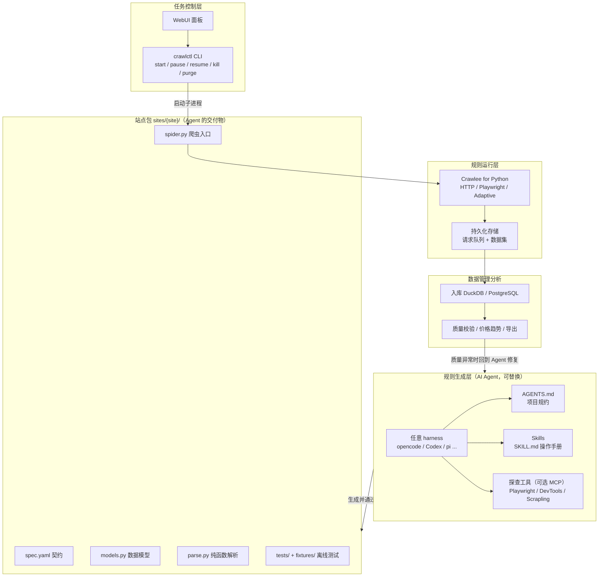
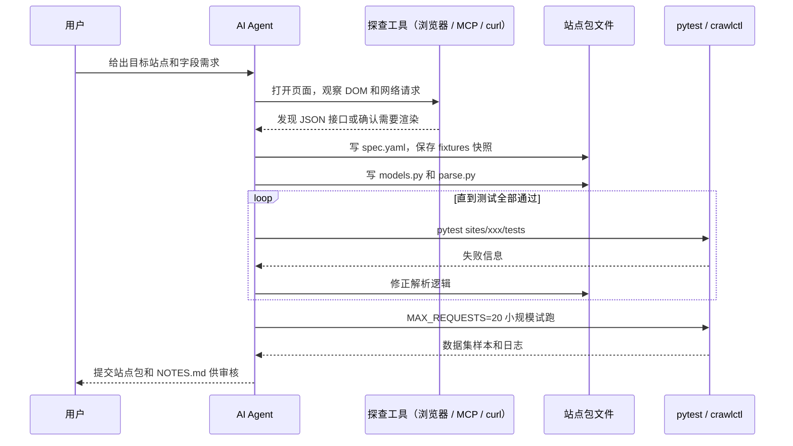
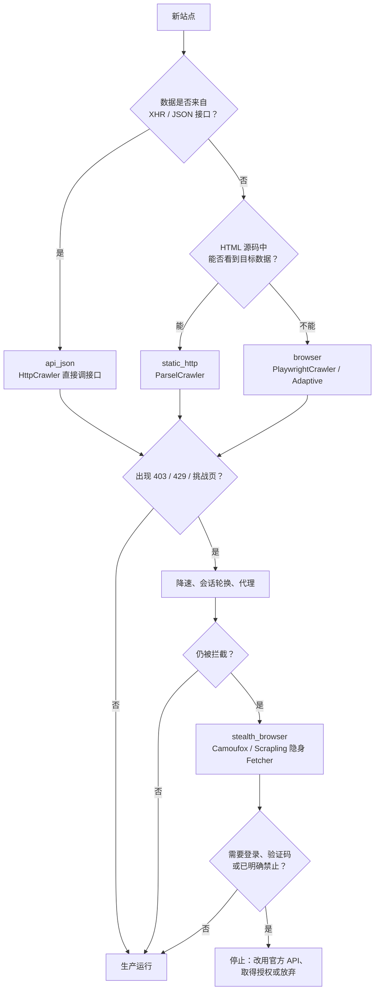
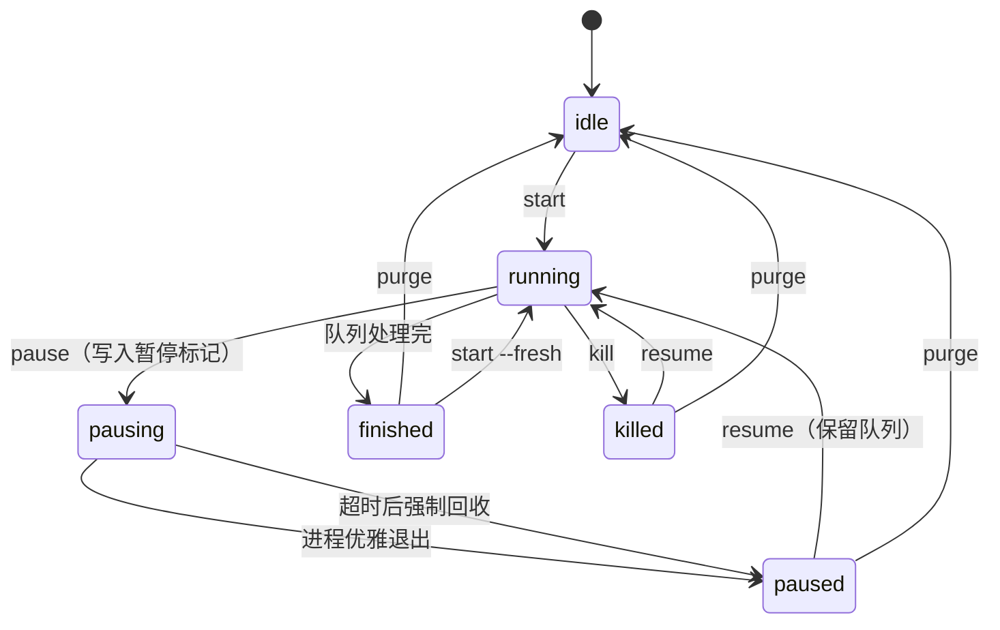
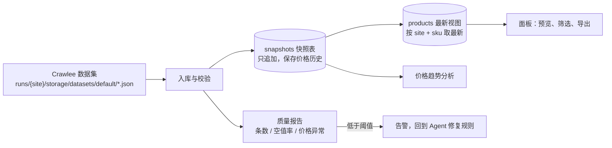

[toc]


## 结论先行：推荐方案一览

核心思路一句话：**AI 只在"写规则"时出场，不在"跑规则"时出场**。Agent 产出的是**确定性的代码、契约和测试**，运行时默认不调用大模型。这样**成本低、结果可复现、可审计**。

| 层                         | 推荐方案（主选）                                             | 备选 / 补充                                                  | 选择理由                                                     |
| -------------------------- | ------------------------------------------------------------ | ------------------------------------------------------------ | ------------------------------------------------------------ |
| **规则生成层**（AI Agent） | 不依赖具体 harness 的"三件套"：**`AGENTS.md` + Skills（`SKILL.md`）+ 项目 CLI**；MCP 只作可选增强 | 探查网页用 Playwright MCP、Chrome DevTools MCP、Scrapling MCP | 任何能读文件、跑 shell 的 agent（opencode、Codex、pi 等）都能直接用 |
| **规则运行层**（框架）     | **Crawlee for Python**                                       | **Scrapy**（保守稳妥）；**Scrapling**（隐身抓取和自适应选择器）；Crawl4AI（探查、生成 schema） | 静态和浏览器两种模式用同一套 API，有自适应切换、会话池、指纹、可持久化的请求队列，并且官方开始集成 AI 爬虫 |
| **任务控制层**             | 自建轻量控制面 **`crawlctl.py`**（已在沙箱实测）+ Streamlit 面板 | 多节点时用 **Crawlab**；纯 Scrapy 时用 ScrapydWeb            | 初学者可以完全看懂，跨平台，以后能平滑迁移                   |
| **数据管理分析**           | **DuckDB**（单机分析）+ Streamlit                            | PostgreSQL + Metabase / Superset                             | 不需要部署服务就能分析 JSON / Parquet                        |

---

## 总体架构



**图解**：
- **站点包**（Site Package）是整个系统的关键接口。Agent 层只负责产出站点包，运行层只负责执行站点包，两边通过文件约定解耦。所以把 Agent 从 opencode 换成 Codex，或者把运行框架从 Crawlee 换成 Scrapy，另一侧都不用改。
- **控制层只认 CLI**。WebUI 只是调用 CLI 的一层外壳。Agent 本身也可以调用 `crawlctl` 做小规模试跑，一套接口给人和 AI 共用。
- **闭环**：数据层的质量检查（比如空值率突然升高）就是网站改版的信号，可以把问题交回 Agent 修复规则。

---

## 核心设计原则

| 等级     | 原则                                                  | 说明                                                         |
| -------- | ----------------------------------------------------- | ------------------------------------------------------------ |
| **必须** | **AI 写规则，运行时确定性执行**                       | 每个页面都调用大模型会让成本随页面数线性增长，结果也不稳定。生成选择器或 schema 时付一次成本，之后零成本运行 |
| **必须** | **解析逻辑写成纯函数，用离线快照测试**                | `parse.py` 只接收 HTML 或 JSON，返回模型对象，不发网络请求。Agent 能在本地反复迭代，不会频繁访问目标站 |
| **必须** | **用 Pydantic 模型做数据契约**                        | 字段类型、取值范围、是否必填都由模型校验。不合规的数据在入口就被拦下，Agent 的产出也有了客观验收标准 |
| **应该** | **抓取策略按"阶梯"逐级升级**                          | 顺序是 JSON 接口 > 静态 HTML > 浏览器渲染 > 隐身浏览器。能用低一级解决就不升级 |
| **应该** | **CLI 优先，MCP 可选**                                | CLI 是所有 harness 的最大公约数。MCP 的配置格式各家不同，部分 harness 有意不内置 MCP |
| **可以** | 运行时 AI 兜底                                        | 选择器失效时用 LLM 抽取一次，同时报警让 Agent 重写规则       |
| **避免** | 让 browser-use 这类"全自主 Agent"直接承担生产批量采集 | 每页都调模型、每次路径都不一样，又慢又贵还难复现，只适合探查阶段 |

官方动向也印证了这个原则：
- **Crawl4AI**：在 `JsonCssExtractionStrategy` 上增加了 LLM 生成 schema 的 `generate_schema` 方法，文档把它定位为**一次性成本、之后无需 LLM 的可复用 schema**（[v0.5.0 发布说明](https://docs.crawl4ai.com/blog/releases/0.5.0/)、[Quick Start](https://docs.crawl4ai.com/core/quickstart/)）。
- **Crawlee for Python**：新版 API 文档里的 `PydanticAiCrawler` 支持传入 `PydanticAiSelectorExtractor`，做**带缓存的 CSS 选择器抽取，LLM 成本接近零**（[API 文档（next）](https://crawlee.dev/python/api/next/class/PydanticAiCrawler)）。

---

## 规则生成层：不绑定 harness 的 AI Agent 设计

### 为什么能做到不绑定

opencode、Codex、pi-agent 等 coding agent 的共同能力只有三项：**读写文件、执行 shell 命令、读取项目说明文件**。只要把"采集规则开发"的全部知识和工具都落到这三项上，就能在不同 harness 之间迁移。

| 机制                                 | 作用                                       | 可移植性                                               | 说明                                                         |
| ------------------------------------ | ------------------------------------------ | ------------------------------------------------------ | ------------------------------------------------------------ |
| **`AGENTS.md`**                      | 项目级规约：目录约定、验收标准、禁止事项   | 高。Codex、opencode 等多数工具会读取（未核实最新清单） | Claude Code 读的是 `CLAUDE.md`，可以用符号链接或一行引用复用 |
| **Skills（`SKILL.md`）**             | 按需加载的"操作手册"，比如"如何新建站点包" | 中高。已形成开放规范，但各 harness 的技能目录位置不同  | 用符号链接把同一份 `skills/` 挂到各 harness 要求的目录       |
| **项目 CLI**（`crawlctl`、`pytest`） | 验证、试跑、查状态                         | **最高**。能执行 shell 就能用                          | 推荐作为主要接口                                             |
| **MCP 服务**                         | 浏览器探查、网络请求抓包、隐身抓取         | 中。各家配置格式不同                                   | 作为可选增强。据我所知 pi-agent 有意不内置 MCP（未核实），这也说明 CLI 优先更稳 |

### 站点包目录约定

Agent 的交付物是一个**自包含的站点目录**：

```bash
sites/
└── books_toscrape/            # 站点标识 site，小写 + 下划线
    ├── spec.yaml              # 契约：入口、策略、礼貌参数、质量门槛
    ├── models.py              # Pydantic 数据模型
    ├── parse.py               # 纯函数解析（不联网）
    ├── spider.py              # Crawlee 爬虫入口（由 crawlctl 启动）
    ├── tests/
    │   ├── fixtures/          # 页面快照（HTML / JSON）
    │   └── test_parse.py      # 离线单测
    └── NOTES.md               # Agent 的探查记录：接口、反爬现象、改版历史
```

### 契约文件 `spec.yaml`

```yaml
site: books_toscrape
display_name: "Books to Scrape（练习站）"
start_urls:
  - "https://books.toscrape.com/"
strategy: static_http          # api_json | static_http | browser | stealth_browser
politeness:
  max_concurrency: 4
  max_tasks_per_minute: 60
  respect_robots_txt: true
schema: models.Product
fields_required: [sku, title, price, in_stock, url]
quality:
  min_items: 900
  max_null_ratio:
    stock_qty: 0.05
    rating: 0.0
schedule: "0 3 * * *"
notes: "练习站，约 1000 本书、50 个列表页"
```

| 字段                              | 含义                                   | 注意事项                                                |
| --------------------------------- | -------------------------------------- | ------------------------------------------------------- |
| `site`                            | 站点唯一标识，同时是目录名、运行目录名 | 定下后不要改，否则历史队列和数据会对不上                |
| `start_urls`                      | 爬取入口                               | 续跑时会被重新加入队列，但会按 URL 去重，不会重复抓取   |
| `strategy`                        | 抓取档位，对应后文的"抓取阶梯"         | `api_json` 表示直接调站点的 XHR / JSON 接口，优先级最高 |
| `politeness.max_concurrency`      | 最大并发请求数                         | 对应 Crawlee 的 `ConcurrencySettings`                   |
| `politeness.max_tasks_per_minute` | 每分钟请求上限，也就是限速             | 比并发数更能直接控制对目标站的压力                      |
| `politeness.respect_robots_txt`   | 是否遵守 `robots.txt`                  | 建议默认 `true`                                         |
| `schema`                          | 数据模型路径                           | 和 `models.py` 中的类对应                               |
| `fields_required`                 | 必须非空的字段                         | 用于验收和监控                                          |
| `quality.min_items`               | 单次全量采集的最低条数                 | 低于它说明可能被封或网站改版                            |
| `quality.max_null_ratio`          | 各字段允许的最大空值比例               | 空值率突然升高通常是选择器失效                          |
| `schedule`                        | cron 表达式（分 时 日 月 周）          | 由控制层读取，例如每天 3 点                             |

### Agent 开发一个站点包的标准流程



**图解**：
- **先探查，后编码**。Agent 先用浏览器工具确认数据来自 HTML 还是 XHR 接口。电商站的价格、库存很多是接口加载的，直接调接口最稳也最省。
- **快照优先**。抓一次页面保存到 `fixtures/`，后面的循环全部离线完成，不会因为反复调试去压目标站。
- **小规模试跑**。通过环境变量限制请求数，确认端到端链路正常后再交给人审核。

### `AGENTS.md` 示例

```markdown
# 项目规约：商品数据采集

## 你的任务
为 `sites/<site>/` 生成或修复"站点包"。交付物必须通过 `pytest sites/<site>/tests` 和一次小规模试跑。

## 必须遵守
- 解析逻辑只能写在 `parse.py`，并且是纯函数：输入 parsel `Selector` 或 dict，输出 `models.py` 中的模型。
- 先把页面快照保存到 `tests/fixtures/`，再写解析代码；测试不得联网。
- 抓取策略按以下顺序选择，并在 `NOTES.md` 写明理由：api_json > static_http > browser > stealth_browser。
- 礼貌参数：并发不超过 4，每分钟请求数不超过 60，遵守 robots.txt。
- 试跑命令：`MAX_REQUESTS=20 python crawlctl.py start <site> --fresh`。

## 禁止
- 禁止采集个人信息（手机号、住址、用户评论里的身份信息等）。
- 禁止绕过登录、付费墙或验证码。遇到这些情况立即停止，并在 NOTES.md 中报告。
- 禁止修改 `crawlctl.py` 和其他站点的目录。

## 参考
- 框架速查：`skills/crawlee-site/SKILL.md`
- Crawlee 版本已在 `pyproject.toml` 中锁定，不要使用文档里没有的 API。
```

### Skill 示例 `skills/crawlee-site/SKILL.md`

Skill 的作用是**把经过验证的 API 用法喂给 Agent**，防止它凭记忆编造不存在的 API。Crawlee Python 的 0.x 和 1.x API 有差异，这个问题在它身上尤其明显。

```markdown
---
name: crawlee-site
description: 新建或修复 sites/ 下的 Crawlee 站点包时使用。包含已验证的 Crawlee for Python 用法片段、目录约定和验收步骤。
---

# 新建站点包
1. 复制 `sites/_template/` 到 `sites/<site>/`。
2. 用 `curl -sL <url> -o tests/fixtures/<name>.html` 或浏览器工具保存快照。
3. 编写 models.py → parse.py → tests，运行 `pytest sites/<site>/tests -q`。

# 已验证的 API 片段（锁定版本，不要使用这里以外的写法）
- 静态页面：`ParselCrawler`，在 handler 中用 `ctx.selector.css(...)`。
- 需要渲染：`PlaywrightCrawler`，在 handler 中用 `ctx.page`。
- 混合站点：`AdaptivePlaywrightCrawler.with_parsel_static_parser(...)`。
- 入队：`await ctx.enqueue_links(selector="...", label="DETAIL")`。
- 输出：`await ctx.push_data(model.model_dump(mode="json"))`。
- 路由：`@crawler.router.default_handler` 和 `@crawler.router.handler("DETAIL")`。

# 遇到 403 / 429 / 验证页
先把 politeness 参数减半并重试；仍然失败就停止，在 NOTES.md 中记录响应特征，不要自行引入绕过方案。
```

### 探查工具（MCP，可选）

| 工具                              | 用途                                                         | 启动方式（未核实最新参数）                  |
| --------------------------------- | ------------------------------------------------------------ | ------------------------------------------- |
| **Playwright MCP**（微软）        | 让 Agent 操作真实浏览器、读取无障碍树（accessibility tree）、截图 | `npx @playwright/mcp@latest`                |
| **Chrome DevTools MCP**（Google） | 查看**网络请求**、性能、控制台，适合找 JSON 接口             | `npx chrome-devtools-mcp@latest`            |
| **Scrapling MCP**                 | 带隐身能力的抓取，返回经过预处理的精简内容                   | 安装 `scrapling[ai]` 后运行 `scrapling mcp` |

据第三方 MCP 汇总站 [Webfuse 2026 榜单](https://www.webfuse.com/mcp/web-scraping) 介绍，Scrapling 的 MCP 服务支持 stdio 和 Streamable HTTP 两种传输，能力包括 Cloudflare 挑战处理、指纹轮换、自适应元素重定位，以及**剥离网页中隐藏的提示词注入（prompt injection）内容**。最后一点对 Agent 安全很有价值：网页内容是不可信输入，可能藏有诱导 Agent 执行危险操作的文字。

各 harness 的 MCP 配置格式不同（以下为训练知识，未核实）：
- 很多工具使用 `{"mcpServers": {"playwright": {"command": "npx", "args": ["@playwright/mcp@latest"]}}}` 这种 JSON 结构。
- **Codex** 在 `~/.codex/config.toml` 中写 `[mcp_servers.playwright]` 段。
- **opencode** 在 `opencode.json` 的 `mcp` 字段里配置 `type: "local"` 和 `command` 数组。

这正是 **CLI 优先**的原因：只要提供一个 `curl` 加 `pytest` 就能跑通的流程，任何 harness 都能完成，MCP 只是让探查更顺手。

---

## 规则运行层：采集框架选型

### 评估维度

| 维度                    | 具体问题                                                     |
| ----------------------- | ------------------------------------------------------------ |
| **灵活性**              | 能否用同一套代码同时处理静态页、动态页和接口？能否自定义中间环节？ |
| **可用性**              | 新手上手难度、文档质量、中文资料                             |
| **稳定性**              | 维护方背景、版本节奏、API 是否频繁破坏性变更                 |
| **现代化**              | 原生 asyncio、类型提示、浏览器集成、HTTP/2、TLS 指纹         |
| **AI 掌握度**           | 训练语料中的代码量（决定 AI 写得是否地道），以及 API 是否简单、规律 |
| **抓取能力**            | 静态、动态、限流、反爬的应对手段                             |
| **对 Agent 的额外支持** | MCP、LLM 抽取、schema 生成、AI 爬虫类                        |
| **任务运维**            | 请求队列持久化（暂停 / 续跑）、重试、会话、代理轮换          |

### 候选框架对比

| 框架                                         | 定位                           | 静态 / 动态 / 反爬                                           | AI 掌握度                             | Agent 支持                                             | 暂停续跑                     | 结论                                                         |
| -------------------------------------------- | ------------------------------ | ------------------------------------------------------------ | ------------------------------------- | ------------------------------------------------------ | ---------------------------- | ------------------------------------------------------------ |
| **Crawlee for Python**（Apify，Apache-2.0）  | 全功能现代爬虫框架             | 强 / 强（内置 Playwright、Adaptive）/ 中强（会话池、browserforge 指纹、代理分级） | 中（较新，1.x API 需要用 Skill 补充） | **AI 爬虫类**：`PydanticAiCrawler`、`StagehandCrawler` | **请求队列落盘**，重启后续跑 | **主选**                                                     |
| **Scrapy**（BSD）                            | 老牌工业级框架                 | 强 / 依赖 `scrapy-playwright` 插件 / 弱（需要自己组装）      | **最高**（语料最多）                  | 无官方支持                                             | `JOBDIR` 持久化              | **保守备选**                                                 |
| **Scrapling**（BSD-3）                       | 自适应解析加隐身抓取           | 强 / 强 / **强**（隐身浏览器、Cloudflare 处理）              | 中低（新，但 API 简单）               | **内置 MCP**、提示词注入过滤                           | 自带 Spider 框架（较新）     | **困难站点补充**和 Agent 探查工具                            |
| **Crawl4AI**（Apache-2.0，许可证细节请核对） | 面向 LLM 的抓取，输出 Markdown | 中 / 强 / 中                                                 | 中                                    | **LLM 抽取**、`generate_schema`、`crwl` CLI            | 有限                         | 适合内容、RAG 类场景和 schema 起草，**不建议作为商品批量采集主框架** |
| **DrissionPage**（国产）                     | 浏览器控制与 requests 合体     | 中 / 强 / 中强（不走 WebDriver）                             | 中（中文资料多）                      | 无                                                     | 无框架级队列                 | 适合单站脚本。**许可证为自定义条款，商用前必须阅读**         |
| **Playwright**（原生）                       | 浏览器自动化基础库             | 不适用 / 强 / 弱                                             | **高**                                | Playwright MCP                                         | 无                           | 作为底层被 Crawlee 封装即可                                  |
| **browser-use、Stagehand**                   | 自然语言驱动浏览器             | 动态强                                                       | 不适用                                | 本身就是 Agent                                         | 无                           | 只用于探查或个别交互步骤                                     |

**为什么主选 Crawlee for Python**：
1. **一套 API 覆盖静态和动态页面**。v0.6 引入的 `AdaptivePlaywrightCrawler` 会根据页面的实时分析，**自动在 Playwright 完整渲染和轻量 HTTP 抓取之间切换**，以降低抓取成本（[v0.6 博客](https://crawlee.dev/blog/crawlee-for-python-v06)）。它推荐用 `with_beautifulsoup_static_parser` 或 `with_parsel_static_parser` 这类工厂方法创建实例（[API 文档](https://crawlee.dev/python/api/class/AdaptivePlaywrightCrawler)）。当前 API 文档显示的版本号是 1.10。
2. **AI 原生扩展**。API 索引里已经有 `PydanticAiCrawler` 和 `StagehandCrawler`（[API 索引](https://crawlee.dev/python/api)）：
   - `PydanticAiCrawler`：传入一个 Pydantic 模型，返回校验过的实例；支持 Pydantic AI 能接入的各家模型（OpenAI、Anthropic、Gemini、Ollama 等）。
   - `StagehandCrawler`：继承 `PlaywrightCrawler`，页面对象额外提供 `act`、`extract`、`observe`、`execute` 四个 AI 方法（[StagehandCrawler 文档](https://crawlee.dev/python/api/next/class/StagehandCrawler)）。
   - 注意：这两个类的文档位于 `next` 路径，**可能属于较新或尚未稳定的版本，使用前请确认已发布**。
3. **运维能力内置**：会话池、重试、默认启用的 browserforge 指纹、存储持久化。这些正好是任务控制层所需的底座。
4. **维护方是 Apify 公司**，有商业平台支撑，持续性比个人项目更有保障。

**主要风险和对策**：
- Crawlee Python 比 Scrapy 新，**AI 可能写出旧版或 JS 版的 API**。对策：锁定版本，在 Skill 里给出已验证片段，并用测试兜底。
- 如果团队已有 Scrapy 积累，或者更看重 AI 写得地道，**选 Scrapy 也完全合理**。站点包的约定不变，只把 `spider.py` 换成 Scrapy Spider，`crawlctl` 的续跑改用 `JOBDIR` 即可。

**Scrapling 的角色**：它由 Karim Shoair 维护，由解析引擎、Fetcher 层、自适应引擎、Spider 框架和 MCP 服务五个子系统组成（[PyShine 2026-05 介绍](https://pyshine.com/Scrapling-AI-Powered-Adaptive-Web-Scraping/)）。
- GitHub star 数各来源差异很大：有说 3.3 万，有说 3.8 万，Webfuse 标注 77.5k。总之**属于热门项目**，但**主要由个人维护**。
- 因此推荐用在两处：一是 **Agent 的探查工具**（MCP）；二是在 `stealth_browser` 档位时，**由 Scrapling 的隐身 Fetcher 取页面，交给同一套 `parse.py` 解析**，不需要把整个运行层押在它上面。

### 抓取阶梯：按需升级



**图解**：
- **接口优先**。电商的商品列表、价格、库存经常通过 JSON 接口加载。直接调接口最快、字段最完整，也最不容易因页面改版失效。
- **反爬应对的第一步是降低自身压力**：限速、减少并发、复用会话。很多 429 限流只是因为请求太快。
- **隐身浏览器**（如 Camoufox，一个改造过的 Firefox；Crawlee 文档有与之集成的示例，未核实最新用法）只适合**公开数据但检测严格**的场景，成本高、速度慢。
- **红线**：遇到登录墙、验证码，或者网站明确禁止，就停止技术对抗，转向合规渠道。

### 综合示例：用 Crawlee 采集练习站 Books to Scrape

[books.toscrape.com](https://books.toscrape.com/) 是专门用于爬虫练习的公开商品站（约 1000 本书），有价格、库存、评分、分页，结构非常适合演示"列表页到详情页"的商品采集。以下代码按前面的站点包约定组织。

**说明**：沙箱没有网络，也没有安装 crawlee 和 parsel，所以 **`models.py` 以外的这几段代码没有在沙箱中实际运行**。它们根据官方文档的 API 编写，请在本地用 `pytest` 和小规模试跑验证。

**`sites/books_toscrape/models.py`：数据契约**

```python
from datetime import datetime, timezone
from decimal import Decimal

from pydantic import BaseModel, Field, HttpUrl


class Product(BaseModel):
    sku: str = Field(min_length=1, description="商品唯一编号，本站为 UPC")
    title: str = Field(min_length=1)
    price: Decimal = Field(gt=0)
    currency: str | None = None
    in_stock: bool
    stock_qty: int | None = Field(default=None, ge=0)
    rating: int | None = Field(default=None, ge=1, le=5)
    url: HttpUrl
    crawled_at: datetime = Field(default_factory=lambda: datetime.now(timezone.utc))
```

| 字段                     | 含义                                 | 约束的作用                                           |
| ------------------------ | ------------------------------------ | ---------------------------------------------------- |
| `sku`                    | 商品唯一编号，用于去重和关联价格历史 | `min_length=1`：取不到就校验失败，及时暴露选择器失效 |
| `price`                  | 价格，使用 `Decimal`                 | **避免 float 精度误差**，金额必须用 Decimal          |
| `in_stock` / `stock_qty` | 是否有货 / 库存数量                  | 数量可为空，因为很多站点不公开                       |
| `rating`                 | 1 到 5 星                            | 超出范围说明解析错误                                 |
| `crawled_at`             | 采集时间（UTC）                      | 价格趋势分析的时间轴，**统一用 UTC 存储**            |

**`sites/books_toscrape/parse.py`：纯函数解析**

```python
import re
from decimal import Decimal

from parsel import Selector

from models import Product

RATING = {"One": 1, "Two": 2, "Three": 3, "Four": 4, "Five": 5}


def parse_detail(sel: Selector, url: str) -> Product:
    """解析商品详情页。只依赖输入的 HTML，不联网，便于离线测试。"""
    main = sel.css("div.product_main")
    price_text = main.css("p.price_color::text").get(default="").strip()      # 例如 "£51.77"
    stock_text = " ".join(t.strip() for t in main.css("p.availability::text").getall()).strip()
    qty = re.search(r"\((\d+) available\)", stock_text)                      # "In stock (22 available)"
    rating_cls = main.css("p.star-rating::attr(class)").get(default="")       # "star-rating Three"
    info = {
        row.css("th::text").get(): row.css("td::text").get()
        for row in sel.css("table.table-striped tr")
    }
    return Product(
        sku=info.get("UPC") or "",
        title=main.css("h1::text").get(default="").strip(),
        price=Decimal(re.sub(r"[^\d.]", "", price_text) or "0"),
        currency="GBP" if "£" in price_text else None,
        in_stock="In stock" in stock_text,
        stock_qty=int(qty.group(1)) if qty else None,
        rating=RATING.get(rating_cls.replace("star-rating", "").strip()),
        url=url,
    )
```

要点：
- **价格只提取数字**（`re.sub(r"[^\d.]", "", ...)`）。即使编码问题把 `£` 显示成 `£`，价格也不受影响。
- 取不到值时故意填 `""` 或 `"0"`，**让 Pydantic 校验失败并报错**，而不是静默产出脏数据。

**`sites/books_toscrape/tests/test_parse.py`：离线测试**

```python
from decimal import Decimal
from pathlib import Path

from parsel import Selector

from parse import parse_detail

FIX = Path(__file__).parent / "fixtures"
URL = "https://books.toscrape.com/catalogue/a-light-in-the-attic_1000/index.html"


def test_detail_a_light_in_the_attic():
    html = (FIX / "a-light-in-the-attic.html").read_text(encoding="utf-8")
    p = parse_detail(Selector(text=html), URL)
    assert p.title == "A Light in the Attic"
    assert p.price == Decimal("51.77")
    assert p.currency == "GBP"
    assert p.in_stock and p.stock_qty == 22
    assert p.rating == 3
    assert p.sku
```

准备快照：在站点目录下执行 `curl -sL "https://books.toscrape.com/catalogue/a-light-in-the-attic_1000/index.html" -o tests/fixtures/a-light-in-the-attic.html`。断言里的期望值来自我对该练习站的记忆，**以你实际保存的快照为准**。运行测试时需要让 `parse` 模块可导入，例如在站点目录下执行 `python -m pytest tests -q`，或者加一个 `conftest.py` 把站点目录加入 `sys.path`。

**`sites/books_toscrape/spider.py`：爬虫入口**

```python
import asyncio
import os
from datetime import timedelta
from pathlib import Path

from crawlee import ConcurrencySettings
from crawlee.crawlers import ParselCrawler, ParselCrawlingContext

from parse import parse_detail

START_URLS = ["https://books.toscrape.com/"]
PAUSE_FLAG = Path(os.environ.get("CRAWL_PAUSE_FLAG", "PAUSE"))


async def watch_pause(crawler: ParselCrawler) -> None:
    """后台轮询暂停标记文件，发现后让爬虫优雅停止（处理中的请求会先完成）。"""
    while not PAUSE_FLAG.exists():
        await asyncio.sleep(1)
    crawler.stop(reason="pause flag detected")


async def main() -> None:
    crawler = ParselCrawler(
        max_requests_per_crawl=int(os.environ.get("MAX_REQUESTS", "2000")),
        max_request_retries=3,
        request_handler_timeout=timedelta(seconds=60),
        concurrency_settings=ConcurrencySettings(max_concurrency=4, max_tasks_per_minute=60),
    )

    @crawler.router.default_handler
    async def list_page(ctx: ParselCrawlingContext) -> None:
        # 列表页：详情链接交给 DETAIL 处理器，下一页回到默认处理器
        await ctx.enqueue_links(selector="article.product_pod h3 a", label="DETAIL")
        await ctx.enqueue_links(selector="li.next a")

    @crawler.router.handler("DETAIL")
    async def detail_page(ctx: ParselCrawlingContext) -> None:
        product = parse_detail(ctx.selector, ctx.request.url)
        await ctx.push_data(product.model_dump(mode="json"))

    watcher = asyncio.create_task(watch_pause(crawler))
    try:
        await crawler.run(START_URLS)
    finally:
        watcher.cancel()


if __name__ == "__main__":
    asyncio.run(main())
```

关键设计：
- **暂停不能写在 handler 里**。如果在 handler 中检测到暂停就 `return`，当前请求会被标记为"已处理"，导致数据丢失。所以用**独立的后台任务**调用 `crawler.stop()`：爬虫不再领取新请求，已经开始的请求正常完成。
- **续跑依赖存储不被清空**。由 `crawlctl` 设置 `CRAWLEE_PURGE_ON_START=0`。重启后，已处理的 URL 留在磁盘队列里，`START_URLS` 重新加入时会被去重跳过，未处理的请求继续执行。
- `crawler.stop()` 在 Crawlee Python 较新版本中存在。如果你使用的版本没有这个方法，就退回到用 `crawlctl kill` 强制回收。**请在本地做一次"中途暂停再续跑"的测试，确认没有漏抓或重抓。**

**动态页面变体**：如果目标数据需要 JS 渲染，把爬虫换成浏览器版本，`parse.py` 基本不用改，因为可以把渲染后的 HTML 交给同一个解析函数：

```python
from parsel import Selector
from crawlee.crawlers import PlaywrightCrawler, PlaywrightCrawlingContext

crawler = PlaywrightCrawler(headless=True, browser_type="chromium", max_requests_per_crawl=200)


@crawler.router.handler("DETAIL")
async def detail_page(ctx: PlaywrightCrawlingContext) -> None:
    await ctx.page.wait_for_selector("div.product_main h1")
    html = await ctx.page.content()
    product = parse_detail(Selector(text=html), ctx.request.url)
    await ctx.push_data(product.model_dump(mode="json"))
```

这体现了"**解析和抓取分离**"的好处：抓取档位从 `static_http` 升级到 `browser`，甚至换成 Scrapling 的隐身 Fetcher，测试和解析代码都可以原样复用。

### 限流与反爬：合规前提下的稳健做法

| 等级     | 做法                                                         |
| -------- | ------------------------------------------------------------ |
| **必须** | 限速（`max_tasks_per_minute`）、限制并发、遇到 429 时指数退避；遵守 `robots.txt` 和网站服务条款 |
| **应该** | 优先使用官方开放 API 或接口；增量采集（只抓变化的部分）；在非高峰时段运行 |
| **应该** | 使用框架自带的会话池和指纹（Crawlee 的 `PlaywrightCrawler` 默认使用 browserforge 指纹和请求头） |
| **可以** | 对公开数据使用代理池分散来源，用隐身浏览器处理较严格的检测   |
| **避免** | 破解验证码、绕过登录或付费墙、采集个人信息、高频压测式抓取。在国内可能触及《网络安全法》、《数据安全法》、《个人信息保护法》以及刑法中"非法获取计算机信息系统数据"等条款，数据使用方式还可能涉及《反不正当竞争法》。海外生产环境需要评估目标地区的法律（如 GDPR、CFAA）。这不是法律意见，商业项目请咨询法务 |

---

## 任务控制层：启动、暂停、续跑、回收、清理

### 任务状态机



| 操作               | 语义               | 实现方式                                                     | 数据影响                       |
| ------------------ | ------------------ | ------------------------------------------------------------ | ------------------------------ |
| **start**          | 启动采集           | 启动子进程，每个站点有独立的 `CRAWLEE_STORAGE_DIR`           | `--fresh` 会先清空队列         |
| **pause**（暂停）  | 优雅停止，可以续跑 | 写入暂停标记文件，爬虫内的 watcher 调用 `crawler.stop()`；超时后强杀 | 队列保留在磁盘                 |
| **resume**（恢复） | 从断点继续         | 不清空存储，重新启动                                         | 已处理的 URL 被去重跳过        |
| **kill**（回收）   | 立即释放资源       | POSIX 下杀整个进程组；Windows 下用 `taskkill /T /F` 连同浏览器子进程一起结束 | 正在处理的少量请求可能需要重试 |
| **purge**（清理）  | 删除队列和数据集   | 删除站点的 `storage` 目录                                    | **不可逆**，先入库再清理       |
| **status**         | 查看状态           | 读 `state.json`，同时检测进程是否存活                        | 无                             |

**为什么"暂停"做成"停止加续跑"，而不是冻结进程**：在 Linux 上用 `SIGSTOP` / `SIGCONT` 冻结进程看起来更像暂停，但会让 TCP 连接和浏览器会话超时，Windows 上也没有对应机制。把"暂停"实现为"优雅退出，状态持久化"更可靠，而且进程退出后浏览器占用的内存会全部释放。

### `crawlctl.py`：跨平台控制 CLI

这个脚本只依赖标准库，**已在沙箱 Linux 环境中用模拟爬虫实测**，验证了 start、pause、resume 后从断点继续，以及 kill、purge 的流程。Windows 分支按 API 文档编写，没有实机测试。

```python
#!/usr/bin/env python3
"""crawlctl: 采集任务控制 CLI（跨平台，仅依赖标准库）。

用法:
  python crawlctl.py start  <site> [--fresh]       启动；--fresh 先清空历史队列
  python crawlctl.py pause  <site> [--timeout 60]  优雅暂停（队列保留在磁盘）
  python crawlctl.py resume <site>                 从磁盘队列继续
  python crawlctl.py kill   <site>                 强制回收进程（浏览器等资源随之释放）
  python crawlctl.py purge  <site>                 清理该站点的队列、数据集和状态
  python crawlctl.py status [site]                 查看状态（JSON）
"""
from __future__ import annotations

import argparse
import json
import os
import shutil
import subprocess
import sys
import time
from pathlib import Path

ROOT = Path(__file__).resolve().parent
SITES = ROOT / "sites"
RUNS = ROOT / "runs"
IS_WIN = os.name == "nt"


def run_dir(site: str) -> Path:
    return RUNS / site


def state_file(site: str) -> Path:
    return run_dir(site) / "state.json"


def pause_flag(site: str) -> Path:
    return run_dir(site) / "PAUSE"


def load_state(site: str) -> dict:
    f = state_file(site)
    return json.loads(f.read_text("utf-8")) if f.exists() else {"site": site, "status": "idle"}


def save_state(site: str, **kv) -> dict:
    st = load_state(site) | kv | {"updated_at": time.strftime("%Y-%m-%d %H:%M:%S")}
    run_dir(site).mkdir(parents=True, exist_ok=True)
    state_file(site).write_text(json.dumps(st, ensure_ascii=False, indent=2), "utf-8")
    return st


def pid_alive(pid: int | None) -> bool:
    if not pid:
        return False
    if IS_WIN:
        out = subprocess.run(["tasklist", "/FI", f"PID eq {pid}", "/NH"],
                             capture_output=True, text=True).stdout
        return str(pid) in out
    try:
        os.kill(pid, 0)
    except OSError:
        return False
    # 回收僵尸进程，避免 kill(pid, 0) 误判存活
    try:
        done, _ = os.waitpid(pid, os.WNOHANG)
        return done == 0
    except ChildProcessError:
        return True


def refresh(site: str) -> dict:
    """进程已退出时，根据暂停标记推断最终状态。"""
    st = load_state(site)
    if st.get("status") in ("running", "pausing") and not pid_alive(st.get("pid")):
        new = "paused" if pause_flag(site).exists() else "finished"
        st = save_state(site, status=new, pid=None)
    return st


def start(site: str, fresh: bool = False) -> dict:
    spider = SITES / site / "spider.py"
    if not spider.exists():
        sys.exit(f"spider not found: {spider}")
    st = refresh(site)
    if st["status"] in ("running", "pausing"):
        sys.exit(f"{site} is already {st['status']} (pid={st.get('pid')})")
    if fresh:
        purge(site)
    rd = run_dir(site)
    rd.mkdir(parents=True, exist_ok=True)
    pause_flag(site).unlink(missing_ok=True)
    env = os.environ | {
        "CRAWLEE_STORAGE_DIR": str(rd / "storage"),  # 每个站点独立存储
        "CRAWLEE_PURGE_ON_START": "0",               # 关键：不清空，才能续跑
        "CRAWL_PAUSE_FLAG": str(pause_flag(site)),
        "PYTHONUTF8": "1",                            # Windows 下避免中文日志乱码
    }
    log = open(rd / "run.log", "a", encoding="utf-8")
    kw = {"creationflags": subprocess.CREATE_NEW_PROCESS_GROUP} if IS_WIN else {"start_new_session": True}
    p = subprocess.Popen([sys.executable, str(spider)], cwd=spider.parent, env=env,
                         stdout=log, stderr=subprocess.STDOUT, **kw)
    return save_state(site, status="running", pid=p.pid, started_at=time.strftime("%Y-%m-%d %H:%M:%S"))


def pause(site: str, timeout: int = 60) -> dict:
    st = refresh(site)
    if st["status"] != "running":
        sys.exit(f"{site} is {st['status']}, nothing to pause")
    pause_flag(site).touch()  # 爬虫内的 watcher 发现后调用 crawler.stop()
    save_state(site, status="pausing")
    deadline = time.time() + timeout
    while time.time() < deadline:
        if not pid_alive(st["pid"]):
            return save_state(site, status="paused", pid=None)
        time.sleep(1)
    print(f"graceful pause timed out after {timeout}s, killing", file=sys.stderr)
    kill(site, keep_flag=True)
    return save_state(site, status="paused", pid=None)


def resume(site: str) -> dict:
    st = refresh(site)
    if st["status"] not in ("paused", "killed", "finished", "idle"):
        sys.exit(f"{site} is {st['status']}, cannot resume")
    return start(site, fresh=False)


def kill(site: str, keep_flag: bool = False) -> dict:
    st = load_state(site)
    pid = st.get("pid")
    if pid and pid_alive(pid):
        if IS_WIN:
            subprocess.run(["taskkill", "/PID", str(pid), "/T", "/F"], capture_output=True)
        else:
            import signal
            try:
                os.killpg(pid, signal.SIGKILL)  # 杀整个进程组，连同浏览器子进程
            except ProcessLookupError:
                pass
            time.sleep(0.5)
            pid_alive(pid)
    if not keep_flag:
        pause_flag(site).unlink(missing_ok=True)
    return save_state(site, status="killed", pid=None)


def purge(site: str) -> dict:
    st = refresh(site)
    if st["status"] in ("running", "pausing"):
        sys.exit(f"{site} is {st['status']}; pause/kill it first")
    shutil.rmtree(run_dir(site) / "storage", ignore_errors=True)
    pause_flag(site).unlink(missing_ok=True)
    return save_state(site, status="idle", pid=None)


def status(site: str | None) -> list[dict]:
    names = [site] if site else sorted(p.name for p in SITES.iterdir() if (p / "spider.py").exists())
    return [refresh(n) for n in names]


def main() -> None:
    ap = argparse.ArgumentParser(description=__doc__, formatter_class=argparse.RawDescriptionHelpFormatter)
    sub = ap.add_subparsers(dest="cmd", required=True)
    for name in ("start", "pause", "resume", "kill", "purge"):
        sp = sub.add_parser(name)
        sp.add_argument("site")
        if name == "start":
            sp.add_argument("--fresh", action="store_true", help="清空历史队列后重新开始")
        if name == "pause":
            sp.add_argument("--timeout", type=int, default=60, help="优雅暂停的最长等待秒数")
    sub.add_parser("status").add_argument("site", nargs="?")
    a = ap.parse_args()
    if a.cmd == "start":
        out = start(a.site, a.fresh)
    elif a.cmd == "pause":
        out = pause(a.site, a.timeout)
    elif a.cmd == "status":
        out = status(a.site)
    else:
        out = globals()[a.cmd](a.site)
    print(json.dumps(out, ensure_ascii=False, indent=2))


if __name__ == "__main__":
    main()
```

| 环境变量或文件           | 含义                                                         |
| ------------------------ | ------------------------------------------------------------ |
| `CRAWLEE_STORAGE_DIR`    | Crawlee 的存储根目录（请求队列、数据集、键值存储）。每个站点隔离，放在 `runs/<site>/storage` |
| `CRAWLEE_PURGE_ON_START` | 启动时是否清空存储。**设为 `0` 是续跑的前提**                |
| `CRAWL_PAUSE_FLAG`       | 暂停标记文件路径，是控制层和爬虫之间的约定                   |
| `runs/<site>/state.json` | 任务状态：`status`、`pid`、时间戳                            |
| `runs/<site>/run.log`    | 爬虫日志（追加写入，UTF-8）                                  |

**沙箱实测输出摘要**：模拟爬虫每秒产出一条，共 6 条。
- 第 3 条后执行 `pause`，状态变为 `paused`，日志出现 `pausing at 3`。
- 执行 `resume` 后从第 4 条继续到第 6 条，状态变为 `finished`。
- 随后 `kill` 返回 `killed`，`purge` 返回 `idle`，`storage` 目录已删除。

### 现成控制平台对比（以下均为训练知识，未核实）

| 方案                                | 特点                                                         | 适用                                             |
| ----------------------------------- | ------------------------------------------------------------ | ------------------------------------------------ |
| **自建 `crawlctl` + Streamlit**     | 最轻，完全可控，跨平台                                       | **单机起步阶段（推荐）**                         |
| **Crawlab**                         | 国内团队开发，Go 加 Vue，支持多语言爬虫、分布式节点、调度、日志、结果查看；有社区版和 Pro 版 | 多节点、多人协作。请先确认社区版近期是否活跃     |
| **Scrapyd + ScrapydWeb / Gerapy**   | Scrapy 专用的部署和管理界面                                  | 选了 Scrapy 时使用                               |
| **Prefect / Dagster / APScheduler** | 通用调度和编排                                               | 定时任务多、需要依赖编排时，在外层包一层         |
| **Apify 平台**                      | Crawlee 的原生云平台                                         | 有免费额度，但不能自托管，不符合"开源自建"的目标 |

---

## 数据管理与分析层

### 数据流和存储模型



**图解**：
- **快照表只追加**。每次采集都把 `(site, sku, price, stock, crawled_at)` 追加一行，价格历史自然形成，这正是商品数据最有价值的部分。
- **最新视图**用 SQL 窗口函数按 `(site, sku)` 取 `crawled_at` 最大的一行，用于日常预览。
- **质量报告**对照 `spec.yaml` 的 `quality` 段，是网站改版的预警器。

### 面板示例：控制和分析合一（Streamlit + DuckDB）

沙箱没有 streamlit 和 duckdb，**这段代码未实际运行**。Crawlee 数据集目录里除了逐条的 JSON，还有以 `__` 开头的元数据文件，所以代码会把它们过滤掉。不同版本的目录结构请以实际为准。

```python
# panel.py  启动：streamlit run panel.py
import json
import subprocess
import sys
from pathlib import Path

import duckdb
import streamlit as st

ROOT = Path(__file__).resolve().parent


def ctl(*args: str) -> str:
    r = subprocess.run([sys.executable, str(ROOT / "crawlctl.py"), *args],
                       capture_output=True, text=True, encoding="utf-8")
    return r.stdout or r.stderr


st.set_page_config(page_title="商品采集控制台", layout="wide")
rows = json.loads(ctl("status") or "[]")
site = st.sidebar.selectbox("站点", [r["site"] for r in rows]) if rows else None
tab_ctl, tab_data = st.tabs(["任务控制", "数据分析"])

with tab_ctl:
    st.dataframe(rows, use_container_width=True)
    if site:
        for col, cmd in zip(st.columns(5), ["start", "pause", "resume", "kill", "purge"]):
            if col.button(cmd, key=cmd, type="primary" if cmd == "start" else "secondary"):
                st.code(ctl(cmd, site), language="json")
        log = ROOT / "runs" / site / "run.log"
        if log.exists():
            st.text_area("最近日志", log.read_text("utf-8", errors="replace")[-4000:], height=300)

with tab_data:
    if site:
        ds = ROOT / "runs" / site / "storage" / "datasets" / "default"
        files = [str(p) for p in ds.glob("*.json") if not p.name.startswith("__")] if ds.exists() else []
        if not files:
            st.info("暂无数据")
        else:
            con = duckdb.connect()
            df = con.execute("SELECT * FROM read_json_auto(?)", [files]).df()
            c1, c2, c3 = st.columns(3)
            c1.metric("商品数", len(df))
            c2.metric("有货比例", f"{df['in_stock'].mean():.0%}")
            c3.metric("均价", f"{df['price'].astype(float).mean():.2f}")
            st.dataframe(df, use_container_width=True)
            st.download_button("导出 CSV（Excel 兼容）",
                               df.to_csv(index=False).encode("utf-8-sig"),
                               file_name=f"{site}.csv", mime="text/csv")
```

要点：
- **导出 CSV 用 `utf-8-sig`**（带 BOM），否则 Windows 上用 Excel 打开中文会乱码。
- `pause` 按钮会阻塞到爬虫优雅退出，最长等待 `--timeout` 秒。规模大了以后应该改成异步任务，或者换成 FastAPI 加前端。
- 多人使用、长期运行时，把快照写入 **PostgreSQL**，用 **Metabase** 或 **Apache Superset** 做 BI，Streamlit 只保留控制功能。

---

## 环境搭建（跨平台，考虑国内网络）

推荐用 **uv** 管理 Python 项目，它跨平台、速度快、能锁定版本，方便在多台设备上复现环境。

```bash
# Linux / macOS
curl -LsSf https://astral.sh/uv/install.sh | sh
# 国内可选：使用清华 PyPI 镜像
export UV_DEFAULT_INDEX="https://pypi.tuna.tsinghua.edu.cn/simple"

uv init crawl-system && cd crawl-system
uv add "crawlee[parsel,playwright]" pydantic pytest streamlit duckdb pyyaml
uv run playwright install chromium        # 下载浏览器，体积较大
```

```powershell
# Windows PowerShell
powershell -ExecutionPolicy ByPass -c "irm https://astral.sh/uv/install.ps1 | iex"
$env:UV_DEFAULT_INDEX = "https://pypi.tuna.tsinghua.edu.cn/simple"
$env:PYTHONUTF8 = "1"
uv add "crawlee[parsel,playwright]" pydantic pytest streamlit duckdb pyyaml
uv run playwright install chromium
```

| 场景                                      | Linux / macOS                                                | Windows（PowerShell）                                        |
| ----------------------------------------- | ------------------------------------------------------------ | ------------------------------------------------------------ |
| 使用本地代理（如 mihomo，端口按实际配置） | `export HTTPS_PROXY=http://127.0.0.1:7890 HTTP_PROXY=http://127.0.0.1:7890` | `$env:HTTPS_PROXY="http://127.0.0.1:7890"; $env:HTTP_PROXY="http://127.0.0.1:7890"` |
| Playwright 浏览器下载慢                   | 先走代理；或设置 `PLAYWRIGHT_DOWNLOAD_HOST` 指向镜像（国内镜像地址请先核实可用性） | 同左，用 `$env:` 语法                                        |
| 下载 GitHub 资源                          | 在原链接前加 `https://gh-proxy.com/` 等加速前缀（第三方服务，可用性会变化，用前测试） | 同左                                                         |
| npx 启动 MCP                              | `npm config set registry https://registry.npmmirror.com`     | 同左                                                         |

**跨平台注意事项**：
- **换行符**：在仓库里加 `.gitattributes`，写入 `* text=auto eol=lf`，防止 Windows 上编辑的 `.sh` 文件因为 CRLF 换行无法运行。
- **中文编码**：日志和文件读写一律显式指定 `encoding="utf-8"`；Windows 下设置 `PYTHONUTF8=1`（`crawlctl` 已为子进程设置）。
- **进程控制差异**：POSIX 用进程组和信号，Windows 用 `CREATE_NEW_PROCESS_GROUP` 加 `taskkill /T`，`crawlctl` 已分别处理。
- **生产环境在海外服务器**：不需要镜像，但要注意**数据中心 IP 更容易被识别为机器流量**，而且要评估目标站点所在地区的法律。

---

## 落地路线图（建议的推进顺序）

1. **跑通第一个站点**：照抄本文的 Books to Scrape 示例。手工完成 `models.py`、`parse.py`、测试和 `crawlctl` 试跑，理解每一层在做什么。
2. **交给 Agent**：写好 `AGENTS.md` 和 Skill，让 Agent 为第二个站点生成站点包。你只负责审核 `NOTES.md` 和测试。
3. **加入面板**：用 Streamlit 面板管理多个站点，数据入库到 DuckDB，建立价格历史。
4. **加入质量闭环**：每次运行后对照 `spec.yaml` 的 `quality` 段检查，不达标就自动生成"修复任务"交给 Agent。
5. **扩展**：站点多了以后再引入调度（APScheduler / Prefect）、PostgreSQL、Crawlab 多节点；困难站点接入 Scrapling 隐身 Fetcher。

---

## 最佳实践清单

- **必须**：在运行阶段尽量去掉 LLM，让 AI 产出可测试的确定性规则。
- **必须**：解析写成纯函数，用离线快照测试，用 Pydantic 校验，金额用 `Decimal`，时间用 UTC。
- **必须**：限速、遵守 robots 和服务条款，不采集个人信息，不绕过登录和验证码。
- **应该**：接口优先，按抓取阶梯逐级升级；暂停用"优雅停止加持久化续跑"实现。
- **应该**：锁定框架版本，用 Skill 提供已验证的 API 片段，减少 AI 编造 API。
- **应该**：给每个站点隔离存储目录、日志和状态，方便单独清理和排错。
- **可以**：用 MCP 增强 Agent 的探查能力；用 `PydanticAiCrawler` 或 Crawl4AI 的 `generate_schema` 起草选择器，再固化为代码。
- **避免**：让全自主浏览器 Agent 跑生产批量任务；在 handler 里 `return` 来实现暂停；`purge` 前不入库；把整个系统押在单一个人维护的项目上。

---

## 信息依据和后续搜索建议

**本轮核实过的来源**（检索时间约 2026 年 10 月）：
- Crawlee 官方：[v0.6 发布博客](https://crawlee.dev/blog/crawlee-for-python-v06)、[Python API 索引](https://crawlee.dev/python/api)、[AdaptivePlaywrightCrawler](https://crawlee.dev/python/api/class/AdaptivePlaywrightCrawler)、[PydanticAiCrawler（next）](https://crawlee.dev/python/api/next/class/PydanticAiCrawler)、[StagehandCrawler（next）](https://crawlee.dev/python/api/next/class/StagehandCrawler)
- Crawl4AI 官方：[v0.5.0 发布说明](https://docs.crawl4ai.com/blog/releases/0.5.0/)、[Quick Start](https://docs.crawl4ai.com/core/quickstart/)
- Scrapling 第三方介绍：[Webfuse 2026 MCP 榜单](https://www.webfuse.com/mcp/web-scraping)、[PyShine 2026-05](https://pyshine.com/Scrapling-AI-Powered-Adaptive-Web-Scraping/)

**没有核实、来自训练知识的内容**：Scrapy 和 scrapy-playwright 的现状、Playwright MCP 和 Chrome DevTools MCP 的参数、各 harness 的 MCP 和 Skills 配置路径、Crawlab 的活跃度、DrissionPage 和 Crawl4AI 的许可证细节、Camoufox 集成、国内镜像地址、`crawler.stop()` 和 Crawlee 存储目录结构在你所用版本中的具体行为。

**建议下一轮搜索的关键词**：
- `Crawlee Python changelog 2026 stop() request queue persistence`、`Crawlee PydanticAiCrawler release`
- `Scrapling spider pause resume 2026`、`Scrapling vs Crawlee`
- `Crawlab 2026 社区版 更新`、`Crawlab alternative open source`
- `Agent Skills SKILL.md opencode codex pi support 2026`
- `Playwright CLI for coding agents 2026`、`chrome-devtools-mcp network requests`
- `Crawl4AI license attribution 2026`、`DrissionPage 许可证 商用`
- `Camoufox maintenance 2026`、`patchright nodriver comparison 2026`
- `Firecrawl self-host limitations 2026`、`Crawl4AI alternative`
- `电商 爬虫 合规 判例 2026`