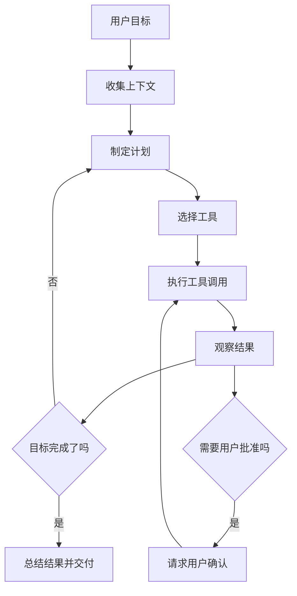
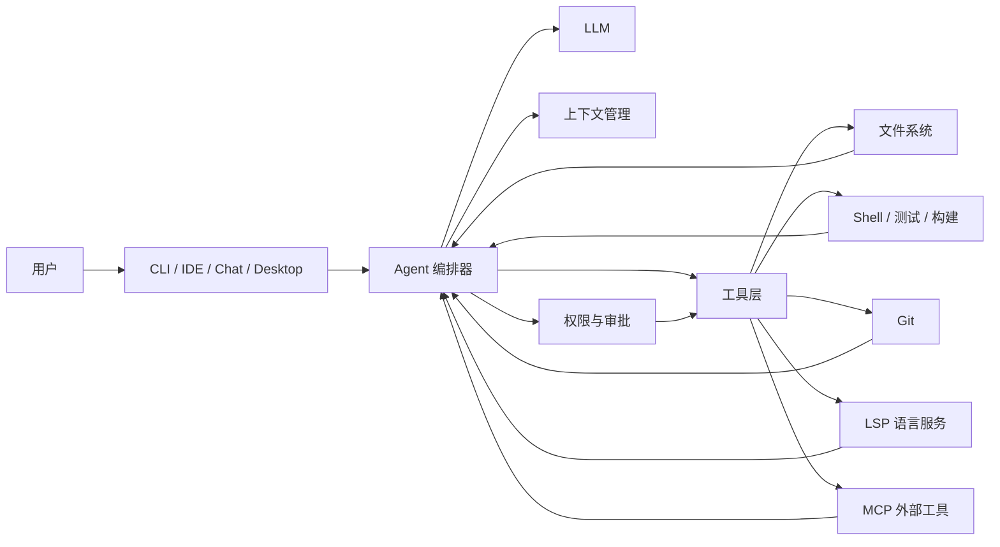
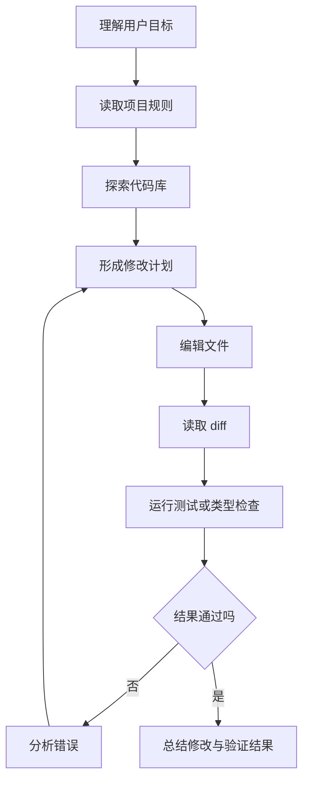
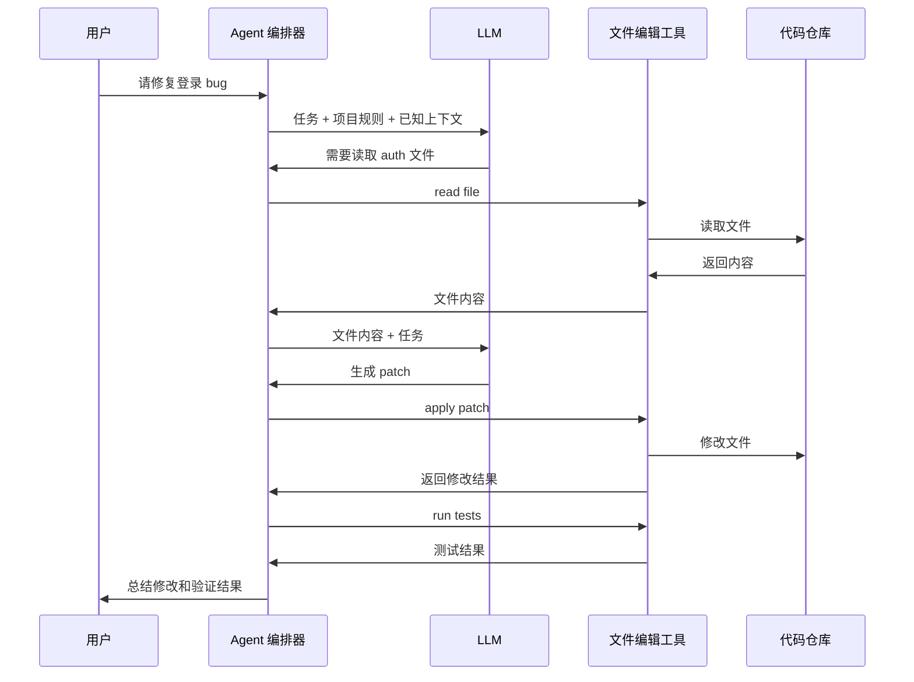
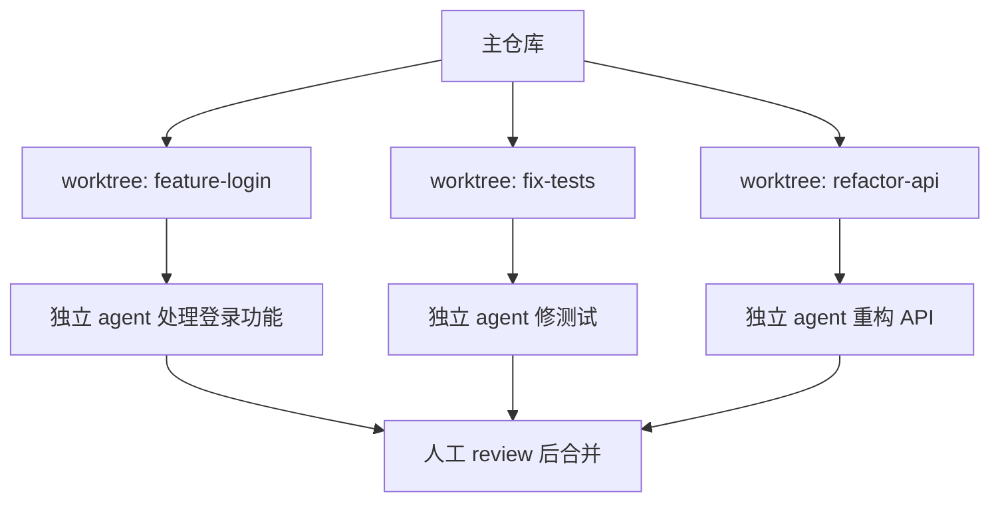
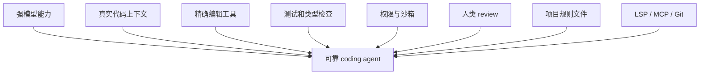

[toc]

## abstrct

为保证现代性与准确性，我会把 **AI agent**、**coding agent**、**Codex / Claude Code / OpenCode / OpenClaw** 放在同一套架构框架下理解。需要先说明一点：**OpenClaw 更像是把 Discord、Slack、Telegram、WhatsApp 等聊天渠道连接到 AI coding agents 的自托管网关，而不是单一的代码编辑 agent**；它的重点是“多渠道接入、网关、会话与 agent 调度”。([OpenClaw](https://docs.openclaw.ai/?utm_source=chatgpt.com))

## 大纲

### 基础认知

- 什么是 AI agent
- 什么是 coding agent
- agent 与普通聊天机器人的区别
- 当前典型工具的定位
- 新手应该建立的核心心智模型

### 系统结构

- 大语言模型（Large Language Model, LLM）
- 上下文窗口（Context Window）
- 工具调用（Tool Calling）
- 工作空间（Workspace）
- 沙箱（Sandbox）
- 权限与审批（Permissions / Approvals）
- 记忆与项目规则（Memory / Project Instructions）
- 外部工具协议：MCP、LSP、Git、测试框架

### 工作循环

- 观察（Observe）
- 规划（Plan）
- 行动（Act）
- 验证（Verify）
- 反思与重试（Reflect / Retry）
- 交给人类审查（Human Review）

### coding agent 如何准确编辑代码文件

- 它并不是“在脑中修改文件”
- 文件编辑由宿主程序执行
- 常见编辑方式：精确替换、补丁、整文件重写、结构化编辑
- 为什么 diff / patch 比直接生成完整文件可靠
- 如何定位要改的文件与代码块
- 如何避免改错文件、改错位置、破坏格式
- 如何通过测试、类型检查、lint、LSP 反馈闭环提高准确率

### 规则、配置与上下文工程

- `AGENTS.md`、`CLAUDE.md` 等规则文件
- 项目级、用户级、目录级规则
- 规则不是魔法，规则会竞争上下文预算
- 好规则与坏规则的区别
- 如何为新项目写 agent 友好的说明

### 安全与可靠性

- 最小权限原则
- 沙箱与审批的区别
- 为什么不能一上来就开最高权限
- 如何隔离实验性修改
- 如何防止误删、泄密、跑危险命令
- 如何审查 agent 生成的代码

### 新手最佳实践

- 从读代码开始，不要急着让 agent 大改
- 小步提交，小步验证
- 先让 agent 解释，再让 agent 修改
- 让 agent 输出计划、影响范围、测试策略
- 用 Git、测试、CI、review 兜底
- 不要把 agent 当“绝对正确的程序员”

------

## 什么是 AI agent

**AI agent** 可以理解为：一个由大语言模型驱动，能够根据目标、上下文和工具反馈，持续采取行动的系统。

普通聊天机器人通常是：

> 用户提问，模型回答。

而 agent 更像是：

> 用户给目标，模型读取环境，制定计划，调用工具，观察结果，继续调整，直到完成任务或需要用户决策。

一个现代 AI agent 通常包含这些部分：

| 组成       | 英文术语                  | 作用                                             |
| ---------- | ------------------------- | ------------------------------------------------ |
| 大语言模型 | Large Language Model, LLM | 理解任务、生成计划、选择工具、解释结果           |
| 工具系统   | Tools / Tool Calling      | 让模型能读文件、搜代码、跑命令、访问 API         |
| 环境       | Environment               | 代码仓库、终端、浏览器、数据库、云服务等         |
| 上下文     | Context                   | 用户需求、项目规则、文件内容、历史对话、工具结果 |
| 权限控制   | Permissions / Approvals   | 限制 agent 能做什么，哪些动作需要确认            |
| 执行循环   | Agent Loop                | 观察、计划、行动、验证、重试                     |
| 记忆或规则 | Memory / Instructions     | 长期偏好、项目约定、架构说明、禁止事项           |
| 反馈机制   | Feedback                  | 测试结果、编译错误、lint、用户评价、代码审查     |

ReAct 论文把“推理”和“行动”交替结合起来：模型一边推理任务，一边通过外部工具获取信息或执行动作，这正是许多 agent 系统的思想基础。([arXiv](https://arxiv.org/abs/2210.03629?utm_source=chatgpt.com))

可以把 agent 的核心循环画成这样：



这里最重要的认识是：**LLM 本身只是生成文本或结构化工具调用，真正读文件、改文件、跑命令的是 agent 宿主程序**。比如 Claude Code 官方说明它能读取代码库、编辑文件、运行命令并集成开发工具；Codex 也强调本地命令运行在受限沙箱中，文件和网络访问由沙箱与审批策略控制。([Claude](https://code.claude.com/docs/en/overview?utm_source=chatgpt.com))

------

## 什么是 coding agent

**Coding agent** 是专门面向软件工程任务的 AI agent。它不只是“生成一段代码”，而是能围绕一个代码仓库完成更完整的软件开发循环。

典型能力包括：

| 能力          | 说明                                                  |
| ------------- | ----------------------------------------------------- |
| 读代码        | 查看文件、搜索符号、理解目录结构                      |
| 定位问题      | 根据报错、测试失败、issue 描述找到相关模块            |
| 修改代码      | 用 edit、write、patch、diff 等工具更改文件            |
| 运行命令      | 执行测试、构建、lint、类型检查、格式化                |
| 使用 Git      | 查看 diff、分支、提交历史，必要时创建 PR              |
| 调用外部工具  | 通过 MCP、浏览器、文档服务、Figma、数据库等补充上下文 |
| 多 agent 协作 | 主 agent 委派子任务给 subagent                        |
| 长任务管理    | 多轮执行、压缩上下文、恢复会话、并行工作              |

Codex、Claude Code、OpenCode 都属于这个范畴：Codex 是 OpenAI 的 coding agent，可处理写功能、修 bug、回答代码库问题和提出 PR 等任务；Claude Code 是 agentic coding tool，可以读代码库、编辑文件、运行命令并集成开发工具；OpenCode 是开源 coding agent，可在终端、IDE 或桌面使用，并强调 LSP 支持、多会话和开放性。([OpenAI](https://openai.com/index/introducing-codex/?utm_source=chatgpt.com))

### 典型工具定位对比

| 工具        | 更准确的定位                  | 主要入口                    | 关键特点                                                     |
| ----------- | ----------------------------- | --------------------------- | ------------------------------------------------------------ |
| Codex       | OpenAI coding agent           | CLI、IDE、桌面 app、云环境  | 沙箱、审批、`AGENTS.md`、MCP、subagents、并行任务            |
| Claude Code | Anthropic agentic coding tool | 终端、IDE、桌面 app、浏览器 | 文件读写、命令执行、权限、hooks、subagents、worktrees、`CLAUDE.md` |
| OpenCode    | 开源 AI coding agent          | 终端、IDE、桌面             | 开源、LSP、权限系统、多 session、工具化 patch/edit           |
| OpenClaw    | 自托管 AI assistant gateway   | 聊天渠道、CLI、网关         | 把多种聊天 app 与 coding agents 连接起来，偏“网关与编排”     |

OpenCode 文档明确列出权限项包括 `read`、`edit`、`bash`、`task`、`skill`、`lsp` 等，其中 `edit` 覆盖文件修改、写入和 patch；它的工具文档也提到精确文本替换和 apply_patch。([OpenCode](https://opencode.ai/docs/permissions/?utm_source=chatgpt.com))

------

## agent 与普通代码生成器的本质区别

普通代码生成器更像：

> “请写一个函数。”
> 模型直接输出函数代码。

coding agent 更像：

> “这个项目登录失败，帮我修好。”
> agent 先读项目结构，再找登录相关文件，运行测试，定位失败原因，修改代码，重新跑测试，给出 diff 和解释。

区别可以总结为：

| 维度             | 普通聊天模型         | Coding agent                                 |
| ---------------- | -------------------- | -------------------------------------------- |
| 输入             | 一段 prompt          | 目标、仓库、历史、规则、工具结果             |
| 输出             | 文本或代码片段       | 文件修改、命令结果、diff、PR、解释           |
| 是否接触真实环境 | 通常不接触           | 会读真实文件、执行命令                       |
| 能否自我验证     | 较弱                 | 可运行测试、lint、类型检查                   |
| 是否有权限边界   | 通常没有实际操作权限 | 有 sandbox、permissions、approval            |
| 适合任务         | 问答、解释、小段代码 | 修 bug、重构、补测试、迁移代码、理解大型项目 |

所以，coding agent 的能力不只来自模型本身，还来自 **工具、权限、上下文、验证闭环、工程化执行器** 的组合。

------

## 现代 coding agent 的系统结构



### 用户界面层

入口可以是终端、IDE、桌面 app、浏览器或聊天工具。

- Claude Code 支持终端、IDE、桌面 app 和浏览器。([Claude](https://code.claude.com/docs/en/overview?utm_source=chatgpt.com))
- Codex 有 CLI、IDE 扩展、桌面 app 和云端/沙箱化执行形态；Codex app 还强调管理多个 agents、并行运行和处理长任务。([OpenAI](https://openai.com/index/introducing-the-codex-app/?utm_source=chatgpt.com))
- OpenClaw 的核心价值是把多个聊天渠道接到本机或服务器上的 AI assistant / coding agent。([OpenClaw](https://docs.openclaw.ai/?utm_source=chatgpt.com))

### Agent 编排器

编排器负责把模型、工具、权限、上下文连接起来。它通常会做这些事：

| 工作         | 说明                                           |
| ------------ | ---------------------------------------------- |
| 组装 prompt  | 把用户目标、规则、文件片段、历史结果放进上下文 |
| 调用模型     | 让模型判断下一步该做什么                       |
| 解析工具调用 | 将模型输出转换成 read、grep、edit、bash 等动作 |
| 权限检查     | 判断动作是否允许，是否需要用户批准             |
| 执行动作     | 由宿主程序实际读写文件或执行命令               |
| 回填结果     | 把命令输出、文件内容、错误信息返回给模型       |
| 管理循环     | 决定继续、重试、询问用户或结束                 |

### 工具层

工具层是 agent “能做事”的关键。常见工具包括：

| 工具类型 | 英文术语                      | 例子                                   |
| -------- | ----------------------------- | -------------------------------------- |
| 文件读取 | Read                          | 读取源代码、配置、README               |
| 文件搜索 | Grep / Search                 | 搜索函数名、错误信息、TODO             |
| 文件匹配 | Glob                          | 找到符合路径模式的文件                 |
| 文件编辑 | Edit / Write / Patch          | 精确替换、整文件写入、应用 diff        |
| 命令执行 | Bash / Shell                  | 跑测试、构建、格式化                   |
| Git 操作 | Git                           | 查看 diff、status、log、branch         |
| 语言服务 | Language Server Protocol, LSP | 诊断、跳转定义、引用查找、代码动作     |
| 外部协议 | Model Context Protocol, MCP   | 访问文档、数据库、浏览器、Figma 等     |
| 子代理   | Subagent                      | 把搜索、审查、迁移等任务拆给独立 agent |

LSP 是现代 coding agent 很重要的“代码智能”来源。

LSP 规范支持 hover、跳转定义、诊断、补全、code action 等语言功能；OpenCode 文档也说明 LSP 可帮助 agent 通过语言服务器诊断来发现和修复问题。([GitHub Microsoft](https://microsoft.github.io/language-server-protocol/specifications/lsp/3.17/specification/?utm_source=chatgpt.com))

MCP 则是把模型连接到外部工具和上下文的标准化方式。

MCP 官方规范把能力分为 tools、resources、prompts 等：tools 让模型调用外部系统，resources 给模型提供文件、数据库 schema 或应用上下文，prompts 提供可复用的提示模板。([Model Context Protocol](https://modelcontextprotocol.io/specification/2025-06-18/server/tools?utm_source=chatgpt.com))

------

## coding agent 的工作循环

可以把 coding agent 的执行过程理解成一个不断收敛的循环：



### 观察

观察阶段包括：

- 读取项目说明
- 查看目录结构
- 搜索关键字
- 阅读相关文件
- 查看测试、报错、issue、日志
- 理解已有架构和编码风格

新手常犯的错误是直接说“帮我实现 X”，但不给上下文。更好的方式是让 agent 先观察：

> 先不要修改代码。请阅读项目结构，找出实现登录逻辑的关键文件，并总结它们的职责。

### 规划

规划阶段不是形式主义。它帮助 agent 减少盲改。

好的计划通常包括：

| 内容             | 例子                                      |
| ---------------- | ----------------------------------------- |
| 要改哪些文件     | `src/auth/login.ts`、`tests/auth.test.ts` |
| 为什么改这些文件 | 登录失败发生在 token refresh 分支         |
| 修改策略         | 保留现有 API，只修复过期 token 判断       |
| 验证方式         | 跑 auth 单测和类型检查                    |
| 风险             | 可能影响 refresh token 重试逻辑           |

### 行动

行动就是调用工具：

- read 文件
- grep 搜索
- edit 修改
- apply_patch 应用补丁
- bash 跑测试
- git diff 查看变化

现代工具通常不建议模型“凭记忆”改代码，而是让模型先读取最新文件，再基于真实内容生成补丁。Codex 文档说明本地执行时有 OS 级沙箱和审批策略；Claude Code 文档也提供工具、权限和 hooks 配置，以控制读写、命令执行和自动化行为。([OpenAI开发者](https://developers.openai.com/codex/agent-approvals-security?utm_source=chatgpt.com))

### 验证

验证阶段是 coding agent 可靠性的核心。

验证方式包括：

| 验证方式         | 能发现的问题                       |
| ---------------- | ---------------------------------- |
| 重新读取文件     | 确认 patch 是否按预期应用          |
| `git diff`       | 检查实际改动范围                   |
| 单元测试         | 检查局部逻辑                       |
| 集成测试         | 检查模块协作                       |
| 类型检查         | 检查接口、类型、泛型错误           |
| lint             | 检查风格、潜在错误                 |
| 格式化           | 保持项目风格一致                   |
| LSP diagnostics  | 获取编辑器级错误反馈               |
| 人类 code review | 检查需求理解、设计合理性、安全风险 |

SWE-bench 这类基准也体现了 coding agent 的核心评价方式：给定真实代码库和真实 issue，模型需要生成能解决问题的 patch；SWE-bench Verified 是一个人工验证过的 500 个实例子集，用于更可靠地评估真实软件问题修复能力。([GitHub](https://github.com/swe-bench/SWE-bench?utm_source=chatgpt.com))

------

## coding agent 如何准确编辑代码文件

coding agent 准确编辑代码，不是因为 LLM 天生知道你的文件，而是因为宿主工具把“读文件、定位、生成补丁、应用补丁、验证结果”做成了受控流程。

### 文件编辑不是 LLM 直接完成的

LLM 通常不会直接打开磁盘文件。它会输出类似这样的意图：

- 读取某文件
- 搜索某字符串
- 将某段旧文本替换为新文本
- 应用某个 patch
- 运行某条命令
- 查看测试结果

真正执行这些动作的是 Codex、Claude Code、OpenCode 这样的宿主程序。

可以理解为：



### 常见文件编辑方式

| 编辑方式        | 英文术语                     | 工作方式                           | 优点                            | 风险                         |
| --------------- | ---------------------------- | ---------------------------------- | ------------------------------- | ---------------------------- |
| 精确替换        | Exact Text Replacement       | 找到完全匹配的旧文本，替换成新文本 | 简单、可控、适合小改动          | 旧文本不唯一或已变化时会失败 |
| 多点替换        | MultiEdit                    | 对同一文件做多个精确替换           | 适合批量小改                    | 顺序和上下文要准确           |
| 整文件写入      | Write                        | 重新写入整个文件                   | 适合新文件或小文件              | 大文件容易误删细节           |
| **补丁**        | Patch / Diff                 | 生成带上下文的差异补丁             | 最接近真实开发流程，便于 review | patch 上下文不匹配会失败     |
| AST 编辑        | Abstract Syntax Tree Editing | 基于语法树定位节点后修改           | 理论上更结构化                  | 工具复杂，语言支持有限       |
| LSP code action | Language Server Code Action  | 调用语言服务器提供的修复动作       | 适合 import、rename、诊断修复   | 依赖语言服务器质量           |

OpenCode 的工具文档提到，其编辑工具可以通过精确文本匹配进行精确修改，也支持 apply_patch 应用补丁；它的权限系统把 edit、write、patch 都纳入文件修改权限。([OpenCode](https://opencode.ai/docs/tools/?utm_source=chatgpt.com))

### 为什么 patch / diff 常常更可靠

直接让模型输出完整文件有几个问题：

- 容易漏掉原文件中的细节
- 大文件会消耗大量上下文
- 很难 review
- 容易破坏格式或注释
- 并发修改时容易覆盖别人改动

而 diff / patch 的优势是：

| 优势     | 说明                                             |
| -------- | ------------------------------------------------ |
| 局部性强 | 只描述要改的片段                                 |
| 可审查   | 人类可以快速看出变更范围                         |
| 有上下文 | patch hunk 通常包含修改前后的邻近行              |
| 可失败   | 如果上下文对不上，工具会拒绝应用，而不是盲目覆盖 |
| 适合 Git | 与 code review、CI、PR 流程天然兼容              |

准确编辑的核心不是“模型一次写对”，而是：

> 让模型提出局部修改，由工具严格应用，由测试和 diff 验证，由人类最终审查。

### agent 如何定位要改哪里

coding agent 通常会组合多种信息源：

| 信息源          | 用途                                              |
| --------------- | ------------------------------------------------- |
| 文件名          | 根据命名定位模块，比如 `auth`、`login`、`payment` |
| grep 搜索       | 搜索函数名、错误信息、接口名                      |
| import / export | 追踪模块依赖                                      |
| 调用链          | 找到谁调用谁                                      |
| 测试文件        | 理解预期行为                                      |
| 报错堆栈        | 定位异常行                                        |
| Git 历史        | 理解最近改动                                      |
| LSP             | 查定义、引用、诊断                                |
| README / docs   | 理解业务规则                                      |
| 项目规则文件    | 理解编码规范和架构约束                            |

Tree-sitter 这类工具能构建代码的具体语法树，并支持随着编辑增量更新语法树；LSP 则提供跳转定义、诊断、补全、code action 等语言级功能，这些能力能显著增强 agent 对代码结构的理解。([GitHub](https://github.com/tree-sitter/tree-sitter?utm_source=chatgpt.com))

### agent 如何避免改错

现代 coding agent 主要通过以下机制降低风险：

| 机制         | 作用                               |
| ------------ | ---------------------------------- |
| 先读后改     | 不凭空假设文件内容                 |
| 精确匹配     | 旧文本不匹配就不应用               |
| patch 上下文 | 修改点周围有上下文，减少错位       |
| 权限限制     | 不允许随便改工作区外文件           |
| 审批流程     | 高风险命令或越界访问需要确认       |
| 沙箱         | 限制文件系统和网络访问             |
| 测试反馈     | 发现语法、类型、逻辑错误           |
| git diff     | 让人和 agent 都能审查实际改动      |
| worktree     | 多任务并行时隔离不同修改           |
| hooks        | 自动格式化、阻止敏感操作、审计变更 |

Codex 官方把安全控制分成沙箱模式和审批策略：沙箱定义 agent 技术上能访问什么，审批策略定义什么时候必须停下来请求许可。Claude Code 也提供权限规则、OS 级 sandbox 文件系统限制和 hooks，可用于控制文件读写、网络、命令执行以及自动格式化或阻止受保护文件修改。([OpenAI开发者](https://developers.openai.com/codex/agent-approvals-security?utm_source=chatgpt.com))

------

## 上下文管理是 agent 成败的关键

LLM 不是直接“知道整个项目”。它只能看到被放进上下文窗口的内容。

### 上下文窗口

**上下文窗口（Context Window）** 是模型一次推理时能看到的信息总量。里面可能包括：

- 用户任务
- 系统指令
- 项目规则
- 最近对话
- 文件片段
- 搜索结果
- 命令输出
- 测试失败信息
- 工具说明

问题是：真实项目通常远大于上下文窗口。因此 agent 必须做选择：

| 策略       | 说明                             |
| ---------- | -------------------------------- |
| 搜索优先   | 先 grep / glob 找相关文件        |
| 摘要压缩   | 把历史对话和文件内容压缩成摘要   |
| 分层规则   | 根目录规则 + 子目录规则          |
| 子任务隔离 | 用 subagent 搜集信息，只返回摘要 |
| 稀疏读取   | 只读相关文件和相关片段           |
| 迭代补充   | 缺什么再读什么，而不是一次塞满   |

Claude Code 文档明确区分 `CLAUDE.md` 与自动记忆，并说明这些内容会作为上下文加载，但不是强制执行的配置；如果要真正阻止某类动作，应使用 PreToolUse hook 等强制机制。([Claude](https://code.claude.com/docs/en/memory?utm_source=chatgpt.com))

### 项目规则文件

常见规则文件包括：

| 文件                 | 常见工具              | 用途                                   |
| -------------------- | --------------------- | -------------------------------------- |
| `AGENTS.md`          | Codex、部分跨工具生态 | 项目说明、构建命令、测试命令、编码规范 |
| `CLAUDE.md`          | Claude Code           | 项目记忆、约定、常用命令               |
| `.codex/config.toml` | Codex                 | 模型、权限、sandbox、MCP 等配置        |
| `opencode.json`      | OpenCode              | 权限、LSP、工具、agent 配置            |
| `.cursor/rules`      | Cursor                | 项目规则                               |
| 自定义 docs          | 各工具都可读          | 架构说明、开发流程、领域知识           |

Codex 文档说明它会在开始工作前读取 `AGENTS.md`，并支持全局、项目级和目录层级的规则覆盖；相关研究也发现，`AGENTS.md` 正在成为跨工具的仓库级配置标准之一，并且在一些实验中与更低的运行时间和输出 token 消耗相关。([OpenAI开发者](https://developers.openai.com/codex/guides/agents-md?utm_source=chatgpt.com))

### 好的项目规则长什么样

不要写成：

> 你是世界上最强的程序员。请写出完美代码。

这类规则几乎没有工程价值。

更好的写法是：

```markdown
## 项目概览

这是一个 Next.js + TypeScript 项目，使用 pnpm 管理依赖。

## 常用命令

- 安装依赖：pnpm install
- 类型检查：pnpm typecheck
- 单元测试：pnpm test
- lint：pnpm lint

## 编码规范

- 优先使用函数式组件
- 新增公共函数必须补测试
- 不要直接修改数据库迁移文件，除非用户明确要求
- API 错误统一使用 src/lib/errors.ts 中的 AppError

## 工作流程

- 修改前先说明计划
- 修改后运行相关测试
- 最终回复中列出修改文件、测试结果和潜在风险
```

### 规则文件的注意事项

| 原则         | 说明                                 |
| ------------ | ------------------------------------ |
| 短而具体     | 规则越长，越容易占满上下文           |
| 写真实命令   | 不要让 agent 猜测试命令              |
| 写禁止事项   | 比如不要改生成文件、不要提交 secrets |
| 写架构边界   | 哪些模块不能互相依赖                 |
| 写验证标准   | 改完要跑哪些测试                     |
| 分目录放规则 | 大型 monorepo 不要所有规则堆在根目录 |
| 定期清理     | 过时规则会误导 agent                 |

------

## 权限、沙箱与审批

这是 coding agent 新手最容易忽视、但非常关键的一层。

### 三者区别

| 概念 | 英文术语    | 解决的问题                                    |
| ---- | ----------- | --------------------------------------------- |
| 权限 | Permissions | agent 被允许使用哪些工具、访问哪些路径        |
| 审批 | Approvals   | 某个动作执行前是否需要用户确认                |
| 沙箱 | Sandbox     | 即使 agent 想越界，操作系统或宿主环境也阻止它 |

Codex 官方说明：默认网络访问关闭，本地命令在 OS 强制沙箱中执行；沙箱控制技术边界，审批策略控制什么时候暂停请求用户批准。([OpenAI开发者](https://developers.openai.com/codex/agent-approvals-security?utm_source=chatgpt.com))

Claude Code 文档也强调：权限规则可以控制 Edit、Read、WebFetch 等工具访问；sandbox.filesystem 则在 OS 级边界控制子进程能访问的路径。([Claude](https://code.claude.com/docs/en/settings?utm_source=chatgpt.com))

### 推荐的新手权限模式

| 场景                       | 推荐模式                      |
| -------------------------- | ----------------------------- |
| 初次接触陌生项目           | 只读，让 agent 分析和计划     |
| 小范围 bug 修复            | 允许工作区内编辑，命令需审批  |
| 跑测试和格式化             | 允许常见安全命令              |
| 安装依赖                   | 需要审批                      |
| 网络访问                   | 默认禁止，必要时审批          |
| 修改工作区外文件           | 默认禁止                      |
| 删除文件、迁移数据库、部署 | 必须人工确认                  |
| 私有仓库或生产环境         | 最小权限 + 审计 + 人工 review |

不要一开始就使用完全无审批、全文件系统、全网络权限。这样虽然省事，但风险很高：误删文件、泄露密钥、执行危险脚本、修改错误项目都可能发生。

------

## 子代理、并行任务与长任务

现代 coding agent 越来越多地支持 **subagent**。

### subagent 是什么

**Subagent** 是由主 agent 派生出的专用 agent，通常有自己的上下文窗口、工具权限和任务说明。

适合场景：

| 场景             | 用 subagent 的原因                   |
| ---------------- | ------------------------------------ |
| 大型代码库搜索   | 避免主上下文被大量搜索结果污染       |
| 并行排查多个模块 | 提高速度                             |
| 代码审查         | 让一个 agent 写，另一个 agent review |
| 测试补全         | 主 agent 改功能，子 agent 补测试     |
| 文档总结         | 子 agent 阅读长文档，只返回摘要      |

Codex 文档说明它可以通过 subagent workflow 并行生成专用 agent 并汇总结果；Claude Code 文档也说明 subagent 有自己的上下文窗口、自定义系统提示、特定工具访问和独立权限。([OpenAI开发者](https://developers.openai.com/codex/subagents?utm_source=chatgpt.com))

### worktree 隔离

当多个 agent 并行改同一个仓库时，最怕互相覆盖。Git worktree 可以让每个 agent 在独立工作目录和分支上工作。Claude Code 文档说明，每个 session 运行在自己的 git worktree 中时，一个 session 的编辑不会触碰另一个 session 的文件。([Claude](https://code.claude.com/docs/en/worktrees?utm_source=chatgpt.com))

适合流程：



------

## MCP 在 coding agent 中的作用

**MCP（Model Context Protocol）** 是一个越来越重要的概念。它的目标是让模型用标准方式连接外部工具和上下文。

在 coding agent 中，MCP 常用于：

| 用途              | 例子                             |
| ----------------- | -------------------------------- |
| 查外部文档        | 读取框架、SDK、内部文档          |
| 访问设计工具      | 读取 Figma 设计稿                |
| 查询数据库 schema | 理解表结构                       |
| 连接浏览器        | 检查页面状态                     |
| 调用内部服务      | 查询 issue、CI、监控             |
| 暴露自定义工具    | 公司内部代码生成、发布、审计工具 |

Codex 文档说明 MCP 可以让 Codex 访问第三方文档，或与浏览器、Figma 等开发工具交互。([OpenAI开发者](https://developers.openai.com/codex/mcp?utm_source=chatgpt.com))

但 MCP 不是越多越好。工具越多，选择错误工具、传错参数、增加上下文成本的风险也越高。2026 年关于 MCP 工具描述质量的研究指出，工具描述质量会影响 agent 是否正确选择工具；改进描述能提升成功率，但也可能增加执行步数和成本。([arXiv](https://arxiv.org/abs/2602.14878?utm_source=chatgpt.com))

### 好的 MCP 工具描述

应该包含：

| 要素        | 说明                           |
| ----------- | ------------------------------ |
| 工具目的    | 这个工具解决什么问题           |
| 输入 schema | 参数类型、必填项、默认值       |
| 适用场景    | 什么时候应该用                 |
| 不适用场景  | 什么时候不要用                 |
| 副作用      | 是否会写数据库、发请求、改文件 |
| 权限边界    | 能访问什么，不能访问什么       |
| 示例        | 给一两个典型调用               |

------

## coding agent 的可靠性来源

很多人以为 coding agent 靠的是“模型更聪明”。这只说对了一部分。

更完整地看，可靠性来自多层叠加：



### 模型能力

模型需要能理解需求、代码、错误信息、设计权衡。但模型仍可能幻觉、漏看上下文、误判边界。

### 工具能力

工具要能精确读写文件、运行命令、返回清晰错误。工具设计越好，agent 越容易做对。

### 上下文质量

上下文要足够相关、不过载、不过时。错误或过时的项目规则会让 agent 稳定地做错事。

### 验证闭环

没有测试的 agent 很容易“看起来完成了”。有测试、类型检查、lint、CI 的项目，agent 成功率通常更高。

### 人类审查

agent 适合加速，但不应绕过 review。尤其是安全、权限、支付、数据迁移、认证、加密、并发、基础设施相关代码。

------

## 新手如何正确使用 coding agent

### 从只读任务开始

新手不要一上来就让 agent 大改。

可以先练这些任务：

| 任务        | 推荐 prompt                                          |
| ----------- | ---------------------------------------------------- |
| 理解项目    | “先不要修改代码。请阅读项目结构，解释主要模块职责。” |
| 找入口      | “请找出用户登录流程从前端到后端经过哪些文件。”       |
| 找 bug 位置 | “根据这个报错，先定位最可能的问题文件，不要修改。”   |
| 总结测试    | “请说明这个测试文件覆盖了哪些行为。”                 |
| 评估风险    | “如果修改这个函数，可能影响哪些调用方？”             |

### 小步修改

不要说：

> 帮我重构整个项目。

更好：

> 先只重构 `src/auth/session.ts`，保持外部 API 不变。修改前给计划，修改后运行相关测试并展示 diff 摘要。

### 明确约束

好的约束包括：

| 约束类型 | 示例                                                |
| -------- | --------------------------------------------------- |
| 范围     | “只修改 `src/auth` 和相关测试。”                    |
| 风格     | “保持现有函数式风格，不引入类。”                    |
| 依赖     | “不要新增依赖。”                                    |
| 兼容性   | “不能改变 public API。”                             |
| 验证     | “完成后运行 `pnpm test auth` 和 `pnpm typecheck`。” |
| 安全     | “不要读取 `.env`，不要执行部署命令。”               |
| 交付     | “最后列出修改文件、原因、测试结果、风险。”          |

### 让 agent 先计划再改

推荐格式：

```text
请按以下流程执行：

先只读分析，不要修改文件。
找出相关文件和调用链。
给出修改计划，包括要改的文件、原因、风险和验证方式。
等我确认后，再应用修改。
```

如果你信任项目和 agent，可以改成：

```text
请先给出简短计划，然后直接修改。
修改后运行相关测试。
最后给出 diff 摘要、测试结果和剩余风险。
```

### 每次只让它解决一个明确问题

差的任务：

> 优化一下这个项目。

好的任务：

> `pnpm test` 中 `auth refresh token` 相关测试失败。请定位原因并修复。不要改测试断言，除非你能证明断言与需求冲突。

### 使用 Git 做护栏

强烈建议：

| 做法                        | 原因               |
| --------------------------- | ------------------ |
| 修改前 `git status`         | 确认工作区是否干净 |
| 开新分支                    | 隔离 agent 修改    |
| 小步提交                    | 方便回滚           |
| 查看 `git diff`             | 确认真实改动       |
| 用 PR review                | 保持团队流程       |
| 不让 agent 自动提交到主分支 | 防止错误进入主线   |

------

## 写给 coding agent 的高质量 prompt 模板

### 只读分析模板

```text
你现在只做只读分析，不要修改任何文件。

目标：
解释当前项目中用户登录流程的实现方式。

请完成：
- 找出关键入口文件
- 说明前端、后端、数据库或外部服务之间的调用关系
- 标出最重要的函数和数据结构
- 总结潜在风险或不清楚的地方

不要执行写入操作，不要安装依赖，不要访问网络。
```

### 安全修 bug 模板

```text
目标：
修复用户登录后偶发 401 的问题。

约束：
- 只修改 auth 相关代码和必要测试
- 不要新增依赖
- 不要改变公开 API
- 不要读取 .env 或任何 secrets
- 修改前先说明计划
- 修改后运行相关测试和类型检查

交付：
- 修改了哪些文件
- 为什么这样改
- 测试结果
- 仍然存在的风险
```

### 重构模板

```text
目标：
重构 src/services/payment.ts，提高可读性，但保持行为不变。

约束：
- 不改变导出的函数签名
- 不改变错误类型
- 不改变日志字段名
- 需要补充或更新测试来证明行为不变
- 每次修改尽量小步

验证：
- 运行 payment 相关测试
- 运行类型检查
- 展示 diff 摘要
```

### 代码审查模板

```text
请审查当前 git diff。

重点关注：
- 是否满足需求
- 是否有潜在 bug
- 是否破坏兼容性
- 是否有安全问题
- 是否缺少测试
- 是否存在过度设计

请按严重程度分组：
- 必须修复
- 建议修复
- 可以接受
```

------

## 常见失败模式

| 失败模式     | 表现                    | 应对                                   |
| ------------ | ----------------------- | -------------------------------------- |
| 上下文不足   | 改错模块、误解需求      | 先只读分析，让 agent 找相关文件        |
| 规则过时     | 按旧架构写代码          | 定期维护 `AGENTS.md` / `CLAUDE.md`     |
| 任务太大     | 一次改太多，难 review   | 拆成小任务                             |
| 没跑测试     | 代码看似正确但实际失败  | 明确要求运行测试和类型检查             |
| 盲目新增依赖 | 引入不必要复杂度        | prompt 中写“不要新增依赖”              |
| 覆盖人工修改 | 改动混在一起            | 修改前检查 git status                  |
| 权限过宽     | 执行危险命令            | 使用最小权限和审批                     |
| 生成假修复   | 只让测试过，不修根因    | 要求解释根因和影响范围                 |
| 过度重构     | 顺手改一大片            | 限定修改范围                           |
| 忽略安全     | 泄露 secrets、绕过 auth | 禁止读取敏感文件，人工 review 安全代码 |

------

## 工具配置的最佳实践

### `AGENTS.md` 或项目说明

推荐包含：

| 内容     | 是否必要 | 例子                                       |
| -------- | -------- | ------------------------------------------ |
| 项目简介 | 必要     | “这是一个 Node.js monorepo。”              |
| 包管理器 | 必要     | “使用 pnpm，不要使用 npm。”                |
| 常用命令 | 必要     | `pnpm test`、`pnpm lint`                   |
| 测试策略 | 必要     | “修改 auth 必须跑 auth tests。”            |
| 架构边界 | 建议     | “web 不应直接 import server/db。”          |
| 禁止事项 | 必要     | “不要修改 generated 文件。”                |
| 安全规则 | 必要     | “不要读取 secrets，不要运行 deploy。”      |
| 风格约定 | 建议     | “优先使用 async/await，不使用 callbacks。” |
| 交付格式 | 建议     | “最终回复包含文件、测试、风险。”           |

### hooks

Claude Code 的 hooks 可以在生命周期事件中运行 shell 命令、HTTP 端点或 LLM prompt，可用于自动格式化、阻止命令、发送通知、重新注入上下文、审计配置变更等。([Claude](https://code.claude.com/docs/en/hooks?utm_source=chatgpt.com))

常见 hooks 用途：

| 用途             | 例子                                |
| ---------------- | ----------------------------------- |
| 自动格式化       | 文件编辑后跑 prettier               |
| 阻止敏感文件修改 | 禁止改 `.env`、密钥、迁移文件       |
| 命令审计         | 记录 agent 执行过的 bash 命令       |
| 自动测试         | 修改特定目录后跑对应测试            |
| 自动提醒         | agent 等待用户输入时通知            |
| 安全检查         | 阻止 `rm -rf`、部署、生产数据库命令 |

### LSP

为项目启用 LSP 对 coding agent 很有帮助，尤其是 TypeScript、Python、Go、Rust、Java 等语言。

LSP 可以提供：

- 语法错误
- 类型错误
- 未使用变量
- 跳转定义
- 查找引用
- rename
- code action
- import 修复

OpenCode 文档明确支持配置 LSP，并说明 LSP diagnostics 可帮助 agent 找到并修复问题。([OpenCode](https://opencode.ai/docs/lsp/?utm_source=chatgpt.com))

------

## 新手学习路线

| 阶段     | 目标                               | 练习                                |
| -------- | ---------------------------------- | ----------------------------------- |
| 入门     | 理解 agent 与聊天模型区别          | 让 agent 只读解释一个小项目         |
| 基础     | 掌握 read、grep、edit、bash 的作用 | 让 agent 找 bug 但不修改            |
| 文件编辑 | 理解 patch / diff                  | 让 agent 修改一个小函数并展示 diff  |
| 验证     | 学会用测试兜底                     | 要求 agent 修改后跑测试             |
| 配置     | 写项目规则文件                     | 创建 `AGENTS.md` 或 `CLAUDE.md`     |
| 权限     | 学会控制风险                       | 使用只读、workspace-write、审批     |
| 大项目   | 学会上下文管理                     | 让 agent 分模块分析 monorepo        |
| 团队协作 | 接入 review 和 CI                  | 用分支、PR、CI 管理 agent 代码      |
| 高级     | subagent、MCP、hooks               | 用子代理做审查，用 hooks 自动格式化 |

------

## 最重要的心智模型

### Agent 是“会使用工具的模型”，不是魔法程序员

它的能力来自：

> 模型推理 + 真实上下文 + 工具调用 + 权限控制 + 验证闭环。

### Agent 不应该绕过工程流程

好的 coding agent 工作流应该融入已有工程实践：

- Git
- 测试
- CI
- code review
- lint
- 类型检查
- 安全审查
- 小步提交

### 让 agent 做“可验证”的事

差的目标：

> 写得更好一点。

好的目标：

> 修复这个测试失败，不改变 public API，完成后跑指定测试。

### 准确编辑代码的关键是闭环

可以用一句话总结：

> 先读真实文件，再生成局部补丁，由工具严格应用，再用测试和 diff 验证，最后由人类审查。

这就是 Codex、Claude Code、OpenCode 这类 coding agents 能够相对准确编辑代码文件的根本原因。