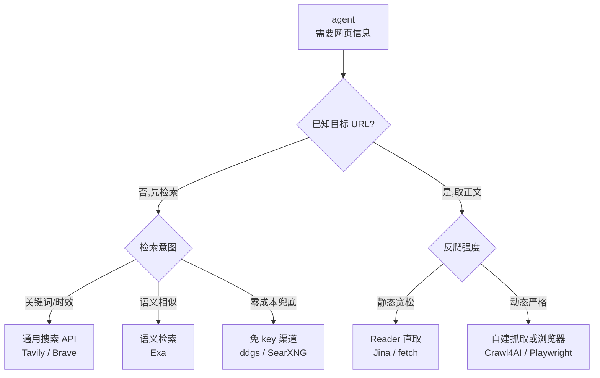

[toc]

## 概述

AI agent(智能体)要回答时效性问题、核对版本与价格、采集产品数据,都绕不开两件事:**联网搜索**(找到相关网页)与**网页抓取**(取回正文)。本文系统梳理截至 2026-10-30,agent 可直接调用的免费搜索与抓取资源及低价付费延伸,覆盖国内外方案,给出免费额度、限制与选型建议。

调研方法:首轮按决策档预算完成 16 次联网检索,应用户要求解除预算限制后追加核验,合计 32 次检索(含 3 次超时重试)与 10 次正文读取;优先采用官方定价页与官方文档,社区口径均明确标注;数字档位为撰写时点快照,各厂商额度调整频繁,落地前应以官方页面复核。

复核记录(2026-10-30,全程经本机代理出口):逐项对照官方页面重查核心数字,并实际跑通一个免 key 单文件 MCP 项目。据此修正了 Google CSE 停服、Gemini grounding 档位、Jina 免费 key 速率、Parallel 免费口径等条目,补充了 ddgs 自带 API/MCP、Anthropic web fetch 免按次计费、Brave LLM Context 端点等此前遗漏的通道;仍未复核的条目集中列在 **证据与缺口** 一节。

## 五类免费通道总览

agent 获取网页信息的免费资源可归为五类通道,各自解决不同环节的问题:

| 通道 | 代表资源 | 免费形态 | 解决什么 |
| --- | --- | --- | --- |
| 通用搜索 API | Tavily、Brave、Exa、Parallel | 月度额度或一次性赠额 | 检索发现"该看哪些网页" |
| 免 key 与自建搜索 | ddgs、SearXNG、Whoogle、免 key 单文件 MCP | 零注册、零费用 | 无账号成本、完全可控的兜底 |
| 网页抓取与 Reader | Jina Reader、Firecrawl、Crawl4AI | 免 key 限流、月度积分、开源自建 | 把"已知 URL"变成干净正文 |
| 大模型内置联网 | Gemini grounding、国产模型搜索工具 | 按天免费档或赠送资源包 | 已有模型 API 时顺带获得搜索 |
| 垂直开放数据源 | Wikipedia、GitHub、arXiv、HN | 完全免费 | 结构化领域数据直连 |

推荐阅读顺序:先看 **通道选型决策** 一节建立整体路由思路,再按需查阅各通道细节;落地配置参考 **场景化选型建议**。

## 通道选型决策



图的读法:第一层按 **是否已知 URL** 判定,分成检索与取正文两条路径——不知道去哪找走检索分支,已知网页要看内容走取正文分支。检索路径再按意图三分:找事实与新闻用通用搜索 API,找"相似的页面"用语义检索,没有账号与预算时走免 key 渠道。取正文路径按 **反爬强度** 分流:静态站点直接用 Reader 类服务,动态渲染或反爬严格的站点用自建抓取与浏览器自动化。图中任一通道触发限流或免费额度耗尽时,按本文各节的替代方案横向切换。

## 通用搜索 API

SERP(SERP,Search Engine Results Page,搜索引擎结果页)类 API 把搜索引擎结果结构化返回给程序。主流服务的免费额度如下,数字为 2026-10-30 复核快照:

| 服务 | 免费额度 | 刷新方式 | 关键限制 |
| --- | --- | --- | --- |
| Tavily | 1000 credits(积分) | 每月 | 1 credit 约合 1 次基础搜索;爬取、深度研究类调用按多倍计 |
| Brave Search | 每月 $5 额度,约 1000 次 | 每月 | $5/1000 次;新账户需绑卡验身(停留额度内不扣费);老的 free plan 订阅者仍保留 2000 次/月 |
| Google CSE | 100 次/天,仅存量用户 | 每天 | 2027-01-01 停服,且不再接受新客户;超出 $5/1000 次,日上限 10000 次;单次 num 最多 10 条,翻页最多取 100 条 |
| Exa | $10/月,注册另赠 $10 | 每月 1 日 | 语义检索定位;搜索 $7/1000 次起,Contents $1/1000 页 |
| Serper | 2500 次 | 一次性 | 之后约 $0.3 至 $1/1000 次 |
| SerpAPI | 250 次/月 | 每月 | 由 100 次/月上调;缓存命中不占额度 |
| Linkup | 注册赠约 4000 次(合 $20) | 合规账户每月补足至 $20 | 搜索约 $0.001 至 $0.006/次;默认限流 10 QPS(每秒查询数);初创可申请 $5000 赠额 |
| Parallel | 5000 次/月 | 每月 | 免费额度按请求数而非金额计;Search 约 $0.001 至 $0.005/次(每 10 条结果);另提供免费 Search MCP(见 MCP 一节) |
| TinyFish | Search 与 Fetch 全档免费 | 按天限流 | Search 30 次/分、500 次/时;Fetch 150 URL/分、1000 URL/天 |
| AnySearch | 1000 次/天,约合 30000 次/月 | 每天 | 免费档 10 QPS,20 余个垂直域;付费 $3/1000 次(额度不限期);厂商自测基准仅作线索 |
| Perplexity Search | 新户一次性 $10 | 一次性 | 搜索 $5/1000 次,fast 档 $1/1000 次 |
| You.com | 注册赠 $100(产品页口径;定价页现示 $10/2000 次) | 一次性 | 搜索约 $5/1000 次,取页约 $1/1000 次 |
| Mojeek | 无免费档 | — | 入门档 £2/1000 次,欧洲托管、零留存 |
| 博查 | 无长期免费档;Semantic Reranker 限时免费 | — | 约 0.03 至 0.036 元/次(第三方口径) |
| 智谱 Search-Std | 平台赠送资源包 | 按活动 | 官方定价 0.01 元/次;Search-Pro 质量更高、单价更高 |

主要来源:[Tavily](https://www.tavily.com/)、[Brave Search API](https://brave.com/search/api/)、[Google Programmable Search Engine](https://developers.google.com/custom-search/v1/overview)、[Exa 定价](https://exa.ai/pricing)、[SerpAPI 文档](https://serpapi.com/)、[TinyFish Fetch 文档](https://docs.tinyfish.ai/fetch-api)、[Parallel 定价](https://parallel.ai/pricing)、[Mojeek API](https://www.mojeek.com/services/search/web-search-api)。

几点解读:

- **月度刷新** 的额度(Tavily、Brave、Exa、SerpAPI)适合长期低量运行的个人 agent;**一次性赠额**(Serper、You.com、Perplexity 新户)适合评估与原型验证,用完即止;**按天刷新** 的(TinyFish、AnySearch)适合日调用量高但不需要 SLA 的场景。
- **"一次调用"不等于"一次搜索"**:Tavily 基础搜索 1 credit、高级搜索 2 credits,Extract 每 5 个成功 URL 计 1 credit,Research 单次 4 至 250 credits;Firecrawl 搜索计 2 credits/10 条结果,JSON、Highlight 等格式每页再加 4 credits。按"查询数"折算免费额度会系统性高估,估算前先看计费单位。
- **Google CSE 正在退场**:官方文档已注明该 API 只对存量客户开放,2027-01-01 停服,新客户无法申请。仍把 100 次/天当长期免费通道的方案需要提前迁移,Brave 与 Tavily 都提供对应的迁移路径。
- Brave 的独立索引是它与其他 SERP 封装的核心差异——2025-08-11 起 [Bing Search API 全面退役](https://www.computing.co.uk/news/2025/microsoft-s-plan-to-retire-bing-api-access-and-what-it-means-for-web-search),微软仅保留 Azure AI Agents 内部的 Grounding with Bing Search,独立索引的价值随之上升。
- 对 agent 更实用的是 Brave 的 LLM Context 端点(`/res/v1/llm/context`):一次调用直接返回排好序的正文片段,可用参数把上下文控制在 1k 至 33k token,省掉"先搜索再逐页抓取"两步;它和普通搜索共用同一份月度免费额度。
- 横评方面,[AIMultiple 的 8 家搜索 API 基准](https://aimultiple.com/agentic-search)显示 Brave 在其 agentic search(智能体检索)测试中稳定领先 Tavily 约 1 分,但该基准口径独立于本文引用的其他横评,仅作选型线索。
- 中文互联网内容覆盖是国际 API 的普遍短板;博查、智谱专门面向中文场景,但两者均无长期免费档,"免费"主要靠平台赠送资源包。

## 免 key 与自建搜索

免 key(无需注册账号)与自建方案是真正的零成本通道,代价是稳定性或运维责任由自己承担。

### ddgs:多后端免 key 搜索库

`ddgs`(Dux Distributed Global Search,前名 `duckduckgo_search`)是 Python 生态最常用的免 key 搜索库。它已从单一的 DuckDuckGo 抓取器演进为 **多后端聚合器**,文本搜索支持 bing、brave、duckduckgo、google、grokipedia、mojeek、startpage、yandex、yahoo、wikipedia 十个后端,另支持图片、视频、新闻与图书搜索,Python 3.10 以上可用,支持配置代理与超时。

```python
from ddgs import DDGS

results = DDGS().text("python programming", max_results=5)
for r in results:
    print(r["title"], r["href"])
```

新版本还自带三层接入形态,不必再找第三方封装:`ddgs api` 起本地 HTTP 服务(默认 4479 端口,提供 `/search/text`、`/extract` 等端点),`ddgs mcp` 直接作为 stdio MCP server 暴露 `search_text`、`extract_content` 等工具,`DDGS().extract(url)` 负责把单个 URL 转成 Markdown。依赖用 `pip install -U ddgs[api]` 或 `ddgs[mcp]` 分别安装。

局限要认清:各引擎会主动限流自动化流量,社区大量报告 `RatelimitException` 与 202 状态码,结果顺序不稳定,且只返回摘要而非全文;仓库声明仅供教育目的使用。实测观察:ddgs 会并发 fan-out 到多个后端,个别后端返回 429 或 202 时由其余后端补位,所以"这次拿到结果"不等于"每个引擎都没被限流"。它适合做 **个人 agent 的兜底通道**,不适合生产依赖。来源:[ddgs 仓库](https://github.com/deedy5/ddgs)、[open-webui 社区的限流讨论](https://github.com/open-webui/open-webui/discussions/6624)。

### SearXNG:自建元搜索引擎

SearXNG(SearXNG,AGPL 协议的开源元搜索引擎,即 Metasearch Engine,把多家搜索引擎结果聚合并去重的引擎)是自建路线的主力。自建实例无调用配额、无账号,数据不出境,是生产环境的可靠兜底。

Docker 部署后须做两项配置,否则 agent 调用会被拒:

- 默认不开放 JSON 输出,需在 `settings.yml` 的 `search.formats` 中加入 `json`;
- limiter(限流器)默认拦截脚本流量,私有实例应关闭或把 agent 来源地址加入信任列表。

```yaml
search:
  formats:
    - html
    - json
```

之后即可用 HTTP 直查:

```bash
curl "http://127.0.0.1:8080/search?q=web+search+api&format=json"
```

注意 Windows PowerShell 中 `curl` 是 `Invoke-WebRequest` 的别名,须改用 `curl.exe`;*nix 直接用 `curl`。返回编码为 UTF-8;Windows 终端中文乱码问题在仓库内有专文讨论,遇到时先处理编码设置再解析返回。

公共实例(见 [searx.space](https://searx.space/))大多开启限流并禁用 JSON 输出,仅供临时测试,不建议作为 agent 依赖。来源:[mcp-searxng 关于开启 JSON 的讨论](https://github.com/ihor-sokoliuk/mcp-searxng/issues/57)、[searxng 官方文档](https://docs.searxng.org/)。

### Whoogle 与其他

Whoogle 是自托管的 Google 结果代理,免 key 返回净化后的结果,但 Google 对代理流量的封禁使其稳定性一般,仅作备选。此外 GitHub 上有 qsearch 等面向 agent 的自托管搜索 API 项目,生态在持续新增,选型前可再检索一轮。

## 网页抓取与正文提取

搜索解决"找到 URL",抓取解决"取回正文"。该环节免费资源分托管服务与开源自建两档:

| 服务 | 免费形态 | 关键限制 |
| --- | --- | --- |
| Jina Reader | 免 key 直取约 20 RPM(requests per minute,每分钟请求数),仅限取页 | 注册免费 key 赠 1000 万 token(词元)、提速至 500 RPM;付费 key 同为 500 RPM,Premium key 5000 RPM;另可用 s.jina.ai 直接搜索(每次固定从 1 万 token 起计) |
| Firecrawl | 1000 credits/月 | 抓取、爬取、映射均为 1 credit/页;搜索 2 credits/10 条结果;JSON、Highlight 等格式每页再加 4 credits;403/404 仍计 1 credit;学生认证可提额 |
| TinyFish Fetch | 免费,约 1000 URL/天 | 与其 Search 同一账号体系 |
| Crawl4AI | 开源自建完全免费 | Apache 2.0;云版另有 1000 credits/月 |
| ddgs extract | 开源自建免费 | 与搜索同库的 `DDGS().extract(url)`,直接输出 Markdown;不处理 JS 渲染,反爬强度高的站点仍需浏览器 |
| WaterCrawl | 开源自建完全免费(核心 AGPL-3.0) | Django 加 Scrapy 加 Celery 架构,Docker 部署,导出 Markdown、JSON、CSV |
| Scrapling | 开源自建免费 | 自适应抓取,内置反检测能力 |
| ScrapeGraphAI | 开源自建免费 | LLM 驱动的抓取管道,需自备模型 key |
| Crawlee 与 Scrapy 加 Playwright | 开源框架免费 | 经典组合,需自行维护渲染与反爬策略 |
| ScraperAPI 与 ScrapingBee 等 | 注册试用积分(约 1000) | 商业代理型抓取,额度以官网为准 |

主要来源:[Firecrawl 定价](https://www.firecrawl.dev/pricing)、[Crawl4AI 仓库](https://github.com/unclecode/crawl4ai)、[TinyFish Fetch 文档](https://docs.tinyfish.ai/fetch-api)。

### Jina Reader:最省事的免费正文通道

Jina Reader 的用法是把任意 URL 前缀上 `https://r.jina.ai/` 直接 GET,返回即为正文 Markdown,免 key 约 20 RPM:

```bash
curl "https://r.jina.ai/https://example.com/article"
```

免 key 通道无需注册即可用,适合脚本与个人 agent;注册免费 key 后速率提升到 500 RPM,而 5000 RPM 属于 Premium 档,不要把最高档当成免费额度来估算并发。同一族还有 `https://s.jina.ai/?q=` 搜索端点,一次返回前五条结果连同正文,把检索与取正文合成一步,代价是每次固定从 1 万 token 起计,免费额度消耗比 Reader 快得多。Jina 另提供官方 Remote MCP(见 MCP 一节)。注意本环境实测 r.jina.ai 直连超时,需经代理(见 **国内网络环境适配** 一节)。

### Crawl4AI:开源自建主力

Crawl4AI 是当前 GitHub 上关注度最高的 LLM 导向爬虫(仓库自述 most-starred crawler),Apache 2.0 协议、免 key、自建免费,2026-10-14 发布 v0.9.5。核心能力:

- **LLM 友好输出**:智能 Markdown 保留标题、表格与代码块;Fit Markdown 用剪枝、BM25 或 LLM 过滤导航与页脚等样板内容;
- **浏览器渲染**:基于 Chromium、Firefox、WebKit 内核,支持 JS 执行、无限滚动、隐身模式、代理与持久登录会话;
- **结构化抽取**:CSS、XPath、正则免模型抽取 JSON,也可用 LLM 按类型化 schema 抽取;
- **深度爬取**:BFS(广度优先)、DFS(深度优先)、best-first(最佳优先)等爬取策略与断点恢复,自带 MCP 集成。

自建跑在本机或自有服务器上,免费额度即本机资源,没有第三方配额;代价是反爬对抗需要自己处理(代理池、指纹等)。来源:[Crawl4AI 仓库](https://github.com/unclecode/crawl4ai)。

### 开源生态补充

- WaterCrawl:Firecrawl 的开源自托管替代,AGPL-3.0 协议,自建后无调用配额,见 [WaterCrawl 仓库](https://github.com/watercrawl/WaterCrawl);
- Scrapling:自适应抓取库,页面结构变化后可自动重定位元素,实战见仓库内 [Scrapling-MCP与Skill实战](./MCP/Scrapling-MCP与Skill实战.md);
- ScrapeGraphAI:把抓取流程编排成图,用 LLM 决定抽取策略,适合快速原型;
- Crawlee 与 Scrapy 加 Playwright:无 LLM 依赖的工程化组合,适合大规模确定性采集。

## MCP 封装:给现成 agent 用

MCP(Model Context Protocol,模型上下文协议)服务器把上述能力封装成 agent 可直接挂载的工具。用现成 agent(如 Claude、ZCode、OpenCode 等)而非自研 agent 时,这是接入成本最低的方式:

| MCP 服务器 | 上游能力 | 免费情况 |
| --- | --- | --- |
| fetch(官方参考实现) | 直接 HTTP 取页转 Markdown | 自托管完全免费 |
| Tavily MCP | Tavily 搜索与抽取 | 免费档 1000 credits/月 |
| Firecrawl MCP | 抓取、爬站、结构化 | 免费档 1000 credits/月 |
| Exa MCP | 语义搜索 | $10/月免费额度 |
| Brave Search MCP | 独立索引搜索 | 每月 $5 免费额度 |
| Parallel Search MCP | 搜索 | 官方免费 MCP |
| AnySearch MCP | 统一搜索与垂直域检索 | 免费档 1000 次/天 |
| Jina Remote MCP | 搜索、抽取、截图 | 免 key 低速可用 |
| Bocha Search MCP(官方) | 博查中文搜索 | 按次计费约 0.03 元,无月费 |
| mcp-searxng(社区) | 自建 SearXNG | 自建免费,需开启 JSON 输出 |
| ddgs(官方) | ddgs 多后端搜索 + URL 正文抽取 | 装 `ddgs[mcp]` 后 `ddgs mcp`,自托管免费,受上游限流影响 |
| agent-web-search(社区) | ddgs 搜索 + 前几条正文抽取 | 免费,单文件二进制,免 Python 环境(详见下一小节) |
| agent-web-fetch(社区) | 单 URL 取正文转 Markdown | 免费,Go 单文件二进制 |

官方参考服务器清单见 [modelcontextprotocol/servers](https://github.com/modelcontextprotocol/servers);MCP 的机制与配置入门见仓库内 [MCP指南](./MCP/MCP指南.md)。同一上游服务的 MCP 版本与直连 API 版本共享同一份免费额度,不会因换了接入方式而翻倍。

### 免 key 单文件 MCP:agent-web-search 实测

[agent-web-search](https://github.com/ChHsiching/agent-web-search) 是这类里最小可用的一种实现:一个 stdio MCP server,只暴露 `web_search` 一个工具,参数是关键词、域名过滤、时间范围、正文长度与地区;返回约 10 条结果,靠前的几条附 Readability 抽取的正文摘录。项目为 AGPL-3.0,v0.2.1(2026-07-17)提供 Windows、Linux、macOS 单文件二进制(Python 解释器与依赖都打包在内),不装运行时也能跑。

它为什么能免费:项目自身没有索引,也没有托管基础设施。它用 `ddgs` 把 DuckDuckGo、Bing、Brave、Yandex、Startpage、Mojeek、Google、Yahoo、Wikipedia、Grokipedia 的公开搜索端点抓一遍,再抓取排在前面的目标页正文。成本由被爬的搜索引擎和目标站点承担,项目侧的边际成本接近带宽,于是可以做到无 key、无配额、无月费。同理,README 里"不会遇到 429"是营销口径——限流照旧发生,只是被多后端 failover 掩盖。

实测记录(2026-10-30,Windows x64 二进制 v0.2.1,境内网络经代理出口):

- 协议层正常:initialize 与 tools/list 一次通过,工具名与 README 一致;
- 英文查询 `rust tokio tutorial`:8.6 秒返回 10 条,前 3 条各附 3.1k 至 3.6k 字符正文;
- 中文查询:21.5 秒返回 10 条中文结果,brave 与 yahoo 超时后由 google、startpage、mojeek、yandex 补位;
- 运行日志里单个后端确实返回过 429 与 202,最终结果由其余后端补齐;
- `serverInfo.version` 报 0.1.0,与 release 的 v0.2.1 不一致,版本号没有完全单一来源。

据此判断:

- 值得用的场景:个人 agent 的零成本兜底、临时环境、以及客户端只支持 MCP 又不想装 Python 的场合。它的真实增量不是搜索能力,而是"单文件二进制 + 固定 schema + 自动抓正文"这层封装。
- 不适合当生产依赖:单维护者、7 星量级、约 150 次下载、无 SLA 也没有稳定发布节奏;8 至 22 秒的端到端延迟远高于搜索 API 的毫秒级;结果数固定 10 条、无发布时间字段;抓取公开搜索页本身处在引擎条款的灰区;AGPL-3.0 对分发与网络服务有传染性要求。
- 更省事的等价替代:已有 Python 环境时,`pip install -U ddgs[mcp]` 后跑 `ddgs mcp` 就是同一上游的 MCP server,`ddgs api` 给本地 HTTP 接口;差别只在是否接受装 Python,以及是否看重"顺手抽取前几条正文"这个便利。

## 大模型内置联网

若已采购大模型 API,模型平台自带的联网工具是"顺带"的搜索通道,通常按次计费但有免费档或赠送额度:

| 方案 | 免费额度 | 超出后 |
| --- | --- | --- |
| Gemini API grounding(谷歌搜索接地) | 免费档不提供;付费档每月 5000 次免费(所有 Gemini 3 及以上模型共享) | 超出 $14/1000 次查询;Gemini 2.5 时代的 $35/1000 与 1500 次/天口径已作废 |
| DeepSeek Search 与 Fetch API | 无长期免费档;2026-11-01 前经 harness 的 server-side 调用不单独计费 | $0.75/1000 次成功请求(约合 0.005 元/次),空结果、错误与超时不计费;限流约 5 QPS |
| OpenAI web_search 工具 | 无 | $10/1000 次(较 2025 年的 $25 至 $30/1000 次明显下调) |
| Anthropic web search | 无 | $10/1000 次 |
| Anthropic web fetch | 不按次收费 | 只计抓回正文产生的输入 token,是同类里少见的"取页免费"通道 |
| Perplexity Sonar | 新户一次性 $10 | 搜索 API $5/1000 次,fast 档 $1/1000 次,另计 token 费 |
| 智谱、通义、豆包联网工具 | 平台赠送资源包 | 约几分钱/次 |

主要来源:[Gemini API 文档](https://ai.google.dev/gemini-api/docs/google-search)、[Anthropic web search 文档](https://docs.anthropic.com/en/docs/build-with-claude/web-search-tool)。

三点提醒:

- 国际厂商的搜索单价集中在 $10 至 $14/1000 次,但抓回的网页正文按模型输入 token 另行计费,这部分常比搜索本身更贵;Anthropic 的 web fetch 是例外,取页本身不按次收费,只算正文 token。
- 内置联网的免费空间正在收缩:Gemini 免费档已不含 grounding,OpenAI 没有免费档,Anthropic 只做到取页免费;轻量使用更多依赖国产平台的赠送资源包,以及付费档内的月度免费量(Gemini 3 及以上每月 5000 次)。
- DeepSeek 的搜索形态发生了转变:消费级 App 早已内置联网搜索,而 API 侧长期只有模型能力,直到 2026-10 中旬(官方文档 2026-10-18)随 V4.1-Flash 发布独立的 Search 与 Fetch API 才补齐;单价 $0.75/1000 次成功请求、限流约 5 QPS,2026-11-01 起正式计费,此前经 harness 的 server-side tool 调用暂不单独收费。

## 垂直与开放数据源

目标明确的数据不必走通用搜索,直连官方 API 更省额度也更稳定。以下均为免费开放资源(限流数字以各自官方文档为准):

| 资源 | 用途 | 免费情况 |
| --- | --- | --- |
| Wikipedia 与 Wikidata | 百科事实、结构化实体 | 免 key,要求自报 User-Agent 并控制频率 |
| GitHub REST 与代码搜索 | 代码、仓库、文档 | 无 token 60 次/时,带免费 token 5000 次/时 |
| arXiv | 论文元数据与全文 | 免 key,官方建议请求间隔 3 秒 |
| Semantic Scholar | 学术图谱与引用 | 免费注册 key,约 1 次/秒 |
| HN Algolia API | Hacker News 全文检索 | 完全免费无 key |
| StackExchange API | 问答数据 | 300 次/天,注册免费 key 后 10000 次/天 |
| Reddit API | 社区讨论 | OAuth(开放授权)凭证免费约 100 次/分,匿名 JSON 端点已大幅收紧 |
| Common Crawl | 海量历史网页快照 | 索引与数据免费开放,大批量拉取有存储流量成本 |
| Wayback Machine | 网页历史版本 | 免费,有限流 |
| RSS | 站点更新订阅 | 各站点自带,常被忽略的零成本通道 |

## 浏览器自动化兜底与反爬

搜索与抓取通道全部失效(站点要求 JS 渲染、触发 Cloudflare 挑战、接口签名校验)时,浏览器自动化是最后的兜底:

- **Playwright MCP**:微软官方维护,把真实浏览器交给 agent 操作,免费用;
- **browser-use**:开源的浏览器 agent 框架,与 Playwright MCP 定位相近;
- **FlareSolverr**:自托管代理,专门消化 Cloudflare 挑战;
- **Camoufox、Patchright、指纹浏览器**:对抗自动化检测的进阶方案。

反爬对抗是单独的工程领域,方案对比详见仓库内 [cloakbrowser和patchright等@防机器人检测@应对自动化抗检测方案对比](./cloakbrowser和patchright等@防机器人检测@应对自动化抗检测方案对比.md);浏览器应作为 **兜底而非默认**,频次、资源与封号风险都远高于前述通道。

## 合规与工程约束

免费不等于无边界,生产使用前逐项自查:

- **robots 协议**:robots.txt(Robot Exclusion Protocol,站点对爬虫的声明文件)与各服务的 ToS(Terms of Service,服务条款)是合规底线;ddgs 一类抓取搜索引擎结果的库,本身就游走在引擎条款边缘,只宜轻量使用;
- **限流礼貌**:遇到 HTTP 429(过多请求)时遵守 `Retry-After` 响应头,指数退避加抖动,不要并发打同一站点;
- **自报身份**:设置可联系的 User-Agent,既是开放数据源的礼节,也减少被拦概率;
- **缓存与去重**:同一主张只取一份正文,规范化 URL 去重,避免重复消耗额度;
- **个人数据**:抓取内容含个人信息时注意 PIPL(个人信息保护法)与 GDPR 的存储使用边界;
- **版权边界**:搜索摘要与正文快照用于内部 agent 推理与对外展示是不同的合规强度,后者须再评估。

## 国内网络环境适配

本调研在境内网络实测发现,免费通道的可达性差异显著(2026-10-29 与 10-30 实测记录):

- brave.com、r.jina.ai 直连超时,WebFetch 与 web_reader 双通道均失败;
- raw.githubusercontent.com 时通时断,GitHub 主站基本可达;
- 官方 WebSearch 通道可用;
- 2026-10-30 复核全程走本机代理出口(`http://127.0.0.1:7897`):brave.com、r.jina.ai、firecrawl.dev、exa.ai、api.github.com 页面与 GitHub release 二进制(26 MB,约 15 秒)全部 200,未做直连对照;其中 exa.ai 第一次 TLS 握手失败,加 `--http1.1` 重试即通,属链路抖动而非站点不可达。

据此给出路由建议:

- **生产部署面向海外服务器**(本仓库默认约定),境外 API 在海外机上不存在可达性问题;
- **境内试验环境**优先选国内可达通道:博查、智谱、通义、豆包等国产方案,或自建 SearXNG 与 Crawl4AI(部署在境内可达的目标站点场景);
- 需要 Brave、Exa、Jina 等境外服务时,经代理出口,选型参考仓库内 [中转站搭建@newapi和sub2api](./中转站搭建@newapi和sub2api.md);
- 自建 SearXNG 若部署在海外 VPS,境内 agent 经内网穿透或专线访问,可同时解决可达性与数据出境两个问题;
- Python 生态工具(ddgs、Crawl4AI、Scrapling)在 Windows 与 *nix 均可运行,浏览器内核类工具(Playwright、Crawl4AI)安装后需额外执行内核下载步骤,Windows 下注意用 `curl.exe` 而非 `curl` 别名。

## 低价服务参考

免费额度之外,单价足够低的服务是免费方案的自然延伸;免费额度耗尽后的第一档升级往往不是"换付费套餐",而是换到这些按量低价通道。

### 低价搜索(SERP 类)

| 服务 | 最低单价 | 免费口径与说明 |
| --- | --- | --- |
| DataForSEO | $0.6/1000 次(标准队列,约 5 分钟返回) | 按量付费无月费,全场最低;Live 实时档 $2/1000 次 |
| Serper | $0.3 至 $1/1000 次 | 注册赠 2500 次 |
| HasData | $0.83 至 $2.95/1000 次 | 注册免费 100 次 |
| SearchApi.io | $1 至 $4/1000 次 | 量大递减,最低约 $1/1000 次 |
| ValueSERP | 约 $1.6 至 $2.6/1000 次 | 年付 25000 次档 $56/月 |
| 对照:智谱 Search-Std | 约 $1.4/1000 次(0.01 元/次) | 中文质量导向,官方定价 |

来源:[DataForSEO 定价](https://dataforseo.com/pricing/serp)、[SearchApi.io 定价](https://www.searchapi.io/pricing)、[HasData Google SERP](https://hasdata.com/apis/google-serp-api)、[ValueSERP 定价](https://trajectdata.com/serp/value-serp-api/pricing)。注意各家"每次"对应的条数与计费单位不同(如 HasData 一次完整 SERP 计 10 credits),横向比较前先换算;DataForSEO 的队列档返回延迟以分钟计,不适合时效敏感的对话场景。

### 低价抓取与托管爬虫

| 服务 | 免费档 | 付费起步 |
| --- | --- | --- |
| ZenRows | 5000 credits/月 | 约 $49/月 |
| ScraperAPI | 1000 credits/月(试用期 5000) | 约 $49/月 |
| Firecrawl | 1000 credits/月 | 约 $16/月 |
| Apify | 每月 $5 平台额度 | 按执行秒数计费 |
| ScrapeOps | 约 1000 次成功请求/月(第三方口径) | — |

说明:多数平台 credits 不跨月滚存;Scrapeway 等独立基准显示各家抓取服务在真实站点上的成功率差异极大,低价不等于可用,上量前先实测。

### 大模型平台联网搜索(按次计费)

| 平台 | 单价 | 免费口径 |
| --- | --- | --- |
| DeepSeek Search 与 Fetch API | $0.75/1000 次成功请求,约合 0.005 元/次 | 空结果、错误与超时不计费;2026-11-01 起计费 |
| 智谱 Search-Std | 0.01 元/次 | 平台赠送资源包 |
| 火山方舟豆包 web-search | 约 0.02 元/次;订阅 5.9 元/1000 次 | 订阅档有每日上限 |
| 腾讯云元宝搜索 | 约 0.014 至 0.026 元/次 | 每月 2000 次免费 |
| 阿里百炼联网搜索 | 约 0.03 元/次 | 平台活动赠送 |
| OpenRouter web 插件 | $4/1000 条结果,默认一次 5 条约合 $0.02 | 无 |

来源:[火山方舟计费文档](https://www.volcengine.com/docs/6568/103928)、[阿里百炼联网搜索文档](https://help.aliyun.com/zh/model-studio/web-search)、[腾讯云元宝搜索计费](https://cloud.tencent.com/document/product/1806/121798)。两点提醒:搜索返回的正文会拼入提示词,模型输入 token 费常高于搜索费本身;腾讯元宝的每月 2000 次免费是国产平台中少见的稳定免费档。

## 场景化选型建议

按场景给出可直接照做的组合:

| 场景 | 推荐组合 |
| --- | --- |
| 个人 agent,低量英文检索 | Tavily 1000 次/月 + Jina Reader 免 key 取正文 + ddgs 兜底 |
| 完全零成本、零账号 | TinyFish Search 与 Fetch(前者 30 次/分,后者 1000 URL/天)+ ddgs 兜底 + 自建 SearXNG;存量 Google CSE 账户可临时接 100 次/天,但 2027-01-01 停服,不要写进长期方案 |
| 日调用量高的个人 agent | AnySearch 免费档 1000 次/天(新服务,先试用验证质量)+ Crawl4AI 自建抓取 |
| 大量检索、预算极低 | DataForSEO 或 Serper 按量付费 + Crawl4AI 自建抓取 |
| 语义检索与相似页发现 | Exa 每月 $10 额度 + Tavily 补关键词检索 |
| 中文内容为主 | 博查或智谱(约 0.01 至 0.03 元/次)承担搜索,垂类数据直连官方 API |
| 生产 agent,长期运行 | Brave 或 Tavily 主搜 + 自建 SearXNG 冗余 + Crawl4AI 自建抓取 + 垂直 API 直连 |
| 现成 agent 快速接入 | 挂载 fetch、Tavily MCP、Firecrawl MCP,复用各自免费档 |

**总体推荐**:默认组合为 Tavily(月度 1000 次,agent 导向、接入最省事)承担检索,Jina Reader 或自建 Crawl4AI 承担正文,自建 SearXNG 作为额度耗尽与限流时的冗余兜底,垂类需求(Wikipedia、GitHub、arXiv 等)一律直连官方 API 不占搜索额度。预算敏感场景把主搜换成 TinyFish 的免费 Search 与 Fetch,并以 ddgs、自建 SearXNG 兜底;已有 Claude API 时,取正文优先用 Anthropic web fetch(不按次收费)。中文重度场景把主搜换成博查或智谱并接受按次计费。

## 证据与缺口

关键数字的来源与档位汇总(复核时点为 2026-10-30,个别条目为撰写时点 2026-10-29 快照):

| 关键主张 | 数值 | 来源层级 |
| --- | --- | --- |
| Tavily 免费档 | 1000 credits/月,每月 1 日重置 | 一级(官方定价页与计费文档) |
| Brave 免费档 | 每月 $5 额度(约 1000 次);老 free plan 用户保留 2000 次/月 | 一级(官网)+ 二级 |
| SerpAPI 免费档上调 | 250 次/月 | 一级(官方文档) |
| Google CSE | 100 次/天,仅存量用户;2027-01-01 停服 | 一级(官方文档) |
| Exa | $10/月 + 注册赠 $10 | 一级(官方定价页) |
| Firecrawl | 1000 credits/月 | 一级(官方定价页)+ 二级 |
| Jina Reader | 免 key 20 RPM 仅限取页;免费 key 赠 1000 万 token、500 RPM | 一级(官方产品页) |
| TinyFish | Search 与 Fetch 全档免费;Search 30 次/分、500 次/时,Fetch 150 URL/分、1000 URL/天 | 一级(官方定价页) |
| AnySearch 免费档 | 1000 次/天,10 QPS;付费 $3/1000 次 | 一级(官网定价页);基准与隐私声明为厂商自报 |
| Linkup | 注册赠约 4000 次,合规账户每月补足至 $20 | 一级(官方文档) |
| 智谱搜索工具 | Search-Std 0.01 元/次 | 一级(官方定价文档) |
| DeepSeek Search 与 Fetch API | $0.75/1000 次成功请求,空结果与错误不计费,约 5 QPS | 一级(官方文档)+ 二级(媒体与官方文档一致) |
| 国产云厂商联网搜索 | 豆包约 0.02、百炼约 0.03、元宝 0.014 至 0.026 元/次 | 二级(官方计费文档链接,横评口径) |
| 低价 SERP | DataForSEO $0.6/1000 次起 | 一级(官方定价页)+ 二级 |
| Bing Search API 退役 | 2025-08-11 | 二级(多家媒体一致) |
| Gemini grounding | 免费档不含;付费档每月 5000 次免费,超出 $14/1000 | 一级(官方定价页) |
| Parallel 免费档 | 5000 次请求/月,Search $0.001 至 $0.005/次 | 一级(官方定价页) |
| 垂直数据源限流 | GitHub 60/5000、Reddit 100/10 QPM、StackExchange 300/10000 | 一级(官方公告与文档) |
| ddgs | 10 个文本搜索后端,前名 duckduckgo_search | 一级(仓库 README) |
| ddgs 自带接入形态 | `ddgs api`(默认 4479 端口)、`ddgs mcp`、`extract()` | 一级(仓库 README) |
| agent-web-search | 单文件二进制 v0.2.1,7 星、约 150 次下载;实测 8.6 秒(英文)/21.5 秒(中文) | 一级(GitHub API)+ 本次实测 |
| Crawl4AI | Apache 2.0 自建免费,v0.9.5(2026-10-14) | 一级(仓库 README) |
| WaterCrawl | 核心协议 AGPL-3.0,自建免费 | 一级(仓库与 Docker Hub 口径) |
| 博查单价 | 约 0.03 至 0.036 元/次 | 三级(第三方文档与阿里云市场) |

已知缺口与下一轮补搜方向:

- 博查官网定价页未能直接打开,精确单价以 open.bochaai.com 为准;
- DeepSeek Search 与 Fetch API 的每日/月度总量上限未核对,已确认的只有约 5 QPS 与 2026-11-01 起计费;
- ScrapeOps 的免费档数字为第三方口径,建议核对官网;
- 腾讯元宝搜索单价为区间口径,精确值以其计费文档为准;
- ScrapingBee 的免费试用额度各来源报道不一(100 至 1000),以官网为准;
- Mojeek 是否推出免费试用档,建议核对其 services 页面;
- OpenRouter 旧 Exa web 插件正逐步由 Parallel 等引擎接替,过渡期引擎与计费可能变动;
- AnySearch 服务质量未经独立实测,其自报基准(对比 Parallel 与 Brave)与零遥测隐私声明仅作线索;
- Linkup 的 4000 次赠额与每月补足规则本次未复核,仍按厂商文档口径;
- SearXNG 公共实例的限流策略未实测,自建前可先用公共实例试跑验证 JSON 开关;
- 各厂商免费额度调整频繁,本页数字为 2026-10-30 复核快照,落地前仍以官方页面为准。