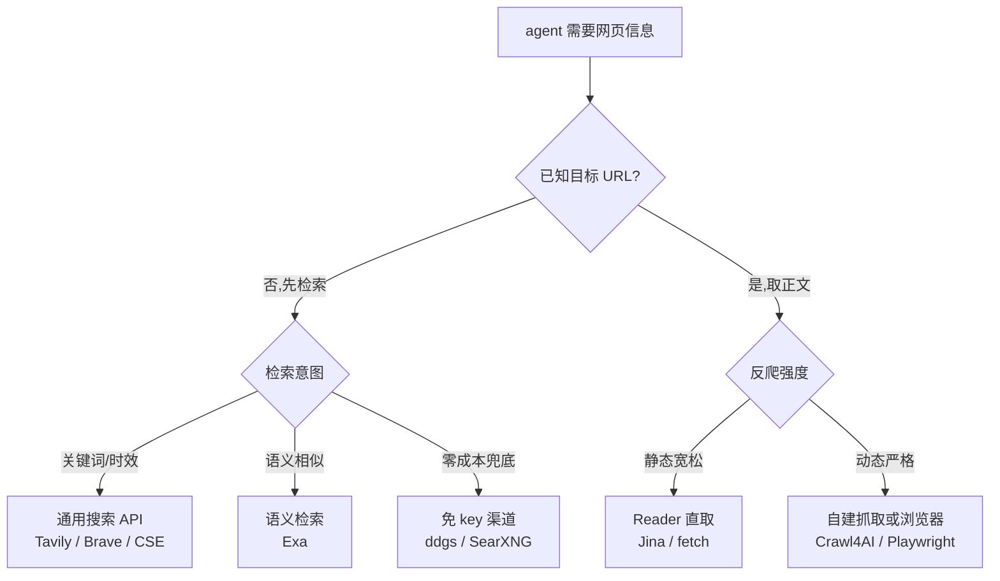

[toc]

## 概述

AI agent(智能体)要回答时效性问题、核对版本与价格、采集产品数据,都绕不开两件事:**联网搜索**(找到相关网页)与**网页抓取**(取回正文)。本文系统梳理截至 2026-10-28,agent 可直接调用的免费搜索与抓取资源,覆盖国内外方案,给出免费额度、限制与选型建议。

调研方法:按决策档预算做了 16 次联网检索与 6 次正文核验,优先采用官方定价页与官方文档,社区口径均明确标注;数字档位为撰写时点快照,各厂商额度调整频繁,落地前应以官方页面复核。

## 五类免费通道总览

agent 获取网页信息的免费资源可归为五类通道,各自解决不同环节的问题:

| 通道 | 代表资源 | 免费形态 | 解决什么 |
| --- | --- | --- | --- |
| 通用搜索 API | Tavily、Brave、Google CSE、Exa | 月度额度或一次性赠额 | 检索发现"该看哪些网页" |
| 免 key 与自建搜索 | ddgs、SearXNG、Whoogle | 零注册、零费用 | 无账号成本、完全可控的兜底 |
| 网页抓取与 Reader | Jina Reader、Firecrawl、Crawl4AI | 免 key 限流、月度积分、开源自建 | 把"已知 URL"变成干净正文 |
| 大模型内置联网 | Gemini grounding、国产模型搜索工具 | 按天免费档或赠送资源包 | 已有模型 API 时顺带获得搜索 |
| 垂直开放数据源 | Wikipedia、GitHub、arXiv、HN | 完全免费 | 结构化领域数据直连 |

推荐阅读顺序:先看 **通道选型决策** 一节建立整体路由思路,再按需查阅各通道细节;落地配置参考 **场景化选型建议**。

## 通道选型决策



图的读法:第一层按 **是否已知 URL** 判定,分成检索与取正文两条路径——不知道去哪找走检索分支,已知网页要看内容走取正文分支。检索路径再按意图三分:找事实与新闻用通用搜索 API,找"相似的页面"用语义检索,没有账号与预算时走免 key 渠道。取正文路径按 **反爬强度** 分流:静态站点直接用 Reader 类服务,动态渲染或反爬严格的站点用自建抓取与浏览器自动化。图中任一通道触发限流或免费额度耗尽时,按本文各节的替代方案横向切换。

## 通用搜索 API

SERP(SERP,Search Engine Results Page,搜索引擎结果页)类 API 把搜索引擎结果结构化返回给程序。主流服务的免费额度如下,数字为 2026-10-28 快照:

| 服务 | 免费额度 | 刷新方式 | 关键限制 |
| --- | --- | --- | --- |
| Tavily | 1000 credits(积分) | 每月 | 1 credit 约合 1 次基础搜索;爬取、深度研究类调用按多倍计 |
| Brave Search | 折合约 1000 次 | 每月 $5 额度 | 现行 $5/1000 次;旧的 2000 次/月免费档已取消 |
| Google CSE | 100 次/天 | 每天 | 超出 $5/1000 次,硬上限 10000 次/天;单查询最多返回 100 条 |
| Exa | $10/月,注册另赠 $10 | 每月 1 日 | 语义检索定位;Lite 档约 $7/1000 次 |
| Serper | 2500 次 | 一次性 | 之后约 $0.3 至 $1/1000 次 |
| SerpAPI | 250 次/月 | 每月 | 由 100 次/月上调;缓存命中不占额度 |
| Linkup | 4000 次 + 每月 $20 额度 | 每月 | 深度搜索约 $0.05/次(第三方口径) |
| Parallel | 折合约 5000 次 | 每月 $5 额度 | 另提供免费 Search MCP(见 MCP 一节) |
| TinyFish | Search 与 Fetch 全档免费 | 按天限流 | Fetch 上限约 1000 URL/天(官方文档) |
| Perplexity Search | 新户一次性 $10 | 一次性 | 搜索 $5/1000 次,fast 档 $1/1000 次 |
| You.com | 注册赠 $100 | 一次性 | 无公开长期免费档 |
| Mojeek | 无免费档 | — | 入门档 £2/1000 次,欧洲托管、零留存 |
| 博查 | 无长期免费档 | — | 约 0.03 元/次(社区口径) |
| 智谱 web-search-pro | 平台赠送资源包 | 按活动 | 约 0.03 元/次(社区口径) |

主要来源:[Tavily](https://www.tavily.com/)、[Brave Search API](https://brave.com/search/api/)、[Google Programmable Search Engine](https://developers.google.com/custom-search/v1/overview)、[Exa 定价](https://exa.ai/pricing)、[SerpAPI 文档](https://serpapi.com/)、[TinyFish Fetch 文档](https://docs.tinyfish.ai/fetch-api)、[Parallel 定价](https://parallel.ai/pricing)、[Mojeek API](https://www.mojeek.com/services/search/web-search-api)。

几点解读:

- **月度刷新** 的额度(Tavily、Brave、Exa、Google CSE、SerpAPI)适合长期低量运行的个人 agent;**一次性赠额**(Serper、You.com、Perplexity 新户)适合评估与原型验证,用完即止。
- Brave 的独立索引是它与其他 SERP 封装的核心差异——2025-08-11 起 [Bing Search API 全面退役](https://www.computing.co.uk/news/2025/microsoft-s-plan-to-retire-bing-api-access-and-what-it-means-for-web-search),微软仅保留 Azure AI Agents 内部的 Grounding with Bing Search,独立索引的价值随之上升。
- 横评方面,[AIMultiple 的 8 家搜索 API 基准](https://aimultiple.com/agentic-search)显示 Brave 在其 agentic search(智能体检索)测试中稳定领先 Tavily 约 1 分,但该基准口径独立于本文引用的其他横评,仅作选型线索。
- 中文互联网内容覆盖是国际 API 的普遍短板;博查、智谱专门面向中文场景,但两者均无长期免费档,"免费"主要靠平台赠送资源包。

## 免 key 与自建搜索

免 key(无需注册账号)与自建方案是真正的零成本通道,代价是稳定性或运维责任由自己承担。

### ddgs:多后端免 key 搜索库

`ddgs`(Dux Distributed Global Search,前名 `duckduckgo_search`)是 Python 生态最常用的免 key 搜索库。它已从单一的 DuckDuckGo 抓取器演进为 **多后端聚合器**,文本搜索支持 bing、brave、duckduckgo、google、grokipedia、mojeek、startpage、yandex、yahoo、wikipedia 十个后端,另支持图片、视频、新闻与图书搜索,Python 3.10 以上可用,支持配置代理与超时。

```python
from ddgs import DDGS

results = DDGS().text("python programming", max_results=5)
for r in results:
    print(r["title"], r["href"])
```

局限要认清:各引擎会主动限流自动化流量,社区大量报告 `RatelimitException` 与 202 状态码,结果顺序不稳定,且只返回摘要而非全文;仓库声明仅供教育目的使用。它适合做 **个人 agent 的兜底通道**,不适合生产依赖。来源:[ddgs 仓库](https://github.com/deedy5/ddgs)、[open-webui 社区的限流讨论](https://github.com/open-webui/open-webui/discussions/6624)。

### SearXNG:自建元搜索引擎

SearXNG(SearXNG,AGPL 协议的开源元搜索引擎,即 Metasearch Engine,把多家搜索引擎结果聚合并去重的引擎)是自建路线的主力。自建实例无调用配额、无账号,数据不出境,是生产环境的可靠兜底。

Docker 部署后须做两项配置,否则 agent 调用会被拒:

- 默认不开放 JSON 输出,需在 `settings.yml` 的 `search.formats` 中加入 `json`;
- limiter(限流器)默认拦截脚本流量,私有实例应关闭或把 agent 来源地址加入信任列表。

```yaml
search:
  formats:
    - html
    - json
```

之后即可用 HTTP 直查:

```bash
curl "http://127.0.0.1:8080/search?q=web+search+api&format=json"
```

注意 Windows PowerShell 中 `curl` 是 `Invoke-WebRequest` 的别名,须改用 `curl.exe`;*nix 直接用 `curl`。返回编码为 UTF-8;Windows 终端中文乱码问题在仓库内有专文讨论,遇到时先处理编码设置再解析返回。

公共实例(见 [searx.space](https://searx.space/))大多开启限流并禁用 JSON 输出,仅供临时测试,不建议作为 agent 依赖。来源:[mcp-searxng 关于开启 JSON 的讨论](https://github.com/ihor-sokoliuk/mcp-searxng/issues/57)、[searxng 官方文档](https://docs.searxng.org/)。

### Whoogle 与其他

Whoogle 是自托管的 Google 结果代理,免 key 返回净化后的结果,但 Google 对代理流量的封禁使其稳定性一般,仅作备选。此外 GitHub 上有 qsearch 等面向 agent 的自托管搜索 API 项目,生态在持续新增,选型前可再检索一轮。

## 网页抓取与正文提取

搜索解决"找到 URL",抓取解决"取回正文"。该环节免费资源分托管服务与开源自建两档:

| 服务 | 免费形态 | 关键限制 |
| --- | --- | --- |
| Jina Reader | 免 key 直取约 20 RPM(requests per minute,每分钟请求数) | 注册免费 key 可提额并获赠 token(词元,社区报告 1M 至 10M,以官网为准) |
| Firecrawl | 1000 credits/月 | 1 credit 约合 1 页;学生认证 10000;支持 JS 渲染、爬站、结构化抽取 |
| TinyFish Fetch | 免费,约 1000 URL/天 | 与其 Search 同一账号体系 |
| Crawl4AI | 开源自建完全免费 | Apache 2.0;云版另有 1000 credits/月 |
| Scrapling | 开源自建免费 | 自适应抓取,内置反检测能力 |
| ScrapeGraphAI | 开源自建免费 | LLM 驱动的抓取管道,需自备模型 key |
| Crawlee 与 Scrapy 加 Playwright | 开源框架免费 | 经典组合,需自行维护渲染与反爬策略 |
| ScraperAPI 与 ScrapingBee 等 | 注册试用积分(约 1000) | 商业代理型抓取,额度以官网为准 |

主要来源:[Firecrawl 定价](https://www.firecrawl.dev/pricing)、[Crawl4AI 仓库](https://github.com/unclecode/crawl4ai)、[TinyFish Fetch 文档](https://docs.tinyfish.ai/fetch-api)。

### Jina Reader:最省事的免费正文通道

Jina Reader 的用法是把任意 URL 前缀上 `https://r.jina.ai/` 直接 GET,返回即为主题正文 Markdown,免 key 约 20 RPM:

```bash
curl "https://r.jina.ai/https://example.com/article"
```

免 key 通道无需注册即可用,适合脚本与个人 agent;Jina 另提供官方 Remote MCP(见 MCP 一节)。注意本环境实测该域名直连超时(见 **国内网络环境适配** 一节)。

### Crawl4AI:开源自建主力

Crawl4AI 是当前 GitHub 上关注度最高的 LLM 导向爬虫(仓库自述 most-starred crawler),Apache 2.0 协议、免 key、自建免费,2026-10-14 发布 v0.9.5。核心能力:

- **LLM 友好输出**:智能 Markdown 保留标题、表格与代码块;Fit Markdown 用剪枝、BM25 或 LLM 过滤导航与页脚等样板内容;
- **浏览器渲染**:基于 Chromium、Firefox、WebKit 内核,支持 JS 执行、无限滚动、隐身模式、代理与持久登录会话;
- **结构化抽取**:CSS、XPath、正则免模型抽取 JSON,也可用 LLM 按类型化 schema 抽取;
- **深度爬取**:BFS(广度优先)、DFS(深度优先)、best-first(最佳优先)等爬取策略与断点恢复,自带 MCP 集成。

自建跑在本机或自有服务器上,免费额度即本机资源,没有第三方配额;代价是反爬对抗需要自己处理(代理池、指纹等)。来源:[Crawl4AI 仓库](https://github.com/unclecode/crawl4ai)。

### 开源生态补充

- Scrapling:自适应抓取库,页面结构变化后可自动重定位元素,实战见仓库内 [Scrapling-MCP与Skill实战](./MCP/Scrapling-MCP与Skill实战.md);
- ScrapeGraphAI:把抓取流程编排成图,用 LLM 决定抽取策略,适合快速原型;
- Crawlee 与 Scrapy 加 Playwright:无 LLM 依赖的工程化组合,适合大规模确定性采集。

## MCP 封装:给现成 agent 用

MCP(Model Context Protocol,模型上下文协议)服务器把上述能力封装成 agent 可直接挂载的工具。用现成 agent(如 Claude、ZCode、OpenCode 等)而非自研 agent 时,这是接入成本最低的方式:

| MCP 服务器 | 上游能力 | 免费情况 |
| --- | --- | --- |
| fetch(官方参考实现) | 直接 HTTP 取页转 Markdown | 自托管完全免费 |
| Tavily MCP | Tavily 搜索与抽取 | 免费档 1000 credits/月 |
| Firecrawl MCP | 抓取、爬站、结构化 | 免费档 1000 credits/月 |
| Exa MCP | 语义搜索 | $10/月免费额度 |
| Brave Search MCP | 独立索引搜索 | 每月 $5 免费额度 |
| Parallel Search MCP | 搜索 | 官方免费 MCP |
| Jina Remote MCP | 搜索、抽取、截图 | 免 key 低速可用 |
| mcp-searxng(社区) | 自建 SearXNG | 自建免费,需开启 JSON 输出 |
| DuckDuckGo 系社区 MCP | ddgs | 免费,受上游限流影响 |

官方参考服务器清单见 [modelcontextprotocol/servers](https://github.com/modelcontextprotocol/servers);MCP 的机制与配置入门见仓库内 [MCP指南](./MCP/MCP指南.md)。同一上游服务的 MCP 版本与直连 API 版本共享同一份免费额度,不会因换了接入方式而翻倍。

## 大模型内置联网

若已采购大模型 API,模型平台自带的联网工具是"顺带"的搜索通道,通常按次计费但有免费档或赠送额度:

| 方案 | 免费额度 | 超出后 |
| --- | --- | --- |
| Gemini API grounding(谷歌搜索接地) | 免费档约 500 次/天(2.5 Flash 系列,该限额多次收紧) | 付费档前 1500 次/天免费,之后 $35/1000 次 |
| OpenAI web_search 工具 | 无 | $10/1000 次(较 2025 年的 $25 至 $30/1000 次明显下调) |
| Anthropic web search | 无 | $10/1000 次 |
| Perplexity Sonar | 新户一次性 $10 | 搜索 API $5/1000 次,fast 档 $1/1000 次,另计 token 费 |
| 智谱、通义、豆包联网工具 | 平台赠送资源包 | 约几分钱/次 |

主要来源:[Gemini API 文档](https://ai.google.dev/gemini-api/docs/google-search)、[Anthropic web search 文档](https://docs.anthropic.com/en/docs/build-with-claude/web-search-tool)。

三点提醒:

- 三家国际厂商超出免费档后单价已趋同($10/1000 次),但抓回的网页正文按模型输入 token 另行计费,这部分常比搜索本身更贵;
- Gemini 的免费档是当前唯一 **按天刷新且数量可观** 的内置联网免费额度,轻量个人 agent 可优先利用;
- DeepSeek 官方 API 未提供内置联网工具,需要搜索时须自行组合上文通道(此为模型已有知识,以官方文档为准)。

## 垂直与开放数据源

目标明确的数据不必走通用搜索,直连官方 API 更省额度也更稳定。以下均为免费开放资源(限流数字以各自官方文档为准):

| 资源 | 用途 | 免费情况 |
| --- | --- | --- |
| Wikipedia 与 Wikidata | 百科事实、结构化实体 | 免 key,要求自报 User-Agent 并控制频率 |
| GitHub REST 与代码搜索 | 代码、仓库、文档 | 无 token 60 次/时,带免费 token 5000 次/时 |
| arXiv | 论文元数据与全文 | 免 key,官方建议请求间隔 3 秒 |
| Semantic Scholar | 学术图谱与引用 | 免费注册 key,约 1 次/秒 |
| HN Algolia API | Hacker News 全文检索 | 完全免费无 key |
| StackExchange API | 问答数据 | 300 次/天,注册免费 key 后 10000 次/天 |
| Reddit API | 社区讨论 | OAuth(开放授权)凭证免费约 100 次/分,匿名 JSON 端点已大幅收紧 |
| Common Crawl | 海量历史网页快照 | 索引与数据免费开放,大批量拉取有存储流量成本 |
| Wayback Machine | 网页历史版本 | 免费,有限流 |
| RSS | 站点更新订阅 | 各站点自带,常被忽略的零成本通道 |

## 浏览器自动化兜底与反爬

搜索与抓取通道全部失效(站点要求 JS 渲染、触发 Cloudflare 挑战、接口签名校验)时,浏览器自动化是最后的兜底:

- **Playwright MCP**:微软官方维护,把真实浏览器交给 agent 操作,免费用;
- **browser-use**:开源的浏览器 agent 框架,与 Playwright MCP 定位相近;
- **FlareSolverr**:自托管代理,专门消化 Cloudflare 挑战;
- **Camoufox、Patchright、指纹浏览器**:对抗自动化检测的进阶方案。

反爬对抗是单独的工程领域,方案对比详见仓库内 [cloakbrowser和patchright等@防机器人检测@应对自动化抗检测方案对比](./cloakbrowser和patchright等@防机器人检测@应对自动化抗检测方案对比.md);浏览器应作为 **兜底而非默认**,频次、资源与封号风险都远高于前述通道。

## 合规与工程约束

免费不等于无边界,生产使用前逐项自查:

- **robots 协议**:robots.txt(Robot Exclusion Protocol,站点对爬虫的声明文件)与各服务的 ToS(Terms of Service,服务条款)是合规底线;ddgs 一类抓取搜索引擎结果的库,本身就游走在引擎条款边缘,只宜轻量使用;
- **限流礼貌**:遇到 HTTP 429(过多请求)时遵守 `Retry-After` 响应头,指数退避加抖动,不要并发打同一站点;
- **自报身份**:设置可联系的 User-Agent,既是开放数据源的礼节,也减少被拦概率;
- **缓存与去重**:同一主张只取一份正文,规范化 URL 去重,避免重复消耗额度;
- **个人数据**:抓取内容含个人信息时注意 PIPL(个人信息保护法)与 GDPR 的存储使用边界;
- **版权边界**:搜索摘要与正文快照用于内部 agent 推理与对外展示是不同的合规强度,后者须再评估。

## 国内网络环境适配

本调研在境内网络实测发现,免费通道的可达性差异显著(2026-10-28 实测记录):

- brave.com、r.jina.ai 直连超时,WebFetch 与 web_reader 双通道均失败;
- raw.githubusercontent.com 时通时断,GitHub 主站基本可达;
- 官方 WebSearch 通道可用。

据此给出路由建议:

- **生产部署面向海外服务器**(本仓库默认约定),境外 API 在海外机上不存在可达性问题;
- **境内试验环境**优先选国内可达通道:博查、智谱、通义、豆包等国产方案,或自建 SearXNG 与 Crawl4AI(部署在境内可达的目标站点场景);
- 需要 Brave、Exa、Jina 等境外服务时,经代理出口,选型参考仓库内 [中转站搭建@newapi和sub2api](./中转站搭建@newapi和sub2api.md);
- 自建 SearXNG 若部署在海外 VPS,境内 agent 经内网穿透或专线访问,可同时解决可达性与数据出境两个问题;
- Python 生态工具(ddgs、Crawl4AI、Scrapling)在 Windows 与 *nix 均可运行,浏览器内核类工具(Playwright、Crawl4AI)安装后需额外执行内核下载步骤,Windows 下注意用 `curl.exe` 而非 `curl` 别名。

## 场景化选型建议

按场景给出可直接照做的组合:

| 场景 | 推荐组合 |
| --- | --- |
| 个人 agent,低量英文检索 | Tavily 1000 次/月 + Jina Reader 免 key 取正文 + ddgs 兜底 |
| 完全零成本、零账号 | TinyFish Search 与 Fetch + Google CSE 100 次/天 + 自建 SearXNG |
| 语义检索与相似页发现 | Exa 每月 $10 额度 + Tavily 补关键词检索 |
| 中文内容为主 | 博查或智谱(约 0.03 元/次)承担搜索,垂类数据直连官方 API |
| 生产 agent,长期运行 | Brave 或 Tavily 主搜 + 自建 SearXNG 冗余 + Crawl4AI 自建抓取 + 垂直 API 直连 |
| 现成 agent 快速接入 | 挂载 fetch、Tavily MCP、Firecrawl MCP,复用各自免费档 |

**总体推荐**:默认组合为 Tavily(月度 1000 次,agent 导向、接入最省事)承担检索,Jina Reader 或自建 Crawl4AI 承担正文,自建 SearXNG 作为额度耗尽与限流时的冗余兜底,垂类需求(Wikipedia、GitHub、arXiv 等)一律直连官方 API 不占搜索额度。预算敏感场景把主搜换成 TinyFish 与 Google CSE 的免费组合;中文重度场景把主搜换成博查或智谱并接受按次计费。

## 证据与缺口

关键数字的来源与档位汇总(抓取与检索时点均为 2026-10-28):

| 关键主张 | 数值 | 来源层级 |
| --- | --- | --- |
| Tavily 免费档 | 1000 credits/月 | 二级(厂商定价页引述,两源一致) |
| Brave 免费档改为月度 $5 额度 | 约 1000 次/月 | 一级(官网)+ 二级 |
| SerpAPI 免费档上调 | 250 次/月 | 一级(官方文档) |
| Google CSE | 100 次/天免费,上限 10000 次/天 | 一级(官方文档)+ 二级 |
| Exa | $10/月 + 注册赠 $10 | 一级(官方定价页) |
| Firecrawl | 1000 credits/月 | 一级(官方定价页)+ 二级 |
| Jina Reader 免 key | 约 20 RPM | 二级 |
| TinyFish Fetch | 约 1000 URL/天免费 | 一级(官方文档) |
| Bing Search API 退役 | 2025-08-11 | 二级(多家媒体一致) |
| Gemini grounding 免费档 | 约 500 次/天 | 二级(官方文档口径,限额有收紧历史) |
| 博查与智谱单价 | 约 0.03 元/次 | 三级(社区口径,未经官网页面直接确认) |
| 垂直数据源限流数字 | 见对应表 | 模型已有知识,未逐项复核 |

已知缺口与下一轮补搜方向:

- Jina Reader 注册赠 token 的具体规模(社区报告 1M 至 10M 不一),建议检索 `jina reader free credits official`;
- Linkup、You.com 的免费额度仅有第三方口径,建议直接核对官网定价页;
- 博查、智谱的精确单价与资源包策略,建议访问 open.bochaai.com 与 open.bigmodel.cn 定价页;
- Mojeek 是否已推出免费试用档,建议核对其 services 页面;
- SearXNG 公共实例的限流策略未实测,自建前可先用公共实例试跑验证 JSON 开关;
- 垂直数据源的限流数字建议按需逐项核对官方文档。