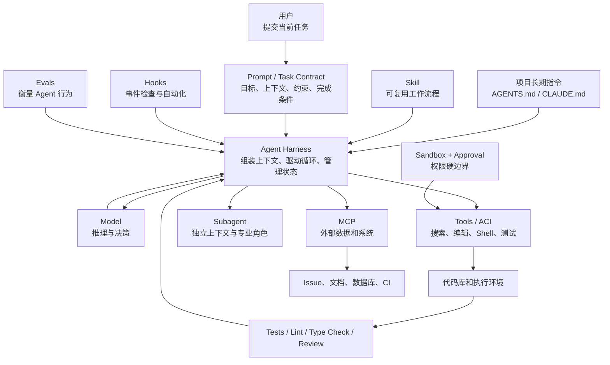
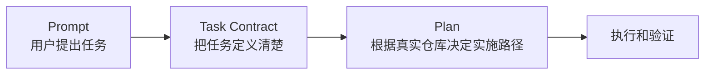
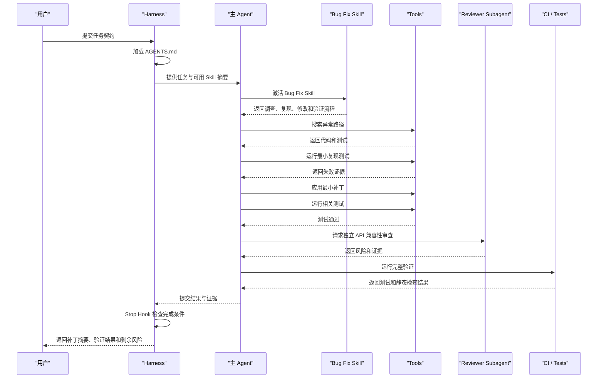
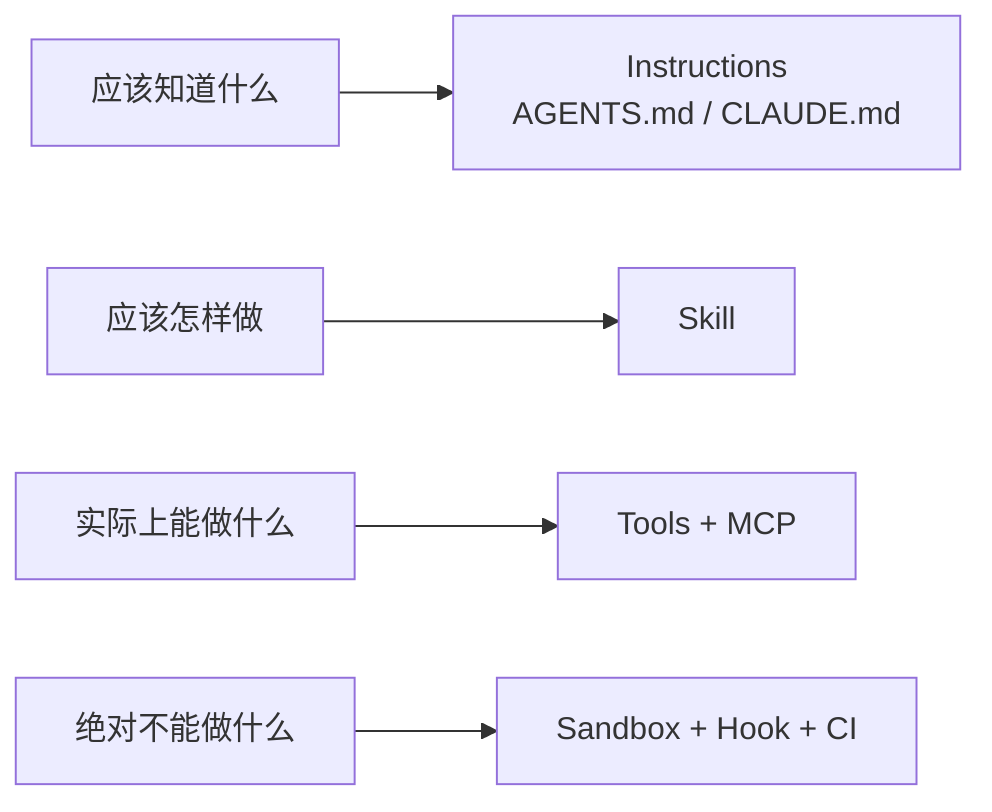

[toc]

对ai agent某些概念(术语)缺乏足够深刻的认识(尤其是需要用户参与编写或引用的东西),请展开介绍并结合适当的例子说明. 

> 包括但不限于harness,skill等.

下面先建立一个统一的概念坐标系，再分别展开 **Harness、Skill、项目指令、Tool、MCP、Hook、Subagent、Sandbox、Task Contract、Eval** 等概念。

重点不是记住名词，而是理解：

> 谁来编写、何时生效、解决什么问题、是否能够强制执行，以及它与其他机制的边界在哪里。

## 概念总览：这些东西分别处于哪一层

| 概念                     | 中文理解                 | 通常由谁提供           | 主要作用                        | 是否直接执行代码 |
| ------------------------ | ------------------------ | ---------------------- | ------------------------------- | ---------------- |
| Model                    | 模型                     | 模型厂商               | 理解、推理、决策、生成          | 否               |
| Agent Harness            | Agent 运行支架、编排外壳 | Agent 工具开发者       | 驱动模型和工具形成完整循环      | 是               |
| Prompt                   | 当前任务提示             | 用户                   | 描述一次具体任务                | 否               |
| Task Contract            | 任务契约                 | 用户、团队             | 明确目标、约束、完成条件        | 否               |
| `AGENTS.md`、`CLAUDE.md` | 项目长期指令             | 用户、团队             | 保存项目事实和长期工作约定      | 否               |
| Skill                    | 可复用技能、操作流程包   | 用户、团队、工具厂商   | 封装重复使用的**工作流**        | 可包含脚本       |
| Tool                     | 工具                     | Harness、开发者        | 给模型提供可调用的**操作能力**  | 是               |
| ACI                      | Agent-Computer Interface | Agent 工具开发者       | 规定 Agent 如何观察和操作计算机 | 是               |
| MCP                      | 模型上下文协议           | MCP 生态和服务开发者   | 标准化连接外部数据和工具        | 取决于能力       |
| Hook                     | 生命周期钩子             | 用户、团队             | 在特定事件自动检查、执行或阻断  | 通常是           |
| Subagent                 | 子 Agent                 | 用户、工具厂商         | 在独立上下文中完成专业子任务    | 可调用工具       |
| Sandbox                  | 沙箱                     | Agent 工具、平台管理员 | 从技术上限制 Agent 能做什么     | 是硬边界         |
| Approval Policy          | 审批策略                 | 用户、管理员           | 决定哪些越界行为必须确认        | 否               |
| Eval                     | Agent 评估用例           | 用户、团队             | 衡量 Agent 是否稳定完成任务     | 通常调用 Agent   |
| CI Guard                 | 持续集成门禁             | 开发团队               | 阻止不合格代码进入主分支        | 是               |

它们之间的大致关系如下：



------

## Agent Harness：真正让模型成为 Agent 的运行支架

### Harness 是什么

**Agent Harness** 可以译为：

- Agent 运行支架；
- Agent 编排外壳；
- Agent 执行框架；
- Agent 控制系统。

它不是模型本身，也不只是一个 Prompt。

Harness 是围绕模型构建的一整套运行系统，负责：

- 组装模型上下文；
- 注册可用工具；
- 调用模型；
- 解析模型发出的工具请求；
- 执行工具；
- 把工具结果返回给模型；
- 保存任务状态；
- 控制权限；
- 检测失败和循环；
- 压缩过长上下文；
- 判断何时结束；
- 记录日志和轨迹。

现代 Coding Agent 的核心不是一次模型调用，而是一个不断在“模型决策”和“环境反馈”之间迭代的循环。OpenAI 对 Codex Agent Loop 的说明也展示了这种持续追加模型输出、工具结果和用户输入的运行结构，并说明长任务需要上下文压缩来继续执行。([OpenAI](https://openai.com/index/unrolling-the-codex-agent-loop/))

### 一个最小 Harness 的概念代码

下面不是某个产品的真实源码，而是用于解释职责的伪代码：

```python
state = initialize_task(
    user_prompt=user_prompt,
    project_instructions=load_project_instructions(),
    available_skills=discover_skills(),
)

while True:
    context = build_context(state)

    response = model.generate(
        context=context,
        tools=tool_registry.schemas(),
    )

    if response.requests_tool():
        request = response.tool_request

        policy_result = permission_policy.check(request)

        if policy_result.requires_approval:
            approval = ask_user_for_approval(request)
            if not approval:
                state.record_denial(request)
                continue

        result = sandbox.execute(request)
        state.append_tool_result(result)

    else:
        verification = completion_checker.evaluate(
            response=response,
            state=state,
        )

        if verification.accepted:
            return build_final_report(state, response)

        state.append_feedback(verification.feedback)

    if state.exceeds_budget():
        return build_partial_report(state)
```

其中真正重要的不是语法，而是这些职责：

| Harness 组件       | 解决的问题                 |
| ------------------ | -------------------------- |
| Context Builder    | 当前应让模型看到什么       |
| Tool Registry      | 模型可以调用哪些能力       |
| Agent Loop         | 如何反复推理和行动         |
| State Store        | 已经做过什么、当前进度如何 |
| Policy Engine      | 当前操作是否允许           |
| Executor           | 在什么环境中运行命令       |
| Completion Checker | 什么时候才算完成           |
| Retry Controller   | 失败后是否以及如何重试     |
| Context Compactor  | 长任务如何避免上下文耗尽   |
| Trace Recorder     | 如何调查成功和失败原因     |

### Harness、模型和 Agent 的区别

可以使用一个类比：

| 软件开发概念 | Agent 对应物             |
| ------------ | ------------------------ |
| CPU          | 模型                     |
| 操作系统     | Harness                  |
| 应用程序     | 当前 Agent 任务          |
| 系统调用     | Tool Call                |
| 权限系统     | Sandbox 与 Approval      |
| 配置文件     | `AGENTS.md`、Skill、策略 |
| 日志系统     | Trace 与 Observability   |

模型负责“想”，Harness 负责：

- 允许它看到什么；
- 允许它做什么；
- 怎样把思考变成动作；
- 怎样把动作结果反馈回来；
- 什么时候阻止它；
- 什么时候认为任务完成。

### Harness 与 Agent Framework 的区别

这两个词常被混用，但可以这样区分：

- **Agent Framework** 是用于开发 Agent 的库或框架。
- **Agent Harness** 是某个 Agent 实际运行时的完整控制系统。

例如，一个框架可能提供：

- Tool 定义 API；
- 状态存储；
- Agent Loop；
- 多 Agent 编排；
- 追踪接口。

开发者使用框架组装出实际 Harness。

### 普通用户需要编写 Harness 吗

多数 Coding Agent 用户不需要从零编写 Harness。Codex、Claude Code、OpenHands 等产品已经提供了 Harness。

普通用户主要配置 Harness：

- 编写项目指令；
- 配置权限；
- 添加 Skill；
- 添加 MCP Server；
- 定义 Hook；
- 选择工作目录；
- 提供完成条件；
- 定义验证命令。

只有在以下情况下，才通常需要自己构建 Harness：

- 开发企业内部 Coding Agent；
- 将 Agent 接入内部研发平台；
- 需要特殊权限控制；
- 需要自己的任务队列和状态系统；
- 需要自定义多 Agent 编排；
- 需要大规模自动运行和评估；
- 需要严格的审计和合规。

------

## 项目指令：`AGENTS.md`、`CLAUDE.md`

### 它是什么

项目指令文件是 Agent **每次进入项目时都应该知道的长期信息**，例如：

- 项目使用什么技术栈；
- 如何安装依赖；
- 如何运行测试；
- 哪些目录不能修改；
- 代码采用什么架构；
- 哪些行为需要用户确认；
- 完成任务时应执行哪些检查。

Codex 会在运行开始时发现并组合不同目录层级的 `AGENTS.md`；靠近当前工作目录的指令具有更具体的作用域。Claude Code 的 `CLAUDE.md` 同样用于保存用户编写的持久项目上下文。([OpenAI开发者](https://developers.openai.com/codex/guides/agents-md))

### 项目指令适合保存什么

项目指令最适合保存：

> 长期稳定、对大多数任务都适用的事实和约定。

例如：

```markdown
## 项目结构

- `src/api/` 存放 HTTP 接口层。
- `src/domain/` 存放业务逻辑，不得依赖 Web 框架。
- `src/infrastructure/` 存放数据库和外部服务实现。
- `tests/unit/` 存放无外部依赖的单元测试。
- `tests/integration/` 存放需要数据库的集成测试。

## 开发命令

- 安装依赖：`uv sync`
- 运行单元测试：`uv run pytest tests/unit`
- 运行完整测试：`uv run pytest`
- 类型检查：`uv run mypy src`
- 静态检查：`uv run ruff check src tests`

## 修改规则

- 缺陷修复必须增加回归测试。
- 不要在 Domain 层访问数据库。
- 不要修改公开 API 的响应字段，除非任务明确要求。
- 不要增加生产依赖，除非先说明理由。
- 不要读取或输出 `.env` 内容。

## 完成任务前

- 运行受影响模块测试。
- 运行类型检查。
- 检查 `git diff`，移除无关修改。
- 在最终回复中列出执行过的验证命令。
```

### 不适合保存什么

不适合放进项目指令的内容：

- 某一个 Issue 的临时需求；
- 只执行一次的迁移步骤；
- 几百行详细操作流程；
- 大量 API 文档原文；
- 一次性的调试日志；
- 会频繁变化的当前任务状态；
- 必须百分之百强制执行的安全规则。

### 为什么不能把它当作硬规则

项目指令通常只是模型上下文，不是安全执行机制。

Claude Code 官方文档明确指出，`CLAUDE.md` 属于上下文而不是强制配置；如果某个动作无论模型如何判断都必须被阻止，应使用 `PreToolUse` Hook 等强制机制。([Claude Platform Docs](https://docs.anthropic.com/en/docs/claude-code/memory))

例如，下面的规则：

```markdown
- 不要读取 `.env`。
```

可能提高模型遵守概率，但不能作为严肃的密钥保护边界。

更可靠的方法是：

- 文件权限禁止读取；
- Sandbox 不挂载密钥；
- Hook 阻断相关工具调用；
- 敏感配置只通过受控凭据代理提供。

### 好指令和坏指令

坏指令：

```markdown
- 写出高质量代码。
- 保持最佳实践。
- 测试代码。
- 注意安全。
```

这些内容过于抽象，无法帮助 Agent 作出具体决定。

更好的指令：

```markdown
- 修改 `src/domain/` 后运行 `uv run pytest tests/unit/domain`。
- Domain 层只能依赖 Python 标准库和 `src/domain/` 内的模块。
- 新增公开函数必须添加类型注解和至少一个失败路径测试。
- 禁止在异常信息中输出访问令牌、Cookie 和完整请求头。
```

------

## Skill：可复用的任务执行流程

### Skill 是什么

**Agent Skill** 是为某类重复任务准备的可复用工作流程包。

Skill 往往包含：

- 适用场景；
- 触发描述；
- 所需输入；
- 执行步骤；
- 决策规则；
- 验证方法；
- 输出格式；
- 可选脚本；
- 可选参考资料；
- 可选模板。

OpenAI 当前将 Skill 描述为由说明、资源和可选脚本组成的任务专用能力包；Skill 通常以包含 `SKILL.md` 的目录存在，并可附带 `scripts/`、`references/` 和 `assets/`。Skill 采用渐进式加载：Agent 初始只看到名称和描述，决定使用后才读取完整正文。([OpenAI开发者](https://developers.openai.com/codex/skills))

Claude Code 同样使用 `SKILL.md` 表达技能，并建议在用户不断粘贴同一份检查表或多步骤流程时将其转化为 Skill；与始终进入上下文的项目指令不同，Skill 正文通常只在实际使用时加载。([Claude Platform Docs](https://docs.anthropic.com/en/docs/claude-code/skills))

### Skill 最核心的思想

Skill 不是简单地告诉模型一个事实，而是告诉它：

> 遇到某一类任务时，应按照什么经过验证的流程工作。

例如：

- 排查 CI 失败；
- 修复 Bug；
- 做安全审查；
- 升级数据库 Schema；
- 创建发布说明；
- 审查 REST API 兼容性；
- 分析生产日志；
- 更新依赖；
- 验证前端交互；
- 生成迁移计划。

### Skill 与项目指令的区别

| 项目指令                  | Skill                        |
| ------------------------- | ---------------------------- |
| 保存长期事实和规则        | 保存重复执行的流程           |
| 通常每次会话自动加载      | 通常在相关任务中按需加载     |
| 例如“项目使用 PostgreSQL” | 例如“如何执行数据库迁移”     |
| 例如“生产依赖需要审批”    | 例如“新增依赖时执行哪些检查” |
| 不应太长                  | 可以包含较详细流程和参考材料 |
| 适用于多数任务            | 只适用于特定任务类型         |

判断方法：

> “这是 Agent 始终应该知道的事实”，放项目指令。
> “这是 Agent 遇到某类任务时应该执行的步骤”，放 Skill。

### 一个 Bug 修复 Skill 的目录

```text
bug-fix/
├── SKILL.md
├── scripts/
│   └── verify_changed_files.py
├── references/
│   ├── testing-guide.md
│   └── error-handling.md
└── assets/
    └── final-report-template.md
```

### 一个简化的 `SKILL.md`

不同 Agent 产品支持的元数据可能略有差异，下面采用通用表达：

```markdown
---
name: bug-fix
description: >
  用于修复可复现的软件缺陷。适用于错误日志、失败测试、
  Issue 或明确错误行为已经存在的情况。
---

## 目标

以最小且可验证的补丁修复缺陷，并增加能够防止回归的测试。

## 使用前提

开始前必须获得以下至少一种信息：

- 可复现步骤
- 错误日志或堆栈
- 失败测试
- 明确的实际行为与预期行为

如果以上信息全部缺失，先调查并建立复现方法，不要立即修改代码。

## 工作流程

### 理解问题

- 阅读项目指令。
- 检查工作区状态。
- 阅读错误堆栈和相关测试。
- 找到错误路径的入口、责任模块和调用者。
- 区分已确认事实与待验证假设。

### 建立复现

优先使用以下方式：

- 在现有测试文件中增加最小失败用例。
- 使用已有命令复现错误。
- 构造最小输入触发问题。

修改实现前，记录复现命令和失败结果。

### 实施修改

- 优先修改最接近根因的责任层。
- 不进行无关重构。
- 不改变公共接口，除非任务明确要求。
- 不增加生产依赖，除非没有合理替代方案。

### 验证

按以下顺序执行：

- 新增的回归测试
- 受影响模块测试
- 类型检查
- 静态检查
- 必要时执行完整测试

### Diff 审查

检查：

- 是否有无关格式变化
- 是否保留调试日志
- 是否遗漏边界情况
- 是否意外改变公开 API
- 测试是否真正验证用户可观察行为

## 停止条件

只有在以下条件全部满足时才报告完成：

- 问题可以在修改前复现
- 修改后复现用例通过
- 相关回归测试通过
- 没有发现新增回归
- 最终 Diff 仅包含任务相关修改

## 最终输出

按照以下结构报告：

- 根因
- 修改内容
- 新增或修改的测试
- 执行的验证命令
- 未验证内容
- 剩余风险
```

### Skill 中为什么可以包含脚本

自然语言适合表达：

- 判断原则；
- 工作流程；
- 风险意识；
- 何时使用某种策略。

脚本适合表达：

- 确定性检查；
- 重复执行；
- 格式转换；
- 文件统计；
- 结构验证；
- 固定命令组合。

例如，Skill 可以让 Agent 执行：

```bash
python scripts/verify_changed_files.py
```

脚本则确定性地检查：

- 是否修改了禁止目录；
- 是否包含大文件；
- 是否意外提交密钥；
- 是否遗漏对应测试；
- 是否存在调试标记。

### Skill 不等于脚本

Skill 可以调用脚本，但它本身不只是脚本。

脚本更像：

> 给定固定输入，执行确定逻辑。

Skill 更像：

> 在不完全确定的真实任务中，指导 Agent 如何调查、决策、执行和验证。

例如，“运行测试”是脚本或 Tool。

“根据改动范围选择测试，失败后判断是实现问题、测试问题还是环境问题”更适合 Skill。

### Skill 不等于 Prompt

Prompt 是这一次的具体任务：

```text
修复刷新令牌过期时返回 500 的问题。
```

Skill 是一类任务的通用方法：

```text
修复所有可复现 Bug 时应该采取什么流程。
```

同一个 Bug 修复 Skill 可以服务于许多不同 Prompt。

### Skill 不等于 Tool

Tool 表示能力：

```text
run_tests(test_path)
```

Skill 表示如何使用能力：

```text
先运行最小失败测试；修改后重新运行；
再执行模块回归，最后检查完整 Diff。
```

简化理解：

- **Tool 是动词。**
- **Skill 是操作手册。**
- **Prompt 是本次工单。**
- **Harness 是负责安排全过程的系统。**

### Skill 的常见失败

#### 描述过于宽泛

```yaml
description: 用于编程任务
```

几乎任何任务都可能触发，导致 Skill 被滥用。

更好：

```yaml
description: >
  用于修复已有错误行为，并要求先建立失败复现、
  添加回归测试和执行最小补丁。
```

#### Skill 写成百科全书

Skill 不需要解释所有编程知识，应聚焦：

- 本团队特有流程；
- 关键决策点；
- 容易遗漏的步骤；
- 可验证的退出条件。

#### 只有步骤，没有失败分支

真实任务经常失败，因此 Skill 应说明：

- 无法复现怎么办；
- 测试命令不存在怎么办；
- 测试不稳定怎么办；
- 修改后出现回归怎么办；
- 需要新增依赖怎么办；
- 缺少权限怎么办。

#### 没有明确完成条件

如果 Skill 最后只是：

> “完成修改并汇报。”

Agent 很容易过早停止。

应写成：

> 新失败测试通过、相关回归通过、Diff 已检查、未验证内容已说明后才能结束。

------

## Tool 与 ACI：Agent 实际能够做什么

### Tool 是什么

**Tool** 是模型可以请求 Harness 执行的结构化操作。

例如：

- 读取文件；
- 搜索代码；
- 修改文件；
- 运行命令；
- 获取 Git Diff；
- 运行测试；
- 查询数据库；
- 读取 Issue；
- 创建 PR。

Tool 通常有：

- 名称；
- 描述；
- 参数 Schema；
- 返回值格式；
- 权限类别；
- 超时；
- 错误类型。

### Skill 与 Tool 的区别

假设 Agent 要检查订单接口：

| 对象                | 示例                                                         |
| ------------------- | ------------------------------------------------------------ |
| Tool                | `run_test(path="tests/api/test_orders.py")`                  |
| Skill               | “先运行订单接口测试；若失败，判断失败属于业务逻辑、Fixture 还是环境；修改后执行回归和兼容性检查” |
| Prompt              | “修复订单金额为零时接口返回 500 的问题”                      |
| Project Instruction | “订单金额使用整数分表示，禁止使用浮点数”                     |

### 什么是 ACI

**Agent-Computer Interface，Agent-计算机接口** 是 Agent 与计算机交互的整体界面设计。

它不仅包括有哪些 Tool，还包括：

- Agent 如何查看文件；
- 一次能看到多少行；
- 搜索结果如何展示；
- 如何表达编辑；
- 命令输出是否截断；
- 错误是否结构化；
- 当前目录是否明确；
- 如何查看 Git Diff；
- 如何知道命令超时；
- 如何恢复失败编辑。

SWE-agent 的研究重点之一就是：专门为语言模型设计代码查看、编辑、仓库导航和程序执行接口，可以显著影响 Agent 的软件工程表现。([arXiv](https://arxiv.org/abs/2405.15793?utm_source=chatgpt.com))

### 为什么不能简单地只给 Agent 一个 Shell

自由 Shell 很强，但存在问题：

- 参数需要模型自己转义；
- 输出格式不稳定；
- 工作目录容易出错；
- 输出可能非常长；
- 命令副作用难以判断；
- 很难对不同动作设置不同权限；
- 重试是否安全不明确。

例如，一个含糊工具：

```json
{
  "tool": "shell",
  "command": "do something"
}
```

更可靠的测试工具可以是：

```json
{
  "tool": "run_tests",
  "arguments": {
    "paths": [
      "tests/api/test_auth.py"
    ],
    "timeout_seconds": 120,
    "fail_fast": true,
    "network_access": false
  }
}
```

返回：

```json
{
  "status": "failed",
  "exit_code": 1,
  "summary": {
    "passed": 14,
    "failed": 1,
    "skipped": 2
  },
  "failures": [
    {
      "test": "test_expired_refresh_token",
      "file": "tests/api/test_auth.py",
      "line": 84,
      "message": "expected 401, got 500"
    }
  ]
}
```

这比一大段混杂的终端文本更容易被 Agent 正确理解。

### 好 Tool Contract 的要求

| 要求       | 含义                       |
| ---------- | -------------------------- |
| 名称明确   | `read_file` 优于 `operate` |
| 参数明确   | 路径、范围、超时分别表达   |
| 返回稳定   | 成功和失败具有统一结构     |
| 错误可行动 | 告诉 Agent如何修正         |
| 副作用明确 | 是否写入、联网、发送消息   |
| 幂等性明确 | 重试是否会重复创建资源     |
| 权限明确   | 是否需要用户批准           |
| 输出有限   | 避免数十万行日志进入上下文 |

------

## MCP：标准化连接外部数据和工具

### MCP 是什么

**Model Context Protocol，模型上下文协议** 是连接 AI 应用和外部系统的一种标准协议。

MCP 的角色大致包括：

- **Host**：承载 AI Agent 的应用；
- **Client**：Host 内连接某个 MCP Server 的客户端；
- **Server**：提供数据或能力的外部服务。

MCP 标准定义了服务器可以向客户端提供的三类主要能力：

- **Resources**：上下文和数据；
- **Prompts**：模板化消息或工作流；
- **Tools**：模型可以执行的函数。([Model Context Protocol](https://modelcontextprotocol.io/specification/2025-11-25))

### Resources、Prompts 和 Tools 的区别

| MCP 能力 | 用途                       | 示例                           |
| -------- | -------------------------- | ------------------------------ |
| Resource | 提供可读取的数据           | 项目架构文档、数据库 Schema    |
| Prompt   | 提供用户主动选择的模板流程 | “分析某个生产故障”模板         |
| Tool     | 执行动作或查询             | 查询 Issue、创建工单、执行部署 |

### 一个 Issue Tracker MCP 的概念设计

Resources：

```text
issue://PROJ-1842
project://PROJ/workflow
project://PROJ/components
```

Prompts：

```text
triage-issue(issue_id)
prepare-fix-plan(issue_id)
summarize-release(version)
```

Tools：

```text
get_issue(issue_id)
list_issue_comments(issue_id)
search_related_issues(query)
add_issue_comment(issue_id, comment)
change_issue_status(issue_id, status)
```

Agent 接到任务：

> 修复 `PROJ-1842`。

可能执行：

1. 通过 MCP 读取 Issue；
2. 查询相关历史 Issue；
3. 在代码仓库定位实现；
4. 修改和测试；
5. 生成修复摘要；
6. 在用户批准后向 Issue 添加评论。

### MCP 与直接 Tool 集成的区别

如果没有 MCP，每个 Agent 产品可能都需要为 Issue 系统编写专用插件。

使用 MCP 后，理论上可以让不同 Agent Client 使用相同服务器协议。

但 MCP 只解决“如何连接和描述能力”，并不会自动解决：

- 权限是否合理；
- Tool 是否安全；
- 数据是否可信；
- 是否应该执行操作；
- 是否需要审批；
- 返回结果是否包含恶意指令。

MCP 规范明确强调用户同意、数据隐私和 Tool 安全；Tool 可能代表任意代码执行或数据访问，因此 Host 应清楚展示并授权操作。([Model Context Protocol](https://modelcontextprotocol.io/specification/2025-11-25))

### 用户配置 MCP 时应关注什么

不要只问：

> 这个 MCP Server 能做什么？

还要问：

- 它能读取哪些数据？
- 它能写入哪些系统？
- 使用什么身份运行？
- Token 权限范围是什么？
- 是否能够执行任意查询？
- 是否能够删除或发布？
- Tool 调用是否需要审批？
- 返回内容是否会进入模型上下文？
- 数据会被发送到哪里？
- 是否有审计日志？

### 只读与写入应分开

例如，将以下能力分开：

```text
get_issue
search_issues
list_comments
```

与：

```text
create_issue
add_comment
close_issue
delete_comment
```

读取操作可以较宽松；写入和破坏性操作应使用更严格审批。

------

## Hook：在特定时机自动执行规则

### Hook 是什么

**Hook，钩子** 是在 Agent 生命周期某个事件发生时，自动执行的逻辑。

常见 Hook 时机：

- 会话开始；
- 用户提交任务；
- Tool 调用前；
- Tool 调用后；
- 修改文件后；
- 子 Agent 启动或结束；
- 上下文压缩前；
- Agent 准备停止；
- 会话结束。

Claude Code 的 Hook 可以是用户定义的 Shell 命令、HTTP 端点或模型提示，并在诸如 `SessionStart`、`PreToolUse`、`PostToolUse`、`Stop` 等生命周期事件触发。([Claude Platform Docs](https://docs.anthropic.com/en/docs/claude-code/hooks))

### Hook 与项目指令的区别

项目指令：

```markdown
- 不要修改 `generated/` 目录。
```

这是软约束。

Hook：

```text
当 Agent 尝试编辑 generated/ 下的文件时，直接拒绝 Tool 调用。
```

这是可执行约束。

### Hook 与 Skill 的区别

| Skill                    | Hook                       |
| ------------------------ | -------------------------- |
| 描述应该怎样完成一类任务 | 在某个事件发生时自动运行   |
| 通常由 Agent理解和遵循   | 由 Harness 确定性触发      |
| 适合表达流程和判断       | 适合执行检查、自动化和阻断 |
| 可能不被完全遵循         | 可形成实际技术边界         |
| 例如 Bug 修复流程        | 例如禁止编辑生成目录       |

### Hook 的典型用途

| 事件         | 用途                   |
| ------------ | ---------------------- |
| SessionStart | 检查依赖、输出环境摘要 |
| PreToolUse   | 阻止危险命令           |
| PostToolUse  | 记录工具调用结果       |
| AfterEdit    | 自动格式化修改文件     |
| Stop         | 检查测试是否运行       |
| SessionEnd   | 保存任务摘要和指标     |

### 示例：阻止危险命令

下面是概念脚本，不绑定具体 Agent 产品的配置格式：

```python
import json
import sys

event = json.load(sys.stdin)

command = event.get("tool_input", {}).get("command", "")

blocked_patterns = [
    "rm -rf /",
    "git reset --hard",
    "git clean -fdx",
    "DROP DATABASE",
]

for pattern in blocked_patterns:
    if pattern.lower() in command.lower():
        print(json.dumps({
            "decision": "deny",
            "reason": f"Blocked dangerous operation: {pattern}",
        }))
        sys.exit(2)

print(json.dumps({"decision": "allow"}))
```

### 示例：修改后自动检查

Agent 修改 Python 文件后：

```bash
ruff format "$CHANGED_FILE"
ruff check "$CHANGED_FILE"
```

这比在项目指令中写：

> “请记得格式化。”

更加稳定。

### Hook 的最佳实践

Hook 应优先用于：

- 规则明确；
- 输入结构明确；
- 能够确定性判断；
- 误报成本可接受；
- 必须统一执行。

Hook 不适合承担过度开放的复杂工程判断，例如：

> “判断这次架构设计是否足够优雅。”

这种任务更适合 Reviewer 或 Eval。

### Hook 也可能造成问题

- 每次编辑都执行全量测试，导致极慢；
- Hook 本身存在命令注入；
- Hook 修改文件，Agent 不知道文件已变化；
- Hook 输出过多，占用上下文；
- Hook 阻止合法操作，但不给出修正方法；
- 多个 Hook 互相触发形成循环。

因此 Hook 返回的错误应尽量可操作：

不推荐：

```text
Operation denied.
```

推荐：

```text
拒绝修改 generated/client.py。
该文件由 `make generate-client` 生成。
请修改 schemas/openapi.yaml 后执行生成命令。
```

------

## Prompt、Task Contract 与 Plan

这三个概念常被混在一起。

### Prompt

Prompt 是用户当前发出的具体请求，例如：

```text
修复刷新令牌过期时接口返回 500 的问题。
```

### Task Contract

**Task Contract，任务契约** 是经过结构化的任务定义：

```markdown
## 目标

修复刷新令牌过期时接口返回 500 的问题。

## 当前行为

`POST /auth/refresh` 收到已过期令牌时返回 500。

## 预期行为

返回 401，并使用错误代码 `TOKEN_EXPIRED`。

## 约束

- 不修改公开响应字段结构。
- 不增加生产依赖。
- 有效刷新令牌行为必须保持不变。

## 完成条件

- 新增能够复现该错误的测试。
- 新测试在修改前失败、修改后通过。
- 现有认证测试全部通过。
- 类型检查和静态检查通过。
```

OpenAI 当前的 Codex 最佳实践也推荐在任务中明确 Goal、Context、Constraints 和 Done when，以减少假设并提高结果可审查性。([OpenAI开发者](https://developers.openai.com/codex/learn/best-practices))

### Plan

Plan 是 Agent 根据任务和仓库实际情况形成的执行计划：

```markdown
- 阅读刷新令牌的解析和异常转换路径。
- 找到 `TokenExpiredError` 当前由谁捕获。
- 增加过期令牌回归测试。
- 在认证异常映射层增加转换。
- 运行认证模块测试。
- 运行类型检查和完整回归。
```

三者关系：



Task Contract 通常由用户决定“要什么”。

Plan 通常由 Agent 根据代码库决定“怎么做”。

### 为什么不要把实现细节写死在任务契约里

用户可能写：

> 修改 `auth/controller.py` 中的第 84 行。

但 Agent 调查后可能发现：

- 根因在异常映射中间件；
- Controller 修改会导致重复逻辑；
- 第 84 行只是症状发生位置。

因此更好的任务契约应描述行为和边界，而不是过早规定实现。

------

## Subagent：独立上下文中的专业执行者

### Subagent 是什么

**Subagent，子 Agent** 是由主 Agent 委派工作的专业 Agent。

它通常具有：

- 独立上下文窗口；
- 专门系统提示；
- 特定工具集合；
- 独立权限；
- 独立模型选择；
- 明确输出格式。

Claude Code 当前将 Subagent 定义为处理特定任务的专业助手，它可以在独立上下文中完成探索或实现，只把摘要返回主会话；自定义 Subagent 还能限制 Tool、权限和模型。([Claude Platform Docs](https://docs.anthropic.com/en/docs/claude-code/sub-agents))

### 为什么需要独立上下文

假设主 Agent 需要调查一个大型仓库。

探索过程可能产生：

- 100 个搜索结果；
- 20 个文件片段；
- 几千行日志；
- 多个无效假设。

如果全部进入主上下文，会干扰后续实现。

Explorer Subagent 可以：

1. 在独立上下文中搜索；
2. 阅读大量文件；
3. 排除无关路径；
4. 最终只返回：

```markdown
根因可能位于 `src/auth/token_service.py`。

证据：

- `decode_refresh_token()` 抛出 `TokenExpiredError`。
- `auth_error_handler()` 只处理 `InvalidTokenError`。
- `TokenExpiredError` 不继承 `InvalidTokenError`。
- 现有测试只覆盖格式错误令牌，没有覆盖过期令牌。

建议修改异常映射层，而不是 Controller。
```

主上下文只保留有价值的结论和证据。

### Skill 与 Subagent 的区别

| Skill                   | Subagent                |
| ----------------------- | ----------------------- |
| 工作方法                | 执行工作的人或角色      |
| 是说明和资源包          | 是独立运行的 Agent 实例 |
| 通常不拥有独立上下文    | 通常拥有独立上下文      |
| 可以由主 Agent 直接遵循 | 主 Agent 将任务委派给它 |
| 例如“代码审查流程”      | 例如“安全审查员”        |

二者可以结合：

> Security Reviewer Subagent 使用 Security Review Skill 完成审查。

### Subagent 示例

概念配置：

```markdown
---
name: api-compatibility-reviewer
description: >
  当任务修改 HTTP 路由、请求字段、响应字段或状态码时使用。
tools:
  - read_file
  - search_code
  - git_diff
  - run_tests
permissions:
  write: false
---

你是 API 兼容性审查员。

检查：

- 路由是否变化
- 请求字段是否新增必填项
- 响应字段是否删除或改名
- 状态码是否变化
- 错误代码是否变化
- OpenAPI 文档是否同步
- 客户端兼容性测试是否存在

不得修改代码。

输出：

- 阻断性问题
- 非阻断性风险
- 证据位置
- 建议增加的测试
```

### 什么时候不应使用 Subagent

- 任务只有一个小文件；
- 子任务不能清晰分离；
- 主 Agent 很快就能完成；
- 多 Agent 会同时修改同一代码；
- 没有明确的汇总机制；
- Subagent 输出无法验证；
- 使用 Subagent 只是为了“显得高级”。

------

## Sandbox 与 Approval：技术边界和决策边界

### Sandbox 是什么

**Sandbox，沙箱** 从技术上规定 Agent 能做什么，例如：

- 能读哪些目录；
- 能写哪些目录；
- 能否访问网络；
- 能否启动子进程；
- 可以使用多少 CPU 和内存；
- 是否能访问用户主目录；
- 是否能读取环境变量；
- 是否能访问 Docker Socket。

### Approval Policy 是什么

**Approval Policy，审批策略** 决定：

> Agent 想要越过当前边界时，是直接拒绝，还是暂停并询问用户。

Codex 文档明确区分了这两个概念：Sandbox 定义技术边界，Approval Policy 决定 Agent 在越界前何时必须停止并请求批准。([OpenAI开发者](https://developers.openai.com/codex/concepts/sandboxing))

### 示例

当前 Sandbox：

```yaml
read:
  - /workspace/project

write:
  - /workspace/project

network:
  allowed: false

environment_variables:
  allow:
    - PATH
    - HOME
```

Agent 尝试：

```text
pip install requests
```

可能需要联网。

Approval 策略可以：

- 直接拒绝；
- 请求一次性网络权限；
- 只允许访问包仓库域名；
- 允许本次命令但不永久放开网络。

### 项目指令不能替代 Sandbox

项目指令：

```markdown
不要访问用户主目录。
```

Sandbox：

```yaml
filesystem:
  deny:
    - /Users/alice
    - /home/alice
```

前者依赖模型遵守；后者由操作系统或执行环境强制。

### 新手推荐的权限策略

| 操作                | 默认建议         |
| ------------------- | ---------------- |
| 读取当前仓库        | 允许             |
| 修改当前工作区      | 普通实现任务允许 |
| 读取仓库外文件      | 默认拒绝         |
| 网络访问            | 默认关闭         |
| 安装生产依赖        | 需要审批         |
| 执行测试            | 允许             |
| 执行破坏性 Git 命令 | 拒绝             |
| 发送邮件或评论      | 每次审批         |
| 部署生产环境        | 严格审批         |
| 读取密钥            | 不向 Agent 暴露  |

------

## Memory、Context 与 Compaction

这三个概念也很容易混淆。

### Context

**Context，上下文** 是当前这一次模型调用能够看到的信息：

- 系统指令；
- 项目指令；
- 用户任务；
- Skill；
- 文件内容；
- Tool Schema；
- 历史工具结果；
- 当前计划。

### Memory

**Memory，记忆** 是跨会话保存的信息，例如：

- 项目构建方式；
- 用户偏好；
- 已发现的调试经验；
- 某个常见错误的解决方案。

有些 Memory 由用户维护，有些由 Agent 自动总结。Claude Code 当前区分用户编写的 `CLAUDE.md` 和 Agent 自行积累的 Auto Memory。([Claude Platform Docs](https://docs.anthropic.com/en/docs/claude-code/memory))

### Compaction

**Compaction，上下文压缩** 是长任务运行过程中，将过长历史转换为较短状态摘要。

压缩前可能存在：

- 50 次工具调用；
- 多份测试日志；
- 重复文件内容；
- 已废弃计划；
- 多个失败补丁。

压缩后应保留：

```markdown
## 原始目标

修复过期刷新令牌返回 500。

## 已确认事实

- 异常由 `decode_refresh_token()` 抛出。
- 当前异常映射没有处理 `TokenExpiredError`。
- 新增测试在修改前稳定失败。

## 当前修改

- `src/auth/errors.py` 新增异常转换。
- `tests/api/test_auth.py` 新增回归测试。

## 验证状态

- 新增测试通过。
- 认证模块测试通过。
- 完整测试尚未运行。

## 下一步

- 运行完整测试。
- 检查公开 API Diff。
```

OpenAI 对 Codex Loop 的说明提到，在上下文达到阈值后，会使用压缩后的较小输入继续任务，以释放上下文空间。([OpenAI](https://openai.com/index/unrolling-the-codex-agent-loop/))

------

## Eval：测试 Agent，而不仅是测试代码

### 普通软件测试检查什么

普通测试检查代码行为：

```text
输入过期令牌
→ 应返回 401
```

### Agent Eval 检查什么

Agent Eval 检查 Agent 的整体工作是否可靠：

- 是否找到正确根因；
- 是否修改了正确文件；
- 是否增加了回归测试；
- 是否执行了验证；
- 是否引入无关重构；
- 是否越权；
- 是否在失败后正确调整；
- 是否给出可信最终报告。

### Eval 用例示例

```yaml
name: expired-refresh-token

repository_revision: 8f20a41

task:
  goal: 修复过期刷新令牌返回 500 的问题
  constraints:
    - 不修改公开响应结构
    - 不增加生产依赖
  done_when:
    - 过期令牌返回 401
    - 错误代码为 TOKEN_EXPIRED
    - 有效令牌行为保持不变

environment:
  network: false
  writable_paths:
    - /workspace/repository

scoring:
  hidden_tests:
    - tests/hidden/test_expired_token.py
    - tests/hidden/test_valid_token.py
  forbidden_changes:
    - pyproject.toml
    - src/api/public_schema.py
  required_evidence:
    - test_command
    - test_result
    - changed_files
```

### 为什么需要隐藏测试

如果 Agent 能看到所有评分逻辑，它可能：

- 只针对测试写特殊判断；
- 修改测试以让结果通过；
- 满足单一示例而不满足真实需求。

隐藏测试使评估更接近真实代码审查和 CI 门禁。

### Eval 与 CI 的区别

| Eval                     | CI                       |
| ------------------------ | ------------------------ |
| 评价 Agent 是否可靠      | 评价当前代码是否合格     |
| 可能重复运行同一任务多次 | 通常对每个提交运行一次   |
| 衡量过程和结果           | 主要衡量最终产物         |
| 可以比较模型和配置       | 通常不关注使用了什么模型 |
| 记录工具轨迹和成本       | 记录构建和测试结果       |

------

## Plugin：Skill 和集成的分发容器

**Plugin** 通常不是一种工作逻辑，而是打包和分发方式。

可以把多个元素放进一个 Plugin：

```text
company-engineering-plugin/
├── skills/
│   ├── bug-fix/
│   ├── dependency-upgrade/
│   └── release-check/
├── agents/
│   ├── security-reviewer/
│   └── api-reviewer/
├── hooks/
│   └── protect-generated-files/
└── connectors/
    └── internal-issue-tracker/
```

OpenAI 当前文档将 Skill 视为可复用工作流的编写格式，而 Plugin 用于向工作空间其他用户分发 Skills 和连接器。([OpenAI开发者](https://developers.openai.com/codex/skills))

简化理解：

- Skill 是一本操作手册。
- Plugin 是装有多本操作手册和配套工具的安装包。

------

## 一个完整项目如何组合这些机制

假设团队开发一个 Python Web 服务。

### 文件结构

```text
project/
├── AGENTS.md
├── pyproject.toml
├── src/
├── tests/
├── .agent/
│   ├── skills/
│   │   ├── bug-fix/
│   │   │   ├── SKILL.md
│   │   │   └── references/
│   │   └── api-change-review/
│   │       └── SKILL.md
│   ├── agents/
│   │   ├── api-reviewer.md
│   │   └── security-reviewer.md
│   ├── hooks/
│   │   ├── block_dangerous_commands.py
│   │   └── check_stop_conditions.py
│   └── evals/
│       ├── auth_bug.yaml
│       └── api_compatibility.yaml
└── scripts/
    ├── verify.sh
    └── detect_secrets.sh
```

### 各自承担什么责任

| 文件或机制            | 责任                              |
| --------------------- | --------------------------------- |
| `AGENTS.md`           | 项目结构、命令、长期规则          |
| Bug Fix Skill         | 修复缺陷的标准流程                |
| API Review Skill      | 如何审查 API 兼容性               |
| API Reviewer Subagent | 独立执行兼容性审查                |
| PreToolUse Hook       | 阻止危险命令                      |
| Stop Hook             | 防止未测试就结束                  |
| Sandbox               | 禁止访问仓库外文件和网络          |
| MCP                   | 读取 Issue 和 CI 状态             |
| Eval                  | 检查 Agent 能否稳定完成代表性任务 |
| CI                    | 阻止不合格代码合并                |

### 一次任务的完整运行过程



------

## 应该把内容写在哪里

这是实际使用中最重要的判断表。

| 你想表达的内容              | 推荐位置                   |
| --------------------------- | -------------------------- |
| 本项目使用 `pnpm`           | `AGENTS.md` 或 `CLAUDE.md` |
| Domain 层不能依赖数据库     | 项目指令加架构测试         |
| 每次 Bug 修复都要先复现     | Bug Fix Skill              |
| 每次发布如何生成 Changelog  | Release Skill              |
| 禁止执行 `git reset --hard` | PreToolUse Hook            |
| 禁止写入 `generated/`       | Sandbox 或 Hook            |
| 查询 Issue 内容             | MCP Resource 或 Tool       |
| 向 Issue 添加评论           | MCP Tool，加审批           |
| 当前要修复哪个 Bug          | 当前 Prompt                |
| 任务什么时候算完成          | Task Contract              |
| 本次具体修改步骤            | Plan                       |
| 独立检查 API 兼容性         | Reviewer Subagent          |
| 测试 Agent 是否稳定修复 Bug | Eval                       |
| 阻止未通过测试的代码合并    | CI                         |
| 向团队分发一整套 Agent 配置 | Plugin                     |

------

## 最容易混淆的概念对照

### Harness 与 Skill

- Harness 是运行 Agent 的系统。
- Skill 是 Harness 可加载的一份工作流程。

Harness 类似操作系统，Skill 类似应用中的操作手册。

### Skill 与 Tool

- Skill 告诉 Agent 怎么做。
- Tool 让 Agent 有能力去做。

### Skill 与项目指令

- 项目指令是长期事实和约定。
- Skill 是按需使用的过程。

### Hook 与 Skill

- Skill 依赖模型理解和执行。
- Hook 在事件发生时自动执行。

### Hook 与 Sandbox

- Hook 可以检查和拒绝。
- Sandbox 是操作系统或执行环境层面的硬限制。

在安全要求高的场景，Sandbox 通常比 Hook 更可靠。

### Subagent 与 Skill

- Subagent 是一个专业执行者。
- Skill 是它可以遵循的专业流程。

### MCP 与 Tool

- Tool 是具体可调用能力。
- MCP 是暴露和连接 Tool、Resource、Prompt 的标准协议。

### Task Contract 与 Plan

- Task Contract 规定结果和边界。
- Plan 规定当前准备采取的路径。

### Eval 与测试

- 测试评价代码。
- Eval 评价 Agent 完成软件工程任务的能力。

------

## 新手最合理的引入顺序

不要一开始就构建复杂的多 Agent 系统。推荐逐层增加。

### 先写好 Task Contract

先练习明确：

- Goal；
- Context；
- Constraints；
- Done when。

这通常能立即改善结果。

### 再建立项目指令

把反复解释的内容写进：

- `AGENTS.md`；
- `CLAUDE.md`；
- 对应产品的项目规则文件。

先控制在简洁、稳定、具体的范围内。

### 再增加可靠验证脚本

例如：

```bash
#!/usr/bin/env bash
set -euo pipefail

pytest tests/unit
mypy src
ruff check src tests
```

让 Agent 不必每次猜测验证命令。

### 重复三次以上的流程再做成 Skill

例如你连续多次告诉 Agent：

- 先复现；
- 再写测试；
- 不做无关重构；
- 最后检查 Diff。

这时适合做成 Bug Fix Skill。

### 确定性规则再做成 Hook

例如 Agent 多次修改生成代码：

- 项目指令提醒一次；
- 仍然发生，则增加 Hook；
- 若风险较高，再加入 CI 或 Sandbox 硬限制。

### 需要外部系统时再添加 MCP

先从只读能力开始：

- 读取 Issue；
- 读取文档；
- 读取 CI 状态。

确认权限模型后，再开放：

- 评论；
- 更新状态；
- 创建资源；
- 部署。

### 只有上下文明显拥挤时再引入 Subagent

优先添加：

- Read-only Explorer；
- Reviewer；
- Security Reviewer。

不要首先建立多个都能修改代码的 Agent。

### 最后建立 Eval

当流程逐渐稳定后，用真实历史任务建立评估集，持续比较：

- 模型变化；
- Skill 变化；
- 项目指令变化；
- Tool 变化；
- 权限策略变化。

------

## 一个实用的设计原则

可以用下面四类机制分别处理四种不同问题：



换成一句话：

> 用项目指令保存知识，用 Skill 固化流程，用 Tool 提供能力，用 Sandbox、Hook 和 CI 强制边界。

这也是判断一个 Agent 配置是否清晰的有效标准。