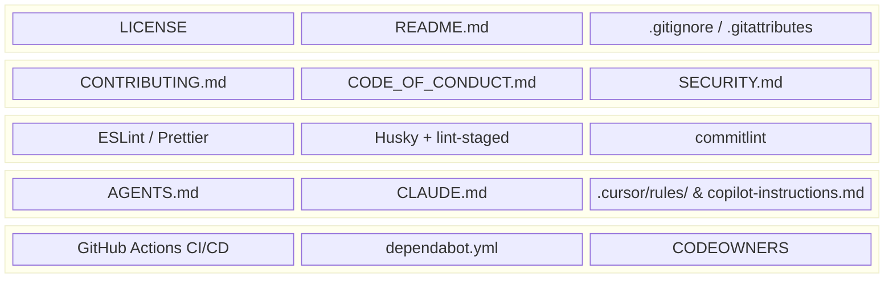
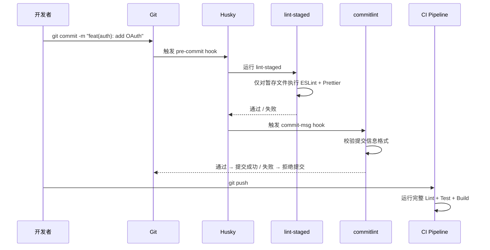
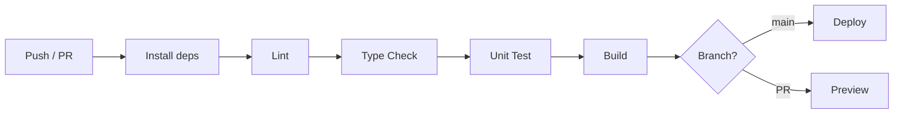

[toc]

## 现代代码仓库治理指南

含 AI Coding 规范

> **知识截止与信息来源**：本指南综合了 GitHub 官方文档、Conventional Commits 规范、commitlint / Husky 官方项目、`AGENTS.md` 开放标准（Agentic AI Foundation）、以及社区实践（dev.to、SOTAAZ、Techsy 等），信息截至 **2026 年 9 月**。
>
> **适用范围**：新建任何代码仓库（个人 / 团队 / 开源）时的初始化 Checklist 与持续治理规范。

---


### 仓库结构总览

下面是一个治理完善的现代代码仓库应具备的文件结构全景。后续章节将逐一讲解每个组成部分。

```
my-project/
├── .editorconfig                  # 跨编辑器格式统一
├── .gitignore                     # 忽略规则
├── .gitattributes                 # 行尾/合并策略
├── LICENSE                        # 开源许可证
├── README.md                      # 项目说明
├── CONTRIBUTING.md                # 贡献指南
├── CODE_OF_CONDUCT.md             # 行为准则
├── SECURITY.md                    # 安全漏洞上报流程
├── CHANGELOG.md                   # 变更日志
├── CODEOWNERS                     # 代码所有者
├── AGENTS.md                      # AI Agent 通用指令 (开放标准)
├── CLAUDE.md                      # Claude Code 专用指令 (可选, 可 symlink)
├── .cursor/
│   └── rules/
│       └── *.mdc                  # Cursor 专用规则 (可选)
├── .github/
│   ├── copilot-instructions.md    # GitHub Copilot 自定义指令
│   ├── FUNDING.yml                # 赞助按钮
│   ├── dependabot.yml             # 依赖自动更新
│   ├── ISSUE_TEMPLATE/
│   │   ├── bug_report.yml         # Bug 报告模板
│   │   ├── feature_request.yml    # 功能请求模板
│   │   └── config.yml             # Issue 模板配置
│   ├── PULL_REQUEST_TEMPLATE.md   # PR 模板
│   └── workflows/
│       ├── ci.yml                 # CI 流水线
│       └── release.yml            # 自动发布
├── .husky/
│   ├── pre-commit                 # lint-staged 触发
│   └── commit-msg                 # commitlint 校验
├── commitlint.config.js           # 提交信息规范配置
├── .prettierrc                    # 代码格式化配置
├── .eslintrc.*                    # Lint 配置 (按语言选择)
├── docs/                          # 项目文档
│   └── ARCHITECTURE.md            # 架构决策记录
└── src/                           # 源代码
```

下图展示了这些文件按功能域的分层关系：



---

### 基础治理层

#### `LICENSE` — 开源许可证

这是开源仓库的**法律基础**。如果希望给予使用者**最大自由**，MIT 许可证是常见选择；如果需要对使用方式施加限制，则应仔细调研并选择合适的许可条款，GitHub 提供了多种许可证模板可直接添加。

常见许可证对比：

| 许可证              | 特点                                | 适用场景             |
| ------------------- | ----------------------------------- | -------------------- |
| **MIT**             | 极度宽松，仅需保留版权声明          | 通用库、工具         |
| **Apache 2.0**      | 明确授予专利权，要求标注变更        | 企业级项目           |
| **GPL v3**          | 强 Copyleft，衍生作品必须同许可开源 | 希望确保代码永远开源 |
| **BSD 2-Clause**    | 类似 MIT，更简短                    | 轻量项目             |
| **Unlicense / CC0** | 放弃一切权利，进入公共领域          | 示例代码、数据集     |

> **注意**：未添加 LICENSE 的仓库默认保留所有权利（All Rights Reserved），其他人在法律上无权使用你的代码。

#### `README.md` — 项目门面

一个合格的 README 至少应包含：

- **项目名称与一句话描述**
- **徽章（Badges）**：CI 状态、版本号、许可证、代码覆盖率
- **快速开始**（Quick Start）：安装、配置、运行的最少步骤
- **功能特性**列表
- **依赖 / 前置条件**
- **使用示例**（最好包含截图或 GIF）
- **贡献方式**（链接到 `CONTRIBUTING.md`）
- **许可证**声明

#### `.gitignore` — 版本控制忽略规则

GitHub 官方维护了按语言分类的 `.gitignore` 模板集合（[github/gitignore](https://github.com/github/gitignore)），建议以此为起点，再追加项目特有的忽略项（如 IDE 配置、本地环境文件等）。

**跨平台注意**：

- macOS 的 `.DS_Store`、Windows 的 `Thumbs.db` 和 `desktop.ini` 应全局忽略（建议配置在 **全局 gitignore** `~/.gitignore_global` 中，而非每个项目重复声明）
- 环境变量文件如 `.env`、`.env.local` **必须**忽略，防止敏感信息泄露

#### `.gitattributes` — 行尾与合并策略

这是解决**跨平台换行符问题**的关键文件。Windows 默认使用 `CRLF`，而 Linux/macOS 使用 `LF`。如果团队成员使用不同操作系统，不统一行尾会导致：

- Git diff 出现大量无意义的行尾变更
- Shell 脚本在 Linux 上因 `\r` 字符无法执行

推荐配置：

```gitattributes
# 自动检测文本文件并统一行尾为 LF
* text=auto eol=lf

# 确保 Shell 脚本始终使用 LF（即使在 Windows 上检出）
*.sh text eol=lf
*.bash text eol=lf

# Windows 批处理文件保持 CRLF
*.bat text eol=crlf
*.cmd text eol=crlf

# 二进制文件不做转换
*.png binary
*.jpg binary
*.ico binary
*.woff2 binary
```

各字段说明：

| 字段          | 含义                                                         |
| ------------- | ------------------------------------------------------------ |
| `* text=auto` | Git 自动判断文件是否为文本，对文本文件在 commit 时归一化行尾 |
| `eol=lf`      | 检出（checkout）时强制使用 LF 行尾                           |
| `eol=crlf`    | 检出时强制使用 CRLF 行尾                                     |
| `binary`      | 将文件标记为二进制，禁止行尾转换和 diff                      |

#### `.editorconfig` — 跨编辑器格式统一

**EditorConfig** 是一个被绝大多数主流编辑器（VS Code、JetBrains 系列、Vim、Emacs 等）原生支持或通过插件支持的标准。它确保不同开发者在不同编辑器中打开同一文件时，基础格式设置一致。

推荐配置：

```ini
# .editorconfig
root = true

[*]
charset = utf-8
end_of_line = lf
indent_style = space
indent_size = 2
insert_final_newline = true
trim_trailing_whitespace = true

[*.md]
trim_trailing_whitespace = false

[*.{py,rs}]
indent_size = 4

[Makefile]
indent_style = tab
```

| 字段                       | 含义                                                      |
| -------------------------- | --------------------------------------------------------- |
| `root = true`              | 告诉编辑器这是项目根级配置，不再向上级目录查找            |
| `charset`                  | 文件编码，统一使用 `utf-8`                                |
| `end_of_line`              | 行尾风格，与 `.gitattributes` 保持一致                    |
| `indent_style`             | 缩进方式：`space`（空格）或 `tab`（制表符）               |
| `indent_size`              | 每级缩进的空格数                                          |
| `insert_final_newline`     | 文件末尾自动添加空行（POSIX 标准）                        |
| `trim_trailing_whitespace` | 删除行尾多余空格（Markdown 文件除外，因为双空格表示换行） |

---

### 社区协作层

#### `CONTRIBUTING.md` — 贡献指南

让贡献者了解项目的参与规则非常重要——当贡献者因不知道流程而被拒绝时，体验很差。`CONTRIBUTING.md` 是承载这些流程的标准文件，它能降低参与门槛。

一份完善的贡献指南应包含：

- **开发环境搭建**步骤（包括依赖安装、数据库初始化等）
- **分支策略**（如 `main` / `develop` / `feature/*` / `hotfix/*`）
- **提交信息规范**（链接到 Conventional Commits）
- **代码风格**要求与自动格式化工具说明
- **Pull Request 流程**（是否需要先提 Issue、是否需要签署 CLA）
- **测试要求**（新功能必须附带测试用例）
- **Code Review 规范**

#### `CODE_OF_CONDUCT.md` — 行为准则

行为准则为项目参与者设定行为底线，对于开源项目和社区尤其有价值。它赋予维护者处理不当行为的明确权力，有助于减轻维护者的管理压力。

业界最广泛使用的是 **Contributor Covenant**（贡献者公约），可直接采用。

#### `SECURITY.md` — 安全漏洞上报

告知安全研究者如何**负责任地披露**（Responsible Disclosure）漏洞，通常包括：

- 上报渠道（专用邮箱，而非公开 Issue）
- 预期响应时间
- 漏洞处理流程
- 致谢策略（Hall of Fame）

#### `CODEOWNERS` — 代码所有者

GitHub 的 **CODEOWNERS** 文件定义了代码各部分的负责人。当 PR 涉及对应路径的文件时，相关负责人会被**自动添加为 Reviewer**。

示例：

```
# 全局默认 Owner
* @team-lead

# 前端代码
/src/frontend/ @frontend-team

# API 层
/src/api/ @backend-team

# CI/CD 配置
/.github/workflows/ @devops-team

# 文档
/docs/ @tech-writer
```

---

### 质量保障层

本层建立 **自动化的代码质量门禁**，确保每次提交都符合团队标准。以下是核心工具链及其协作关系：



#### Conventional Commits — 提交信息规范

**Conventional Commits**（约定式提交）是一套结构化的提交信息格式标准，格式为：

```
<type>(<scope>): <subject>

[optional body]

[optional footer(s)]
```

| 占位符    | 含义                                                 | 示例                              |
| --------- | ---------------------------------------------------- | --------------------------------- |
| `type`    | 提交类型，限定为枚举值                               | `feat`, `fix`, `docs`, `chore` 等 |
| `scope`   | 影响范围（可选），通常是模块名                       | `auth`, `api`, `ui`               |
| `subject` | 简短描述，不以句号结尾                               | `add OAuth2 login flow`           |
| `body`    | 详细说明（可选），解释 what 和 why                   | 多行文本                          |
| `footer`  | 脚注（可选），如 `BREAKING CHANGE:` 或 `Closes #123` | 关联 Issue / 破坏性变更声明       |

常见的 type 枚举值（基于 Angular 约定）包括：`build`、`chore`、`ci`、`docs`、`feat`、`fix`、`perf`、`refactor`、`revert`、`style`、`test`。

遵循此规范的好处：

- 可**自动生成 CHANGELOG**
- 可**自动推断语义化版本号**（Semantic Versioning）：`feat` → minor、`fix` → patch、`BREAKING CHANGE` → major
- Git 历史可读性大幅提升

#### Husky — Git Hooks 管理

Husky 是一个管理 Git Hooks 的工具，允许以脚本形式定义 hooks，并在合适的执行节点自动触发。

安装与初始化：

```bash
# 安装
npm install --save-dev husky

# 初始化（创建 .husky/ 目录并配置 prepare 脚本）
npx husky init
```

`prepare` 脚本（`"prepare": "husky"`）确保团队成员执行 `npm ci` 时自动安装 Git hooks。

#### lint-staged — 暂存文件 Lint

lint-staged 仅对 Git 暂存区（staged）中的文件运行 linter，而非全部文件，使预提交检查快速高效。

配置示例（`package.json` 中或独立 `.lintstagedrc` 文件）：

```json
{
  "lint-staged": {
    "*.{js,jsx,ts,tsx}": [
      "eslint --fix --max-warnings=0",
      "prettier --write"
    ],
    "*.{json,md,yml,yaml,css,scss}": [
      "prettier --write"
    ]
  }
}
```

在 `.husky/pre-commit` 中调用：

```bash
npx lint-staged
```

#### commitlint — 提交信息校验

commitlint 结合 Conventional Commits 规范与 Husky 的 `commit-msg` hook，在提交创建前验证每条提交信息。

安装：

```bash
npm install --save-dev @commitlint/cli @commitlint/config-conventional
```

配置文件 `commitlint.config.js`：

```js
export default {
  extends: ['@commitlint/config-conventional'],
  rules: {
    // 自定义 scope 枚举（可选，按项目模块定义）
    // 'scope-enum': [2, 'always', ['api', 'auth', 'ui', 'db', 'ci', 'docs']],
    'type-enum': [
      2, // 错误级别：0=禁用, 1=警告, 2=错误
      'always',
      ['feat', 'fix', 'docs', 'chore', 'style', 'refactor', 'ci', 'test', 'revert', 'perf', 'build']
    ]
  }
};
```

在 `.husky/commit-msg` 中调用：

```bash
npx --no-install commitlint --edit "$1"
```

如果提交信息不符合规范，commitlint 会输出明确的错误提示，如 `type must be one of [build, chore, ci, docs, feat, fix, ...]`，并阻止提交。

> **跨平台注意**：`"$1"` 在 Windows 的某些 Shell 环境（如 CMD）中可能无法正确解析。推荐团队统一使用 **Git Bash**（Windows 上随 Git 安装）或 WSL。Husky v9+ 已对 Windows 做了较好兼容。

#### ESLint + Prettier — 代码质量与格式化

| 工具         | 职责                                                         | 关注点                             |
| ------------ | ------------------------------------------------------------ | ---------------------------------- |
| **ESLint**   | 静态代码分析，捕获并修复 JavaScript/TypeScript 代码中的常见语法和风格错误，使代码更一致 | 代码逻辑、潜在 Bug、最佳实践       |
| **Prettier** | 有主见的代码格式化器，解析代码并按自有规则重新打印，消除原始风格差异，保证格式一致性 | 缩进、引号、括号、分号等纯格式问题 |

二者**互补而非竞争**：ESLint 负责"代码写得对不对"，Prettier 负责"代码看起来一不一致"。在配置时需要安装 `eslint-config-prettier` 来关闭 ESLint 中与 Prettier 冲突的格式规则。

> **非 JavaScript 项目**的等价工具参考：Python → `ruff` / `black`；Go → `gofmt` / `golangci-lint`；Rust → `rustfmt` / `clippy`；Shell → `shfmt` / `shellcheck`。

---

### AI Coding 层

这是 **2026 年仓库治理的新增维度**。随着 AI 编码工具（Claude Code、Cursor、GitHub Copilot、Codex CLI、Windsurf 等）在开发流程中扮演越来越重要的角色，仓库中的 **AI 指令文件** 相当于给 AI 的"入职文档"。

规则文件本质上是一份给 AI 的入职文档——就像你给新加入团队的开发者的文档，只不过读者是 AI Agent。AI 在会话结束后会遗忘一切，规则文件充当了跨会话的"永不遗忘的笔记"。

#### AI 指令文件格式对比

如今每种工具都收敛到了同一个核心理念：在仓库中放置一个 Markdown 文件，AI 在执行任何操作前先读取它。区别在于文件命名、发现顺序和层级处理方式。

| 文件                                  | 读取者                                                       | 存放位置                                                     | 特点                                                         |
| ------------------------------------- | ------------------------------------------------------------ | ------------------------------------------------------------ | ------------------------------------------------------------ |
| **`AGENTS.md`**                       | Cursor、Codex、Copilot、Windsurf、Zed、Aider 等 20+ 工具原生支持 | 项目根目录，可在子目录中放置分层指令                         | 开放标准，由 Agentic AI Foundation 维护，已被 60,000+ 项目采用 |
| **`CLAUDE.md`**                       | Claude Code                                                  | 三级合并：`~/.claude/CLAUDE.md`（全局） → `./CLAUDE.md`（项目） → 子目录 `CLAUDE.md` | Anthropic 建议每文件不超过 200 行，超过 4 MiB 会被跳过       |
| **`.cursor/rules/*.mdc`**             | Cursor                                                       | `.cursor/rules/` 目录                                        | 精细的作用域控制能力最强（可设置 Always On / Manual / Model Decision） |
| **`.github/copilot-instructions.md`** | GitHub Copilot                                               | `.github/` 目录                                              | GitHub 生态原生集成                                          |

#### 推荐策略：`AGENTS.md` 为主，工具专属配置为辅

重新理解这些文件的关系：`AGENTS.md`、`CLAUDE.md`、`.cursor/rules` 不是竞争关系，而是同一份指令投递给不同的读者。

如果团队同时使用 Claude Code 和其他 Agent，建议以 `AGENTS.md` 为起点作为 source of truth，让 Claude Code 自动回退读取它；在需要工具特定覆盖的地方再添加专属配置。

实际操作中，可用**符号链接**统一管理：

```bash
# 在项目根目录
# 以 AGENTS.md 为 source of truth
ln -s AGENTS.md CLAUDE.md
```

> **Windows 注意**：Windows 上创建符号链接需要**管理员权限**或开启开发者模式。也可以用 `mklink` 命令：`mklink CLAUDE.md AGENTS.md`。如果团队有 Windows 成员且不方便用 symlink，可改为在 `CLAUDE.md` 中通过 `@AGENTS.md` 导入。

#### `AGENTS.md` 编写指南

支持多级目录结构，最近（nearest）的文件优先，子目录文件覆盖父目录文件。

一份有效的 `AGENTS.md` 应涵盖以下章节：

```markdown
# AGENTS.md

## 项目概述
- 项目名称、用途、核心技术栈
- 运行时版本要求（如 Node.js >= 20, Python >= 3.12）

## 架构概览
- 目录结构说明（哪些目录放什么代码）
- 关键设计模式（如 Repository Pattern、Clean Architecture）
- 数据库选型与 ORM

## 编码规范
- 命名约定（文件名、变量名、函数名）
- 导入排序规则
- 错误处理模式
- 日志级别和格式

## 禁止事项
- 不要使用 any 类型（TypeScript）
- 不要直接修改 migration 文件
- 不要在 controller 层写业务逻辑

## 测试要求
- 新功能必须附带单元测试
- 测试框架和断言库说明
- 覆盖率要求

## Git 规范
- 使用 Conventional Commits
- PR 描述模板
- 合并策略（squash merge / rebase）

## 部署信息
- 环境变量说明
- CI/CD 流程简述
```

#### Claude Code 的附加特性

Claude Code 会在 `~/.claude/projects/<project>/memory/` 中自动维护每个仓库的记忆笔记（`MEMORY.md`），首 200 行或 25KB 会自动加载到每个会话。可通过 `/memory` 命令切换，或设置环境变量 `CLAUDE_CODE_DISABLE_AUTO_MEMORY=1` 禁用。

需要区分 **Rules**（规则）和 **Skills**（技能）两个概念：Rules 是项目级指令，持续指导 AI 的代码生成、审查和重构行为；Skills 是任务专属指令包，仅在特定工作流（如重构、代码审查、遗留代码改造）需要时加载。

#### 跨工具规则同步

对于需要在多工具间同步规则的场景，`ai-rules-sync` 工具可以将规则、技能、命令等集中在一个 Git 仓库中管理，通过 symlink 同步到各项目。它支持 Cursor、Claude Code、Copilot、OpenCode、Trae、Codex、Gemini CLI、Warp 等工具，是目前跨工具覆盖最广的方案。

---

### 自动化层

#### GitHub Actions CI/CD

一个基础但完善的 CI 流水线应覆盖：



#### `dependabot.yml` — 依赖自动更新

```yaml
# .github/dependabot.yml
version: 2
updates:
  - package-ecosystem: "npm"     # 包管理器类型
    directory: "/"                # package.json 所在目录
    schedule:
      interval: "weekly"         # 检查频率: daily / weekly / monthly
    commit-message:
      prefix: "chore(deps)"      # 遵循 Conventional Commits
    open-pull-requests-limit: 10 # 同时打开的 PR 上限
    reviewers:
      - "devops-team"            # 自动指定 Reviewer
```

| 字段                       | 含义                                                         |
| -------------------------- | ------------------------------------------------------------ |
| `package-ecosystem`        | 依赖管理器类型，支持 `npm`、`pip`、`docker`、`github-actions` 等 |
| `directory`                | 清单文件（如 `package.json`）所在的相对路径                  |
| `schedule.interval`        | Dependabot 检查更新的频率                                    |
| `commit-message.prefix`    | 自动生成的提交信息前缀，建议统一为 Conventional Commits 格式 |
| `open-pull-requests-limit` | 同时保持打开状态的 Dependabot PR 最大数量                    |

#### Issue 与 PR 模板

GitHub Labels 允许为 Issue 和 PR 创建分类标签，通过标签可以更轻松地扫描和过滤，提供视觉辅助，是保持项目面板整洁的重要工具。

强制使用 Issue 模板是控制信息质量的最佳方式。

GitHub 推荐使用 **YAML 格式**的 Issue 模板（`.github/ISSUE_TEMPLATE/*.yml`），支持表单式字段，比纯 Markdown 模板的体验更好。

Bug 报告模板示例（`.github/ISSUE_TEMPLATE/bug_report.yml`）：

```yaml
name: Bug Report
description: 报告一个 Bug
labels: ["type: bug"]
body:
  - type: textarea
    id: description
    attributes:
      label: Bug 描述
      description: 清晰简洁地描述这个 Bug
    validations:
      required: true
  - type: textarea
    id: steps
    attributes:
      label: 复现步骤
      description: 请列出复现此 Bug 的步骤
      placeholder: |
        1. 执行 '...'
        2. 点击 '...'
        3. 观察到 '...'
    validations:
      required: true
  - type: textarea
    id: expected
    attributes:
      label: 期望行为
  - type: dropdown
    id: severity
    attributes:
      label: 严重程度
      options:
        - 低 - 不影响主要功能
        - 中 - 影响部分功能
        - 高 - 核心功能不可用
        - 紧急 - 生产环境故障
```

#### 组织级 `.github` 仓库

`.github` 仓库是 GitHub 中的一种特殊仓库，允许维护者为组织内所有仓库存放社区健康文件和模板的默认值。

你可以在其中创建如 `CONTRIBUTING` 和 `CODE_OF_CONDUCT` 的默认文件，它们会自动应用于组织下所有没有自己同名文件的仓库。

GitHub 自动将这些模板应用到组织中的每个仓库，仓库本地模板会按设计覆盖（override）组织级默认值。

> `.github` 仓库必须是 **public** 的（或 GitHub Enterprise 中为 internal）才能生效。

---

### 新仓库初始化 Checklist

将以上所有实践浓缩为一份可执行的检查清单，建议在创建每个新仓库时逐项确认：

**基础治理**

- [ ] 选择并添加 `LICENSE`
- [ ] 编写 `README.md`（至少包含项目描述、快速开始、许可证）
- [ ] 配置 `.gitignore`（基于语言模板 + 项目特有排除项）
- [ ] 配置 `.gitattributes`（统一行尾为 LF）
- [ ] 添加 `.editorconfig`

**社区协作**（开源仓库必须，私有仓库推荐）

- [ ] 编写 `CONTRIBUTING.md`
- [ ] 添加 `CODE_OF_CONDUCT.md`
- [ ] 添加 `SECURITY.md`
- [ ] 配置 `CODEOWNERS`

**质量保障**

- [ ] 配置代码 Lint 工具（ESLint / Ruff / Clippy 等）
- [ ] 配置代码格式化工具（Prettier / Black / rustfmt 等）
- [ ] 安装 Husky 并配置 `pre-commit` hook 运行 lint-staged
- [ ] 安装 commitlint 并配置 `commit-msg` hook
- [ ] 编写 `commitlint.config.js`

**AI Coding**

- [ ] 编写 `AGENTS.md`（项目概述、架构、编码规范、禁止事项、测试要求）
- [ ] 根据团队工具选择是否创建 `CLAUDE.md`（或 symlink 到 `AGENTS.md`）
- [ ] 如使用 Cursor，配置 `.cursor/rules/*.mdc`
- [ ] 如使用 Copilot，配置 `.github/copilot-instructions.md`

**自动化**

- [ ] 编写 CI 流水线（`.github/workflows/ci.yml`）
- [ ] 配置 `dependabot.yml`
- [ ] 创建 Issue 模板（Bug Report、Feature Request）
- [ ] 创建 PR 模板

**文档**

- [ ] 创建 `docs/ARCHITECTURE.md`（架构决策记录）
- [ ] 创建 `CHANGELOG.md`（或配置自动生成）

---

### 脚本化初始化（参考方案）

以下提供一个简化的初始化脚本思路（Bash），可根据实际需求扩展为完整的 CLI 工具：

```bash
#!/usr/bin/env bash
# repo-init.sh — 新仓库治理文件初始化脚本
# 用法: ./repo-init.sh <project-name> [--open-source]

set -euo pipefail

PROJECT_NAME="${1:?用法: $0 <project-name> [--open-source]}"
OPEN_SOURCE=false
[[ "${2:-}" == "--open-source" ]] && OPEN_SOURCE=true

mkdir -p "$PROJECT_NAME"
cd "$PROJECT_NAME"
git init

# ---- 基础治理 ----
cat > .editorconfig << 'EOF'
root = true
[*]
charset = utf-8
end_of_line = lf
indent_style = space
indent_size = 2
insert_final_newline = true
trim_trailing_whitespace = true
[*.md]
trim_trailing_whitespace = false
[Makefile]
indent_style = tab
EOF

cat > .gitattributes << 'EOF'
* text=auto eol=lf
*.sh text eol=lf
*.bat text eol=crlf
*.png binary
*.jpg binary
EOF

touch .gitignore README.md

# ---- AI Coding ----
cat > AGENTS.md << 'EOF'
# AGENTS.md

## 项目概述
<!-- 在此描述项目名称、用途、技术栈 -->

## 编码规范
<!-- 在此定义命名约定、导入排序、错误处理模式 -->

## 禁止事项
<!-- 在此列出 AI 不应做的事情 -->

## 测试要求
<!-- 在此描述测试框架和覆盖率要求 -->

## Git 规范
- 使用 Conventional Commits
- 合并策略: squash merge
EOF

# 创建 CLAUDE.md 软链接
ln -sf AGENTS.md CLAUDE.md

# ---- 社区协作 (仅开源) ----
if $OPEN_SOURCE; then
  touch LICENSE CONTRIBUTING.md CODE_OF_CONDUCT.md SECURITY.md CODEOWNERS
  mkdir -p .github/ISSUE_TEMPLATE
  touch .github/PULL_REQUEST_TEMPLATE.md
  touch .github/ISSUE_TEMPLATE/bug_report.yml
  touch .github/ISSUE_TEMPLATE/feature_request.yml
fi

# ---- 自动化 ----
mkdir -p .github/workflows
touch .github/workflows/ci.yml
touch .github/dependabot.yml

echo "仓库 $PROJECT_NAME 初始化完成。"
echo "请根据项目实际情况填充各文件内容。"
```

> **Windows 用户**：上述脚本需在 **Git Bash** 或 **WSL** 中执行。`ln -sf` 命令在 Windows CMD/PowerShell 中不可用，需改用 `mklink` 或 WSL。

> **网络环境提示**：如果从 GitHub 拉取模板仓库遇到网络问题，可使用 GitHub 镜像加速服务（如 `https://gh-proxy.com/` 包裹原始链接），或配置本地代理（如 mihomo）：
>
> - Linux/macOS：`export https_proxy=http://127.0.0.1:7890`
> - Windows PowerShell：`$env:HTTPS_PROXY = "http://127.0.0.1:7890"`
> - Git 专用：`git config --global http.proxy http://127.0.0.1:7890`

---

### 完整仓库文件速查表

| 文件 / 目录                        | 必要性       | 说明                           |
| ---------------------------------- | ------------ | ------------------------------ |
| `LICENSE`                          | 开源**必须** | 无此文件 = 保留所有权利        |
| `README.md`                        | **必须**     | 项目第一印象                   |
| `.gitignore`                       | **必须**     | 排除非版本控制文件             |
| `.gitattributes`                   | **强烈推荐** | 跨平台行尾一致性               |
| `.editorconfig`                    | **强烈推荐** | 跨编辑器格式统一               |
| `CONTRIBUTING.md`                  | 开源推荐     | 降低贡献门槛                   |
| `CODE_OF_CONDUCT.md`               | 开源推荐     | 社区行为底线                   |
| `SECURITY.md`                      | 推荐         | 漏洞负责任披露                 |
| `CODEOWNERS`                       | 团队推荐     | 自动分配 Code Review           |
| `CHANGELOG.md`                     | 推荐         | 版本变更记录                   |
| `AGENTS.md`                        | **强烈推荐** | AI Agent 通用指令（开放标准）  |
| `CLAUDE.md`                        | 可选         | Claude Code 专用（可 symlink） |
| `.cursor/rules/*.mdc`              | 可选         | Cursor 专用细粒度规则          |
| `.github/copilot-instructions.md`  | 可选         | GitHub Copilot 自定义指令      |
| `commitlint.config.js`             | **强烈推荐** | 提交信息规范校验               |
| `.husky/`                          | **强烈推荐** | Git Hooks 自动化               |
| `.github/workflows/`               | **强烈推荐** | CI/CD 流水线                   |
| `.github/dependabot.yml`           | 推荐         | 依赖自动更新                   |
| `.github/ISSUE_TEMPLATE/`          | 开源推荐     | 结构化 Issue 提交              |
| `.github/PULL_REQUEST_TEMPLATE.md` | 推荐         | PR 描述规范化                  |
| `docs/ARCHITECTURE.md`             | 推荐         | 架构决策文档                   |

---

### 现成推荐：可直接使用的模板仓库

在编写自己的 Skill 之前，先列出几个已有的高质量模板，可按需直接复用或参考：

| 项目                                  | 说明                                                         | 链接        |
| ------------------------------------- | ------------------------------------------------------------ | ----------- |
| **cfpb/open-source-project-template** | 美国消费者金融保护局的开源项目模板，包含默认的 `opensource-checklist.md` | GitHub      |
| **svt/open-source-project-template**  | 瑞典电视台（SVT）的 FOSS 项目模板，包含合理的默认配置        | GitHub      |
| **aiagentwithdhruv/ai-coding-rules**  | 包含 15 条 Cursor 规则 + 9 个文档模板 + Claude Code 配置，已在 30+ 项目中生产验证 | GitHub      |
| **ciembor/agent-rules-books**         | 从 *Clean Code*、*Refactoring*、*DDD* 等经典书籍中提炼的 AI Agent 规则集，可作为轻量级工程协议使用 | GitHub      |
| **组织级 `.github` 仓库**             | GitHub 支持在组织的 `.github` 仓库中存放 `CONTRIBUTING`、`CODE_OF_CONDUCT`、Issue / PR 模板等社区健康文件，作为所有仓库的默认配置 | GitHub Docs |

---


## 总结：

现代仓库治理 = **传统最佳实践**（LICENSE、README、.gitignore、Conventional Commits、CI/CD）+ **AI Coding 新维度**（`AGENTS.md` 为核心的 AI 指令体系）。