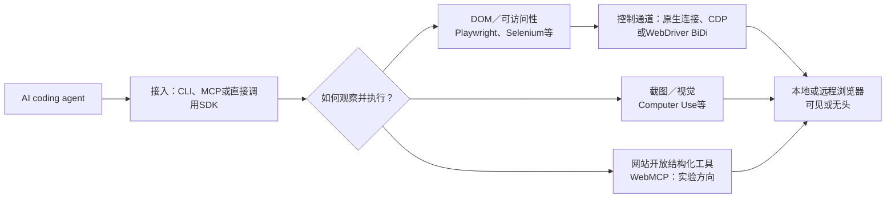
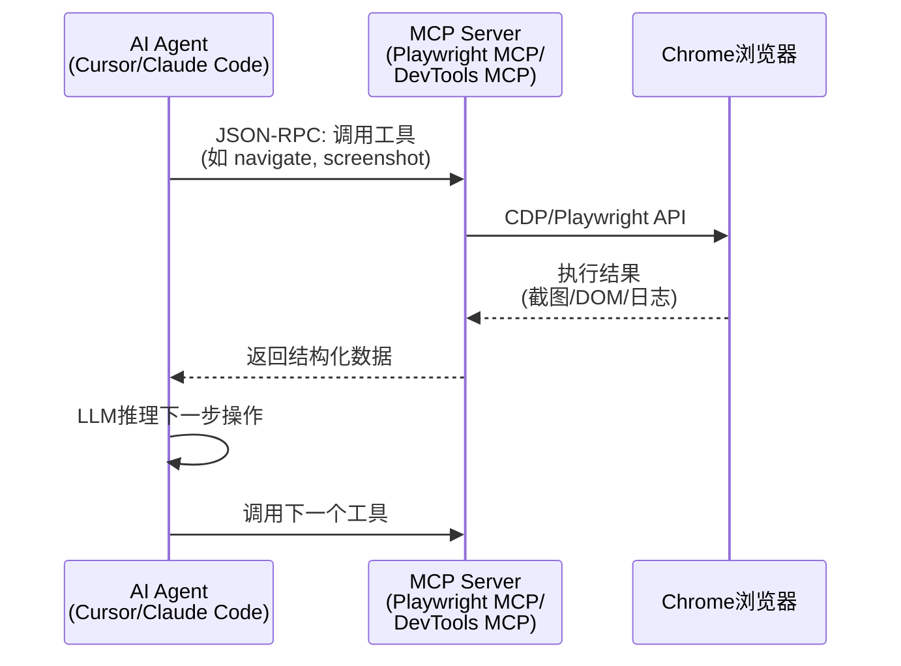
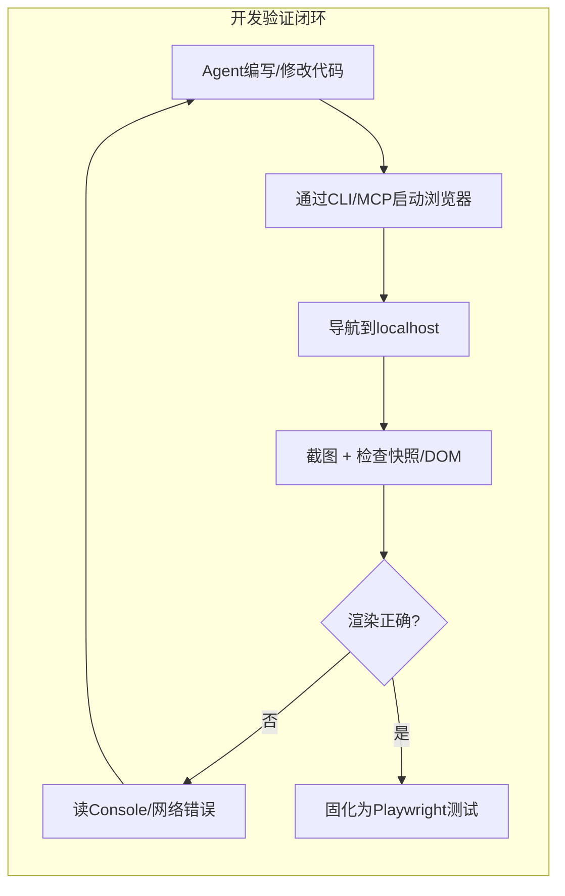

[toc]

---

## AI Coding Agent使用浏览器的方式: 全景调研报告

> **信息来源**: Google Chrome官方文档 (developer.chrome.com, 含 Chrome DevTools for agents / WebMCP 文档)、Microsoft Playwright官方文档 (playwright.dev, 含 agent-cli / MCP / browsers / api)、Puppeteer官方文档 (pptr.dev)、W3C WebDriver BiDi (TR, 2026-09-24 Working Draft)、WebKit博客 (Safari MCP server, 2026-07-01)、Browserless官方文档 (connection-urls)、GitHub各开源项目 (Browser Use, Stagehand, agent-browser, chrome-devtools-mcp, Midscene, Page Agent, UI-TARS)。
> **知识截止**: 2026年9月。文中涉及版本号、命令行、配额数字均已按上述来源核验；凡宣传性基准数字一律弱化处理，以自己页面的实测为准。

**先给结论：** 如果目标是让 coding agent 开发并验证自己的 Web 应用，优先用 **Playwright 脚本形成可重复测试**，用 **Playwright CLI 或 MCP 辅助探索页面**；排查 Chrome 网络、性能问题时加用 **Chrome DevTools MCP**。**无头**适合 CI(持续集成)，**CDP**适合接入现有 Chromium 或深入诊断，**视觉操作**适合结构化定位困难的界面。它们属于不同层次，通常应当组合，而不是六选一。

---

### 全局概览：分层组合，而不是六选一

AI Coding Agent 要“使用浏览器”，本质是解决：**让 LLM 能感知(看到)和操控(交互)真实 Web 页面**，并把一次性的探索固化为可重复的验证。

不要把 CLI / MCP / CDP / 无头 / 云端并列比较。正确的心智模型是四层组合：



| 层次 | 说明 | 典型代表 |
| ---- | ---- | -------- |
| **Agent 入口** | Agent 以什么形式调用浏览器能力 | Playwright CLI + Skills、Playwright MCP、Chrome DevTools MCP/CLI、SDK |
| **观察与执行** | 靠什么定位和断言 | DOM/可访问性树、截图/视觉坐标、WebMCP(网站主动暴露工具) |
| **控制通道** | 用什么协议驱动浏览器 | Playwright 原生连接、CDP、WebDriver BiDi |
| **运行方式** | 浏览器跑在哪里、是否可见 | 本地/远程(云浏览器)、有头/无头 |

两种典型组合：

- **coding agent → CLI → Playwright → 无头Chromium**(本地开发验证、CI回归)
- **coding agent → MCP → Chrome DevTools → CDP → 已打开的Chrome**(接手调查线上/已登录页面)

Playwright 自身支持 Chromium、Firefox、WebKit；但 **Playwright 通过 CDP 接入现有浏览器(`connectOverCDP` / `attach --cdp`)只适用于 Chromium 系**，且官方明确其保真度低于 Playwright 原生连接(`browserType.connect()`)。

---

### 底层控制通道：CDP vs WebDriver vs WebDriver BiDi

这是理解一切上层差异的根基。

#### Chrome DevTools Protocol (CDP)

每个 Chromium 都内置的远程控制 API，即 F12 DevTools 背后使用的同一协议。

- **通信**：基于 WebSocket 的双向 JSON-RPC，如 `ws://localhost:9222/devtools/browser/...` 或 `http://localhost:9222`(HTTP 仅用于发现端点)。
- **能力**：按 DOM、Network、Debugger、Performance 等**域(domain)**提供命令和事件，可做 DOM/CSS 检查、网络拦截、Console 读取、性能轨迹、截图等，诊断深度最强。
- **覆盖**：仅 Chromium 系(Chrome、Edge、Brave 等)。
- **版本注意**：CDP 持续演进，不保证任意版本间兼容；直接写底层 CDP 要处理会话与协议变化。

两个容易混淆的安全变更(均已核验，见下文接管已登录浏览器)：

- **9222**一类端口是**浏览器调试端口，不是业务站点端口**。
- Chrome 自 **136 版**起，用 `--remote-debugging-port` / `--remote-debugging-pipe` 不再接受调试**默认用户数据目录**，必须配合指向非默认目录的 `--user-data-dir`([developer.chrome.com/blog/remote-debugging-port](https://developer.chrome.com/blog/remote-debugging-port))。这与后文 Chrome 144+ 的用户授权路径是两条不同路径，不要混为一谈。

#### WebDriver (W3C 标准)

- **通信**：HTTP REST 请求-响应，需独立 driver(ChromeDriver、GeckoDriver)做代理。
- **能力**：标准化的操作子集(导航、元素交互、窗口管理)，相比 CDP 诊断能力窄。
- **覆盖**：最广，几乎所有主流浏览器。
- **代价**：多一层代理 + 缺少 auto-wait，Agent 跑数百步时延迟累积明显，维护负担重(版本匹配、Grid 配置)。

#### WebDriver BiDi(双向 WebDriver)

- 结合 WebDriver 跨浏览器兼容性 + CDP 双向事件流的**下一代标准化路线**，可订阅日志、网络等事件。
- **标准状态**：截至核验时 W3C 文本仍为 **2026-09-24 Working Draft**([w3.org/TR/webdriver-bidi](https://www.w3.org/TR/webdriver-bidi/))，仍在演进，不宜假定所有浏览器和功能完全一致。**不要把 BiDi 描述为已经全面替换 CDP**。
- **Puppeteer 现状(已核验，[pptr.dev/webdriver-bidi](https://pptr.dev/webdriver-bidi))**：在 Chrome 上默认仍用 CDP，在 Firefox 上默认用 BiDi；部分 CDP 能力尚不能通过 BiDi 获得。Selenium 4+ 也在接入 BiDi，但覆盖仍在补齐。

| 维度 | **CDP** | **WebDriver** | **WebDriver BiDi** |
| ---- | ------- | ------------- | ------------------ |
| 通信模型 | WebSocket 双向 | HTTP 请求-响应 | WebSocket 双向 |
| 浏览器覆盖 | 仅 Chromium | 所有主流浏览器 | 逐步扩展中 |
| 调试能力 | 极强(性能追踪、网络拦截、Console) | 有限 | 中等(逐步增强) |
| 延迟 | 低 | 较高(多一层代理) | 低 |
| 标准化 | Chrome 事实标准 | W3C 标准 | W3C Working Draft(2026-09-24) |
| AI Agent 适配 | 最佳(信息密度高) | 较弱 | 前景好但尚未成熟 |

> 原稿中“Chrome 146+ 原生设置开关”的说法不准确，已按官方文档修正为Chrome 144+的 `--autoConnect` 授权路径(见接管已登录浏览器)。

---

### 自动化引擎：Playwright vs Puppeteer vs Selenium

三者都是对上述协议的封装，但 Agent 适配度差异很大。

| 维度 | **Playwright** | **Puppeteer** | **Selenium** |
| ---- | -------------- | ------------- | ------------ |
| 底层协议 | 原生协议为主；`connectOverCDP` 仅 Chromium 且低保真 | Chrome 默认 CDP，Firefox 默认 BiDi | WebDriver(含 BiDi 演进中) |
| 浏览器支持 | Chromium、Firefox、WebKit | Chrome 为主(Firefox 经 BiDi) | 所有主流浏览器 |
| 语言绑定 | Python、JS/TS、Java、.NET | JS/TS | 最广 |
| 自动等待 | **内建**(actionability 检查) | 部分手动 | 完全手动 |
| 官方 Agent 入口 | CLI + Skills、MCP Server(`@playwright/mcp`) | 无官方(需自建) | 无 |
| AI 适配度 | 最高(Accessibility Tree 抽象) | 中 | 低 |
| 速度定性 | 快(单进程、异步) | Chrome 专属任务接近底层、通常更快 | 相对慢(桥接+手动等待) |
| 最佳场景 | Agent 开发验证、跨浏览器测试 | Chrome 性能分析、覆盖率、原始 CDP | 遗留套件、合规 Grid |

原稿中290ms vs 536ms、11KB vs 326KB、快15-20%/30-50%、40-70%维护时间、45.1%采用率等精确数字多来自厂商基准或调研快照，跨版本和场景波动极大，本次合并已删除，改为定性结论：**按自己页面的任务完成率、耗时、模型与浏览器成本、失败证据是否可定位来选型，区分一次性探索成功与多次稳定通过**。

#### 为什么 Playwright 是 Agent 首选

1. **官方双入口**：MCP Server适合统一发现和沙盒环境；CLI + Skills适合已有终端能力的coding agent(详见Agent入口)。
2. **Accessibility Tree / Snapshots**：结构化语义描述，比原始 HTML 噪音更少、信息密度更高，适合 LLM 决策；CLI 把快照落盘为 YAML，按需读取。
3. **Auto-wait**：交互前自动等待可见、稳定、可用并可接收事件，对非确定性 Agent 操作序列尤为关键。
4. **跨浏览器**：一套定位逻辑覆盖三大引擎(CDP 接入除外)。

#### Puppeteer 的定位

Chrome专属的性能(`Performance.getMetrics()`)、网络监控、原始CDP命令场景更接近底层。Agent场景不足：无开箱**Accessibility抽象**、无**auto-wait**、跨浏览器弱。

#### Selenium 的现状

需要 driver 版本匹配和 Grid 运维；WebDriver 延迟在长会话中累积。除非维护遗留套件，否则新 Agent 工作流优先 Playwright。

---

### Agent入口：CLI vs MCP vs SDK

MCP(模型上下文协议，Model Context Protocol)是 2025-2026 年最重要的连接范式：配置一次 MCP Server，多个兼容 Agent(Claude Code、Cursor、Copilot、Gemini CLI 等)都能通过 JSON-RPC 调用浏览器工具。但 **MCP 与 CLI 不宜简单按“哪个一定更省 token”排序**。



Playwright 官方当前立场([playwright.dev/docs/getting-started-cli](https://playwright.dev/docs/getting-started-cli)，已核验)：

- **`playwright-cli` 适合 coding agent**：通过简洁 CLI(命令行界面)命令 + 可安装 Skills，避免始终加载大量工具描述和冗长可访问性树；快照/截图落盘，Agent 按需读取，token 通常显著更省(官方个案约 4 倍，实际取决于快照大小、调用次数和 Agent 实现)。
- **MCP 适合希望工具被客户端统一发现和调用的场合**(无 `shell` 的沙盒 Agent、通用助手)。
- 无论入口是哪一种，值得长期保留的业务校验仍应落到**脚本和断言**上，探索过程不自动等于稳定测试。

```bash
npm install --save-dev @playwright/test
npx playwright install chromium
npm install --global @playwright/cli@latest

playwright-cli open http://127.0.0.1:3000/tickets
playwright-cli snapshot
```

说明：CLI 默认无头运行，`--headed` 可见；`--browser=chrome|firefox|webkit|msedge` 切换引擎；具名/多会话用 `PLAYWRIGHT_CLI_SESSION` 或 `attach [name]` / `-s=` 选择会话(`127.0.0.1:3000` 为示例应用地址)。应让 Agent 依据**本次快照**确定元素引用(`e5` 一类短引用)，不能预先臆造或长期复用。

#### 主流 MCP/CLI 方案

| Server | 维护方 | 核心定位 | 连接方式 | 适用场景 |
| ------ | ------ | -------- | -------- | -------- |
| `@playwright/mcp` | Microsoft | 通用浏览器自动化 | 启动独立 Playwright 浏览器实例 | Web 应用测试、Agent 日常操控(主要工具) |
| `playwright-cli` + Skills | Microsoft | token 高效的 coding agent 入口 | 终端命令 + 落盘快照 | 开发时探索、复现、生成测试初稿 |
| `chrome-devtools-mcp` | Google | 调试与性能分析 | 连接已有 Chrome(CDP)或启动新实例 | 调试当前标签页、网络/性能深挖 |
| `chrome-devtools` CLI + Skills | Google | 终端直调 DevTools | `chrome-devtools <tool>` | 无 MCP 时的终端调试、WebMCP 实验工具调用 |
| `browser-tools-mcp` | AgentDesk | 实时会话观察 | Chrome 扩展 + DevTools | 复用已登录真实会话的 Console/网络/截图/Lighthouse |
| `agent-browser` | 开源社区 | CLI 优先的轻量控制 | Playwright 或 CDP，可独立或连现有 Chrome | 一行命令快速集成 |
| `safari-mcp`(`safaridriver --mcp`) | Apple/WebKit | 真实Safari核查 | Safari开发者自动化 | 仅Safari渲染/性能问题(见观察与执行) |

Chrome DevTools for Agents 由三件套构成(已核验，[developer.chrome.com/docs/devtools/agents](https://developer.chrome.com/docs/devtools/agents/get-started))：**MCP Server + CLI + Agent Skills**(任务级工作流指令)。Playwright 侧对应为 **MCP + CLI + Skills**。

#### Playwright MCP vs Chrome DevTools MCP

| 对比点 | **Playwright MCP / CLI** | **Chrome DevTools MCP** |
| ------ | ------------------------ | ----------------------- |
| 浏览器来源 | 自行启动独立实例(也可用 `attach --cdp/--extension` 连现有) | 连接已运行 Chrome，或启动新实例 |
| 会话状态 | 全新(用 storageState 显式复用登录) | 可复用登录态和 Cookie(需用户授权) |
| 浏览器引擎 | Chromium、Firefox、WebKit | 仅 Chrome(Safari 问题用 Safari MCP) |
| 核心能力 | 导航、交互、截图、数据提取、测试生成 | DOM/CSS 检查、**性能追踪**、Console、**网络分析**、Lighthouse |
| 典型场景 | 测试正在开发的 Web 应用 | 调试线上/已打开页面的布局与性能 |
| 用户体验 | Agent 在“自己的浏览器”中操作 | Agent 操作**你正在看的那个浏览器** |

实际使用两者互补：Playwright 做主要自动化，DevTools MCP 做 Chrome 深度诊断。

---

### 观察与执行：DOM vs 视觉 vs WebMCP

| 方式 | 主要优势 | 主要限制与适用场景 |
| ---- | -------- | ------------------ |
| **固定自动化脚本**：Playwright、Puppeteer、Selenium | 可审查、可复跑、适合断言和 CI；Playwright 定位器自动等待 | 首次需设计测试数据与定位规则。**适合已知流程、回归、长期维护** |
| **Playwright CLI／MCP**：边观察边操作 | CLI 便于有终端能力的 agent 调用；MCP 以结构化工具暴露操作；均可利用页面快照 | 探索不等于稳定测试；大快照和频繁调用占上下文。**适合探索、复现、生成测试初稿** |
| **CDP 与 Chrome DevTools MCP** | 可看控制台、网络、CSS、性能轨迹，定位“为何坏了” | 主要 Chromium；底层 CDP 要处理会话与协议变化。**适合 Chrome 专项调试、接管可调试实例** |
| **WebDriver BiDi**(Selenium/Puppeteer 经此用) | 跨浏览器双向事件流的标准化路线；可订阅日志、网络 | 标准仍在演进(W3C WD 2026-09-24)。**适合重视跨浏览器与标准协议的体系** |
| **扩展或授权接入现有浏览器** | 复用已登录页、SSO(单点登录)和部分扩展状态 | **权限敏感，隔离性不如专用测试环境**。仅人工已复现、Agent 接手调查时用；不宜默认接管私人浏览器 |
| **视觉／计算机操作** | 依据截图操作；对画布、复杂可视化、浏览器外原生对话框有价值 | 坐标受尺寸、滚动、布局影响，需更谨慎验证。**适合 DOM 覆盖不到的步骤，宜与结构化断言结合** |
| **语义化混合框架**：Stagehand、Browser Use、Midscene | 自然语言描述操作，结合 DOM/视觉/代码；适合常变界面探索 | 模型、提示词、页面状态使结果难完全复现；**不要用“自愈”代替结果断言** |

#### 定位器建议

`getByRole()` 优先利用用户可感知的角色与名称，比长 CSS 路径更稳，适合长期维护。对画布或缺语义标注界面，再加截图验证。

#### WebMCP：网站主动暴露工具(实验方向)

WebMCP 不是“再装一个本地 MCP 浏览器服务器”，而是**由网站通过浏览器 API 向 Agent 暴露结构化操作工具**(如 `search_products`、`date_pick`、`checkout`)，减少模拟点击的脆弱性。核验结论：

- Chrome **149 起 origin trial**，Gemini in Chrome 为首批客户端之一([developer.chrome.com/docs/ai/webmcp](https://developer.chrome.com/docs/ai/webmcp))。
- Chrome DevTools 149 在 Application 面板提供**实验性** WebMCP 调试；`chrome-devtools` CLI 的 `list_webmcp_tools` / `execute_webmcp_tool` 需 `--categoryExperimentalWebmcp=true`。
- **可为自有网站试验，不宜作为普通网站自动化的默认依赖**。

#### Safari MCP：只用于真实 Safari

WebKit 于 2026-07-01 公布 **Safari MCP server**([webkit.org/blog/18136](https://webkit.org/blog/18136/introducing-the-safari-mcp-server-for-web-developers/))：Safari 27 / Safari Technology Preview 247 起，任意 MCP 客户端经 `safaridriver --mcp` 连接 Safari 窗口，做 DOM、网络、截图、控制台核查。**适合核查真实 Safari 问题，不能当作 Windows/Linux 通用 CDP 替代品**。

---

### 运行方式：有头 vs 无头 vs 云端

| 维度 | **有头(Headed)** | **无头(Headless)** |
| ---- | ------------------ | -------------------- |
| GUI | 有可视窗口 | 无 GUI，后台运行 |
| 资源 | 较高 | 较低 |
| 适用 | 本地开发调试、需人工观察 Agent、会话共享 | CI/CD、服务器批量任务、云端 Agent |
| 反爬 | 不易识别 | 部分网站可检测无头特征 |

```python
# Playwright (Python) 示例
browser = await playwright.chromium.launch(headless=True)   # 无头
browser = await playwright.chromium.launch(headless=False)  # 有头
```

三点纠偏(均已核验)：

1. **无头不是“只下载 HTML”**：仍执行 JS 并渲染，适合后台回归与 CI；调试视觉问题切可见窗口更直观。
2. **“无头”有实现差异**：Playwright 默认用轻量的 **Chromium headless shell** 跑无头，更接近普通 Chrome 的是 Chrome 112+ 的**新无头模式**(Playwright 用 `channel: 'chromium'` 启用，[playwright.dev/docs/browsers](https://playwright.dev/docs/browsers))。两者在 GPU、字体、扩展等场景可能表现不同，**不要把“有头跑通”未经验证视为“无头一定跑通”**。
3. **“远程”不必然等于“通过 CDP”**：Browserless 等同时提供 CDP 端点(`wss://...?token=`，`connectOverCDP`)和 **Playwright 原生连接**(`wss://.../chromium/playwright?token=`，另有 `firefox/playwright`、`webkit/playwright`，[docs.browserless.io](https://docs.browserless.io/overview/connection-urls))。云浏览器适合并发与统一管理，但要计入费用、延迟、会话隔离与凭证保管。

典型分工：本地开发有头(可观察)、CI 无头(省资源)、规模化用云端。

---

### 接管已登录浏览器：两条易混淆的路径

- **调试端口路径**：`--remote-debugging-port=9222` + `--user-data-dir=<非默认目录>` 手动启动可调试实例，再用 `--browserUrl=http://127.0.0.1:9222` 或 `playwright-cli attach --cdp=http://localhost:9222` 接入。Chrome 136+ 忽略默认目录的调试开关，此为安全收紧，非 bug。
- **用户授权路径(Chrome 144+)**：Chrome DevTools MCP 用 `--autoConnect` 请求连接正在使用的 Chrome；用户先在 `chrome://inspect/#remote-debugging` 启用功能，每次连接时确认授权([developer.chrome.com/.../configuration](https://developer.chrome.com/docs/devtools/agents/get-started/configuration))。Playwright CLI 对应 `playwright-cli attach --extension` 或 `attach --cdp=chrome`。**这不是绕过 136 版限制去打开默认目录旧端口，而是不同的接入流程**；两者都意味着 Agent 会接触登录态和敏感页面。

安全要求：仅在确需复用登录态时启用，优先专用测试账号与独立配置(`--isolated`、`--userDataDir`、`state-save/state-load`)，用完即断开(`detach`)。

---

### 上层Agent框架：AI原生的浏览器Agent

五大类：**浏览器基础设施**、**研究 Agent**、**浏览器自动化 Agent**、**开发者框架**(Browser Use、Stagehand、Playwright MCP)、**企业自动化平台**。

| 框架 | 语言 | 底层引擎 | AI 集成方式 | 最佳场景 |
| ---- | ---- | -------- | ----------- | -------- |
| **Browser Use** | Python | Playwright | LangChain + 任意 LLM、分层 Planner/Navigation | 自定义 AI 浏览器 Agent |
| **Stagehand** | TypeScript | Playwright | `act` / `extract` / `observe` 极简 API | TS 开发者，脚本+AI 混合 |
| **Skyvern** | Python | 自研视觉 | 视觉 AI + 无代码 | 表单密集型业务流 |
| **agent-browser** | JS/TS | Playwright/CDP | CLI + MCP | CLI 集成、轻量快速 |
| **Midscene** | JS/TS | Playwright/Puppeteer | `aiAct` / `aiAssert` + Skills，视觉与 DOM 结合 | 中文界面、E2E 断言增强 |
| **阿里 Page Agent** | JS | 页面内 JS + 文本化 DOM | 页内内嵌助手；跨标签/外部 agent 经扩展及 Beta MCP | **自有 SaaS 页内助手**，与控制任意网站目标不同 |
| **字节 Agent TARS / UI-TARS** | 多语言 | DOM + GUI 视觉 + 混合 | 开源桌面/浏览器 Agent | 本地模型、视觉路线评估 |

> 原稿 Stars 与榜单分数(如 Browser Use 108K、87.4%、Stagehand 23K+ 等)为快照值且涨落极快，本次合并删除具体数字；Midscene 致谢中明确构建于 UI-TARS、Qwen、Playwright 等之上。凡选型都应在自己页面测成功率，不沿用宣传性指标。是否用 Browserbase 等云托管，取决于要的是“远程浏览器+会话管理+并发运维”，还是“自己控制推理与工具逻辑”。

| 平台 | 特色 | 连接方式 |
| ---- | ---- | -------- |
| **Browserbase** | Stagehand SDK + 会话可观察性 | Playwright API、CDP |
| **Browserless** | 开源可自部署，Docker 友好；CDP 与 Playwright 原生双端点 | WebSocket(CDP / Playwright) |
| **Steel** | 会话持久化、身份管理 | API |
| **Hyperbrowser** | 面向 Agent 的数据采集与研究流 | API |
| **Browser Use Cloud** | SDK、REST 或 CDP 托管浏览器 | SDK/REST/CDP |

---

### 一套可落地的开发流程：先探索，后固化

假设本地客服系统 `http://127.0.0.1:3000/tickets` 有标为“类型”的筛选框；固定数据含**退款工单 1042**和**咨询工单 1088**。需求：修复“选择退款后仍显示咨询工单”，并留下可重复验证。以下示例按该页面约定编写，**未在本环境实跑**。

**先探索，后固化**：服务按实际方式启动；另开终端用 CLI 看快照：

```bash
npm install --save-dev @playwright/test
npx playwright install chromium
npm install --global @playwright/cli@latest

playwright-cli open http://127.0.0.1:3000/tickets
playwright-cli snapshot
```

给 Agent 的任务写成：

> 只检查本地 `/tickets` 页面。先获取页面快照，复现“类型＝退款”筛选；核对 1042 仍显示、1088 不显示，并检查相关控制台或网络错误。修复代码后，将该行为写成 Playwright 测试并运行；失败时保留 `trace`/截图供复查。不要连接生产环境或修改真实客户数据。

随后把成功的探索**固化为测试**，如 `tests/tickets.spec.ts`：

```typescript
import { test, expect } from '@playwright/test';

test('筛选退款工单时排除咨询工单', async ({ page }) => {
  await page.goto('http://127.0.0.1:3000/tickets');

  await page.getByRole('combobox', { name: '类型' })
    .selectOption({ label: '退款' });

  await expect(page.getByRole('row', { name: /工单-1042/ }))
    .toContainText('退款');
  await expect(page.getByRole('row', { name: /工单-1088/ }))
    .toHaveCount(0);
});
```

```bash
npx playwright test tests/tickets.spec.ts --trace on
```

前提：测试环境确实准备了上述两条固定数据，且筛选框、工单行有对应可访问性语义；否则先调整夹具或页面标注。若症状指向请求失败或性能，再用 **Chrome DevTools MCP** 查网络、控制台和性能轨迹；若问题只在已登录真实Chrome复现，再用接管已登录浏览器一节的**明确授权接入**。这种分工比开放式 Agent 反复点击、最后只报告“看起来正常”更易复查。



---

### 实施边界与安全建议

- **最小权限**：优先专用测试账号、独立浏览器配置(`--isolated`、独立 `--user-data-dir`)。Playwright的登录状态文件(`auth.json` / `storageState`)含可冒充账号的Cookie，**排除在版本控制之外**；截图、`trace`、云会话按敏感数据管理。
- **不要把便利性限制当安全边界**：Playwright MCP 的来源允许/阻止列表(`allowedOrigins` / `blockedOrigins`)只防误操作，不构成隔离；真正的限制放在 Agent 权限、独立账号与运行环境层。CDP 端点和带 token 的远端 WebSocket 地址不公开暴露。
- **提示注入**：网页文本、快照、图片都可能携带注入；付款、发布、删除等有实际后果的动作设人工确认。
- **按任务评估**：测“任务完成且断言正确的比例、耗时、模型与浏览器成本、失败证据是否可定位”；区分一次成功与多环境稳定通过；结构良好的表单优先结构化定位，画布/缺语义界面加截图验证。

---

### 综合方案选择指南(组合，而非单选)

| 你的需求 | 推荐组合 | 理由 |
| -------- | -------- | ---- |
| **Coding Agent 开发验证** | Playwright 测试 + CLI/MCP 探索 | 可重复验收 + 低摩擦探索；auto-wait 与快照 |
| **调试已打开的页面** | Chrome DevTools MCP | 连现有会话、性能追踪、网络分析 |
| **需登录态操控** | 授权接入(`--autoConnect` / `attach --extension`)或 `storageState` | 复用Cookie，但仅确需时启用 |
| **构建自定义 Agent** | Browser Use(Python)/ Stagehand(TS) | 高级 Agent 抽象与 LLM 集成 |
| **Chrome 专属深挖** | Puppeteer / DevTools CLI | 最接近 CDP |
| **遗留系统兼容** | Selenium | 最广浏览器与已有生态 |
| **规模化云端** | Browserbase / Browserless + 上层框架 | 托管、反爬、并发；注意远程分 CDP 与 Playwright 原生两种端点 |
| **CLI 快速集成** | `agent-browser` 或 `playwright-cli` | 一行命令即可操控 |
| **真实 Safari 核查** | Safari MCP(`safaridriver --mcp`) | 覆盖 WebKit 真机逻辑 |
| **自有站点结构化工具** | WebMCP(Chrome 149 origin trial) | 值得跟踪，尚不宜作通用前提 |

**最终推荐组合：Playwright 测试承担可重复验收；CLI 或 MCP 承担探索与调试；Chrome DevTools MCP 承担 Chrome 深度诊断；扩展/授权连接仅在确需复用登录态时启用；视觉 Agent 处理结构化工具盲区。云浏览器是规模化选择，WebMCP 是跟踪方向。**

---

### 国内开发者与趋势

- **网络分两条链路处理**：下载浏览器 vs 浏览器访问目标是两回事。下载受阻用 `HTTPS_PROXY` 或可信内部制品仓；运行时代理另配。Bash：`HTTPS_PROXY=http://127.0.0.1:7890 npx playwright install chromium`；PowerShell 先设 `$env:HTTPS_PROXY='http://127.0.0.1:7890'` 再安装。7890仅示例，改为实际端口；不下载来源不明的二进制。`npx` registry受阻可配镜像。
- **国内生态定位**：Page Agent 适合自有 SaaS 页内助手；Midscene 的 Skills 支持默认无头、连已有 Chrome 及 CDP 端点；TARS/UI-TARS 覆盖 DOM/视觉/混合路线，适合中文界面与本地模型评估。
- **趋势**：
  1. MCP 正在成为标准，浏览器只是其中一个工具；Chrome DevTools for Agents 与 Playwright 均走向 MCP + CLI + Skills 三件套。
  2. Agent-as-User 兴起：API 更快更可预测，但受限于可用性；无 API 时浏览器自动化是唯一手段。
  3. Playwright 主导 Agent 基础设施；Puppeteer 守 Chrome 底层。
  4. 安全与对齐：“对齐的 LLM 不等于对齐的浏览器 Agent”，提示注入与权限是活跃研究方向。
- **Azure Foundry**：已用 Azure 的团队可评估其浏览器自动化工具(Preview，经 MCP 连 Browser Automation toolbox)。
