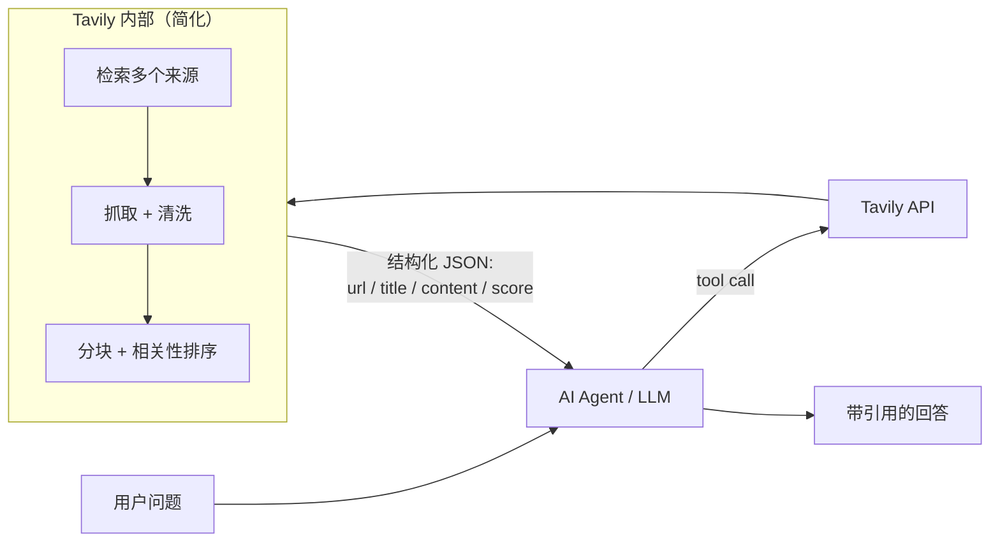
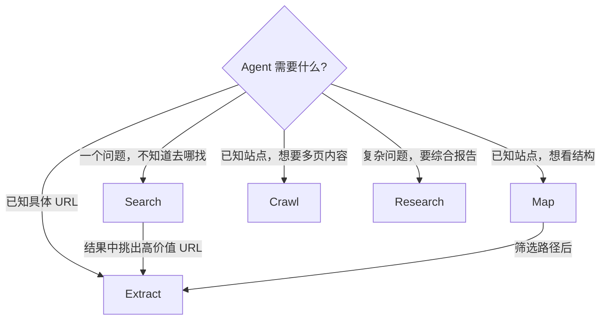
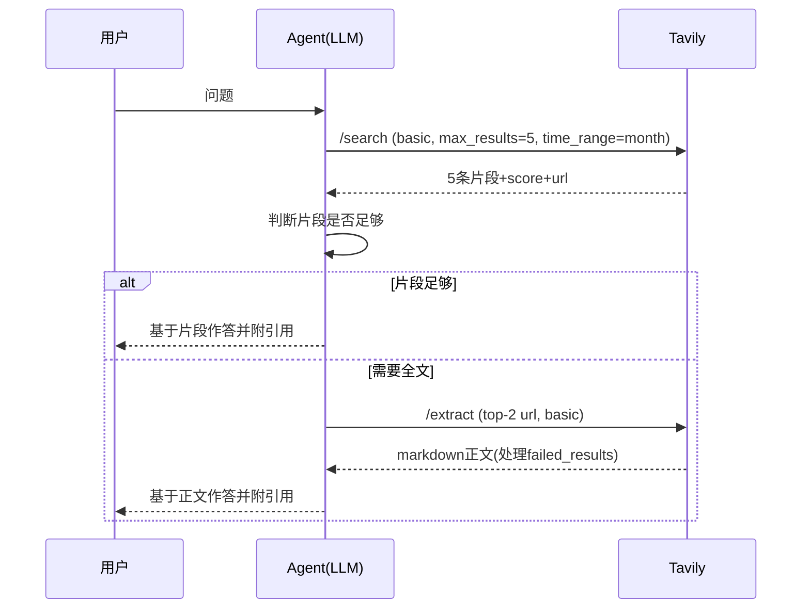
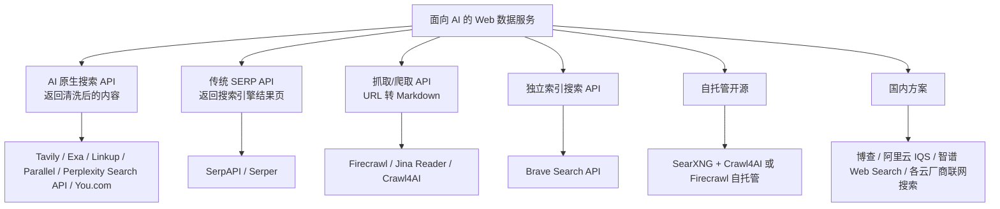
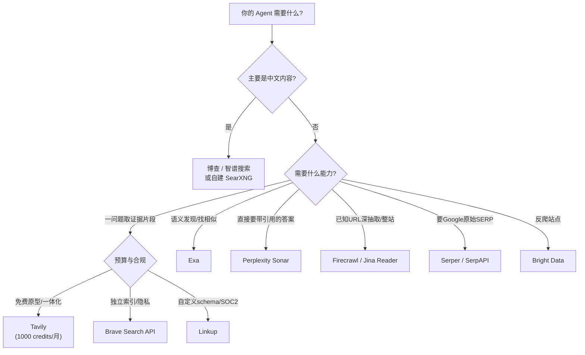

[toc]

---

## 本文定位与资料口径

本文是 Tavily 的专项说明：**它是什么、免费层能做什么、参数怎么配、怎么省钱、哪里不够用**。方法论（怎么提问、怎么验证、什么时候升级到浏览器）见同目录 [ai agent联网搜索指南](./ai%20agent联网搜索指南.md)；各家服务的免费额度与低价档位见 [免费资源调研指南](<../ai agent@联网搜索与网页抓取@免费资源调研指南.md>)。

资料以 2026 年 10 月的官方文档与定价页为准，第三方整理的数字标注来源；端点、参数与计费规则以 [docs.tavily.com](https://docs.tavily.com/) 为最终依据。本文的竞品对比部分未能逐条联网核实，相关表格已标注，引用时请自行复核。

---

## Tavily 是什么

**Tavily** 自称"AI Agent 的 Web 层（the web layer for AI agents）"。它是**专门给大语言模型（LLM）和自主智能体设计的检索基础设施**。它和传统搜索引擎 API 的核心区别在于：**不返回原始 HTML 或一堆 SERP（搜索引擎结果页）链接，而是把网页清洗、抽取、分块（chunk）后，以结构化、可以直接放进上下文窗口的格式返回**（[Daily AI Tools](https://dailyaitools.ai/tools/tavily/)）。

用一个例子说明：同样问"2026 年某框架的最新版本有哪些破坏性变更"。

- **传统 SERP API**（如 SerpAPI）返回 10 个标题、URL 和一两句摘要。Agent 还得自己去抓页面、去广告、切块、排序。
- **Tavily Search** 直接返回若干来源，每个来源附带**与问题最相关的内容片段（chunks）和相关性得分（score）**。还可以选择附上一段 LLM 生成的答案。Agent 可以直接拿来推理和引用。



**图解**：Agent 只负责"决定什么时候搜、搜什么"。检索、抓取、清洗、排序都由 Tavily 在服务端完成，这能**省掉大量 token 和工程量**。这也是"面向 Agent 的搜索 API"这个品类的核心价值。

---

## 功能与服务全景

### 五大核心端点

根据官方文档，Tavily 覆盖五类能力：**search（搜索）、extract（抽取）、crawl（爬取）、map（站点地图）、research（研究）**（[Tavily Agents 文档](https://docs.tavily.com/agents)、[Tavily MCP 文档](https://docs.tavily.com/documentation/mcp)）。

| 端点                     | 作用                                         | 典型场景                       | 是否支持免 Key |
| ------------------------ | -------------------------------------------- | ------------------------------ | -------------- |
| **Search** `/search`     | 实时网页搜索，返回相关片段                   | 回答时效性问题、查新闻、查事实 | **支持**       |
| **Extract** `/extract`   | 给定 URL，抽取正文（Markdown 或文本）        | 读文档页、读文章全文           | **支持**       |
| **Map** `/map`           | 从一个起始 URL 发现站点结构，只返回 URL 列表 | 爬取前先摸清站点结构           | 需要 API Key   |
| **Crawl** `/crawl`       | 跨多页读取整站内容（按深度、广度控制）       | 把整套官方文档灌进 RAG（检索增强生成）         | 需要 API Key   |
| **Research** `/research` | 多来源研究，返回带引用的成文答案；内部做多轮检索与去重，官方定位接近"Agent-in-a-Box" | 让 Tavily 代做"小型深度研究"   | 需要 API Key   |

**辨析：Map、Crawl、Extract 三者的区别**

- **Extract**：你**已经知道**要读哪几个 URL，它只负责"读"。
- **Map**：你只知道站点入口，它负责"找"有哪些页面，**不读内容**。
- **Crawl**：先"找"再"读"，等于 Map 加 Extract，所以**计费也是两者之和**（见后文）。



**图解**：最常见的组合是 **Search 后接 Extract**：先用便宜的 basic 搜索定位来源，再只对少数高分 URL 抽取全文。处理文档站点时，推荐**先 Map 再有选择地 Extract**，比直接 Crawl 更可控。

官方文档展示了带路径过滤和自然语言指令的 Crawl 用法：

```python
response = client.crawl(
    url="https://docs.tavily.com",
    max_depth=2,                                      # 从起始 URL 向下的链接深度
    limit=50,                                         # 页数上限，直接控制 credits 消耗
    select_paths=["/documentation/.*", "/sdk/.*"],    # 只进入匹配正则的路径
    exclude_paths=["/changelog/.*"],                  # 排除匹配正则的路径
    instructions="Find pages about Search and Extract endpoints",  # 自然语言引导
    extract_depth="advanced",
)
for page in response["results"]:
    print(page["url"], len(page["raw_content"]))
```

**Map 同样支持 `instructions` 自然语言过滤**（如 `client.map(url="tavily.com", instructions="find only the developer docs")`），但注意带 `instructions` 的 Map 计费翻倍（见下文扣费表）。

### 接入方式

| 方式                  | 说明                                                         |
| --------------------- | ------------------------------------------------------------ |
| **REST API**          | 例如 `POST https://api.tavily.com/search`，用 `Authorization: Bearer <token>` 认证（[Search 文档](https://docs.tavily.com/documentation/api-reference/endpoint/search)） |
| **SDK / CLI**         | 官方提供 Python、JavaScript SDK 和官方 CLI（[Daily AI Tools](https://dailyaitools.ai/tools/tavily/)） |
| **远程 MCP（Model Context Protocol，模型上下文协议）服务器**   | `https://mcp.tavily.com/mcp/`，可接入 Claude、ChatGPT、Codex、Cursor、Kiro、VS Code 或任意 MCP 客户端，支持 OAuth（[MCP 文档](https://docs.tavily.com/documentation/mcp)） |
| **平台连接器**        | 例如微软 Copilot Studio 的 Tavily MCP 连接器（预览版）（[Microsoft Learn](https://learn.microsoft.com/en-us/connectors/tavilymcp/)） |
| **第三方转售/代理**   | 例如 Novita AI 提供 `api.novita.ai/v3/tavily/search` 代理接口（[Novita 文档](https://docs.novita.ai/api-reference/model-apis-tavily-search)） |
| **Agent 工具包**      | `tavily_agent_toolkit`，提供 `search_dedup`（多查询去重）、`extract_and_summarize` 等高层函数（[Tools Reference](https://docs.tavily.com/examples/agent-toolkit/tools)） |
| **面向 Agent 的文档** | 由 Mintlify 托管的"文档 MCP 服务器"，Agent 可以直接检索 Tavily 文档，无需 Key（[Agents 文档](https://docs.tavily.com/agents)） |

通过 MCP 暴露的工具有 `tavily_search`、`tavily_extract`、`tavily_crawl`、`tavily_map`、`tavily_research`，Claude 集成页还列出了 **`tavily_skill`**（为 Agent 查找技能）（[Claude 集成文档](https://docs.tavily.com/documentation/integrations/claude)）。

### SDK 与常用框架封装

各语言 SDK 与主流框架都有现成封装（包名以官方文档为准）：

| 集成方式                                  | 包 / 入口                          | 说明                                  |
| ----------------------------------------- | ---------------------------------- | ------------------------------------- |
| **Python SDK**                            | `pip install tavily-python`        | `TavilyClient` 同步、`AsyncTavilyClient` 异步 |
| **JavaScript SDK**                        | `npm i @tavily/core`               | `tavily({apiKey})`                    |
| **LangChain**                             | `pip install langchain-tavily`     | 提供 `TavilySearch`、`TavilyExtract` 等工具类 |
| **LlamaIndex / CrewAI / OpenAI Agents SDK** | 各自的 tool 封装                 | 官方产品页列为 partner marketplaces   |
| **本地 MCP 服务器**                       | `npx -y tavily-mcp@latest`         | 适合不便走远程 OAuth 的本地 MCP 客户端 |
| **低代码平台**                            | Dify、Coze、n8n 等均有 Tavily 节点/插件 | 对国内读者友好                    |

LangChain 接入示例：

```python
from langchain_tavily import TavilySearch

search_tool = TavilySearch(
    max_results=5,
    topic="general",
    search_depth="basic",
)
# 将 search_tool 加入你的 Agent 工具列表，LLM 按需调用
```

本地 MCP 客户端（Claude Desktop / Cursor 的 `mcp.json` 风格）配置示例：

```json
{
  "mcpServers": {
    "tavily": {
      "command": "npx",
      "args": ["-y", "tavily-mcp@latest"],
      "env": { "TAVILY_API_KEY": "tvly-你的密钥" }
    }
  }
}
```

---

## 免费用户能用什么（重点）

### 三种免费途径

| 途径                    | 额度                                                         | 条件                                                         | 可用端点                   |
| ----------------------- | ------------------------------------------------------------ | ------------------------------------------------------------ | -------------------------- |
| **Researcher 免费计划** | **每月 1,000 API Credits**，按月重置                         | 注册即可，**不需要信用卡**                                   | **全部五个端点**           |
| **Keyless 免 Key 模式** | 有频率限制（官方未给出具体数字）                             | **无需账号**，请求头加 `X-Tavily-Access-Mode: keyless`，或不带 Key 连接远程 MCP | **只有 Search 和 Extract** |
| **学生计划**            | **免费使用 Project 计划 4 个月**（每月 4,000 credits，约值 120 美元） | 学生身份，用途为研究、课程、黑客松                           | 全部                       |

依据：[Tavily Credits & Pricing](https://docs.tavily.com/documentation/api-credits)、[Tavily Agents 文档](https://docs.tavily.com/agents)、[FreeTier.co](https://freetier.co/directory/products/tavily)（学生计划信息来自第三方，申请前**应该**到官网确认）。额度重置时间，第三方整理为**每月 1 日**（aitrendtool 整理，**须核实**）。

**关于 Keyless 的提醒**：有第三方实测报告称，免 Key 的 MCP 会话能"看到"全部五个工具，但文档写明 Crawl、Map、Research 需要 Key（[GitHub PR 讨论](https://github.com/PublicAgents/public-agents/pull/290)）。**应该以文档为准**：免 Key 时只用 Search 和 Extract，其他工具能列出来不代表能调用。

### Credits 怎么扣（必须理解）

| 端点     | 模式              | 消耗                                   |
| -------- | ----------------- | -------------------------------------- |
| Search   | `basic`           | **1 credit / 次**                      |
| Search   | `advanced`        | **2 credits / 次**                     |
| Extract  | `basic`           | 每 5 个**成功**抽取的 URL 扣 1 credit  |
| Extract  | `advanced`        | 每 5 个成功 URL 扣 2 credits           |
| Map      | 普通              | 每返回 10 个页面扣 1 credit            |
| Map      | 带 `instructions` | 每 10 个页面扣 2 credits               |
| Crawl    | 任意              | **Map 费用 + Extract 费用**            |
| Research | `model=mini`      | **4 到 110 credits / 次**（动态计费）  |
| Research | `model=pro`       | **15 到 250 credits / 次**（动态计费） |

依据：[Morph 整理](https://www.morphllm.com/tavily)、[ColdIQ](https://coldiq.com/blog/tavily-pricing)、[官方 Credits 文档](https://docs.tavily.com/documentation/api-credits)。

**两个省钱规则**（[ColdIQ](https://coldiq.com/blog/tavily-pricing)）：

- **抽取或 Map 失败不扣费**，所以对失效 URL 重试不花钱。
- **Extract 按 5 个一批计费**，抽 4 个和抽 5 个都是 1 credit，所以**推荐凑满 5 个 URL 再批量调用**。

**免费额度能做多少事（示例）**：

直接换算（[ColdIQ](https://coldiq.com/blog/tavily-pricing)）：1,000 credits 约等于 **1,000 次 basic 搜索，或 500 次 advanced 搜索，或约 5,000 个 URL 的抽取**，或三者混合。

- 个人新闻助手：每天 20 次 basic 搜索（20 credits），加上对 10 个 URL 做 basic 抽取（2 credits），每天 22 credits，**一个月约 660 credits，免费额度够用**。
- 换成每天 20 次 advanced 搜索：一天 40 credits，加上抽取后一个月约 1,260，**会超额**。
- Research 是**最容易烧光预算的端点**：一次 pro 调用最多扣 250 credits，**最坏情况下免费额度只够 4 次**。ColdIQ 专门提醒过这一点。

### 付费计划（参考）

| 计划          | 每月 Credits | 月费（美元） | 单价      |
| ------------- | ------------ | ------------ | --------- |
| Researcher    | 1,000        | 免费         | –         |
| Project       | 4,000        | 30           | 0.0075    |
| Bootstrap     | 15,000       | 100          | 0.0067    |
| Startup       | 38,000       | 220          | 0.0058    |
| Growth        | 100,000      | 500          | 0.005     |
| Pay as you go | 按用量       | –            | **0.008** |
| Enterprise    | 定制         | 定制         | 定制      |

依据：[官方 Credits 文档](https://docs.tavily.com/documentation/api-credits)。Katteb 在 **2026 年 10 月 12 日**核对过定价页，结果相同（[Katteb](https://katteb.com/blog/tavily-ai-agent/)）。速率限制方面，第三方整理为**开发 Key 每分钟 100 次、生产 Key 每分钟 1,000 次**（[Morph](https://www.morphllm.com/tavily)）；其中 1,000 RPM 需要付费计划或已开通按量付费，免费层拿不到这个速率，不要把生产速率当成免费额度的一部分。

**x402 按次付费**：官方 Agents 文档确认了这条通道——Agent 可通过 x402 协议用 Base 链上的 USDC **按请求付费调用 Advanced Search**，无需 Key 和账号；该模式**只覆盖 Search，不含 Extract / Crawl / Map / Research**（[Agents 文档](https://docs.tavily.com/agents)）。"每次 0.01 美元"的说法来自二手讨论（[GitHub PR 讨论](https://github.com/PublicAgents/public-agents/pull/290)），以官方页面为准。

---

## Search 端点参数详解

官方请求示例中的主要字段如下（[Search API 文档](https://docs.tavily.com/documentation/api-reference/endpoint/search)、[Sim 文档](https://docs.sim.ai/tools/tavily)）：

| 字段                                                  | 含义与取值                                                   | 建议                                                         |
| ----------------------------------------------------- | ------------------------------------------------------------ | ------------------------------------------------------------ |
| `query`                                               | 搜索语句（必填）                                             | 写成**具体的自然语言问题**，不要只堆关键词                   |
| `search_depth`                                        | `basic` / `fast` / `ultra-fast`（均 1 credit）或 `advanced`（2 credits）；advanced 检索更深、片段更精准，`ultra-fast` 延迟最低但每个 URL 只返回一段摘要 | **默认用 basic**，确实质量不够再升级；低延迟场景试 `fast` / `ultra-fast`                         |
| `chunks_per_source`                                   | 每个来源返回的相关片段数，1 到 3，默认 3                     | 控制上下文长度时调小                                         |
| `max_results`                                         | 返回的来源数量（官方取值范围 0 到 20）                                               | 一般 3 到 8 就够；Agent 场景 3 到 5 条通常足够，过多会撑爆上下文                                             |
| `topic`                                               | `general`、`news` 或 `finance`                               | 查新闻**必须**用 `news`，时效排序会更好                      |
| `time_range`                                          | 相对时间范围（如 day/week/month/year）                       | 和 `start_date`/`end_date` 二选一                            |
| `start_date` / `end_date`                             | 绝对日期范围，格式 `YYYY-MM-DD`                              | 查"某段时间发生了什么"时用                                   |
| `include_answer`                                      | 是否附带 LLM 生成的答案：`true`/`basic` 为简短答案，`advanced` 为详细答案 | 如果你自己的 LLM 会做总结，**可以关掉**以减少冗余            |
| `include_raw_content`                                 | 是否附带页面全文                                             | 会让响应体积暴涨，**避免默认开启**，按需改用 Extract         |
| `include_images` / `include_image_descriptions`       | 是否返回图片和图片描述                                       | 多模态场景才需要                                             |
| `include_favicon`                                     | 是否返回站点图标                                             | 前端展示用                                                   |
| `include_domains` / `exclude_domains`                 | 域名白名单 / 黑名单                                          | **只想看官方来源时非常有用**                                 |
| `include_domains_mode`                                | 白名单生效方式：`restrict`（默认，只返回白名单内的结果）或 `prefer`（白名单优先，不排除其他站点）；必须与 `include_domains` 同用，否则返回 400                              | 只想看官方来源用默认 `restrict`；想"优先官方、不排除其他"用 `prefer`                                       |
| `country`                                             | 偏向某个国家的结果                                           | 需要本地化结果时用                                           |
| `language` / `filter_by_language`                     | 语言偏好 / `filter_by_language=true` 时严格过滤非该语言结果（默认只做排序加权）；置 `true` 必须同时给 `language`，否则返回 400                                | 中文场景可以试试                                             |
| `include_published_date` / `filter_by_published_date` | 返回发布日期 / 按发布日期过滤                                | 时效敏感的任务推荐开启                                       |
| `auto_parameters`                                     | 让 Tavily 根据查询意图自动设置参数；显式指定的值优先，`include_answer`、`include_raw_content`、`max_results` 始终需手动设置                               | 它**可能在收益明显时自动把 `search_depth` 升到 `advanced`（2 credits）**，预算敏感时显式指定 `search_depth` |
| `exact_match`                                         | 精确匹配短语                                                 | 查型号、错误码时有用                                         |
| `include_usage`                                       | 在响应里返回本次消耗的 credits                               | **推荐开启，方便做预算监控**                                 |
| `safe_search`                                         | 安全搜索过滤                                                 | 面向终端用户的产品可以开启                                   |

注：**新闻场景 `topic=news` 配合 `time_range`**，以及**事实核查场景 `include_domains` 白名单**，是性价比最高的两种用法。

### 返回结果里最容易混淆的三个字段

- `content`：**与查询相关的片段**（已裁剪），不是整页。
- `raw_content`：整页正文，仅在 `include_raw_content=true` 时出现。
- `score`：Tavily 的相关性评分（0 到 1），**只用于同一次调用内比较高低，不要跨查询设统一阈值**（不同查询的分数分布不同）。

---

## 实践：最小可用示例

### 零账号试用（Keyless 模式）

下面用 curl 发一个免 Key 的搜索请求，参数刻意保持最少：

```bash
curl -sS -X POST "https://api.tavily.com/search" \
  -H "Content-Type: application/json" \
  -H "X-Tavily-Access-Mode: keyless" \
  -d '{"query": "Python 3.14 有哪些新特性", "max_results": 3, "search_depth": "basic"}'
```

**说明**：免 Key 模式有频率限制，只适合体验和临时脚本。**正式项目必须注册拿 Key**，才能获得可预期的额度、速率和全部端点。

### 在编程 Agent 中接入 MCP

以 Claude Code 为例，官方给出的命令是（[MCP 文档](https://docs.tavily.com/documentation/mcp)）：

```bash
claude mcp add tavily --transport http https://mcp.tavily.com/mcp/
```

首次连接会走 OAuth 登录。团队共享场景下，官方建议**不要把 Key 写进 URL**，而是在客户端的"请求头"设置里配置共享 Key（[Claude 集成文档](https://docs.tavily.com/documentation/integrations/claude)）。

### 综合示例：带预算控制的"文档研究助手"

**场景**：你要让 Agent 回答"某开源项目最新版本怎么配置代理"。可靠的做法是：

1. 先用 basic Search 找到官方文档页（用白名单限制域名）。
2. 对高分 URL 批量 Extract，凑满 5 个一批。
3. 如果 Search 结果不够，再用 Map 摸清文档站结构，用路径过滤后抽取。
4. 全程用 `include_usage` 记账，超出预算就停。

```python
"""
文档研究助手：Search -> Extract -> (必要时) Map，带 credits 预算控制。
依赖：pip install tavily-python
环境变量：TAVILY_API_KEY；国内网络如需代理，设置 HTTPS_PROXY（见下文）。
"""
import os
from tavily import TavilyClient

BUDGET = 15  # 本次任务最多花费的 credits
client = TavilyClient(api_key=os.environ["TAVILY_API_KEY"])
spent = 0


def charge(resp: dict, fallback: int) -> None:
    """优先读取响应中的 usage 字段记账；读不到时按估算值记账。"""
    global spent
    usage = resp.get("usage") or {}
    spent += usage.get("credits", fallback)
    if spent > BUDGET:
        raise RuntimeError(f"超出预算: 已用 {spent} credits")


# 第 1 步：basic 搜索 + 官方域名白名单（1 credit）
search = client.search(
    query="mihomo 如何配置 TUN 模式",
    search_depth="basic",
    max_results=5,
    include_domains=["wiki.metacubex.one", "github.com"],
    include_usage=True,
)
charge(search, fallback=1)

# 只保留相关性高的来源
urls = [r["url"] for r in search["results"] if r.get("score", 0) >= 0.5]

# 第 2 步：批量抽取，每 5 个 URL 一批（basic 每批 1 credit）
docs = []
for i in range(0, len(urls), 5):
    batch = urls[i:i + 5]
    ext = client.extract(urls=batch, extract_depth="basic", include_usage=True)
    charge(ext, fallback=1)
    docs.extend(ext.get("results", []))
    for failed in ext.get("failed_results", []):
        print("抽取失败（不扣费）:", failed.get("url"))

# 第 3 步：没抽到内容时，用 Map 探索站点结构（每 10 页 1 credit）
if not docs:
    site_map = client.map(url="https://wiki.metacubex.one", limit=30)
    charge(site_map, fallback=3)
    candidates = [u for u in site_map.get("results", []) if "tun" in u.lower()][:5]
    if candidates:
        ext = client.extract(urls=candidates, include_usage=True)
        charge(ext, fallback=1)
        docs.extend(ext.get("results", []))

print(f"共获得 {len(docs)} 篇文档，消耗约 {spent} credits")
for d in docs:
    # raw_content 是 Markdown 或文本，可直接交给 LLM 作为上下文
    print(d["url"], len(d.get("raw_content", "")), "chars")
```

**这个例子串起来的知识点**：

- `include_domains` 白名单保证来源权威。
- 先用 basic 档位控制成本。
- 用 `score` 过滤低相关结果。
- Extract 凑满 5 个一批，并利用"失败不扣费"的规则。
- 内容不够时用 Map 兜底。
- 用 `include_usage` 记账，`fallback` 是读不到 usage 时的估算值。

**说明**：这段代码是按 SDK 的常见方法名（`search`、`extract`、`map`）写的，**这次没有在沙箱里实际运行**（沙箱没有 Key，也没联网）。`usage` 和 `failed_results` 等响应字段的结构**应该**以当前 SDK 文档为准。

### 进阶示例：搜索-抽取-作答的 Agent 循环

上面的例子控的是**credits 预算**，这个例子控的是**上下文体积**：片段够用就不抽全文，需要全文时截断保护窗口。



```python
import os
from tavily import TavilyClient

client = TavilyClient(api_key=os.environ["TAVILY_API_KEY"])


def gather_evidence(question: str, need_fulltext: bool = False) -> list[dict]:
    """返回 [{url, title, text}]，优先用片段，必要时抽全文。credits：1 + (0 或 1)"""
    sr = client.search(query=question, search_depth="basic",
                       max_results=5, time_range="month")
    evidence = [{"url": r["url"], "title": r["title"], "text": r["content"]}
                for r in sr["results"]]
    if need_fulltext and evidence:
        top_urls = [e["url"] for e in evidence[:2]]
        ex = client.extract(urls=top_urls, extract_depth="basic", format="markdown")
        full = {p["url"]: p["raw_content"] for p in ex["results"]}
        for e in evidence:
            if e["url"] in full:
                e["text"] = full[e["url"]][:8000]   # 截断，保护上下文窗口
    return evidence


if __name__ == "__main__":
    ev = gather_evidence("LangGraph 最新版本 breaking changes", need_fulltext=True)
    for e in ev:
        print(e["title"], e["url"], len(e["text"]))
    # 之后把 ev 拼进提示词，交给你的 LLM 生成带引用的回答
```

这个例子串起三个要点：**用 basic 搜索省 credits、用 Extract 按需补全文、用截断保护上下文**。一次问答通常只消耗 1 到 2 credits，免费层每月可支撑数百次问答。

### 国内网络环境注意事项

`api.tavily.com` 是海外服务，国内多数情况可以直连，但稳定性因地区和运营商而异；不稳定时推荐通过本地代理（如 mihomo，默认混合端口常见为 `7890`）访问：

- **Linux / macOS（bash/zsh）**：`export HTTPS_PROXY=http://127.0.0.1:7890`
- **Windows PowerShell**：`$env:HTTPS_PROXY = "http://127.0.0.1:7890"`
- **Windows CMD**：`set HTTPS_PROXY=http://127.0.0.1:7890`

Python 的 `requests`/`httpx` 默认会读取这个环境变量。**生产环境部署在海外服务器时不需要代理**。返回正文为 UTF-8，中文显示无问题，但 `content` 片段的截断点可能落在中文词中间，拼接时注意。另外，Tavily 的中文内容覆盖和排序质量**可能**不如国内搜索服务，这是社区常见观点，这次没有核实。**中文为主的业务推荐和国内方案做 A/B 对比**。

---

## 使用 Tavily 的最佳实践

- **必须**：把 Key 放在环境变量或密钥管理里，**不要**写进代码或 MCP URL。正式项目不要依赖 Keyless 模式。
- **必须**：给 Research 端点设置预算上限或调用次数上限，因为它是动态计费，pro 一次最多 250 credits。
- **推荐**：默认 `search_depth="basic"`。**显式指定参数**，不要依赖 `auto_parameters`。开启 `include_usage`。
- **推荐**：采用"Search 定位、Extract 精读"的两段式流程，而不是在 Search 里开 `include_raw_content`。
- **推荐**：在控制台观察 credits 消耗曲线，为每个 Agent 会话设置调用上限，避免检索循环失控。
- **推荐**：新闻类查询用 `topic="news"` 配合时间范围；事实核查用 `include_domains` 白名单。
- **可以**：多个子问题时用 `tavily_agent_toolkit` 的 `search_dedup` 去重，减少重复来源占用上下文。
- **避免**：对文档站盲目 Crawl 全站，应该先 Map，用路径过滤后再抽取。
- **避免**：既让 Tavily `include_answer="advanced"`，又让自己的 LLM 再总结一遍，造成冗余和潜在的不一致。

---

## 批评与局限

以下问题来自竞品对比页、第三方测评与官方文档本身的表述，**竞品页面有立场**，引用时区分事实与评价：

| 局限 | 具体表现 | 什么时候会踩到 |
| ------------------ | ------------------------------------------------------------ | ------------------------------------------------------------ |
| **非独立索引** | 结果来自"聚合 + 重排"，质量受上游索引与抓取能力约束，不提供原始 SERP 元数据 | 需要与 Google 完全一致的排序、或要分析结果页结构时，应改用 Brave 或 SERP 代理 |
| **输出结构固定** | 返回字段由 Tavily 定义，不能按自定义 schema 输出 | 下游要求严格 JSON 契约、或要按业务字段重排时，Linkup 一类服务更合适 |
| **Research 计费不可预测** | 单次 4 到 250 credits 动态计费，最坏情况一次吃掉免费额度的四分之一 | 把 Research 放进自动循环又没有预算上限 |
| **免费层速率有限** | 开发速率 100 RPM，1,000 RPM 需付费计划或按量付费 | 并发批处理时误把免费额度当成可用吞吐 |
| **语义检索不是强项** | 以关键词相关性为主，"找相似页面/相似公司/相似论文"不如 embedding 检索 | 探索式调研、相似页发现，应换 Exa |
| **深度抽取弱于专业爬虫** | JS 重度渲染、分页、强反爬站点能力有限 | 目标站点有反爬或需要交互，应换 Firecrawl、Bright Data |
| **中文覆盖偏弱** | 索引以英文网络为主，中文时效信息常需国内引擎 | 中文政策、国内产品发布、中文社区讨论 |

选型含义：Tavily 适合"一次调用拿到可用片段"的通用检索层，不适合当唯一数据源。需要独立性、结构化契约或强反爬能力时，按上表换对应专长的服务，而不是在 Tavily 上叠加重试。

---

## 同类服务（部分已复核）

**再次强调**：本节的横评与部分竞品信息来自训练知识与竞品官网的对比页，未能逐条核实；其中 Brave、Firecrawl、SerpAPI、Jina 的免费额度已于 2026 年 10 月按官网口径复核并标注。**免费额度和定价变化很频繁**，使用前**必须**去官网核实。

### 分类框架



**图解**：Tavily 处在"AI 原生搜索"类别，但也通过 Extract、Crawl、Map 覆盖了"抓取/爬取"类别的部分能力。选型时**应该先判断你缺的是"找"（搜索）还是"读"（抓取）**。

### 海外主要竞品

| 服务                              | 定位与特色                                                   | 免费额度（印象，**须核实**）         | 开源/自托管                |
| --------------------------------- | ------------------------------------------------------------ | ------------------------------------ | -------------------------- |
| **Exa**                           | 基于嵌入的"神经搜索"，擅长语义和"找相似页面"，有 contents/answer/Websets 等能力；约每千次搜索 7 美元（含内容） | 注册赠送一次性额度（印象约 10 美元）                   | 否                         |
| **Brave Search API**              | **自建独立索引**（不依赖 Google/Bing），隐私友好；官方称索引超 350 亿页，有零数据保留选项             | 每月 $5 额度（约 1000 次），新账户需绑卡；老 free plan 用户保留 2000 次/月（2026-10 官网口径） | 否                         |
| **Firecrawl**                     | 以抓取和爬取为核心（scrape/crawl/map/search/extract），输出 LLM 友好的 Markdown | 每月 1000 credits（2026-10 官网口径）                   | **开源（AGPL），可自托管** |
| **Jina Reader / Search**          | `r.jina.ai/<URL>` 把网页转成 Markdown，`s.jina.ai` 做搜索，接入极其简单 | 免 key 约 20 RPM；注册免费 key 赠 1000 万 token、500 RPM（2026-10 官网口径）                    | Reader 部分开源            |
| **Perplexity Sonar / Search API** | Sonar 直接返回带内联引用的合成答案；Search API 返回原始排序结果      | 以付费为主，无免费层                           | 否                         |
| **Parallel**                      | 面向 Agent 的 Search/Extract/Task（深度研究）API             | 须核实                               | 否                         |
| **Linkup**                        | 欧洲厂商，standard/deep 两档搜索，强调高质量来源；支持自定义输出 schema 与私有索引（BYOC），全计划 SOC 2             | 每月少量免费额度                     | 否                         |
| **Serper**                        | 便宜的 Google SERP API（印象约每千次 1 美元）                                       | 注册赠送一次性约 2,500 次               | 否                         |
| **SerpAPI**                       | 老牌多引擎 SERP API（Google/Bing/Baidu 等）                  | 每月 250 次（2026-10 官网口径）                     | 否                         |
| **Bing Search API**               | **已于 2025 年退役**（第三方整理为 2025 年 8 月停服），微软改推 Azure AI Agent 中的 "Grounding with Bing" | –                                    | –                          |

其他可选服务：

| 服务                                    | 定位与特色                                       | 免费额度（印象，**须核实**） | 开源/自托管 |
| --------------------------------------- | ------------------------------------------------ | ---------------------------- | ----------- |
| **Bright Data**                         | SERP + Web Unlocker，用代理网络突破反爬          | 试用额度                     | 否          |
| **Google Programmable Search JSON API** | 返回 Google 结果的传统 API，但仅为片段           | 每天 100 次                  | 否          |
| **Nimble / Olostep / LLMLayer**         | 新兴一体化平台，各有侧重（SERP、抽取、全栈）     | 不一                         | 否          |
| **ddgs（原 duckduckgo-search）**        | 非官方免费库，无密钥；易被限流，**避免用于生产** | –                            | –           |

### 自托管开源方案（最符合"免费、开源"偏好）

- **SearXNG**：开源元搜索引擎，聚合几十个搜索引擎的结果，Docker 一键部署，**零 API 费用**，社区有现成的 MCP 封装，Open WebUI、Dify、Perplexica 等对其原生支持。缺点是**只返回 SERP 片段**，并且上游引擎可能限流或封禁。
- **Crawl4AI**：开源的 LLM 友好爬虫，负责"读"。
- **Firecrawl 自托管版**：功能接近其云服务，但部分高级特性只在云端提供。
- **推荐组合**：**SearXNG 负责找，Crawl4AI 或 Firecrawl 负责读**，就能自建一个"穷人版 Tavily"。适合对成本敏感、能自己运维的开发者。

### 国内方案

| 服务                                         | 说明                                                                                                    | 计费（大致，**须核实**）           |
| -------------------------------------------- | ------------------------------------------------------------------------------------------------------- | ---------------------------------- |
| **博查（Bocha）Web Search API**              | 国内最接近 Tavily 定位的独立搜索 API，据称兼容 Bing 搜索接口格式，返回网页片段与摘要，支持时效过滤，中文覆盖好，Dify、Coze 有插件 | 按次计费，新用户有赠送额度         |
| **智谱 Web Search API**                      | 智谱开放平台的搜索工具 API，有标准版、专业版及搜狗、夸克等多引擎选项，可独立调用、不绑定 GLM 模型       | 按次计费，部分引擎有免费或促销额度 |
| **阿里云 IQS（信息查询服务）**               | 面向大模型的统一搜索 API（通用搜索、新闻等），适合阿里云生态                                            | 按次，有试用                       |
| **百度智能云 / 千帆、火山引擎**              | 云厂商搜索能力，多以"模型联网插件"形式提供                                                              | 按次                               |
| **Kimi（Moonshot）`$web_search` 内置工具**   | 模型侧内置联网，不是独立搜索 API                                                                        | 按搜索次数与 token                 |
| **通义千问 DashScope `enable_search`**       | 模型侧联网开关，不返回独立检索接口                                                                      | 随模型计费                         |
| **秘塔 / 360 / 微信搜一搜**                  | 部分面向企业开放 API                                                                                    | 需咨询                             |

辨析：**"独立搜索 API"（博查、智谱搜索、Tavily）**与**"模型内置联网"（Kimi、通义）**是两类东西。前者返回检索结果供任意 LLM 使用，适合自建 Agent；后者把检索封装在模型调用内，省事但不可控、不可换模型。

**国内方案的优势**：网络直连、中文内容覆盖好、备案合规更方便。**劣势**：英文和海外技术内容的覆盖可能不如 Tavily 或 Exa。

### 选型建议

| 需求                                  | 首选                                           | 备选                   |
| ------------------------------------- | ---------------------------------------------- | ---------------------- |
| 通用 Agent 搜索，快速上手，要免费额度 | **Tavily**（每月 1,000 credits，接入生态最广） | Linkup、Exa            |
| 语义检索、"找类似的论文/公司"         | **Exa**                                        | Tavily advanced        |
| 整站文档抓取，喂给 RAG                | **Firecrawl**（可自托管）                      | Tavily Crawl、Crawl4AI |
| 零成本、可自托管                      | **SearXNG + Crawl4AI**                         | Jina Reader 免费额度   |
| 中文内容为主，国内部署                | **博查 / 阿里云 IQS / 智谱**                   | Tavily 加代理          |
| 需要 Google 原生结果                  | **Serper**（便宜）                             | SerpAPI                |



**图解**：先按内容语言分流，中文走国内方案或自建；英文场景再按"取证据片段、语义发现、要现成答案、抓网页、要原始 SERP、突破反爬"六种需求选择，预算与合规只在通用搜索分支参与决策。

**综合推荐**（面向国内开发者、免费优先）：

- **英文为主、快速起步**：Tavily 免费层是目前**门槛最低的一体化方案**（无需信用卡、1,000 credits/月、search+extract+crawl+map 齐全），搭配 LangChain / MCP 即插即用。
- **中文为主**：优先评估博查与智谱搜索 API；成本极度敏感或需要离线可控时自建 SearXNG，并在 Agent 侧自己做抽取（可配 Jina Reader 或 Firecrawl 自托管）。
- **生产环境**：不要只接一家。把"搜索提供方"抽象成接口，**Tavily + Brave（或 Exa）互为备份**，抽取单独接 Firecrawl 类服务。

---

## 小结

1. **Tavily 是什么**：一站式的"Agent Web 层"，提供 Search、Extract、Map、Crawl、Research 五个端点，同时有 REST、SDK、CLI 和远程 MCP 接入。
2. **免费用户能用什么**：**每月 1,000 credits，不需要信用卡，能用全部端点**；**Keyless 模式无需账号，但只能用 Search 和 Extract**；学生可以申请 4 个月免费 Project 计划。
3. **最关键的计费点**：basic 搜索 1 credit，advanced 2 credits；Extract 每 5 个 URL 一个计费单位；**Research 动态计费，最贵一次 250 credits，要特别控制**。
4. **替代方案**：海外有 Exa、Firecrawl、Brave、Linkup、Parallel 等；开源自托管可以用 SearXNG + Crawl4AI；国内有博查、阿里云 IQS、智谱等。这些**都需要你下一轮核实**。

---

## 遗漏审计与下一轮建议搜索词

| 可能遗漏的类别                                             | 建议搜索词                                                   |
| ---------------------------------------------------------- | ------------------------------------------------------------ |
| Tavily 公司动态（融资、并购、条款变化）                    | `Tavily acquisition 2026`、`Tavily Nebius`                   |
| Tavily 新功能（Research API 细节、更快的检索档位、skills） | `Tavily research API request_id`、`Tavily search_depth fast ultra-fast`、`tavily_skill` |
| Tavily 的批评与局限                                        | `Tavily limitations reddit`、`Tavily vs Exa benchmark 2026`  |
| 竞品最新定价与免费额度                                     | `Exa API pricing 2026`、`Brave Search API free plan change 2026`、`Firecrawl pricing 2026`、`Linkup API pricing`、`Parallel Search API pricing`、`Perplexity Search API pricing` |
| 评测与基准                                                 | `web search API benchmark agents 2026`、`SimpleQA search API comparison` |
| 国内方案                                                   | `博查 Web Search API 价格 2026`、`阿里云 IQS 联网搜索 计费`、`智谱 web search API search_pro 价格`、`火山引擎 联网搜索 API` |
| 自托管                                                     | `SearXNG MCP server`、`Crawl4AI vs Firecrawl self-hosted 2026` |
| 新兴协议与付费方式                                         | `x402 agent payments search API`                             |
| 国内连通性                                                 | `api.tavily.com 国内 访问`                                   |

---

## 来源与知识截止

**Tavily 部分**（本次检索获得，资料日期为 2026 年，最新约到 10 月）：

- *Credits & Pricing*，Tavily Docs：<https://docs.tavily.com/documentation/api-credits>
- *Tavily MCP Server*，Tavily Docs：<https://docs.tavily.com/documentation/mcp>
- *Agents*，Tavily Docs：<https://docs.tavily.com/agents>
- *Tavily Search（API Reference）*：<https://docs.tavily.com/documentation/api-reference/endpoint/search>
- *Tavily Extract（API Reference）*：<https://docs.tavily.com/documentation/api-reference/endpoint/extract>
- *Claude 集成*，Tavily Docs：<https://docs.tavily.com/documentation/integrations/claude>
- *Tools Reference（Agent Toolkit）*：<https://docs.tavily.com/examples/agent-toolkit/tools>
- Microsoft Learn *Tavily MCP Connector*：<https://learn.microsoft.com/en-us/connectors/tavilymcp/>
- 第三方：[Morph](https://www.morphllm.com/tavily)、[ColdIQ](https://coldiq.com/blog/tavily-pricing)、[Katteb（2026-10-12 核对）](https://katteb.com/blog/tavily-ai-agent/)、[FreeTier.co](https://freetier.co/directory/products/tavily)、[The Rundown AI](https://www.therundown.ai/tools/tavily)、[Daily AI Tools](https://dailyaitools.ai/tools/tavily/)、[Sim 文档](https://docs.sim.ai/tools/tavily)、[GitHub PublicAgents PR #290](https://github.com/PublicAgents/public-agents/pull/290)、[usagepricing.com](https://usagepricing.com)、[aitrendtool.com](https://aitrendtool.com)、[Nimble](https://www.nimbleway.com)、[Exa 对比页](https://exa.ai/alternatives/tavily)、[Parallel](https://parallel.ai)、[anygen.io](https://anygen.io)、[Firecrawl](https://firecrawl.dev)

**合并说明**：本文由同目录两轮调研稿合并而成——2026-10-03 的 fable5.1 轮与 2026-10-25 的 opus5.5 轮（以 opus5.5 版为底本）。上列第三方来源中 usagepricing、aitrendtool、Nimble、Exa 对比页、Parallel、anygen.io、Firecrawl 出自 fable5.1 轮；Search 参数语义（`search_depth` 四档、`include_domains_mode`、`filter_by_language`、`auto_parameters`）、Extract 的 `format` 参数、Keyless 请求头与 x402 通道已于 2026-10-25 对照官方文档核实。

