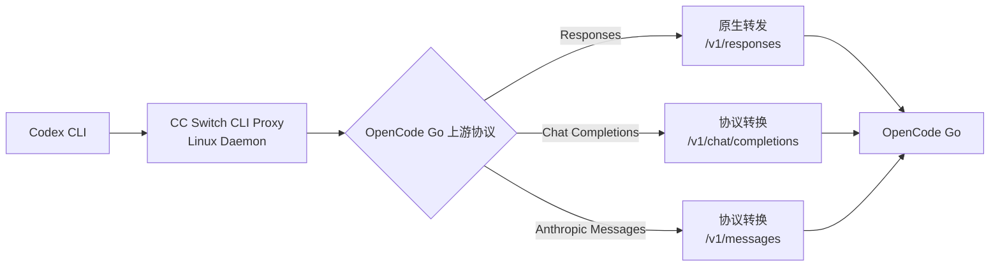

[toc]


[CC Switch 攻略 | 无图形界面的命令行版本CCS- 官方与社区教程合集](https://ccswitch.io/zh/tutorials/cc-switch-cli-headless-guide)

## 结论

| 方案                              | 服务器纯命令行 | 协议转换代理             | 推荐程度              |
| --------------------------------- | -------------- | ------------------------ | --------------------- |
| 官方桌面版 `farion1231/cc-switch` | 暂不支持       | 支持，但需要桌面应用运行 | 不适合无头服务器      |
| 社区版 `SaladDay/cc-switch-cli`   | 支持           | 支持                     | 推荐用于 Linux 服务器 |

截至 **2026 年 8 月 2 日**，官方主项目仍定位为桌面 GUI 应用。其 CLI/Headless 功能请求仍处于开放状态，相应 WebUI/CLI 合并请求也尚未合入主分支。([GitHub](https://github.com/farion1231/cc-switch/pull/2335))

真正适合服务器的是社区维护的 **CC Switch CLI**。它是 CC Switch 的命令行分支，提供：

- 全屏终端界面（TUI，Terminal User Interface）
- 可编写脚本的普通 CLI
- 供应商添加、编辑、切换
- Codex、Claude Code、Gemini、OpenCode 等配置管理
- 后台代理守护进程（Daemon）
- Responses、Chat Completions、Anthropic Messages 协议适配
- 请求统计、故障转移和模型检查

其当前最新版本是 **v5.10.0，发布于 2026 年 8 月 2 日**；该版本还加强了 Codex 使用 Anthropic-compatible 上游时的流式输出、工具调用和媒体内容支持。([GitHub](https://github.com/saladday/cc-switch-cli/releases?utm_source=chatgpt.com))

## 在 Linux 服务器上安装

项目提供 musl 静态构建，通常比较适合 Ubuntu、Debian、Alpine 和其他无桌面 Linux 环境。([GitHub](https://github.com/saladday/cc-switch-cli?utm_source=chatgpt.com))

快速安装：

```bash
curl -fsSL \
  https://github.com/SaladDay/cc-switch-cli/releases/latest/download/install.sh \
  | bash
```

确认程序可用：

```bash
~/.local/bin/cc-switch --version
```

把目录加入 `PATH`：

```bash
echo 'export PATH="$HOME/.local/bin:$PATH"' >> ~/.bashrc
source ~/.bashrc
```

也可以手工下载 Linux x64 的 musl 构建：

```bash
curl -LO \
  https://github.com/SaladDay/cc-switch-cli/releases/latest/download/cc-switch-cli-linux-x64-musl.tar.gz

tar -xzf cc-switch-cli-linux-x64-musl.tar.gz
chmod +x cc-switch
sudo mv cc-switch /usr/local/bin/
```

ARM64 服务器使用：

```bash
curl -LO \
  https://github.com/SaladDay/cc-switch-cli/releases/latest/download/cc-switch-cli-linux-arm64-musl.tar.gz

tar -xzf cc-switch-cli-linux-arm64-musl.tar.gz
chmod +x cc-switch
sudo mv cc-switch /usr/local/bin/
```

生产服务器上更稳妥的做法是手工下载安装包并核验 Release 页面提供的 SHA-256，而不是直接执行远程安装脚本。

## 两种操作方式

### TUI 交互界面

直接运行：

```bash
cc-switch
```

它会在 SSH 终端中显示全屏界面，不需要图形桌面、浏览器或 X11。

适合初次配置：

- 添加 OpenCode Go
- 填写 API Key
- 设置模型
- 选择 Codex 上游协议
- 开启本地代理
- 查看运行状态

### 纯命令行

例如查看 Codex 供应商：

```bash
cc-switch --app codex provider list
```

查看当前供应商：

```bash
cc-switch --app codex provider current
```

添加供应商：

```bash
cc-switch --app codex provider add
```

切换供应商：

```bash
cc-switch --app codex provider switch <provider-id>
```

也可以使用快捷命令：

```bash
cc-switch --app codex use <provider-id>
```

配置、切换和诊断等操作均有对应 CLI 命令。([GitHub](https://github.com/saladday/cc-switch-cli))

## 用于 OpenCode Go 到 Codex 的协议转换

推荐结构如下：



CC Switch CLI 的本地代理明确支持：

- Codex Responses 请求到 Chat Completions 的转换
- Codex 使用 Anthropic Messages-compatible 供应商
- 流式响应
- 工具调用
- 推理内容
- Token 统计
- 故障转移

因此可以用于你前面讨论的 OpenCode Go Chat 和 Messages 模型。([GitHub](https://github.com/saladday/cc-switch-cli))

## 推荐的服务器配置流程

先初始化 Codex 的配置目录：

```bash
codex --help
```

启动 CC Switch TUI：

```bash
cc-switch
```

在其中：

1. 切换到 Codex。
2. 添加 OpenCode Go 供应商。
3. 填写 Go API Key。
4. 设置 Base URL：

```text
https://opencode.ai/zen/go/v1
```

1. 根据模型选择上游格式：
   - Responses
   - Chat Completions
   - Anthropic Messages
2. 保存供应商。

然后查看供应商 ID：

```bash
cc-switch --app codex provider list
```

切换到该供应商：

```bash
cc-switch --app codex provider switch <provider-id>
```

## 启用 Codex 本地代理

显式设置 Codex 代理端口：

```bash
cc-switch --app codex proxy config --listen-port 15722
```

开启 Codex 路由：

```bash
cc-switch --app codex proxy enable
```

查看状态：

```bash
cc-switch proxy show
```

正常情况下会显示：

- Codex 路由已启用
- 监听端口
- 当前供应商
- Daemon 状态
- Proxy Worker 状态

在 Linux 和 macOS 上，执行 `proxy enable` 后，后台守护进程会自动启动，并为启用的应用创建独立代理 Worker；全部代理路由关闭后，Daemon 会自动退出。([GitHub](https://github.com/saladday/cc-switch-cli))

随后启动：

```bash
codex
```

Codex 的请求链路会变成：

```text
Codex
→ localhost:15722/v1/responses
→ CC Switch CLI
→ 协议转换
→ OpenCode Go
```

## 常用运维命令

| 操作            | 命令                                                |
| --------------- | --------------------------------------------------- |
| 查看供应商      | `cc-switch --app codex provider list`               |
| 查看当前供应商  | `cc-switch --app codex provider current`            |
| 切换供应商      | `cc-switch --app codex provider switch <id>`        |
| 检查模型流      | `cc-switch --app codex provider stream-check <id>`  |
| 拉取模型目录    | `cc-switch --app codex provider fetch-models <id>`  |
| 查看代理        | `cc-switch proxy show`                              |
| 开启 Codex 代理 | `cc-switch --app codex proxy enable`                |
| 关闭 Codex 代理 | `cc-switch --app codex proxy disable`               |
| 停止守护进程    | `cc-switch daemon stop`                             |
| 检查环境冲突    | `cc-switch env check --app codex`                   |
| 查看配置路径    | `cc-switch config path`                             |
| 验证配置        | `cc-switch config validate`                         |
| 备份数据库      | `cc-switch config backup --name before-opencode-go` |

CLI 版的核心状态默认保存在 `~/.cc-switch/cc-switch.db`，Codex 实际配置通常位于 `~/.codex/config.toml`；它也支持通过 `CODEX_HOME` 使用其他 Codex 配置目录。([GitHub](https://github.com/saladday/cc-switch-cli))

## 建议先备份

社区 CLI 与桌面版使用相似的数据目录和数据库结构。切换前建议备份：

```bash
cc-switch config backup --name before-cli-migration
```

或者直接备份整个目录：

```bash
cp -a ~/.cc-switch \
  ~/.cc-switch.backup.$(date +%Y%m%d-%H%M%S)
```

不要同时运行桌面版和 CLI 版去修改同一个 `~/.cc-switch` 数据库。也要注意两者安装后的可执行文件都可能叫 `cc-switch`，可通过下面的命令确认当前调用的是哪一个：

```bash
type -a cc-switch
cc-switch --version
```

## 服务器部署建议

对于你的 OpenCode Go 场景，推荐：

```text
Linux Server
├── Codex CLI
├── CC Switch CLI
│   ├── Codex Proxy Worker
│   ├── Provider Database
│   └── Protocol Adapters
└── OpenCode Go API
```

也就是：

- 不安装官方 Tauri 桌面版。
- 安装 `SaladDay/cc-switch-cli`。
- 使用 TUI 完成第一次配置。
- 日常通过 CLI 切换供应商。
- 使用内置 Daemon 常驻协议转换代理。
- 代理只监听 `127.0.0.1`，不要直接暴露到公网。
- OpenCode Go 按 Responses、Chat、Messages 拆分供应商配置。