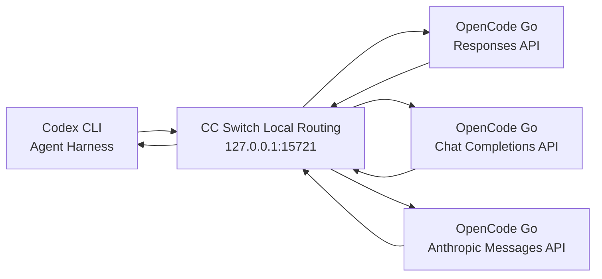
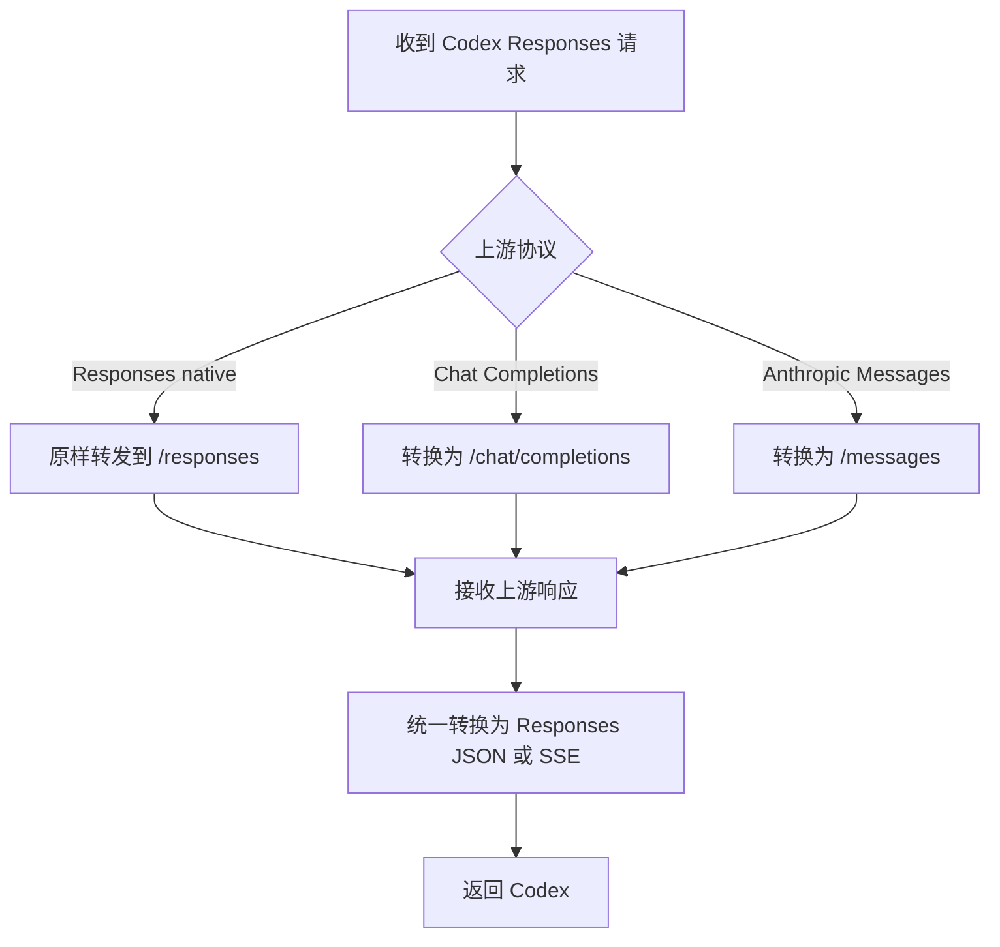
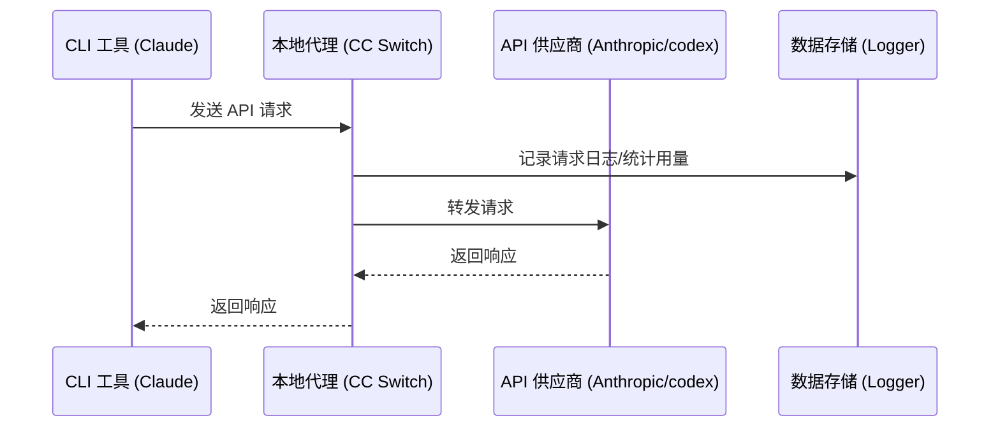
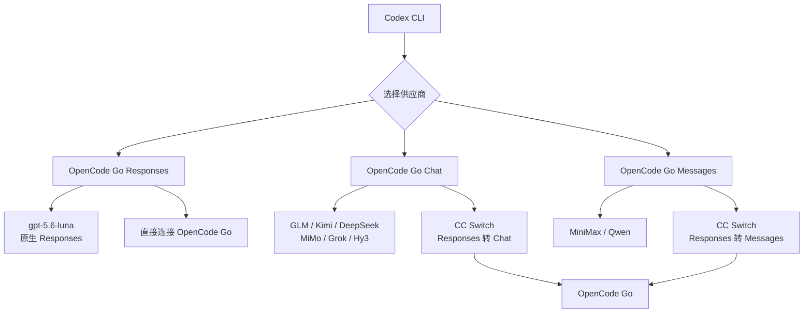

## 结论

**OpenCode Go 是模型供应商套餐，不是独立的 coding harness。** 它可以供 OpenCode 使用，也可以供其他 harness 使用，但前提是目标 harness 支持对应模型的 API 协议。

目前最关键的限制是：

| OpenCode Go 模型类型                    | API 协议                 | 接入 Codex                           |
| --------------------------------------- | ------------------------ | ------------------------------------ |
| `gpt-5.6-luna`                          | OpenAI Responses API     | **可以尝试直接接入**                 |
| GLM、Kimi、DeepSeek、MiMo、Grok、Hy3 等 | `/v1/chat/completions`   | 不能直接接最新版 Codex，需要协议转换 |
| MiniMax、Qwen Plus/Max 等               | Anthropic `/v1/messages` | 不能直接接最新版 Codex，需要协议转换 |

OpenCode Go 官方确实开放了这些 API 端点；而当前 Codex 自定义供应商只支持 Responses API。因此，目前只有 Go 中走 `/v1/responses` 的模型能与 Codex 的协议直接匹配。([OpenCode](https://opencode.ai/docs/zh-cn/go/))

------

## 一、OpenCode Go 接入 Codex

### 可直接尝试的配置：`gpt-5.6-luna`

先把 Go API Key 放到环境变量中：

```bash
# macOS / Linux
export OPENCODE_API_KEY="你的 OpenCode Go API Key"
```

PowerShell：

```powershell
$env:OPENCODE_API_KEY="你的 OpenCode Go API Key"
```

然后编辑 Codex 用户配置：

```text
~/.codex/config.toml
```

写入：

```toml
model = "gpt-5.6-luna"
model_provider = "opencode_go"

[model_providers.opencode_go]
name = "OpenCode Go"
base_url = "https://opencode.ai/zen/go/v1"
env_key = "OPENCODE_API_KEY"
wire_api = "responses"
```

之后启动：

```bash
codex
```

这是根据 OpenCode Go 的 Responses 端点和 Codex 自定义 provider 配置规则组合出的兼容配置。Codex 会在 `base_url` 后请求 `/responses`，认证密钥由 `env_key` 指定的环境变量提供。不要设置 `requires_openai_auth = true`，否则 Codex 会改用 OpenAI/ChatGPT 登录凭据并忽略 `env_key`。([OpenAI Developers](https://developers.openai.com/codex/config-advanced))

### 为什么 Kimi、GLM、DeepSeek 不能这样接

例如：

```text
https://opencode.ai/zen/go/v1/chat/completions
```

是 OpenAI Chat Completions 协议；但当前 Codex 的 `wire_api` 只支持：

```toml
wire_api = "responses"
```

所以把 Codex 的 `base_url` 指向 OpenCode Go，并将模型改成：

```toml
model = "kimi-k3"
```

通常会失败，因为 Codex 请求的是：

```text
/v1/responses
```

而该模型只暴露：

```text
/v1/chat/completions
```

这类模型要在 Codex 中使用，需要中间增加一个协议转换层：

```text
Codex Responses API
        ↓
LiteLLM / 自建转换代理
        ↓
Chat Completions 或 Anthropic Messages
        ↓
OpenCode Go
```

转换层除了请求字段，还要正确转换流式响应、工具调用、reasoning 内容和 usage 数据；仅做 URL 转发通常不够。

------

## 二、接入其他 harness

### Pi 是目前较省事的选择

Pi 当前已经内置 `opencode-go` provider，并支持通过 `OPENCODE_API_KEY` 使用。([GitHub](https://github.com/badlogic/pi-mono/blob/main/packages/coding-agent/README.md?utm_source=chatgpt.com))

```bash
export OPENCODE_API_KEY="你的 OpenCode Go API Key"
pi
```

进入 Pi 后执行：

```text
/model
```

选择：

```text
opencode-go
```

再选择 Kimi、DeepSeek、GLM、Qwen 或 MiniMax 模型。

Pi 对 OpenCode Go 的价值在于，它能根据模型分别走 Chat Completions、Responses 或 Anthropic Messages，不需要你手工为每类模型做代理。其模型目录也明确标记了 provider、API 类型和 Go 的 base URL。([Pi](https://pi.dev/packages/pi-opencode-provider?page=35&utm_source=chatgpt.com))

### 其他 harness 的判断方法

看该 harness 是否支持下面至少一种配置：

```text
自定义 base URL
自定义 API Key
自定义 model ID
OpenAI Chat Completions
OpenAI Responses
Anthropic Messages
```

对于 OpenAI-compatible Chat Completions harness，可以配置：

```text
Base URL: https://opencode.ai/zen/go/v1
API Key: OpenCode Go API Key
Model: kimi-k3 / glm-5.2 / deepseek-v4-flash 等
```

但具体 harness 可能自动追加 `/chat/completions`，也可能要求填写完整端点，需要看其 URL 拼接规则。

------

## 三、OpenCode 自身如何接入 Go

最简单的方法不需要手写 provider：

```bash
opencode
```

在 TUI 中输入：

```text
/connect
```

选择：

```text
OpenCode Go
```

粘贴 API Key，然后执行：

```text
/models
```

即可看到当前 Go 模型。OpenCode 配置中的模型 ID 形式为：

```text
opencode-go/<model-id>
```

例如：

```text
opencode-go/kimi-k3
opencode-go/deepseek-v4-flash
opencode-go/glm-5.2
```

这是 OpenCode Go 官方推荐的接入流程。([OpenCode](https://opencode.ai/docs/zh-cn/go/))

可以将默认模型持久化到：

```jsonc
{
  "$schema": "https://opencode.ai/config.json",

  "model": "opencode-go/kimi-k3",
  "small_model": "opencode-go/deepseek-v4-flash"
}
```

------

## 四、OpenCode 配置如何查看

### 查看最终合并后的有效配置

```bash
opencode debug config
```

这是最有用的命令，因为 OpenCode 会同时加载全局、项目、环境变量和组织配置；直接查看某一个文件不一定代表最终生效结果。([OpenCode](https://opencode.ai/docs/config/?utm_source=chatgpt.com))

### 查看已经保存的供应商凭据

```bash
opencode auth list
```

也可以在 TUI 中通过：

```text
/connect
```

添加或更新凭据。官方故障排除文档也建议使用 `opencode auth list` 检查 provider 凭据。([OpenCode](https://opencode.ai/docs/zh-cn/providers/?utm_source=chatgpt.com))

### 查看模型

```text
/models
```

### 查看日志

macOS/Linux：

```text
~/.local/share/opencode/log/
```

更详细地启动：

```bash
opencode --log-level DEBUG
```

认证信息通常保存在：

```text
~/.local/share/opencode/auth.json
```

这个文件包含 API Key 或 OAuth token，不应提交到 Git，也不建议直接复制分享。([OpenCode](https://opencode.ai/docs/troubleshooting/?utm_source=chatgpt.com))

------

## 五、OpenCode 配置文件位置与优先级

### 用户全局配置

```text
~/.config/opencode/opencode.json
```

也支持带注释的：

```text
~/.config/opencode/opencode.jsonc
```

TUI 界面相关设置单独放在：

```text
~/.config/opencode/tui.json
```

### 项目配置

项目根目录：

```text
项目目录/opencode.json
```

或：

```text
项目目录/opencode.jsonc
```

OpenCode 会从当前目录向上查找，直到最近的 Git 项目根目录。项目配置会覆盖全局配置中的同名字段，但不同字段会合并，而不是整个文件替换。([OpenCode](https://opencode.ai/docs/config/))

常见优先级从低到高大致是：

```text
组织远程配置
→ 全局配置
→ OPENCODE_CONFIG 指定的配置
→ 项目 opencode.json
→ .opencode 目录
→ OPENCODE_CONFIG_CONTENT
→ 管理员托管配置
```

因此修改后建议运行：

```bash
opencode debug config
```

确认最终结果。

------

## 六、OpenCode 可以接入其他供应商吗

可以。OpenCode 当前通过 AI SDK 和 Models.dev 支持 75 个以上的供应商，同时支持本地模型。热门供应商通常可以直接通过 `/connect` 添加，包括 OpenAI、Anthropic、Gemini、OpenRouter、Amazon Bedrock、Azure、Ollama、LM Studio 等。([OpenCode](https://opencode.ai/docs/zh-cn/models/))

### 自定义 OpenAI-compatible 供应商

例如接入一个自建网关：

```jsonc
{
  "$schema": "https://opencode.ai/config.json",

  "model": "my-gateway/qwen3-coder",

  "provider": {
    "my-gateway": {
      "npm": "@ai-sdk/openai-compatible",
      "name": "My Gateway",

      "options": {
        "baseURL": "https://gateway.example.com/v1",
        "apiKey": "{env:MY_GATEWAY_API_KEY}"
      },

      "models": {
        "qwen3-coder": {
          "name": "Qwen 3 Coder",
          "limit": {
            "context": 131072,
            "output": 32768
          }
        }
      }
    }
  }
}
```

设置密钥：

```bash
export MY_GATEWAY_API_KEY="sk-..."
```

然后：

```text
/models
```

选择：

```text
my-gateway/qwen3-coder
```

对于不同协议，应选择对应的 AI SDK 包：

```text
/v1/chat/completions  → @ai-sdk/openai-compatible
/v1/responses         → @ai-sdk/openai
/v1/messages          → @ai-sdk/anthropic
```

OpenCode 官方自定义 provider 文档明确支持配置 `baseURL`、API Key、自定义请求头和模型 ID。([OpenCode](https://opencode.ai/docs/zh-cn/providers/?utm_source=chatgpt.com))

------

## 七、OpenCode 中使用 Codex/ChatGPT 套餐

这和 OpenCode Go 是两套独立的额度。

在 OpenCode 中执行：

```text
/connect
```

选择：

```text
OpenAI
```

然后选择：

```text
ChatGPT Plus/Pro
```

浏览器完成授权后，再通过：

```text
/models
```

选择 OpenAI/Codex 模型。OpenCode 当前官方 provider 文档已经提供了这一登录方式；生态页面也列出了 Codex 认证插件。([OpenCode](https://opencode.ai/docs/zh-cn/providers/?utm_source=chatgpt.com))

所以更实用的组合通常是：

```text
OpenCode Go
  └─ Kimi / DeepSeek / GLM / Qwen / MiniMax 等低成本模型

ChatGPT Plus/Pro 或 Codex
  └─ OpenAI 前沿/Codex 模型

OpenCode 或 Pi
  └─ 作为统一 harness，在模型之间切换
```


## 使用ccs做不同协议间的兼容处理

CC Switch 已经具备真正的双向协议转换能力，不再只是“修改配置文件的一键切换器”。

以 OpenCode Go套餐提供的几类模型为例：

- 原生使用 **OpenAI Responses API** 的模型，可以让 Codex 直接连接，不需要转换。
- 使用 **OpenAI Chat Completions API** 的模型，可以由 CC Switch 转换成 Codex 所需的 Responses API。
- 使用 **Anthropic Messages API** 的模型，也可以由新版 CC Switch 转换成 Responses API。

关键前提是：必须开启 CC Switch 的 **本地路由（Local Routing）**。仅在 CC Switch 中保存一个供应商配置，但不启动本地路由，不能实现协议转换。CC Switch 的 Chat Completions 转换从 v3.16.0 开始提供，Anthropic Messages 上游支持在 v3.17.0 加入；当前最新正式版为 v3.19.1。([GitHub](https://github.com/farion1231/cc-switch/blob/main/docs/release-notes/v3.16.0-en.md))

更准确地说，你实现的是：

> 使用 Codex 作为**智能体执行框架**（Agent Harness），使用 OpenCode Go 提供**模型推理服务**，再由 CC Switch 负责 **API 协议适配**。

这并不是把 Kimi、GLM 或 MiniMax “变成 Codex 模型”，而是让这些模型可以运行在 Codex 的工具调用、文件编辑、命令执行和会话编排框架中。

------

## 内容导航

- 最终能否实现，以及哪些模型需要转换
- Codex、OpenCode Go 和 CC Switch 分别负责什么
- 三种 API 协议有什么区别
- CC Switch 如何完成双向转换
- 推荐的三供应商配置结构
- 从零开始的配置步骤
- 原生 Responses 模型如何直接连接
- Chat Completions 模型如何转换
- Anthropic Messages 模型如何转换
- 如何验证工具调用和流式输出
- 常见故障与排查方法
- 协议转换的能力边界
- 安全、稳定性与最佳实践

------

## 先建立正确的心智模型

### Harness 是什么

**Harness** 可以理解为“**智能体执行框架**”或“智能体运行外壳”。

Codex CLI 不只是一个聊天窗口，它还负责：

- 扫描项目文件
- 读取和修改代码
- 执行 Shell 命令
- 调用工具
- 管理上下文
- 处理工具调用循环
- 执行补丁
- 请求用户批准危险操作
- 保存和恢复会话

因此：

- **Codex CLI** 是 Harness。
- **OpenCode** 也是 Harness。
- **Claude Code** 也是 Harness。

### Provider 是什么

**Provider（模型供应商）** 是真正接收模型请求并返回推理结果的服务。

本文讨论的 Provider 是 OpenCode Go,其他供应商也类似，它提供：

- API Key
- 模型列表
- 模型调用端点
- 用量限制
- 推理结果

### Protocol 是什么

**Protocol（协议）** 是客户端和模型服务之间约定的请求与响应格式。

即使两个服务都使用 JSON，它们也可能不是同一种协议。例如：

- 请求字段不同
- 消息结构不同
- 工具调用结构不同
- 流式事件不同
- 推理内容字段不同
- 错误响应格式不同

因此，“支持 OpenAI API”并不一定意味着“可以被 Codex 直接使用”。

### Gateway 或 Proxy 是什么

**Gateway（网关）** 或 **Proxy（代理）** 位于 Codex 和模型供应商之间：

1. ccs接收 **Codex 的请求**。
2. css将请求转换成供应商理解的格式。
3. ccs将请求发送给供应商。
4. ccs接收供应商响应。
5. ccs再转换回 **Codex 理解**的格式。

CC Switch 的 **Local Routing** 就承担这个角色。

------

## 整体架构



1. **Codex CLI** 始终按照 Responses API 发送请求。
2. 请求进入 CC Switch 的 `127.0.0.1:15721/v1`。
3. CC Switch 根据当前供应商配置选择模型，并判断上游协议。
4. 原生 Responses 模型直接转发。
5. Chat Completions 和 Anthropic Messages 模型经过协议转换。
6. CC Switch 注入真实的 OpenCode Go API Key。
7. OpenCode Go 返回文本、推理内容、工具调用或流式事件。
8. CC Switch 将响应重新包装成 Codex 能识别的 Responses API 格式。
9. 如果模型要求调用工具，Codex 在本地执行文件、Shell 或 MCP 工具。
10. 工具结果再次经过 CC Switch 发往模型，形成完整的 **Agent Loop（智能体循环）**

从 Codex 的角度看，它始终在访问：

```text
POST /v1/responses
```

但 CC Switch 会根据当前供应商的 `Upstream Format` 决定实际如何处理：



CC Switch 官方文档说明，开启 Codex 路由后，Codex 的 Base URL 会指向 `http://127.0.0.1:15721/v1`，并继续保持 `wire_api = "responses"`。代理会根据供应商配置，将请求改写为 Chat Completions 或 Anthropic Messages，并将普通 JSON 或 SSE 流重新构造成 Responses API 格式。([GitHub](https://github.com/farion1231/cc-switch/blob/main/docs/guides/codex-deepseek-routing-guide-en.md))

------

## OpenCode Go 当前使用的三类协议

OpenCode Go 并没有为全部模型提供统一协议。**不同模型通过不同端点开放**。官方文档同时明确允许使用 Go API Key 访问这些外部 API 端点。([OpenCode](https://opencode.ai/docs/go/))

| 协议类型                    | OpenCode Go 端点       | Codex 是否能直接使用 | CC Switch 设置                          |
| --------------------------- | ---------------------- | -------------------- | --------------------------------------- |
| OpenAI Responses API        | `/v1/responses`        | 可以                 | `Responses (native)`                    |
| OpenAI Chat Completions API | `/v1/chat/completions` | 不能直接使用         | `Chat Completions (routing required)`   |
| Anthropic Messages API      | `/v1/messages`         | 不能直接使用         | `Anthropic Messages (routing required)` |

例如:

| 模型         | 模型 ID      | 端点                                             | AI SDK 包                   |
| :----------- | :----------- | :----------------------------------------------- | :-------------------------- |
| GPT 5.6 Luna | gpt-5.6-luna | `https://opencode.ai/zen/go/v1/responses`        | `@ai-sdk/openai`            |
| Grok 4.5     | grok-4.5     | `https://opencode.ai/zen/go/v1/chat/completions` | `@ai-sdk/openai-compatible` |
| GLM-5.2      | glm-5.2      | `https://opencode.ai/zen/go/v1/chat/completions` | `@ai-sdk/openai-compatible` |

### Responses API 模型

| 模型         | API 模型 ID    | 推荐方式                              |
| ------------ | -------------- | ------------------------------------- |
| GPT 5.6 Luna | `gpt-5.6-luna` | Codex 直连，或通过 CC Switch 原样转发 |

### Chat Completions 模型

| 模型              | API 模型 ID         |
| ----------------- | ------------------- |
| Grok 4.5          | `grok-4.5`          |
| GLM-5.2           | `glm-5.2`           |
| GLM-5.1           | `glm-5.1`           |
| Kimi K3           | `kimi-k3`           |
| Kimi K2.7 Code    | `kimi-k2.7-code`    |
| Kimi K2.6         | `kimi-k2.6`         |
| DeepSeek V4 Pro   | `deepseek-v4-pro`   |
| DeepSeek V4 Flash | `deepseek-v4-flash` |
| MiMo-V2.5         | `mimo-v2.5`         |
| MiMo-V2.5-Pro     | `mimo-v2.5-pro`     |
| Hy3               | `hy3`               |

### Anthropic Messages 模型

| 模型         | API 模型 ID    |
| ------------ | -------------- |
| MiniMax M3   | `minimax-m3`   |
| MiniMax M2.7 | `minimax-m2.7` |
| MiniMax M2.5 | `minimax-m2.5` |
| Qwen3.7 Max  | `qwen3.7-max`  |
| Qwen3.7 Plus | `qwen3.7-plus` |
| Qwen3.6 Plus | `qwen3.6-plus` |

模型及端点列表可能随着 OpenCode Go 调整而变化，使用前可以查询：

```text
https://opencode.ai/zen/go/v1/models
```

当前模型与协议分组来自 OpenCode Go 官方端点表。([OpenCode](https://opencode.ai/docs/go/))

```shell
curl https://opencode.ai/zen/go/v1/models | jq
```


------

## 为什么不能把所有模型放在一个供应商配置中

这是最容易踩坑的地方。

一个 CC Switch Codex 供应商卡片通常只有一个确定的 **Upstream Format（上游格式）**：

- Responses
- Chat Completions
- Anthropic Messages

但 OpenCode Go 的模型跨越了三种协议。

所以最佳实践不是创建一个“OpenCode Go 全模型”配置，而是拆成三个逻辑供应商：

| CC Switch 供应商名称  | 上游格式           | 包含模型                             | 是否开启路由 |
| --------------------- | ------------------ | ------------------------------------ | ------------ |
| OpenCode Go Responses | Responses native   | `gpt-5.6-luna`                       | 不需要       |
| OpenCode Go Chat      | Chat Completions   | GLM、Kimi、DeepSeek、MiMo、Grok、Hy3 | 需要         |
| OpenCode Go Messages  | Anthropic Messages | MiniMax、Qwen                        | 需要         |

这样做的好处是：

- 不会把 `/messages` 模型错误发送到 `/chat/completions`。
- 不会让原生 Responses 模型经过不必要的转换。
- 更容易排查 401、404 和工具调用问题。
- 模型目录和上下文设置更清晰。
- 切换供应商时能直观看出所使用的协议。

CC Switch 当前已经提供 OpenCode Go 的 Codex 预设，但该预设主要面向 OpenAI Chat 格式的 GLM、Kimi、DeepSeek 和 MiMo 等模型。Messages 模型和原生 Responses 模型更适合单独创建配置。([GitHub](https://github.com/farion1231/cc-switch/releases?utm_source=chatgpt.com))

------

## 准备工作

推荐使用：

| 组件        | 建议                               |
| ----------- | ---------------------------------- |
| CC Switch   | v3.19.1 或更新版本                 |
| Codex CLI   | 使用当前稳定版                     |
| OpenCode Go | 已订阅并获得 API Key               |
| 网络        | 能正常访问 OpenCode Go API         |
| 测试方式    | 先使用 Codex CLI，再测试桌面客户端 |

Chat Completions 转换至少需要 CC Switch v3.16.0，Anthropic Messages 转换至少需要 v3.17.0。由于后续版本持续修复流式输出、工具调用、附件、推理字段和错误处理，实际使用应直接安装当前稳定版，而不是停留在最低兼容版本。([GitHub](https://github.com/farion1231/cc-switch/blob/main/docs/release-notes/v3.16.0-en.md))

### 备份 Codex 配置

> 推荐执行但可能不是必须的,ccs在启用本地路由,并且路由启用`codex`后会自行备份,然后修改`~/.codex/config.toml`,从而当关闭路由服务后,能够还原旧配置文件.

macOS 或 Linux：

```bash
mkdir -p ~/.codex
cp ~/.codex/config.toml ~/.codex/config.toml.bak 2>/dev/null || true
```

PowerShell：

```powershell
New-Item -ItemType Directory -Force "$HOME\.codex" | Out-Null

if (Test-Path "$HOME\.codex\config.toml") {
    Copy-Item "$HOME\.codex\config.toml" "$HOME\.codex\config.toml.bak"
}
```

### 确认 API Key

macOS 或 Linux：

```bash
export OPENCODE_API_KEY="你的 OpenCode Go API Key"

curl -sS "https://opencode.ai/zen/go/v1/models" \
  -H "Authorization: Bearer $OPENCODE_API_KEY"
```

PowerShell：

```powershell
$env:OPENCODE_API_KEY = "你的 OpenCode Go API Key"

Invoke-RestMethod `
  -Uri "https://opencode.ai/zen/go/v1/models" `
  -Headers @{
    Authorization = "Bearer $env:OPENCODE_API_KEY"
  }
```

正常情况下应返回模型列表。若返回 `401`，应先处理 API Key，而不是继续调试 CC Switch。

------

## 配置本地路由代理服务(请求重写协议兼容服务)

[为什么需要本地路由cc-switch](https://github.com/farion1231/cc-switch/blob/main/docs/guides/codex-deepseek-routing-guide-en.md#why-local-routing-is-needed)

[本地路由与高可用 - CC Switch 文档](https://ccswitch.io/zh/docs?section=proxy)





> 新版 Codex CLI 针对的是 OpenAI Responses API，而许多服务提供商则公开了 OpenAI Chat Completions 接口，通常位于 `/chat/completions` 。这两种协议使用不同的请求体、流式事件和响应结构。如果直接将聊天端点添加到 Codex 配置中，常见的问题包括模型列表错误、404/400 错误请求，或者 Codex 无法正确解析流式响应。
>
> CC Switch 通过让 Codex **始终与本地路由(服务)通信**并持续发送 Responses API 请求来解决这个问题。
>
> 该路由会检测当前提供的**提供商**是否为 Chat 格式，如果是，则将codex的Responses 格式请求重写为 Chat Completions 以发送给上游提供商，最后将 Chat 响应转换回 Codex 可以理解的 Responses 格式。

该链条包含四个主要步骤：

> 1. 启用 Codex 路由时，本地配置写为 `http://127.0.0.1:15721/v1` ，而 `wire_api = "responses"` 则保持不变。
> 2. 提供商的 `meta.apiFormat = "openai_chat"` 告诉路由真正的上游是 Chat Completions。
> 3. 该路由将 `/responses` 或 `/v1/responses` 重写为 `/chat/completions` ，并将 Responses 请求正文转换为 Chat 请求正文。
> 4. 上游响应后，路由会将`Chat` JSON 或 SSE 流转换回`responses` JSON/SSE。
>
> 对于原生支持响应的提供商（例如当前的 DeepSeek 预设），步骤 2 到 4 永远不会发生：请求直接发送到上游，完全没有格式重写。

在 CC Switch 中进入：

```text
设置
  → Routing
  → Local Routing
```

完成以下操作：

- 开启 `Routing Master Switch`。
- 在 `Routing Enabled` 中开启 `Codex`。
- 默认监听地址保持 `127.0.0.1:15721`。
- 不要将监听地址改成 `0.0.0.0`，除非你明确需要并已经配置防火墙与鉴权。

启用后，CC Switch 会把 Codex 的实时配置指向本地路由。真实 OpenCode Go API Key 保留在 CC Switch 的供应商配置中，由**代理转发请求时注入**；Codex 配置中使用的是受管理的**占位认证**。([GitHub](https://github.com/farion1231/cc-switch/blob/main/docs/guides/codex-deepseek-routing-guide-en.md))

```toml
experimental_bearer_token = "PROXY_MANAGED"
```

Codex 的配置在概念上会变成类似：

```toml
model = "deepseek-v4-flash"
model_provider = "custom"

[model_providers.custom]
name = "CC Switch Local Routing"
base_url = "http://127.0.0.1:15721/v1"
wire_api = "responses"
experimental_bearer_token = "PROXY_MANAGED"
```

这段仅用于理解工作原理。**启用 CC Switch 后，最好让 CC Switch 管理该配置，不要同时手工修改相同字段。**

------

## 配置 OpenCode Go Chat 模型

这是最适合新手先完成的一条路径。

### 使用内置预设

进入：

```text
CC Switch
  → Codex
  → 添加供应商
  → OpenCode Go
```

填写：

| 字段            | 内容                     |
| --------------- | ------------------------ |
| API Key         | OpenCode Go API Key      |
| Base URL        | 使用预设值               |
| Upstream Format | `Chat Completions`       |
| 默认模型        | 例如 `deepseek-v4-flash` |
| Local Routing   | 开启                     |

内置预设一般已经包含：

- Base URL
- 模型目录
- 上游协议类型
- 模型名称
- 推理能力判断
- 必要的格式转换设置

因此应优先使用预设，而不是从空白自定义供应商开始。

### 手工创建时的关键字段

| 字段            | 推荐值                                |
| --------------- | ------------------------------------- |
| 名称            | `OpenCode Go Chat`                    |
| Base URL        | `https://opencode.ai/zen/go/v1`       |
| API Key         | OpenCode Go API Key                   |
| Upstream Format | `Chat Completions (routing required)` |
| 模型 ID         | 使用原始 API ID                       |
| Local Routing   | 开启                                  |

不要把 Base URL 填成完整端点：

```text
https://opencode.ai/zen/go/v1/chat/completions
```

应填写基础地址：

```text
https://opencode.ai/zen/go/v1
```

CC Switch 会根据协议自动添加正确路径。CC Switch 官方排障说明同样建议自定义供应商填写服务基础地址，而不是包含 `/chat/completions` 的完整调用路径。([GitHub](https://github.com/farion1231/cc-switch/blob/main/docs/guides/codex-deepseek-routing-guide-en.md))

### 模型 ID 不要加 OpenCode 前缀

在 OpenCode 自身的 `opencode.json` 中，模型写法是：

```text
opencode-go/kimi-k3
```

但通过 API、Codex 或 CC Switch 调用时，应使用：

```text
kimi-k3
```

而不是：

```text
opencode-go/kimi-k3
```

`opencode-go/` 是 OpenCode Harness 内部用于区分 Provider 的前缀，不是 OpenCode Go REST API 的模型 ID。([OpenCode](https://opencode.ai/docs/go/))

------

## 配置 OpenCode Go Messages 模型

MiniMax 和 Qwen 模型需要另一张供应商卡片。

进入：

```text
CC Switch
  → Codex
  → 添加自定义供应商
```

推荐配置：

| 字段            | 推荐值                                                  |
| --------------- | ------------------------------------------------------- |
| 名称            | `OpenCode Go Messages`                                  |
| Base URL        | `https://opencode.ai/zen/go/v1`                         |
| Upstream Format | `Anthropic Messages (routing required)`                 |
| 认证方式        | `ANTHROPIC_AUTH_TOKEN` 或界面中对应的 Bearer Token 选项 |
| API Key         | OpenCode Go API Key                                     |
| 默认模型        | 例如 `minimax-m3`                                       |
| 最大输出 Token  | 根据模型能力显式设置                                    |
| Local Routing   | 开启                                                    |

这里选择 `ANTHROPIC_AUTH_TOKEN` 的原因不是说 OpenCode Go 使用 Anthropic 账号，而是 CC Switch 将该选项映射为：

```text
Authorization: Bearer <API Key>
```

不要选择发送 `x-api-key` 的模式，除非 OpenCode Go 后续明确改为该鉴权方式。CC Switch 的 Anthropic 上游配置支持 Bearer Token 与 `x-api-key` 两种认证头，当前 OpenCode Go API 使用 Bearer 认证。([GitHub](https://github.com/farion1231/cc-switch/releases))

可以在模型映射或模型目录中添加：

```text
minimax-m3
minimax-m2.7
minimax-m2.5
qwen3.7-max
qwen3.7-plus
qwen3.6-plus
```

### 为什么建议显式设置最大输出 Token

Codex 的 Responses 请求不一定会向 Anthropic 上游发送完全对应的 `model_max_output_tokens`。

CC Switch 对 Anthropic Messages 上游存在保守的默认输出上限。若模型需要较长思考或生成较大补丁，而上限设置过低，可能出现：

- 回复被截断
- 工具参数 JSON 不完整
- 补丁生成到一半停止
- 推理过程耗尽输出配额

CC Switch 官方发布说明建议在 Anthropic 上游供应商中设置模型最大输出 Token 覆盖，以避免默认保守值导致长回复截断。([GitHub](https://github.com/farion1231/cc-switch/releases))

------

## 原生 Responses 模型不需要转换

`gpt-5.6-luna` 已由 OpenCode Go 通过：

```text
https://opencode.ai/zen/go/v1/responses
```

提供原生 Responses API。

因此可以：

- 通过 CC Switch 创建 `Responses (native)` 供应商；
- 或者完全绕过 CC Switch，直接配置 Codex。

### Codex 直连配置

macOS、Linux 和 Windows 的用户配置文件都位于用户主目录下：

```text
~/.codex/config.toml
```

配置示例：

```toml
model = "gpt-5.6-luna"
model_provider = "opencode_go"

[model_providers.opencode_go]
name = "OpenCode Go"
base_url = "https://opencode.ai/zen/go/v1"
env_key = "OPENCODE_API_KEY"
wire_api = "responses"
```

然后设置环境变量。

macOS 或 Linux：

```bash
export OPENCODE_API_KEY="你的 OpenCode Go API Key"
codex
```

PowerShell：

```powershell
$env:OPENCODE_API_KEY = "你的 OpenCode Go API Key"
codex
```

Codex 官方允许自定义 Model Provider，并可以配置 `base_url`、`env_key`、HTTP 头和 `wire_api = "responses"`。OpenCode Go 的 `gpt-5.6-luna` 端点与该协议匹配，因此不需要 CC Switch 转换。([OpenAI Developers](https://developers.openai.com/codex/config-advanced))

### 是否仍然值得经过 CC Switch

即使不需要协议转换，通过 CC Switch 仍可能获得：

- 可视化切换
- 请求日志
- 用量统计
- 供应商故障转移
- 项目配置快照
- 统一模型目录

但如果目标只是让 `gpt-5.6-luna` 在 Codex 中工作，直连结构更简单，故障点更少。

------

## CC Switch 实际转换了什么🎈

协议转换远不只是改一个 URL。

### 请求结构转换

Responses API 可能使用：

```json
{
  "model": "example-model",
  "input": [
    {
      "role": "user",
      "content": []
    }
  ],
  "tools": []
}
```

Chat Completions 更接近：

```json
{
  "model": "example-model",
  "messages": [
    {
      "role": "user",
      "content": "..."
    }
  ],
  "tools": []
}
```

Anthropic Messages 则使用另一套内容块结构：

```json
{
  "model": "example-model",
  "max_tokens": 8192,
  "system": [],
  "messages": [],
  "tools": []
}
```

代理必须转换：

- `input` 与 `messages`
- system 指令
- 文本内容块
- 图片内容块
- 工具声明
- 工具调用
- 工具执行结果
- 推理内容
- 停止原因
- Token 用量

### 流式协议转换

**SSE（Server-Sent Events，服务器发送事件）** 是模型逐段输出内容的常见方式。

不同协议的事件名称和数据结构不同。代理必须把类似：

```text
Chat delta
```

转换为 Codex 能理解的：

```text
response.output_text.delta
response.output_item.added
response.function_call_arguments.delta
response.completed
```

如果只转换普通 JSON，而不转换 SSE，可能出现：

- Codex 一直等待
- 输出到一半停止
- 工具调用永远不执行
- 显示连接重试
- 把推理内容当作普通文本

CC Switch v3.16.0 的实现明确覆盖了 JSON 和 SSE 双向转换，并处理 Chat 模型的推理字段、工具调用、`previous_response_id` 后续请求和错误结构。后续版本又修复了流截断检测、空工具列表、附件转换和 Token 统计。([GitHub](https://github.com/farion1231/cc-switch/blob/main/docs/release-notes/v3.16.0-en.md))

### 工具调用转换

Codex 依赖工具调用完成：

- Shell 命令
- 文件读取
- 文件修改
- 搜索
- 补丁应用
- MCP 工具调用

不同模型协议对函数调用的表示不完全相同。代理需要维护：

- 工具名称
- 调用 ID
- JSON 参数
- 调用与结果的对应关系
- 并行工具调用
- 多轮会话中的工具历史

这也是为什么简单的 Nginx 反向代理不够。Nginx 可以转发 HTTP，但不会理解和改写模型协议的语义。

------

## 完整操作流程

以Minimax或Qwen模型为例(opencode go中和anthropic Messages端点兼容)

### 创建供应商

目前有3种形式:Chat,Messages,Responses;

根据你要使用的模型所属的类别来选择其中的一个;

#### 创建 Chat 供应商

在 CC Switch 的 OpenAI/Codex 页面：

- 添加 `OpenCode Go` 预设。
- 粘贴 API Key。
- 确认上游格式为 Chat Completions。
- 选择一个模型，例如 `deepseek-v4-flash`。
- 保存。

#### 创建 Messages 供应商

再添加一个自定义供应商：

- 名称设置为 `OpenCode Go Messages`。
- Base URL 设置为 `https://opencode.ai/zen/go/v1`。
- 上游格式选择 Anthropic Messages。
- 认证选择 Bearer Token 对应选项。
- 添加 MiniMax 和 Qwen 模型。
- 保存。

#### 创建 Responses 供应商

可选地再添加：

- 名称设置为 `OpenCode Go Responses`。
- Base URL 设置为 `https://opencode.ai/zen/go/v1`。
- 上游格式选择 Responses native。
- 模型设置为 `gpt-5.6-luna`。
- 不要求开启协议转换。

### 开启 Codex 路由

进入 Routing 页面：

- 开启总开关。
- 开启 Codex。
- 确认端口为 `15721`。

### 启用供应商

回到 Codex 供应商列表：

- 点击目标供应商的“启用”。
- 确认带有 `Needs Routing` 标记的供应商没有警告。
- 关闭当前正在运行的 Codex 会话。
- 重新启动 Codex。

运行中的 Codex 进程可能已经读取了旧的 `config.toml` 和旧模型目录，因此切换供应商后应重启 Codex。([GitHub](https://github.com/farion1231/cc-switch/blob/main/docs/guides/codex-deepseek-routing-guide-en.md))

------

## 如何验证转换是否真正工作

不要只验证“能返回一句话”。应分层验证。

### 验证本地代理

macOS 或 Linux：

```bash
curl -sS "http://127.0.0.1:15721/v1/models"
```

即使模型列表接口行为因版本而异，至少不应出现：

```text
Connection refused
```

若连接被拒绝，说明 Local Routing 没有启动。

### 验证基础对话

在 Codex 中发送：

```text
只回复当前模型名称和“连接成功”，不要调用工具。
```

确认：

- 返回速度正常
- 没有 401
- 没有 404
- 没有 SSE 解析错误
- 模型名称符合预期

### 验证文件读取

在一个测试项目中创建：

```text
ccs-test.txt
```

内容：

```text
protocol-bridge-ok
```

然后让 Codex：

```text
读取当前目录中的 ccs-test.txt，并告诉我其中的内容。不要修改文件。
```

这一步验证：

- Codex 能生成工具调用
- 代理能转换工具声明
- 模型能正确返回工具参数
- Codex 能执行工具
- 工具结果能返回模型
- 模型能完成第二轮回答

### 验证文件修改

让 Codex：

```text
创建 bridge-test.md，写入一行：
CC Switch protocol conversion works.
```

随后检查文件是否真实存在。

### 验证命令执行

让 Codex：

```text
执行当前系统中安全的命令，输出当前工作目录，然后解释结果。
```

这一测试能发现：

- 工具调用 ID 丢失
- 参数 JSON 格式错误
- 工具结果无法与调用匹配
- 多轮消息转换失败

### 验证连续会话

连续提出三个相关问题：

1. 让模型读取一个文件。
2. 让它根据文件内容提出修改方案。
3. 让它执行修改。

若第三轮突然忘记前文，可能是：

- 会话历史转换不完整
- `previous_response_id` 处理异常
- 上下文被错误压缩
- 切换供应商后旧会话仍在使用

------

## 推荐的测试矩阵

| 测试项目     | 目的               | 合格标准                 |
| ------------ | ------------------ | ------------------------ |
| 简单文本     | 验证认证与基础协议 | 正常返回文本             |
| 流式长回复   | 验证 SSE 转换      | 无停顿、重连或截断       |
| 文件读取     | 验证工具调用       | 能读取并引用正确内容     |
| 文件写入     | 验证工具结果闭环   | 文件内容正确             |
| Shell 命令   | 验证结构化参数     | 命令参数无 JSON 错误     |
| 多轮工具调用 | 验证会话状态       | 后续轮次能使用前文       |
| 长上下文     | 验证窗口设置       | 不提前压缩或返回 400     |
| 错误命令     | 验证错误转换       | 模型能看到真实错误       |
| 切换模型     | 验证配置更新       | 重启后使用新模型         |
| 达到配额     | 验证上游错误       | 能识别为限额而非协议故障 |

------

## 常见故障排查

| 现象                      | 常见原因                                   | 处理方法                                               |
| ------------------------- | ------------------------------------------ | ------------------------------------------------------ |
| Codex 报 `/responses` 404 | Chat 或 Messages 上游被直接写进 Codex      | 开启 Local Routing，让 Codex 指向 `127.0.0.1:15721/v1` |
| 本地地址连接被拒绝        | CC Switch 未运行或路由总开关关闭           | 启动 CC Switch 并开启 Routing Master Switch            |
| `401 Missing API key`     | API Key 错误，或认证头类型不对             | 验证 `/models`；Messages 配置使用 Bearer Token         |
| 上游返回 404              | Base URL 填了完整 `/chat/completions` 路径 | 改成 `https://opencode.ai/zen/go/v1`                   |
| Model not found           | 使用了 `opencode-go/模型名`                | 改成原始 API ID，例如 `kimi-k3`                        |
| `/model` 看不到新模型     | Codex 未重新加载模型目录                   | 关闭并重新启动 Codex                                   |
| 回复正常但不会调用工具    | 模型工具能力不足，或转换映射有问题         | 先测试单个简单工具，检查路由日志                       |
| 工具调用参数不是合法 JSON | 模型函数调用兼容性较差                     | 降低并行工具调用，换更适合 Agent 的模型                |
| 回复到一半停止            | 最大输出 Token 太低或 SSE 被截断           | 提高模型输出上限并检查代理日志                         |
| 图片请求报 400            | 模型不支持图片或桥接能力不完整             | 在纯文本会话中重试，使用支持视觉的模型                 |
| 切换模型后仍使用旧模型    | Codex 进程缓存了配置                       | 完全退出并重开 Codex                                   |
| 能聊天但无法应用补丁      | 模型目录或 Harness 指令不匹配              | 检查模型目录、工具声明及 Codex 版本                    |
| 请求突然被限制            | OpenCode Go 套餐达到时间窗口额度           | 查看 OpenCode Go 控制台用量                            |

CC Switch 官方文档将 `/responses` 404、上游 404、模型列表不刷新和路由到错误供应商列为典型问题，并建议确认供应商、路由服务和 Codex 路由开关三者状态一致。([GitHub](https://github.com/farion1231/cc-switch/blob/main/docs/guides/codex-deepseek-routing-guide-en.md))

------

## 协议转换的能力边界

### 转换成功不代表功能完全等价

协议转换能解决的是：

- 请求格式
- 响应格式
- 流式事件
- 工具调用结构
- 推理字段
- 错误格式

它不能改变模型本身的能力。

例如：

- 不擅长工具调用的模型不会因为接入 Codex 就突然擅长工具调用。
- 不支持视觉的模型仍然不能理解图片。
- 上下文较小的模型仍然受其上下文限制。
- 代码能力较弱的模型不会因为使用 Codex Prompt 就达到前沿 Codex 模型水平。

### Hosted Tools 不一定能映射

Responses API 中可能存在供应商托管的工具，例如：

- Web Search
- File Search
- Code Interpreter
- 特定的原生工具类型

OpenCode Go 的 Chat 或 Messages 模型通常只接受普通函数工具。CC Switch 可以转换 Codex 的常规工具调用，但不能保证所有 OpenAI 专有托管工具都能在其他模型上复现。

### Stateful Responses 与无状态 Chat 不完全相同

Responses API 可以具有更强的服务端状态语义，例如：

```text
previous_response_id
```

Chat Completions 通常依赖客户端重新发送会话历史。

CC Switch 会尽力转换后续请求和历史，但它不能让一个无状态 Chat 服务真正获得和 OpenAI Responses 后端完全相同的服务端状态机制。CC Switch 当前实现会处理 `previous_response_id` 后续调用，但从系统设计上仍应把它视为兼容层，而不是完全相同的后端。([GitHub](https://github.com/farion1231/cc-switch/blob/main/docs/release-notes/v3.16.0-en.md))

### 模型目录影响 Harness 行为

Codex 不只需要模型 ID，还可能依赖模型目录中的：

- 上下文窗口
- 最大输出长度
- 是否支持推理
- 推理级别
- 是否支持并行工具调用
- 基础指令
- 可用工具形式

模型目录设置错误，可能导致：

- 过早压缩上下文
- 请求超过模型窗口
- 发送模型不支持的推理参数
- 工具调用行为异常
- `/model` 菜单信息错误

因此不应随意复制其他模型的目录配置。

------

## Codex CLI 与 Codex 桌面端的差异

当前 CC Switch 官方指南提示：

- Codex CLI 中使用 `/model` 切换和验证自定义模型通常更直接。
- 生成新的模型目录后，运行中的 Codex 进程一般不会热加载。
- Codex 桌面端对第三方多模型选择的支持可能弱于 CLI。
- 部分情况下桌面端会使用配置中的第一个模型，而不显示完整自定义目录。

因此推荐顺序是：

```text
先使用 Codex CLI 验证
再测试编辑器扩展
最后测试 Codex 桌面端
```

这样可以将“协议转换问题”和“客户端模型选择界面问题”分开排查。([GitHub](https://github.com/farion1231/cc-switch/blob/main/docs/guides/codex-deepseek-routing-guide-en.md))

------

## OpenCode Go 套餐额度不会因转换而改变

CC Switch 只是代理，不会产生新的模型额度。

OpenCode Go 当前使用金额价值定义时间窗口限制，包括：

| 时间窗口 | 当前额度        |
| -------- | --------------- |
| 5 小时   | 12 美元等值用量 |
| 每周     | 30 美元等值用量 |
| 每月     | 60 美元等值用量 |

不同模型价格不同，所以实际可用请求数不同。通过 Codex、OpenCode、Pi 或 CC Switch 调用，只要使用的是 Go API Key 和 Go 端点，仍会消耗相应的 Go 使用额度。OpenCode Go 官方说明这些限制可能随着产品调整而变化。([OpenCode](https://opencode.ai/docs/go/))

协议转换还可能轻微影响实际 Token 使用量，因为：

- Harness 会发送较长的系统提示。
- Codex 会携带工具定义。
- 多轮工具调用会增加历史消息。
- Chat 协议可能需要重复发送历史。
- 不同协议的缓存命中机制不同。

所以不能按照普通聊天请求数估算 Codex Agent 的真实消耗。

------

## 安全最佳实践

### 只从官方渠道安装

CC Switch 官方明确提醒存在冒充网站和客户端。官方项目是免费开源软件，不应向所谓的“CC Switch 官方”支付订阅费、充值或提交账号登录凭据。应只使用官方 GitHub 仓库、GitHub Releases 或官方站点提供的软件。([GitHub](https://github.com/farion1231/cc-switch/blob/main/docs/release-notes/v3.16.0-en.md))

### 保持代理仅监听本机

推荐：

```text
127.0.0.1:15721
```

不推荐：

```text
0.0.0.0:15721
```

否则同一局域网中的其他设备可能访问你的代理。即使 Codex 配置中使用占位密钥，代理本身仍能代表你向上游发起请求。

### 不要把 CC Switch 数据目录提交到 Git

CC Switch 当前主要数据位置包括：

| 数据     | 路径                         |
| -------- | ---------------------------- |
| 数据库   | `~/.cc-switch/cc-switch.db`  |
| 本地设置 | `~/.cc-switch/settings.json` |
| 备份     | `~/.cc-switch/backups/`      |

供应商配置和敏感信息可能存在于这些本地数据中，不应上传到公开仓库或公开网盘。([GitHub](https://github.com/farion1231/cc-switch/blob/main/README_ZH.md))

### 不要同时让多个工具管理同一份配置

避免同时使用：

- CC Switch 自动写入
- 手工脚本定时修改
- dotfiles 工具自动覆盖
- 其他 Provider Switch 工具
- 编辑器插件自动重写

否则可能出现“刚切换就被另一个程序改回去”的情况。

### 区分官方账号与第三方 API Key

OpenCode Go 使用的是第三方 Provider API Key 场景，适合本地路由。

不要把 ChatGPT/Codex 官方账号登录流量随意交给未经信任的中转服务。CC Switch 自身也提示，官方 OpenAI Codex 账号不建议通过一般第三方路由处理，并会对某些官方供应商的代理接管进行限制。([GitHub](https://github.com/farion1231/cc-switch/blob/main/docs/guides/codex-deepseek-routing-guide-en.md))

------

## 稳定性最佳实践

### 优先原生协议

选择顺序建议是：

```text
原生 Responses
优先于
Messages 或 Chat 的协议转换
优先于
多层代理嵌套
```

每增加一层协议转换，就增加：

- 延迟
- 故障点
- 流式中断风险
- 工具调用映射风险
- 日志与隐私暴露面

因此 `gpt-5.6-luna` 应优先使用 Responses 直连，不要强制将它降级成 Chat 路径。

### 每张供应商卡片只使用一种协议

不要在同一张 Chat 供应商卡片中同时加入：

```text
deepseek-v4-flash
minimax-m3
gpt-5.6-luna
```

它们分别属于不同端点。

应拆成：

```text
OpenCode Go Chat
OpenCode Go Messages
OpenCode Go Responses
```

### 先验证单模型，再添加模型目录

新手建议：

1. 先只配置一个模型。
2. 验证文本输出。
3. 验证工具调用。
4. 验证文件修改。
5. 再添加同协议的其他模型。
6. 最后配置模型目录和故障转移。

这样出错时更容易确定是：

- API Key 问题
- 协议问题
- 模型问题
- 模型目录问题
- Codex 客户端问题

### 不要从旧会话测试新 Provider

切换模型供应商后，应新建 Codex 会话。

旧会话可能包含：

- 上一个模型生成的工具调用
- 不兼容的 reasoning 项
- 不同格式的工具 ID
- 图片内容
- 旧模型特定上下文
- 旧的 `previous_response_id`

这些内容可能使新供应商第一次请求就失败。

### 生产使用前完成最小回归测试

至少测试：

- 一次文件读取
- 一次文件写入
- 一次 Shell 调用
- 一次失败命令
- 一次多轮工具调用
- 一次长流式回复
- 一次供应商切换

------

## 适合新手的推荐落地方案

### 第一阶段：先验证原生 Responses

使用：

```text
gpt-5.6-luna
```

直接连接 OpenCode Go Responses API。

目标是确认：

- Go API Key 可用
- Codex 自定义 Provider 可用
- 网络环境正常
- Codex 配置路径正确

### 第二阶段：验证 Chat 转换

使用 CC Switch 的 OpenCode Go Codex 预设，选择一个 Chat 模型。

配置：

```text
Upstream Format:
Chat Completions

Local Routing:
开启

Codex Routing:
开启
```

目标是确认：

- `/responses` 到 `/chat/completions` 转换正常
- SSE 正常
- 文件工具正常
- Shell 工具正常

### 第三阶段：验证 Anthropic Messages 转换

单独创建 `OpenCode Go Messages` 供应商，先只加入一个 MiniMax 或 Qwen 模型。

目标是确认：

- Bearer Token 鉴权正确
- Responses 到 Messages 转换正常
- 最大输出 Token 合理
- 工具结果能够正确回传

### 第四阶段：完善模型目录和切换策略

所有单模型测试通过后，再加入：

- 多模型目录
- 模型别名
- 上下文窗口
- 最大输出 Token
- 推理能力
- 定价
- 故障转移
- 项目快照

------

## 最终推荐架构



建议最终保留三个清晰的 Provider：

```text
OpenCode Go Responses
OpenCode Go Chat
OpenCode Go Messages
```

其中：

- `Responses` 供应商可直连。
- `Chat` 供应商必须经过 Local Routing。
- `Messages` 供应商必须经过 Local Routing。
- Codex 始终使用 Responses API 与 CC Switch 通信。
- API 模型 ID 使用原始 ID，不使用 `opencode-go/` 前缀。
- 切换供应商后重启 Codex，并开启新会话。

所以，对你的核心问题可以给出明确答案：

> **CC Switch 可以将 OpenCode Go 套餐中的 Chat Completions 和 Anthropic Messages 模型转换成 Codex 可使用的 Responses API 形式；对于本身已经提供 Responses API 的模型，则无需转换。**
> 最稳妥的做法是按协议拆成三张供应商卡片，而不是试图用一个配置承载 OpenCode Go 的全部模型。